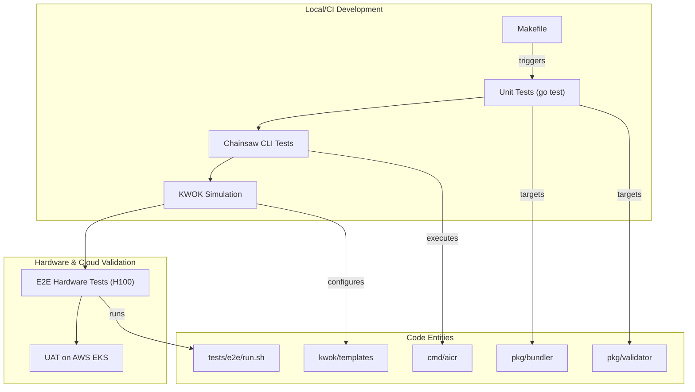
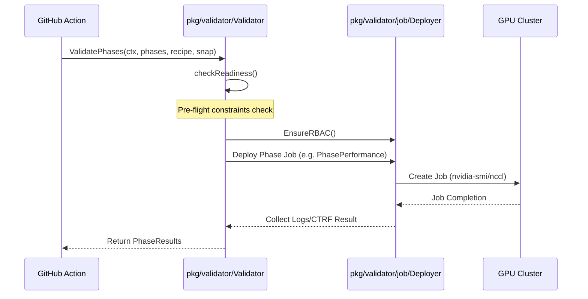

<!-- source: DeepWiki mcp.deepwiki.com · repo NVIDIA/aicr · page 8 Testing Infrastructure · fetched 2026-10-26 -->

# Testing Infrastructure

Relevant source files

The following files were used as context for generating this wiki page:

- [.yamllint.yaml](.yamllint.yaml)
- [Makefile](Makefile)
- [pkg/bundler/deployer/argocd/argocd_test.go](pkg/bundler/deployer/argocd/argocd_test.go)
- [pkg/bundler/deployer/argocd/templates/application.yaml.tmpl](pkg/bundler/deployer/argocd/templates/application.yaml.tmpl)
- [pkg/validator/phases.go](pkg/validator/phases.go)
- [pkg/validator/validator.go](pkg/validator/validator.go)
- [pkg/validator/validator_test.go](pkg/validator/validator_test.go)
- [site/.vitepress/config.ts](site/.vitepress/config.ts)
- [site/.vitepress/theme/Landing.vue](site/.vitepress/theme/Landing.vue)
- [site/.vitepress/theme/custom.css](site/.vitepress/theme/custom.css)
- [site/.vitepress/theme/index.ts](site/.vitepress/theme/index.ts)
- [tests/chainsaw/cli/bundle-variants/chainsaw-test.yaml](tests/chainsaw/cli/bundle-variants/chainsaw-test.yaml)
- [tests/e2e/run.sh](tests/e2e/run.sh)

The AICR project employs a multi-layered testing strategy designed to ensure reliability across diverse GPU hardware, cloud providers, and Kubernetes distributions. This infrastructure ranges from fast-executing unit tests to complex end-to-end (E2E) workflows involving real H100 GPU hardware and cloud-specific user acceptance testing (UAT).

### Testing Strategy Overview

The infrastructure is categorized into four primary tiers, each serving a specific role in the validation lifecycle:

| Tier | Tooling | Purpose | Environment |
| :--- | :--- | :--- | :--- |
| **Unit** | `go test` | Validate individual logic components (e.g., bundler templates, recipe resolution). | Local / CI |
| **Functional** | `Chainsaw` | Declarative CLI and API contract testing using `aicr` and `aicrd`. | Kind / Tilt |
| **Simulation** | `KWOK` | Large-scale cluster simulation to test recipe matching and scheduling. | Kind |
| **Hardware/E2E** | `run.sh` / `UAT` | Real GPU validation, performance benchmarks, and cloud conformance. | EKS / H100 |

**Sources:** [Makefile:166-184](), [tests/e2e/run.sh:1-32](), [pkg/validator/validator.go:148-165]()

---

## E2E and Chainsaw Tests

The E2E layer focuses on the integration of the `aicr` CLI with the `aicrd` API server. It utilizes the `tests/e2e/run.sh` script to orchestrate a full pipeline: injecting fake GPU data, taking snapshots, resolving recipes, and generating bundles. 

For declarative testing of CLI variants and API responses, AICR uses **Chainsaw**. These tests verify specific scenarios such as bundle scheduling logic and the Snapshot Agent deployment lifecycle without requiring a full hardware cluster.

For details, see [E2E and Chainsaw Tests](#8.1).

**Sources:** [tests/e2e/run.sh:46-55](), [tests/e2e/run.sh:193-236]()

---

## KWOK Simulation Testing

To test AICR at scale and across diverse infrastructure profiles without the cost of real GPUs, the project uses **KWOK (Kubernetes WithOut Kubelet)**. This allows the simulation of hundreds of nodes with specific labels and taints (e.g., H100 vs. A100, EKS vs. GKE).

The simulation layer validates:
- **Recipe Matching:** Ensuring the correct `RecipeCriteria` matches the simulated node profile.
- **Scheduling Injection:** Verifying that `nodeSelector` and `tolerations` are correctly injected into the generated Helm values.

For details, see [KWOK Simulation Testing](#8.2).

**Sources:** [Makefile:125-131](), [.yamllint.yaml:37-38]()

---

## GPU Hardware Tests

Real-world validation is performed on NVIDIA H100 hardware. These tests are categorized into distinct phases defined in the `Validator` framework:

1.  **Deployment:** Ensures components like the GPU Operator are healthy.
2.  **Performance:** Runs benchmarks like NCCL all-reduce to verify interconnect bandwidth.
3.  **Conformance:** Executes the CNCF AI Conformance suite (e.g., DRA support, gang scheduling).

For details, see [GPU Hardware Tests (H100 Smoke, Inference, Training, Conformance)](#8.3).

**Sources:** [pkg/validator/phases.go:20-36](), [pkg/validator/validator.go:148-215](), [pkg/validator/validator.go:44-67]()

---

## UAT on AWS EKS

User Acceptance Testing (UAT) is the final gate in the testing infrastructure. It automates the provisioning of ephemeral EKS clusters using Terraform and OIDC federation. The `uat-aws.yaml` workflow checks for EC2 capacity reservations, installs the AICR stack, and runs the full validation suite to ensure cloud-provider specific overlays (like AWS EBS CSI or EFA) function correctly in a production-like environment.

For details, see [UAT on AWS EKS](#8.4).

**Sources:** [pkg/bundler/deployer/argocd/argocd_test.go:46-64](), [pkg/bundler/deployer/argocd/templates/application.yaml.tmpl:1-36]()

---

## Development & CI Integration

The `Makefile` serves as the entry point for local testing and CI automation.

| Command | Entity | Description |
| :--- | :--- | :--- |
| `make test` | `go test` | Runs unit tests with race detection and coverage. |
| `make lint` | `golangci-lint` | Enforces code quality and YAML standards. |
| `make tools-setup` | `tools/setup-tools` | Installs dependencies like `chainsaw`, `kwok`, and `kind`. |
| `make test-coverage` | `go tool cover` | Enforces a minimum coverage threshold (default 70%). |

**Sources:** [Makefile:58-62](), [Makefile:105-108](), [Makefile:166-184]()

---

