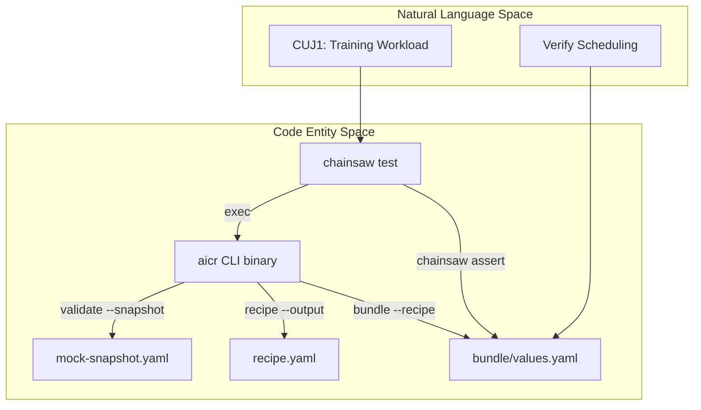
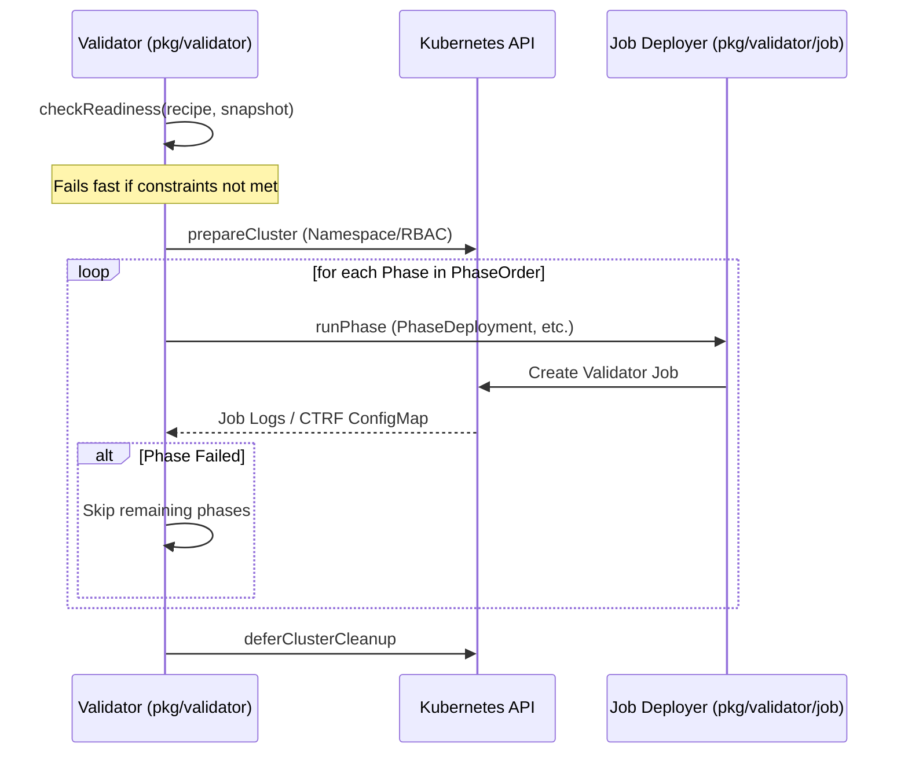

<!-- source: DeepWiki mcp.deepwiki.com · repo NVIDIA/aicr · page 8.1 E2E and Chainsaw Tests · fetched 2026-10-26 -->

# E2E and Chainsaw Tests

Relevant source files

The following files were used as context for generating this wiki page:

- [.github/actions/chainsaw/action.yml](.github/actions/chainsaw/action.yml)
- [.github/actions/cli-e2e/action.yml](.github/actions/cli-e2e/action.yml)
- [.github/actions/cloud-run-deploy/action.yml](.github/actions/cloud-run-deploy/action.yml)
- [.github/actions/e2e/action.yml](.github/actions/e2e/action.yml)
- [.github/actions/go-lint/action.yml](.github/actions/go-lint/action.yml)
- [.github/actions/go-test/action.yml](.github/actions/go-test/action.yml)
- [.github/actions/install-e2e-tools/action.yml](.github/actions/install-e2e-tools/action.yml)
- [.github/actions/integration/action.yml](.github/actions/integration/action.yml)
- [.github/actions/kwok-test/action.yml](.github/actions/kwok-test/action.yml)
- [.github/actions/prep-kind-runner/action.yml](.github/actions/prep-kind-runner/action.yml)
- [.github/actions/setup-build-tools/action.yml](.github/actions/setup-build-tools/action.yml)
- [.github/workflows/qualification.yaml](.github/workflows/qualification.yaml)
- [.github/workflows/test-deploy.yaml](.github/workflows/test-deploy.yaml)
- [demos/cuj1-eks.md](demos/cuj1-eks.md)
- [demos/cuj2-eks.md](demos/cuj2-eks.md)
- [pkg/validator/phases.go](pkg/validator/phases.go)
- [pkg/validator/validator.go](pkg/validator/validator.go)
- [pkg/validator/validator_test.go](pkg/validator/validator_test.go)
- [tests/chainsaw/ai-conformance/offline/chainsaw-test.yaml](tests/chainsaw/ai-conformance/offline/chainsaw-test.yaml)
- [tests/chainsaw/cli/cuj1-training/chainsaw-test.yaml](tests/chainsaw/cli/cuj1-training/chainsaw-test.yaml)
- [tests/e2e/run.sh](tests/e2e/run.sh)
- [tests/uat/aws/tests/cuj1-training/chainsaw-test.yaml](tests/uat/aws/tests/cuj1-training/chainsaw-test.yaml)
- [tests/uat/aws/tests/cuj2-inference/chainsaw-test.yaml](tests/uat/aws/tests/cuj2-inference/chainsaw-test.yaml)

This page details the multi-layered testing infrastructure used to validate the NVIDIA AI Cluster Runtime (AICR). The testing strategy spans from declarative CLI tests using Chainsaw to full end-to-end (E2E) pipelines involving fake GPU injection and simulated clusters.

## E2E Pipeline (run.sh)

The primary end-to-end test suite is driven by `tests/e2e/run.sh`. This script orchestrates a complete lifecycle test against a local Kubernetes cluster (typically Kind) managed via Tilt `[tests/e2e/run.sh:19-27]()`.

### Workflow Stages
The E2E pipeline follows these sequential steps:
1.  **Build**: Compiles the `aicr` CLI and `aicrd` API server binaries `[tests/e2e/run.sh:124-154]()`.
2.  **API Health**: Verifies the `aicrd` daemon is responsive at `/health` and `/ready` `[tests/e2e/run.sh:160-183]()`.
3.  **Fake GPU Injection**: Injects a mock `nvidia-smi` binary into Kind worker nodes to simulate a GPU environment without requiring physical hardware `[.github/actions/e2e/action.yml:115-128]()`.
4.  **Snapshot**: Captures the state of the simulated cluster.
5.  **Recipe**: Requests a recipe from the API server (via `GET` and `POST` endpoints) `[tests/e2e/run.sh:193-236]()`.
6.  **Validate**: Executes validation phases (Deployment, Performance, Conformance) using the `aicr-validator` images `[.github/actions/e2e/action.yml:85-101]()`.
7.  **Bundle**: Generates deployment artifacts and verifies the bundle structure.

### Fake GPU Injection
To enable testing on standard CI runners, the pipeline uses a "fake GPU" mechanism. The script `tools/fake-nvidia-smi` is copied into the worker nodes' `/usr/local/bin/` path, allowing the AICR collector system to "discover" GPUs and driver versions `[.github/actions/e2e/action.yml:121-128]()`.

**Sources:** `tests/e2e/run.sh`, `.github/actions/e2e/action.yml`

## Chainsaw Declarative Tests

AICR uses [Kyverno Chainsaw](https://github.com/kyverno/chainsaw) for declarative testing of the CLI and AI Conformance logic. These tests are defined in YAML and can run in `--no-cluster` mode for logic validation or against a live cluster for behavioral validation.

### CLI Test Suites
The CLI tests (located in `tests/chainsaw/cli/`) validate specific "Critical User Journeys" (CUJs). For example, `cuj1-training` tests:
*   **Recipe Generation**: Ensuring correct components like `kubeflow` are included `[tests/chainsaw/cli/cuj1-training/chainsaw-test.yaml:36-50]()`.
*   **Node Scheduling**: Verifying that `bundle` correctly injects `nodeSelector` and `tolerations` into Helm values `[tests/chainsaw/cli/cuj1-training/chainsaw-test.yaml:89-101]()`.
*   **Multi-phase Validation**: Running the validator logic against mock snapshots to ensure CTRF reports are generated correctly `[tests/chainsaw/cli/cuj1-training/chainsaw-test.yaml:143-157]()`.

### Data Flow: Chainsaw CLI Validation
The following diagram illustrates how Chainsaw orchestrates the `aicr` binary to validate the pipeline without a physical cluster.

**Chainsaw CLI Test Logic**

**Sources:** `tests/chainsaw/cli/cuj1-training/chainsaw-test.yaml`, `.github/actions/cli-e2e/action.yml`

## Validation Phases and Lifecycle

The `Validator` struct manages the execution of testing phases. It ensures that prerequisites are met before heavy containerized tests are launched.

### Readiness Pre-flight
Before running any Kubernetes Jobs, the validator performs a `checkReadiness` call `[pkg/validator/validator.go:46-67]()`. This evaluates top-level recipe constraints (e.g., minimum K8s version) against the snapshot. If this fails, the entire validation is short-circuited `[pkg/validator/validator.go:163-165]()`.

### Phase Execution Order
Validation follows a strict `PhaseOrder`:
1.  **Deployment**: Checks if components are healthy `[pkg/validator/phases.go:22]()`.
2.  **Performance**: Runs GPU benchmarks `[pkg/validator/phases.go:25]()`.
3.  **Conformance**: Verifies API compliance `[pkg/validator/phases.go:28]()`.

If any phase returns a `ctrf.StatusFailed`, subsequent phases are marked as `skipped` `[pkg/validator/validator.go:194-211]()`.

**Validation Orchestration**

**Sources:** `pkg/validator/validator.go`, `pkg/validator/phases.go`

## Qualification Workflow

The `.github/workflows/qualification.yaml` workflow acts as the primary gate for code changes. It executes several parallel test jobs to ensure high confidence.

| Job Name | Tool / Action | Purpose |
| :--- | :--- | :--- |
| `test` | `go test` | Unit tests and coverage `[.github/workflows/qualification.yaml:36-61]()` |
| `lint` | `golangci-lint` | Static analysis and license checks `[.github/workflows/qualification.yaml:62-85]()` |
| `cli-e2e` | `chainsaw` | Validates CLI logic and SLSA attestations `[.github/workflows/qualification.yaml:86-111]()` |
| `e2e` | `run.sh` | Full integration with Kind and fake GPUs `[.github/workflows/qualification.yaml:112-132]()` |

### Environment Setup
The `Setup Build Tools` action installs all necessary binaries (Kind, Helm, Chainsaw, Ko) with SHA256 verification to ensure a reproducible test environment `[.github/actions/setup-build-tools/action.yml:15-189]()`.

**Sources:** `.github/workflows/qualification.yaml`, `.github/actions/setup-build-tools/action.yml`

---

