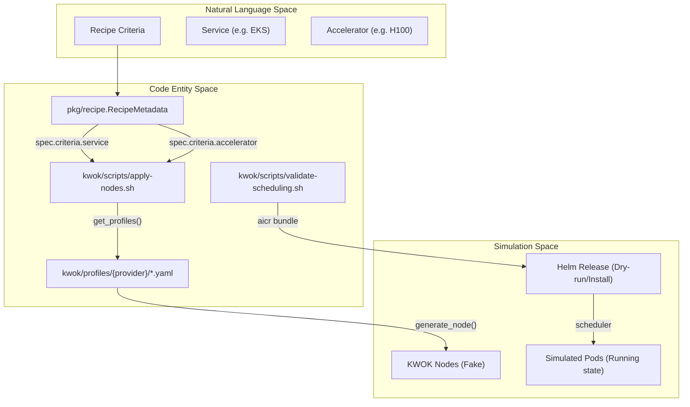
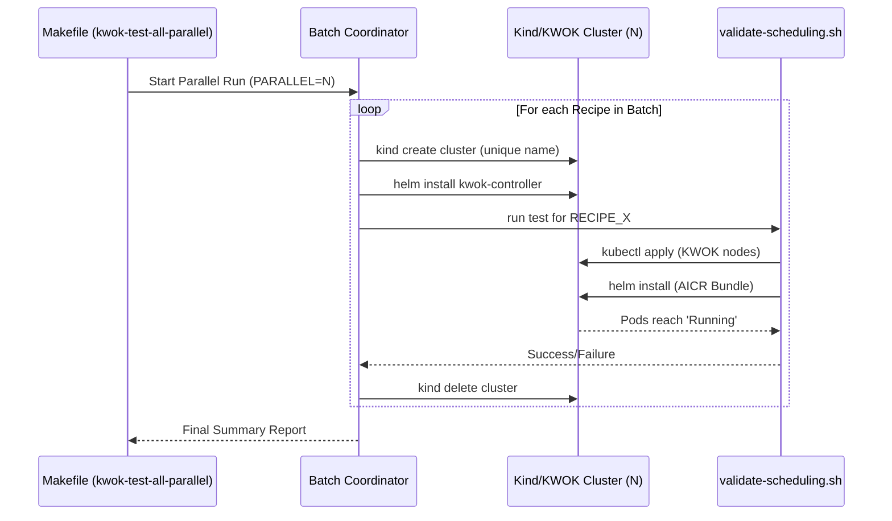

<!-- source: DeepWiki mcp.deepwiki.com · repo NVIDIA/aicr · page 8.2 KWOK Simulation Testing · fetched 2026-10-26 -->

# KWOK Simulation Testing

Relevant source files

The following files were used as context for generating this wiki page:

- [.github/workflows/docs-only-checks.yaml](.github/workflows/docs-only-checks.yaml)
- [.github/workflows/docs-only.yaml](.github/workflows/docs-only.yaml)
- [.github/workflows/kwok-recipes.yaml](.github/workflows/kwok-recipes.yaml)
- [kwok/README.md](kwok/README.md)
- [kwok/scripts/apply-nodes.sh](kwok/scripts/apply-nodes.sh)
- [kwok/scripts/run-all-recipes.sh](kwok/scripts/run-all-recipes.sh)
- [kwok/scripts/validate-scheduling.sh](kwok/scripts/validate-scheduling.sh)
- [pkg/recipe/yaml_test.go](pkg/recipe/yaml_test.go)
- [recipes/components/gpu-operator/values.yaml](recipes/components/gpu-operator/values.yaml)
- [recipes/components/prometheus-adapter/values.yaml](recipes/components/prometheus-adapter/values.yaml)
- [tests/chainsaw/cli/cuj1-training/assert-validate-multiphase.yaml](tests/chainsaw/cli/cuj1-training/assert-validate-multiphase.yaml)
- [tests/chainsaw/cli/snapshot-template/chainsaw-test.yaml](tests/chainsaw/cli/snapshot-template/chainsaw-test.yaml)

KWOK (Kubernetes WithOut Kubelet) simulation testing provides a high-fidelity environment for validating AICR bundle generation and pod scheduling decisions without requiring access to physical GPU hardware [kwok/README.md:1-5](). By simulating the Kubernetes Control Plane and node lifecycle, AICR can verify that the **Recipe Engine** correctly matches cluster criteria to overlays and that the **Bundler** produces valid Helm values for node selectors, tolerations, and resource requests [kwok/README.md:191-197]().

## Architecture and Data Flow

The simulation infrastructure is designed to be "recipe-driven." Instead of maintaining separate cluster configurations, the testing scripts infer the required hardware environment directly from the `RecipeMetadata` criteria [kwok/README.md:14-25]().

### Mapping Logic
1.  **Recipe Discovery**: The system scans `recipes/overlays/*.yaml` for any recipe defining a concrete `spec.criteria.service` (e.g., `eks`, `gke`) [kwok/scripts/run-all-recipes.sh:41-52]().
2.  **Profile Selection**: The `apply-nodes.sh` script maps the `service` and `accelerator` criteria to static node profiles located in `kwok/profiles/` [kwok/scripts/apply-nodes.sh:52-86]().
3.  **Node Synthesis**: Nodes are created using KWOK templates, injecting labels such as `nvidia.com/gpu.product` and `nvidia.com/cuda.driver.major` to mimic real NVIDIA GPU nodes [kwok/scripts/apply-nodes.sh:89-135]().

### Code Entity Map: From Recipe to Simulation
The following diagram illustrates how natural language concepts in a Recipe are mapped to specific code entities and simulation artifacts.

**Recipe to KWOK Mapping**

Sources: [kwok/README.md:18-25](), [kwok/scripts/apply-nodes.sh:52-86](), [kwok/scripts/validate-scheduling.sh:16-27]()

## Simulation Scripts

### apply-nodes.sh
This script is responsible for provisioning the simulated infrastructure. It uses `yq` to parse recipe overlays and selects two types of profiles:
*   **System Profile**: Provisioned with the `node-role.kubernetes.io/control-plane` label to host operator controllers [kwok/scripts/apply-nodes.sh:98-101]().
*   **GPU Profile**: Provisioned with extended resources and NVIDIA-specific labels/annotations [kwok/scripts/apply-nodes.sh:103-114]().

By default, it creates **2 system nodes** and **4 GPU nodes** (simulating 32 GPUs total for an H100/GB200 cluster) [kwok/scripts/apply-nodes.sh:33-35]().

### validate-scheduling.sh
This script executes the end-to-end validation logic:
1.  **Snapshot**: Invokes `aicr snapshot` against the KWOK cluster to capture the simulated node states [kwok/scripts/validate-scheduling.sh:23-24]().
2.  **Bundle**: Generates a bundle using the captured snapshot [kwok/scripts/validate-scheduling.sh:24]().
3.  **Deploy**: Installs the generated Helm charts to the KWOK cluster [kwok/scripts/validate-scheduling.sh:25]().
4.  **Verify**: Monitors the simulated pods. In a KWOK environment, pods that successfully pass scheduling constraints are automatically transitioned to the `Running` state by the `kwok-controller` [kwok/scripts/validate-scheduling.sh:26]().

Sources: [kwok/scripts/apply-nodes.sh:16-43](), [kwok/scripts/validate-scheduling.sh:16-29]()

## Parallel Recipe Testing

To optimize CI performance, AICR supports parallel testing across multiple ephemeral `Kind` clusters. This is orchestrated via `make kwok-test-all-parallel` [kwok/README.md:68-70]().

**Parallel Execution Flow**

Sources: [kwok/README.md:86-95](), [kwok/scripts/run-all-recipes.sh:109-123]()

## CI Integration

The KWOK testing suite is integrated into GitHub Actions via `.github/workflows/kwok-recipes.yaml`. It employs a three-tier discovery strategy to balance coverage and speed [.github/workflows/kwok-recipes.yaml:55-62]().

| Tier | Scope | Trigger |
| :--- | :--- | :--- |
| **Tier 1** | Generic overlays (no accelerator specialization) | Every PR [.github/workflows/kwok-recipes.yaml:88-105]() |
| **Tier 2** | Affected accelerator-specific overlays | PRs with changes to specific overlays, `registry.yaml`, or `base.yaml` [.github/workflows/kwok-recipes.yaml:109-126]() |
| **Tier 3** | Full matrix (all testable recipes) | Nightly cron or manual dispatch [.github/workflows/kwok-recipes.yaml:36-45]() |

### Diff-Aware Discovery
The workflow uses `git diff` to calculate the inheritance chain. If a base overlay (e.g., `base.yaml`) or a shared component values file is modified, the CI automatically promotes all downstream leaf recipes to the test set to prevent regression [.github/workflows/kwok-recipes.yaml:123-172]().

Sources: [.github/workflows/kwok-recipes.yaml:15-45](), [.github/workflows/kwok-recipes.yaml:71-126]()

## Limitations

While KWOK is highly effective for control-plane validation, it does not execute actual container workloads.

| Validated by KWOK | NOT Validated by KWOK |
| :--- | :--- |
| Node Selectors & Tolerations | GPU Driver Functionality |
| Resource Request Matching | NCCL Network Performance |
| Helm Chart Template Rendering | Container Image Pulling |
| Namespace & RBAC Creation | Hardware-specific Sysctls |

Sources: [kwok/README.md:190-201]()

---

