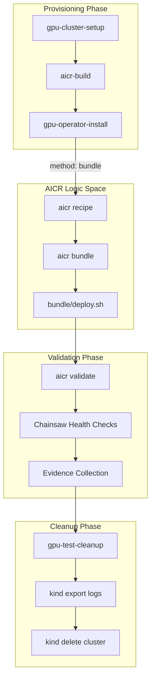
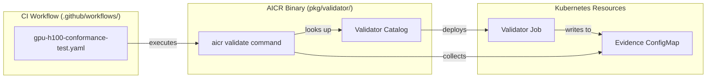

<!-- source: DeepWiki mcp.deepwiki.com · repo NVIDIA/aicr · page 8.3 GPU Hardware Tests (H100 Smoke, Inference, Training, Conformance) · fetched 2026-10-26 -->

# GPU Hardware Tests (H100 Smoke, Inference, Training, Conformance)

Relevant source files

The following files were used as context for generating this wiki page:

- [.github/actions/gpu-operator-install/action.yml](.github/actions/gpu-operator-install/action.yml)
- [.github/actions/gpu-test-cleanup/action.yml](.github/actions/gpu-test-cleanup/action.yml)
- [.github/actions/install-karpenter-kwok/action.yml](.github/actions/install-karpenter-kwok/action.yml)
- [.github/workflows/gpu-h100-conformance-test.yaml](.github/workflows/gpu-h100-conformance-test.yaml)
- [.github/workflows/gpu-h100-inference-test.yaml](.github/workflows/gpu-h100-inference-test.yaml)
- [.github/workflows/gpu-h100-training-test.yaml](.github/workflows/gpu-h100-training-test.yaml)
- [.github/workflows/gpu-smoke-test.yaml](.github/workflows/gpu-smoke-test.yaml)
- [recipes/overlays/h100-kind-training.yaml](recipes/overlays/h100-kind-training.yaml)
- [tests/chainsaw/ai-conformance/kind-training/assert-crds.yaml](tests/chainsaw/ai-conformance/kind-training/assert-crds.yaml)
- [tests/chainsaw/ai-conformance/kind-training/assert-namespaces.yaml](tests/chainsaw/ai-conformance/kind-training/assert-namespaces.yaml)
- [tests/chainsaw/ai-conformance/kind-training/chainsaw-test.yaml](tests/chainsaw/ai-conformance/kind-training/chainsaw-test.yaml)

This page details the automated testing infrastructure used to validate AICR against real NVIDIA GPU hardware. These tests ensure that the recipes, bundles, and validators function correctly on physical accelerators (H100, T4) across various workloads including LLM inference (Dynamo/vLLM), distributed training (Kubeflow/KAI), and CNCF AI Conformance suites.

## Overview of Hardware Test Suites

AICR employs four primary categories of hardware-backed tests. Each suite runs on specific GitHub Actions runners equipped with physical GPUs and uses `nvkind` (NVIDIA-enhanced Kubernetes-in-Docker) to provide a Kubernetes control plane with GPU passthrough.

| Test Suite | Hardware | Primary Objective | Key Components Tested |
|:---|:---|:---|:---|
| **Smoke Test** | T4 | Basic GPU connectivity and operator health. | `nvidia-smi`, GPU Operator (Helm) |
| **Inference Test** | H100 | LLM serving performance and stability. | Dynamo, vLLM, `aicr bundle` |
| **Training Test** | H100 x2 | Multi-GPU scheduling and metrics. | KAI Scheduler, DCGM Exporter, Prometheus |
| **Conformance** | H100 x2 | CNCF AI Conformance validation. | DRA, Gang Scheduling, Pod Autoscaling |

Sources: [.github/workflows/gpu-smoke-test.yaml:15-43](), [.github/workflows/gpu-h100-inference-test.yaml:55-58](), [.github/workflows/gpu-h100-training-test.yaml:51-53](), [.github/workflows/gpu-h100-conformance-test.yaml:57-59]()

## Test Lifecycle and Data Flow

The hardware tests follow a standardized lifecycle orchestrated by GitHub Actions. The process transitions from environment provisioning to AICR-driven deployment and finally to workload-specific validation.

### Workflow Implementation Logic

1.  **Cluster Setup**: Uses `.github/actions/gpu-cluster-setup` to initialize `nvkind` on the GPU runner.
2.  **AICR Build**: Compiles the `aicr` binary and builds validator images using `ko` [.github/workflows/gpu-h100-inference-test.yaml:73-75]().
3.  **Provisioning**: Uses `gpu-operator-install` to deploy the stack. In "bundle" mode, this executes `aicr recipe` and `aicr bundle` before running the generated `deploy.sh` [.github/actions/gpu-operator-install/action.yml:68-116]().
4.  **Validation**: Executes `aicr validate` with specific phases (`deployment`, `conformance`) and captures CTRF results and evidence [.github/workflows/gpu-h100-conformance-test.yaml:105-117]().
5.  **Cleanup**: Mandatory teardown via `.github/actions/gpu-test-cleanup` which exports logs and deletes the cluster regardless of test outcome [.github/actions/gpu-test-cleanup/action.yml:63-69]().

### Hardware Test Data Flow
Title: GPU Test Execution Flow

Sources: [.github/workflows/gpu-h100-inference-test.yaml:70-117](), [.github/actions/gpu-operator-install/action.yml:19-116](), [.github/actions/gpu-test-cleanup/action.yml:15-71]()

## H100 Inference and Training Workflows

### Inference (Dynamo/vLLM)
The inference test validates the "Dynamo" platform stack. It involves creating a specialized KAI Scheduler queue for Dynamo and deploying a `DynamoGraphDeployment` [.github/workflows/gpu-h100-inference-test.yaml:136-164](). The test waits for the `Ready` condition on the `vllm-smoke-test` before performing port-forwarding to validate the `/v1/models` endpoint [.github/workflows/gpu-h100-inference-test.yaml:166-201]().

### Training (Multi-GPU)
The training test utilizes two H100 GPUs to validate multi-node/multi-GPU coordination. It specifically targets:
*   **KAI Scheduler**: Validates `PodGroup` and `Queue` resources for gang scheduling [.github/workflows/gpu-h100-training-test.yaml:163-171]().
*   **Metrics Pipeline**: Ensures the DCGM -> Prometheus -> Prometheus-Adapter pipeline is functional for GPU-based HPA [.github/workflows/gpu-h100-training-test.yaml:113-118]().

Sources: [.github/workflows/gpu-h100-inference-test.yaml:136-201](), [.github/workflows/gpu-h100-training-test.yaml:113-171](), [recipes/overlays/h100-kind-training.yaml:24-45]()

## AI Conformance Testing

The conformance suite specifically targets the requirements for CNCF AI Conformance. It leverages `aicr validate --phase conformance` to run specialized Go-based checks inside the cluster.

### Conformance Check Registry
The `h100-kind-training` and `h100-kind-conformance` overlays define the specific checks executed:
*   `dra-support`: Validates Dynamic Resource Allocation for GPUs.
*   `gang-scheduling`: Validates co-scheduling of multi-GPU training jobs.
*   `pod-autoscaling`: Validates HPA using custom DCGM metrics.
*   `accelerator-metrics`: Validates availability of `gpu_utilization` and `gpu_memory_used` in the Custom Metrics API.

Sources: [recipes/overlays/h100-kind-training.yaml:34-45](), [.github/workflows/gpu-h100-conformance-test.yaml:105-117](), [.github/workflows/gpu-h100-conformance-test.yaml:176-183]()

### Code Entity Association: Conformance Workflow
Title: Conformance Validation Code Map

Sources: [.github/workflows/gpu-h100-conformance-test.yaml:105-117](), [recipes/overlays/h100-kind-training.yaml:34-45]()

## Provisioning and Simulation Tools

### Karpenter + KWOK
To test cluster-autoscaling logic without physical node scaling, the tests install Karpenter with the KWOK (Kubernetes Without Kubelet) provider. This allows the `cluster-autoscaling` validator to "provision" simulated nodes in response to pending GPU pods [.github/actions/install-karpenter-kwok/action.yml:26-35]().

### GPU Operator Installation Action
The `gpu-operator-install` action supports two modes:
1.  **Helm**: Standard installation for baseline smoke tests [.github/actions/gpu-operator-install/action.yml:41-56]().
2.  **Bundle**: The full AICR pipeline. It uses `aicr recipe` with `--intent` and `--accelerator` flags, followed by `aicr bundle` to create a deployment directory [.github/actions/gpu-operator-install/action.yml:70-95]().

Sources: [.github/actions/install-karpenter-kwok/action.yml:15-35](), [.github/actions/gpu-operator-install/action.yml:15-143]()

## Cleanup and Diagnostics

The `.github/actions/gpu-test-cleanup` action ensures that CI runners remain clean while preserving diagnostic data on failure.

### Diagnostic Collection
If a test fails, the following artifacts are collected:
*   **Resource Dumps**: `kubectl get all --all-namespaces` [.github/actions/gpu-test-cleanup/action.yml:37]().
*   **Logs**: Device plugin and GPU operator controller logs [.github/actions/gpu-test-cleanup/action.yml:40-41]().
*   **Kind Logs**: Full node-level logs via `kind export logs` [.github/actions/gpu-test-cleanup/action.yml:51]().

The cluster is then deleted using `kind delete cluster --name "${KIND_CLUSTER_NAME}"` [.github/actions/gpu-test-cleanup/action.yml:69]().

Sources: [.github/actions/gpu-test-cleanup/action.yml:30-71]()

---

