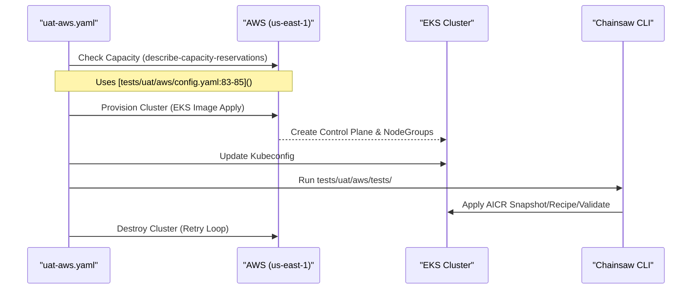
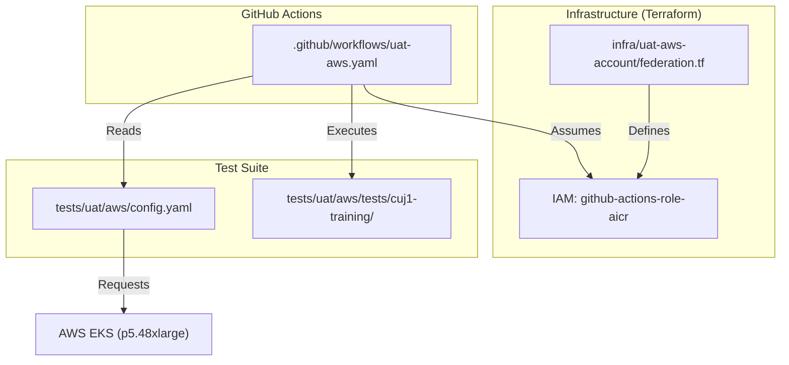

<!-- source: DeepWiki mcp.deepwiki.com · repo NVIDIA/aicr · page 8.4 UAT on AWS EKS · fetched 2026-10-26 -->

# UAT on AWS EKS

<details>
<summary>Relevant source files</summary>

The following files were used as context for generating this wiki page:

- [.github/actions/go-coverage/action.yml](.github/actions/go-coverage/action.yml)
- [.github/actions/malware-scan/action.yml](.github/actions/malware-scan/action.yml)
- [.github/workflows/build-attested.yaml](.github/workflows/build-attested.yaml)
- [.github/workflows/codeql.yaml](.github/workflows/codeql.yaml)
- [.github/workflows/on-push-comment.yaml](.github/workflows/on-push-comment.yaml)
- [.github/workflows/on-push.yaml](.github/workflows/on-push.yaml)
- [.github/workflows/on-tag.yaml](.github/workflows/on-tag.yaml)
- [.github/workflows/packaging.yaml](.github/workflows/packaging.yaml)
- [.github/workflows/uat-aws.yaml](.github/workflows/uat-aws.yaml)
- [.github/workflows/verify-licenses.yaml](.github/workflows/verify-licenses.yaml)
- [.github/workflows/vuln-scan.yaml](.github/workflows/vuln-scan.yaml)
- [infra/uat-aws-account/README.md](infra/uat-aws-account/README.md)
- [infra/uat-aws-account/federation.tf](infra/uat-aws-account/federation.tf)
- [infra/uat-aws-account/main.tf](infra/uat-aws-account/main.tf)
- [infra/uat-aws-account/outputs.tf](infra/uat-aws-account/outputs.tf)
- [infra/uat-aws-account/providers.tf](infra/uat-aws-account/providers.tf)
- [infra/uat-aws-account/variables.tf](infra/uat-aws-account/variables.tf)
- [pkg/bundler/checksum/checksum.go](pkg/bundler/checksum/checksum.go)
- [pkg/bundler/handler.go](pkg/bundler/handler.go)
- [pkg/evidence/collector.go](pkg/evidence/collector.go)
- [pkg/evidence/collector_test.go](pkg/evidence/collector_test.go)
- [pkg/logging/cli.go](pkg/logging/cli.go)
- [pkg/manifest/render.go](pkg/manifest/render.go)
- [pkg/oci/push.go](pkg/oci/push.go)
- [tests/uat/aws/config.yaml](tests/uat/aws/config.yaml)
- [tests/uat/aws/tests/cuj1-training/assert-recipe.yaml](tests/uat/aws/tests/cuj1-training/assert-recipe.yaml)
- [tests/uat/aws/tests/cuj1-training/assert-validate-multiphase.yaml](tests/uat/aws/tests/cuj1-training/assert-validate-multiphase.yaml)
- [validators/context.go](validators/context.go)

</details>


User Acceptance Testing (UAT) on AWS EKS provides a high-fidelity validation environment for AICR using real GPU hardware (e.g., NVIDIA H100/P5 instances). The system utilizes an ephemeral infrastructure pattern where a complete EKS cluster is provisioned, tested, and destroyed within a single CI/CD job.

## Workflow Overview: uat-aws.yaml

The `uat-aws.yaml` workflow is a scheduled and manual pipeline that validates AICR against live cloud infrastructure. It ensures that the recipe engine, bundler, and validator function correctly on supported cloud provider profiles.

### Data Flow and Lifecycle
The workflow follows a strict sequence to ensure resource availability and cost management:

1.  **Build and Push**: The `aicr` binary is built from source, and validator images are built and pushed to GHCR with a unique `uat-${{ github.run_id }}` tag [[.github/workflows/uat-aws.yaml:66-83]]().
2.  **Capacity Check**: Before provisioning, the workflow queries AWS for EC2 Capacity Reservations to ensure the required GPU instances (e.g., `p5.48xlarge`) are available [[.github/workflows/uat-aws.yaml:95-113]]().
3.  **Infrastructure Bringup**: Uses a specialized EKS provisioning image (`ghcr.io/mchmarny/cluster/eks`) to apply the configuration defined in `tests/uat/aws/config.yaml` [[.github/workflows/uat-aws.yaml:137-147]]().
4.  **Chainsaw Execution**: Runs declarative tests using the `chainsaw` CLI against the live cluster [[.github/workflows/uat-aws.yaml:162-174]]().
5.  **Mandatory Teardown**: An `always()` cleanup step triggers up to 3 retry attempts to destroy the EKS cluster and associated VPC resources to prevent cost leakage [[.github/workflows/uat-aws.yaml:176-195]]().

### UAT Execution Sequence
The following diagram illustrates the relationship between the GitHub Action workflow and the underlying infrastructure entities.

**UAT System Architecture**

Sources: `[.github/workflows/uat-aws.yaml:95-113]()`, `[.github/workflows/uat-aws.yaml:137-147]()`, `[.github/workflows/uat-aws.yaml:176-195]()`, `[tests/uat/aws/config.yaml:78-89]()`

---

## Infrastructure and OIDC Federation

To interact with AWS securely without long-lived credentials, AICR uses OIDC federation between GitHub Actions and AWS IAM.

### IAM Role Configuration
The infrastructure in `infra/uat-aws-account/` defines the `github-actions-role-aicr` role. This role is configured with a trust relationship that allows the `NVIDIA/aicr` repository to assume it via `role-to-assume` in the workflow [[.github/workflows/uat-aws.yaml:90]()].

| Entity | Purpose |
| :--- | :--- |
| `github-actions-role-aicr` | IAM Role assumed by GHA runners [[.github/workflows/uat-aws.yaml:36]()] |
| `615299774277` | Dedicated AWS Account for UAT [[.github/workflows/uat-aws.yaml:34]()] |
| `us-east-1` | Target region for P5/H100 capacity [[.github/workflows/uat-aws.yaml:35]()] |

### Cluster Configuration
The `tests/uat/aws/config.yaml` file defines the hardware requirements for the UAT cluster, specifically targeting GPU workers with capacity reservations.

```yaml
# [tests/uat/aws/config.yaml:78-85]()
      workers:
        - name: gpu-worker
          instanceType: p5.48xlarge
          capacity:
            desired: 2
            reservation:
              preference: capacity-reservations-only
              target: cr-0cbe491320188dfa6
```

Sources: `[.github/workflows/uat-aws.yaml:33-41]()`, `[tests/uat/aws/config.yaml:18-27]()`, `[tests/uat/aws/config.yaml:78-89]()`

---

## Test Execution (Chainsaw)

AICR uses `chainsaw` to orchestrate end-to-end tests on the EKS cluster. These tests validate the full AICR lifecycle: capturing a snapshot of the EKS nodes, resolving the EKS-specific recipe, and running the multi-phase validator.

### Test Logic and Assertions
The UAT tests include specific assertions for training workloads and validation phases:
*   **Recipe Assertion**: Validates that the recipe engine correctly identifies the AWS provider and selects the appropriate component overlays [[tests/uat/aws/tests/cuj1-training/assert-recipe.yaml]()].
*   **Validator Assertion**: Ensures that all three phases (deployment, performance, conformance) pass on the live hardware [[tests/uat/aws/tests/cuj1-training/assert-validate-multiphase.yaml]()].

**Code-to-Infra Mapping**

Sources: `[.github/workflows/uat-aws.yaml:33-41]()`, `[.github/workflows/uat-aws.yaml:171-174]()`, `[tests/uat/aws/config.yaml:78-89]()`, `[infra/uat-aws-account/federation.tf]()`

### Capacity Reservation Check
The workflow includes a pre-flight check to verify instance availability. This prevents the "partial bringup" failure mode where a control plane is created but GPU nodes cannot be provisioned due to AWS stock-outs.

```bash
# [.github/workflows/uat-aws.yaml:104-113]()
AVAILABLE=$(aws ec2 describe-capacity-reservations \
  --capacity-reservation-ids "${RESERVATION}" \
  --query 'CapacityReservations[0].AvailableInstanceCount' \
  --output text)
if [[ "${AVAILABLE}" -lt "${DESIRED}" ]]; then
  exit 1
fi
```

Sources: `[.github/workflows/uat-aws.yaml:95-114]()`, `[tests/uat/aws/config.yaml:81-85]()`

---

