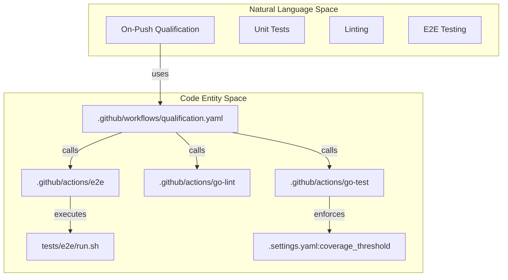
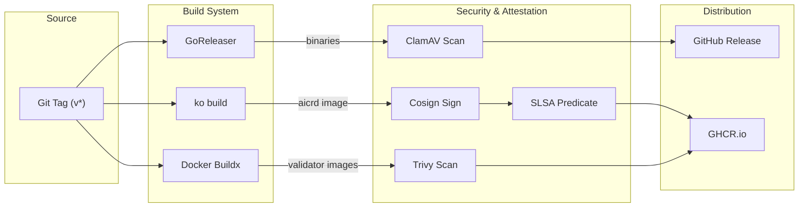

<!-- source: DeepWiki mcp.deepwiki.com · repo NVIDIA/aicr · page 9 CI/CD and Release Pipeline · fetched 2026-10-26 -->

# CI/CD and Release Pipeline

Relevant source files

The following files were used as context for generating this wiki page:

- [.github/actions/chainsaw/action.yml](.github/actions/chainsaw/action.yml)
- [.github/actions/cli-e2e/action.yml](.github/actions/cli-e2e/action.yml)
- [.github/actions/cloud-run-deploy/action.yml](.github/actions/cloud-run-deploy/action.yml)
- [.github/actions/e2e/action.yml](.github/actions/e2e/action.yml)
- [.github/actions/go-coverage/action.yml](.github/actions/go-coverage/action.yml)
- [.github/actions/go-lint/action.yml](.github/actions/go-lint/action.yml)
- [.github/actions/go-test/action.yml](.github/actions/go-test/action.yml)
- [.github/actions/install-e2e-tools/action.yml](.github/actions/install-e2e-tools/action.yml)
- [.github/actions/integration/action.yml](.github/actions/integration/action.yml)
- [.github/actions/kwok-test/action.yml](.github/actions/kwok-test/action.yml)
- [.github/actions/malware-scan/action.yml](.github/actions/malware-scan/action.yml)
- [.github/actions/prep-kind-runner/action.yml](.github/actions/prep-kind-runner/action.yml)
- [.github/actions/setup-build-tools/action.yml](.github/actions/setup-build-tools/action.yml)
- [.github/workflows/build-attested.yaml](.github/workflows/build-attested.yaml)
- [.github/workflows/codeql.yaml](.github/workflows/codeql.yaml)
- [.github/workflows/on-push-comment.yaml](.github/workflows/on-push-comment.yaml)
- [.github/workflows/on-push.yaml](.github/workflows/on-push.yaml)
- [.github/workflows/on-tag.yaml](.github/workflows/on-tag.yaml)
- [.github/workflows/packaging.yaml](.github/workflows/packaging.yaml)
- [.github/workflows/qualification.yaml](.github/workflows/qualification.yaml)
- [.github/workflows/test-deploy.yaml](.github/workflows/test-deploy.yaml)
- [.github/workflows/uat-aws.yaml](.github/workflows/uat-aws.yaml)
- [.github/workflows/verify-licenses.yaml](.github/workflows/verify-licenses.yaml)
- [.github/workflows/vuln-scan.yaml](.github/workflows/vuln-scan.yaml)

This page provides an overview of the GitHub Actions-based CI/CD system for AICR. The pipeline is designed to ensure code quality through rigorous qualification, maintain a secure supply chain via automated scanning and attestations, and provide a streamlined release process for binaries and container images.

## Qualification Pipeline (On Push)

The qualification pipeline runs on every push to the `main` branch and for every Pull Request [`.github/workflows/on-push.yaml`:18-34](). It utilizes a reusable `qualification.yaml` workflow to execute a comprehensive test suite across multiple environments.

### Qualification Stages
1.  **Static Analysis & Linting**: Executes `golangci-lint` and license header checks [`.github/workflows/qualification.yaml`:62-85]().
2.  **Unit Testing**: Runs Go tests with coverage reporting and enforcement of a coverage threshold defined in `.settings.yaml` [`.github/workflows/qualification.yaml`:36-61]().
3.  **CLI E2E**: Uses **Chainsaw** to validate CLI command behavior [`.github/workflows/qualification.yaml`:86-111]().
4.  **Integration E2E**: Provisions a **Kind** cluster, injects a fake `nvidia-smi` [`.github/actions/e2e/action.yml`:121-128](), and runs the full AICR pipeline (snapshot to bundle) [`.github/actions/e2e/action.yml`:137-147]().
5.  **Security Scanning**: Performs initial filesystem scans using **Trivy** [`.github/workflows/qualification.yaml`:133-153]().

For details on the testing tools and local environment, see [Local Development Environment](#9.4).

### Code Entity Mapping: Qualification Workflow
The following diagram maps the high-level qualification stages to the specific GitHub Actions and scripts that implement them.

Title: Qualification Workflow Mapping

Sources: [`.github/workflows/on-push.yaml`:50-59](), [`.github/workflows/qualification.yaml`:15-153](), [`.github/actions/e2e/action.yml`:146-146]().

## Release Pipeline (On Tag)

The release pipeline is triggered by semantic version tags (e.g., `v1.2.3`) [`.github/workflows/on-tag.yaml`:18-20](). It builds upon the qualification suite to produce production-grade artifacts.

*   **Binary Compilation**: Uses **GoReleaser** to build cross-platform binaries for `aicr` and `aicrd` [`.github/workflows/on-tag.yaml`:87-93]().
*   **Validator Images**: Builds multi-arch Docker images (amd64/arm64) for the `deployment`, `performance`, and `conformance` validator phases [`.github/workflows/on-tag.yaml`:105-154]().
*   **Manifest Creation**: Combines architecture-specific images into OCI multi-arch manifests [`.github/workflows/on-tag.yaml`:159-196]().
*   **Automated Changelog**: Generates release notes using `git-cliff` based on the commit history [`.github/workflows/on-tag.yaml`:66-66]().

For a deep dive into the release steps, see [Release Process](#9.2). For details on the build tools, see [Build System and Toolchain](#9.1).

Sources: [`.github/workflows/on-tag.yaml`:15-196]().

## Security and Supply Chain

AICR implements a "Shift Left" security strategy, integrating vulnerability and malware scanning directly into the CI/CD flow.

*   **Vulnerability Scanning**: **Trivy** performs daily scans of the repository filesystem for vulnerabilities, secrets, and misconfigurations [`.github/workflows/vuln-scan.yaml`:46-89]().
*   **SAST**: **CodeQL** analysis runs weekly and on every PR to detect common Go security patterns [`.github/workflows/codeql.yaml`:15-67]().
*   **Malware Detection**: Release binaries are scanned with **ClamAV** before publication [`.github/workflows/on-tag.yaml`:94-100]().
*   **Provenance & Attestation**: The pipeline generates **SLSA Build Level 3** provenance and uses **Sigstore/Cosign** for keyless signing of artifacts [`.github/workflows/on-tag.yaml`:79-86]().
*   **License Compliance**: `go-licenses` ensures all third-party dependencies adhere to CNCF-approved license policies [`.github/workflows/verify-licenses.yaml`:44-88]().

For details on security implementations, see [Security Scanning and Supply Chain](#9.3).

Sources: [`.github/workflows/vuln-scan.yaml`:15-108](), [`.github/workflows/codeql.yaml`:15-67](), [`.github/workflows/verify-licenses.yaml`:80-88]().

## User Acceptance Testing (UAT)

To ensure cloud provider compatibility, AICR runs daily User Acceptance Tests (UAT) on real hardware.

*   **AWS EKS**: The `uat-aws.yaml` workflow provisions an ephemeral EKS cluster, verifies EC2 GPU capacity reservations, and executes **Chainsaw** tests on live H100/L40S nodes [`.github/workflows/uat-aws.yaml`:15-174]().
*   **Simulation**: **KWOK** (Kubernetes Without Kubelet) is used to simulate large-scale clusters with various node profiles to test recipe resolution logic without the cost of real GPUs [`.github/actions/kwok-test/action.yml`:15-108]().

Sources: [`.github/workflows/uat-aws.yaml`:15-174](), [`.github/actions/kwok-test/action.yml`:15-108]().

### Code Entity Mapping: Release and Artifact Flow
This diagram illustrates the flow from source code to signed, scanned production artifacts.

Title: Artifact Production and Security Flow

Sources: [`.github/workflows/on-tag.yaml`:50-200](), [`.github/actions/setup-build-tools/action.yml`:15-152]().

## Child Pages
- [Build System and Toolchain](#9.1) — Details on `.settings.yaml`, GoReleaser, and `ko`.
- [Release Process](#9.2) — Detailed walkthrough of the `on-tag.yaml` steps.
- [Security Scanning and Supply Chain](#9.3) — In-depth look at Trivy, CodeQL, SLSA, and Cosign.
- [Local Development Environment](#9.4) — Guide to `make dev-env`, Tilt, and local testing.

---

