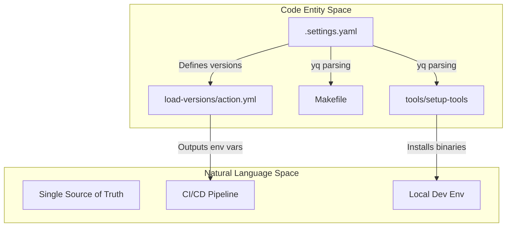
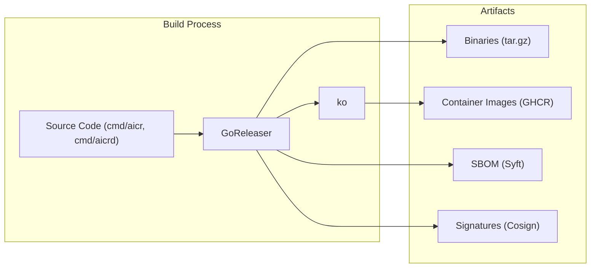

<!-- source: DeepWiki mcp.deepwiki.com · repo NVIDIA/aicr · page 9.1 Build System and Toolchain · fetched 2026-10-26 -->

# Build System and Toolchain

Relevant source files

The following files were used as context for generating this wiki page:

- [.github/actions/load-versions/action.yml](.github/actions/load-versions/action.yml)
- [.goreleaser.yaml](.goreleaser.yaml)
- [.settings.yaml](.settings.yaml)
- [.yamllint.yaml](.yamllint.yaml)
- [Makefile](Makefile)
- [go.mod](go.mod)
- [go.sum](go.sum)
- [pkg/bundler/deployer/argocd/argocd_test.go](pkg/bundler/deployer/argocd/argocd_test.go)
- [pkg/bundler/deployer/argocd/templates/application.yaml.tmpl](pkg/bundler/deployer/argocd/templates/application.yaml.tmpl)
- [site/.vitepress/config.ts](site/.vitepress/config.ts)
- [site/.vitepress/theme/Landing.vue](site/.vitepress/theme/Landing.vue)
- [site/.vitepress/theme/custom.css](site/.vitepress/theme/custom.css)
- [site/.vitepress/theme/index.ts](site/.vitepress/theme/index.ts)
- [tests/chainsaw/cli/bundle-variants/chainsaw-test.yaml](tests/chainsaw/cli/bundle-variants/chainsaw-test.yaml)
- [tools/check-tools](tools/check-tools)
- [tools/setup-tools](tools/setup-tools)
- [vendor/github.com/in-toto/attestation/go/v1/resource_descriptor.pb.go](vendor/github.com/in-toto/attestation/go/v1/resource_descriptor.pb.go)
- [vendor/github.com/in-toto/attestation/go/v1/statement.go](vendor/github.com/in-toto/attestation/go/v1/statement.go)
- [vendor/github.com/in-toto/attestation/go/v1/statement.pb.go](vendor/github.com/in-toto/attestation/go/v1/statement.pb.go)
- [vendor/google.golang.org/grpc/internal/envconfig/envconfig.go](vendor/google.golang.org/grpc/internal/envconfig/envconfig.go)
- [vendor/google.golang.org/grpc/server.go](vendor/google.golang.org/grpc/server.go)
- [vendor/google.golang.org/grpc/version.go](vendor/google.golang.org/grpc/version.go)
- [vendor/modules.txt](vendor/modules.txt)

This page details the infrastructure used to build, package, and release the AICR project. The build system is designed around a "Single Source of Truth" philosophy, where all tool versions and quality thresholds are centralized to ensure consistency across local development, CI/CD pipelines, and containerized environments.

## Single Source of Truth: .settings.yaml

The `.settings.yaml` file is the central configuration hub for the entire project [ .settings.yaml:1-74 ](). It defines:
*   **Language Versions**: Specifically the Go version [ .settings.yaml:17-17 ]().
*   **Build & Release Tools**: Versions for `goreleaser`, `ko`, and `crane` [ .settings.yaml:21-23 ]().
*   **Quality Gates**: Thresholds for code coverage and timeouts for linting and testing [ .settings.yaml:57-60 ]().
*   **Testing Infrastructure**: Versions for `kind`, `kubectl`, and `chainsaw`, including specific SHA256 checksums for binary verification [ .settings.yaml:41-52 ]().

### Data Flow: Settings to Tools
The project uses a custom GitHub Action, `load-versions`, to parse this YAML and export values as environment variables for use in CI workflows [ .github/actions/load-versions/action.yml:15-143 ]().

Sources: [ .settings.yaml:1-74 ](), [ .github/actions/load-versions/action.yml:15-143 ](), [ Makefile:5-29 ](), [ tools/setup-tools:34-35 ]()

---

## Toolchain Management

AICR provides a suite of scripts to manage the developer toolchain, ensuring that every contributor uses identical versions of compilers, linters, and testing utilities.

### setup-tools and check-tools
*   **`tools/setup-tools`**: An interactive or automated script that detects the host OS/Arch and installs the specific versions defined in `.settings.yaml` [ tools/setup-tools:1-208 ](). It includes logic to verify download URLs and validate SHA256 checksums [ tools/setup-tools:60-112 ]().
*   **`tools/check-tools`**: Verifies the current environment against the requirements. It uses different matching strategies (exact, major, or major_minor) depending on the tool [ tools/check-tools:16-177 ]().

### Makefile Targets
The `Makefile` serves as the primary entry point for all build and maintenance tasks [ Makefile:1-4 ]().

| Target | Description | Source |
| :--- | :--- | :--- |
| `make tools-setup` | Installs all required tools for the dev environment. | [ Makefile:58-61 ]() |
| `make tools-check` | Compares installed tool versions against `.settings.yaml`. | [ Makefile:54-56 ]() |
| `make tidy` | Runs `go fmt`, `go mod tidy`, and updates the `vendor/` directory. | [ Makefile:76-81 ]() |
| `make lint` | Executes Go and YAML linters with project-specific configs. | [ Makefile:105-108 ]() |
| `make test` | Runs unit tests with race detection and generates coverage. | [ Makefile:166-174 ]() |

Sources: [ tools/setup-tools:1-208 ](), [ tools/check-tools:16-177 ](), [ Makefile:1-188 ]()

---

## Binary and Container Builds

AICR utilizes **GoReleaser** for binary distribution and **ko** for container image generation.

### GoReleaser Configuration
The `.goreleaser.yaml` file defines how the `aicr` CLI and `aicrd` API server are compiled [ .goreleaser.yaml:15-17 ]().
*   **Cross-Compilation**: Targets `linux` and `darwin` for `amd64` and `arm64` [ .goreleaser.yaml:48-53 ]().
*   **Build Metadata**: Injects version, commit, and build date into the binaries using `ldflags` [ .goreleaser.yaml:29-35 ]().
*   **Provenance**: Generates SLSA Level 3 attestations for the binaries using `cosign attest-blob` [ .goreleaser.yaml:36-47 ]().

### Containerization with ko
Container images are built using `ko`, which creates lightweight, OCI-compliant images without requiring a Dockerfile [ .goreleaser.yaml:103-131 ]().
*   **`aicr` image**: Built on a CUDA runtime base image (`nvcr.io/nvidia/cuda:13.1.0-runtime-ubuntu24.04`) to support GPU-related operations [ .goreleaser.yaml:104-108 ]().
*   **`aicrd` image**: Built on a minimal `distroless/static` base for a reduced attack surface [ .goreleaser.yaml:118-122 ]().

Sources: [ .goreleaser.yaml:15-131 ](), [ Makefile:16-17 ]()

---

## Dependency Management

The project uses Go modules with a mandatory `vendor/` directory to ensure reproducible builds even without internet access [ go.mod:1-33 ]().

*   **Vendoring**: All dependencies are stored in the `vendor/` folder, tracked in `vendor/modules.txt` [ vendor/modules.txt:1-204 ]().
*   **Static Linking**: GoReleaser is configured with `CGO_ENABLED=0` and `-extldflags "-static"` to produce completely static binaries [ .goreleaser.yaml:25-32 ]().
*   **License Compliance**: The `make license-check` target uses `go-licenses` to verify that all dependencies comply with the project's allowed licenses (Apache-2.0, MIT, BSD, etc.) [ Makefile:159-164 ]().

Sources: [ go.mod:1-33 ](), [ .goreleaser.yaml:25-32 ](), [ Makefile:159-164 ](), [ vendor/modules.txt:1-204 ]()

---

