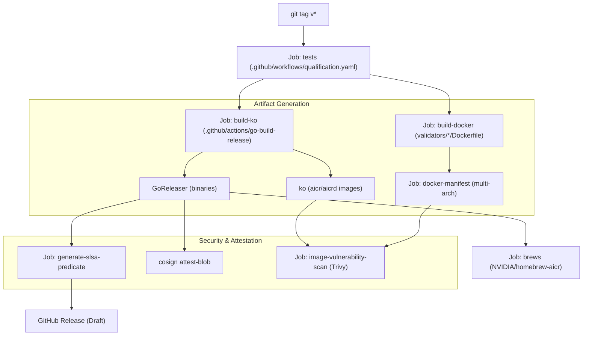
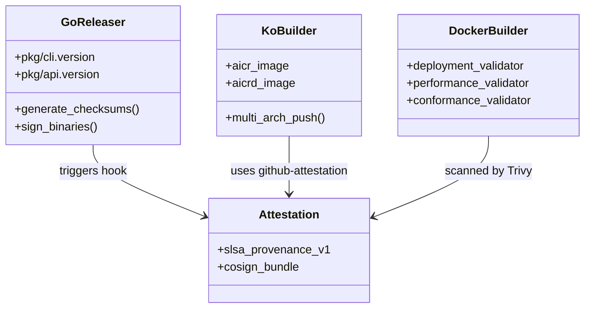

<!-- source: DeepWiki mcp.deepwiki.com · repo NVIDIA/aicr · page 9.2 Release Process · fetched 2026-10-26 -->

# Release Process

Relevant source files

The following files were used as context for generating this wiki page:

- [.ctlptl-kwok.yaml](.ctlptl-kwok.yaml)
- [.github/actions/go-coverage/action.yml](.github/actions/go-coverage/action.yml)
- [.github/actions/load-versions/action.yml](.github/actions/load-versions/action.yml)
- [.github/actions/malware-scan/action.yml](.github/actions/malware-scan/action.yml)
- [.github/workflows/build-attested.yaml](.github/workflows/build-attested.yaml)
- [.github/workflows/codeql.yaml](.github/workflows/codeql.yaml)
- [.github/workflows/on-push-comment.yaml](.github/workflows/on-push-comment.yaml)
- [.github/workflows/on-push.yaml](.github/workflows/on-push.yaml)
- [.github/workflows/on-tag.yaml](.github/workflows/on-tag.yaml)
- [.github/workflows/packaging.yaml](.github/workflows/packaging.yaml)
- [.github/workflows/uat-aws.yaml](.github/workflows/uat-aws.yaml)
- [.github/workflows/verify-licenses.yaml](.github/workflows/verify-licenses.yaml)
- [.github/workflows/vuln-scan.yaml](.github/workflows/vuln-scan.yaml)
- [.goreleaser.yaml](.goreleaser.yaml)
- [.settings.yaml](.settings.yaml)
- [CHANGELOG.md](CHANGELOG.md)
- [cliff.toml](cliff.toml)
- [tools/bump](tools/bump)
- [tools/check-tools](tools/check-tools)
- [tools/setup-tools](tools/setup-tools)

The AICR release process is an automated pipeline triggered by semantic version tags. It orchestrates a high-confidence transition from source code to signed, attested, and multi-arch artifacts including binaries, container images, and Homebrew formulas.

## Release Pipeline Overview

The release is governed by the `on-tag.yaml` workflow, which executes a linear progression of validation, building, and publishing stages.

### Pipeline Stages

1.  **Qualification**: Executes the full suite of E2E, unit, and simulation tests defined in `qualification.yaml` [ .github/workflows/on-tag.yaml:38-45 ]().
2.  **Build (GoReleaser + ko)**: Parallel builds of binaries (via GoReleaser) and container images (via `ko`). This stage includes SLSA predicate generation [ .github/workflows/on-tag.yaml:50-93 ]().
3.  **Validator Build**: Native compilation of validator images for `amd64` and `arm64` architectures [ .github/workflows/on-tag.yaml:105-154 ]().
4.  **Multi-Arch Manifest**: Aggregation of per-architecture validator images into single multi-arch manifests [ .github/workflows/on-tag.yaml:159-195 ]().
5.  **Supply Chain Security**: Includes Trivy vulnerability scanning, ClamAV malware scanning, and SLSA Level 3 attestation [ .github/workflows/on-tag.yaml:200-240 ]().
6.  **Publishing**: Updates the Homebrew formula and creates a GitHub Release draft [ .goreleaser.yaml:164-181 ]().

### Release Flow Diagram

This diagram maps the logical release phases to the GitHub Action jobs and external tools used.

**Release Process Logic to Code Mapping**

Sources: [ .github/workflows/on-tag.yaml:15-240 ](), [ .goreleaser.yaml:103-181 ]()

## Versioning and Changelog

AICR uses semantic versioning. The release preparation is assisted by internal tooling to ensure consistency between Git history and the `CHANGELOG.md`.

### Tooling
-   **`tools/bump`**: A script used by maintainers to increment versions across the repository.
-   **`git-cliff`**: Used to generate the `CHANGELOG.md` based on Conventional Commits. It groups changes into "New Features", "Bug Fixes", and "Other Tasks" [ cliff.toml:65-80 ]().
-   **`.settings.yaml`**: The single source of truth for tool versions (Go, `ko`, `kubectl`, etc.) used during the build [ .settings.yaml:1-50 ]().

### Changelog Configuration
The `cliff.toml` file mirrors the changelog settings in `.goreleaser.yaml` to ensure that the GitHub Release notes match the repository's `CHANGELOG.md` [ cliff.toml:18-20 ](). It filters out non-user-facing commits like documentation-only changes or linter fixes [ cliff.toml:70-77 ]().

Sources: [ CHANGELOG.md:1-100 ](), [ cliff.toml:21-95 ](), [ .settings.yaml:1-50 ]()

## Build and Attestation Details

The build process prioritizes supply chain integrity through keyless signing and SLSA provenance.

### GoReleaser Integration
GoReleaser handles the cross-compilation of the `aicr` CLI and `aicrd` API server for `linux` and `darwin` on both `amd64` and `arm64` [ .goreleaser.yaml:48-75 ](). 

-   **Binary Attestation**: A post-build hook uses `cosign attest-blob` to attach SLSA provenance to the binaries [ .goreleaser.yaml:36-47 ]().
-   **SBOM**: GoReleaser generates Software Bill of Materials (SBOM) for all binary artifacts [ .goreleaser.yaml:81-83 ]().

### Container Images (`ko`)
Container images for `aicr` and `aicrd` are built using `ko`, which produces slim, distroless-based images without requiring a Docker daemon [ .goreleaser.yaml:103-131 ]().
-   `aicr` image uses a CUDA runtime base: `nvcr.io/nvidia/cuda:13.1.0-runtime-ubuntu24.04` [ .goreleaser.yaml:108 ]().
-   `aicrd` image uses a static non-root base: `gcr.io/distroless/static:nonroot` [ .goreleaser.yaml:122 ]().

### Validator Images
Unlike the core binaries, validator images are built using standard `Dockerfiles` located in `validators/{phase}/` [ .github/workflows/on-tag.yaml:141 ](). They are built natively on `ubuntu-latest` (amd64) and `ubuntu-24.04-arm` (arm64) runners to optimize build speed [ .github/workflows/on-tag.yaml:119-124 ]().

**Build Entity Relationship**

Sources: [ .goreleaser.yaml:19-131 ](), [ .github/workflows/on-tag.yaml:105-154 ]()

## Homebrew Release

The release process automatically updates the NVIDIA Homebrew tap.

### Formula Generation
GoReleaser pushes a new formula to `NVIDIA/homebrew-aicr` using a GitHub deploy key [ .goreleaser.yaml:167-173 ](). The formula includes:
-   The `aicr` binary.
-   The `aicr-attestation.sigstore.json` for local verification [ .goreleaser.yaml:183-184 ]().

### Local Verification
The formula includes `caveats` that instruct the user on how to verify the binary's provenance using `cosign`. It verifies the OIDC identity against the specific GitHub Actions workflow that produced the release [ .goreleaser.yaml:187-196 ]().

Sources: [ .goreleaser.yaml:164-200 ]()

## Security and Vulnerability Management

Every release undergoes rigorous security scanning before being finalized.

| Scan Type | Tool | Scope |
| :--- | :--- | :--- |
| **Vulnerability** | Trivy | Filesystem and container image OS/library scans [ .github/workflows/vuln-scan.yaml:59-74 ]() |
| **Malware** | ClamAV | Release binaries in the `dist/` directory [ .github/workflows/on-tag.yaml:94-100 ]() |
| **SAST** | CodeQL | Go source code analysis [ .github/workflows/codeql.yaml:60-67 ]() |
| **Compliance** | go-licenses | Verification of all vendor dependencies [ .github/workflows/verify-licenses.yaml ]() |

If any critical vulnerabilities are found, the pipeline provides a SARIF report which is uploaded to GitHub Security Tab [ .github/workflows/vuln-scan.yaml:84-89 ]().

Sources: [ .github/workflows/vuln-scan.yaml:15-108 ](), [ .github/workflows/codeql.yaml:15-67 ](), [ .github/workflows/on-tag.yaml:94-100 ]()

---

