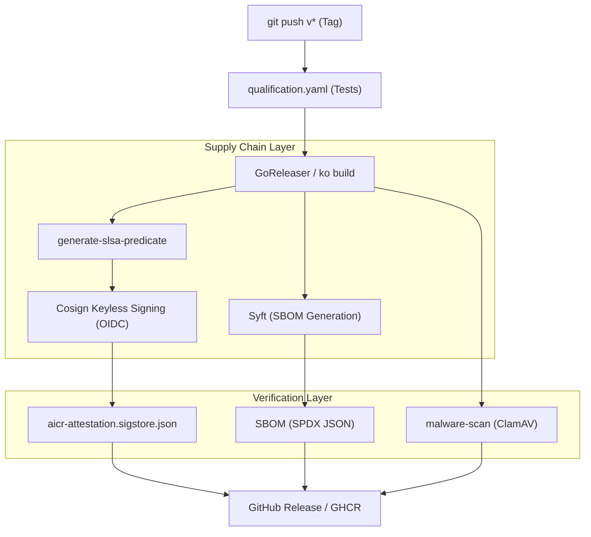
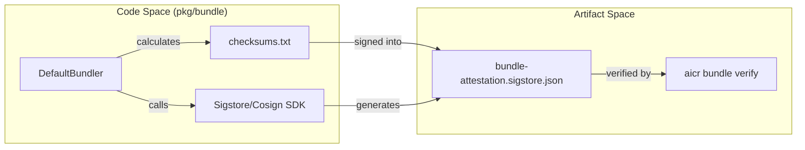

<!-- source: DeepWiki mcp.deepwiki.com · repo NVIDIA/aicr · page 9.3 Security Scanning and Supply Chain · fetched 2026-10-26 -->

# Security Scanning and Supply Chain

Relevant source files

The following files were used as context for generating this wiki page:

- [.github/actions/generate-slsa-predicate/action.yml](.github/actions/generate-slsa-predicate/action.yml)
- [.github/actions/go-coverage/action.yml](.github/actions/go-coverage/action.yml)
- [.github/actions/malware-scan/action.yml](.github/actions/malware-scan/action.yml)
- [.github/actions/security-scan/action.yml](.github/actions/security-scan/action.yml)
- [.github/workflows/build-attested.yaml](.github/workflows/build-attested.yaml)
- [.github/workflows/codeql.yaml](.github/workflows/codeql.yaml)
- [.github/workflows/on-push-comment.yaml](.github/workflows/on-push-comment.yaml)
- [.github/workflows/on-push.yaml](.github/workflows/on-push.yaml)
- [.github/workflows/on-tag.yaml](.github/workflows/on-tag.yaml)
- [.github/workflows/packaging.yaml](.github/workflows/packaging.yaml)
- [.github/workflows/uat-aws.yaml](.github/workflows/uat-aws.yaml)
- [.github/workflows/verify-licenses.yaml](.github/workflows/verify-licenses.yaml)
- [.github/workflows/vuln-scan.yaml](.github/workflows/vuln-scan.yaml)
- [.golangci.yaml](.golangci.yaml)
- [SECURITY.md](SECURITY.md)
- [demos/s3c.md](demos/s3c.md)
- [pkg/serializer/http.go](pkg/serializer/http.go)
- [pkg/serializer/reader.go](pkg/serializer/reader.go)
- [tools/e2e](tools/e2e)

The NVIDIA AI Cluster Runtime (AICR) implements a defense-in-depth security strategy for its software supply chain. This encompasses automated vulnerability scanning, malware detection, static analysis, and cryptographically verifiable build provenance. The system ensures that every artifact—from CLI binaries to container images and deployment bundles—is traceable to its source and verified against security policies.

## Vulnerability and Malware Scanning

AICR employs a multi-layered scanning approach that triggers on every pull request, merge to the `main` branch, and official release tag.

### Filesystem and Container Scanning
AICR uses **Trivy** to perform comprehensive scans of the repository filesystem and container images. The scanning covers Operating System (OS) packages, language-specific libraries (Go modules), secrets, and infrastructure-as-code (IaC) misconfigurations [/.github/workflows/vuln-scan.yaml:61-73]().

- **Scope**: Scans include the root directory while skipping `vendor`, `node_modules`, and test directories to reduce noise [/.github/workflows/vuln-scan.yaml:71-71]().
- **Severity**: Results are filtered for `MEDIUM, HIGH, CRITICAL` vulnerabilities [/.github/workflows/vuln-scan.yaml:43-43]().
- **Reporting**: Findings are exported in **SARIF** format and uploaded to GitHub Code Scanning for centralized management [/.github/workflows/vuln-scan.yaml:84-89]().

### Malware Detection
All release binaries and repository files are scanned using **ClamAV** via a dedicated GitHub Action [/.github/workflows/vuln-scan.yaml:90-108](). During the release process, the `malware-scan` action is specifically targeted at the `dist/` directory containing the final compiled binaries [/.github/workflows/on-tag.yaml:94-100]().

### Static Analysis (SAST)
**CodeQL** is integrated into the CI pipeline to perform semantic analysis of the Go source code [/.github/workflows/codeql.yaml:15-16](). It identifies potential security flaws such as unsanitized inputs or insecure cryptographic usage by building the entire project with `GOFLAGS=-mod=vendor` to ensure all dependencies are included in the analysis [/.github/workflows/codeql.yaml:63-65]().

Sources: [/.github/workflows/vuln-scan.yaml:15-108](), [/.github/workflows/codeql.yaml:15-67](), [/.github/workflows/on-tag.yaml:94-100]()

---

## Supply Chain Integrity and Provenance

AICR achieves **SLSA Build Level 3** compliance by utilizing GitHub Actions as a trusted builder and Sigstore for keyless signing.

### SLSA Build Provenance
During the release workflow, a SLSA predicate is generated to document the build environment, including the exact workflow file and commit SHA [/.github/workflows/on-tag.yaml:82-86](). This predicate is used to create a verifiable attestation that proves the artifact was built in the official NVIDIA/aicr repository.

### Sigstore and Cosign Attestation
AICR uses **Sigstore Cosign** for keyless signing based on OpenID Connect (OIDC) identities [/.github/workflows/on-tag.yaml:79-80]().
1. **Container Images**: Every image (e.g., `aicr`, `aicrd`, and validators) is signed and attached with an SBOM attestation [/.github/workflows/on-tag.yaml:200-210]().
2. **CLI Binaries**: Release archives include a `aicr-attestation.sigstore.json` file, which allows users to verify the binary's integrity using `cosign verify-blob-attestation` [/.github/workflows/on-tag.yaml:87-93](), [SECURITY.md:142-162]().

### SBOM Generation
Software Bill of Materials (SBOM) are generated in **SPDX v2.3 JSON** format.
- **Syft**: Used to catalog all Go module dependencies, transitive dependencies, and system packages [SECURITY.md:128-135]().
- **GoReleaser**: Automatically embeds binary-level SBOMs into the CLI tools during the build phase [SECURITY.md:41-41]().

### Data Flow: Secure Release Pipeline
The following diagram illustrates how security entities interact during the `on-tag` release process.

**Security Artifact Generation Flow**

Sources: [/.github/workflows/on-tag.yaml:15-100](), [SECURITY.md:35-60](), [/.github/workflows/build-attested.yaml:61-79]()

---

## License Compliance

AICR ensures that all third-party dependencies adhere to CNCF-approved licenses (e.g., Apache-2.0, MIT, BSD) [/.github/workflows/verify-licenses.yaml:84-87]().

The `verify-licenses` workflow uses `go-licenses` to:
1. **Report**: Generate a full list of dependency licenses [/.github/workflows/verify-licenses.yaml:70-75]().
2. **Check**: Enforce a strict allow-list. If a dependency uses a non-approved license (e.g., GPL), the CI build fails [/.github/workflows/verify-licenses.yaml:80-88]().

Sources: [/.github/workflows/verify-licenses.yaml:15-88]()

---

## Bundle Attestation (User-Side)

Supply chain security extends to the artifacts generated by the user. When a user runs `aicr bundle`, the CLI tool generates a `bundle-attestation.sigstore.json` [SECURITY.md:172-180]().

- **Content Binding**: The attestation includes a `checksums.txt` of all files in the bundle (recipes, manifests, scripts) [SECURITY.md:174-176]().
- **Verification**: Users can verify a bundle using the `aicr bundle verify` command, which checks the Sigstore signature against the expected OIDC identity [SECURITY.md:180-185]().

**Bundle Security Entity Map**

Sources: [SECURITY.md:172-185](), [tools/e2e:78-86]()

---

## Security Reporting

Vulnerabilities should not be reported via GitHub Issues. NVIDIA provides a formal process via the Product Security Incident Response Team (PSIRT) [SECURITY.md:5-13]().

- **Form**: [Security Vulnerability Submission Form](https://www.nvidia.com/object/submit-security-vulnerability.html)
- **Email**: psirt@nvidia.com (PGP encrypted) [SECURITY.md:12-13]().

Sources: [SECURITY.md:1-26]()

---

