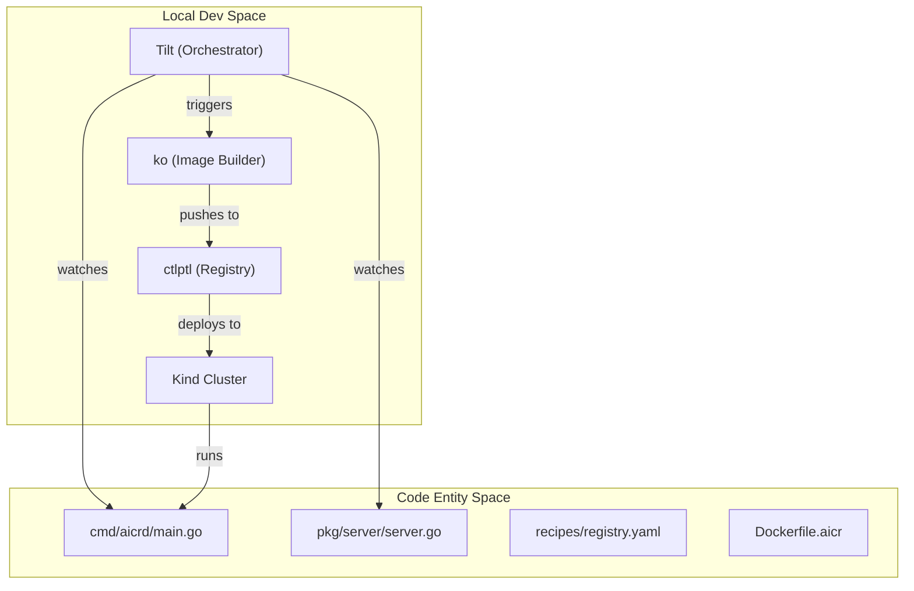
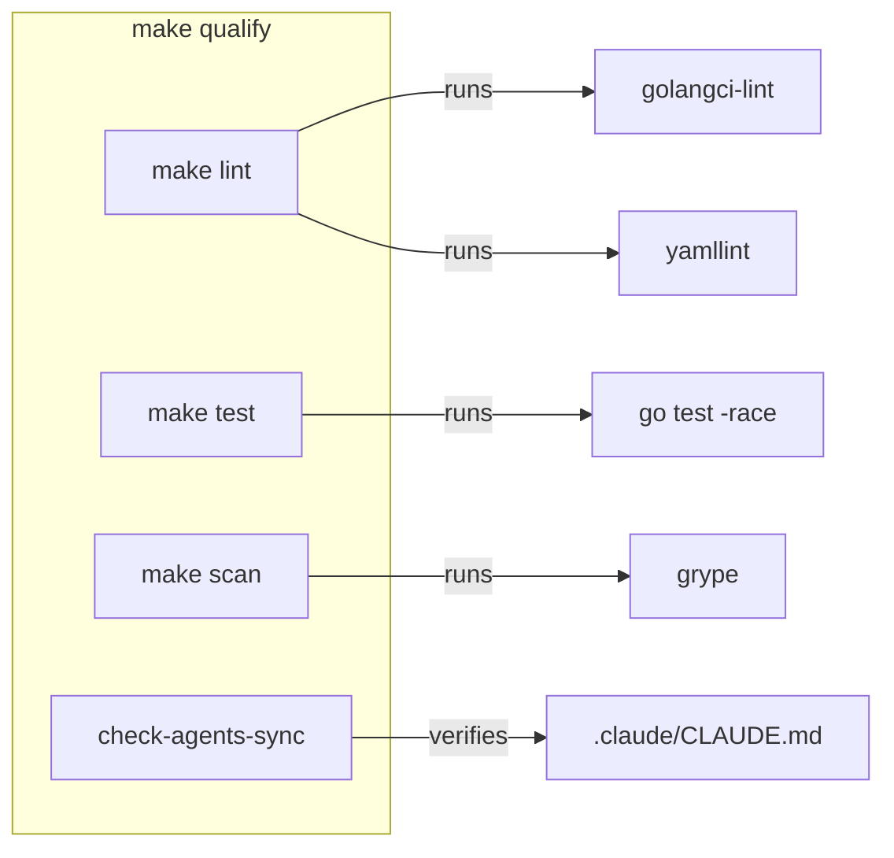

<!-- source: DeepWiki mcp.deepwiki.com · repo NVIDIA/aicr · page 9.4 Local Development Environment · fetched 2026-10-26 -->

# Local Development Environment

Relevant source files

The following files were used as context for generating this wiki page:

- [.claude/CLAUDE.md](.claude/CLAUDE.md)
- [.github/PULL_REQUEST_TEMPLATE.md](.github/PULL_REQUEST_TEMPLATE.md)
- [.github/actionlint.yaml](.github/actionlint.yaml)
- [.github/actions/README.md](.github/actions/README.md)
- [.github/actions/build-versioned-site/action.yml](.github/actions/build-versioned-site/action.yml)
- [.github/copilot-instructions.md](.github/copilot-instructions.md)
- [.github/dependabot.yml](.github/dependabot.yml)
- [.github/labeler.yml](.github/labeler.yml)
- [.github/workflows/actionlint.yaml](.github/workflows/actionlint.yaml)
- [.github/workflows/conflict-check.yaml](.github/workflows/conflict-check.yaml)
- [.github/workflows/dependabot-auto-merge.yaml](.github/workflows/dependabot-auto-merge.yaml)
- [.github/workflows/gh-pages.yaml](.github/workflows/gh-pages.yaml)
- [.github/workflows/inactive-pr-reminder.yaml](.github/workflows/inactive-pr-reminder.yaml)
- [.github/workflows/labeler.yaml](.github/workflows/labeler.yaml)
- [.github/workflows/lock-threads.yaml](.github/workflows/lock-threads.yaml)
- [.github/workflows/ok-to-test.yaml](.github/workflows/ok-to-test.yaml)
- [.github/workflows/triage.yaml](.github/workflows/triage.yaml)
- [.github/workflows/welcome.yaml](.github/workflows/welcome.yaml)
- [.yamllint.yaml](.yamllint.yaml)
- [AGENTS.md](AGENTS.md)
- [CONTRIBUTING.md](CONTRIBUTING.md)
- [DEVELOPMENT.md](DEVELOPMENT.md)
- [Makefile](Makefile)
- [RELEASING.md](RELEASING.md)
- [pkg/bundler/deployer/argocd/argocd_test.go](pkg/bundler/deployer/argocd/argocd_test.go)
- [pkg/bundler/deployer/argocd/templates/application.yaml.tmpl](pkg/bundler/deployer/argocd/templates/application.yaml.tmpl)
- [site/.vitepress/config.ts](site/.vitepress/config.ts)
- [site/.vitepress/theme/Landing.vue](site/.vitepress/theme/Landing.vue)
- [site/.vitepress/theme/custom.css](site/.vitepress/theme/custom.css)
- [site/.vitepress/theme/index.ts](site/.vitepress/theme/index.ts)
- [tests/chainsaw/cli/bundle-variants/chainsaw-test.yaml](tests/chainsaw/cli/bundle-variants/chainsaw-test.yaml)
- [tools/check-agents-sync](tools/check-agents-sync)
- [tools/common](tools/common)

The NVIDIA AI Cluster Runtime (AICR) project prioritizes a "Local Development Equals CI" philosophy [CONTRIBUTING.md:91-92](). By centralizing tool versions and utilizing containerized local Kubernetes clusters, the project ensures that any check passing on a developer's machine will pass in the GitHub Actions pipeline [CONTRIBUTING.md:95-98]().

## Automated Tooling Setup

The development environment is anchored by `.settings.yaml`, which serves as the single source of truth for all tool versions [DEVELOPMENT.md:89-91](). This file is consumed by both local setup scripts and CI workflows to maintain absolute parity [DEVELOPMENT.md:126-130]().

### Core Setup Commands

| Command | Action | File Reference |
|---------|--------|----------------|
| `make tools-setup` | Installs all required binaries (Go, Kind, Tilt, etc.) | [Makefile:58-61]() |
| `make tools-check` | Verifies installed versions against `.settings.yaml` | [Makefile:54-56]() |
| `make tools-update` | Force upgrades all tools to the latest pinned versions | [Makefile:63-66]() |
| `make tidy` | Formats code and synchronizes the `vendor/` directory | [Makefile:76-81]() |

Sources: [DEVELOPMENT.md:47-70](), [Makefile:50-67](), [CONTRIBUTING.md:60-63]()

## Local Kubernetes and Hot-Reloading

For developing the `aicrd` API server and testing Kubernetes integrations (like the Snapshot Agent), AICR uses a combination of **Kind**, **ctlptl**, and **Tilt** [DEVELOPMENT.md:66-68]().

### The `make dev-env` Workflow

Executing `make dev-env` orchestrates the following components:
1.  **Kind Cluster**: Creates a local Kubernetes cluster.
2.  **Local Registry**: Sets up a container registry (typically on port 5001) via `ctlptl` [Makefile:32-34]().
3.  **Tilt**: Starts a Tilt session that monitors the source code. When changes are detected in `pkg/` or `cmd/aicrd/`, Tilt triggers a `ko` build and redeploys the `aicrd` pod into Kind with hot-reload capabilities [DEVELOPMENT.md:68](), [.claude/CLAUDE.md:52]().

### Development Infrastructure Relationship
The following diagram maps the local development tools to their respective roles in the codebase.

**Local Dev Entity Mapping**

Sources: [DEVELOPMENT.md:66-68](), [Makefile:31-34](), [.claude/CLAUDE.md:50-53]()

## PR Workflow and Quality Gates

AICR enforces a rigorous Pull Request (PR) workflow to maintain high code quality and security standards.

### PR Labeling and Size Checks
The `Auto-Label PRs` workflow automatically categorizes PRs based on two criteria:
1.  **Path-based Labeling**: Uses `actions/labeler` to apply labels like `area/api`, `area/cli`, or `area/validator` based on the modified files [.github/workflows/labeler.yaml:39-44]().
2.  **Size-based Labeling**: A custom script calculates the total number of additions and deletions to assign a size label from `size/XS` (<10 lines) to `size/XL` (>500 lines) [.github/workflows/labeler.yaml:45-61]().

### "ok-to-test" Workflow
To protect CI resources and prevent malicious code execution from forks, the project uses an `ok-to-test` pattern. E2E tests and hardware-intensive tasks only run after a maintainer comments `/ok-to-test` on the PR [.github/workflows/ok-to-test.yaml]().

### Coverage Reporting
PRs must meet a coverage threshold, typically 70% [Makefile:18-21]().
- `make test` runs unit tests with the `-race` detector and generates `coverage.out` [Makefile:166-174]().
- `make test-coverage` enforces the threshold and will exit with an error if the project coverage falls below the requirement [Makefile:176-183]().

Sources: [.github/workflows/labeler.yaml:15-89](), [Makefile:18-29](), [Makefile:166-184]()

## Pre-Submission: `make qualify`

The `make qualify` target is the final local gate. It aggregates multiple checks to ensure the PR is ready for review [.claude/CLAUDE.md:37]():

1.  **Linting**: Runs `golangci-lint` for Go, `yamllint` for YAML, and `addlicense` for license headers [Makefile:105-108]().
2.  **Testing**: Executes unit tests with the race detector [Makefile:167-171]().
3.  **Security Scanning**: Runs `grype` to check for vulnerabilities in dependencies [Makefile:195-197]().
4.  **Sync Checks**: Verifies that `AGENTS.md` is in sync with `.claude/CLAUDE.md` and that documentation sidebars are updated [Makefile:109-115]().

**PR Qualification Pipeline**

Sources: [Makefile:105-124](), [Makefile:166-174](), [Makefile:195-197](), [DEVELOPMENT.md:39-41]()

## Flox Environment

The project supports `flox` for reproducible development environments. The `.flox` configuration (managed in the project root) provides a declarative way to manage the toolchain, ensuring that `go`, `yq`, `kubectl`, and other dependencies are available in the shell without manual installation.

Sources: [DEVELOPMENT.md:9-12](), [.claude/CLAUDE.md:62-65]()

---

