# Page: AICR Overview

# AICR Overview

<details>
<summary>Relevant source files</summary>

The following files were used as context for generating this wiki page:

- [.claude/CLAUDE.md](.claude/CLAUDE.md)
- [.ctlptl-kwok.yaml](.ctlptl-kwok.yaml)
- [.github/PULL_REQUEST_TEMPLATE.md](.github/PULL_REQUEST_TEMPLATE.md)
- [.github/actions/README.md](.github/actions/README.md)
- [.github/copilot-instructions.md](.github/copilot-instructions.md)
- [AGENTS.md](AGENTS.md)
- [CHANGELOG.md](CHANGELOG.md)
- [CONTRIBUTING.md](CONTRIBUTING.md)
- [DEVELOPMENT.md](DEVELOPMENT.md)
- [README.md](README.md)
- [RELEASING.md](RELEASING.md)
- [cliff.toml](cliff.toml)
- [docs/README.md](docs/README.md)
- [docs/contributor/component.md](docs/contributor/component.md)
- [docs/integrator/data-flow.md](docs/integrator/data-flow.md)
- [docs/integrator/recipe-development.md](docs/integrator/recipe-development.md)
- [tools/bump](tools/bump)
- [tools/check-agents-sync](tools/check-agents-sync)
- [tools/common](tools/common)

</details>


The **NVIDIA AI Cluster Runtime (AICR)** is a suite of tools designed to automate the deployment of GPU-accelerated Kubernetes infrastructure. It replaces manual, error-prone setup processes with a deterministic, automated workflow that captures known-good combinations of drivers, operators, kernels, and system configurations as version-locked **recipes** [README.md:1-19]().

AICR ensures that AI/ML workloads run on infrastructure that is validated against NVIDIA's hardware standards, optimized for specific workload intents (e.g., training vs. inference), and secured with verifiable supply chain provenance [docs/README.md:1-4]().

## The Four-Stage Pipeline

AICR operates through a structured four-stage lifecycle that transforms raw system state into deployment-ready artifacts.

| Stage | Command | Purpose |
| :--- | :--- | :--- |
| **Snapshot** | `aicr snapshot` | Captures the "as-is" state of the cluster (OS, GPU, K8s, etc.) [docs/README.md:52-57](). |
| **Recipe** | `aicr recipe` | Matches the snapshot or query criteria against validated overlays to generate a configuration [docs/README.md:59-66](). |
| **Validate** | `aicr validate` | Compares the cluster's actual state against the recipe's constraints [docs/README.md:67-75](). |
| **Bundle** | `aicr bundle` | Materializes the recipe into Helm charts, ArgoCD manifests, and deployment scripts [docs/README.md:76-80](). |

### Pipeline Entity Mapping
The following diagram bridges high-level pipeline stages to the Go packages and data entities that implement them.

**Pipeline to Code Entity Map**
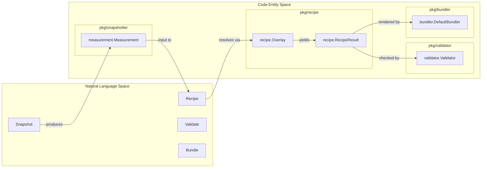
**Sources:** [pkg/recipe/resolve.go](), [pkg/bundler/bundler.go](), [pkg/validator/validator.go](), [docs/README.md:52-80]()

## Key Components

### Binaries
*   **`aicr` CLI**: A single binary built using `urfave/cli/v3` that provides the primary interface for all pipeline stages [DEVELOPMENT.md:176-181]().
*   **`aicrd` API Server**: A REST API server that exposes recipe generation and bundling capabilities for CI/CD integration and air-gapped environments [DEVELOPMENT.md:183-191]().

### In-Cluster Agents
*   **Snapshot Agent**: A Kubernetes Job that captures live cluster state (GPU hardware, drivers, OS) and stores it in a `ConfigMap` [README.md:62]().
*   **Validator Agent**: Orchestrates multi-phase validation (Deployment, Performance, Conformance) within the cluster [docs/README.md:71-75]().

### System Architecture
The architecture relies on a "base-plus-overlay" model where configurations are resolved through asymmetric matching of criteria (service, accelerator, OS, intent) [docs/README.md:64]().

**System Component Interaction**
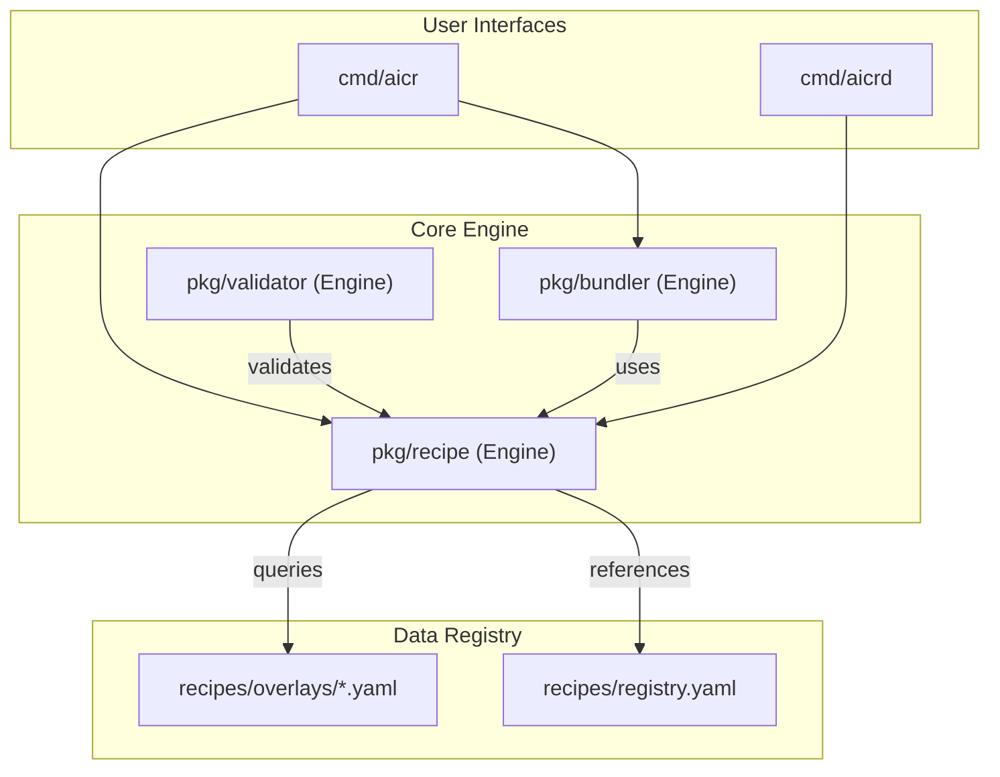
**Sources:** [DEVELOPMENT.md:145-172](), [docs/integrator/recipe-development.md:75-86]()

## Detailed Sub-sections

For in-depth technical details, refer to the following child pages:

*   **[Getting Started](#1.1)**: Installation via Homebrew or install script, environment prerequisites, and a 2-minute quick-start walkthrough [README.md:21-54]().
*   **[Architecture Overview](#1.2)**: Conceptual deep-dive into the data model, the asymmetric matching algorithm, and the Kubernetes-native `cm://` URI scheme for I/O [docs/README.md:5-27]().

---
**Sources:** [README.md](), [DEVELOPMENT.md](), [docs/README.md](), [docs/integrator/recipe-development.md]()

---

# Page: Getting Started

# Getting Started

<details>
<summary>Relevant source files</summary>

The following files were used as context for generating this wiki page:

- [.claude/CLAUDE.md](.claude/CLAUDE.md)
- [.github/PULL_REQUEST_TEMPLATE.md](.github/PULL_REQUEST_TEMPLATE.md)
- [.github/actions/README.md](.github/actions/README.md)
- [.github/copilot-instructions.md](.github/copilot-instructions.md)
- [AGENTS.md](AGENTS.md)
- [CONTRIBUTING.md](CONTRIBUTING.md)
- [DEVELOPMENT.md](DEVELOPMENT.md)
- [RELEASING.md](RELEASING.md)
- [demos/README.md](demos/README.md)
- [demos/cuj2.md](demos/cuj2.md)
- [demos/examples/CUJ2-Test-Report.md](demos/examples/CUJ2-Test-Report.md)
- [demos/valid.md](demos/valid.md)
- [docs/user/installation.md](docs/user/installation.md)
- [install](install)
- [pkg/bundler/deployer/helm/helm.go](pkg/bundler/deployer/helm/helm.go)
- [pkg/bundler/deployer/helm/helm_test.go](pkg/bundler/deployer/helm/helm_test.go)
- [pkg/bundler/deployer/helm/templates/deploy.sh.tmpl](pkg/bundler/deployer/helm/templates/deploy.sh.tmpl)
- [pkg/bundler/deployer/helm/templates/undeploy.sh.tmpl](pkg/bundler/deployer/helm/templates/undeploy.sh.tmpl)
- [recipes/components/cert-manager/values.yaml](recipes/components/cert-manager/values.yaml)
- [tools/check-agents-sync](tools/check-agents-sync)
- [tools/common](tools/common)

</details>


The NVIDIA AI Cluster Runtime (AICR) is a technical framework designed to generate, validate, and deploy optimized Kubernetes configurations for GPU-accelerated workloads. This page provides the technical procedures for installing the `aicr` CLI, setting up the development environment, and executing the end-to-end pipeline.

## Installation Methods

AICR provides multiple distribution channels to ensure compatibility with various environments, ranging from local workstations to automated CI/CD pipelines.

### 1. Automated Install Script (Recommended)
The installation script automatically detects the host operating system and architecture (e.g., `linux/amd64`, `darwin/arm64`) and fetches the corresponding binary from GitHub Releases [install:219-232]().

```bash
# Install to default /usr/local/bin
curl -sfL https://raw.githubusercontent.com/NVIDIA/aicr/main/install | bash -s --

# Install to a custom directory (e.g., for non-root users)
curl -sfL https://raw.githubusercontent.com/NVIDIA/aicr/main/install | bash -s -- -d ~/.local/bin
```

### 2. Homebrew (macOS/Linux)
For users managing packages via Homebrew, AICR maintains a custom tap [docs/user/installation.md:16-21]().
```bash
brew tap NVIDIA/aicr
brew install aicr
```

### 3. Containerized Execution
AICR is available as a container image, which is ideal for stateless execution in ephemeral environments [docs/user/installation.md:124-132]().
```bash
docker pull ghcr.io/nvidia/aicr:latest
docker run --rm -v $(pwd):/workspace -w /workspace ghcr.io/nvidia/aicr:latest --version
```

### 4. Building from Source
For contributors or environments requiring custom builds, AICR requires Go 1.26+ [DEVELOPMENT.md:49]().
```bash
go install github.com/NVIDIA/aicr/cmd/aicr@latest
```

**Sources:** [install:1-135](), [docs/user/installation.md:1-100](), [DEVELOPMENT.md:43-53]()

---

## Environment Prerequisites

To utilize the full functionality of the AICR pipeline, the following environmental components are required:

| Component | Requirement | Purpose |
| :--- | :--- | :--- |
| **Go** | 1.26+ | Core runtime for building/running the CLI and API server [DEVELOPMENT.md:49]() |
| **Kubernetes** | 1.33+ | Target environment for snapshots and bundle deployment [.claude/CLAUDE.md:27]() |
| **NVIDIA Driver** | Compatible with hardware | Required for the `GPUCollector` to interface with `nvidia-smi` [docs/user/installation.md:166-175]() |
| **Tools** | `yq`, `helm`, `kubectl` | Essential for YAML processing and cluster interaction [DEVELOPMENT.md:53-69]() |

**Sources:** [DEVELOPMENT.md:43-70](), [.claude/CLAUDE.md:27-28](), [docs/user/installation.md:7-12]()

---

## Quick-Start Pipeline Walkthrough

The AICR lifecycle follows a strictly defined four-stage data flow: **Snapshot → Recipe → Validate → Bundle** [.claude/CLAUDE.md:14-25]().

### Data Flow and Code Entity Mapping
The following diagram bridges the conceptual pipeline stages to the internal Go packages and CLI commands.

**AICR Pipeline Architecture**
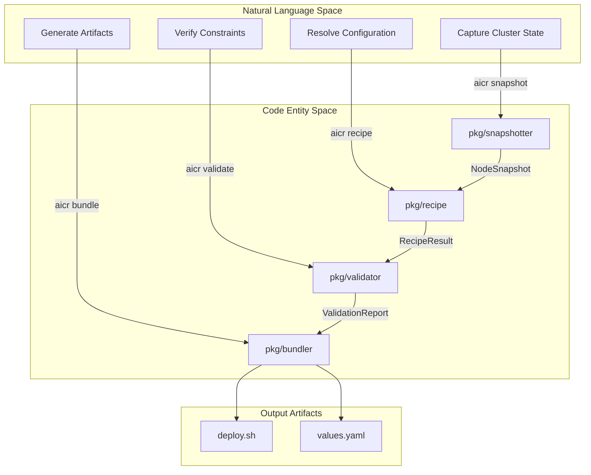
**Sources:** [.claude/CLAUDE.md:14-25](), [DEVELOPMENT.md:145-165](), [pkg/bundler/deployer/helm/helm.go:67-88]()

### Step 1: Snapshot
Capture the current state of the hardware and software environment. This utilizes the `pkg/collector` system to gather GPU, OS, and K8s metrics [DEVELOPMENT.md:194-203]().
```bash
aicr snapshot --output snapshot.yaml
```

### Step 2: Recipe Generation
Generate an optimized configuration based on the snapshot and user intent (e.g., training vs. inference) [demos/cuj2.md:7-15](). The `pkg/recipe` engine matches these inputs against the `ComponentRegistry` [DEVELOPMENT.md:204-210]().
```bash
aicr recipe \
  --snapshot snapshot.yaml \
  --intent training \
  --platform kubeflow \
  --output recipe.yaml
```

### Step 3: Validation
Verify that the target cluster meets the requirements defined in the recipe. This executes the `pkg/validator` logic, often deploying a temporary agent Job to the cluster [.claude/CLAUDE.md:87-91]().
```bash
aicr validate --recipe recipe.yaml --phase deployment --phase performance
```

### Step 4: Bundling and Deployment
The `pkg/bundler` transforms the validated recipe into a deployable Helm bundle [pkg/bundler/deployer/helm/helm.go:105-112](). This includes a generated `deploy.sh` script with retry logic and CRD race handling [pkg/bundler/deployer/helm/templates/deploy.sh.tmpl:84-100]().
```bash
# Generate the bundle
aicr bundle --recipe recipe.yaml --output ./my-bundle

# Deploy to the cluster
cd ./my-bundle
chmod +x deploy.sh
./deploy.sh
```

**Sources:** [demos/cuj2.md:7-46](), [.claude/CLAUDE.md:87-91](), [pkg/bundler/deployer/helm/helm.go:114-209](), [pkg/bundler/deployer/helm/templates/deploy.sh.tmpl:1-134]()

---

## Initial Setup for Developers

For contributors, the environment is managed via a centralized `.settings.yaml` file to ensure consistency between local development and CI pipelines [DEVELOPMENT.md:89-91]().

**Development Environment Initialization**
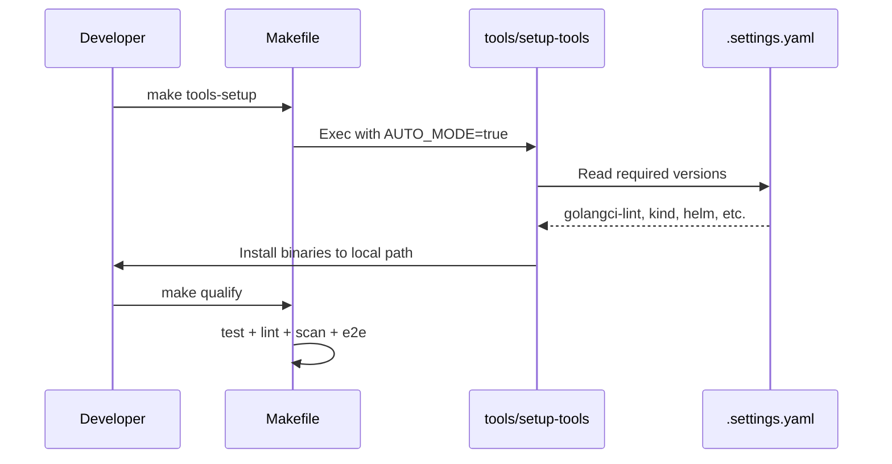

### Workflow Commands
| Command | Implementation | Purpose |
| :--- | :--- | :--- |
| `make tools-setup` | `tools/setup-tools` | Installs all required dev tools at pinned versions [DEVELOPMENT.md:94]() |
| `make build` | `cmd/aicr`, `cmd/aicrd` | Compiles the CLI and API server binaries [DEVELOPMENT.md:37]() |
| `make qualify` | `scripts/qualify.sh` | Runs full suite: lint, unit tests, vulnerability scan, and E2E [DEVELOPMENT.md:40]() |
| `make dev-env` | `tilt`, `kind` | Boots a local Kind cluster with Tilt hot-reloading [.claude/CLAUDE.md:52]() |

**Sources:** [DEVELOPMENT.md:19-41](), [DEVELOPMENT.md:88-101](), [.claude/CLAUDE.md:31-70]()

---

# Page: Architecture Overview

# Architecture Overview

<details>
<summary>Relevant source files</summary>

The following files were used as context for generating this wiki page:

- [.claude/CLAUDE.md](.claude/CLAUDE.md)
- [.github/PULL_REQUEST_TEMPLATE.md](.github/PULL_REQUEST_TEMPLATE.md)
- [.github/actions/README.md](.github/actions/README.md)
- [.github/copilot-instructions.md](.github/copilot-instructions.md)
- [AGENTS.md](AGENTS.md)
- [CONTRIBUTING.md](CONTRIBUTING.md)
- [DEVELOPMENT.md](DEVELOPMENT.md)
- [README.md](README.md)
- [RELEASING.md](RELEASING.md)
- [ROADMAP.md](ROADMAP.md)
- [docs/README.md](docs/README.md)
- [docs/contributor/cli.md](docs/contributor/cli.md)
- [docs/contributor/component.md](docs/contributor/component.md)
- [docs/contributor/data.md](docs/contributor/data.md)
- [docs/design/002-validatorv2-adr.md](docs/design/002-validatorv2-adr.md)
- [docs/images/aicr-end-to-end.png](docs/images/aicr-end-to-end.png)
- [docs/integrator/automation.md](docs/integrator/automation.md)
- [docs/integrator/data-flow.md](docs/integrator/data-flow.md)
- [docs/integrator/kubernetes-deployment.md](docs/integrator/kubernetes-deployment.md)
- [docs/integrator/recipe-development.md](docs/integrator/recipe-development.md)
- [docs/user/agent-deployment.md](docs/user/agent-deployment.md)
- [docs/user/api-reference.md](docs/user/api-reference.md)
- [tools/check-agents-sync](tools/check-agents-sync)
- [tools/common](tools/common)

</details>


The NVIDIA AI Cluster Runtime (AICR) is a technical framework designed to bridge the gap between high-level AI infrastructure requirements and low-level Kubernetes configuration. It automates the complexity of matching GPU hardware, drivers, and operators to specific cloud environments and workload intents.

## System Workflow and Data Flow

AICR operates through a deterministic four-stage pipeline. Each stage transforms data from one representation to another, moving from a measurement of physical reality to a deployable software bundle.

Title: AICR Pipeline Data Flow
```mermaid
graph LR
    subgraph "Capture Phase"
        A["Cluster/Node"] -- "pkg/collector" --> B["Snapshot (YAML/JSON)"]
    [pkg/snapshotter/snapshotter.go:1-100]()
    end

    subgraph "Inference Phase"
        B -- "pkg/recipe" --> C["Recipe (Metadata)"]
        D["Criteria/Overlays"] -- "Deep Merge" --> C
    [pkg/recipe/engine.go:1-100]()
    end

    subgraph "Verification Phase"
        C -- "pkg/validator" --> E["Validation Report (CTRF)"]
        B -- "Constraint Check" --> E
    [pkg/validator/validator.go:1-100]()
    end

    subgraph "Materialization Phase"
        C -- "pkg/bundler" --> F["Deployment Bundle"]
        G["Component Registry"] -- "Template" --> F
    [pkg/bundler/bundler.go:1-100]()
    end
```

Sources: `README.md`, `.claude/CLAUDE.md`, `pkg/snapshotter/snapshotter.go`, `pkg/recipe/engine.go`, `pkg/validator/validator.go`, `pkg/bundler/bundler.go`

---

## Core Components and Relationships

The system is split into two primary interfaces—the `aicr` CLI and the `aicrd` API server—which both utilize a shared set of functional packages. This separation ensures that business logic for recipe resolution and bundle generation is consistent regardless of how it is invoked.

Title: Component Entity Relationship
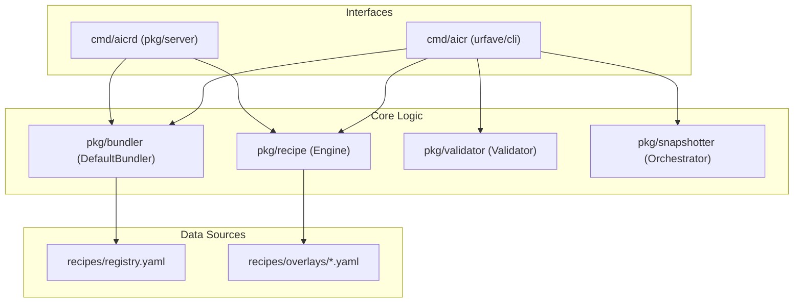

**Implementation Details:**
- **CLI (`aicr`)**: Built using `urfave/cli/v3` [pkg/cli/cli.go:1-50](). It handles user interaction and I/O orchestration.
- **API Server (`aicrd`)**: A RESTful service [cmd/aicrd/main.go:1-30]() providing endpoints like `GET /v1/recipe` and `POST /v1/bundle` [pkg/api/server.go:1-100]().
- **Recipe Engine**: Resolves the "best fit" configuration using an asymmetric matching algorithm [pkg/recipe/engine.go:50-150]().
- **Bundler**: Materializes the recipe into Helm values or ArgoCD manifests [pkg/bundler/bundler.go:20-80]().

Sources: `DEVELOPMENT.md`, `pkg/cli/cli.go`, `pkg/api/server.go`, `pkg/recipe/engine.go`, `pkg/bundler/bundler.go`

---

## The Base-Plus-Overlay Data Model

AICR uses a hierarchical data model to manage configuration drift across different clouds and hardware types. This model relies on **Multi-Level Inheritance** [docs/integrator/recipe-development.md:90-110]().

1.  **Base Layer (`base.yaml`)**: Universal defaults for all GPU clusters.
2.  **Intermediate Layer (e.g., `eks.yaml`)**: Shared configurations for specific cloud providers or services.
3.  **Leaf Layer (e.g., `h100-eks-ubuntu-training.yaml`)**: Highly specific overrides for hardware, OS, and workload intent.

### Merge Logic
The `pkg/recipe` engine performs a deep merge of these layers. 
- **Constraints**: Merged by key; more specific layers overwrite base layers [docs/integrator/recipe-development.md:130-134]().
- **ComponentRefs**: Merged field-by-field if the name matches [docs/integrator/recipe-development.md:132-132]().
- **Asymmetric Matching**: A query for `service: eks` will match an EKS recipe, but a generic query will not match a specific hardware overlay unless explicitly requested [docs/README.md:64-64]().

Sources: `docs/integrator/recipe-development.md`, `docs/README.md`, `pkg/recipe/engine.go`

---

## ConfigMap URI Scheme

AICR implements a Kubernetes-native I/O scheme to facilitate automation within clusters. This is primarily used by the **Snapshot Agent** [docs/user/agent-deployment.md:32-35]().

The URI format is `cm://<namespace>/<name>`.

### Data Flow for Kubernetes I/O:
1.  **Write**: The `aicr snapshot --output cm://gpu-operator/aicr-snapshot` command creates or updates a ConfigMap [docs/user/agent-deployment.md:34-35]().
2.  **Read**: The `aicr recipe --snapshot cm://gpu-operator/aicr-snapshot` command retrieves the snapshot data directly from the cluster using the Kubernetes API [docs/user/agent-deployment.md:207-207]().

This scheme allows AICR to operate without requiring persistent volumes (PVs) for state storage, using the Etcd-backed ConfigMap as a transient data exchange layer.

Sources: `docs/user/agent-deployment.md`, `pkg/k8s/pod/pod.go` (inferred from URI usage)

---

## Infrastructure and Security Architecture

AICR's architecture is designed for high-trust environments through built-in supply chain security.

| Feature | Implementation |
| :--- | :--- |
| **Provenance** | SLSA Build Level 3 attestations generated during the GitHub Actions release pipeline [RELEASING.md:110-110](). |
| **Signing** | Keyless Sigstore signing via Fulcio and Rekor for all container images and binaries [RELEASING.md:112-112](). |
| **SBOM** | SPDX-formatted Software Bill of Materials generated for every release [RELEASING.md:111-111](). |
| **Verification** | The `aicr bundle verify` command checks checksums and attestations [README.md:47-47](). |

Sources: `RELEASING.md`, `README.md`, `.github/actions/README.md`

---

# Page: CLI and API Server

# CLI and API Server

<details>
<summary>Relevant source files</summary>

The following files were used as context for generating this wiki page:

- [.claude/CLAUDE.md](.claude/CLAUDE.md)
- [.github/PULL_REQUEST_TEMPLATE.md](.github/PULL_REQUEST_TEMPLATE.md)
- [.github/actions/README.md](.github/actions/README.md)
- [.github/copilot-instructions.md](.github/copilot-instructions.md)
- [AGENTS.md](AGENTS.md)
- [CONTRIBUTING.md](CONTRIBUTING.md)
- [DEVELOPMENT.md](DEVELOPMENT.md)
- [RELEASING.md](RELEASING.md)
- [pkg/cli/root.go](pkg/cli/root.go)
- [pkg/cli/root_test.go](pkg/cli/root_test.go)
- [pkg/errors/exitcode.go](pkg/errors/exitcode.go)
- [pkg/recipe/provider_test.go](pkg/recipe/provider_test.go)
- [tools/check-agents-sync](tools/check-agents-sync)
- [tools/common](tools/common)

</details>


The NVIDIA AI Cluster Runtime (AICR) provides two primary interfaces for interacting with its core logic: the `aicr` command-line tool and the `aicrd` REST API server. Both interfaces act as thin wrappers around the project's functional packages, ensuring that business logic for snapshots, recipes, and bundling is consistent across all user touchpoints [DEVELOPMENT.md:117-120](), [.claude/CLAUDE.md:97-101]().

### Interface Overview

| Interface | Binary | Primary Use Case | Technology Stack |
| :--- | :--- | :--- | :--- |
| **CLI** | `aicr` | Local development, CI/CD pipelines, manual cluster audits. | [urfave/cli/v3](https://github.com/urfave/cli) [DEVELOPMENT.md:178]() |
| **API Server** | `aicrd` | Web-based integrations, centralized management services. | Standard Go `http` + `slog` [DEVELOPMENT.md:184-190]() |

The following diagram illustrates how both interfaces consume the same underlying functional packages to maintain architectural parity.

**Interface to Logic Mapping**
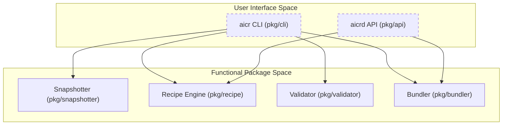
Sources: [DEVELOPMENT.md:176-192](), [.claude/CLAUDE.md:97-101](), [pkg/cli/root.go:149-156]()

---

## aicr CLI Commands

The `aicr` CLI is the primary tool for executing the four-stage AICR workflow: **Snapshot → Recipe → Validate → Bundle** [.claude/CLAUDE.md:14-25](). It is built using the `urfave/cli/v3` framework and supports multiple output formats including YAML, JSON, and human-readable tables [DEVELOPMENT.md:178-181]().

Key features of the CLI include:
*   **ConfigMap URI Support**: The `--output` flag supports a specialized `cm://` scheme, allowing results to be written directly to Kubernetes ConfigMaps [pkg/cli/root.go:60-65]().
*   **External Data Overlays**: Users can provide a `--data` directory to override or extend the embedded recipe registry and component values [pkg/cli/root.go:82-89]().
*   **Structured Logging**: Supports standard `slog` output with a `--log-json` flag for machine readability [pkg/cli/root.go:116-121]().

For a detailed reference on flags, command arguments, and usage examples, see **[aicr CLI Commands](#2.1)**.

Sources: [pkg/cli/root.go:60-156](), [DEVELOPMENT.md:176-182]()

---

## aicrd API Server

The `aicrd` daemon provides a RESTful interface to AICR's recipe and bundling capabilities. It is designed for deployment as a Kubernetes service or a standalone container (e.g., Google Cloud Run) [RELEASING.md:149-151]().

The server includes:
*   **Standard Endpoints**: `/v1/recipe` for generation and `/v1/bundle` for artifact creation [DEVELOPMENT.md:185-187]().
*   **Observability**: Built-in `/health`, `/ready`, and `/metrics` (Prometheus) endpoints [DEVELOPMENT.md:188-189]().
*   **Production Hardening**: Middleware for rate limiting and structured logging via `slog` [DEVELOPMENT.md:190]().

For details on API schemas, deployment configurations, and middleware internals, see **[aicrd API Server](#2.2)**.

Sources: [DEVELOPMENT.md:183-192](), [.claude/CLAUDE.md:101]()

---

## Common Infrastructure

Both interfaces share a common set of utilities for error handling and data serialization.

### Error Handling and Exit Codes
AICR uses a structured error system defined in `pkg/errors`. This system maps internal error codes (e.g., `ErrCodeNotFound`) to standard Unix exit codes to facilitate predictable scripting [pkg/errors/exitcode.go:26-60]().

**CLI Exit Code Mapping**
| Error Code | Exit Code | Description |
| :--- | :--- | :--- |
| `ErrCodeInvalidRequest` | 2 | Malformed input or validation failure. |
| `ErrCodeNotFound` | 3 | Resource not found. |
| `ErrCodeTimeout` | 5 | Operation exceeded time limit. |
| `ErrCodeInternal` | 8 | Unexpected internal failure. |

Sources: [pkg/errors/exitcode.go:26-60](), [pkg/errors/exitcode.go:80-99]()

### Component Interaction Diagram
The following diagram traces a user request from the CLI or API through the shared error and logging stack into the core logic.

**Request Flow and Code Entities**
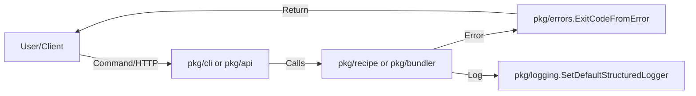
Sources: [pkg/cli/root.go:122-148](), [pkg/errors/exitcode.go:65-77](), [pkg/cli/root.go:162-167]()

---

# Page: aicr CLI Commands

# aicr CLI Commands

<details>
<summary>Relevant source files</summary>

The following files were used as context for generating this wiki page:

- [demos/attestation.md](demos/attestation.md)
- [docs/user/cli-reference.md](docs/user/cli-reference.md)
- [pkg/bundler/bundler.go](pkg/bundler/bundler.go)
- [pkg/bundler/bundler_test.go](pkg/bundler/bundler_test.go)
- [pkg/bundler/config/config.go](pkg/bundler/config/config.go)
- [pkg/bundler/config/config_test.go](pkg/bundler/config/config_test.go)
- [pkg/bundler/verifier/trust.go](pkg/bundler/verifier/trust.go)
- [pkg/bundler/verifier/trust_test.go](pkg/bundler/verifier/trust_test.go)
- [pkg/cli/bundle.go](pkg/cli/bundle.go)
- [pkg/cli/bundle_verify.go](pkg/cli/bundle_verify.go)
- [pkg/cli/bundle_verify_test.go](pkg/cli/bundle_verify_test.go)
- [pkg/cli/root.go](pkg/cli/root.go)
- [pkg/cli/root_test.go](pkg/cli/root_test.go)
- [pkg/cli/snapshot.go](pkg/cli/snapshot.go)
- [pkg/cli/validate.go](pkg/cli/validate.go)
- [pkg/cli/validate_test.go](pkg/cli/validate_test.go)
- [pkg/errors/exitcode.go](pkg/errors/exitcode.go)
- [pkg/k8s/agent/deployer.go](pkg/k8s/agent/deployer.go)
- [pkg/k8s/agent/deployer_test.go](pkg/k8s/agent/deployer_test.go)
- [pkg/k8s/agent/job.go](pkg/k8s/agent/job.go)
- [pkg/k8s/agent/permissions.go](pkg/k8s/agent/permissions.go)
- [pkg/k8s/agent/rbac.go](pkg/k8s/agent/rbac.go)
- [pkg/k8s/agent/types.go](pkg/k8s/agent/types.go)
- [pkg/recipe/components.go](pkg/recipe/components.go)
- [pkg/recipe/components_test.go](pkg/recipe/components_test.go)
- [pkg/recipe/provider_test.go](pkg/recipe/provider_test.go)
- [pkg/snapshotter/agent.go](pkg/snapshotter/agent.go)
- [pkg/snapshotter/snapshot.go](pkg/snapshotter/snapshot.go)
- [recipes/overlays/eks.yaml](recipes/overlays/eks.yaml)
- [tests/chainsaw/cli/bundle-attestation/chainsaw-test.yaml](tests/chainsaw/cli/bundle-attestation/chainsaw-test.yaml)
- [validators/conformance/pod_autoscaling_check.go](validators/conformance/pod_autoscaling_check.go)

</details>


The `aicr` CLI is the primary interface for the NVIDIA AI Cluster Runtime pipeline. It implements a four-stage workflow: capturing cluster state, generating optimization recipes, validating infrastructure against those recipes, and producing deployment-ready bundles.

### Global Flags

The CLI is built using `urfave/cli/v3` [pkg/cli/root.go:15-25]() and supports global flags for logging and output control.

| Flag | Short | Type | Default | Description |
| :--- | :--- | :--- | :--- | :--- |
| `--debug` | `-d` | bool | `false` | Enable debug logging (text mode with full metadata) |
| `--log-json` | | bool | `false` | Enable JSON logging for machine parsing |

**Logging Modes Implementation:**
The CLI supports three logging modes:
1.  **CLI Mode (Default):** Minimal output for human readability [docs/user/cli-reference.md:35-38]().
2.  **Text Mode (`--debug`):** Key=value format including timestamps and source locations [docs/user/cli-reference.md:40-42]().
3.  **JSON Mode (`--log-json`):** Structured JSON via `slog` for automation [docs/user/cli-reference.md:44-46]().

Sources: [docs/user/cli-reference.md:20-47](), [pkg/cli/root.go:15-30]()

---

### Command: snapshot

The `snapshot` command captures the current state of a Kubernetes cluster, including GPU hardware details, OS configurations, and SystemD service states.

#### Implementation and Data Flow
The snapshot process utilizes a **K8s Agent** pattern. The CLI does not collect data locally; instead, it deploys a privileged Job into the cluster to perform collection [pkg/cli/snapshot.go:171-180]().

1.  **RBAC Provisioning:** The `Deployer` creates a `ServiceAccount`, `Role` (for ConfigMap access), and `ClusterRole` (for node/pod discovery) [pkg/k8s/agent/rbac.go:45-165]().
2.  **Agent Deployment:** A `batchv1.Job` is created. If `privileged` is true (default), the pod uses `hostPID: true` and `hostNetwork: true` to access the node's underlying OS and GPU drivers [pkg/k8s/agent/job.go:140-160]().
3.  **Collection:** The agent runs the `aicr snapshot` command internally, executing collectors (GPU, OS, K8s, SystemD) in parallel [pkg/cli/snapshot.go:163-170]().
4.  **Retrieval:** The agent writes the result to a `ConfigMap`. The CLI watches the Job for completion, retrieves the `ConfigMap` data, and saves it to the specified `--output` [pkg/snapshotter/agent.go:166-183]().

#### Snapshot Logic Diagram
"This diagram maps the CLI execution to the internal K8s Agent deployment entities."

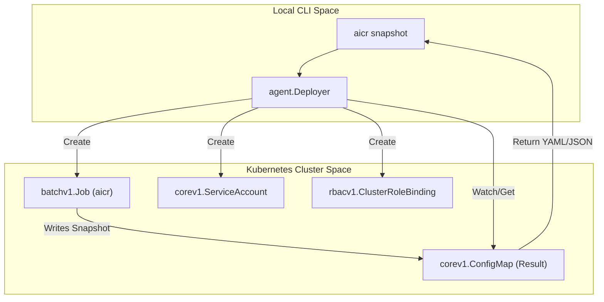

Sources: [pkg/cli/snapshot.go:157-188](), [pkg/snapshotter/agent.go:97-184](), [pkg/k8s/agent/job.go:68-103](), [pkg/k8s/agent/rbac.go:15-100]()

---

### Command: recipe

The `recipe` command resolves a set of infrastructure **Criteria** (e.g., Service=EKS, Accelerator=H100) into a concrete **RecipeResult** containing specific component versions and constraints.

#### ConfigMap URI Scheme
The CLI supports a `cm://` URI scheme for Kubernetes-native I/O, allowing snapshots and recipes to be stored directly in the cluster [docs/user/cli-reference.md:88-96]().
*   **Format:** `cm://<namespace>/<name>`
*   **Usage:** `aicr recipe --input cm://gpu-operator/snapshot-1`

#### Logic and Resolution
The command takes a snapshot as input and matches its measurements against the `ComponentRegistry` and `Overlays` [docs/user/cli-reference.md:210-220]().
*   **Asymmetric Matching:** The engine matches snapshot measurements against criteria defined in overlays like `recipes/overlays/eks.yaml` [recipes/overlays/eks.yaml:24-31]().
*   **Deep Merge:** It merges component references and constraints from the base recipe up through specific cloud and hardware overlays [recipes/overlays/eks.yaml:34-43]().

Sources: [docs/user/cli-reference.md:162-225](), [recipes/overlays/eks.yaml:15-43](), [pkg/cli/bundle.go:85-88]()

---

### Command: validate

The `validate` command executes a multi-phase validation suite (Deployment, Performance, Conformance) against the cluster.

#### Validation Phases
Users can filter which phases to run using the `--phase` flag [pkg/cli/validate.go:85-118]().

| Phase | Internal Entity | Description |
| :--- | :--- | :--- |
| `deployment` | `validator.PhaseDeployment` | Checks if operators/drivers are running [pkg/cli/validate.go:98](). |
| `performance` | `validator.PhasePerformance` | Runs NCCL benchmarks and stress tests [pkg/cli/validate.go:99](). |
| `conformance` | `validator.PhaseConformance` | Validates CNCF AI requirements (DRA, Gang Scheduling) [pkg/cli/validate.go:100](). |

#### CNCF Evidence Collection
The command includes specialized flags for the **CNCF AI Conformance** program:
*   `--cncf-submission`: Enables behavioral evidence gathering [pkg/cli/validate.go:348-355]().
*   `--evidence-dir`: Specifies where to save logs and CTRF (Common Test Report Format) results [pkg/cli/validate.go:219]().

Sources: [pkg/cli/validate.go:85-118](), [pkg/cli/validate.go:330-360](), [pkg/cli/validate_test.go:180-204]()

---

### Command: bundle

The `bundle` command transforms a `RecipeResult` into a deployable artifact, typically a collection of Helm charts with optimized `values.yaml` files.

#### Deployment Targets
The `--deployer` flag determines the output structure [pkg/cli/bundle.go:104-113]():
1.  **Helm (Default):** Generates a directory with `deploy.sh` and per-component `values.yaml` [pkg/bundler/bundler.go:42-50]().
2.  **ArgoCD:** Generates an App-of-Apps pattern with `application.yaml` manifests [pkg/bundler/bundler.go:149-160]().

#### Node Scheduling Injection
The bundler automatically injects `nodeSelector` and `tolerations` into components based on their tier:
*   **System Tier:** Components like `aws-ebs-csi-driver` [recipes/overlays/eks.yaml:38-42]().
*   **Accelerated Tier:** Components requiring GPUs (e.g., GPU Operator).
*   **Workload Gate:** Injects the `skyhook.io/runtime-required` taint to prevent pods from starting until validation passes [pkg/cli/bundle.go:168-172]().

#### Bundle Attestation
When the `--attest` flag is used, the CLI performs **SLSA Build Provenance** signing [pkg/bundler/bundler.go:120-135]().
*   **Implementation:** Uses Sigstore (Fulcio/Rekor) to bind the bundle's `checksums.txt` to an OIDC identity [pkg/cli/bundle.go:56-60]().
*   **Safety Check:** The `DefaultBundler` verifies that the `aicr` binary itself contains a valid NVIDIA attestation before signing a bundle [pkg/bundler/bundler.go:120-137]().

Sources: [pkg/bundler/bundler.go:42-65](), [pkg/bundler/bundler.go:147-190](), [pkg/cli/bundle.go:104-188](), [pkg/bundler/bundler_test.go:69-88]()

---

### Command: bundle verify

The `bundle verify` command validates the integrity and provenance of a generated bundle.

#### Verification Workflow
1.  **Binary Trust:** Verifies that the `aicr` binary used to perform verification is signed by NVIDIA [pkg/bundler/bundler.go:120-130]().
2.  **Signature Verification:** Checks the `bundle-attestation.sigstore.json` against the Rekor transparency log [pkg/cli/bundle_verify.go:15-30]().
3.  **Checksum Integrity:** Recalculates SHA256 hashes for all files in the bundle and compares them to the signed `checksums.txt` [pkg/bundler/bundler.go:159]().

#### Entity Mapping Diagram
"Mapping CLI verification flags to the internal security and verifier packages."

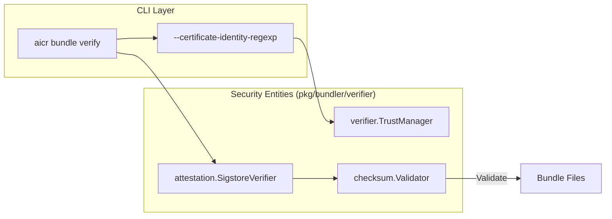

Sources: [pkg/cli/bundle_verify.go:10-40](), [pkg/bundler/bundler.go:120-140](), [pkg/bundler/verifier/trust.go:10-30]()

---

# Page: aicrd API Server

# aicrd API Server

<details>
<summary>Relevant source files</summary>

The following files were used as context for generating this wiki page:

- [.claude/CLAUDE.md](.claude/CLAUDE.md)
- [.github/PULL_REQUEST_TEMPLATE.md](.github/PULL_REQUEST_TEMPLATE.md)
- [.github/actions/README.md](.github/actions/README.md)
- [.github/copilot-instructions.md](.github/copilot-instructions.md)
- [AGENTS.md](AGENTS.md)
- [CONTRIBUTING.md](CONTRIBUTING.md)
- [DEVELOPMENT.md](DEVELOPMENT.md)
- [RELEASING.md](RELEASING.md)
- [ROADMAP.md](ROADMAP.md)
- [docs/contributor/cli.md](docs/contributor/cli.md)
- [docs/contributor/data.md](docs/contributor/data.md)
- [docs/design/002-validatorv2-adr.md](docs/design/002-validatorv2-adr.md)
- [docs/images/aicr-end-to-end.png](docs/images/aicr-end-to-end.png)
- [docs/integrator/automation.md](docs/integrator/automation.md)
- [docs/integrator/kubernetes-deployment.md](docs/integrator/kubernetes-deployment.md)
- [docs/user/agent-deployment.md](docs/user/agent-deployment.md)
- [docs/user/api-reference.md](docs/user/api-reference.md)
- [pkg/validator/phases.go](pkg/validator/phases.go)
- [pkg/validator/validator.go](pkg/validator/validator.go)
- [pkg/validator/validator_test.go](pkg/validator/validator_test.go)
- [tests/e2e/run.sh](tests/e2e/run.sh)
- [tools/check-agents-sync](tools/check-agents-sync)
- [tools/common](tools/common)

</details>


The `aicrd` daemon is the RESTful interface for the NVIDIA AI Cluster Runtime (AICR). It provides programmatic access to the recipe generation and bundling engines, allowing external systems—such as CI/CD pipelines, GitOps controllers, or custom dashboards—to request validated GPU-accelerated Kubernetes configurations without requiring the `aicr` CLI.

## Purpose and Scope

The API server encapsulates the core business logic of AICR into a stateless HTTP service. While the `aicr` CLI is optimized for interactive use and local cluster operations (like snapshotting), `aicrd` is designed for remote integration. It handles:
*   **Recipe Resolution**: Translating environment parameters or `RecipeCriteria` into specialized `RecipeResult` objects.
*   **Bundle Generation**: Transforming recipes into downloadable ZIP archives containing Helm values and deployment scripts.
*   **Observability**: Providing Prometheus metrics, health probes, and structured logging for production deployments.

[DEVELOPMENT.md:183-192]()

## REST Endpoints

The `aicrd` server exposes a versioned API under `/v1/`.

### Recipe Generation
*   **`GET /v1/recipe`**: Generates a recipe based on query parameters (`service`, `accelerator`, `intent`, `os`, `platform`, `nodes`). [docs/user/api-reference.md:109-124]()
*   **`POST /v1/recipe`**: Accepts a `RecipeCriteria` YAML or JSON body to generate a recipe. This is the programmatic equivalent of `aicr recipe --criteria`. [docs/user/api-reference.md:146-170]()

### Bundle Creation
*   **`POST /v1/bundle`**: Accepts a `RecipeResult` JSON body and returns a `application/zip` stream containing the generated deployment artifacts. [docs/user/api-reference.md:269-272]()

### System Endpoints
*   **`GET /health`**: Liveness probe. [DEVELOPMENT.md:187]()
*   **`GET /ready`**: Readiness probe. [DEVELOPMENT.md:188]()
*   **`GET /metrics`**: Prometheus-formatted metrics. [DEVELOPMENT.md:189]()
*   **`GET /`**: Returns service information and a list of available routes. [docs/user/api-reference.md:90-105]()

**Sources:** [DEVELOPMENT.md:183-192](), [docs/user/api-reference.md:1-272]()

## Middleware Stack

The API server implements a robust middleware stack to ensure production-grade resiliency and observability.

| Middleware | Purpose | Implementation Detail |
| :--- | :--- | :--- |
| **Rate Limiting** | Prevents DoS and resource exhaustion. | Enforced per-IP or per-client. |
| **Structured Logging** | Provides machine-readable logs. | Uses `slog` with correlation IDs. |
| **Prometheus** | Exports performance data. | Tracks request latency and error rates. |
| **Context Timeouts** | Prevents hanging requests. | Handlers enforce a strict 30s timeout. |

**Sources:** [DEVELOPMENT.md:190](), [.claude/CLAUDE.md:149-155](), [.github/copilot-instructions.md:12-14]()

## Data Flow: Request to Artifact

The following diagram illustrates how a request for a bundle flows through the `aicrd` internal components, bridging the "Natural Language Space" of an API call to the "Code Entity Space".

### API Request Lifecycle
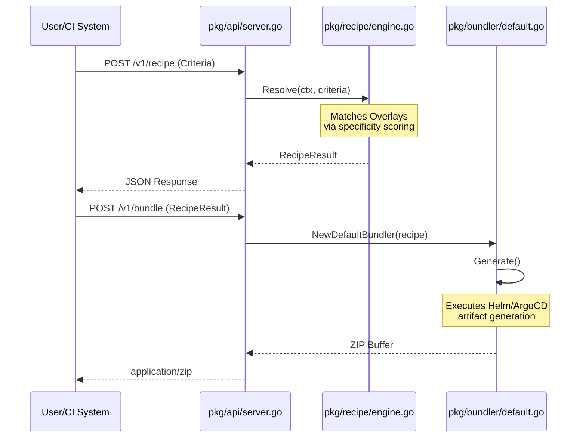
**Sources:** [docs/user/api-reference.md:9-18](), [.claude/CLAUDE.md:14-25](), [DEVELOPMENT.md:183-192]()

## Deployment as a Kubernetes Service

`aicrd` is typically deployed as a stateless Service within a Kubernetes cluster or as a serverless container (e.g., Google Cloud Run).

### Container Image
The server is packaged as a minimal, distroless image for security:
*   **Image**: `ghcr.io/nvidia/aicrd:latest`
*   **Base**: `gcr.io/distroless/static:nonroot`
*   **Port**: `8080`

[RELEASING.md:102]()

### Deployment Architecture
The API server acts as the central hub for automated workflows. While the **AICR Agent** (deployed as a `Job`) handles local node state, `aicrd` handles the logic of what *should* be installed.

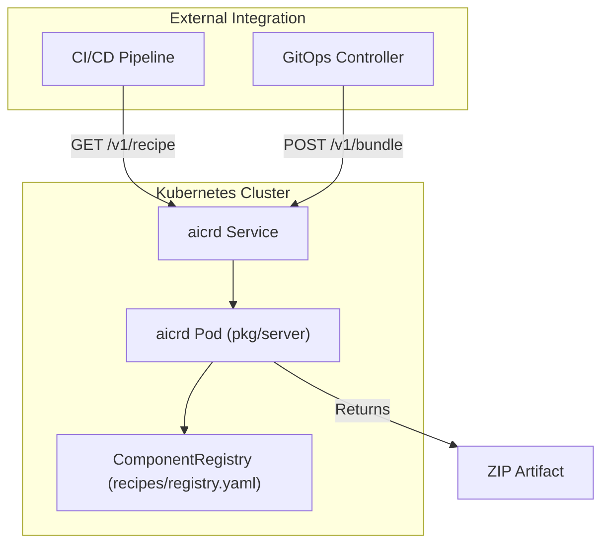
**Sources:** [DEVELOPMENT.md:183-192](), [docs/user/api-reference.md:20-31](), [RELEASING.md:147-152]()

## Local Development and Testing

The project provides a `Tiltfile` and `make` targets to facilitate local development of the API server.

*   **`make server`**: Starts the `aicrd` server locally in debug mode. [.claude/CLAUDE.md:51]()
*   **`make dev-env`**: Spins up a Kind cluster and starts `Tilt`, which hot-reloads the `aicrd` container upon code changes. [.claude/CLAUDE.md:52]()
*   **E2E Testing**: The `tests/e2e/run.sh` script performs health checks against `localhost:8080/health` and validates the `/v1/recipe` endpoints using `curl`. [tests/e2e/run.sh:160-236]()

**Sources:** [.claude/CLAUDE.md:31-70](), [tests/e2e/run.sh:1-236]()

---

# Page: Recipe Engine

# Recipe Engine

<details>
<summary>Relevant source files</summary>

The following files were used as context for generating this wiki page:

- [README.md](README.md)
- [docs/README.md](docs/README.md)
- [docs/contributor/component.md](docs/contributor/component.md)
- [docs/integrator/data-flow.md](docs/integrator/data-flow.md)
- [docs/integrator/recipe-development.md](docs/integrator/recipe-development.md)
- [examples/recipes/eks-gb200-ubuntu-training-with-validation.yaml](examples/recipes/eks-gb200-ubuntu-training-with-validation.yaml)
- [examples/recipes/eks-training.yaml](examples/recipes/eks-training.yaml)
- [examples/recipes/kind.yaml](examples/recipes/kind.yaml)
- [recipes/components/kai-scheduler/manifests/disable-runtime-class-injection.yaml](recipes/components/kai-scheduler/manifests/disable-runtime-class-injection.yaml)
- [recipes/overlays/base.yaml](recipes/overlays/base.yaml)
- [recipes/overlays/monitoring-hpa.yaml](recipes/overlays/monitoring-hpa.yaml)
- [recipes/registry.yaml](recipes/registry.yaml)
- [tests/chainsaw/ai-conformance/cluster/assert-skyhook.yaml](tests/chainsaw/ai-conformance/cluster/assert-skyhook.yaml)
- [tests/chainsaw/cli/cuj1-training/mock-snapshot.yaml](tests/chainsaw/cli/cuj1-training/mock-snapshot.yaml)

</details>


The **Recipe Engine** is the core intelligence of AICR. It transforms high-level environmental criteria (Cloud provider, GPU type, OS, and Workload Intent) into a deterministic, version-locked configuration called a **Recipe**. The engine uses a **base-plus-overlay inheritance model** to compose these configurations from a library of validated metadata.

The recipe system ensures that infrastructure deployments are not just "installable" but are optimized and validated for specific NVIDIA hardware and cloud environments [README.md:15-19]().

### Workflow Overview

The engine operates in two primary modes:
1.  **Query Mode**: Generates a recipe directly from CLI flags (e.g., `--accelerator h100 --service eks`) [docs/integrator/data-flow.md:147-150]().
2.  **Snapshot Mode**: Analyzes a `Snapshot` (captured cluster state) to automatically infer criteria like Kubernetes version, OS distribution, and GPU models, then matches them to the best available overlays [docs/integrator/data-flow.md:152-171]().

### Natural Language to Code Entity Mapping

The following diagram bridges the conceptual "Natural Language Space" of user requirements to the "Code Entity Space" of the AICR Recipe Engine.

**Diagram: Requirement Mapping to Code Entities**
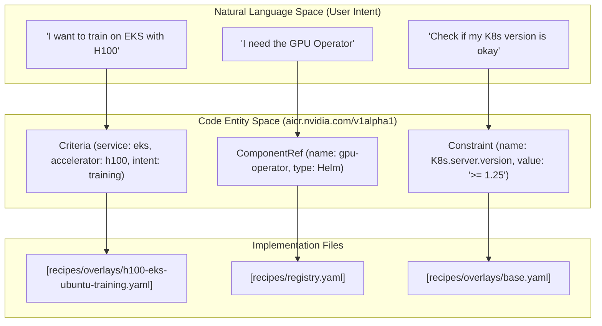
**Sources:** [docs/README.md:7-26](), [recipes/registry.yaml:38-41](), [recipes/overlays/base.yaml:15-25]().

---

### The Overlay Inheritance Model

AICR uses a layered approach to configuration. Instead of monolithic files, recipes are composed by merging a chain of **Overlays**. This allows common settings (like `cert-manager` versions) to be defined once in a base layer and specialized only where necessary (e.g., specific driver versions for GB200).

**Resolution Chain:**
`base.yaml` (Universal Defaults) → `eks.yaml` (Provider Defaults) → `eks-training.yaml` (Workload Tuning) → `h100-eks-ubuntu-training.yaml` (Hardware Leaf)

**Merge Rules:**
*   **Constraints**: Overlays can add new constraints or override existing ones by name [docs/integrator/recipe-development.md:131]().
*   **ComponentRefs**: Merged field-by-field. For example, a leaf overlay can change the `version` of a component defined in the base without redefining its `source` [docs/integrator/recipe-development.md:132]().
*   **Values**: Deep-merged from `Base` → `ValuesFile` → `Overrides` → `CLI --set flags` [docs/integrator/recipe-development.md:192-200]().

For technical details on scoring and asymmetric matching, see **[Overlay System and Recipe Resolution](#3.2)**.

---

### Component Registry

The **ComponentRegistry** is a declarative catalog defined in `recipes/registry.yaml`. It serves as the "source of truth" for how the engine should handle individual software packages like the `gpu-operator` or `nvsentinel`.

**Key Features of the Registry:**
*   **Source Mapping**: Defines default Helm repositories or Kustomize sources [recipes/registry.yaml:24-31]().
*   **Node Scheduling**: Maps where the engine should inject `nodeSelector` and `toleration` values within a component's Helm values tree (e.g., `operator.nodeSelector` vs `daemonsets.nodeSelector`) [recipes/registry.yaml:52-73]().
*   **Health Checks**: Points to `assertFile` definitions used by the Validator to verify component health [recipes/registry.yaml:46-47]().

**Diagram: Component Resolution Flow**
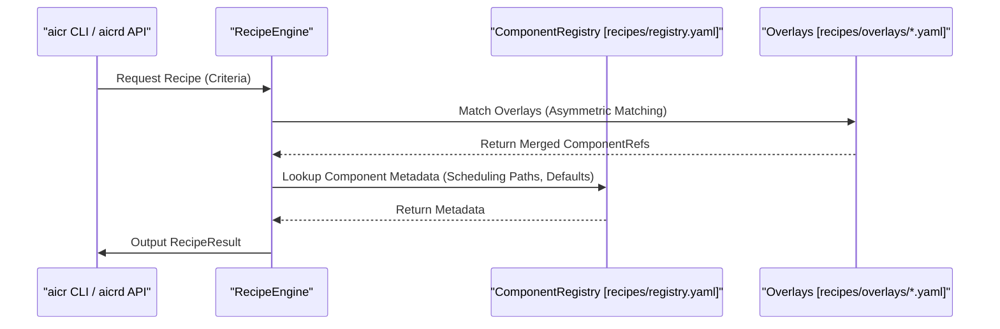
**Sources:** [recipes/registry.yaml:15-37](), [docs/integrator/recipe-development.md:88-128]().

For a list of all supported components and how to add new ones, see **[Component Catalog and Registry](#3.3)**.

---

### Child Pages

*   **[Recipe Data Model](#3.1)**: Deep dive into the `v1alpha1` schema, including `RecipeMetadata`, `RecipeResult`, and `Constraints`.
*   **[Overlay System and Recipe Resolution](#3.2)**: Details on the matching algorithm, specificity scoring, and deep-merge logic.
*   **[Component Catalog and Registry](#3.3)**: How to extend AICR by adding components to `registry.yaml` and defining scheduling paths.
*   **[Cloud-Specific Overlays (EKS, GKE, AKS)](#3.4)**: Overview of provider-specific tuning and hardware profiles (H100/GB200).

---

# Page: Recipe Data Model

# Recipe Data Model

<details>
<summary>Relevant source files</summary>

The following files were used as context for generating this wiki page:

- [pkg/cli/recipe.go](pkg/cli/recipe.go)
- [pkg/component/base.go](pkg/component/base.go)
- [pkg/component/overrides.go](pkg/component/overrides.go)
- [pkg/measurement/types.go](pkg/measurement/types.go)
- [pkg/recipe/criteria.go](pkg/recipe/criteria.go)
- [pkg/recipe/criteria_test.go](pkg/recipe/criteria_test.go)
- [pkg/recipe/metadata.go](pkg/recipe/metadata.go)
- [pkg/recipe/metadata_store.go](pkg/recipe/metadata_store.go)
- [pkg/recipe/metadata_test.go](pkg/recipe/metadata_test.go)
- [pkg/recipe/provider.go](pkg/recipe/provider.go)
- [pkg/recipe/recipe.go](pkg/recipe/recipe.go)
- [pkg/version/version.go](pkg/version/version.go)

</details>


The Recipe Data Model defines the structural contract for cluster configuration and deployment orchestration within AICR. It leverages a base-plus-overlay inheritance system to transform environmental snapshots into actionable deployment plans. The model is versioned under the `aicr.nvidia.com/v1alpha1` API group.

## Core Entities and API Versioning

The system revolves around two primary resource kinds defined in [pkg/recipe/metadata.go:29-35]():
- `RecipeMetadata`: Defines the blueprint, including matching criteria, constraints, and component references.
- `RecipeResult`: The final, resolved output containing a sorted list of components and validated constraints.

### API Specification
| Field | Value | Source |
| :--- | :--- | :--- |
| **API Version** | `aicr.nvidia.com/v1alpha1` | [pkg/recipe/metadata.go:35]() |
| **Kind (Metadata)** | `RecipeMetadata` | [pkg/recipe/metadata.go:29]() |
| **Kind (Result)** | `RecipeResult` | [pkg/recipe/metadata.go:32]() |

---

## Recipe Metadata and Inheritance

The `RecipeMetadata` structure supports a hierarchical inheritance model where "Overlays" extend a "Base" recipe.

### Data Structure: RecipeMetadata
The metadata contains a `RecipeMetadataSpec` which includes:
- **Base**: A reference to a parent recipe name [pkg/recipe/metadata.go:193]().
- **Criteria**: Parameters used to match this recipe to a cluster (e.g., Service, Accelerator) [pkg/recipe/metadata.go:196]().
- **Constraints**: Requirements that must be satisfied by the cluster state [pkg/recipe/metadata.go:199]().
- **ComponentRefs**: A list of software components to deploy [pkg/recipe/metadata.go:202]().

### The Inheritance Chain
The `MetadataStore` resolves the inheritance by building a chain from the root `base.yaml` down to the most specific matching overlay [pkg/recipe/metadata_store.go:177-215]().

**Recipe Inheritance Logic**
```mermaid
graph TD
    subgraph "Code Entity Space: MetadataStore"
        [base.yaml] --> |"spec.base: nil"| Root["Base Recipe"]
        [eks.yaml] --> |"spec.base: base"| L1["EKS Overlay"]
        [eks-h100.yaml] --> |"spec.base: eks"| L2["EKS H100 Overlay"]
    end

    subgraph "Natural Language Space: Cluster Requirements"
        Req1["Generic K8s Setup"] -.-> Root
        Req2["AWS Specific Networking"] -.-> L1
        Req3["H100 Optimized Drivers"] -.-> L2
    end

    classDef code font-family:monospace;
    class Root,L1,L2 code;
```
Sources: [pkg/recipe/metadata_store.go:177-215](), [pkg/recipe/metadata.go:193-205]()

---

## Criteria and Matching

`Criteria` are the selectors used by the `Recipe Engine` to find applicable overlays.

### Supported Criteria Types
| Type | Constants | Source |
| :--- | :--- | :--- |
| **Service** | `eks`, `gke`, `aks`, `oke`, `kind` | [pkg/recipe/criteria.go:39-46]() |
| **Accelerator** | `h100`, `gb200`, `a100`, `l40` | [pkg/recipe/criteria.go:77-83]() |
| **Intent** | `training`, `inference` | [pkg/recipe/criteria.go:112-116]() |
| **OS** | `ubuntu`, `rhel`, `cos`, `amazonlinux` | [pkg/recipe/criteria.go:141-147]() |

### Matching Logic
Matching is asymmetric. A recipe with "any" (wildcard) criteria matches a specific query, but a specific recipe does not match a generic query [pkg/recipe/criteria_test.go:139-153]().

---

## Constraints and Snapshot Integration

`Constraints` represent assertions about the cluster environment that must be true for the recipe to be valid.

### Constraint Structure
Defined in [pkg/recipe/metadata.go:47-62](), a constraint includes:
- **Name**: Identifier (e.g., "k8s-version").
- **Value**: Expression (e.g., ">= 1.30").
- **Severity**: "error" or "warning".
- **Remediation**: Human-readable instructions for fixing a failure.

### Evaluation Flow
When a `Snapshot` is provided, the `Builder` uses a `ConstraintEvaluator` to compare the `Snapshot` measurements against the `Constraint` values [pkg/cli/recipe.go:173-180]().

**Constraint Evaluation Sequence**
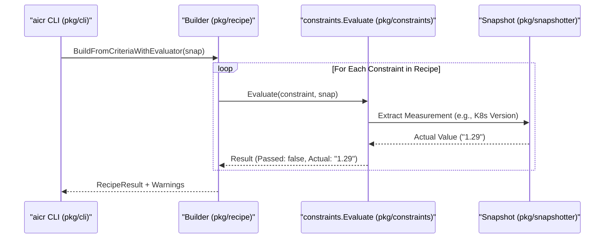
Sources: [pkg/cli/recipe.go:171-183](), [pkg/recipe/metadata.go:47-62]()

---

## Components and Dependency Resolution

`ComponentRef` defines the deployment artifacts.

### Component Attributes
- **Type**: `Helm` or `Kustomize` [pkg/recipe/metadata.go:41-44]().
- **DependencyRefs**: List of other components that must be deployed first [pkg/recipe/metadata.go:97-98]().
- **Overrides**: Map of values to override the default `values.yaml` [pkg/recipe/metadata.go:90-92]().

### Topological Sort
To ensure correct deployment order, the `RecipeMetadataSpec` performs a topological sort based on `DependencyRefs` [pkg/recipe/metadata_test.go:144-185](). If a circular dependency is detected, the system returns an error [pkg/recipe/metadata_test.go:81-112]().

---

## Snapshot Schema and Measurements

The `Snapshot` is the source of truth for `Constraint` evaluation. It consists of `Measurements` collected from the cluster.

### Measurement Structure
Defined in [pkg/measurement/types.go:104-116](), measurements are categorized by `Type`:
- `TypeK8s`: Kubernetes version, nodes, namespaces.
- `TypeGPU`: Driver version, GPU models, count.
- `TypeOS`: Kernel version, OS name, architecture.
- `TypeSystemD`: Service states (Active/Enabled).

### Data Types (Readings)
Measurements use a `Reading` interface to support multiple scalar types (int, float, bool, string) while maintaining JSON/YAML compatibility [pkg/measurement/types.go:178-212]().

---

## Implementation Summary Table

| Component | Logic Location | Purpose |
| :--- | :--- | :--- |
| **MetadataStore** | [pkg/recipe/metadata_store.go]() | Loads YAMLs from `data/` and resolves inheritance. |
| **Builder** | [pkg/recipe/builder.go]() | Orchestrates criteria matching and constraint evaluation. |
| **Version** | [pkg/version/version.go]() | Handles semantic version comparison for constraints. |
| **Overrides** | [pkg/component/overrides.go]() | Applies dot-notation overrides to Helm/Kustomize values. |

Sources: [pkg/recipe/metadata.go](), [pkg/recipe/criteria.go](), [pkg/measurement/types.go](), [pkg/recipe/metadata_store.go](), [pkg/cli/recipe.go]()

---

# Page: Overlay System and Recipe Resolution

# Overlay System and Recipe Resolution

<details>
<summary>Relevant source files</summary>

The following files were used as context for generating this wiki page:

- [examples/recipes/eks-gb200-ubuntu-training-with-validation.yaml](examples/recipes/eks-gb200-ubuntu-training-with-validation.yaml)
- [examples/recipes/eks-training.yaml](examples/recipes/eks-training.yaml)
- [examples/recipes/kind.yaml](examples/recipes/kind.yaml)
- [recipes/components/kai-scheduler/manifests/disable-runtime-class-injection.yaml](recipes/components/kai-scheduler/manifests/disable-runtime-class-injection.yaml)
- [recipes/overlays/base.yaml](recipes/overlays/base.yaml)
- [recipes/overlays/h100-eks-ubuntu-training.yaml](recipes/overlays/h100-eks-ubuntu-training.yaml)
- [recipes/overlays/monitoring-hpa.yaml](recipes/overlays/monitoring-hpa.yaml)
- [recipes/registry.yaml](recipes/registry.yaml)
- [recipes/validators/README.md](recipes/validators/README.md)
- [recipes/validators/catalog.yaml](recipes/validators/catalog.yaml)
- [tests/chainsaw/ai-conformance/cluster/assert-skyhook.yaml](tests/chainsaw/ai-conformance/cluster/assert-skyhook.yaml)
- [tests/chainsaw/cli/cuj1-training/mock-snapshot.yaml](tests/chainsaw/cli/cuj1-training/mock-snapshot.yaml)
- [validators/conformance/inference_gateway_check.go](validators/conformance/inference_gateway_check.go)
- [validators/conformance/robust_controller_check.go](validators/conformance/robust_controller_check.go)
- [validators/conformance/robust_controller_check_test.go](validators/conformance/robust_controller_check_test.go)
- [validators/deployment/main.go](validators/deployment/main.go)

</details>


The Recipe Engine resolves a set of cluster **Criteria** (Service, Accelerator, Intent, OS) into a finalized `RecipeResult`. This process uses an inheritance-based overlay system where specific configurations (leaf nodes) override or augment general configurations (base nodes).

## Resolution Algorithm: Leaf to Base

The resolution process follows a "chain of responsibility" pattern. When the engine identifies the most specific overlay matching the input criteria, it traverses the `spec.base` pointers until it reaches the root `base` overlay.

### Chain Traversal and Merging
1.  **Selection**: The engine identifies the "Leaf" overlay that exactly matches the `Criteria` provided in the Snapshot or CLI flags [recipes/overlays/h100-eks-ubuntu-training.yaml:25-29]().
2.  **Ancestry**: It follows the `spec.base` field to find the parent [recipes/overlays/h100-eks-ubuntu-training.yaml:23-23]().
3.  **Aggregation**: It collects all `RecipeMetadata` objects in the chain, from the root `base` [recipes/overlays/base.yaml:18-18]() to the leaf.
4.  **Deep Merge**: It applies merging rules to combine `constraints`, `componentRefs`, and `validation` phases.

### Specificity Scoring
The engine uses asymmetric matching to find the best overlay. An overlay matches if its criteria are a subset of the target criteria. If multiple overlays match, the one with the highest number of defined criteria fields is selected as the leaf.

**Natural Language to Code Mapping: Resolution Flow**

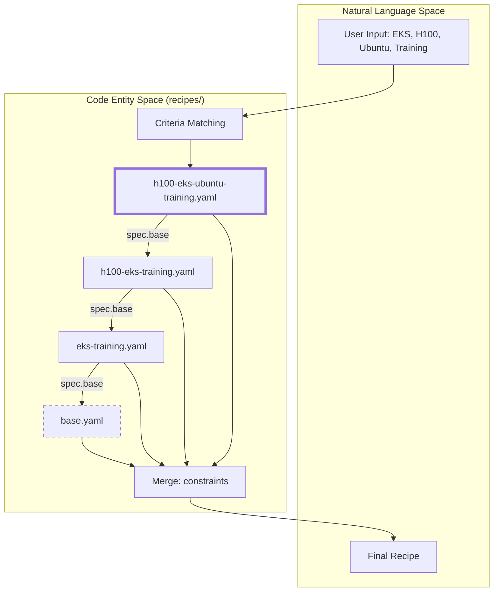
Sources: [recipes/overlays/h100-eks-ubuntu-training.yaml:23-29](), [recipes/overlays/base.yaml:15-20](), [examples/recipes/eks-training.yaml:15-27]()

## Deep-Merge Rules

The resolution engine does not perform a simple overwrite; it applies specific logic based on the data type:

### 1. Constraints (Additive & Overriding)
Constraints are identified by their `name` (e.g., `K8s.server.version`).
*   If a name is unique in the chain, it is added to the result.
*   If a name conflicts, the value from the more specific (leaf-ward) overlay overrides the base [examples/recipes/eks-gb200-ubuntu-training-with-validation.yaml:36-53]().

### 2. ComponentRefs (Merging)
Components are merged based on their `name`. This allows a base overlay to define a component's source and version, while a specific overlay adds `manifestFiles` or `overrides` [recipes/overlays/base.yaml:34-40]().

| Field | Merge Strategy |
| :--- | :--- |
| `version` / `source` | Overwrite (Leaf wins) |
| `valuesFile` | Overwrite (Leaf wins) |
| `manifestFiles` | Append (Unique list) |
| `dependencyRefs` | Append (Unique list) |
| `overrides` | Deep Merge (Map merge) |

### 3. Validation Phases
The `validation` block is merged per-phase (`deployment`, `performance`, `conformance`). Within each phase, `checks` are appended, and phase-specific `constraints` follow the constraint overriding rule [recipes/overlays/h100-eks-ubuntu-training.yaml:45-73]().

Sources: [recipes/overlays/base.yaml:23-95](), [examples/recipes/eks-gb200-ubuntu-training-with-validation.yaml:80-148](), [recipes/overlays/h100-eks-ubuntu-training.yaml:33-42]()

## Component Registry Integration

While overlays define *which* components to use and *what* versions/overrides to apply, the `ComponentRegistry` defines *how* the Bundler should interact with them.

During resolution, the engine cross-references the `componentRefs` in the overlay with the `ComponentRegistry` [recipes/registry.yaml:41-42]() to determine:
1.  **Default Values**: If an overlay omits a `namespace` or `repository`, the registry provides the default [recipes/registry.yaml:48-51]().
2.  **Node Scheduling**: The registry provides the JSON paths within the Helm values where `nodeSelector` and `tolerations` should be injected [recipes/registry.yaml:52-74]().
3.  **Health Checks**: The registry links to the `assertFile` used by the validator to verify the component's health [recipes/registry.yaml:46-47]().

**Data Flow: Overlay to Registry Mapping**

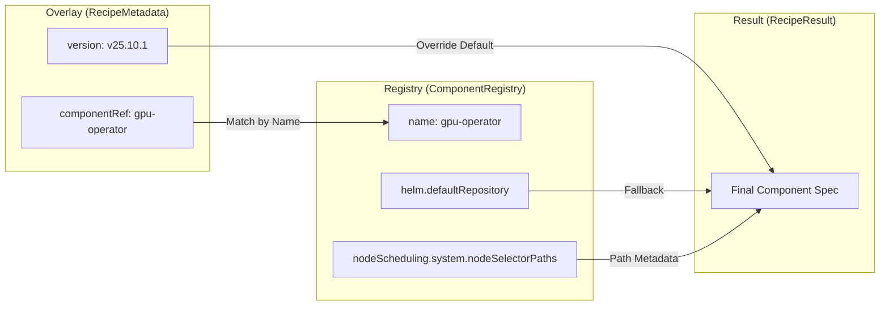
Sources: [recipes/registry.yaml:15-36](), [recipes/registry.yaml:41-74](), [recipes/overlays/base.yaml:34-44]()

## Resolution Output: RecipeResult

The final output of the resolution process is a `RecipeResult`. This object contains the flattened configuration used by the Bundler and Validator.

| Section | Description |
| :--- | :--- |
| `appliedOverlays` | A list of all overlays used in the resolution chain, in order from base to leaf [examples/recipes/eks-training.yaml:19-22](). |
| `constraints` | The final set of readiness constraints to be checked against the cluster snapshot [examples/recipes/kind.yaml:24-26](). |
| `componentRefs` | The complete list of components, including resolved versions, sources, and merged overrides [examples/recipes/kind.yaml:27-55](). |
| `deploymentOrder` | A calculated list of component names sorted by their `dependencyRefs` to ensure correct installation order [examples/recipes/kind.yaml:57-62](). |

Sources: [examples/recipes/kind.yaml:15-62](), [examples/recipes/eks-training.yaml:15-70](), [examples/recipes/eks-gb200-ubuntu-training-with-validation.yaml:18-156]()

---

# Page: Component Catalog and Registry

# Component Catalog and Registry

<details>
<summary>Relevant source files</summary>

The following files were used as context for generating this wiki page:

- [docs/integrator/aks-gpu-setup.md](docs/integrator/aks-gpu-setup.md)
- [docs/integrator/index.md](docs/integrator/index.md)
- [docs/user/component-catalog.md](docs/user/component-catalog.md)
- [examples/recipes/aks-training.yaml](examples/recipes/aks-training.yaml)
- [examples/recipes/eks-gb200-ubuntu-training-with-validation.yaml](examples/recipes/eks-gb200-ubuntu-training-with-validation.yaml)
- [examples/recipes/eks-training.yaml](examples/recipes/eks-training.yaml)
- [examples/recipes/kind.yaml](examples/recipes/kind.yaml)
- [h100-cluster.sh](h100-cluster.sh)
- [recipes/components/gpu-operator/values-aks-training.yaml](recipes/components/gpu-operator/values-aks-training.yaml)
- [recipes/components/gpu-operator/values-aks.yaml](recipes/components/gpu-operator/values-aks.yaml)
- [recipes/components/kai-scheduler/manifests/disable-runtime-class-injection.yaml](recipes/components/kai-scheduler/manifests/disable-runtime-class-injection.yaml)
- [recipes/components/nvsentinel/values.yaml](recipes/components/nvsentinel/values.yaml)
- [recipes/components/skyhook-customizations/manifests/no-op.yaml](recipes/components/skyhook-customizations/manifests/no-op.yaml)
- [recipes/components/skyhook-customizations/manifests/tuning.yaml](recipes/components/skyhook-customizations/manifests/tuning.yaml)
- [recipes/components/skyhook-operator/values.yaml](recipes/components/skyhook-operator/values.yaml)
- [recipes/overlays/aks-inference.yaml](recipes/overlays/aks-inference.yaml)
- [recipes/overlays/aks-training.yaml](recipes/overlays/aks-training.yaml)
- [recipes/overlays/aks.yaml](recipes/overlays/aks.yaml)
- [recipes/overlays/base.yaml](recipes/overlays/base.yaml)
- [recipes/overlays/h100-eks-inference.yaml](recipes/overlays/h100-eks-inference.yaml)
- [recipes/overlays/h100-eks-training.yaml](recipes/overlays/h100-eks-training.yaml)
- [recipes/overlays/monitoring-hpa.yaml](recipes/overlays/monitoring-hpa.yaml)
- [recipes/registry.yaml](recipes/registry.yaml)
- [tests/chainsaw/ai-conformance/cluster/assert-skyhook.yaml](tests/chainsaw/ai-conformance/cluster/assert-skyhook.yaml)
- [tests/chainsaw/ai-conformance/offline/assert-recipe.yaml](tests/chainsaw/ai-conformance/offline/assert-recipe.yaml)
- [tests/chainsaw/bundle-templates/README.md](tests/chainsaw/bundle-templates/README.md)
- [tests/chainsaw/bundle-templates/gpu-operator/assert-dcgm-defaults.yaml](tests/chainsaw/bundle-templates/gpu-operator/assert-dcgm-defaults.yaml)
- [tests/chainsaw/bundle-templates/gpu-operator/chainsaw-test.yaml](tests/chainsaw/bundle-templates/gpu-operator/chainsaw-test.yaml)
- [tests/chainsaw/bundle-templates/kgateway/chainsaw-test.yaml](tests/chainsaw/bundle-templates/kgateway/chainsaw-test.yaml)
- [tests/chainsaw/bundle-templates/nvsentinel/assert-netpol-defaults.yaml](tests/chainsaw/bundle-templates/nvsentinel/assert-netpol-defaults.yaml)
- [tests/chainsaw/bundle-templates/nvsentinel/chainsaw-test.yaml](tests/chainsaw/bundle-templates/nvsentinel/chainsaw-test.yaml)
- [tests/chainsaw/bundle-templates/skyhook-customizations/assert-tuning-defaults.yaml](tests/chainsaw/bundle-templates/skyhook-customizations/assert-tuning-defaults.yaml)
- [tests/chainsaw/bundle-templates/skyhook-customizations/assert-tuning-no-autotaint.yaml](tests/chainsaw/bundle-templates/skyhook-customizations/assert-tuning-no-autotaint.yaml)
- [tests/chainsaw/cli/cuj1-training/assert-recipe.yaml](tests/chainsaw/cli/cuj1-training/assert-recipe.yaml)
- [tests/chainsaw/cli/cuj1-training/mock-snapshot.yaml](tests/chainsaw/cli/cuj1-training/mock-snapshot.yaml)

</details>


The **Component Catalog and Registry** is the declarative heart of AICR's recipe and bundling system. It defines the universe of available software packages (components) that can be orchestrated into a GPU-accelerated Kubernetes runtime. By centralizing component metadata in a single registry, AICR allows for adding new software or updating deployment logic without modifying the Go source code [recipes/registry.yaml:15-18]().

## The ComponentRegistry Schema

The registry is defined in `recipes/registry.yaml` using the `aicr.nvidia.com/v1alpha1` API [recipes/registry.yaml:38-41](). Each entry in the `components` list provides the necessary metadata for the Recipe Engine to resolve versions and for the Bundler to generate deployment artifacts.

### Key Configuration Fields

| Field | Description |
| :--- | :--- |
| `name` | Unique identifier used in recipes (e.g., `gpu-operator`) [recipes/registry.yaml:21](). |
| `displayName` | Human-readable name for templates and UI output [recipes/registry.yaml:22](). |
| `valueOverrideKeys` | Alternative keys for the `--set` CLI flag to target specific components [recipes/registry.yaml:23](). |
| `helm` | Configuration for Helm-based components, including repository, chart name, and namespace [recipes/registry.yaml:24-27](). |
| `kustomize` | Configuration for Kustomize-based components (source, path, tag) [recipes/registry.yaml:28-31](). |
| `nodeScheduling` | Mapping of Helm value paths where AICR should inject node selectors and tolerations [recipes/registry.yaml:32](). |
| `healthCheck` | Reference to an `assertFile` used by the Validator to verify component health [recipes/registry.yaml:46-47](). |

**Sources:** [recipes/registry.yaml:20-34](), [recipes/registry.yaml:41-52]()

---

## Component Data Flow: From Registry to Bundle

The following diagram illustrates how a component definition in the registry is transformed into a deployable artifact through the AICR pipeline.

### Component Transformation Pipeline
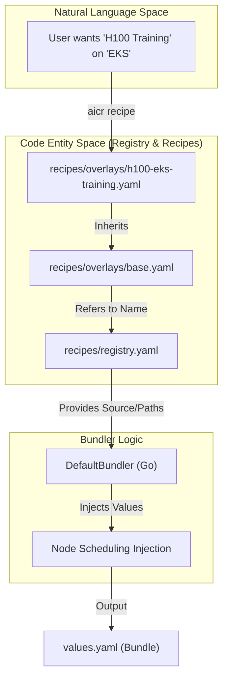
**Sources:** [recipes/registry.yaml:15-36](), [recipes/overlays/base.yaml:34-44](), [recipes/overlays/h100-eks-training.yaml:35-48]()

---

## Node Scheduling Injection

A critical feature of the registry is the `nodeScheduling` block. This allows AICR to handle complex multi-tier scheduling (e.g., "System" nodes vs "Accelerated" GPU nodes) by knowing exactly where in a component's `values.yaml` to inject the selectors.

### Scheduling Tiers
1.  **System**: Services that should run on general-purpose CPU nodes (e.g., `cert-manager`, `operator` controllers) [recipes/registry.yaml:53-61]().
2.  **Accelerated**: Services that must run on GPU nodes (e.g., `nvidia-driver-daemonset`, `aws-efa` plugin) [recipes/registry.yaml:62-73]().

### Example: GPU Operator Scheduling
In `recipes/registry.yaml`, the `gpu-operator` defines multiple paths for scheduling injection to ensure both the manager and the drivers land on the correct nodes:
*   **System Paths**: `operator.nodeSelector`, `node-feature-discovery.master.nodeSelector` [recipes/registry.yaml:54-57]().
*   **Accelerated Paths**: `daemonsets.nodeSelector` [recipes/registry.yaml:63-64]().

**Sources:** [recipes/registry.yaml:52-74](), [docs/user/component-catalog.md:32-40]()

---

## Component Types and Sources

AICR supports multiple deployment formats, though a component must have exactly one primary source type (Helm or Kustomize) [recipes/registry.yaml:34]().

### 1. Helm Components
Most components (e.g., `nvsentinel`, `kai-scheduler`) are defined as Helm charts. The registry provides the `defaultRepository` and `defaultChart`, while the recipe provides the specific `version` [recipes/registry.yaml:48-51](), [recipes/overlays/base.yaml:45-49]().

### 2. Manifest-Only Components
Some components, like `skyhook-customizations`, act as "manifest-only" components. They may use an empty Helm repository and instead rely on `manifestFiles` defined in the recipe overlays to provide raw Kubernetes YAML or Go-templated manifests [recipes/registry.yaml:170-173](), [recipes/overlays/h100-eks-training.yaml:51-52]().

### 3. Native Kubernetes Objects
Components like `gke-nccl-tcpxo` may simply define a `defaultNamespace` and rely on environment-specific logic to provide the underlying manifests [recipes/registry.yaml:92-98]().

**Sources:** [recipes/registry.yaml:41-200](), [recipes/overlays/base.yaml:27-95]()

---

## Adding New Components

To add a component to the AICR ecosystem, a developer follows a declarative process without modifying Go code [recipes/registry.yaml:18]().

### Integration Workflow
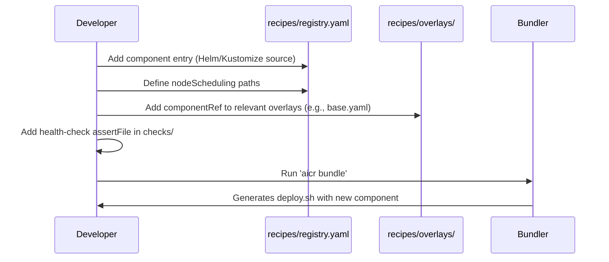

### Checklist for New Components
1.  **Registry Entry**: Add the component to `recipes/registry.yaml` with appropriate `valueOverrideKeys` [recipes/registry.yaml:41-45]().
2.  **Health Check**: Create a health check YAML and reference it in `healthCheck.assertFile` [recipes/registry.yaml:46-47]().
3.  **Overlay Integration**: Add the component to `recipes/overlays/base.yaml` (for global components) or cloud-specific overlays (e.g., `eks.yaml`) [recipes/overlays/base.yaml:27-33]().
4.  **Templating**: If the component requires dynamic tuning (like `skyhook-customizations`), create templates in `recipes/components/{name}/manifests/` [recipes/components/skyhook-customizations/manifests/tuning.yaml:22-63]().

**Sources:** [docs/user/component-catalog.md:49-51](), [recipes/registry.yaml:15-36](), [recipes/components/skyhook-customizations/manifests/tuning.yaml:15-21]()

---

# Page: Cloud-Specific Overlays (EKS, GKE, AKS)

# Cloud-Specific Overlays (EKS, GKE, AKS)

<details>
<summary>Relevant source files</summary>

The following files were used as context for generating this wiki page:

- [.trivyignore.yaml](.trivyignore.yaml)
- [demos/cuj1-gke.md](demos/cuj1-gke.md)
- [demos/cuj2-gke.md](demos/cuj2-gke.md)
- [demos/workloads/training/gke-nccl-test-tcpxo.yaml](demos/workloads/training/gke-nccl-test-tcpxo.yaml)
- [docs/integrator/aks-gpu-setup.md](docs/integrator/aks-gpu-setup.md)
- [docs/integrator/gke-tcpxo-networking.md](docs/integrator/gke-tcpxo-networking.md)
- [docs/integrator/index.md](docs/integrator/index.md)
- [docs/user/component-catalog.md](docs/user/component-catalog.md)
- [examples/recipes/aks-training.yaml](examples/recipes/aks-training.yaml)
- [h100-cluster.sh](h100-cluster.sh)
- [pkg/recipe/conformance_test.go](pkg/recipe/conformance_test.go)
- [recipes/components/dynamo-platform/values.yaml](recipes/components/dynamo-platform/values.yaml)
- [recipes/components/gke-nccl-tcpxo/manifests/nccl-tcpxo-installer.yaml](recipes/components/gke-nccl-tcpxo/manifests/nccl-tcpxo-installer.yaml)
- [recipes/components/gke-nccl-tcpxo/manifests/nri-device-injector.yaml](recipes/components/gke-nccl-tcpxo/manifests/nri-device-injector.yaml)
- [recipes/components/gpu-operator/manifests/gke-resource-quota.yaml](recipes/components/gpu-operator/manifests/gke-resource-quota.yaml)
- [recipes/components/gpu-operator/values-aks-training.yaml](recipes/components/gpu-operator/values-aks-training.yaml)
- [recipes/components/gpu-operator/values-aks.yaml](recipes/components/gpu-operator/values-aks.yaml)
- [recipes/components/gpu-operator/values-gke-cos-training.yaml](recipes/components/gpu-operator/values-gke-cos-training.yaml)
- [recipes/components/kgateway/manifests/inference-gateway.yaml](recipes/components/kgateway/manifests/inference-gateway.yaml)
- [recipes/components/kgateway/values.yaml](recipes/components/kgateway/values.yaml)
- [recipes/components/nvidia-dra-driver-gpu/values.yaml](recipes/components/nvidia-dra-driver-gpu/values.yaml)
- [recipes/overlays/aks-inference.yaml](recipes/overlays/aks-inference.yaml)
- [recipes/overlays/aks-training.yaml](recipes/overlays/aks-training.yaml)
- [recipes/overlays/aks.yaml](recipes/overlays/aks.yaml)
- [recipes/overlays/gke-cos-inference.yaml](recipes/overlays/gke-cos-inference.yaml)
- [recipes/overlays/h100-eks-ubuntu-inference-dynamo.yaml](recipes/overlays/h100-eks-ubuntu-inference-dynamo.yaml)
- [recipes/overlays/h100-gke-cos-inference-dynamo.yaml](recipes/overlays/h100-gke-cos-inference-dynamo.yaml)
- [recipes/overlays/h100-gke-cos-inference.yaml](recipes/overlays/h100-gke-cos-inference.yaml)
- [recipes/overlays/h100-kind-inference-dynamo.yaml](recipes/overlays/h100-kind-inference-dynamo.yaml)
- [recipes/overlays/kind.yaml](recipes/overlays/kind.yaml)

</details>


Cloud-specific overlays are specialized `RecipeMetadata` objects that extend base recipes to handle the unique infrastructure requirements of major cloud providers (AWS EKS, Google GKE, and Azure AKS). These overlays inject provider-specific components (e.g., AWS EFA drivers, GKE TCPXO networking), apply mandatory constraints (e.g., Kubernetes version requirements for DRA), and override Helm values to match cloud-specific storage classes or networking stacks.

## Implementation and Data Flow

Overlays use an inheritance model where a specific recipe (e.g., `h100-eks-ubuntu-inference-dynamo`) references a `base` recipe [recipes/overlays/h100-eks-ubuntu-inference-dynamo.yaml:23](). The `RecipeBuilder` resolves this chain, performing a deep merge of `componentRefs`, `constraints`, and `validation` checks.

### Overlay Resolution Logic
1.  **Criteria Matching**: The engine matches the cluster's `service` (eks, gke, aks), `accelerator` (h100, a100), and `intent` (training, inference) against the `criteria` block in the overlay [recipes/overlays/h100-eks-ubuntu-inference-dynamo.yaml:25-30]().
2.  **Constraint Injection**: Overlays enforce environment-specific requirements, such as requiring Kubernetes `>= 1.34` for Dynamic Resource Allocation (DRA) [recipes/overlays/h100-eks-ubuntu-inference-dynamo.yaml:33-35]().
3.  **Component Overrides**: Overlays modify generic components. For example, the `dynamo-platform` component on EKS is configured to use `gp2` storage classes for `etcd` and `nats` [recipes/overlays/h100-eks-ubuntu-inference-dynamo.yaml:64-74](), whereas the same component on `kind` overrides these to use the `standard` storage class [recipes/overlays/h100-kind-inference-dynamo.yaml:53-63]().

### Provider-Specific Component Mapping

| Provider | Key Components Injected | Purpose |
| :--- | :--- | :--- |
| **EKS** | `aws-efa`, `aws-ebs-csi-driver` | Low-latency networking and EBS storage integration [docs/user/component-catalog.md:15-23](). |
| **GKE** | `nccl-tcpxo-installer`, `nri-device-injector` | GPUDirect TCPXO for high-speed inter-node GPU communication [docs/integrator/gke-tcpxo-networking.md:11-12](). |
| **AKS** | `nvidia-dra-driver-gpu` | Native GPU management via Kubernetes ResourceSlices [docs/user/component-catalog.md:20](). |

**Sources:** [recipes/overlays/h100-eks-ubuntu-inference-dynamo.yaml:15-74](), [recipes/overlays/h100-kind-inference-dynamo.yaml:15-64](), [docs/user/component-catalog.md:1-51]()

---

## Amazon EKS Overlays

EKS overlays focus on integrating AWS-specific hardware features like EFA (Elastic Fabric Adapter) and storage via EBS.

### EKS Dynamo Inference (H100)
The `h100-eks-ubuntu-inference-dynamo` overlay prepares a cluster for high-performance inference using the NVIDIA Dynamo platform.

*   **Networking**: Requires specific Security Group rules (TCP 2379/4222) for control plane communication [recipes/overlays/h100-eks-ubuntu-inference-dynamo.yaml:37-39]().
*   **Storage**: Overrides `dynamo-platform` values to use the AWS EBS `gp2` storage class [recipes/overlays/h100-eks-ubuntu-inference-dynamo.yaml:67-73]().
*   **DRA Integration**: Enables the `nvidia-dra-driver-gpu` with `gpuResourcesEnabledOverride` set to `true` [recipes/overlays/h100-eks-ubuntu-inference-dynamo.yaml:41-45]().

**Sources:** [recipes/overlays/h100-eks-ubuntu-inference-dynamo.yaml:1-97](), [recipes/components/dynamo-platform/values.yaml:1-71]()

---

## Google GKE Overlays

GKE overlays are distinguished by their use of Container-Optimized OS (COS) and advanced networking for multi-node training.

### TCPXO Networking (H100 Training)
For H100 clusters on GKE (specifically `a3-megagpu-8g` instances), AICR injects the GPUDirect TCPXO stack. This is critical for performance, as inter-node bandwidth drops from ~340 GB/s to ~4 GB/s without it [docs/integrator/gke-tcpxo-networking.md:147-150]().

### GKE Overlay Implementation Detail
The `gke-nccl-test-tcpxo` logic demonstrates how AICR handles GKE's unique multi-NIC requirements:
*   **NRI Profile**: Uses the Node Resource Interface (NRI) to inject GPU devices and multi-NIC interfaces into pods without requiring `hostNetwork` [docs/integrator/gke-tcpxo-networking.md:19-23]().
*   **Sidecar Injection**: Workloads must include a `tcpxo-daemon` sidecar [demos/workloads/training/gke-nccl-test-tcpxo.yaml:129-151]().
*   **Privileged Constraints**: GKE TCPXO components require specific security exemptions (e.g., `hostPID`, `privileged: true`, hostPath mounts for `/sys`) which are managed via `.trivyignore.yaml` for security compliance tracking [.trivyignore.yaml:15-116]().

**Sources:** [docs/integrator/gke-tcpxo-networking.md:1-151](), [demos/workloads/training/gke-nccl-test-tcpxo.yaml:15-185](), [.trivyignore.yaml:15-116]()

---

## Azure AKS Overlays

AKS overlays focus on modernizing GPU allocation using Dynamic Resource Allocation (DRA).

*   **DRA Support**: AKS recipes prioritize the `nvidia-dra-driver-gpu` component [docs/user/component-catalog.md:20]().
*   **Dual-Mode Handling**: The `nvidia-dra-driver-gpu` values define how to transition from traditional `nvidia.com/gpu` limits to DRA `ResourceClaims` [recipes/components/nvidia-dra-driver-gpu/values.yaml:17-41]().
*   **Constraints**: Enforces Kubernetes `>= 1.34` for clusters utilizing DRA features [pkg/recipe/conformance_test.go:39-40]().

**Sources:** [recipes/components/nvidia-dra-driver-gpu/values.yaml:1-63](), [pkg/recipe/conformance_test.go:33-142]()

---

## Data Flow: Overlay Resolution to Component Values

This diagram illustrates how cloud-specific criteria trigger the selection of overlays and the subsequent injection of values into the `ComponentRegistry`.

### Overlay Resolution and Injection
```mermaid
graph TD
    subgraph "Natural Language Space"
        UserIntent["'I want to run H100 training on GKE'"]
    end

    subgraph "Code Entity Space: Recipe Engine"
        Criteria["Criteria {Service: GKE, Accelerator: H100, Intent: Training}"]
        Builder["pkg/recipe/Builder.BuildFromCriteria()"]
        
        subgraph "Overlays (YAML)"
            Base["recipes/overlays/base.yaml"]
            GKEBase["recipes/overlays/gke.yaml"]
            GKETraining["recipes/overlays/h100-gke-cos-training.yaml"]
        end
    end

    subgraph "Code Entity Space: Component Registry"
        Registry["recipes/registry.yaml"]
        GPUOp["gpu-operator"]
        TCPXO["nccl-tcpxo-installer"]
    end

    UserIntent --> Criteria
    Criteria --> Builder
    Builder --> GKETraining
    GKETraining -- "spec.base" --> GKEBase
    GKEBase -- "spec.base" --> Base
    
    GKETraining -- "Injects ComponentRef" --> TCPXO
    GKETraining -- "Overrides Values" --> GPUOp
    Registry -- "Provides Base Definition" --> GPUOp
```
**Sources:** [pkg/recipe/conformance_test.go:216-219](), [recipes/overlays/h100-eks-ubuntu-inference-dynamo.yaml:23-41](), [docs/user/component-catalog.md:32-40]()

---

## Conformance and Invariants

To ensure cloud overlays do not drift from CNCF AI Conformance requirements, AICR implements invariant testing. These tests verify that when a specific cloud criteria is requested, the resulting `RecipeResult` contains the mandatory components and validation checks.

### Conformance Invariant Matrix
| Recipe Name | Required Component | Required Validation Check |
| :--- | :--- | :--- |
| `h100-eks-ubuntu-inference-dynamo` | `nvidia-dra-driver-gpu` | `dra-support`, `inference-gateway` |
| `h100-gke-cos-inference-dynamo` | `kgateway` | `robust-controller`, `ai-service-metrics` |
| `h100-kind-training` | `kai-scheduler` | `gang-scheduling`, `pod-autoscaling` |

### Validation Data Flow
```mermaid
graph LR
    subgraph "Recipe Invariant Test"
        Test["pkg/recipe/TestConformanceRecipeInvariants()"]
    end

    subgraph "Recipe Result"
        Result["RecipeResult"]
        Comps["ComponentRefs[]"]
        Checks["Validation.Conformance.Checks[]"]
    end

    subgraph "Verification Logic"
        CheckComp["result.GetComponentRef(name)"]
        CheckVal["result.Validation.Conformance.Checks"]
    end

    Test --> Result
    Result --> CheckComp
    Result --> CheckVal
    CheckComp -- "Fail if missing" --> Test
    CheckVal -- "Fail if missing" --> Test
```
**Sources:** [pkg/recipe/conformance_test.go:33-252](), [recipes/overlays/h100-eks-ubuntu-inference-dynamo.yaml:75-97]()

---

# Page: Snapshot and Collector System

# Snapshot and Collector System

<details>
<summary>Relevant source files</summary>

The following files were used as context for generating this wiki page:

- [pkg/cli/snapshot.go](pkg/cli/snapshot.go)
- [pkg/cli/validate.go](pkg/cli/validate.go)
- [pkg/cli/validate_test.go](pkg/cli/validate_test.go)
- [pkg/collector/factory.go](pkg/collector/factory.go)
- [pkg/collector/factory_test.go](pkg/collector/factory_test.go)
- [pkg/collector/k8s/doc.go](pkg/collector/k8s/doc.go)
- [pkg/collector/k8s/image_test.go](pkg/collector/k8s/image_test.go)
- [pkg/collector/k8s/k8s.go](pkg/collector/k8s/k8s.go)
- [pkg/collector/k8s/server_test.go](pkg/collector/k8s/server_test.go)
- [pkg/k8s/agent/deployer.go](pkg/k8s/agent/deployer.go)
- [pkg/k8s/agent/deployer_test.go](pkg/k8s/agent/deployer_test.go)
- [pkg/k8s/agent/job.go](pkg/k8s/agent/job.go)
- [pkg/k8s/agent/permissions.go](pkg/k8s/agent/permissions.go)
- [pkg/k8s/agent/rbac.go](pkg/k8s/agent/rbac.go)
- [pkg/k8s/agent/types.go](pkg/k8s/agent/types.go)
- [pkg/snapshotter/agent.go](pkg/snapshotter/agent.go)
- [pkg/snapshotter/snapshot.go](pkg/snapshotter/snapshot.go)
- [validators/conformance/pod_autoscaling_check.go](validators/conformance/pod_autoscaling_check.go)

</details>


The Snapshot and Collector system is the data-acquisition layer of AICR. It is responsible for gathering a point-in-time representation of a Kubernetes cluster's state, including hardware details (GPUs), OS configuration, kernel parameters, and Kubernetes-native resources. This state is captured as a `Snapshot` object, which serves as the primary input for the Recipe Engine to determine the necessary cluster optimizations.

### System Overview

AICR utilizes a dual-execution model for snapshots:
1.  **Local Mode**: Collectors run directly within the process (typically used for unit testing or when the CLI has direct host access).
2.  **Agent Mode (Standard)**: The CLI deploys a privileged Kubernetes Job (the "Agent") onto a cluster node. This Agent executes the collectors and uploads the resulting `Snapshot` to a `ConfigMap` for the CLI to retrieve.

The system is designed for **parallelism** and **graceful degradation**. If a specific collector fails (e.g., `nvidia-smi` is missing), the system logs the warning and continues, ensuring the snapshot contains as much data as possible [pkg/snapshotter/snapshot.go:109-132]().

### Code Entity Mapping

The following diagram bridges the high-level system concepts to the specific Go types and files that implement them.

**Snapshot System Architecture**
```mermaid
graph TD
    subgraph "CLI Layer"
        A["aicr snapshot"] -- "uses" --> B["NodeSnapshotter"]
    end

    subgraph "Orchestration [pkg/snapshotter]"
        B -- "AgentConfig != nil" --> C["deployWithAgent()"]
        B -- "AgentConfig == nil" --> D["measure()"]
        D -- "uses" --> E["collector.Factory"]
    end

    subgraph "Execution [pkg/collector]"
        E -- "spawns" --> F["GPUCollector"]
        E -- "spawns" --> G["K8sCollector"]
        E -- "spawns" --> H["OSCollector"]
        E -- "spawns" --> I["SystemDCollector"]
    end

    subgraph "Concurrency"
        D -- "errgroup.Go" --> F
        D -- "errgroup.Go" --> G
        D -- "errgroup.Go" --> H
        D -- "errgroup.Go" --> I
    end

    style B stroke-width:2px
    style E stroke-width:2px
```
Sources: [pkg/snapshotter/snapshot.go:39-54](), [pkg/snapshotter/snapshot.go:142-150](), [pkg/cli/snapshot.go:157-170]()

---

## NodeSnapshotter and Parallel Collection

The `NodeSnapshotter` is the central orchestrator [pkg/snapshotter/snapshot.go:39-54](). It uses a `collector.Factory` to instantiate various collectors and executes them concurrently using `golang.org/x/sync/errgroup` [pkg/snapshotter/snapshot.go:143-150]().

| Feature | Implementation Detail |
| :--- | :--- |
| **Concurrency** | Uses `errgroup` to run all collectors in parallel to minimize latency [pkg/snapshotter/snapshot.go:143-150](). |
| **Error Handling** | Individual collector failures are caught by `collectSafe`, logged, and skipped to prevent total snapshot failure [pkg/snapshotter/snapshot.go:112-132](). |
| **GPU Enforcement** | If `--require-gpu` is set, the snapshotter validates that `gpu-count > 0` before finishing [pkg/snapshotter/snapshot.go:179-194](). |
| **Metadata** | Automatically captures `source-node` and AICR version information [pkg/snapshotter/snapshot.go:134-140](). |

Sources: [pkg/snapshotter/snapshot.go:35-195]()

---

## Collector Factory Pattern

AICR uses a Factory pattern to decouple the snapshot orchestration from the specific implementation of data collection. This allows for easy dependency injection and testing.

The `collector.Factory` interface defines methods for creating the five primary collector types:
*   **Kubernetes**: Captures server version, node labels, taints, and installed Helm charts.
*   **GPU**: Captures hardware details via `nvidia-smi` and driver versions.
*   **OS**: Gathers kernel modules, sysctl parameters, and `/proc` filesystem data.
*   **SystemD**: Inspects the state of critical host services.
*   **NodeTopology**: Aggregates cluster-wide topology information.

For details on individual collector implementations and the factory interface, see **[Collectors](#4.1)**.

Sources: [pkg/snapshotter/snapshot.go:87-93](), [pkg/snapshotter/snapshot.go:144-148]()

---

## Agent-Based Deployment Model

Because many collectors require host-level access (e.g., `HostPID` for SystemD or device access for GPUs), AICR typically runs as an in-cluster Agent.

The `Deployer` manages the full lifecycle of this agent [pkg/k8s/agent/deployer.go:29-71]():
1.  **Permission Check**: Verifies the user has RBAC rights to create Jobs and ClusterRoles [pkg/k8s/agent/permissions.go:39-103]().
2.  **RBAC Provisioning**: Creates a `ServiceAccount`, `Role`, and `ClusterRole` (named `aicr-node-reader`) [pkg/k8s/agent/rbac.go:45-200]().
3.  **Job Execution**: Deploys a `batch/v1.Job` using the AICR image [pkg/k8s/agent/job.go:68-103]().
4.  **Log Streaming**: Streams the agent's `stdout/stderr` back to the CLI user [pkg/snapshotter/agent.go:155-164]().
5.  **Data Retrieval**: Pulls the final YAML snapshot from a `ConfigMap` populated by the agent [pkg/snapshotter/agent.go:177-183]().

### Security Modes
The Agent supports two security profiles [pkg/k8s/agent/job.go:108-147]():
*   **Privileged (Default)**: Enables `hostPID`, `hostNetwork`, and `privileged: true`. Required for GPU and SystemD collectors.
*   **Restricted**: Runs as a non-root, PSS-compliant pod. Limited to Kubernetes-native collection only.

For details on the Agent lifecycle and RBAC requirements, see **[Snapshot Agent](#4.2)**.

**Agent Lifecycle Flow**
```mermaid
sequenceDiagram
    participant CLI as aicr CLI
    participant K8s as K8s API Server
    participant Job as Snapshot Agent (Pod)

    CLI->>K8s: Check Permissions (SelfSubjectAccessReview)
    CLI->>K8s: Create RBAC (SA, ClusterRole, Binding)
    CLI->>K8s: Create Job (batch/v1)
    K8s->>Job: Schedule on GPU Node
    CLI->>Job: Stream Logs
    Job->>Job: Run Parallel Collectors
    Job->>K8s: Create ConfigMap with Snapshot Data
    Job->>K8s: Signal Completion
    CLI->>K8s: Get ConfigMap Data
    CLI->>CLI: Serialize to File/Stdout
    CLI->>K8s: Cleanup (Delete Job/RBAC)
```
Sources: [pkg/k8s/agent/deployer.go:29-147](), [pkg/snapshotter/agent.go:97-184](), [pkg/k8s/agent/permissions.go:106-123]()

Sources: [pkg/snapshotter/agent.go:43-95](), [pkg/k8s/agent/job.go:108-220]()

---

# Page: Collectors

# Collectors

<details>
<summary>Relevant source files</summary>

The following files were used as context for generating this wiki page:

- [pkg/bundler/handler_test.go](pkg/bundler/handler_test.go)
- [pkg/collector/factory.go](pkg/collector/factory.go)
- [pkg/collector/factory_test.go](pkg/collector/factory_test.go)
- [pkg/collector/file/file.go](pkg/collector/file/file.go)
- [pkg/collector/k8s/doc.go](pkg/collector/k8s/doc.go)
- [pkg/collector/k8s/image.go](pkg/collector/k8s/image.go)
- [pkg/collector/k8s/image_test.go](pkg/collector/k8s/image_test.go)
- [pkg/collector/k8s/k8s.go](pkg/collector/k8s/k8s.go)
- [pkg/collector/k8s/node.go](pkg/collector/k8s/node.go)
- [pkg/collector/k8s/node_test.go](pkg/collector/k8s/node_test.go)
- [pkg/collector/k8s/server.go](pkg/collector/k8s/server.go)
- [pkg/collector/k8s/server_test.go](pkg/collector/k8s/server_test.go)
- [pkg/collector/os/grub.go](pkg/collector/os/grub.go)
- [pkg/collector/os/grub_test.go](pkg/collector/os/grub_test.go)
- [pkg/collector/os/kmod.go](pkg/collector/os/kmod.go)
- [pkg/collector/os/kmod_test.go](pkg/collector/os/kmod_test.go)
- [pkg/collector/os/release.go](pkg/collector/os/release.go)
- [pkg/collector/os/release_test.go](pkg/collector/os/release_test.go)
- [pkg/collector/topology/topology.go](pkg/collector/topology/topology.go)
- [pkg/collector/topology/topology_test.go](pkg/collector/topology/topology_test.go)
- [pkg/errors/network.go](pkg/errors/network.go)
- [pkg/k8s/agent/wait_test.go](pkg/k8s/agent/wait_test.go)
- [pkg/k8s/pod/job.go](pkg/k8s/pod/job.go)
- [pkg/k8s/pod/job_test.go](pkg/k8s/pod/job_test.go)
- [pkg/k8s/pod/logs_test.go](pkg/k8s/pod/logs_test.go)
- [pkg/k8s/pod/wait_test.go](pkg/k8s/pod/wait_test.go)
- [pkg/serializer/http_test.go](pkg/serializer/http_test.go)

</details>


The Collector system is the observation layer of AICR. It is responsible for gathering raw system state from the underlying host and the Kubernetes cluster. These data points, known as `Measurements`, are later used by the Recipe Engine to match criteria and identify missing components.

AICR utilizes a **Factory pattern** and **Dependency Injection** to manage five specialized collector types. This design allows the `aicr` CLI and the in-cluster `aicr-agent` to share the same collection logic while supporting mock implementations for testing.

## Collector Factory and Interface

All collectors implement a common `Collector` interface (which requires a `Collect(context.Context)` method). The `Factory` interface defines the contract for instantiating these collectors with their required dependencies.

### Implementation: DefaultFactory
The `DefaultFactory` is the production implementation that configures collectors with standard dependencies, such as specific SystemD services to monitor (e.g., `containerd`, `docker`, `kubelet`) [pkg/collector/factory.go:56-79]().

| Method | Created Collector | Purpose |
| :--- | :--- | :--- |
| `CreateGPUCollector()` | `gpu.Collector` | Hardware, driver, and CUDA versions. |
| `CreateOSCollector()` | `os.Collector` | Kernel modules, sysctl, and OS release info. |
| `CreateKubernetesCollector()` | `k8s.Collector` | Server version, images, and ClusterPolicies. |
| `CreateSystemDCollector()` | `systemd.Collector` | Service states (Active/Inactive). |
| `CreateNodeTopologyCollector()` | `topology.Collector` | Cluster-wide taints and labels. |

**Sources:** [pkg/collector/factory.go:28-34](), [pkg/collector/factory.go:81-109]()

## The Five Collector Types

### 1. GPU Collector (`nvidia-smi`)
The GPU collector identifies the hardware profile of the node. It typically parses output from NVIDIA utilities to determine:
* GPU Model (e.g., H100, A100).
* Driver Version.
* CUDA Capability.

**Sources:** [pkg/collector/factory.go:81-84]()

### 2. OS Collector (Kernel & System)
The OS collector aggregates data from several sub-collectors to build a `measurement.TypeOS` object [pkg/collector/os/release_test.go:112-120]().
* **Release:** Parses `/etc/os-release` for fields like `ID`, `VERSION_ID`, and `PRETTY_NAME` [pkg/collector/os/release_test.go:150-155]().
* **Kernel Modules (kmod):** Checks for loaded modules (e.g., `nvidia`, `nvidia_uvm`).
* **Sysctl:** Gathers kernel runtime parameters.
* **Grub:** Inspects boot configurations (e.g., IOMMU settings).

**Sources:** [pkg/collector/os/release_test.go:121-134](), [pkg/collector/os/release.go:1-50]()

### 3. Kubernetes Collector
The `k8s.Collector` interacts with the Kubernetes API server. It is designed to **degrade gracefully**; if a specific sub-collection fails (e.g., due to RBAC restrictions), it logs a warning and returns empty data for that subtype rather than failing the entire snapshot [pkg/collector/k8s/k8s.go:38-52]().

* **Server:** Gathers K8s version, platform, and Go version [pkg/collector/k8s/k8s.go:55-57]().
* **Node:** Detects the cloud provider (EKS, GKE, AKS) by parsing the `ProviderID` (e.g., `aws:///...` maps to `eks`) [pkg/collector/k8s/node.go:52-58](), [pkg/collector/k8s/node.go:98-122](). It also collects the container runtime version and kernel version from the node status [pkg/collector/k8s/node.go:60-87]().
* **Image:** Lists container images present on the node.
* **Policy:** Inspects `ClusterPolicy` resources (often used for GPU Operator state).

**Sources:** [pkg/collector/k8s/k8s.go:71-80](), [pkg/collector/k8s/node.go:29-45]()

### 4. SystemD Collector
This collector monitors the state of critical host services. By default, it tracks `containerd.service`, `docker.service`, and `kubelet.service` [pkg/collector/factory.go:65-71](). It reports whether these services are active, which is crucial for identifying nodes with broken runtimes.

**Sources:** [pkg/collector/factory.go:87-91]()

### 5. Node Topology Collector
Unlike the other collectors that usually run locally on a node, the Topology collector looks across the cluster to gather taints and labels [pkg/collector/factory.go:103-108](). This helps AICR understand the distribution of specialized hardware (like InfiniBand or specific GPU SKUs) across the fleet.

**Sources:** [pkg/collector/topology/topology.go:1-40]()

## Data Flow and Error Handling

Collectors utilize `context` for timeout management. For instance, the Kubernetes collector defaults to a specific timeout defined in `defaults.CollectorK8sTimeout` [pkg/collector/k8s/k8s.go:41]().

### Collector Entity Relationship
This diagram shows how the `DefaultFactory` orchestrates the creation of various `Collector` implementations.

Title: Collector Implementation and Factory Mapping
```mermaid
graph TD
    subgraph "Factory Interface"
        F["Factory Interface"]
    end

    subgraph "Implementation Space"
        DF["DefaultFactory"]
        F -- "implements" --> DF
    end

    subgraph "Code Entities (pkg/collector/...)"
        GC["gpu.Collector"]
        KC["k8s.Collector"]
        OC["os.Collector"]
        SC["systemd.Collector"]
        TC["topology.Collector"]
    end

    DF -- "CreateGPUCollector()" --> GC
    DF -- "CreateKubernetesCollector()" --> KC
    DF -- "CreateOSCollector()" --> OC
    DF -- "CreateSystemDCollector()" --> SC
    DF -- "CreateNodeTopologyCollector()" --> TC

    subgraph "Data Output"
        M["measurement.Measurement"]
        GC -- "Collect()" --> M
        KC -- "Collect()" --> M
        OC -- "Collect()" --> M
        SC -- "Collect()" --> M
        TC -- "Collect()" --> M
    end
```
**Sources:** [pkg/collector/factory.go:28-34](), [pkg/collector/factory.go:56-59](), [pkg/collector/k8s/k8s.go:38-40]()

### Kubernetes Sub-Collector Flow
The Kubernetes collector demonstrates the pattern of safe, concurrent sub-collection.

Title: Kubernetes Sub-Collector Data Flow
```mermaid
graph LR
    subgraph "k8s.Collector.Collect()"
        Entry["Collect(ctx)"]
        Client["getClient()"]
        Safe["collectSafe()"]
    end

    subgraph "Sub-Collectors"
        Srv["collectServer()"]
        Img["collectContainerImages()"]
        Pol["collectClusterPolicies()"]
        Nod["collectNode()"]
    end

    subgraph "Logic: pkg/collector/k8s/node.go"
        GN["GetNodeName()"]
        PP["parseProvider()"]
    end

    Entry --> Client
    Client --> Safe
    Safe --> Srv
    Safe --> Img
    Safe --> Pol
    Safe --> Nod
    
    Nod --> GN
    Nod -- "uses ProviderID" --> PP
    
    Srv & Img & Pol & Nod --> Builder["measurement.NewMeasurement(TypeK8s)"]
    Builder --> Result["*measurement.Measurement"]
```
**Sources:** [pkg/collector/k8s/k8s.go:54-80](), [pkg/collector/k8s/node.go:36-58](), [pkg/collector/k8s/node.go:127-144]()

## Dependency Injection and Testing
The use of the `Factory` interface allows the testing suite to inject fake clients. For example, `pkg/k8s/pod/job_test.go` uses `fake.NewSimpleClientset` to simulate Job completion and failure scenarios without requiring a real cluster [pkg/k8s/pod/job_test.go:103-118]().

**Sources:** [pkg/k8s/pod/job_test.go:31-70](), [pkg/collector/factory_test.go:24-42]()

---

# Page: Snapshot Agent

# Snapshot Agent

<details>
<summary>Relevant source files</summary>

The following files were used as context for generating this wiki page:

- [pkg/cli/doc.go](pkg/cli/doc.go)
- [pkg/cli/snapshot.go](pkg/cli/snapshot.go)
- [pkg/cli/validate.go](pkg/cli/validate.go)
- [pkg/cli/validate_test.go](pkg/cli/validate_test.go)
- [pkg/k8s/agent/deployer.go](pkg/k8s/agent/deployer.go)
- [pkg/k8s/agent/deployer_test.go](pkg/k8s/agent/deployer_test.go)
- [pkg/k8s/agent/job.go](pkg/k8s/agent/job.go)
- [pkg/k8s/agent/permissions.go](pkg/k8s/agent/permissions.go)
- [pkg/k8s/agent/rbac.go](pkg/k8s/agent/rbac.go)
- [pkg/k8s/agent/types.go](pkg/k8s/agent/types.go)
- [pkg/snapshotter/agent.go](pkg/snapshotter/agent.go)
- [pkg/snapshotter/agent_test.go](pkg/snapshotter/agent_test.go)
- [pkg/snapshotter/snapshot.go](pkg/snapshotter/snapshot.go)
- [tests/chainsaw/README.md](tests/chainsaw/README.md)
- [tests/chainsaw/snapshot/deploy-agent/assert-configmap.yaml](tests/chainsaw/snapshot/deploy-agent/assert-configmap.yaml)
- [tests/chainsaw/snapshot/deploy-agent/assert-job-complete.yaml](tests/chainsaw/snapshot/deploy-agent/assert-job-complete.yaml)
- [tests/chainsaw/snapshot/deploy-agent/chainsaw-test.yaml](tests/chainsaw/snapshot/deploy-agent/chainsaw-test.yaml)
- [tests/chainsaw/snapshot/deploy-agent/rbac.yaml](tests/chainsaw/snapshot/deploy-agent/rbac.yaml)
- [tests/chainsaw/snapshot/deploy-agent/snapshot-job.yaml](tests/chainsaw/snapshot/deploy-agent/snapshot-job.yaml)
- [validators/conformance/pod_autoscaling_check.go](validators/conformance/pod_autoscaling_check.go)

</details>


The Snapshot Agent is an in-cluster component deployed as a Kubernetes `Job` to capture the state of a node and the surrounding cluster. It is the primary mechanism for gathering hardware-level data (GPUs, kernel modules, sysctl) and cluster-wide configuration (Helm charts, ClusterPolicies) without requiring the user to have local tools like `nvidia-smi` or `helm` installed on their workstation.

The agent follows a **deploy-wait-retrieve** lifecycle, where the `aicr` CLI orchestrates the deployment of RBAC and the Job, streams real-time logs to the user, and finally extracts the resulting snapshot from a `ConfigMap`.

## Agent Deployment Lifecycle

The deployment process is managed by the `Deployer` struct in `pkg/k8s/agent/deployer.go`. It ensures that all necessary prerequisites are met before launching the collection task.

### 1. Permission Validation
Before any resources are created, the `Deployer` performs a `SelfSubjectAccessReview` to verify the user has sufficient privileges to create the required RBAC and Job resources [pkg/k8s/agent/permissions.go:39-103]().

### 2. RBAC Provisioning
The agent requires specific permissions to read cluster state and write its results. The following resources are created:
*   **Namespace**: Created if it doesn't exist (defaults to `default`) [pkg/k8s/agent/rbac.go:30-41]().
*   **ServiceAccount**: The identity used by the agent Pod [pkg/k8s/agent/rbac.go:45-55]().
*   **Role & RoleBinding**: Grants permission to `create` and `patch` `ConfigMaps` (to store results) and `list` `Pods` within its namespace [pkg/k8s/agent/rbac.go:58-125]().
*   **ClusterRole & ClusterRoleBinding**: Named `aicr-node-reader`. It grants cluster-wide `get/list` access to `nodes`, `pods`, and `nvidia.com/clusterpolicies` [pkg/k8s/agent/rbac.go:128-200]().

### 3. Job Execution
The `Deployer` creates a Kubernetes `Job` with `backoffLimit: 0` to ensure it does not retry on failure, providing immediate feedback to the user [pkg/k8s/agent/job.go:86-92]().

### 4. Log Streaming and Result Retrieval
While the Job runs, the CLI uses `StreamLogs` to pipe the agent's `stderr` to the user's terminal [pkg/snapshotter/agent.go:149-164](). Once the Job reaches a `Succeeded` state, the CLI retrieves the snapshot data from the `ConfigMap` and performs cleanup [pkg/snapshotter/agent.go:166-184]().

### Code Entity Mapping: Deployment Lifecycle
The following diagram maps the logical deployment steps to the internal Go functions and Kubernetes entities.

**Agent Deployment Flow**
```mermaid
sequenceDiagram
    participant CLI as "pkg/snapshotter.DeployAndGetSnapshot"
    participant DEP as "pkg/k8s/agent.Deployer"
    participant K8S as "Kubernetes API"

    CLI->>DEP: Deploy(ctx)
    DEP->>K8S: SelfSubjectAccessReview
    DEP->>K8S: Create ServiceAccount, Role, ClusterRole
    DEP->>K8S: Create Job (aicr snapshot -o cm://...)
    
    CLI->>DEP: WaitForPodReady()
    CLI->>DEP: StreamLogs(stderr)
    
    K8S-->>CLI: Job Succeeded
    
    CLI->>DEP: GetSnapshot()
    DEP->>K8S: Get ConfigMap data
    K8S-->>CLI: YAML Snapshot
    
    CLI->>DEP: Cleanup(CleanupOptions)
    DEP->>K8S: Delete Job & RBAC
```
**Sources:** [pkg/snapshotter/agent.go:97-184](), [pkg/k8s/agent/deployer.go:27-72](), [pkg/k8s/agent/job.go:34-65]()

## Pod Security Modes

The agent supports two security profiles depending on the required collectors and the cluster's Pod Security Standards (PSS).

### Privileged Mode (Default)
Required for the **GPU**, **SystemD**, and **OS** collectors. It allows the agent to inspect host-level details by mounting host paths and using host namespaces [pkg/k8s/agent/job.go:149-220]().
*   **Host Namespaces**: `hostPID: true`, `hostNetwork: true`, `hostIPC: true`.
*   **Security Context**: `privileged: true`, `runAsUser: 0`.
*   **Volumes**: Mounts `/run/systemd` and `/etc/os-release` from the host.
*   **Capabilities**: Adds `SYS_ADMIN` and `SYS_CHROOT`.

### Restricted Mode
Triggered by setting `--privileged=false`. This mode is PSS-compliant but limits collection to the **Kubernetes** collector only, as it cannot access host-level hardware or service information [pkg/k8s/agent/job.go:223-255]().
*   **Security Context**: `allowPrivilegeEscalation: false`, `runAsNonRoot: true`, `seccompProfile: RuntimeDefault`.

### GPU Requirements
If `--require-gpu` is specified, the Pod spec is modified to include a resource limit for `nvidia.com/gpu: 1` [pkg/k8s/agent/job.go:167-169](). This is essential in environments using **CDI (Container Device Interface)** where GPU devices are only injected into the container if explicitly requested in the resource requirements [pkg/snapshotter/agent.go:84-87]().

**Sources:** [pkg/k8s/agent/job.go:108-147](), [pkg/k8s/agent/job.go:149-220](), [pkg/snapshotter/agent.go:80-87]()

## Data Flow: Result Retrieval via ConfigMap

The agent does not egress data over the network. Instead, it uses the AICR ConfigMap URI scheme (`cm://<namespace>/<name>`) to write the snapshot to a Kubernetes `ConfigMap` [pkg/k8s/agent/job.go:70]().

### Result Retrieval Process
1.  The Agent Job executes `aicr snapshot -o cm://<ns>/<job-name>`.
2.  The internal `snapshotter` writes the serialized YAML into the `data["snapshot.yaml"]` field of the target ConfigMap.
3.  The `Deployer` on the client-side calls `getSnapshotFromConfigMap` [pkg/k8s/agent/deployer.go:82-84]().
4.  The client-side `aicr` binary reads the ConfigMap, parses the YAML, and returns a `*snapshotter.Snapshot` object for further processing (e.g., by the Recipe engine) [pkg/snapshotter/agent.go:205-230]().

### Code Entity Mapping: Data Retrieval
The following diagram illustrates how the `Deployer` and `Snapshotter` interact with the Kubernetes API to move data from the cluster to the CLI.

**ConfigMap Data Pipeline**
```mermaid
graph LR
    subgraph "In-Cluster (Agent Pod)"
        A["pkg/snapshotter.NodeSnapshotter"] -- "Serialize" --> B["pkg/serializer.ConfigMapWriter"]
    end

    B -- "POST /api/v1/namespaces/.../configmaps" --> K8S[("Kubernetes API")]

    subgraph "Local Machine (CLI)"
        K8S -- "GET /api/v1/namespaces/.../configmaps" --> C["pkg/k8s/agent.Deployer.GetSnapshot"]
        C -- "Unmarshal" --> D["pkg/snapshotter.Snapshot Struct"]
    end

    style A stroke-width:2px
    style C stroke-width:2px
```
**Sources:** [pkg/snapshotter/agent.go:176-184](), [pkg/k8s/agent/job.go:68-73](), [pkg/snapshotter/snapshot.go:165-172]()

## Configuration Parameters

The agent behavior is controlled via the `AgentConfig` struct, which is populated from CLI flags [pkg/snapshotter/agent.go:43-95]().

| Parameter | CLI Flag | Description |
| :--- | :--- | :--- |
| `Namespace` | `--namespace` | K8s namespace for deployment. |
| `Image` | `--image` | The `aicr` container image to run. |
| `Privileged` | `--privileged` | Enables host-level collectors (default: true). |
| `RequireGPU` | `--require-gpu` | Requests `nvidia.com/gpu` resource for the Pod. |
| `NodeSelector` | `--node-selector` | Targets specific nodes (e.g., `nvidia.com/gpu.present=true`). |
| `Cleanup` | `--no-cleanup` | If false, keeps Job and RBAC for debugging. |
| `Timeout` | `--timeout` | Max time to wait for Job completion. |

**Sources:** [pkg/cli/snapshot.go:73-155](), [pkg/snapshotter/agent.go:43-95]()

---

# Page: Bundler

# Bundler

<details>
<summary>Relevant source files</summary>

The following files were used as context for generating this wiki page:

- [demos/README.md](demos/README.md)
- [demos/cuj2.md](demos/cuj2.md)
- [demos/examples/CUJ2-Test-Report.md](demos/examples/CUJ2-Test-Report.md)
- [docs/user/cli-reference.md](docs/user/cli-reference.md)
- [install](install)
- [pkg/bundler/bundler.go](pkg/bundler/bundler.go)
- [pkg/bundler/bundler_test.go](pkg/bundler/bundler_test.go)
- [pkg/bundler/config/config.go](pkg/bundler/config/config.go)
- [pkg/bundler/config/config_test.go](pkg/bundler/config/config_test.go)
- [pkg/bundler/deployer/helm/helm.go](pkg/bundler/deployer/helm/helm.go)
- [pkg/bundler/deployer/helm/helm_test.go](pkg/bundler/deployer/helm/helm_test.go)
- [pkg/bundler/deployer/helm/templates/deploy.sh.tmpl](pkg/bundler/deployer/helm/templates/deploy.sh.tmpl)
- [pkg/bundler/deployer/helm/templates/undeploy.sh.tmpl](pkg/bundler/deployer/helm/templates/undeploy.sh.tmpl)
- [pkg/cli/bundle.go](pkg/cli/bundle.go)
- [pkg/recipe/components.go](pkg/recipe/components.go)
- [pkg/recipe/components_test.go](pkg/recipe/components_test.go)
- [recipes/components/cert-manager/values.yaml](recipes/components/cert-manager/values.yaml)
- [recipes/overlays/eks.yaml](recipes/overlays/eks.yaml)

</details>


The **Bundler** is the final stage of the AICR pipeline. It transforms a `RecipeResult` (the output of the Recipe Engine) into a deployment-ready artifact bundle tailored for a specific Kubernetes cluster. The bundler handles the injection of cluster-specific configuration, such as node selectors and tolerations, and ensures the resulting manifests are signed and attested for security.

### Core Responsibilities
*   **Artifact Generation**: Translates high-level component references into concrete Helm values, Kustomize overlays, or ArgoCD Application manifests [pkg/bundler/bundler.go:148-167]().
*   **Node Scheduling Injection**: Automatically applies `nodeSelector` and `tolerations` across all components based on defined scheduling tiers (System vs. Accelerated) [pkg/bundler/bundler.go:70-78]().
*   **Dependency Orchestration**: Generates ordered deployment and undeployment scripts (`deploy.sh`, `undeploy.sh`) that respect the `deploymentOrder` defined in the recipe [pkg/bundler/deployer/helm/helm.go:155-171]().
*   **Supply Chain Security**: Generates file checksums and provides cryptographic attestation for the bundle content [pkg/bundler/bundler.go:60-61]().

---

## Bundler Lifecycle

The `DefaultBundler` orchestrates the transformation process. It is initialized with a `Config` object containing user overrides (from `--set` flags) and scheduling requirements.

### Process Flow
1.  **Input Validation**: Ensures the `RecipeResult` is valid and contains at least one component [pkg/bundler/bundler.go:180-189]().
2.  **Component Filtering**: Removes components disabled via CLI overrides [pkg/bundler/bundler.go:196-200]().
3.  **Value Resolution**: Merges default component values, recipe-level overrides, and CLI `--set` overrides [pkg/bundler/deployer/helm/helm_test.go:42-51]().
4.  **Scheduling Injection**: Injects node affinity settings into the resolved values based on the `ComponentRegistry` paths [pkg/recipe/components_test.go:181-211]().
5.  **Deployer Execution**: Hands off the resolved data to either the `Helm` or `ArgoCD` generator [pkg/bundler/bundler.go:148-150]().

### From Recipe to Bundle Entities
The following diagram illustrates how the `DefaultBundler` maps recipe concepts to code entities and generated files.

```mermaid
graph TD
    subgraph "Recipe Space"
        R["RecipeResult"]
        CR["ComponentRef"]
        DO["deploymentOrder"]
    end

    subgraph "Code Entities (pkg/bundler)"
        DB["DefaultBundler.Make()"]
        GEN["helm.Generator"]
        CFG["config.Config"]
    end

    subgraph "Artifact Space (Bundle/)"
        DSH["deploy.sh"]
        USH["undeploy.sh"]
        VAL["component/values.yaml"]
        CKS["checksums.txt"]
    end

    R --> DB
    CFG --> DB
    DB --> GEN
    GEN --> DSH
    GEN --> USH
    GEN --> VAL
    GEN --> CKS
    CR -.-> VAL
    DO -.-> DSH
```
**Sources:** [pkg/bundler/bundler.go:148-167](), [pkg/bundler/deployer/helm/helm.go:114-209](), [pkg/bundler/config/config.go]()

---

## Deployer Types

AICR supports two primary deployment methodologies, selected via the `--deployer` flag [pkg/cli/bundle.go:104-113]().

### Helm Deployer
The default deployer generates a "per-component" bundle. Each component gets its own directory containing a `values.yaml` and a `README.md`. A root-level `deploy.sh` script automates the installation using standard `helm install` commands [pkg/bundler/deployer/helm/helm.go:42-45]().

*   **Retry Logic**: The generated `deploy.sh` includes exponential backoff for failed operations [pkg/bundler/deployer/helm/templates/deploy.sh.tmpl:54-78]().
*   **CRD Handling**: Special logic to ignore "no matches for kind" errors during the initial pass, re-applying manifests after CRDs are registered [pkg/bundler/deployer/helm/templates/deploy.sh.tmpl:102-127]().
*   **Reverse Teardown**: `undeploy.sh` removes components in the reverse order of installation to avoid dependency orphans [pkg/bundler/deployer/helm/templates/undeploy.sh.tmpl:139-155]().

For details, see [Helm Deployer](#5.1).

### ArgoCD Deployer
Generates an **App-of-Apps** pattern. It creates a parent ArgoCD `Application` that points to individual child `Application` manifests for each component [pkg/bundler/bundler.go:161-165]().

*   **Sync Waves**: Uses the recipe's `deploymentOrder` to assign `argocd.argoproj.io/sync-wave` annotations, ensuring the GitOps controller respects component dependencies.
*   **Multi-Source Support**: Handles both Helm and Kustomize components within the same Application framework.

For details, see [ArgoCD Deployer](#5.2).

---

## Configuration and Scheduling

The Bundler relies on the `ComponentRegistry` to know where to inject configuration within a component's values tree.

| Feature | Description | Code Reference |
| :--- | :--- | :--- |
| **Value Overrides** | CLI `--set` flags (e.g., `gpuoperator:driver.enabled=false`) | [pkg/cli/bundle.go:141-145]() |
| **System Tier** | Scheduling for control-plane/management components (e.g., cert-manager) | [pkg/recipe/components_test.go:207-211]() |
| **Accelerated Tier** | Scheduling for GPU-dependent components (e.g., GPU Operator) | [pkg/recipe/components_test.go:199-204]() |
| **Workload Gate** | Injection of taints/tolerations to prevent non-runtime workloads from landing on optimized nodes | [pkg/cli/bundle.go:167-173]() |

### Node Scheduling Injection Logic
The Bundler maps high-level flags like `--accelerated-node-selector` to specific YAML paths defined in `recipes/registry.yaml` [pkg/recipe/components_test.go:181-211](). For example, a selector for the `gpu-operator` might be injected at `operator.nodeSelector`.

For details, see [Node Scheduling Injection](#5.3).

---

## Security and Attestation

To ensure the integrity of the generated bundle, the Bundler performs two security tasks:
1.  **Checksum Generation**: A `checksums.txt` file is created containing SHA256 hashes of every file in the bundle [pkg/bundler/deployer/helm/helm.go:180-191]().
2.  **SLSA Attestation**: If the `--attest` flag is used, the Bundler generates a Sigstore attestation. This binds the bundle to the OIDC identity of the builder and provides a verifiable record of the build process [pkg/bundler/bundler.go:120-137]().

For details, see [Bundle Attestation and Supply Chain Security](#5.4).

---
**Sources:**
*   `pkg/bundler/bundler.go` (Main logic)
*   `pkg/bundler/deployer/helm/helm.go` (Helm generation)
*   `pkg/bundler/deployer/helm/templates/deploy.sh.tmpl` (Automation script)
*   `pkg/cli/bundle.go` (CLI interface)
*   `pkg/recipe/components_test.go` (Registry paths)

---

# Page: Helm Deployer

# Helm Deployer

<details>
<summary>Relevant source files</summary>

The following files were used as context for generating this wiki page:

- [demos/README.md](demos/README.md)
- [demos/cuj2.md](demos/cuj2.md)
- [demos/examples/CUJ2-Test-Report.md](demos/examples/CUJ2-Test-Report.md)
- [install](install)
- [pkg/bundler/deployer/argocd/argocd.go](pkg/bundler/deployer/argocd/argocd.go)
- [pkg/bundler/deployer/argocd/templates/README.md.tmpl](pkg/bundler/deployer/argocd/templates/README.md.tmpl)
- [pkg/bundler/deployer/helm/helm.go](pkg/bundler/deployer/helm/helm.go)
- [pkg/bundler/deployer/helm/helm_test.go](pkg/bundler/deployer/helm/helm_test.go)
- [pkg/bundler/deployer/helm/templates/README.md.tmpl](pkg/bundler/deployer/helm/templates/README.md.tmpl)
- [pkg/bundler/deployer/helm/templates/component-README.md.tmpl](pkg/bundler/deployer/helm/templates/component-README.md.tmpl)
- [pkg/bundler/deployer/helm/templates/deploy.sh.tmpl](pkg/bundler/deployer/helm/templates/deploy.sh.tmpl)
- [pkg/bundler/deployer/helm/templates/undeploy.sh.tmpl](pkg/bundler/deployer/helm/templates/undeploy.sh.tmpl)
- [recipes/components/cert-manager/values.yaml](recipes/components/cert-manager/values.yaml)

</details>


The Helm deployer is the default deployment mechanism for AICR bundles. It transforms a `RecipeResult` into a structured directory containing Helm `values.yaml` overrides, Kustomize sources, and robust shell scripts (`deploy.sh` and `undeploy.sh`) designed to handle the complexities of deploying AI infrastructure, such as Custom Resource Definition (CRD) races and orphaned webhooks.

## Overview and Directory Structure

The `Generator` in `pkg/bundler/deployer/helm/helm.go` creates a per-component directory structure. Instead of a single monolithic Helm chart, AICR generates a bundle where each component is managed independently, allowing for granular versioning and easier troubleshooting [pkg/bundler/deployer/helm/helm.go:105-111]().

**Generated Structure Example:**
```text
bundle/
├── README.md           # Root instructions and component metadata
├── deploy.sh           # Main deployment orchestrator
├── undeploy.sh         # Teardown script (reverse order)
├── checksums.txt       # SHA256 hashes for all files (optional)
├── gpu-operator/
│   ├── README.md       # Component-specific manual commands
│   ├── values.yaml     # Resolved Helm values for this component
│   └── manifests/      # (Optional) Extra K8s manifests
└── cert-manager/
    ├── README.md
    └── values.yaml
```

### Data Flow: Recipe to Bundle
The `Generator` takes a `GeneratorInput` containing the `RecipeResult` and a map of `ComponentValues` (derived from overlays and node scheduling logic) to produce the output [pkg/bundler/deployer/helm/helm.go:67-88]().

| Entity | Role |
| :--- | :--- |
| `Generator` | Orchestrates the creation of all files and directories [pkg/bundler/deployer/helm/helm.go:114](). |
| `ComponentData` | Intermediate struct used to render templates for each component [pkg/bundler/deployer/helm/helm.go:51-64](). |
| `buildComponentDataList` | Validates component names and sorts them by `DeploymentOrder` [pkg/bundler/deployer/helm/helm.go:213-238](). |

**Sources:** [pkg/bundler/deployer/helm/helm.go:15-111](), [pkg/bundler/deployer/helm/helm_test.go:35-79]()

---

## Deployment Orchestration (`deploy.sh`)

The generated `deploy.sh` script is a robust wrapper around `helm upgrade --install` and `kubectl apply`. It implements several critical patterns for reliable AI cluster setup.

### Retry and Backoff Logic
To handle transient API server errors or network issues during large-scale deployments, the script includes a `retry` function with exponential backoff [pkg/bundler/deployer/helm/templates/deploy.sh.tmpl:61-78]().
* **Default Retries:** 5 attempts [pkg/bundler/deployer/helm/templates/deploy.sh.tmpl:29]().
* **Backoff Calculation:** `attempt * attempt * 5` seconds, capped at 120s [pkg/bundler/deployer/helm/templates/deploy.sh.tmpl:54-59]().

### CRD Race Handling
A common failure mode in Kubernetes is applying a Custom Resource (CR) before its definition (CRD) is fully registered and "Established." The `apply_ignoring_crd_race` function handles this by [pkg/bundler/deployer/helm/templates/deploy.sh.tmpl:102-127]():
1. Attempting `kubectl apply`.
2. Parsing errors for "no matches for kind" or "ensure CRDs are installed first" [pkg/bundler/deployer/helm/templates/deploy.sh.tmpl:85-88]().
3. Swallowing these specific errors during the first pass, knowing that post-install hooks or subsequent components will re-apply them once the CRDs are ready.

### Pre-flight Checks
Before installation, `deploy.sh` verifies cluster health to prevent "deadlock" scenarios [pkg/bundler/deployer/helm/templates/deploy.sh.tmpl:141-184]():
* **Terminating Namespaces:** Checks if namespaces from a previous install are stuck in `Terminating`, which would block new resource creation [pkg/bundler/deployer/helm/templates/deploy.sh.tmpl:149-157]().
* **Stale Webhooks:** Uses `jq` to find Validating/Mutating webhooks pointing to non-existent services. These "fail-closed" webhooks often block the very pods intended to fix them [pkg/bundler/deployer/helm/templates/deploy.sh.tmpl:159-181]().

**Sources:** [pkg/bundler/deployer/helm/templates/deploy.sh.tmpl:1-184]()

---

## Teardown Logic (`undeploy.sh`)

The `undeploy.sh` script performs a clean removal of the stack, focusing on resource ordering and cleaning up cluster-scoped artifacts that Helm often leaves behind.

### Reverse-Order Teardown
Components are uninstalled in the exact reverse order of their deployment to satisfy dependency requirements (e.g., removing workloads before the operators that manage them) [pkg/bundler/deployer/helm/templates/undeploy.sh.tmpl:140-155]().

### Cleanup of Orphaned Resources
Helm's `uninstall` command often leaves behind cluster-scoped resources if they have specific annotations or were created by operators. The script explicitly cleans these:
* **Webhook Cleanup:** `delete_orphaned_webhooks_for_ns` removes webhooks whose backing service namespace is gone or terminating [pkg/bundler/deployer/helm/templates/undeploy.sh.tmpl:90-121]().
* **Finalizer Clearing:** If a namespace is stuck in `Terminating`, `force_clear_namespace_finalizers` patches resources to remove finalizers, allowing the namespace to delete [pkg/bundler/deployer/helm/templates/undeploy.sh.tmpl:124-137]().
* **Cluster Resources:** `delete_release_cluster_resources` identifies CRDs or Webhooks specifically managed by the Helm release and deletes them [pkg/bundler/deployer/helm/templates/undeploy.sh.tmpl:67-84]().

**Sources:** [pkg/bundler/deployer/helm/templates/undeploy.sh.tmpl:1-155]()

---

## Technical Architecture Diagrams

### Deployment Data Flow
This diagram illustrates how the `Generator` consumes `RecipeResult` data and renders the shell scripts and directory structure.

```mermaid
graph TD
    subgraph "Code Entity Space"
        A["GeneratorInput"] -- "contains" --> B["recipe.RecipeResult"]
        A -- "contains" --> C["ComponentValues (map)"]
        D["Generator.Generate()"] -- "reads" --> A
        D -- "renders" --> E["deploy.sh.tmpl"]
        D -- "renders" --> F["undeploy.sh.tmpl"]
        D -- "writes" --> G["values.yaml"]
    end

    subgraph "Natural Language Space"
        H["Deployment Order"] --> B
        I["Node Selectors/Tolerations"] --> C
        J["Retry Logic"] --> E
        K["Reverse Teardown"] --> F
    end

    E --> L["bundle/deploy.sh"]
    F --> M["bundle/undeploy.sh"]
    G --> N["bundle/component/values.yaml"]
```
**Sources:** [pkg/bundler/deployer/helm/helm.go:67-111](), [pkg/bundler/deployer/helm/templates/deploy.sh.tmpl:7-15]()

### deploy.sh Execution Lifecycle
This diagram details the runtime behavior of the generated `deploy.sh` script during a cluster installation.

```mermaid
sequenceDiagram
    participant S as deploy.sh
    participant K as Kubernetes API
    participant H as Helm CLI

    S->>K: Pre-flight: Check Terminating Namespaces
    S->>K: Pre-flight: Check Stale Webhooks
    Note over S: If checks fail, exit unless --best-effort

    loop For each Component in DeploymentOrder
        S->>S: backoff_seconds(attempt)
        S->>H: helm upgrade --install [component]
        alt Success
            H-->>S: OK
        else Failure (Transient)
            S->>S: retry() logic
            S->>H: helm upgrade --install (retry)
        end
        
        opt Has Extra Manifests
            S->>K: apply_ignoring_crd_race()
            K-->>S: "no matches for kind" (Swallowed)
        end
    end
    
    Note over S: Re-apply manifests to catch CRDs
    S->>K: Final kubectl apply -f [manifests]
```
**Sources:** [pkg/bundler/deployer/helm/templates/deploy.sh.tmpl:141-184](), [pkg/bundler/deployer/helm/templates/deploy.sh.tmpl:61-78](), [pkg/bundler/deployer/helm/templates/deploy.sh.tmpl:102-127]()

---

# Page: ArgoCD Deployer

# ArgoCD Deployer

<details>
<summary>Relevant source files</summary>

The following files were used as context for generating this wiki page:

- [.yamllint.yaml](.yamllint.yaml)
- [Makefile](Makefile)
- [docs/user/cli-reference.md](docs/user/cli-reference.md)
- [pkg/bundler/bundler.go](pkg/bundler/bundler.go)
- [pkg/bundler/bundler_test.go](pkg/bundler/bundler_test.go)
- [pkg/bundler/config/config.go](pkg/bundler/config/config.go)
- [pkg/bundler/config/config_test.go](pkg/bundler/config/config_test.go)
- [pkg/bundler/deployer/argocd/argocd_test.go](pkg/bundler/deployer/argocd/argocd_test.go)
- [pkg/bundler/deployer/argocd/templates/application.yaml.tmpl](pkg/bundler/deployer/argocd/templates/application.yaml.tmpl)
- [pkg/cli/bundle.go](pkg/cli/bundle.go)
- [pkg/recipe/components.go](pkg/recipe/components.go)
- [pkg/recipe/components_test.go](pkg/recipe/components_test.go)
- [recipes/overlays/eks.yaml](recipes/overlays/eks.yaml)
- [site/.vitepress/config.ts](site/.vitepress/config.ts)
- [site/.vitepress/theme/Landing.vue](site/.vitepress/theme/Landing.vue)
- [site/.vitepress/theme/custom.css](site/.vitepress/theme/custom.css)
- [site/.vitepress/theme/index.ts](site/.vitepress/theme/index.ts)
- [tests/chainsaw/cli/bundle-variants/chainsaw-test.yaml](tests/chainsaw/cli/bundle-variants/chainsaw-test.yaml)

</details>


The ArgoCD deployer is a specialized backend for the AICR bundler that transforms a `RecipeResult` into a GitOps-ready directory structure. It utilizes the **App-of-Apps** pattern to manage multiple components as a single unit, leveraging ArgoCD's native `sync-wave` mechanism to enforce the installation sequence defined in the recipe.

## Overview

While the default Helm deployer generates a `deploy.sh` script for manual or imperative execution, the ArgoCD deployer produces declarative Kubernetes manifests. These manifests allow an ArgoCD controller to reconcile the entire AI stack, including Helm charts and Kustomize components, with proper dependency ordering.

### Key Features
- **App-of-Apps Pattern**: Generates a root `app-of-apps.yaml` that tracks all individual component `Application` manifests [pkg/bundler/deployer/argocd/argocd_test.go:104-111]().
- **Sync-Wave Mapping**: Automatically maps the `DeploymentOrder` from the recipe to `argocd.argoproj.io/sync-wave` annotations [pkg/bundler/deployer/argocd/argocd_test.go:124-143]().
- **Multi-Source Support**: Handles both Helm-based components (using `sources` with a separate values repository) and Kustomize components [pkg/bundler/deployer/argocd/templates/application.yaml.tmpl:10-26]().
- **Value Decoupling**: Separates the component's Helm chart source from the environment-specific `values.yaml` generated by AICR [pkg/bundler/deployer/argocd/templates/application.yaml.tmpl:21-25]().

## Data Flow and Implementation

The deployment generation is triggered when the `DefaultBundler` is configured with `DeployerArgoCD` [pkg/bundler/bundler.go:149-150]().

### Component Association Diagram

This diagram shows how code entities in the `argocd` package map to the generated ArgoCD resources.

Title: ArgoCD Deployer Entity Mapping
```mermaid
graph TD
    subgraph "Logic Space (Go)"
        A["Generator [pkg/bundler/deployer/argocd]"] --> B["Generate()"]
        B --> C["GeneratorInput"]
        C --> D["RecipeResult"]
        C --> E["ComponentValues"]
    end

    subgraph "Manifest Space (YAML)"
        F["app-of-apps.yaml"]
        G["component/application.yaml"]
        H["component/values.yaml"]
    end

    B -- "Executes" --> I["application.yaml.tmpl"]
    I -- "Produces" --> G
    D -- "Maps DeploymentOrder to" --> J["sync-wave annotation"]
    J -- "Injected into" --> G
    E -- "Serialized to" --> H
    F -- "Points to" --> G
```
Sources: [pkg/bundler/deployer/argocd/argocd_test.go:39-85](), [pkg/bundler/deployer/argocd/templates/application.yaml.tmpl:1-36]()

### Implementation Details

1.  **Sync-Wave Assignment**: The generator iterates through the `RecipeResult.DeploymentOrder`. The index of a component in this list is assigned as its `sync-wave`. For example, the first component receives `sync-wave: "0"`, and the second receives `sync-wave: "1"` [pkg/bundler/deployer/argocd/argocd_test.go:124-143]().
2.  **Multi-Source Application**: For Helm components, the generator uses the ArgoCD "Multiple Sources" feature.
    -   **Source 1**: The upstream Helm repository and chart version defined in the `ComponentRef` [pkg/bundler/deployer/argocd/templates/application.yaml.tmpl:16-20]().
    -   **Source 2**: The Git repository containing the generated `values.yaml`. This is referenced via the `$values` variable in the Helm `valueFiles` section [pkg/bundler/deployer/argocd/templates/application.yaml.tmpl:21-25]().
3.  **Kustomize Support**: If a component is marked as `IsKustomize`, the template switches to a single-source block targeting the specific path and revision [pkg/bundler/deployer/argocd/templates/application.yaml.tmpl:10-15]().

## Directory Structure

When running `aicr bundle --deployer argocd`, the following structure is generated in the output directory:

| File / Directory | Description |
| :--- | :--- |
| `app-of-apps.yaml` | The parent ArgoCD Application that manages all other components. |
| `<component>/` | A directory for each component in the recipe. |
| `<component>/application.yaml` | The ArgoCD Application manifest for the specific component. |
| `<component>/values.yaml` | The computed Helm values (including node scheduling and overrides). |
| `README.md` | Deployment instructions for the ArgoCD bundle. |

Sources: [pkg/bundler/bundler.go:161-166](), [pkg/bundler/deployer/argocd/argocd_test.go:104-111]()

## Execution Logic

The following sequence diagram illustrates how the `DefaultBundler` delegates work to the `argocd.Generator`.

Title: ArgoCD Bundle Generation Sequence
```mermaid
sequenceDiagram
    participant CLI as aicr CLI
    participant B as DefaultBundler
    participant G as argocd.Generator
    participant T as application.yaml.tmpl

    CLI->>B: Make(ctx, recipeResult, dir)
    Note over B: Detect config.DeployerArgoCD
    B->>G: NewGenerator()
    B->>G: Generate(ctx, GeneratorInput, dir)
    loop For Each Component in DeploymentOrder
        G->>T: Execute template with SyncWave=Index
        T-->>G: application.yaml content
        G->>G: Write <comp>/application.yaml
        G->>G: Write <comp>/values.yaml
    end
    G->>G: Write app-of-apps.yaml
    G-->>B: result.Output
    B-->>CLI: result.Output
```
Sources: [pkg/bundler/bundler.go:148-168](), [pkg/bundler/deployer/argocd/argocd_test.go:39-85]()

## Usage

To generate an ArgoCD bundle, use the `--deployer` flag with the `bundle` command:

```bash
aicr bundle \
  --recipe recipe.yaml \
  --deployer argocd \
  --repo https://github.com/org/aicr-bundles.git \
  --output ./my-bundle
```

The `--repo` flag is critical for ArgoCD deployments as it populates the `repoURL` in the `Application` manifests, allowing ArgoCD to find the generated `values.yaml` files once they are pushed to Git [pkg/cli/bundle.go:74](), [pkg/bundler/deployer/argocd/templates/application.yaml.tmpl:23]().

Sources: [docs/user/cli-reference.md:104-113](), [pkg/cli/bundle.go:104-113]()

---

# Page: Node Scheduling Injection

# Node Scheduling Injection

<details>
<summary>Relevant source files</summary>

The following files were used as context for generating this wiki page:

- [docs/user/cli-reference.md](docs/user/cli-reference.md)
- [examples/recipes/eks-gb200-ubuntu-training-with-validation.yaml](examples/recipes/eks-gb200-ubuntu-training-with-validation.yaml)
- [examples/recipes/eks-training.yaml](examples/recipes/eks-training.yaml)
- [examples/recipes/kind.yaml](examples/recipes/kind.yaml)
- [pkg/bundler/bundler.go](pkg/bundler/bundler.go)
- [pkg/bundler/bundler_test.go](pkg/bundler/bundler_test.go)
- [pkg/bundler/config/config.go](pkg/bundler/config/config.go)
- [pkg/bundler/config/config_test.go](pkg/bundler/config/config_test.go)
- [pkg/cli/bundle.go](pkg/cli/bundle.go)
- [pkg/recipe/components.go](pkg/recipe/components.go)
- [pkg/recipe/components_test.go](pkg/recipe/components_test.go)
- [recipes/components/kai-scheduler/manifests/disable-runtime-class-injection.yaml](recipes/components/kai-scheduler/manifests/disable-runtime-class-injection.yaml)
- [recipes/components/skyhook-customizations/manifests/no-op.yaml](recipes/components/skyhook-customizations/manifests/no-op.yaml)
- [recipes/components/skyhook-customizations/manifests/tuning.yaml](recipes/components/skyhook-customizations/manifests/tuning.yaml)
- [recipes/overlays/base.yaml](recipes/overlays/base.yaml)
- [recipes/overlays/eks.yaml](recipes/overlays/eks.yaml)
- [recipes/overlays/h100-eks-inference.yaml](recipes/overlays/h100-eks-inference.yaml)
- [recipes/overlays/h100-eks-training.yaml](recipes/overlays/h100-eks-training.yaml)
- [recipes/overlays/monitoring-hpa.yaml](recipes/overlays/monitoring-hpa.yaml)
- [recipes/registry.yaml](recipes/registry.yaml)
- [tests/chainsaw/ai-conformance/cluster/assert-skyhook.yaml](tests/chainsaw/ai-conformance/cluster/assert-skyhook.yaml)
- [tests/chainsaw/ai-conformance/offline/assert-recipe.yaml](tests/chainsaw/ai-conformance/offline/assert-recipe.yaml)
- [tests/chainsaw/bundle-templates/README.md](tests/chainsaw/bundle-templates/README.md)
- [tests/chainsaw/bundle-templates/skyhook-customizations/assert-tuning-defaults.yaml](tests/chainsaw/bundle-templates/skyhook-customizations/assert-tuning-defaults.yaml)
- [tests/chainsaw/bundle-templates/skyhook-customizations/assert-tuning-no-autotaint.yaml](tests/chainsaw/bundle-templates/skyhook-customizations/assert-tuning-no-autotaint.yaml)
- [tests/chainsaw/cli/cuj1-training/assert-recipe.yaml](tests/chainsaw/cli/cuj1-training/assert-recipe.yaml)
- [tests/chainsaw/cli/cuj1-training/mock-snapshot.yaml](tests/chainsaw/cli/cuj1-training/mock-snapshot.yaml)

</details>


The Node Scheduling Injection system in AICR automates the placement of GPU infrastructure components by injecting `nodeSelector` and `toleration` values into Helm charts during the bundle generation phase. This ensures that system controllers run on management nodes while GPU-intensive daemonsets are restricted to accelerated hardware.

## Overview

AICR categorizes scheduling into two primary tiers: **System** and **Accelerated**. The mapping between CLI flags and Helm value paths is governed by a declarative `ComponentRegistry`.

| Tier | CLI Flags | Target Components |
| :--- | :--- | :--- |
| **System** | `--system-node-selector`, `--system-node-toleration` | Operators, controllers, and management webhooks (e.g., `gpu-operator` manager, `cert-manager`). |
| **Accelerated** | `--accelerated-node-selector`, `--accelerated-node-toleration` | GPU-specific daemonsets, drivers, and runtime customizations (e.g., `nvidia-driver-daemonset`, `skyhook` tuning). |

Sources: [pkg/cli/bundle.go:48-51](), [recipes/registry.yaml:32-36]()

## Architecture and Data Flow

The following diagram illustrates how scheduling requirements flow from the user interface through the bundler into the final Helm `values.yaml` files.

### Scheduling Injection Flow
```mermaid
graph TD
    subgraph "User Input (CLI/API)"
        SNS["--system-node-selector"]
        SNT["--system-node-toleration"]
        ANS["--accelerated-node-selector"]
        ANT["--accelerated-node-toleration"]
    end

    subgraph "Bundler (pkg/bundler)"
        BCFG["config.Config"]
        DB["DefaultBundler.Make()"]
        REG["ComponentRegistry (registry.yaml)"]
    end

    subgraph "Output Artifacts"
        V_SYS["Component A/values.yaml (System Paths)"]
        V_ACC["Component B/values.yaml (Accelerated Paths)"]
    end

    SNS & SNT & ANS & ANT --> BCFG
    BCFG --> DB
    REG -- "Provides Paths" --> DB
    DB -- "Injects Values" --> V_SYS
    DB -- "Injects Values" --> V_ACC
```
Sources: [pkg/bundler/bundler.go:52-54](), [pkg/cli/bundle.go:148-165](), [recipes/registry.yaml:52-74]()

## Component Registry Configuration

The `recipes/registry.yaml` file defines the specific YAML paths within each component's Helm values where scheduling configuration should be injected. This allows AICR to support diverse Helm chart structures without hardcoded logic.

### Example: GPU Operator Mapping
The GPU Operator requires complex scheduling because it contains both a system controller and multiple accelerated daemonsets.

```yaml
components:
  - name: gpu-operator
    nodeScheduling:
      system:
        nodeSelectorPaths:
          - operator.nodeSelector
          - node-feature-discovery.gc.nodeSelector
        tolerationPaths:
          - operator.tolerations
          - node-feature-discovery.gc.tolerations
      accelerated:
        nodeSelectorPaths:
          - daemonsets.nodeSelector
        tolerationPaths:
          - daemonsets.tolerations
          - node-feature-discovery.worker.tolerations
```
Sources: [recipes/registry.yaml:42-74]()

### The NFD Worker Exception
As noted in [recipes/registry.yaml:65-70](), the `node-feature-discovery.worker` nodeSelector is intentionally **excluded** from accelerated scheduling. NFD workers must run on all nodes (including CPU-only system nodes) to perform hardware discovery. However, they **do** inherit accelerated tolerations to ensure they can deploy onto tainted GPU nodes.

## Workload Gating (Skyhook)

AICR integrates with **Skyhook** to provide a "Workload Gate" mechanism. This prevents workloads from running on nodes until they have been fully initialized and tuned.

### Implementation Details
1.  **Taint Injection**: The `--workload-gate` flag allows users to specify a taint (default: `skyhook.io/runtime-required:NoSchedule`) that is injected into the Skyhook operator configuration.
2.  **Runtime Required**: In the `skyhook-customizations` component, the `tuning.yaml` manifest sets `spec.runtimeRequired: true`.
3.  **Workload Selector**: The `--workload-selector` flag defines which pods are subject to gating, preventing Skyhook from evicting critical system pods during tuning.

### Code-to-Entity Mapping: Workload Gate
```mermaid
graph LR
    subgraph "CLI Entity"
        CLI_WG["--workload-gate"]
        CLI_WS["--workload-selector"]
    end

    subgraph "Code Entity (pkg/cli/bundle.go)"
        OP_WG["opts.workloadGateTaint"]
        OP_WS["opts.workloadSelector"]
    end

    subgraph "Registry Entity (recipes/registry.yaml)"
        REG_WG["skyhook-operator.nodeScheduling.accelerated.taintStrPaths"]
        REG_WS["skyhook-customizations.podScheduling.workload.workloadSelectorPaths"]
    end

    subgraph "Manifest Entity (tuning.yaml)"
        MAN_RR["spec.runtimeRequired: true"]
        MAN_WS["spec.podNonInterruptLabels"]
    end

    CLI_WG --> OP_WG --> REG_WG
    CLI_WS --> OP_WS --> REG_WS
    REG_WS --> MAN_WS
    REG_WG -.-> MAN_RR
```
Sources: [pkg/cli/bundle.go:168-180](), [recipes/registry.yaml:142-163](), [recipes/components/skyhook-customizations/manifests/tuning.yaml:40-63]()

## Key Functions and Classes

### `pkg/bundler/config`
The `Config` struct holds the parsed node selectors and tolerations.
- `WithSystemNodeSelector(map[string]string)`: Sets the selectors for system components.
- `WithAcceleratedNodeTolerations([]corev1.Toleration)`: Sets the tolerations for hardware-specific components.

### `pkg/bundler/DefaultBundler`
The `Make` method orchestrates the injection process:
1.  Loads the `ComponentRegistry` from `recipes/registry.yaml`.
2.  Iterates through `ComponentRefs` in the `RecipeResult`.
3.  For each component, it lookups the paths defined in the registry.
4.  Deep-merges the CLI-provided values into the component's `values.yaml`.

Sources: [pkg/bundler/bundler.go:52-54](), [pkg/bundler/bundler.go:168-190](), [pkg/cli/bundle.go:40-67]()

---

# Page: Bundle Attestation and Supply Chain Security

# Bundle Attestation and Supply Chain Security

<details>
<summary>Relevant source files</summary>

The following files were used as context for generating this wiki page:

- [.github/actions/load-versions/action.yml](.github/actions/load-versions/action.yml)
- [.goreleaser.yaml](.goreleaser.yaml)
- [.settings.yaml](.settings.yaml)
- [demos/attestation.md](demos/attestation.md)
- [pkg/bundler/checksum/checksum.go](pkg/bundler/checksum/checksum.go)
- [pkg/bundler/handler.go](pkg/bundler/handler.go)
- [pkg/bundler/verifier/trust.go](pkg/bundler/verifier/trust.go)
- [pkg/bundler/verifier/trust_test.go](pkg/bundler/verifier/trust_test.go)
- [pkg/cli/bundle_verify.go](pkg/cli/bundle_verify.go)
- [pkg/cli/bundle_verify_test.go](pkg/cli/bundle_verify_test.go)
- [pkg/evidence/collector.go](pkg/evidence/collector.go)
- [pkg/evidence/collector_test.go](pkg/evidence/collector_test.go)
- [pkg/logging/cli.go](pkg/logging/cli.go)
- [pkg/manifest/render.go](pkg/manifest/render.go)
- [pkg/oci/push.go](pkg/oci/push.go)
- [tests/chainsaw/cli/bundle-attestation/chainsaw-test.yaml](tests/chainsaw/cli/bundle-attestation/chainsaw-test.yaml)
- [tests/uat/aws/config.yaml](tests/uat/aws/config.yaml)
- [tools/check-tools](tools/check-tools)
- [tools/setup-tools](tools/setup-tools)
- [validators/context.go](validators/context.go)

</details>


AICR implements a robust supply chain security model for its generated bundles, ensuring that deployment artifacts are tamper-proof and traceable to a verified build identity. This is achieved through SLSA Build Provenance, keyless Sigstore signing via Fulcio and Rekor, and automated checksum generation.

## Overview of Supply Chain Security

The security of an AICR bundle relies on three layers of verification:
1.  **Content Integrity**: SHA256 digests of every file in the bundle, stored in `checksums.txt` [[pkg/bundler/checksum/checksum.go:32-35]]().
2.  **Provenance**: A SLSA (Supply Chain Levels for Software Artifacts) predicate that describes how the bundle was built.
3.  **Attestation**: A Sigstore-signed bundle attestation (`aicr-attestation.sigstore.json`) that binds the `checksums.txt` file to a specific OIDC identity (e.g., a GitHub Actions workflow) [[.goreleaser.yaml:42-46]]().

### Data Flow and Artifact Generation

The following diagram illustrates how the `aicr` binary and its associated attestation artifacts are generated and verified.

**Supply Chain Data Flow**
```mermaid
graph TD
    subgraph "Build Environment (GitHub Actions)"
        A["Source Code"] --> B["GoReleaser"]
        B --> C["aicr Binary"]
        B --> D["checksums.txt"]
        
        subgraph "Sigstore Infrastructure"
            E["Fulcio (CA)"]
            F["Rekor (Log)"]
        end
        
        G["OIDC Token (GitHub)"] --> H["Cosign"]
        C --> H
        D --> H
        H -- "Get Cert" --> E
        H -- "Upload Entry" --> F
        H --> I["aicr-attestation.sigstore.json"]
    end

    subgraph "Consumer Environment"
        J["aicr bundle verify"]
        I --> J
        C --> J
        D --> J
        K["Policy: Min Trust Level"] --> J
        J -- "Verify Integrity" --> L["Deployed Bundle"]
    end
```
Sources: [[.goreleaser.yaml:19-47]](), [[pkg/bundler/checksum/checksum.go:34-44]](), [[pkg/cli/bundle_verify_test.go:33-35]]()

---

## Checksum Generation

Every AICR bundle includes a `checksums.txt` file. This file contains SHA256 digests for all generated artifacts, including `deploy.sh`, `recipe.yaml`, and component-specific `values.yaml` files [[pkg/bundler/handler.go:55-61]]().

The `GenerateChecksums` function in `pkg/bundler/checksum/checksum.go` iterates through the generated files, computes their raw SHA256 digests using streaming I/O to minimize memory footprint, and writes the results in a format compatible with `sha256sum` [[pkg/bundler/checksum/checksum.go:44-79]]().

### Verification Logic
The `VerifyChecksumsFromData` function performs the following security checks:
- **Digest Comparison**: Re-computes the SHA256 of local files and compares them against the `checksums.txt` entries [[pkg/bundler/checksum/checksum.go:137-146]]().
- **Path Traversal Protection**: Ensures that the relative paths specified in the checksum file do not resolve to locations outside the bundle directory [[pkg/bundler/checksum/checksum.go:121-135]]().

Sources: [[pkg/bundler/checksum/checksum.go:15-185]](), [[pkg/bundler/handler.go:61-61]]()

---

## Keyless Signing and SLSA Provenance

AICR utilizes **Sigstore** for keyless signing, eliminating the need for manual PGP key management. During the release process, `cosign` interacts with **Fulcio** to obtain a short-lived certificate based on the GitHub Actions OIDC identity [[.goreleaser.yaml:42-46]]().

### Release Configuration
The `.goreleaser.yaml` file defines the post-build hook that generates the attestation:
- **Predicate Type**: `https://slsa.dev/provenance/v1` [[.goreleaser.yaml:44-44]]().
- **Artifact**: The resulting signature is stored in `aicr-attestation.sigstore.json` [[.goreleaser.yaml:45-45]]().

### Identity Binding
The attestation binds the build to a specific identity. For official NVIDIA releases, the expected OIDC issuer is `https://token.actions.githubusercontent.com` and the identity matches the release workflow path [[.goreleaser.yaml:190-195]]().

Sources: [[.goreleaser.yaml:37-47]](), [[.goreleaser.yaml:188-196]]()

---

## The `aicr bundle verify` Command

The `aicr bundle verify` command is the primary interface for users to validate the security of a bundle before deployment. It evaluates the bundle against a set of trust policies.

### Verification Phases
1.  **Checksum Verification**: Validates that all files in the bundle match the signed `checksums.txt`.
2.  **Attestation Verification**: Uses `cosign` logic to verify the signature in `aicr-attestation.sigstore.json`.
3.  **Policy Enforcement**: Compares the resulting `TrustLevel` against the user-specified `--min-trust-level` [[pkg/cli/bundle_verify_test.go:33-35]]().

### Code Entity Mapping
The following diagram maps the CLI command components to the internal verification logic.

**Verification Logic Mapping**
```mermaid
classDiagram
    class "bundleVerifyCmd" {
        +String min-trust-level
        +String certificate-identity-regexp
        +Run()
    }
    class "verifier.VerifyResult" {
        +bool ChecksumsPassed
        +bool BundleAttested
        +TrustLevel TrustLevel
        +[]string Errors
    }
    class "checksum.VerifyChecksums" {
        +VerifyChecksums(bundleDir)
    }
    class "verifier.TrustLevel" {
        <<enumeration>>
        TrustUnknown
        TrustUnverified
        TrustVerified
    }

    "bundleVerifyCmd" ..> "checksum.VerifyChecksums" : Invokes
    "bundleVerifyCmd" ..> "verifier.VerifyResult" : Populates
    "verifier.VerifyResult" --> "verifier.TrustLevel" : Contains
```
Sources: [[pkg/cli/bundle_verify_test.go:27-35]](), [[pkg/cli/bundle_verify_test.go:67-127]](), [[pkg/bundler/checksum/checksum.go:90-97]]()

### Trust Levels
The verifier supports multiple trust levels, defaulting to `max` (highest security) [[pkg/cli/bundle_verify_test.go:58-60]]():
- `TrustUnknown`: Verification failed or artifacts are missing.
- `TrustUnverified`: Checksums match, but no valid attestation was found.
- `TrustVerified`: Checksums match and the Sigstore attestation is valid and matches the pinned identity.

Sources: [[pkg/cli/bundle_verify_test.go:15-142]](), [[pkg/bundler/checksum/checksum.go:90-110]]()

---

# Page: Validator

# Validator

<details>
<summary>Relevant source files</summary>

The following files were used as context for generating this wiki page:

- [pkg/validator/phases.go](pkg/validator/phases.go)
- [pkg/validator/validator.go](pkg/validator/validator.go)
- [pkg/validator/validator_test.go](pkg/validator/validator_test.go)
- [tests/e2e/run.sh](tests/e2e/run.sh)

</details>


The `Validator` is a multi-phase framework designed to verify that a Kubernetes cluster is correctly configured, performing optimally, and compliant with AI infrastructure standards. It operates by executing a series of specialized checks, often as ephemeral Kubernetes Jobs, and aggregating the results into a standardized report format.

The validation process is driven by the `Validator` struct [pkg/validator/validator.go:70-81](), which orchestrates cluster preparation, phase execution, and cleanup.

### Multi-Phase Framework

Validation is organized into distinct phases that follow a mandatory execution order. This sequential approach ensures that foundational issues (like deployment failures) are identified before attempting more complex tests (like performance benchmarks).

| Phase | Description | Code Entity |
| :--- | :--- | :--- |
| **Deployment** | Validates that all recipe components are deployed and healthy. | `PhaseDeployment` |
| **Performance** | Runs GPU performance benchmarks (e.g., NCCL bandwidth). | `PhasePerformance` |
| **Conformance** | Verifies Kubernetes API and AI-specific conformance requirements. | `PhaseConformance` |

The execution order is defined by the `PhaseOrder` slice [pkg/validator/phases.go:36-36](). If a phase fails, the framework short-circuits and skips all subsequent phases [pkg/validator/validator.go:194-200]().

For details, see [Validation Phases and Lifecycle](#6.1).

### Readiness Pre-flight Check

Before deploying any in-cluster resources or containers, the `Validator` performs a **Readiness Check**. This is an "inline" evaluation that compares the top-level constraints defined in a `RecipeResult` against the captured `Snapshot` [pkg/validator/validator.go:46-67]().

If a readiness constraint fails (e.g., the cluster has the wrong GPU type for the selected recipe), the validation process terminates immediately without incurring the overhead of Kubernetes Job creation.

### CTRF Output Format

All validation results are consolidated into the **Common Test Report Format (CTRF)**. This JSON-based schema provides a uniform way to represent test success, failure, and skipping across different types of validators.

*   **Status**: Each phase and individual test is marked as `passed`, `failed`, or `skipped` [pkg/validator/ctrf/ctrf.go]().
*   **Artifacts**: The framework can extract logs and artifacts from validator jobs to include in the final report.

### System Architecture and Code Entities

The following diagram illustrates how the high-level validation concepts map to the internal Go structures and execution logic.

**Validator Logic to Code Entity Mapping**
```mermaid
graph TD
    subgraph "Logic Space"
        A["Validation Request"] --> B["Pre-flight Check"]
        B -- "Pass" --> C["Phase Execution Loop"]
        C --> D["Deployment Phase"]
        D -- "Success" --> E["Performance Phase"]
        E -- "Success" --> F["Conformance Phase"]
    end

    subgraph "Code Entity Space"
        direction LR
        V["Validator Struct"] --- New["New()"]
        V --- VP["ValidatePhases()"]
        VP --> CR["checkReadiness()"]
        VP --> PC["prepareCluster()"]
        PC --> RB["job.EnsureRBAC()"]
        
        PO["PhaseOrder"] --- P1["PhaseDeployment"]
        PO --- P2["PhasePerformance"]
        PO --- P3["PhaseConformance"]
    end

    B -.-> CR
    C -.-> VP
    D -.-> P1
    E -.-> P2
    F -.-> P3
```
Sources: [pkg/validator/validator.go:70-81](), [pkg/validator/validator.go:148-166](), [pkg/validator/phases.go:20-36](), [pkg/validator/validator.go:108-110]()

### Deployment and Performance Checks

The built-in validators handle a variety of environment-specific checks:
*   **Deployment**: Discovers Helm values and checks for expected resources like the GPU Operator or `nvidia-smi` availability.
*   **Performance**: Utilizes tools like the Kubeflow Trainer to run NCCL all-reduce tests, ensuring inter-node bandwidth meets the required thresholds for distributed training.

For details, see [Deployment and Performance Checks](#6.2).

### Conformance and Evidence Collection

The Conformance phase is critical for the **CNCF AI Conformance** program. It verifies advanced cluster behaviors such as:
*   **Pod Autoscaling**: Validating HPA functionality using DCGM GPU metrics.
*   **Gang Scheduling**: Ensuring workloads are scheduled together to avoid deadlocks.
*   **Secure Access**: Testing that webhooks correctly reject non-secure accelerator configurations.

For details, see [Conformance Checks](#6.3).

### Job Lifecycle Management

Most validators run as Kubernetes Jobs using the `validator-agent` image. The `job.Deployer` handles the lifecycle of these jobs, including:
1.  **RBAC Provisioning**: Creating the necessary ServiceAccounts and Roles [pkg/validator/validator.go:108-110]().
2.  **Data Mounting**: Injecting the `Snapshot` and `RecipeResult` into the Job via ConfigMaps [pkg/validator/validator.go:112-114]().
3.  **Log Extraction**: Streaming logs from the validator container back to the CLI or API server.
4.  **Cleanup**: Removing ephemeral resources after execution [pkg/validator/validator.go:129-143]().

**Validator Job Execution Flow**
```mermaid
sequenceDiagram
    participant V as Validator
    participant K as K8s API
    participant J as Validator Job (Agent)

    V->>K: Create Namespace & RBAC (job.EnsureRBAC)
    V->>K: Create ConfigMaps (ensureDataConfigMaps)
    V->>K: Submit Job (job.Deployer)
    K->>J: Schedule Pod
    J->>J: Run Test Logic
    J->>K: Update Status / Write Logs
    V->>K: Wait for Completion
    V->>K: Collect Logs & CTRF Report
    V->>K: Cleanup (deferClusterCleanup)
```
Sources: [pkg/validator/validator.go:93-127](), [pkg/validator/validator.go:129-143](), [pkg/validator/validator.go:202-211]()

For details, see [Validator Agent and Job Management](#6.4).

---

# Page: Validation Phases and Lifecycle

# Validation Phases and Lifecycle

<details>
<summary>Relevant source files</summary>

The following files were used as context for generating this wiki page:

- [pkg/component/helpers.go](pkg/component/helpers.go)
- [pkg/manifest/render_test.go](pkg/manifest/render_test.go)
- [pkg/validator/phases.go](pkg/validator/phases.go)
- [pkg/validator/validator.go](pkg/validator/validator.go)
- [pkg/validator/validator_test.go](pkg/validator/validator_test.go)
- [tests/chainsaw/cli/validate-agent-flags/chainsaw-test.yaml](tests/chainsaw/cli/validate-agent-flags/chainsaw-test.yaml)
- [tests/e2e/run.sh](tests/e2e/run.sh)

</details>


The `ValidatePhases` orchestration is the core engine of the AICR validation subsystem. It manages the end-to-end lifecycle of cluster validation, ranging from pre-flight readiness checks to the sequential execution of containerized validation jobs across multiple phases.

## Orchestration Overview

The validation lifecycle is managed by the `Validator` struct defined in `pkg/validator/validator.go`. The primary entry point for multi-phase validation is the `ValidatePhases` function [pkg/validator/validator.go:148-153]().

The orchestration follows a strict sequential flow:
1.  **Pre-flight Readiness**: Immediate evaluation of recipe constraints against the cluster snapshot without deploying resources.
2.  **Cluster Preparation**: Provisioning of the validation namespace, RBAC, and data mounting.
3.  **Phase Execution**: Sequential execution of `deployment`, `performance`, and `conformance` phases.
4.  **Short-Circuit Logic**: If a phase fails (returns a `ctrf.StatusFailed`), subsequent phases are skipped to prevent invalid performance or conformance testing on an unstable cluster [pkg/validator/validator.go:194-211]().
5.  **Cleanup**: Automated teardown of all ephemeral Kubernetes resources.

### Validation Lifecycle Flow

The following diagram illustrates the data flow and entity transitions during the `ValidatePhases` execution.

**Validation Lifecycle Orchestration**
```mermaid
graph TD
    subgraph "Local Execution Space"
        A["ValidatePhases()"] --> B["checkReadiness()"]
        B -- "Success" --> C["prepareCluster()"]
        C --> D["catalog.Load()"]
        D --> E["runPhase() Loop"]
    end

    subgraph "Code Entities"
        E -- "Phase: deployment" --> F["job.Deployer.Deploy()"]
        E -- "Phase: performance" --> G["job.Deployer.Deploy()"]
        E -- "Phase: conformance" --> H["job.Deployer.Deploy()"]
    end

    subgraph "Kubernetes Cluster Space"
        F --> J1["Validation Job 1"]
        G --> J2["Validation Job 2"]
        H --> J3["Validation Job 3"]
        J1 -. "Results" .-> K["ConfigMap: ctrf-report"]
        J2 -. "Results" .-> K
        J3 -. "Results" .-> K
    end

    K -- "Collected" --> L["PhaseResult"]
    L --> M["Final CTRF Report"]
```
Sources: [pkg/validator/validator.go:148-215](), [pkg/validator/phases.go:20-36]()

---

## Pre-flight Readiness Check

Before any Kubernetes `Job` is created, the `Validator` performs a "readiness" check using `checkReadiness` [pkg/validator/validator.go:46-67](). 

This check evaluates the top-level `Constraints` defined in the `RecipeResult` against the provided `Snapshot`. Unlike subsequent phases, this is an **inline evaluation** that does not require container execution [pkg/validator/phases.go:34-35](). If a mandatory constraint (e.g., a minimum GPU count or specific kernel version) is not met, the validator fails fast and returns an `ErrCodeInvalidRequest` [pkg/validator/validator.go:60-62]().

Sources: [pkg/validator/validator.go:46-67](), [pkg/validator/phases.go:34-35]()

---

## Cluster Preparation and RBAC

The `prepareCluster` function [pkg/validator/validator.go:93-97]() initializes the environment required for validation jobs.

| Action | Implementation | Description |
| :--- | :--- | :--- |
| **Namespace Creation** | `ensureNamespace` | Creates the `aicr-validation` namespace (default) [pkg/validator/validator.go:72](). |
| **RBAC Provisioning** | `job.EnsureRBAC` | Configures the `ServiceAccount`, `ClusterRole`, and `ClusterRoleBinding` required for validators to inspect cluster resources [pkg/validator/validator.go:108](). |
| **Data Mounting** | `ensureDataConfigMaps` | Serializes the `Snapshot` and `RecipeResult` into ConfigMaps, which are later mounted as volumes into validation pods [pkg/validator/validator.go:112](). |
| **Informer Startup** | `informers.NewSharedInformerFactory` | Starts a scoped informer factory to monitor the lifecycle of validation Jobs [pkg/validator/validator.go:116-120](). |

Sources: [pkg/validator/validator.go:93-127](), [pkg/validator/validator.go:71-81]()

---

## Phase Filtering and Execution

AICR defines three distinct phases in `pkg/validator/phases.go`:

1.  **`PhaseDeployment`**: Validates that components are deployed and healthy [pkg/validator/phases.go:22]().
2.  **`PhasePerformance`**: Runs GPU performance benchmarks like NCCL all-reduce [pkg/validator/phases.go:25]().
3.  **`PhaseConformance`**: Verifies Kubernetes API conformance (e.g., HPA, DRA, Gang Scheduling) [pkg/validator/phases.go:28]().

The execution order is strictly enforced by `PhaseOrder` [pkg/validator/phases.go:36]().

### Implementation of `runPhase`

The `runPhase` function [pkg/validator/validator.go:245-248]() iterates through the `ValidatorCatalog`. It filters validators based on the current phase and the components present in the `RecipeResult`. For each matching validator, it invokes the `job.Deployer` to execute the check as a Kubernetes Job.

**Validator Execution Logic**
```mermaid
graph LR
    subgraph "pkg/validator/validator.go"
        A["runPhase()"] --> B["catalog.Filter()"]
        B --> C["Loop over Checks"]
        C --> D["v.runCheck()"]
    end

    subgraph "pkg/validator/job/deployer.go"
        D --> E["Deployer.Deploy()"]
        E --> F["Create Job Manifest"]
        F --> G["Wait for Completion"]
        G --> H["Collect Logs/CTRF"]
    end
```
Sources: [pkg/validator/validator.go:245-300](), [pkg/validator/phases.go:20-36]()

---

## Short-Circuit and Cleanup

### Failure Handling
If any validator within a phase results in a `ctrf.StatusFailed`, the `overallFailed` flag is set to true [pkg/validator/validator.go:208-210](). While the remaining checks in the *current* phase may continue (depending on configuration), all *subsequent* phases are immediately marked as `ctrf.StatusSkipped` [pkg/validator/validator.go:194-200]().

### Cleanup Lifecycle
Cleanup is managed by `deferClusterCleanup` [pkg/validator/validator.go:130-132](). Unless disabled via `WithCleanup(false)` [pkg/validator/validator_test.go:59](), the validator performs the following on completion or interrupt:
1.  **RBAC Teardown**: Deletes the validation `ClusterRoleBinding` and `ServiceAccount` via `job.CleanupRBAC` [pkg/validator/validator.go:135]().
2.  **ConfigMap Teardown**: Removes the snapshot and recipe data ConfigMaps [pkg/validator/validator.go:141]().
3.  **Timeout Protection**: Cleanup operations use a dedicated context with `defaults.K8sCleanupTimeout` to ensure they do not hang the CLI [pkg/validator/validator.go:133-140]().

Sources: [pkg/validator/validator.go:130-143](), [pkg/validator/validator.go:194-211](), [pkg/validator/validator_test.go:34-52]()

---

# Page: Deployment and Performance Checks

# Deployment and Performance Checks

<details>
<summary>Relevant source files</summary>

The following files were used as context for generating this wiki page:

- [kwok/scripts/validate-scheduling.sh](kwok/scripts/validate-scheduling.sh)
- [recipes/components/gpu-operator/values.yaml](recipes/components/gpu-operator/values.yaml)
- [recipes/components/prometheus-adapter/values.yaml](recipes/components/prometheus-adapter/values.yaml)
- [recipes/overlays/h100-eks-ubuntu-training.yaml](recipes/overlays/h100-eks-ubuntu-training.yaml)
- [recipes/validators/README.md](recipes/validators/README.md)
- [recipes/validators/catalog.yaml](recipes/validators/catalog.yaml)
- [tests/chainsaw/cli/cuj1-training/assert-validate-multiphase.yaml](tests/chainsaw/cli/cuj1-training/assert-validate-multiphase.yaml)
- [tests/chainsaw/cli/snapshot-template/chainsaw-test.yaml](tests/chainsaw/cli/snapshot-template/chainsaw-test.yaml)
- [validators/conformance/inference_gateway_check.go](validators/conformance/inference_gateway_check.go)
- [validators/conformance/robust_controller_check.go](validators/conformance/robust_controller_check.go)
- [validators/conformance/robust_controller_check_test.go](validators/conformance/robust_controller_check_test.go)
- [validators/deployment/main.go](validators/deployment/main.go)
- [validators/performance/nccl_all_reduce_bw_constraint.go](validators/performance/nccl_all_reduce_bw_constraint.go)
- [validators/performance/nccl_test.go](validators/performance/nccl_test.go)
- [validators/performance/testdata/h100/gke/runtime.yaml](validators/performance/testdata/h100/gke/runtime.yaml)

</details>


This page details the built-in validation logic used by AICR to verify that a Kubernetes cluster is correctly provisioned for AI workloads (Deployment Phase) and that the underlying hardware and software stack meets performance expectations (Performance Phase). These checks are orchestrated by the `Validator` and executed as sequential Kubernetes Jobs.

## Deployment Phase Validators

The Deployment phase focuses on the "readiness" of the AI stack components defined in the recipe. It ensures that the NVIDIA GPU Operator is functional, drivers are loaded, and the expected hardware resources are visible to the Kubernetes scheduler.

### Key Deployment Checks

| Check Name | Implementation Function | Purpose |
| :--- | :--- | :--- |
| `operator-health` | `checkOperatorHealth` | Verifies that GPU Operator pods (validator, feature-discovery, etc.) are in `Running` state. |
| `expected-resources` | `checkExpectedResources` | Discovers if required CRDs and services (e.g., `clusterpolicies.nvidia.com`) exist. |
| `gpu-operator-version` | `checkGPUOperatorVersion` | Compares the installed GPU Operator version against the recipe's `constraints`. |
| `check-nvidia-smi` | `checkNvidiaSMI` | Executes `nvidia-smi` across all nodes to verify driver-to-GPU communication. |

### Data Flow: Deployment Validation
The deployment validator container is invoked with a specific command-line argument to select the check logic [validators/deployment/main.go:30-37]().

```mermaid
graph TD
    subgraph "Validator Job (Deployment)"
        A["main()"] --> B{"Check Name?"}
        B -- "operator-health" --> C["checkOperatorHealth()"]
        B -- "gpu-operator-version" --> D["checkGPUOperatorVersion()"]
        B -- "check-nvidia-smi" --> E["checkNvidiaSMI()"]
    end
    
    D --> F["Get ClusterPolicy"]
    F --> G["Compare version vs Recipe.Constraints"]
    E --> H["List GPU Nodes"]
    H --> I["Execute nvidia-smi Pod"]
```
Sources: [validators/deployment/main.go:30-37](), [recipes/validators/catalog.yaml:30-57]()

## Performance Phase Validators

The Performance phase executes synthetic benchmarks to validate the high-speed interconnects (NVLink and InfiniBand/EFA/TCPXo) required for distributed training. Currently, this primarily centers on the **NCCL All-Reduce Bandwidth** check.

### NCCL All-Reduce Bandwidth Check
This check utilizes the [Kubeflow Trainer](https://github.com/kubeflow/trainer) (v1alpha1) to orchestrate an MPI-based NCCL benchmark across multiple nodes [validators/performance/nccl_all_reduce_bw_constraint.go:93-96]().

#### Implementation Details
1.  **Configuration Discovery**: The validator determines the `WorkerCount` and `GPUCountPerNode` from the cluster state [validators/performance/nccl_all_reduce_bw_constraint.go:132-136](). It requires at least 2 nodes to test East-West (EW) fabric [validators/performance/nccl_all_reduce_bw_constraint.go:140-144]().
2.  **Template Selection**: It selects a platform-specific `TrainingRuntime` (e.g., GKE TCPXO vs. EKS EFA) based on the `Recipe.Criteria` [validators/performance/nccl_all_reduce_bw_constraint.go:78-82]().
3.  **Job Execution**: It applies a `TrainJob` resource and waits for the launcher pod to complete [validators/performance/nccl_all_reduce_bw_constraint.go:149-152]().
4.  **Log Parsing**: It uses a regex `ncclBandwidthRe` to extract the bus bandwidth (GB/s) from the `out-of-place` NCCL results [validators/performance/nccl_all_reduce_bw_constraint.go:76-76]().
5.  **Constraint Validation**: The measured bandwidth is compared against the threshold defined in the recipe (e.g., `300 GB/s` for H100 EKS) [recipes/overlays/h100-eks-ubuntu-training.yaml:58-60](). A 10% tolerance is applied [validators/performance/nccl_all_reduce_bw_constraint.go:162-163]().

### Platform-Specific Performance Runtimes
Different cloud providers require specific sidecars and environment variables to achieve peak NCCL performance. For example, GKE requires the `tcpxo-daemon` sidecar and specific NRI device annotations [validators/performance/testdata/h100/gke/runtime.yaml:163-168]().

```mermaid
graph LR
    subgraph "NCCL Performance Logic"
        V["validateNcclAllReduceBw"] --> P["determineGPUConfig()"]
        V --> R["runNCCLTrainJob()"]
        R --> T["Apply TrainingRuntime"]
        R --> J["Apply TrainJob"]
        V --> L["parseBandwidthFromLogs()"]
    end

    subgraph "K8s Cluster Entities"
        T -.-> TR["trainer.kubeflow.org/TrainingRuntime"]
        J -.-> TJ["trainer.kubeflow.org/TrainJob"]
        L -.-> LP["Launcher Pod Logs"]
    end
```
Sources: [validators/performance/nccl_all_reduce_bw_constraint.go:149-158](), [validators/performance/testdata/h100/gke/runtime.yaml:29-32]()

## Validator Catalog and Configuration

The `catalog.yaml` defines the registry of available checks, their associated OCI images, and execution timeouts [recipes/validators/catalog.yaml:28-65]().

### Image Resolution
To ensure consistency, AICR performs image tag resolution:
*   `:latest` tags in the catalog are replaced with the specific CLI version (e.g., `v0.9.5`) during release builds [recipes/validators/catalog.yaml:21-23]().
*   The `AICR_VALIDATOR_IMAGE_REGISTRY` environment variable can override the registry for air-gapped or local development [recipes/validators/catalog.yaml:26-27]().

### Performance Check Metadata
| Name | Phase | Image | Default Timeout |
| :--- | :--- | :--- | :--- |
| `nccl-all-reduce-bw` | `performance` | `aicr-validators/performance` | 30m |

Sources: [recipes/validators/catalog.yaml:59-65](), [recipes/validators/README.md:26-32]()

## Testing and Validation
AICR uses KWOK (Kubernetes WithOut Kubelet) to simulate GPU nodes and validate that the deployment logic (node selectors, tolerations) correctly targets accelerated hardware [kwok/scripts/validate-scheduling.sh:16-27](). 

The validation output is standardized using the **Common Test Report Format (CTRF)** JSON, which is verified during E2E testing to ensure structured reporting of all check results [tests/chainsaw/cli/cuj1-training/assert-validate-multiphase.yaml:15-24]().

Sources: [kwok/scripts/validate-scheduling.sh:16-27](), [tests/chainsaw/cli/cuj1-training/assert-validate-multiphase.yaml:15-24]()

---

# Page: Conformance Checks

# Conformance Checks

<details>
<summary>Relevant source files</summary>

The following files were used as context for generating this wiki page:

- [pkg/defaults/timeouts.go](pkg/defaults/timeouts.go)
- [pkg/defaults/timeouts_test.go](pkg/defaults/timeouts_test.go)
- [pkg/validator/job/deployer.go](pkg/validator/job/deployer.go)
- [pkg/validator/job/deployer_test.go](pkg/validator/job/deployer_test.go)
- [pkg/validator/job/result.go](pkg/validator/job/result.go)
- [pkg/validator/job/result_test.go](pkg/validator/job/result_test.go)
- [recipes/checks/skyhook-customizations/health-check.yaml](recipes/checks/skyhook-customizations/health-check.yaml)
- [validators/conformance/ai_service_metrics_check.go](validators/conformance/ai_service_metrics_check.go)
- [validators/conformance/ai_service_metrics_check_test.go](validators/conformance/ai_service_metrics_check_test.go)
- [validators/conformance/cluster_autoscaling_check.go](validators/conformance/cluster_autoscaling_check.go)
- [validators/conformance/cluster_autoscaling_check_test.go](validators/conformance/cluster_autoscaling_check_test.go)

</details>


The Conformance phase of the AICR Validator verifies the functional and operational readiness of an AI cluster against the CNCF AI Conformance requirements. Unlike deployment checks that verify resource existence, conformance checks execute behavioral tests—such as triggering autoscaling events or querying Prometheus for GPU-specific metrics—to ensure the stack is correctly integrated and performing as expected.

## Conformance Validation Areas

The conformance suite covers seven key technical areas, implemented as specialized validator jobs that run within the cluster.

| Area | Requirement | Implementation Detail |
| :--- | :--- | :--- |
| **AI Service Metrics** | CNCF #5 | Verifies DCGM GPU metrics in Prometheus and Custom Metrics API availability. |
| **Cluster Autoscaling** | CNCF #8a | Validates Karpenter NodePools or platform-specific (EKS/GKE) autoscalers. |
| **Pod Autoscaling** | CNCF #8b | Tests HPA functionality using GPU utilization metrics via DCGM. |
| **Secure Access** | CNCF #4 | Ensures non-privileged pods cannot access accelerator resources without authorization. |
| **Robust Controller** | CNCF #12 | Validates that the GPU Operator/Controller correctly rejects invalid configurations. |
| **Inference Gateway** | CNCF #10 | Checks for the presence and health of AI-optimized ingress/gateway controllers. |
| **Gang Scheduling** | CNCF #7 | Verifies co-scheduling of distributed training pods using Volcano or Kueue. |

Sources: [validators/conformance/ai_service_metrics_check.go:36-40](), [validators/conformance/cluster_autoscaling_check.go:61-68]()

## Implementation Architecture

Conformance checks are orchestrated by the `Validator` and executed as Kubernetes `Jobs` via the `Deployer`. Each check runs in a dedicated container with a specific timeout and RBAC profile.

### Conformance Data Flow
The following diagram illustrates how a conformance check (e.g., AI Service Metrics) interacts with cluster components.

**Conformance Logic: AI Service Metrics**
```mermaid
graph TD
    subgraph "Validator Job (aicr-validator-agent)"
        A["CheckAIServiceMetrics()"] --> B["discoverPrometheusURL()"]
        B --> C["checkAIServiceMetricsWithURL()"]
        C --> D["HTTP GET /api/v1/query"]
        C --> E["Discovery REST Client"]
    end

    subgraph "Cluster Services"
        D -- "Query DCGM_FI_DEV_GPU_UTIL" --> F["Prometheus Service"]
        E -- "GET /apis/custom.metrics.k8s.io" --> G["Custom Metrics API"]
    end

    F --> H["DCGM Exporter"]
    G --> I["Prometheus Adapter"]
```
Sources: [validators/conformance/ai_service_metrics_check.go:40-46](), [validators/conformance/ai_service_metrics_check.go:97-106](), [validators/conformance/ai_service_metrics_check.go:157-162]()

## Key Conformance Components

### 1. AI Service Metrics
This check ensures that GPU telemetry is flowing and available for autoscaling.
- **Discovery**: It identifies the Prometheus service by searching for the `kube-prometheus-stack` component in the `RecipeResult` [validators/conformance/ai_service_metrics_check.go:51-66]().
- **Verification**: It queries for `DCGM_FI_DEV_GPU_UTIL` and retries until metrics appear, respecting `defaults.AIServiceMetricsWaitTimeout` [validators/conformance/ai_service_metrics_check.go:104-116]().
- **Custom Metrics**: It validates the `custom.metrics.k8s.io/v1beta1` endpoint to ensure `prometheus-adapter` is functional [validators/conformance/ai_service_metrics_check.go:157-169]().

### 2. Cluster Autoscaling
The validator supports multiple autoscaling providers:
- **Karpenter**: Performs a behavioral test by creating a temporary HPA and Deployment to trigger a NodePool scale-up [validators/conformance/cluster_autoscaling_check.go:73-86]().
- **Platform Fallbacks**: If Karpenter is not found, it detects the platform (EKS/GKE) and verifies the status of Auto Scaling Groups (ASG) or the `cluster-autoscaler-status` ConfigMap [validators/conformance/cluster_autoscaling_check.go:82-85]().

### 3. Job Management and Lifecycle
Each conformance check is managed by the `Deployer` struct, which handles the Kubernetes Job lifecycle.

**Validator Job Lifecycle**
```mermaid
sequenceDiagram
    participant V as Validator Orchestrator
    participant D as job.Deployer
    participant K as K8s API Server
    participant P as Validator Pod

    V->>D: NewDeployer(entry)
    V->>D: DeployJob(ctx)
    D->>K: Apply Job (Server-Side Apply)
    K->>P: Schedule Pod
    V->>D: WaitForCompletion(ctx)
    P->>P: Run Conformance Logic
    P->>K: Terminate (Exit 0/1)
    D->>K: Get Pod Logs
    V->>D: ExtractResult(ctx)
    D-->>V: ValidatorResult (ExitCode, Logs, Duration)
```
Sources: [pkg/validator/job/deployer.go:43-52](), [pkg/validator/job/deployer.go:84-95](), [pkg/validator/job/result.go:37-50]()

## Timeout and Retry Configuration

Conformance checks often involve asynchronous cluster operations (like pulling large CUDA images or waiting for nodes to join). The system uses a tiered timeout strategy defined in `pkg/defaults/timeouts.go`.

| Constant | Value | Purpose |
| :--- | :--- | :--- |
| `CheckExecutionTimeout` | 10m | Max duration for a single check within a Job [pkg/defaults/timeouts.go:174](). |
| `DRATestPodTimeout` | 5m | Timeout for Dynamic Resource Allocation tests [pkg/defaults/timeouts.go:178](). |
| `GangTestPodTimeout` | 5m | Timeout for co-scheduling verification [pkg/defaults/timeouts.go:182](). |
| `K8sJobCompletionTimeout` | 5m | Orchestrator-side wait for Job termination [pkg/defaults/timeouts.go:85](). |

Sources: [pkg/defaults/timeouts.go:169-182](), [pkg/defaults/timeouts.go:84-85]()

## Result Extraction
The `ExtractResult` function in `pkg/validator/job/result.go` is responsible for collecting the outcome of a conformance check. It retrieves:
1. **Exit Code**: Maps to CTRF status (0=Pass, 1=Fail, 2=Skip) [pkg/validator/job/result.go:61-70]().
2. **Termination Message**: Captured from the pod's `status.containerStatuses[0].state.terminated.message` [pkg/validator/job/result.go:63]().
3. **Logs**: Captures stdout for debugging, truncated to `defaults.ValidatorMaxStdoutLines` [pkg/validator/job/result.go:84-93]().

Sources: [pkg/validator/job/result.go:37-96](), [pkg/validator/job/result_test.go:70-103]()

---

# Page: Validator Agent and Job Management

# Validator Agent and Job Management

<details>
<summary>Relevant source files</summary>

The following files were used as context for generating this wiki page:

- [.dockerignore](.dockerignore)
- [pkg/bundler/attestation/oidc.go](pkg/bundler/attestation/oidc.go)
- [pkg/defaults/http.go](pkg/defaults/http.go)
- [pkg/defaults/http_test.go](pkg/defaults/http_test.go)
- [pkg/k8s/agent/wait.go](pkg/k8s/agent/wait.go)
- [pkg/k8s/pod/doc.go](pkg/k8s/pod/doc.go)
- [pkg/k8s/pod/logs.go](pkg/k8s/pod/logs.go)
- [pkg/k8s/pod/wait.go](pkg/k8s/pod/wait.go)
- [pkg/validator/job/deployer.go](pkg/validator/job/deployer.go)
- [pkg/validator/job/deployer_test.go](pkg/validator/job/deployer_test.go)
- [validators/conformance/cluster_autoscaling_check.go](validators/conformance/cluster_autoscaling_check.go)
- [validators/conformance/cluster_autoscaling_check_test.go](validators/conformance/cluster_autoscaling_check_test.go)

</details>


The Validator subsystem manages the execution of validation checks within a Kubernetes cluster. It leverages a specialized container image and a dedicated job lifecycle manager to execute checks across three distinct phases: deployment, performance, and conformance.

## Validator Agent Container

The validator agent is a containerized environment designed to execute individual validation checks. It is built using `Dockerfile.validator` and contains the necessary binaries and libraries to interact with the Kubernetes API and hardware-specific tools (like `nvidia-smi`).

### Container Environment
When a validator Job is deployed, the agent container is configured with specific environment variables and volume mounts to facilitate its execution:

*   **Input Data**: The agent receives the cluster `Snapshot` and the resolved `Recipe` via ConfigMap mounts at `/data/snapshot` and `/data/recipe` respectively [pkg/validator/job/deployer.go:177-187]().
*   **Environment Variables**: The `Deployer` injects standard paths such as `AICR_SNAPSHOT_PATH` and `AICR_RECIPE_PATH` so the internal logic knows where to find the input artifacts [pkg/validator/job/deployer.go:197-199]().
*   **Termination Logs**: The container uses `/dev/termination-log` to communicate failure reasons back to the orchestrator [pkg/validator/job/deployer.go:175-176]().

**Sources:** [pkg/validator/job/deployer.go:175-199]()

---

## Job Deployer Lifecycle

The `job.Deployer` struct is responsible for the lifecycle of a single validator Job. It handles name generation, resource provisioning via Server-Side Apply (SSA), and cleanup.

### Implementation Flow
The `Deployer` uses `applyconfigurations` to define the Job manifest, ensuring that fields are managed by the `aicr` manager [pkg/validator/job/deployer.go:88-90]().

#### 1. Name Generation
To avoid collisions between multiple runs or parallel validators, the `Deployer` generates a unique name using a random 4-byte suffix [pkg/validator/job/deployer.go:107-111]().

#### 2. Resource Provisioning
The Job is configured with strict execution constraints:
*   **Timeouts**: Uses `ActiveDeadlineSeconds` based on the `catalog.yaml` entry or a default value [pkg/validator/job/deployer.go:143-144]().
*   **Retries**: `BackoffLimit` is set to `0` to ensure validators do not retry on failure, as validation state should be deterministic [pkg/validator/job/deployer.go:144]().
*   **TTL**: `TTLSecondsAfterFinished` is applied to ensure the Job object is automatically garbage collected by Kubernetes after completion [pkg/validator/job/deployer.go:145]().

### Code Entity Mapping: Job Deployment
The following diagram maps the `Deployer` logic to the resulting Kubernetes entities.

```mermaid
graph TD
    subgraph "Go Code Space (pkg/validator/job)"
        D["Deployer Struct"]
        NB["buildApplyConfig()"]
        DJ["DeployJob()"]
    end

    subgraph "Kubernetes API Space"
        JOB["batch/v1.Job"]
        POD["core/v1.Pod"]
        SA["ServiceAccount: aicr-validator"]
    end

    D --> DJ
    DJ -- "Server-Side Apply (SSA)" --> JOB
    NB -- "Injects Labels" --> JOB
    JOB -- "Spawns" --> POD
    POD -- "Uses" --> SA
```
**Sources:** [pkg/validator/job/deployer.go:43-111](), [pkg/validator/job/deployer.go:126-191]()

---

## RBAC and Security

Validators require specific permissions to inspect cluster state or run behavioral tests (e.g., creating a temporary HPA or Deployment for autoscaling checks).

*   **Service Account**: All validator Jobs run under a dedicated `ServiceAccount` defined by the `ServiceAccountName` constant [pkg/validator/job/deployer.go:153]().
*   **Labels**: Jobs and Pods are tagged with `aicr.nvidia.com/validator` and `aicr.nvidia.com/phase` labels to allow for granular RBAC filtering and monitoring [pkg/validator/job/deployer.go:133-151]().
*   **Scheduling**: The `Deployer` applies `preferCPUNodeAffinity` to avoid consuming expensive GPU resources for simple inspection tasks, while allowing `tolerations` for specific hardware constraints [pkg/validator/job/deployer.go:157-158]().

**Sources:** [pkg/validator/job/deployer.go:133-158]()

---

## Wait Logic and Log Extraction

The orchestrator must monitor the Job execution and retrieve logs for debugging or evidence collection. This is handled by the `pkg/k8s/pod` and `pkg/k8s/agent` packages.

### Wait Mechanism
The `Deployer` utilizes a polling and watch-based mechanism to track Job progress:
1.  **WaitForPodReady**: Polls the API server until the Pod enters the `Running` state [pkg/k8s/agent/wait.go:90-125]().
2.  **WaitForJobCompletion**: Monitors the Job status until it reaches a terminal state (`Succeeded` or `Failed`) [pkg/k8s/agent/wait.go:31-33]().

### Log Streaming
Logs can be retrieved in two modes:
*   **Streaming**: Real-time line-by-line transfer using `StreamLogs`, often used for CLI output [pkg/k8s/pod/logs.go:32-63]().
*   **Bulk Retrieval**: Fetching the entire log history after completion via `GetPodLogs` [pkg/k8s/pod/logs.go:68-99]().

### Data Flow: Log Retrieval
```mermaid
graph LR
    subgraph "Orchestrator (pkg/k8s/agent)"
        SL["StreamLogs()"]
        PW["prefixWriter"]
    end

    subgraph "K8s Utilities (pkg/k8s/pod)"
        GL["GetLogs API Call"]
        SCAN["bufio.Scanner"]
    end

    SL --> GL
    GL --> SCAN
    SCAN -- "Line by Line" --> PW
    PW -- "Output with [validator-name]" --> STDOUT["Terminal/File"]
```
**Sources:** [pkg/k8s/agent/wait.go:61-86](), [pkg/k8s/pod/logs.go:1-99]()

---

## Validator Catalog

The `catalog.yaml` (represented by `catalog.ValidatorEntry`) serves as the registry for all available validation checks.

| Field | Description |
| :--- | :--- |
| `Name` | Unique identifier for the validator (e.g., `gpu-operator-health`) |
| `Phase` | The execution phase: `deployment`, `performance`, or `conformance` |
| `Image` | The specific container image to run |
| `Timeout` | Maximum allowed duration before the Job is killed |
| `Args` | Command-line arguments passed to the agent container |
| `Env` | Custom environment variables for the specific check |

### Behavioral Checks example: Cluster Autoscaling
The `CheckClusterAutoscaling` function illustrates a complex validator that interacts with the Kubernetes API to detect and test platform-specific autoscalers (Karpenter, EKS ASG, or GKE CA) [validators/conformance/cluster_autoscaling_check.go:68-110](). It performs discovery, verifies controller health, and can optionally run behavioral tests to verify that new nodes are provisioned in response to GPU demand [validators/conformance/cluster_autoscaling_check.go:171-180]().

**Sources:** [pkg/validator/catalog/catalog.go](), [validators/conformance/cluster_autoscaling_check.go:61-180]()

---

# Page: CNCF AI Conformance

# CNCF AI Conformance

<details>
<summary>Relevant source files</summary>

The following files were used as context for generating this wiki page:

- [docs/conformance/cncf/evidence/accelerator-metrics.md](docs/conformance/cncf/evidence/accelerator-metrics.md)
- [docs/conformance/cncf/evidence/cluster-autoscaling.md](docs/conformance/cncf/evidence/cluster-autoscaling.md)
- [docs/conformance/cncf/evidence/dra-support.md](docs/conformance/cncf/evidence/dra-support.md)
- [docs/conformance/cncf/evidence/gang-scheduling.md](docs/conformance/cncf/evidence/gang-scheduling.md)
- [docs/conformance/cncf/evidence/index.md](docs/conformance/cncf/evidence/index.md)
- [docs/conformance/cncf/evidence/inference-gateway.md](docs/conformance/cncf/evidence/inference-gateway.md)
- [docs/conformance/cncf/evidence/pod-autoscaling.md](docs/conformance/cncf/evidence/pod-autoscaling.md)
- [docs/conformance/cncf/evidence/robust-operator.md](docs/conformance/cncf/evidence/robust-operator.md)
- [docs/conformance/cncf/evidence/secure-accelerator-access.md](docs/conformance/cncf/evidence/secure-accelerator-access.md)
- [docs/conformance/cncf/index.md](docs/conformance/cncf/index.md)
- [docs/conformance/cncf/submission/PRODUCT.yaml](docs/conformance/cncf/submission/PRODUCT.yaml)
- [docs/conformance/cncf/submission/README.md](docs/conformance/cncf/submission/README.md)
- [pkg/evidence/scripts/collect-evidence.sh](pkg/evidence/scripts/collect-evidence.sh)

</details>


The NVIDIA AI Cluster Runtime (AICR) provides a standardized framework for achieving and verifying **CNCF AI Conformance**. AICR automates the deployment of the necessary runtime components—such as the GPU Operator, KAI Scheduler, and kgateway—and includes an evidence collection system to prove that a cluster satisfies the specific requirements defined by the CNCF AI Working Group.

## Overview of Conformance Submission

A complete CNCF AI Conformance submission consists of two primary parts: the metadata describing the product and the behavioral evidence demonstrating the features in action. AICR uses the `PRODUCT.yaml` file to map specific conformance IDs (e.g., `dra_support`, `gang_scheduling`) to the evidence generated during cluster validation.

### Evidence Collection Framework
AICR collects evidence through a combination of structural checks and behavioral tests. Structural evidence (e.g., verifying CRDs exist) is generated by the `aicr validate` command. Behavioral evidence (e.g., verifying a GPU workload scales via HPA) is gathered by executing test workloads that stress specific cluster capabilities.

For details on the collection process, see [Evidence Collection](#7.1).

### Submission Metadata
The `PRODUCT.yaml` file serves as the manifest for the submission. It includes metadata about the platform (e.g., Kubernetes version, vendor) and a specification section where each CNCF requirement ID is linked to its corresponding evidence file and implementation notes.

For details on the requirements and formatting, see [Conformance Requirements and Submission](#7.2).

### Relationship between Conformance Entities

The following diagram illustrates how the AICR validation process generates the artifacts required for a CNCF submission.

**Conformance Artifact Generation**
```mermaid
graph TD
    subgraph "Validation Logic"
        V["aicr validate"]
        S["collect-evidence.sh"]
    end

    subgraph "Code Entities"
        C["pkg/evidence/scripts/manifests/"]
        R["docs/conformance/cncf/submission/PRODUCT.yaml"]
    end

    subgraph "Output Evidence"
        E1["dra-support.md"]
        E2["gang-scheduling.md"]
        E3["pod-autoscaling.md"]
        E4["inference-gateway.md"]
    end

    V -- "Structural Evidence" --> E4
    S -- "Applies" --> C
    S -- "Behavioral Evidence" --> E1
    S -- "Behavioral Evidence" --> E2
    S -- "Behavioral Evidence" --> E3
    
    E1 -. "linked in" .-> R
    E2 -. "linked in" .-> R
    E3 -. "linked in" .-> R
    E4 -. "linked in" .-> R
```
Sources: [pkg/evidence/scripts/collect-evidence.sh:18-25](), [docs/conformance/cncf/submission/PRODUCT.yaml:15-50](), [docs/conformance/cncf/evidence/index.md:14-23]()

---

## Conformance Requirement Areas

AICR addresses eight key requirement areas defined for AI Conformance. Each area is validated by deploying specific components and running verified test manifests.

| Area | Requirement ID(s) | Key Component(s) |
| :--- | :--- | :--- |
| **Accelerators** | `dra_support`, `gpu_sharing` | NVIDIA GPU Operator, DRA Driver |
| **Networking** | `ai_inference` | kgateway (Gateway API) |
| **Scheduling** | `gang_scheduling` | KAI Scheduler (PodGroups) |
| **Observability** | `accelerator_metrics`, `ai_service_metrics` | DCGM Exporter, Prometheus |
| **Autoscaling** | `pod_autoscaling`, `cluster_autoscaling` | Prometheus Adapter, HPA, Cluster Autoscaler |
| **Security** | `secure_accelerator_access` | GPU Operator (mediated access) |
| **Robustness** | `robust_controller` | Dynamo Platform, Kubeflow Trainer |

### Behavioral Evidence Workflow
The behavioral evidence is produced by the `collect_evidence.sh` script, which orchestrates the deployment of test manifests located in `pkg/evidence/scripts/manifests/`. For example, the `pod_autoscaling` requirement is satisfied by deploying a CUDA N-Body simulation and observing the HPA scale the deployment based on `gpu_utilization` metrics.

**Evidence Collection Code Mapping**
```mermaid
graph LR
    subgraph "Script Logic (collect-evidence.sh)"
        F1["run_check()"]
        F2["capture()"]
        F3["wait_for_pod()"]
    end

    subgraph "Test Manifests"
        M1["hpa-gpu-test.yaml"]
        M2["dra-gpu-test.yaml"]
        M3["gang-scheduling-test.yaml"]
    end

    subgraph "Evidence Docs"
        D1["pod-autoscaling.md"]
        D2["dra-support.md"]
        D3["gang-scheduling.md"]
    end

    F1 -- "deploys" --> M1
    F1 -- "deploys" --> M2
    F1 -- "deploys" --> M3
    
    M1 -- "results captured to" --> D1
    M2 -- "results captured to" --> D2
    M3 -- "results captured to" --> D3

    F2 -- "formats output for" --> D1
```
Sources: [pkg/evidence/scripts/collect-evidence.sh:50-70](), [pkg/evidence/scripts/collect-evidence.sh:119-134](), [docs/conformance/cncf/evidence/pod-autoscaling.md:58-156](), [docs/conformance/cncf/evidence/dra-support.md:66-129]()

For a deep dive into how these tests are executed and how the Markdown evidence files are structured, see [Evidence Collection](#7.1).

For the full list of requirement IDs and the mapping to the `PRODUCT.yaml` submission format, see [Conformance Requirements and Submission](#7.2).

---

# Page: Evidence Collection

# Evidence Collection

<details>
<summary>Relevant source files</summary>

The following files were used as context for generating this wiki page:

- [docs/conformance/cncf/evidence/accelerator-metrics.md](docs/conformance/cncf/evidence/accelerator-metrics.md)
- [docs/conformance/cncf/evidence/cluster-autoscaling.md](docs/conformance/cncf/evidence/cluster-autoscaling.md)
- [docs/conformance/cncf/evidence/dra-support.md](docs/conformance/cncf/evidence/dra-support.md)
- [docs/conformance/cncf/evidence/gang-scheduling.md](docs/conformance/cncf/evidence/gang-scheduling.md)
- [docs/conformance/cncf/evidence/index.md](docs/conformance/cncf/evidence/index.md)
- [docs/conformance/cncf/evidence/inference-gateway.md](docs/conformance/cncf/evidence/inference-gateway.md)
- [docs/conformance/cncf/evidence/pod-autoscaling.md](docs/conformance/cncf/evidence/pod-autoscaling.md)
- [docs/conformance/cncf/evidence/robust-operator.md](docs/conformance/cncf/evidence/robust-operator.md)
- [docs/conformance/cncf/evidence/secure-accelerator-access.md](docs/conformance/cncf/evidence/secure-accelerator-access.md)
- [docs/conformance/cncf/submission/PRODUCT.yaml](docs/conformance/cncf/submission/PRODUCT.yaml)
- [docs/conformance/cncf/submission/README.md](docs/conformance/cncf/submission/README.md)
- [pkg/bundler/checksum/checksum.go](pkg/bundler/checksum/checksum.go)
- [pkg/bundler/handler.go](pkg/bundler/handler.go)
- [pkg/evidence/collector.go](pkg/evidence/collector.go)
- [pkg/evidence/collector_test.go](pkg/evidence/collector_test.go)
- [pkg/evidence/renderer.go](pkg/evidence/renderer.go)
- [pkg/evidence/renderer_test.go](pkg/evidence/renderer_test.go)
- [pkg/evidence/scripts/collect-evidence.sh](pkg/evidence/scripts/collect-evidence.sh)
- [pkg/evidence/templates.go](pkg/evidence/templates.go)
- [pkg/evidence/types.go](pkg/evidence/types.go)
- [pkg/logging/cli.go](pkg/logging/cli.go)
- [pkg/manifest/render.go](pkg/manifest/render.go)
- [pkg/oci/push.go](pkg/oci/push.go)
- [tests/uat/aws/config.yaml](tests/uat/aws/config.yaml)
- [validators/context.go](validators/context.go)

</details>


Evidence collection in AICR is a multi-phase process that captures both the structural state of a cluster (via the `aicr validate` command) and the behavioral characteristics of AI workloads (via the `collect-evidence.sh` script). This combined data is used to satisfy the requirements of the CNCF AI Conformance program.

## Overview and Workflow

The evidence collection lifecycle ensures that a cluster not only has the correct components installed but that those components behave as expected under load (e.g., GPUs are allocated, pods scale, and metrics are exported).

1.  **Structural Evidence**: Generated by `aicr validate --evidence-dir`. This captures the presence of CRDs, Pod statuses, and Service configurations [pkg/evidence/scripts/collect-evidence.sh:18-22]().
2.  **Behavioral Evidence**: Generated by `collect-evidence.sh`. This script deploys test workloads (e.g., CUDA N-Body simulations) to trigger and record cluster behaviors like HPA scaling and DRA allocation [pkg/evidence/scripts/collect-evidence.sh:23-24]().

### Data Flow Diagram

The following diagram illustrates how raw cluster data is transformed into Markdown evidence files for conformance submission.

"Evidence Generation Data Flow"
```mermaid
graph TD
    subgraph "Cluster_Space"
        K8S_API["Kubernetes API Server"]
        GPU_NODES["GPU Nodes (H100/A100)"]
    end

    subgraph "AICR_CLI"
        VAL_CMD["aicr validate --evidence-dir"]
        COLL_SCRIPT["collect-evidence.sh"]
    end

    subgraph "Evidence_Artifacts"
        MD_FILES["Markdown Evidence Files (.md)"]
        CTRF_REP["CTRF Report (result.yaml)"]
    end

    VAL_CMD -- "queries" --> K8S_API
    COLL_SCRIPT -- "applies manifests" --> K8S_API
    COLL_SCRIPT -- "monitors" --> GPU_NODES
    
    VAL_CMD --> CTRF_REP
    VAL_CMD --> MD_FILES
    COLL_SCRIPT --> MD_FILES

    MD_FILES --> SUBMISSION["CNCF AI Conformance Submission"]
```
Sources: [pkg/evidence/scripts/collect-evidence.sh:16-30](), [docs/conformance/cncf/evidence/index.md:1-12]()

## The collect-evidence.sh Script

The `collect-evidence.sh` script is the primary engine for behavioral validation. It manages the lifecycle of test workloads, monitors their progress, and captures command outputs into formatted Markdown blocks.

### Key Functions and Logic

| Function | Purpose | Implementation Detail |
| :--- | :--- | :--- |
| `capture` | Formats output | Wraps command output in fenced code blocks and strips local file paths to prevent leaking build environment info [pkg/evidence/scripts/collect-evidence.sh:50-70](). |
| `wait_for_pod` | Sync logic | Polls pod status until `Succeeded` or `Failed`. It includes early exit for unrecoverable errors like `ImagePullBackOff` [pkg/evidence/scripts/collect-evidence.sh:74-97](). |
| `cleanup_ns` | Resource Teardown | Deletes resources in a specific order (Pods → ResourceClaims → Namespace) to prevent stale DRA checkpoints [pkg/evidence/scripts/collect-evidence.sh:139-156](). |
| `run_check` | Orchestration | Executes a collector function and records a `PASS/FAIL/SKIP` status in the runtime results tracker [pkg/evidence/scripts/collect-evidence.sh:119-134](). |

### Behavioral Test Areas

The script executes specific collectors for various conformance requirements:

*   **DRA Support**: Deploys a `ResourceClaim` and a pod requesting a GPU via `deviceClassName: gpu.nvidia.com`. It verifies that `/dev/nvidia*` devices are visible inside the container [docs/conformance/cncf/evidence/dra-support.md:66-129]().
*   **Gang Scheduling**: Uses the **KAI Scheduler** to deploy a `PodGroup` with `minMember: 2`. It ensures both pods are scheduled atomically [docs/conformance/cncf/evidence/gang-scheduling.md:55-143]().
*   **Pod Autoscaling (HPA)**: Deploys a CUDA stress test that forces `gpu_utilization` above 50%, then verifies the HPA scales the deployment replicas [docs/conformance/cncf/evidence/pod-autoscaling.md:58-156]().
*   **Robust Operator**: Validates the **Dynamo Platform** and **Kubeflow Trainer**. It submits invalid manifests to verify that admission webhooks correctly reject malformed resources [docs/conformance/cncf/evidence/robust-operator.md:97-107]().

Sources: [pkg/evidence/scripts/collect-evidence.sh:1-160](), [docs/conformance/cncf/evidence/dra-support.md:1-166](), [docs/conformance/cncf/evidence/gang-scheduling.md:1-170]()

## Code Entity Association

This diagram maps the natural language conformance requirements to the specific manifests and logic used by the evidence collection system.

"Conformance Requirement to Code Mapping"
```mermaid
graph LR
    subgraph "CNCF_Requirement_IDs"
        DRA["dra_support"]
        GANG["gang_scheduling"]
        HPA["pod_autoscaling"]
        GATE["ai_inference"]
    end

    subgraph "Manifest_Entities"
        DRA_MAN["manifests/dra-gpu-test.yaml"]
        GANG_MAN["manifests/gang-scheduling-test.yaml"]
        HPA_MAN["manifests/hpa-gpu-test.yaml"]
    end

    subgraph "Logic_Entities"
        COLL_DRA["collect_dra()"]
        COLL_GANG["collect_gang_scheduling()"]
        CLEANUP["cleanup_ns()"]
    end

    DRA --> DRA_MAN
    DRA_MAN --> COLL_DRA
    GANG --> GANG_MAN
    GANG_MAN --> COLL_GANG
    HPA --> HPA_MAN
    
    COLL_DRA --> CLEANUP
    COLL_GANG --> CLEANUP
```
Sources: [pkg/evidence/scripts/collect-evidence.sh:119-156](), [docs/conformance/cncf/submission/PRODUCT.yaml:38-134]()

## Evidence Artifacts

The collection process produces a set of Markdown files, typically stored in `docs/conformance/cncf/evidence/`. Each file contains:
1.  **Metadata**: Kubernetes version, platform, and timestamp [docs/conformance/cncf/evidence/pod-autoscaling.md:3-6]().
2.  **Summary**: A high-level list of validated features and the final result (PASS/FAIL) [docs/conformance/cncf/evidence/pod-autoscaling.md:13-20]().
3.  **Command Logs**: Actual `kubectl` outputs showing the state of the cluster during the test [docs/conformance/cncf/evidence/accelerator-metrics.md:28-33]().
4.  **Manifests**: The YAML used to trigger the behavior [docs/conformance/cncf/evidence/dra-support.md:67-129]().

### Conformance Summary Table

| Requirement ID | Feature | Evidence File |
| :--- | :--- | :--- |
| `dra_support` | Dynamic Resource Allocation | `dra-support.md` |
| `gang_scheduling` | All-or-nothing scheduling | `gang-scheduling.md` |
| `pod_autoscaling` | HPA with GPU Metrics | `pod-autoscaling.md` |
| `ai_inference` | Gateway API / kgateway | `inference-gateway.md` |
| `robust_controller` | Webhook validation & reconciliation | `robust-operator.md` |

Sources: [docs/conformance/cncf/evidence/index.md:14-24](), [docs/conformance/cncf/submission/PRODUCT.yaml:36-136]()

---

# Page: Conformance Requirements and Submission

# Conformance Requirements and Submission

<details>
<summary>Relevant source files</summary>

The following files were used as context for generating this wiki page:

- [docs/conformance/cncf/evidence/accelerator-metrics.md](docs/conformance/cncf/evidence/accelerator-metrics.md)
- [docs/conformance/cncf/evidence/cluster-autoscaling.md](docs/conformance/cncf/evidence/cluster-autoscaling.md)
- [docs/conformance/cncf/evidence/dra-support.md](docs/conformance/cncf/evidence/dra-support.md)
- [docs/conformance/cncf/evidence/gang-scheduling.md](docs/conformance/cncf/evidence/gang-scheduling.md)
- [docs/conformance/cncf/evidence/index.md](docs/conformance/cncf/evidence/index.md)
- [docs/conformance/cncf/evidence/inference-gateway.md](docs/conformance/cncf/evidence/inference-gateway.md)
- [docs/conformance/cncf/evidence/pod-autoscaling.md](docs/conformance/cncf/evidence/pod-autoscaling.md)
- [docs/conformance/cncf/evidence/robust-operator.md](docs/conformance/cncf/evidence/robust-operator.md)
- [docs/conformance/cncf/evidence/secure-accelerator-access.md](docs/conformance/cncf/evidence/secure-accelerator-access.md)
- [docs/conformance/cncf/submission/PRODUCT.yaml](docs/conformance/cncf/submission/PRODUCT.yaml)
- [docs/conformance/cncf/submission/README.md](docs/conformance/cncf/submission/README.md)
- [pkg/evidence/scripts/collect-evidence.sh](pkg/evidence/scripts/collect-evidence.sh)
- [tests/chainsaw/ai-conformance/cluster/assert-cert-manager.yaml](tests/chainsaw/ai-conformance/cluster/assert-cert-manager.yaml)
- [tests/chainsaw/ai-conformance/cluster/assert-crds.yaml](tests/chainsaw/ai-conformance/cluster/assert-crds.yaml)
- [tests/chainsaw/ai-conformance/cluster/assert-dra-driver.yaml](tests/chainsaw/ai-conformance/cluster/assert-dra-driver.yaml)
- [tests/chainsaw/ai-conformance/cluster/assert-dynamo.yaml](tests/chainsaw/ai-conformance/cluster/assert-dynamo.yaml)
- [tests/chainsaw/ai-conformance/cluster/assert-gpu-operator.yaml](tests/chainsaw/ai-conformance/cluster/assert-gpu-operator.yaml)
- [tests/chainsaw/ai-conformance/cluster/assert-kai-scheduler.yaml](tests/chainsaw/ai-conformance/cluster/assert-kai-scheduler.yaml)
- [tests/chainsaw/ai-conformance/cluster/assert-kgateway.yaml](tests/chainsaw/ai-conformance/cluster/assert-kgateway.yaml)
- [tests/chainsaw/ai-conformance/cluster/assert-monitoring.yaml](tests/chainsaw/ai-conformance/cluster/assert-monitoring.yaml)
- [tests/chainsaw/ai-conformance/cluster/assert-namespaces.yaml](tests/chainsaw/ai-conformance/cluster/assert-namespaces.yaml)
- [tests/chainsaw/ai-conformance/cluster/assert-nvsentinel.yaml](tests/chainsaw/ai-conformance/cluster/assert-nvsentinel.yaml)
- [tests/chainsaw/ai-conformance/main.go](tests/chainsaw/ai-conformance/main.go)
- [tests/manifests/dynamo-vllm-smoke-test.yaml](tests/manifests/dynamo-vllm-smoke-test.yaml)

</details>


This page details the technical implementation of the CNCF AI Conformance requirements within the NVIDIA AI Cluster Runtime (AICR). It covers the twelve requirement IDs, the structural metadata required for submission via `PRODUCT.yaml`, and the automated process for generating behavioral and structural evidence.

## CNCF AI Conformance Requirements

AICR implements and validates the following CNCF AI Conformance requirements to ensure a standardized, interoperable environment for AI workloads.

### Requirement IDs and Implementation

| ID | Level | AICR Implementation | Evidence File |
|:---|:---|:---|:---|
| `dra_support` | **MUST** | Enabled via `resource.k8s.io/v1` APIs. Uses NVIDIA DRA driver (controller and kubelet-plugin) to advertise GPUs via `ResourceSlices`. | [dra-support.md]() |
| `gang_scheduling` | **MUST** | Implemented via the KAI Scheduler and `PodGroup` CRDs to ensure all-or-nothing scheduling for distributed training. | [gang-scheduling.md]() |
| `ai_inference` | **MUST** | Supported through the Kubernetes Gateway API using `kgateway` with inference extensions (`InferencePool`, `InferenceModelRewrite`). | [inference-gateway.md]() |
| `robust_controller` | **MUST** | Validated using Dynamo Platform (Inference) and Kubeflow Trainer (Training) with functional admission webhooks. | [robust-operator.md]() |
| `pod_autoscaling` | **MUST** | HPA scaling using custom GPU metrics (e.g., `gpu_utilization`) provided by the Prometheus Adapter and DCGM Exporter. | [pod-autoscaling.md]() |
| `accelerator_metrics` | **SHOULD** | Fine-grained GPU metrics (temp, power, util) exposed by DCGM Exporter in Prometheus format. | [accelerator-metrics.md]() |
| `ai_service_metrics` | **SHOULD** | Monitoring stack (Prometheus/Grafana) configured for automated workload metric discovery. | [accelerator-metrics.md]() |
| `secure_accelerator_access` | **SHOULD** | GPU access mediated through DRA/Device Plugins; no direct `hostPath` mounts to `/dev/nvidia*`. | [secure-accelerator-access.md]() |
| `cluster_autoscaling` | **SHOULD** | Integration with platform-native autoscalers (AWS ASG, GKE Autoscaler) with GPU-aware scaling. | [cluster-autoscaling.md]() |
| `driver_runtime_management` | **SHOULD** | GPU Operator manages the full lifecycle of drivers and runtimes, verified by `nvidia-operator-validator`. | [PRODUCT.yaml:51-67]() |
| `gpu_sharing` | **SHOULD** | Support for MIG (Multi-Instance GPU) hardware partitioning and software time-slicing. | [PRODUCT.yaml:68-90]() |
| `virtualized_accelerator` | **SHOULD** | Support for vGPU deployments managed through the same DRA/Device Plugin framework. | [PRODUCT.yaml:91-107]() |

**Sources:** [docs/conformance/cncf/submission/PRODUCT.yaml:36-136](), [docs/conformance/cncf/evidence/index.md:14-23]()

## Evidence Generation Process

The evidence collection process is split into two categories: **Structural Evidence** (verifying CRDs, Deployments, and API versions) and **Behavioral Evidence** (verifying functional scaling, allocation, and scheduling).

### Behavioral Evidence Collection
The `collect-evidence.sh` script orchestrates the deployment of test workloads to generate markdown-formatted evidence files.

**Behavioral Test Flow**
1. **Namespace Setup**: Creates isolated namespaces (e.g., `dra-test`, `hpa-test`) [pkg/evidence/scripts/collect-evidence.sh:139-156]().
2. **Workload Deployment**: Applies specialized manifests like `hpa-gpu-test.yaml` or `dra-gpu-test.yaml` [docs/conformance/cncf/evidence/pod-autoscaling.md:58-156]().
3. **Wait & Verify**: Uses `wait_for_pod` to monitor terminal phases and `capture` to record command output into `.md` files [pkg/evidence/scripts/collect-evidence.sh:50-97]().
4. **Result Recording**: The `run_check` function parses the output to determine `PASS`/`FAIL` status [pkg/evidence/scripts/collect-evidence.sh:119-134]().

### Evidence Data Flow

The following diagram illustrates how the `aicr` CLI coordinates with the validator and the collection script to produce the final submission artifacts.

**Evidence Collection Architecture**
```mermaid
graph TD
    subgraph "AICR_CLI"
        A["aicr_validate_--evidence-dir"] --> B["Validator_Engine"]
    end

    subgraph "Validation_Phases"
        B --> C["Phase:_Conformance"]
        C --> D["Validator_Agent_Job"]
    end

    subgraph "Evidence_Script_Space"
        D -- "executes" --> E["collect-evidence.sh"]
        E -- "applies" --> F["Test_Manifests"]
        F -- "creates" --> G["K8s_Resources"]
        G -- "status/logs" --> H["kubectl_capture"]
        H -- "writes" --> I["Markdown_Evidence_Files"]
    end

    I --> J["PRODUCT.yaml_Metadata"]
    J --> K["CNCF_Submission_Bundle"]
```
**Sources:** [pkg/evidence/scripts/collect-evidence.sh:16-25](), [docs/conformance/cncf/evidence/pod-autoscaling.md:58-76](), [docs/conformance/cncf/evidence/dra-support.md:66-83]()

## Submission Format: PRODUCT.yaml

The `PRODUCT.yaml` file serves as the metadata manifest for the CNCF AI Conformance submission. It maps specific requirement IDs to implementation notes and URLs for the evidence generated in the previous step.

### Metadata Schema
The metadata section identifies the product, version, and the underlying conformant Kubernetes platform used for validation.

```yaml
metadata:
  kubernetesVersion: v1.35
  platformName: "NVIDIA AI Cluster Runtime"
  vendorName: "NVIDIA"
  k8sConformanceUrl: "https://github.com/cncf/k8s-conformance/tree/master/v1.35/eks"
```
**Sources:** [docs/conformance/cncf/submission/PRODUCT.yaml:15-34]()

### Requirement Mapping
Each entry in the `spec` section corresponds to a CNCF Requirement ID.

**Code Entity Association**
```mermaid
classDiagram
    class PRODUCT_yaml {
        +Metadata metadata
        +Spec spec
    }
    class Spec {
        +Requirement[] accelerators
        +Requirement[] networking
        +Requirement[] schedulingOrchestration
        +Requirement[] observability
    }
    class Requirement {
        +string id
        +string level
        +string status
        +string[] evidence
        +string notes
    }
    PRODUCT_yaml *-- Spec
    Spec *-- Requirement
```
**Sources:** [docs/conformance/cncf/submission/PRODUCT.yaml:36-136]()

## Verification Examples

### Pod Autoscaling (HPA)
Evidence for `pod_autoscaling` is generated by deploying a CUDA N-Body simulation. The HPA targets `gpu_utilization` with a threshold of 50. The evidence captures the HPA status transition from 1 to 2 replicas when utilization reaches 100%.
**Sources:** [docs/conformance/cncf/evidence/pod-autoscaling.md:133-180]()

### Gang Scheduling (KAI)
Evidence for `gang_scheduling` verifies that the `kai-scheduler` and `PodGroup` CRDs are present. It deploys a group with `minMember: 2`, ensuring that both `gang-worker-0` and `gang-worker-1` are scheduled atomically.
**Sources:** [docs/conformance/cncf/evidence/gang-scheduling.md:71-169]()

### Robust Operator (Dynamo)
Evidence for `robust_controller` includes a "Webhook Rejection Test". The script attempts to submit an invalid `DynamoGraphDeployment` (e.g., missing services) and captures the `Forbidden` error from the admission webhook `vdynamographdeployment.kb.io`.
**Sources:** [docs/conformance/cncf/evidence/robust-operator.md:97-107]()

## Summary of Evidence Artifacts

The final submission consists of:
1.  **PRODUCT.yaml**: The master manifest linking IDs to evidence.
2.  **Evidence Markdown Files**: Individual files for each requirement (e.g., `dra-support.md`, `inference-gateway.md`) containing `kubectl` output, logs, and `PASS` results.
3.  **Cluster State**: Snapshots of CRDs and component health (e.g., `assert-dynamo.yaml`).

**Sources:** [docs/conformance/cncf/evidence/index.md:14-23](), [tests/chainsaw/ai-conformance/cluster/assert-dynamo.yaml:23-41]()

---

# Page: Testing Infrastructure

# Testing Infrastructure

<details>
<summary>Relevant source files</summary>

The following files were used as context for generating this wiki page:

- [.yamllint.yaml](.yamllint.yaml)
- [Makefile](Makefile)
- [pkg/bundler/deployer/argocd/argocd_test.go](pkg/bundler/deployer/argocd/argocd_test.go)
- [pkg/bundler/deployer/argocd/templates/application.yaml.tmpl](pkg/bundler/deployer/argocd/templates/application.yaml.tmpl)
- [pkg/validator/phases.go](pkg/validator/phases.go)
- [pkg/validator/validator.go](pkg/validator/validator.go)
- [pkg/validator/validator_test.go](pkg/validator/validator_test.go)
- [site/.vitepress/config.ts](site/.vitepress/config.ts)
- [site/.vitepress/theme/Landing.vue](site/.vitepress/theme/Landing.vue)
- [site/.vitepress/theme/custom.css](site/.vitepress/theme/custom.css)
- [site/.vitepress/theme/index.ts](site/.vitepress/theme/index.ts)
- [tests/chainsaw/cli/bundle-variants/chainsaw-test.yaml](tests/chainsaw/cli/bundle-variants/chainsaw-test.yaml)
- [tests/e2e/run.sh](tests/e2e/run.sh)

</details>


The AICR project employs a multi-layered testing strategy designed to ensure reliability across diverse GPU hardware, cloud providers, and Kubernetes distributions. This infrastructure ranges from fast-executing unit tests to complex end-to-end (E2E) workflows involving real H100 GPU hardware and cloud-specific user acceptance testing (UAT).

### Testing Strategy Overview

The infrastructure is categorized into four primary tiers, each serving a specific role in the validation lifecycle:

| Tier | Tooling | Purpose | Environment |
| :--- | :--- | :--- | :--- |
| **Unit** | `go test` | Validate individual logic components (e.g., bundler templates, recipe resolution). | Local / CI |
| **Functional** | `Chainsaw` | Declarative CLI and API contract testing using `aicr` and `aicrd`. | Kind / Tilt |
| **Simulation** | `KWOK` | Large-scale cluster simulation to test recipe matching and scheduling. | Kind |
| **Hardware/E2E** | `run.sh` / `UAT` | Real GPU validation, performance benchmarks, and cloud conformance. | EKS / H100 |

```mermaid
graph TD
    subgraph "Local/CI Development"
        A["Unit Tests (go test)"] --> B["Chainsaw CLI Tests"]
        B --> C["KWOK Simulation"]
     Bryan["Makefile"] -- "triggers" --> A
    end

    subgraph "Hardware & Cloud Validation"
        C --> D["E2E Hardware Tests (H100)"]
        D --> E["UAT on AWS EKS"]
    end

    subgraph "Code Entities"
        A -- "targets" --> pkg_bundler["pkg/bundler"]
        A -- "targets" --> pkg_validator["pkg/validator"]
        B -- "executes" --> cmd_aicr["cmd/aicr"]
        C -- "configures" --> kwok_templates["kwok/templates"]
        D -- "runs" --> tests_e2e["tests/e2e/run.sh"]
    end
```
**Sources:** [Makefile:166-184](), [tests/e2e/run.sh:1-32](), [pkg/validator/validator.go:148-165]()

---

## E2E and Chainsaw Tests

The E2E layer focuses on the integration of the `aicr` CLI with the `aicrd` API server. It utilizes the `tests/e2e/run.sh` script to orchestrate a full pipeline: injecting fake GPU data, taking snapshots, resolving recipes, and generating bundles. 

For declarative testing of CLI variants and API responses, AICR uses **Chainsaw**. These tests verify specific scenarios such as bundle scheduling logic and the Snapshot Agent deployment lifecycle without requiring a full hardware cluster.

For details, see [E2E and Chainsaw Tests](#8.1).

**Sources:** [tests/e2e/run.sh:46-55](), [tests/e2e/run.sh:193-236]()

---

## KWOK Simulation Testing

To test AICR at scale and across diverse infrastructure profiles without the cost of real GPUs, the project uses **KWOK (Kubernetes WithOut Kubelet)**. This allows the simulation of hundreds of nodes with specific labels and taints (e.g., H100 vs. A100, EKS vs. GKE).

The simulation layer validates:
- **Recipe Matching:** Ensuring the correct `RecipeCriteria` matches the simulated node profile.
- **Scheduling Injection:** Verifying that `nodeSelector` and `tolerations` are correctly injected into the generated Helm values.

For details, see [KWOK Simulation Testing](#8.2).

**Sources:** [Makefile:125-131](), [.yamllint.yaml:37-38]()

---

## GPU Hardware Tests

Real-world validation is performed on NVIDIA H100 hardware. These tests are categorized into distinct phases defined in the `Validator` framework:

1.  **Deployment:** Ensures components like the GPU Operator are healthy.
2.  **Performance:** Runs benchmarks like NCCL all-reduce to verify interconnect bandwidth.
3.  **Conformance:** Executes the CNCF AI Conformance suite (e.g., DRA support, gang scheduling).

For details, see [GPU Hardware Tests (H100 Smoke, Inference, Training, Conformance)](#8.3).

```mermaid
sequenceDiagram
    participant CI as GitHub Action
    participant V as pkg/validator/Validator
    participant J as pkg/validator/job/Deployer
    participant K8s as GPU Cluster

    CI->>V: ValidatePhases(ctx, phases, recipe, snap)
    V->>V: checkReadiness()
    Note over V: Pre-flight constraints check
    V->>J: EnsureRBAC()
    V->>J: Deploy Phase Job (e.g. PhasePerformance)
    J->>K8s: Create Job (nvidia-smi/nccl)
    K8s-->>J: Job Completion
    J-->>V: Collect Logs/CTRF Result
    V-->>CI: Return PhaseResults
```
**Sources:** [pkg/validator/phases.go:20-36](), [pkg/validator/validator.go:148-215](), [pkg/validator/validator.go:44-67]()

---

## UAT on AWS EKS

User Acceptance Testing (UAT) is the final gate in the testing infrastructure. It automates the provisioning of ephemeral EKS clusters using Terraform and OIDC federation. The `uat-aws.yaml` workflow checks for EC2 capacity reservations, installs the AICR stack, and runs the full validation suite to ensure cloud-provider specific overlays (like AWS EBS CSI or EFA) function correctly in a production-like environment.

For details, see [UAT on AWS EKS](#8.4).

**Sources:** [pkg/bundler/deployer/argocd/argocd_test.go:46-64](), [pkg/bundler/deployer/argocd/templates/application.yaml.tmpl:1-36]()

---

## Development & CI Integration

The `Makefile` serves as the entry point for local testing and CI automation.

| Command | Entity | Description |
| :--- | :--- | :--- |
| `make test` | `go test` | Runs unit tests with race detection and coverage. |
| `make lint` | `golangci-lint` | Enforces code quality and YAML standards. |
| `make tools-setup` | `tools/setup-tools` | Installs dependencies like `chainsaw`, `kwok`, and `kind`. |
| `make test-coverage` | `go tool cover` | Enforces a minimum coverage threshold (default 70%). |

**Sources:** [Makefile:58-62](), [Makefile:105-108](), [Makefile:166-184]()

---

# Page: E2E and Chainsaw Tests

# E2E and Chainsaw Tests

<details>
<summary>Relevant source files</summary>

The following files were used as context for generating this wiki page:

- [.github/actions/chainsaw/action.yml](.github/actions/chainsaw/action.yml)
- [.github/actions/cli-e2e/action.yml](.github/actions/cli-e2e/action.yml)
- [.github/actions/cloud-run-deploy/action.yml](.github/actions/cloud-run-deploy/action.yml)
- [.github/actions/e2e/action.yml](.github/actions/e2e/action.yml)
- [.github/actions/go-lint/action.yml](.github/actions/go-lint/action.yml)
- [.github/actions/go-test/action.yml](.github/actions/go-test/action.yml)
- [.github/actions/install-e2e-tools/action.yml](.github/actions/install-e2e-tools/action.yml)
- [.github/actions/integration/action.yml](.github/actions/integration/action.yml)
- [.github/actions/kwok-test/action.yml](.github/actions/kwok-test/action.yml)
- [.github/actions/prep-kind-runner/action.yml](.github/actions/prep-kind-runner/action.yml)
- [.github/actions/setup-build-tools/action.yml](.github/actions/setup-build-tools/action.yml)
- [.github/workflows/qualification.yaml](.github/workflows/qualification.yaml)
- [.github/workflows/test-deploy.yaml](.github/workflows/test-deploy.yaml)
- [demos/cuj1-eks.md](demos/cuj1-eks.md)
- [demos/cuj2-eks.md](demos/cuj2-eks.md)
- [pkg/validator/phases.go](pkg/validator/phases.go)
- [pkg/validator/validator.go](pkg/validator/validator.go)
- [pkg/validator/validator_test.go](pkg/validator/validator_test.go)
- [tests/chainsaw/ai-conformance/offline/chainsaw-test.yaml](tests/chainsaw/ai-conformance/offline/chainsaw-test.yaml)
- [tests/chainsaw/cli/cuj1-training/chainsaw-test.yaml](tests/chainsaw/cli/cuj1-training/chainsaw-test.yaml)
- [tests/e2e/run.sh](tests/e2e/run.sh)
- [tests/uat/aws/tests/cuj1-training/chainsaw-test.yaml](tests/uat/aws/tests/cuj1-training/chainsaw-test.yaml)
- [tests/uat/aws/tests/cuj2-inference/chainsaw-test.yaml](tests/uat/aws/tests/cuj2-inference/chainsaw-test.yaml)

</details>


This page details the multi-layered testing infrastructure used to validate the NVIDIA AI Cluster Runtime (AICR). The testing strategy spans from declarative CLI tests using Chainsaw to full end-to-end (E2E) pipelines involving fake GPU injection and simulated clusters.

## E2E Pipeline (run.sh)

The primary end-to-end test suite is driven by `tests/e2e/run.sh`. This script orchestrates a complete lifecycle test against a local Kubernetes cluster (typically Kind) managed via Tilt `[tests/e2e/run.sh:19-27]()`.

### Workflow Stages
The E2E pipeline follows these sequential steps:
1.  **Build**: Compiles the `aicr` CLI and `aicrd` API server binaries `[tests/e2e/run.sh:124-154]()`.
2.  **API Health**: Verifies the `aicrd` daemon is responsive at `/health` and `/ready` `[tests/e2e/run.sh:160-183]()`.
3.  **Fake GPU Injection**: Injects a mock `nvidia-smi` binary into Kind worker nodes to simulate a GPU environment without requiring physical hardware `[.github/actions/e2e/action.yml:115-128]()`.
4.  **Snapshot**: Captures the state of the simulated cluster.
5.  **Recipe**: Requests a recipe from the API server (via `GET` and `POST` endpoints) `[tests/e2e/run.sh:193-236]()`.
6.  **Validate**: Executes validation phases (Deployment, Performance, Conformance) using the `aicr-validator` images `[.github/actions/e2e/action.yml:85-101]()`.
7.  **Bundle**: Generates deployment artifacts and verifies the bundle structure.

### Fake GPU Injection
To enable testing on standard CI runners, the pipeline uses a "fake GPU" mechanism. The script `tools/fake-nvidia-smi` is copied into the worker nodes' `/usr/local/bin/` path, allowing the AICR collector system to "discover" GPUs and driver versions `[.github/actions/e2e/action.yml:121-128]()`.

**Sources:** `tests/e2e/run.sh`, `.github/actions/e2e/action.yml`

## Chainsaw Declarative Tests

AICR uses [Kyverno Chainsaw](https://github.com/kyverno/chainsaw) for declarative testing of the CLI and AI Conformance logic. These tests are defined in YAML and can run in `--no-cluster` mode for logic validation or against a live cluster for behavioral validation.

### CLI Test Suites
The CLI tests (located in `tests/chainsaw/cli/`) validate specific "Critical User Journeys" (CUJs). For example, `cuj1-training` tests:
*   **Recipe Generation**: Ensuring correct components like `kubeflow` are included `[tests/chainsaw/cli/cuj1-training/chainsaw-test.yaml:36-50]()`.
*   **Node Scheduling**: Verifying that `bundle` correctly injects `nodeSelector` and `tolerations` into Helm values `[tests/chainsaw/cli/cuj1-training/chainsaw-test.yaml:89-101]()`.
*   **Multi-phase Validation**: Running the validator logic against mock snapshots to ensure CTRF reports are generated correctly `[tests/chainsaw/cli/cuj1-training/chainsaw-test.yaml:143-157]()`.

### Data Flow: Chainsaw CLI Validation
The following diagram illustrates how Chainsaw orchestrates the `aicr` binary to validate the pipeline without a physical cluster.

**Chainsaw CLI Test Logic**
```mermaid
graph TD
    subgraph "Natural Language Space"
        CUJ["CUJ1: Training Workload"]
        Assert["Verify Scheduling"]
    end

    subgraph "Code Entity Space"
        CS["chainsaw test"]
        AICR["aicr CLI binary"]
        MockSnap["mock-snapshot.yaml"]
        Recipe["recipe.yaml"]
        Bundle["bundle/values.yaml"]
        
        CS -- "exec" --> AICR
        AICR -- "recipe --output" --> Recipe
        AICR -- "bundle --recipe" --> Bundle
        AICR -- "validate --snapshot" --> MockSnap
        CS -- "chainsaw assert" --> Bundle
    end

    CUJ --> CS
    Assert --> Bundle
```
**Sources:** `tests/chainsaw/cli/cuj1-training/chainsaw-test.yaml`, `.github/actions/cli-e2e/action.yml`

## Validation Phases and Lifecycle

The `Validator` struct manages the execution of testing phases. It ensures that prerequisites are met before heavy containerized tests are launched.

### Readiness Pre-flight
Before running any Kubernetes Jobs, the validator performs a `checkReadiness` call `[pkg/validator/validator.go:46-67]()`. This evaluates top-level recipe constraints (e.g., minimum K8s version) against the snapshot. If this fails, the entire validation is short-circuited `[pkg/validator/validator.go:163-165]()`.

### Phase Execution Order
Validation follows a strict `PhaseOrder`:
1.  **Deployment**: Checks if components are healthy `[pkg/validator/phases.go:22]()`.
2.  **Performance**: Runs GPU benchmarks `[pkg/validator/phases.go:25]()`.
3.  **Conformance**: Verifies API compliance `[pkg/validator/phases.go:28]()`.

If any phase returns a `ctrf.StatusFailed`, subsequent phases are marked as `skipped` `[pkg/validator/validator.go:194-211]()`.

**Validation Orchestration**
```mermaid
sequenceDiagram
    participant V as Validator (pkg/validator)
    participant K as Kubernetes API
    participant J as Job Deployer (pkg/validator/job)

    V->>V: checkReadiness(recipe, snapshot)
    Note over V: Fails fast if constraints not met
    V->>K: prepareCluster (Namespace/RBAC)
    loop for each Phase in PhaseOrder
        V->>J: runPhase (PhaseDeployment, etc.)
        J->>K: Create Validator Job
        K-->>V: Job Logs / CTRF ConfigMap
        alt Phase Failed
            V->>V: Skip remaining phases
        end
    end
    V->>K: deferClusterCleanup
```

**Sources:** `pkg/validator/validator.go`, `pkg/validator/phases.go`

## Qualification Workflow

The `.github/workflows/qualification.yaml` workflow acts as the primary gate for code changes. It executes several parallel test jobs to ensure high confidence.

| Job Name | Tool / Action | Purpose |
| :--- | :--- | :--- |
| `test` | `go test` | Unit tests and coverage `[.github/workflows/qualification.yaml:36-61]()` |
| `lint` | `golangci-lint` | Static analysis and license checks `[.github/workflows/qualification.yaml:62-85]()` |
| `cli-e2e` | `chainsaw` | Validates CLI logic and SLSA attestations `[.github/workflows/qualification.yaml:86-111]()` |
| `e2e` | `run.sh` | Full integration with Kind and fake GPUs `[.github/workflows/qualification.yaml:112-132]()` |

### Environment Setup
The `Setup Build Tools` action installs all necessary binaries (Kind, Helm, Chainsaw, Ko) with SHA256 verification to ensure a reproducible test environment `[.github/actions/setup-build-tools/action.yml:15-189]()`.

**Sources:** `.github/workflows/qualification.yaml`, `.github/actions/setup-build-tools/action.yml`

---

# Page: KWOK Simulation Testing

# KWOK Simulation Testing

<details>
<summary>Relevant source files</summary>

The following files were used as context for generating this wiki page:

- [.github/workflows/docs-only-checks.yaml](.github/workflows/docs-only-checks.yaml)
- [.github/workflows/docs-only.yaml](.github/workflows/docs-only.yaml)
- [.github/workflows/kwok-recipes.yaml](.github/workflows/kwok-recipes.yaml)
- [kwok/README.md](kwok/README.md)
- [kwok/scripts/apply-nodes.sh](kwok/scripts/apply-nodes.sh)
- [kwok/scripts/run-all-recipes.sh](kwok/scripts/run-all-recipes.sh)
- [kwok/scripts/validate-scheduling.sh](kwok/scripts/validate-scheduling.sh)
- [pkg/recipe/yaml_test.go](pkg/recipe/yaml_test.go)
- [recipes/components/gpu-operator/values.yaml](recipes/components/gpu-operator/values.yaml)
- [recipes/components/prometheus-adapter/values.yaml](recipes/components/prometheus-adapter/values.yaml)
- [tests/chainsaw/cli/cuj1-training/assert-validate-multiphase.yaml](tests/chainsaw/cli/cuj1-training/assert-validate-multiphase.yaml)
- [tests/chainsaw/cli/snapshot-template/chainsaw-test.yaml](tests/chainsaw/cli/snapshot-template/chainsaw-test.yaml)

</details>


KWOK (Kubernetes WithOut Kubelet) simulation testing provides a high-fidelity environment for validating AICR bundle generation and pod scheduling decisions without requiring access to physical GPU hardware [kwok/README.md:1-5](). By simulating the Kubernetes Control Plane and node lifecycle, AICR can verify that the **Recipe Engine** correctly matches cluster criteria to overlays and that the **Bundler** produces valid Helm values for node selectors, tolerations, and resource requests [kwok/README.md:191-197]().

## Architecture and Data Flow

The simulation infrastructure is designed to be "recipe-driven." Instead of maintaining separate cluster configurations, the testing scripts infer the required hardware environment directly from the `RecipeMetadata` criteria [kwok/README.md:14-25]().

### Mapping Logic
1.  **Recipe Discovery**: The system scans `recipes/overlays/*.yaml` for any recipe defining a concrete `spec.criteria.service` (e.g., `eks`, `gke`) [kwok/scripts/run-all-recipes.sh:41-52]().
2.  **Profile Selection**: The `apply-nodes.sh` script maps the `service` and `accelerator` criteria to static node profiles located in `kwok/profiles/` [kwok/scripts/apply-nodes.sh:52-86]().
3.  **Node Synthesis**: Nodes are created using KWOK templates, injecting labels such as `nvidia.com/gpu.product` and `nvidia.com/cuda.driver.major` to mimic real NVIDIA GPU nodes [kwok/scripts/apply-nodes.sh:89-135]().

### Code Entity Map: From Recipe to Simulation
The following diagram illustrates how natural language concepts in a Recipe are mapped to specific code entities and simulation artifacts.

**Recipe to KWOK Mapping**
```mermaid
graph TD
    subgraph "Natural Language Space"
        R["Recipe Criteria"]
        S["Service (e.g. EKS)"]
        A["Accelerator (e.g. H100)"]
    end

    subgraph "Code Entity Space"
        MD["pkg/recipe.RecipeMetadata"]
        AN["kwok/scripts/apply-nodes.sh"]
        VS["kwok/scripts/validate-scheduling.sh"]
        PR["kwok/profiles/{provider}/*.yaml"]
    end

    subgraph "Simulation Space"
        KN["KWOK Nodes (Fake)"]
        HP["Helm Release (Dry-run/Install)"]
        PD["Simulated Pods (Running state)"]
    end

    R --> MD
    MD -- "spec.criteria.service" --> AN
    MD -- "spec.criteria.accelerator" --> AN
    AN -- "get_profiles()" --> PR
    PR -- "generate_node()" --> KN
    VS -- "aicr bundle" --> HP
    HP -- "scheduler" --> PD
```
Sources: [kwok/README.md:18-25](), [kwok/scripts/apply-nodes.sh:52-86](), [kwok/scripts/validate-scheduling.sh:16-27]()

## Simulation Scripts

### apply-nodes.sh
This script is responsible for provisioning the simulated infrastructure. It uses `yq` to parse recipe overlays and selects two types of profiles:
*   **System Profile**: Provisioned with the `node-role.kubernetes.io/control-plane` label to host operator controllers [kwok/scripts/apply-nodes.sh:98-101]().
*   **GPU Profile**: Provisioned with extended resources and NVIDIA-specific labels/annotations [kwok/scripts/apply-nodes.sh:103-114]().

By default, it creates **2 system nodes** and **4 GPU nodes** (simulating 32 GPUs total for an H100/GB200 cluster) [kwok/scripts/apply-nodes.sh:33-35]().

### validate-scheduling.sh
This script executes the end-to-end validation logic:
1.  **Snapshot**: Invokes `aicr snapshot` against the KWOK cluster to capture the simulated node states [kwok/scripts/validate-scheduling.sh:23-24]().
2.  **Bundle**: Generates a bundle using the captured snapshot [kwok/scripts/validate-scheduling.sh:24]().
3.  **Deploy**: Installs the generated Helm charts to the KWOK cluster [kwok/scripts/validate-scheduling.sh:25]().
4.  **Verify**: Monitors the simulated pods. In a KWOK environment, pods that successfully pass scheduling constraints are automatically transitioned to the `Running` state by the `kwok-controller` [kwok/scripts/validate-scheduling.sh:26]().

Sources: [kwok/scripts/apply-nodes.sh:16-43](), [kwok/scripts/validate-scheduling.sh:16-29]()

## Parallel Recipe Testing

To optimize CI performance, AICR supports parallel testing across multiple ephemeral `Kind` clusters. This is orchestrated via `make kwok-test-all-parallel` [kwok/README.md:68-70]().

**Parallel Execution Flow**
```mermaid
sequenceDiagram
    participant M as Makefile (kwok-test-all-parallel)
    participant B as Batch Coordinator
    participant K as Kind/KWOK Cluster (N)
    participant S as validate-scheduling.sh

    M->>B: Start Parallel Run (PARALLEL=N)
    loop For each Recipe in Batch
        B->>K: kind create cluster (unique name)
        B->>K: helm install kwok-controller
        B->>S: run test for RECIPE_X
        S->>K: kubectl apply (KWOK nodes)
        S->>K: helm install (AICR Bundle)
        K-->>S: Pods reach 'Running'
        S-->>B: Success/Failure
        B->>K: kind delete cluster
    end
    B-->>M: Final Summary Report
```
Sources: [kwok/README.md:86-95](), [kwok/scripts/run-all-recipes.sh:109-123]()

## CI Integration

The KWOK testing suite is integrated into GitHub Actions via `.github/workflows/kwok-recipes.yaml`. It employs a three-tier discovery strategy to balance coverage and speed [.github/workflows/kwok-recipes.yaml:55-62]().

| Tier | Scope | Trigger |
| :--- | :--- | :--- |
| **Tier 1** | Generic overlays (no accelerator specialization) | Every PR [.github/workflows/kwok-recipes.yaml:88-105]() |
| **Tier 2** | Affected accelerator-specific overlays | PRs with changes to specific overlays, `registry.yaml`, or `base.yaml` [.github/workflows/kwok-recipes.yaml:109-126]() |
| **Tier 3** | Full matrix (all testable recipes) | Nightly cron or manual dispatch [.github/workflows/kwok-recipes.yaml:36-45]() |

### Diff-Aware Discovery
The workflow uses `git diff` to calculate the inheritance chain. If a base overlay (e.g., `base.yaml`) or a shared component values file is modified, the CI automatically promotes all downstream leaf recipes to the test set to prevent regression [.github/workflows/kwok-recipes.yaml:123-172]().

Sources: [.github/workflows/kwok-recipes.yaml:15-45](), [.github/workflows/kwok-recipes.yaml:71-126]()

## Limitations

While KWOK is highly effective for control-plane validation, it does not execute actual container workloads.

| Validated by KWOK | NOT Validated by KWOK |
| :--- | :--- |
| Node Selectors & Tolerations | GPU Driver Functionality |
| Resource Request Matching | NCCL Network Performance |
| Helm Chart Template Rendering | Container Image Pulling |
| Namespace & RBAC Creation | Hardware-specific Sysctls |

Sources: [kwok/README.md:190-201]()

---

# Page: GPU Hardware Tests (H100 Smoke, Inference, Training, Conformance)

# GPU Hardware Tests (H100 Smoke, Inference, Training, Conformance)

<details>
<summary>Relevant source files</summary>

The following files were used as context for generating this wiki page:

- [.github/actions/gpu-operator-install/action.yml](.github/actions/gpu-operator-install/action.yml)
- [.github/actions/gpu-test-cleanup/action.yml](.github/actions/gpu-test-cleanup/action.yml)
- [.github/actions/install-karpenter-kwok/action.yml](.github/actions/install-karpenter-kwok/action.yml)
- [.github/workflows/gpu-h100-conformance-test.yaml](.github/workflows/gpu-h100-conformance-test.yaml)
- [.github/workflows/gpu-h100-inference-test.yaml](.github/workflows/gpu-h100-inference-test.yaml)
- [.github/workflows/gpu-h100-training-test.yaml](.github/workflows/gpu-h100-training-test.yaml)
- [.github/workflows/gpu-smoke-test.yaml](.github/workflows/gpu-smoke-test.yaml)
- [recipes/overlays/h100-kind-training.yaml](recipes/overlays/h100-kind-training.yaml)
- [tests/chainsaw/ai-conformance/kind-training/assert-crds.yaml](tests/chainsaw/ai-conformance/kind-training/assert-crds.yaml)
- [tests/chainsaw/ai-conformance/kind-training/assert-namespaces.yaml](tests/chainsaw/ai-conformance/kind-training/assert-namespaces.yaml)
- [tests/chainsaw/ai-conformance/kind-training/chainsaw-test.yaml](tests/chainsaw/ai-conformance/kind-training/chainsaw-test.yaml)

</details>


This page details the automated testing infrastructure used to validate AICR against real NVIDIA GPU hardware. These tests ensure that the recipes, bundles, and validators function correctly on physical accelerators (H100, T4) across various workloads including LLM inference (Dynamo/vLLM), distributed training (Kubeflow/KAI), and CNCF AI Conformance suites.

## Overview of Hardware Test Suites

AICR employs four primary categories of hardware-backed tests. Each suite runs on specific GitHub Actions runners equipped with physical GPUs and uses `nvkind` (NVIDIA-enhanced Kubernetes-in-Docker) to provide a Kubernetes control plane with GPU passthrough.

| Test Suite | Hardware | Primary Objective | Key Components Tested |
|:---|:---|:---|:---|
| **Smoke Test** | T4 | Basic GPU connectivity and operator health. | `nvidia-smi`, GPU Operator (Helm) |
| **Inference Test** | H100 | LLM serving performance and stability. | Dynamo, vLLM, `aicr bundle` |
| **Training Test** | H100 x2 | Multi-GPU scheduling and metrics. | KAI Scheduler, DCGM Exporter, Prometheus |
| **Conformance** | H100 x2 | CNCF AI Conformance validation. | DRA, Gang Scheduling, Pod Autoscaling |

Sources: [.github/workflows/gpu-smoke-test.yaml:15-43](), [.github/workflows/gpu-h100-inference-test.yaml:55-58](), [.github/workflows/gpu-h100-training-test.yaml:51-53](), [.github/workflows/gpu-h100-conformance-test.yaml:57-59]()

## Test Lifecycle and Data Flow

The hardware tests follow a standardized lifecycle orchestrated by GitHub Actions. The process transitions from environment provisioning to AICR-driven deployment and finally to workload-specific validation.

### Workflow Implementation Logic

1.  **Cluster Setup**: Uses `.github/actions/gpu-cluster-setup` to initialize `nvkind` on the GPU runner.
2.  **AICR Build**: Compiles the `aicr` binary and builds validator images using `ko` [.github/workflows/gpu-h100-inference-test.yaml:73-75]().
3.  **Provisioning**: Uses `gpu-operator-install` to deploy the stack. In "bundle" mode, this executes `aicr recipe` and `aicr bundle` before running the generated `deploy.sh` [.github/actions/gpu-operator-install/action.yml:68-116]().
4.  **Validation**: Executes `aicr validate` with specific phases (`deployment`, `conformance`) and captures CTRF results and evidence [.github/workflows/gpu-h100-conformance-test.yaml:105-117]().
5.  **Cleanup**: Mandatory teardown via `.github/actions/gpu-test-cleanup` which exports logs and deletes the cluster regardless of test outcome [.github/actions/gpu-test-cleanup/action.yml:63-69]().

### Hardware Test Data Flow
Title: GPU Test Execution Flow
```mermaid
graph TD
    subgraph "Provisioning Phase"
        A["gpu-cluster-setup"] --> B["aicr-build"]
        B --> C["gpu-operator-install"]
    end

    subgraph "AICR Logic Space"
        C -- "method: bundle" --> D["aicr recipe"]
        D --> E["aicr bundle"]
        E --> F["bundle/deploy.sh"]
    end

    subgraph "Validation Phase"
        F --> G["aicr validate"]
        G --> H["Chainsaw Health Checks"]
        H --> I["Evidence Collection"]
    end

    subgraph "Cleanup Phase"
        I --> J["gpu-test-cleanup"]
        J --> K["kind export logs"]
        K --> L["kind delete cluster"]
    end
```
Sources: [.github/workflows/gpu-h100-inference-test.yaml:70-117](), [.github/actions/gpu-operator-install/action.yml:19-116](), [.github/actions/gpu-test-cleanup/action.yml:15-71]()

## H100 Inference and Training Workflows

### Inference (Dynamo/vLLM)
The inference test validates the "Dynamo" platform stack. It involves creating a specialized KAI Scheduler queue for Dynamo and deploying a `DynamoGraphDeployment` [.github/workflows/gpu-h100-inference-test.yaml:136-164](). The test waits for the `Ready` condition on the `vllm-smoke-test` before performing port-forwarding to validate the `/v1/models` endpoint [.github/workflows/gpu-h100-inference-test.yaml:166-201]().

### Training (Multi-GPU)
The training test utilizes two H100 GPUs to validate multi-node/multi-GPU coordination. It specifically targets:
*   **KAI Scheduler**: Validates `PodGroup` and `Queue` resources for gang scheduling [.github/workflows/gpu-h100-training-test.yaml:163-171]().
*   **Metrics Pipeline**: Ensures the DCGM -> Prometheus -> Prometheus-Adapter pipeline is functional for GPU-based HPA [.github/workflows/gpu-h100-training-test.yaml:113-118]().

Sources: [.github/workflows/gpu-h100-inference-test.yaml:136-201](), [.github/workflows/gpu-h100-training-test.yaml:113-171](), [recipes/overlays/h100-kind-training.yaml:24-45]()

## AI Conformance Testing

The conformance suite specifically targets the requirements for CNCF AI Conformance. It leverages `aicr validate --phase conformance` to run specialized Go-based checks inside the cluster.

### Conformance Check Registry
The `h100-kind-training` and `h100-kind-conformance` overlays define the specific checks executed:
*   `dra-support`: Validates Dynamic Resource Allocation for GPUs.
*   `gang-scheduling`: Validates co-scheduling of multi-GPU training jobs.
*   `pod-autoscaling`: Validates HPA using custom DCGM metrics.
*   `accelerator-metrics`: Validates availability of `gpu_utilization` and `gpu_memory_used` in the Custom Metrics API.

Sources: [recipes/overlays/h100-kind-training.yaml:34-45](), [.github/workflows/gpu-h100-conformance-test.yaml:105-117](), [.github/workflows/gpu-h100-conformance-test.yaml:176-183]()

### Code Entity Association: Conformance Workflow
Title: Conformance Validation Code Map
```mermaid
graph LR
    subgraph "CI Workflow (.github/workflows/)"
        WF["gpu-h100-conformance-test.yaml"]
    end

    subgraph "AICR Binary (pkg/validator/)"
        VAL["aicr validate command"]
        CAT["Validator Catalog"]
    end

    subgraph "Kubernetes Resources"
        JOB["Validator Job"]
        EVID["Evidence ConfigMap"]
    end

    WF -- "executes" --> VAL
    VAL -- "looks up" --> CAT
    CAT -- "deploys" --> JOB
    JOB -- "writes to" --> EVID
    VAL -- "collects" --> EVID
```
Sources: [.github/workflows/gpu-h100-conformance-test.yaml:105-117](), [recipes/overlays/h100-kind-training.yaml:34-45]()

## Provisioning and Simulation Tools

### Karpenter + KWOK
To test cluster-autoscaling logic without physical node scaling, the tests install Karpenter with the KWOK (Kubernetes Without Kubelet) provider. This allows the `cluster-autoscaling` validator to "provision" simulated nodes in response to pending GPU pods [.github/actions/install-karpenter-kwok/action.yml:26-35]().

### GPU Operator Installation Action
The `gpu-operator-install` action supports two modes:
1.  **Helm**: Standard installation for baseline smoke tests [.github/actions/gpu-operator-install/action.yml:41-56]().
2.  **Bundle**: The full AICR pipeline. It uses `aicr recipe` with `--intent` and `--accelerator` flags, followed by `aicr bundle` to create a deployment directory [.github/actions/gpu-operator-install/action.yml:70-95]().

Sources: [.github/actions/install-karpenter-kwok/action.yml:15-35](), [.github/actions/gpu-operator-install/action.yml:15-143]()

## Cleanup and Diagnostics

The `.github/actions/gpu-test-cleanup` action ensures that CI runners remain clean while preserving diagnostic data on failure.

### Diagnostic Collection
If a test fails, the following artifacts are collected:
*   **Resource Dumps**: `kubectl get all --all-namespaces` [.github/actions/gpu-test-cleanup/action.yml:37]().
*   **Logs**: Device plugin and GPU operator controller logs [.github/actions/gpu-test-cleanup/action.yml:40-41]().
*   **Kind Logs**: Full node-level logs via `kind export logs` [.github/actions/gpu-test-cleanup/action.yml:51]().

The cluster is then deleted using `kind delete cluster --name "${KIND_CLUSTER_NAME}"` [.github/actions/gpu-test-cleanup/action.yml:69]().

Sources: [.github/actions/gpu-test-cleanup/action.yml:30-71]()

---

# Page: UAT on AWS EKS

# UAT on AWS EKS

<details>
<summary>Relevant source files</summary>

The following files were used as context for generating this wiki page:

- [.github/actions/go-coverage/action.yml](.github/actions/go-coverage/action.yml)
- [.github/actions/malware-scan/action.yml](.github/actions/malware-scan/action.yml)
- [.github/workflows/build-attested.yaml](.github/workflows/build-attested.yaml)
- [.github/workflows/codeql.yaml](.github/workflows/codeql.yaml)
- [.github/workflows/on-push-comment.yaml](.github/workflows/on-push-comment.yaml)
- [.github/workflows/on-push.yaml](.github/workflows/on-push.yaml)
- [.github/workflows/on-tag.yaml](.github/workflows/on-tag.yaml)
- [.github/workflows/packaging.yaml](.github/workflows/packaging.yaml)
- [.github/workflows/uat-aws.yaml](.github/workflows/uat-aws.yaml)
- [.github/workflows/verify-licenses.yaml](.github/workflows/verify-licenses.yaml)
- [.github/workflows/vuln-scan.yaml](.github/workflows/vuln-scan.yaml)
- [infra/uat-aws-account/README.md](infra/uat-aws-account/README.md)
- [infra/uat-aws-account/federation.tf](infra/uat-aws-account/federation.tf)
- [infra/uat-aws-account/main.tf](infra/uat-aws-account/main.tf)
- [infra/uat-aws-account/outputs.tf](infra/uat-aws-account/outputs.tf)
- [infra/uat-aws-account/providers.tf](infra/uat-aws-account/providers.tf)
- [infra/uat-aws-account/variables.tf](infra/uat-aws-account/variables.tf)
- [pkg/bundler/checksum/checksum.go](pkg/bundler/checksum/checksum.go)
- [pkg/bundler/handler.go](pkg/bundler/handler.go)
- [pkg/evidence/collector.go](pkg/evidence/collector.go)
- [pkg/evidence/collector_test.go](pkg/evidence/collector_test.go)
- [pkg/logging/cli.go](pkg/logging/cli.go)
- [pkg/manifest/render.go](pkg/manifest/render.go)
- [pkg/oci/push.go](pkg/oci/push.go)
- [tests/uat/aws/config.yaml](tests/uat/aws/config.yaml)
- [tests/uat/aws/tests/cuj1-training/assert-recipe.yaml](tests/uat/aws/tests/cuj1-training/assert-recipe.yaml)
- [tests/uat/aws/tests/cuj1-training/assert-validate-multiphase.yaml](tests/uat/aws/tests/cuj1-training/assert-validate-multiphase.yaml)
- [validators/context.go](validators/context.go)

</details>


User Acceptance Testing (UAT) on AWS EKS provides a high-fidelity validation environment for AICR using real GPU hardware (e.g., NVIDIA H100/P5 instances). The system utilizes an ephemeral infrastructure pattern where a complete EKS cluster is provisioned, tested, and destroyed within a single CI/CD job.

## Workflow Overview: uat-aws.yaml

The `uat-aws.yaml` workflow is a scheduled and manual pipeline that validates AICR against live cloud infrastructure. It ensures that the recipe engine, bundler, and validator function correctly on supported cloud provider profiles.

### Data Flow and Lifecycle
The workflow follows a strict sequence to ensure resource availability and cost management:

1.  **Build and Push**: The `aicr` binary is built from source, and validator images are built and pushed to GHCR with a unique `uat-${{ github.run_id }}` tag [[.github/workflows/uat-aws.yaml:66-83]]().
2.  **Capacity Check**: Before provisioning, the workflow queries AWS for EC2 Capacity Reservations to ensure the required GPU instances (e.g., `p5.48xlarge`) are available [[.github/workflows/uat-aws.yaml:95-113]]().
3.  **Infrastructure Bringup**: Uses a specialized EKS provisioning image (`ghcr.io/mchmarny/cluster/eks`) to apply the configuration defined in `tests/uat/aws/config.yaml` [[.github/workflows/uat-aws.yaml:137-147]]().
4.  **Chainsaw Execution**: Runs declarative tests using the `chainsaw` CLI against the live cluster [[.github/workflows/uat-aws.yaml:162-174]]().
5.  **Mandatory Teardown**: An `always()` cleanup step triggers up to 3 retry attempts to destroy the EKS cluster and associated VPC resources to prevent cost leakage [[.github/workflows/uat-aws.yaml:176-195]]().

### UAT Execution Sequence
The following diagram illustrates the relationship between the GitHub Action workflow and the underlying infrastructure entities.

**UAT System Architecture**
```mermaid
sequenceDiagram
    participant GHA as "uat-aws.yaml"
    participant AWS as "AWS (us-east-1)"
    participant EKS as "EKS Cluster"
    participant CS as "Chainsaw CLI"

    GHA->>AWS: Check Capacity (describe-capacity-reservations)
    Note over GHA,AWS: Uses [tests/uat/aws/config.yaml:83-85]()
    GHA->>AWS: Provision Cluster (EKS Image Apply)
    AWS-->>EKS: Create Control Plane & NodeGroups
    GHA->>EKS: Update Kubeconfig
    GHA->>CS: Run tests/uat/aws/tests/
    CS->>EKS: Apply AICR Snapshot/Recipe/Validate
    GHA->>AWS: Destroy Cluster (Retry Loop)
```
Sources: `[.github/workflows/uat-aws.yaml:95-113]()`, `[.github/workflows/uat-aws.yaml:137-147]()`, `[.github/workflows/uat-aws.yaml:176-195]()`, `[tests/uat/aws/config.yaml:78-89]()`

---

## Infrastructure and OIDC Federation

To interact with AWS securely without long-lived credentials, AICR uses OIDC federation between GitHub Actions and AWS IAM.

### IAM Role Configuration
The infrastructure in `infra/uat-aws-account/` defines the `github-actions-role-aicr` role. This role is configured with a trust relationship that allows the `NVIDIA/aicr` repository to assume it via `role-to-assume` in the workflow [[.github/workflows/uat-aws.yaml:90]()].

| Entity | Purpose |
| :--- | :--- |
| `github-actions-role-aicr` | IAM Role assumed by GHA runners [[.github/workflows/uat-aws.yaml:36]()] |
| `615299774277` | Dedicated AWS Account for UAT [[.github/workflows/uat-aws.yaml:34]()] |
| `us-east-1` | Target region for P5/H100 capacity [[.github/workflows/uat-aws.yaml:35]()] |

### Cluster Configuration
The `tests/uat/aws/config.yaml` file defines the hardware requirements for the UAT cluster, specifically targeting GPU workers with capacity reservations.

```yaml
# [tests/uat/aws/config.yaml:78-85]()
      workers:
        - name: gpu-worker
          instanceType: p5.48xlarge
          capacity:
            desired: 2
            reservation:
              preference: capacity-reservations-only
              target: cr-0cbe491320188dfa6
```

Sources: `[.github/workflows/uat-aws.yaml:33-41]()`, `[tests/uat/aws/config.yaml:18-27]()`, `[tests/uat/aws/config.yaml:78-89]()`

---

## Test Execution (Chainsaw)

AICR uses `chainsaw` to orchestrate end-to-end tests on the EKS cluster. These tests validate the full AICR lifecycle: capturing a snapshot of the EKS nodes, resolving the EKS-specific recipe, and running the multi-phase validator.

### Test Logic and Assertions
The UAT tests include specific assertions for training workloads and validation phases:
*   **Recipe Assertion**: Validates that the recipe engine correctly identifies the AWS provider and selects the appropriate component overlays [[tests/uat/aws/tests/cuj1-training/assert-recipe.yaml]()].
*   **Validator Assertion**: Ensures that all three phases (deployment, performance, conformance) pass on the live hardware [[tests/uat/aws/tests/cuj1-training/assert-validate-multiphase.yaml]()].

**Code-to-Infra Mapping**
```mermaid
graph TD
    subgraph "GitHub Actions"
        WFLOW[".github/workflows/uat-aws.yaml"]
    end

    subgraph "Infrastructure (Terraform)"
        OIDC["infra/uat-aws-account/federation.tf"]
        ROLE["IAM: github-actions-role-aicr"]
    end

    subgraph "Test Suite"
        CONFIG["tests/uat/aws/config.yaml"]
        TESTS["tests/uat/aws/tests/cuj1-training/"]
    end

    WFLOW -- "Assumes" --> ROLE
    OIDC -- "Defines" --> ROLE
    WFLOW -- "Reads" --> CONFIG
    WFLOW -- "Executes" --> TESTS
    CONFIG -- "Requests" --> AWS_EKS["AWS EKS (p5.48xlarge)"]
```
Sources: `[.github/workflows/uat-aws.yaml:33-41]()`, `[.github/workflows/uat-aws.yaml:171-174]()`, `[tests/uat/aws/config.yaml:78-89]()`, `[infra/uat-aws-account/federation.tf]()`

### Capacity Reservation Check
The workflow includes a pre-flight check to verify instance availability. This prevents the "partial bringup" failure mode where a control plane is created but GPU nodes cannot be provisioned due to AWS stock-outs.

```bash
# [.github/workflows/uat-aws.yaml:104-113]()
AVAILABLE=$(aws ec2 describe-capacity-reservations \
  --capacity-reservation-ids "${RESERVATION}" \
  --query 'CapacityReservations[0].AvailableInstanceCount' \
  --output text)
if [[ "${AVAILABLE}" -lt "${DESIRED}" ]]; then
  exit 1
fi
```

Sources: `[.github/workflows/uat-aws.yaml:95-114]()`, `[tests/uat/aws/config.yaml:81-85]()`

---

# Page: CI/CD and Release Pipeline

# CI/CD and Release Pipeline

<details>
<summary>Relevant source files</summary>

The following files were used as context for generating this wiki page:

- [.github/actions/chainsaw/action.yml](.github/actions/chainsaw/action.yml)
- [.github/actions/cli-e2e/action.yml](.github/actions/cli-e2e/action.yml)
- [.github/actions/cloud-run-deploy/action.yml](.github/actions/cloud-run-deploy/action.yml)
- [.github/actions/e2e/action.yml](.github/actions/e2e/action.yml)
- [.github/actions/go-coverage/action.yml](.github/actions/go-coverage/action.yml)
- [.github/actions/go-lint/action.yml](.github/actions/go-lint/action.yml)
- [.github/actions/go-test/action.yml](.github/actions/go-test/action.yml)
- [.github/actions/install-e2e-tools/action.yml](.github/actions/install-e2e-tools/action.yml)
- [.github/actions/integration/action.yml](.github/actions/integration/action.yml)
- [.github/actions/kwok-test/action.yml](.github/actions/kwok-test/action.yml)
- [.github/actions/malware-scan/action.yml](.github/actions/malware-scan/action.yml)
- [.github/actions/prep-kind-runner/action.yml](.github/actions/prep-kind-runner/action.yml)
- [.github/actions/setup-build-tools/action.yml](.github/actions/setup-build-tools/action.yml)
- [.github/workflows/build-attested.yaml](.github/workflows/build-attested.yaml)
- [.github/workflows/codeql.yaml](.github/workflows/codeql.yaml)
- [.github/workflows/on-push-comment.yaml](.github/workflows/on-push-comment.yaml)
- [.github/workflows/on-push.yaml](.github/workflows/on-push.yaml)
- [.github/workflows/on-tag.yaml](.github/workflows/on-tag.yaml)
- [.github/workflows/packaging.yaml](.github/workflows/packaging.yaml)
- [.github/workflows/qualification.yaml](.github/workflows/qualification.yaml)
- [.github/workflows/test-deploy.yaml](.github/workflows/test-deploy.yaml)
- [.github/workflows/uat-aws.yaml](.github/workflows/uat-aws.yaml)
- [.github/workflows/verify-licenses.yaml](.github/workflows/verify-licenses.yaml)
- [.github/workflows/vuln-scan.yaml](.github/workflows/vuln-scan.yaml)

</details>


This page provides an overview of the GitHub Actions-based CI/CD system for AICR. The pipeline is designed to ensure code quality through rigorous qualification, maintain a secure supply chain via automated scanning and attestations, and provide a streamlined release process for binaries and container images.

## Qualification Pipeline (On Push)

The qualification pipeline runs on every push to the `main` branch and for every Pull Request [`.github/workflows/on-push.yaml`:18-34](). It utilizes a reusable `qualification.yaml` workflow to execute a comprehensive test suite across multiple environments.

### Qualification Stages
1.  **Static Analysis & Linting**: Executes `golangci-lint` and license header checks [`.github/workflows/qualification.yaml`:62-85]().
2.  **Unit Testing**: Runs Go tests with coverage reporting and enforcement of a coverage threshold defined in `.settings.yaml` [`.github/workflows/qualification.yaml`:36-61]().
3.  **CLI E2E**: Uses **Chainsaw** to validate CLI command behavior [`.github/workflows/qualification.yaml`:86-111]().
4.  **Integration E2E**: Provisions a **Kind** cluster, injects a fake `nvidia-smi` [`.github/actions/e2e/action.yml`:121-128](), and runs the full AICR pipeline (snapshot to bundle) [`.github/actions/e2e/action.yml`:137-147]().
5.  **Security Scanning**: Performs initial filesystem scans using **Trivy** [`.github/workflows/qualification.yaml`:133-153]().

For details on the testing tools and local environment, see [Local Development Environment](#9.4).

### Code Entity Mapping: Qualification Workflow
The following diagram maps the high-level qualification stages to the specific GitHub Actions and scripts that implement them.

Title: Qualification Workflow Mapping
```mermaid
graph TD
    subgraph "Natural Language Space"
        A["On-Push Qualification"]
        B["Unit Tests"]
        C["Linting"]
        D["E2E Testing"]
    end

    subgraph "Code Entity Space"
        A -->|uses| WF1[".github/workflows/qualification.yaml"]
        WF1 -->|calls| ACT1[".github/actions/go-test"]
        WF1 -->|calls| ACT2[".github/actions/go-lint"]
        WF1 -->|calls| ACT3[".github/actions/e2e"]
        ACT3 -->|executes| SCR1["tests/e2e/run.sh"]
        ACT1 -->|enforces| SET1[".settings.yaml:coverage_threshold"]
    end
```
Sources: [`.github/workflows/on-push.yaml`:50-59](), [`.github/workflows/qualification.yaml`:15-153](), [`.github/actions/e2e/action.yml`:146-146]().

## Release Pipeline (On Tag)

The release pipeline is triggered by semantic version tags (e.g., `v1.2.3`) [`.github/workflows/on-tag.yaml`:18-20](). It builds upon the qualification suite to produce production-grade artifacts.

*   **Binary Compilation**: Uses **GoReleaser** to build cross-platform binaries for `aicr` and `aicrd` [`.github/workflows/on-tag.yaml`:87-93]().
*   **Validator Images**: Builds multi-arch Docker images (amd64/arm64) for the `deployment`, `performance`, and `conformance` validator phases [`.github/workflows/on-tag.yaml`:105-154]().
*   **Manifest Creation**: Combines architecture-specific images into OCI multi-arch manifests [`.github/workflows/on-tag.yaml`:159-196]().
*   **Automated Changelog**: Generates release notes using `git-cliff` based on the commit history [`.github/workflows/on-tag.yaml`:66-66]().

For a deep dive into the release steps, see [Release Process](#9.2). For details on the build tools, see [Build System and Toolchain](#9.1).

Sources: [`.github/workflows/on-tag.yaml`:15-196]().

## Security and Supply Chain

AICR implements a "Shift Left" security strategy, integrating vulnerability and malware scanning directly into the CI/CD flow.

*   **Vulnerability Scanning**: **Trivy** performs daily scans of the repository filesystem for vulnerabilities, secrets, and misconfigurations [`.github/workflows/vuln-scan.yaml`:46-89]().
*   **SAST**: **CodeQL** analysis runs weekly and on every PR to detect common Go security patterns [`.github/workflows/codeql.yaml`:15-67]().
*   **Malware Detection**: Release binaries are scanned with **ClamAV** before publication [`.github/workflows/on-tag.yaml`:94-100]().
*   **Provenance & Attestation**: The pipeline generates **SLSA Build Level 3** provenance and uses **Sigstore/Cosign** for keyless signing of artifacts [`.github/workflows/on-tag.yaml`:79-86]().
*   **License Compliance**: `go-licenses` ensures all third-party dependencies adhere to CNCF-approved license policies [`.github/workflows/verify-licenses.yaml`:44-88]().

For details on security implementations, see [Security Scanning and Supply Chain](#9.3).

Sources: [`.github/workflows/vuln-scan.yaml`:15-108](), [`.github/workflows/codeql.yaml`:15-67](), [`.github/workflows/verify-licenses.yaml`:80-88]().

## User Acceptance Testing (UAT)

To ensure cloud provider compatibility, AICR runs daily User Acceptance Tests (UAT) on real hardware.

*   **AWS EKS**: The `uat-aws.yaml` workflow provisions an ephemeral EKS cluster, verifies EC2 GPU capacity reservations, and executes **Chainsaw** tests on live H100/L40S nodes [`.github/workflows/uat-aws.yaml`:15-174]().
*   **Simulation**: **KWOK** (Kubernetes Without Kubelet) is used to simulate large-scale clusters with various node profiles to test recipe resolution logic without the cost of real GPUs [`.github/actions/kwok-test/action.yml`:15-108]().

Sources: [`.github/workflows/uat-aws.yaml`:15-174](), [`.github/actions/kwok-test/action.yml`:15-108]().

### Code Entity Mapping: Release and Artifact Flow
This diagram illustrates the flow from source code to signed, scanned production artifacts.

Title: Artifact Production and Security Flow
```mermaid
graph LR
    subgraph "Source"
        TAG["Git Tag (v*)"]
    end

    subgraph "Build System"
        GR["GoReleaser"]
        KO["ko build"]
        DB["Docker Buildx"]
    end

    subgraph "Security & Attestation"
        CS["Cosign Sign"]
        SLSA["SLSA Predicate"]
        TV["Trivy Scan"]
        CL["ClamAV Scan"]
    end

    subgraph "Distribution"
        GH["GitHub Release"]
        GHCR["GHCR.io"]
    end

    TAG --> GR
    TAG --> KO
    TAG --> DB
    
    GR -->|binaries| CL
    CL --> GH
    
    KO -->|aicrd image| CS
    DB -->|validator images| TV
    
    CS --> SLSA
    SLSA --> GHCR
    TV --> GHCR
```
Sources: [`.github/workflows/on-tag.yaml`:50-200](), [`.github/actions/setup-build-tools/action.yml`:15-152]().

## Child Pages
- [Build System and Toolchain](#9.1) — Details on `.settings.yaml`, GoReleaser, and `ko`.
- [Release Process](#9.2) — Detailed walkthrough of the `on-tag.yaml` steps.
- [Security Scanning and Supply Chain](#9.3) — In-depth look at Trivy, CodeQL, SLSA, and Cosign.
- [Local Development Environment](#9.4) — Guide to `make dev-env`, Tilt, and local testing.

---

# Page: Build System and Toolchain

# Build System and Toolchain

<details>
<summary>Relevant source files</summary>

The following files were used as context for generating this wiki page:

- [.github/actions/load-versions/action.yml](.github/actions/load-versions/action.yml)
- [.goreleaser.yaml](.goreleaser.yaml)
- [.settings.yaml](.settings.yaml)
- [.yamllint.yaml](.yamllint.yaml)
- [Makefile](Makefile)
- [go.mod](go.mod)
- [go.sum](go.sum)
- [pkg/bundler/deployer/argocd/argocd_test.go](pkg/bundler/deployer/argocd/argocd_test.go)
- [pkg/bundler/deployer/argocd/templates/application.yaml.tmpl](pkg/bundler/deployer/argocd/templates/application.yaml.tmpl)
- [site/.vitepress/config.ts](site/.vitepress/config.ts)
- [site/.vitepress/theme/Landing.vue](site/.vitepress/theme/Landing.vue)
- [site/.vitepress/theme/custom.css](site/.vitepress/theme/custom.css)
- [site/.vitepress/theme/index.ts](site/.vitepress/theme/index.ts)
- [tests/chainsaw/cli/bundle-variants/chainsaw-test.yaml](tests/chainsaw/cli/bundle-variants/chainsaw-test.yaml)
- [tools/check-tools](tools/check-tools)
- [tools/setup-tools](tools/setup-tools)
- [vendor/github.com/in-toto/attestation/go/v1/resource_descriptor.pb.go](vendor/github.com/in-toto/attestation/go/v1/resource_descriptor.pb.go)
- [vendor/github.com/in-toto/attestation/go/v1/statement.go](vendor/github.com/in-toto/attestation/go/v1/statement.go)
- [vendor/github.com/in-toto/attestation/go/v1/statement.pb.go](vendor/github.com/in-toto/attestation/go/v1/statement.pb.go)
- [vendor/google.golang.org/grpc/internal/envconfig/envconfig.go](vendor/google.golang.org/grpc/internal/envconfig/envconfig.go)
- [vendor/google.golang.org/grpc/server.go](vendor/google.golang.org/grpc/server.go)
- [vendor/google.golang.org/grpc/version.go](vendor/google.golang.org/grpc/version.go)
- [vendor/modules.txt](vendor/modules.txt)

</details>


This page details the infrastructure used to build, package, and release the AICR project. The build system is designed around a "Single Source of Truth" philosophy, where all tool versions and quality thresholds are centralized to ensure consistency across local development, CI/CD pipelines, and containerized environments.

## Single Source of Truth: .settings.yaml

The `.settings.yaml` file is the central configuration hub for the entire project [ .settings.yaml:1-74 ](). It defines:
*   **Language Versions**: Specifically the Go version [ .settings.yaml:17-17 ]().
*   **Build & Release Tools**: Versions for `goreleaser`, `ko`, and `crane` [ .settings.yaml:21-23 ]().
*   **Quality Gates**: Thresholds for code coverage and timeouts for linting and testing [ .settings.yaml:57-60 ]().
*   **Testing Infrastructure**: Versions for `kind`, `kubectl`, and `chainsaw`, including specific SHA256 checksums for binary verification [ .settings.yaml:41-52 ]().

### Data Flow: Settings to Tools
The project uses a custom GitHub Action, `load-versions`, to parse this YAML and export values as environment variables for use in CI workflows [ .github/actions/load-versions/action.yml:15-143 ]().

```mermaid
graph TD
    subgraph "Natural Language Space"
        SOT["Single Source of Truth"]
        CI["CI/CD Pipeline"]
        DEV["Local Dev Env"]
    end

    subgraph "Code Entity Space"
        Settings[".settings.yaml"]
        LoadAction["load-versions/action.yml"]
        Makefile["Makefile"]
        SetupTools["tools/setup-tools"]
        
        Settings -- "Defines versions" --> LoadAction
        Settings -- "yq parsing" --> Makefile
        Settings -- "yq parsing" --> SetupTools
        
        LoadAction -- "Outputs env vars" --> CI
        SetupTools -- "Installs binaries" --> DEV
    end
```
Sources: [ .settings.yaml:1-74 ](), [ .github/actions/load-versions/action.yml:15-143 ](), [ Makefile:5-29 ](), [ tools/setup-tools:34-35 ]()

---

## Toolchain Management

AICR provides a suite of scripts to manage the developer toolchain, ensuring that every contributor uses identical versions of compilers, linters, and testing utilities.

### setup-tools and check-tools
*   **`tools/setup-tools`**: An interactive or automated script that detects the host OS/Arch and installs the specific versions defined in `.settings.yaml` [ tools/setup-tools:1-208 ](). It includes logic to verify download URLs and validate SHA256 checksums [ tools/setup-tools:60-112 ]().
*   **`tools/check-tools`**: Verifies the current environment against the requirements. It uses different matching strategies (exact, major, or major_minor) depending on the tool [ tools/check-tools:16-177 ]().

### Makefile Targets
The `Makefile` serves as the primary entry point for all build and maintenance tasks [ Makefile:1-4 ]().

| Target | Description | Source |
| :--- | :--- | :--- |
| `make tools-setup` | Installs all required tools for the dev environment. | [ Makefile:58-61 ]() |
| `make tools-check` | Compares installed tool versions against `.settings.yaml`. | [ Makefile:54-56 ]() |
| `make tidy` | Runs `go fmt`, `go mod tidy`, and updates the `vendor/` directory. | [ Makefile:76-81 ]() |
| `make lint` | Executes Go and YAML linters with project-specific configs. | [ Makefile:105-108 ]() |
| `make test` | Runs unit tests with race detection and generates coverage. | [ Makefile:166-174 ]() |

Sources: [ tools/setup-tools:1-208 ](), [ tools/check-tools:16-177 ](), [ Makefile:1-188 ]()

---

## Binary and Container Builds

AICR utilizes **GoReleaser** for binary distribution and **ko** for container image generation.

### GoReleaser Configuration
The `.goreleaser.yaml` file defines how the `aicr` CLI and `aicrd` API server are compiled [ .goreleaser.yaml:15-17 ]().
*   **Cross-Compilation**: Targets `linux` and `darwin` for `amd64` and `arm64` [ .goreleaser.yaml:48-53 ]().
*   **Build Metadata**: Injects version, commit, and build date into the binaries using `ldflags` [ .goreleaser.yaml:29-35 ]().
*   **Provenance**: Generates SLSA Level 3 attestations for the binaries using `cosign attest-blob` [ .goreleaser.yaml:36-47 ]().

### Containerization with ko
Container images are built using `ko`, which creates lightweight, OCI-compliant images without requiring a Dockerfile [ .goreleaser.yaml:103-131 ]().
*   **`aicr` image**: Built on a CUDA runtime base image (`nvcr.io/nvidia/cuda:13.1.0-runtime-ubuntu24.04`) to support GPU-related operations [ .goreleaser.yaml:104-108 ]().
*   **`aicrd` image**: Built on a minimal `distroless/static` base for a reduced attack surface [ .goreleaser.yaml:118-122 ]().

```mermaid
graph LR
    subgraph "Build Process"
        SRC["Source Code (cmd/aicr, cmd/aicrd)"]
        GR["GoReleaser"]
        KO["ko"]
    end

    subgraph "Artifacts"
        BIN["Binaries (tar.gz)"]
        IMG["Container Images (GHCR)"]
        SBOM["SBOM (Syft)"]
        SIG["Signatures (Cosign)"]
    end

    SRC --> GR
    GR --> BIN
    GR --> KO
    KO --> IMG
    GR --> SBOM
    GR --> SIG
```
Sources: [ .goreleaser.yaml:15-131 ](), [ Makefile:16-17 ]()

---

## Dependency Management

The project uses Go modules with a mandatory `vendor/` directory to ensure reproducible builds even without internet access [ go.mod:1-33 ]().

*   **Vendoring**: All dependencies are stored in the `vendor/` folder, tracked in `vendor/modules.txt` [ vendor/modules.txt:1-204 ]().
*   **Static Linking**: GoReleaser is configured with `CGO_ENABLED=0` and `-extldflags "-static"` to produce completely static binaries [ .goreleaser.yaml:25-32 ]().
*   **License Compliance**: The `make license-check` target uses `go-licenses` to verify that all dependencies comply with the project's allowed licenses (Apache-2.0, MIT, BSD, etc.) [ Makefile:159-164 ]().

Sources: [ go.mod:1-33 ](), [ .goreleaser.yaml:25-32 ](), [ Makefile:159-164 ](), [ vendor/modules.txt:1-204 ]()

---

# Page: Release Process

# Release Process

<details>
<summary>Relevant source files</summary>

The following files were used as context for generating this wiki page:

- [.ctlptl-kwok.yaml](.ctlptl-kwok.yaml)
- [.github/actions/go-coverage/action.yml](.github/actions/go-coverage/action.yml)
- [.github/actions/load-versions/action.yml](.github/actions/load-versions/action.yml)
- [.github/actions/malware-scan/action.yml](.github/actions/malware-scan/action.yml)
- [.github/workflows/build-attested.yaml](.github/workflows/build-attested.yaml)
- [.github/workflows/codeql.yaml](.github/workflows/codeql.yaml)
- [.github/workflows/on-push-comment.yaml](.github/workflows/on-push-comment.yaml)
- [.github/workflows/on-push.yaml](.github/workflows/on-push.yaml)
- [.github/workflows/on-tag.yaml](.github/workflows/on-tag.yaml)
- [.github/workflows/packaging.yaml](.github/workflows/packaging.yaml)
- [.github/workflows/uat-aws.yaml](.github/workflows/uat-aws.yaml)
- [.github/workflows/verify-licenses.yaml](.github/workflows/verify-licenses.yaml)
- [.github/workflows/vuln-scan.yaml](.github/workflows/vuln-scan.yaml)
- [.goreleaser.yaml](.goreleaser.yaml)
- [.settings.yaml](.settings.yaml)
- [CHANGELOG.md](CHANGELOG.md)
- [cliff.toml](cliff.toml)
- [tools/bump](tools/bump)
- [tools/check-tools](tools/check-tools)
- [tools/setup-tools](tools/setup-tools)

</details>


The AICR release process is an automated pipeline triggered by semantic version tags. It orchestrates a high-confidence transition from source code to signed, attested, and multi-arch artifacts including binaries, container images, and Homebrew formulas.

## Release Pipeline Overview

The release is governed by the `on-tag.yaml` workflow, which executes a linear progression of validation, building, and publishing stages.

### Pipeline Stages

1.  **Qualification**: Executes the full suite of E2E, unit, and simulation tests defined in `qualification.yaml` [ .github/workflows/on-tag.yaml:38-45 ]().
2.  **Build (GoReleaser + ko)**: Parallel builds of binaries (via GoReleaser) and container images (via `ko`). This stage includes SLSA predicate generation [ .github/workflows/on-tag.yaml:50-93 ]().
3.  **Validator Build**: Native compilation of validator images for `amd64` and `arm64` architectures [ .github/workflows/on-tag.yaml:105-154 ]().
4.  **Multi-Arch Manifest**: Aggregation of per-architecture validator images into single multi-arch manifests [ .github/workflows/on-tag.yaml:159-195 ]().
5.  **Supply Chain Security**: Includes Trivy vulnerability scanning, ClamAV malware scanning, and SLSA Level 3 attestation [ .github/workflows/on-tag.yaml:200-240 ]().
6.  **Publishing**: Updates the Homebrew formula and creates a GitHub Release draft [ .goreleaser.yaml:164-181 ]().

### Release Flow Diagram

This diagram maps the logical release phases to the GitHub Action jobs and external tools used.

**Release Process Logic to Code Mapping**

```mermaid
graph TD
    Tag["git tag v*"] --> Qual["Job: tests (.github/workflows/qualification.yaml)"]
    Qual --> Build["Job: build-ko (.github/actions/go-build-release)"]
    Qual --> Docker["Job: build-docker (validators/*/Dockerfile)"]
    
    subgraph "Artifact Generation"
        Build --> GR["GoReleaser (binaries)"]
        Build --> KO["ko (aicr/aicrd images)"]
        Docker --> Manifest["Job: docker-manifest (multi-arch)"]
    end

    subgraph "Security & Attestation"
        GR --> SLSA["Job: generate-slsa-predicate"]
        GR --> Cosign["cosign attest-blob"]
        KO --> Vuln["Job: image-vulnerability-scan (Trivy)"]
        Manifest --> Vuln
    end

    SLSA --> Release["GitHub Release (Draft)"]
    GR --> Brew["Job: brews (NVIDIA/homebrew-aicr)"]
```
Sources: [ .github/workflows/on-tag.yaml:15-240 ](), [ .goreleaser.yaml:103-181 ]()

## Versioning and Changelog

AICR uses semantic versioning. The release preparation is assisted by internal tooling to ensure consistency between Git history and the `CHANGELOG.md`.

### Tooling
-   **`tools/bump`**: A script used by maintainers to increment versions across the repository.
-   **`git-cliff`**: Used to generate the `CHANGELOG.md` based on Conventional Commits. It groups changes into "New Features", "Bug Fixes", and "Other Tasks" [ cliff.toml:65-80 ]().
-   **`.settings.yaml`**: The single source of truth for tool versions (Go, `ko`, `kubectl`, etc.) used during the build [ .settings.yaml:1-50 ]().

### Changelog Configuration
The `cliff.toml` file mirrors the changelog settings in `.goreleaser.yaml` to ensure that the GitHub Release notes match the repository's `CHANGELOG.md` [ cliff.toml:18-20 ](). It filters out non-user-facing commits like documentation-only changes or linter fixes [ cliff.toml:70-77 ]().

Sources: [ CHANGELOG.md:1-100 ](), [ cliff.toml:21-95 ](), [ .settings.yaml:1-50 ]()

## Build and Attestation Details

The build process prioritizes supply chain integrity through keyless signing and SLSA provenance.

### GoReleaser Integration
GoReleaser handles the cross-compilation of the `aicr` CLI and `aicrd` API server for `linux` and `darwin` on both `amd64` and `arm64` [ .goreleaser.yaml:48-75 ](). 

-   **Binary Attestation**: A post-build hook uses `cosign attest-blob` to attach SLSA provenance to the binaries [ .goreleaser.yaml:36-47 ]().
-   **SBOM**: GoReleaser generates Software Bill of Materials (SBOM) for all binary artifacts [ .goreleaser.yaml:81-83 ]().

### Container Images (`ko`)
Container images for `aicr` and `aicrd` are built using `ko`, which produces slim, distroless-based images without requiring a Docker daemon [ .goreleaser.yaml:103-131 ]().
-   `aicr` image uses a CUDA runtime base: `nvcr.io/nvidia/cuda:13.1.0-runtime-ubuntu24.04` [ .goreleaser.yaml:108 ]().
-   `aicrd` image uses a static non-root base: `gcr.io/distroless/static:nonroot` [ .goreleaser.yaml:122 ]().

### Validator Images
Unlike the core binaries, validator images are built using standard `Dockerfiles` located in `validators/{phase}/` [ .github/workflows/on-tag.yaml:141 ](). They are built natively on `ubuntu-latest` (amd64) and `ubuntu-24.04-arm` (arm64) runners to optimize build speed [ .github/workflows/on-tag.yaml:119-124 ]().

**Build Entity Relationship**

```mermaid
classDiagram
    class GoReleaser {
        +pkg/cli.version
        +pkg/api.version
        +generate_checksums()
        +sign_binaries()
    }
    class KoBuilder {
        +aicr_image
        +aicrd_image
        +multi_arch_push()
    }
    class DockerBuilder {
        +deployment_validator
        +performance_validator
        +conformance_validator
    }
    class Attestation {
        +slsa_provenance_v1
        +cosign_bundle
    }

    GoReleaser --> Attestation : triggers hook
    KoBuilder --> Attestation : uses github-attestation
    DockerBuilder --> Attestation : scanned by Trivy
```
Sources: [ .goreleaser.yaml:19-131 ](), [ .github/workflows/on-tag.yaml:105-154 ]()

## Homebrew Release

The release process automatically updates the NVIDIA Homebrew tap.

### Formula Generation
GoReleaser pushes a new formula to `NVIDIA/homebrew-aicr` using a GitHub deploy key [ .goreleaser.yaml:167-173 ](). The formula includes:
-   The `aicr` binary.
-   The `aicr-attestation.sigstore.json` for local verification [ .goreleaser.yaml:183-184 ]().

### Local Verification
The formula includes `caveats` that instruct the user on how to verify the binary's provenance using `cosign`. It verifies the OIDC identity against the specific GitHub Actions workflow that produced the release [ .goreleaser.yaml:187-196 ]().

Sources: [ .goreleaser.yaml:164-200 ]()

## Security and Vulnerability Management

Every release undergoes rigorous security scanning before being finalized.

| Scan Type | Tool | Scope |
| :--- | :--- | :--- |
| **Vulnerability** | Trivy | Filesystem and container image OS/library scans [ .github/workflows/vuln-scan.yaml:59-74 ]() |
| **Malware** | ClamAV | Release binaries in the `dist/` directory [ .github/workflows/on-tag.yaml:94-100 ]() |
| **SAST** | CodeQL | Go source code analysis [ .github/workflows/codeql.yaml:60-67 ]() |
| **Compliance** | go-licenses | Verification of all vendor dependencies [ .github/workflows/verify-licenses.yaml ]() |

If any critical vulnerabilities are found, the pipeline provides a SARIF report which is uploaded to GitHub Security Tab [ .github/workflows/vuln-scan.yaml:84-89 ]().

Sources: [ .github/workflows/vuln-scan.yaml:15-108 ](), [ .github/workflows/codeql.yaml:15-67 ](), [ .github/workflows/on-tag.yaml:94-100 ]()

---

# Page: Security Scanning and Supply Chain

# Security Scanning and Supply Chain

<details>
<summary>Relevant source files</summary>

The following files were used as context for generating this wiki page:

- [.github/actions/generate-slsa-predicate/action.yml](.github/actions/generate-slsa-predicate/action.yml)
- [.github/actions/go-coverage/action.yml](.github/actions/go-coverage/action.yml)
- [.github/actions/malware-scan/action.yml](.github/actions/malware-scan/action.yml)
- [.github/actions/security-scan/action.yml](.github/actions/security-scan/action.yml)
- [.github/workflows/build-attested.yaml](.github/workflows/build-attested.yaml)
- [.github/workflows/codeql.yaml](.github/workflows/codeql.yaml)
- [.github/workflows/on-push-comment.yaml](.github/workflows/on-push-comment.yaml)
- [.github/workflows/on-push.yaml](.github/workflows/on-push.yaml)
- [.github/workflows/on-tag.yaml](.github/workflows/on-tag.yaml)
- [.github/workflows/packaging.yaml](.github/workflows/packaging.yaml)
- [.github/workflows/uat-aws.yaml](.github/workflows/uat-aws.yaml)
- [.github/workflows/verify-licenses.yaml](.github/workflows/verify-licenses.yaml)
- [.github/workflows/vuln-scan.yaml](.github/workflows/vuln-scan.yaml)
- [.golangci.yaml](.golangci.yaml)
- [SECURITY.md](SECURITY.md)
- [demos/s3c.md](demos/s3c.md)
- [pkg/serializer/http.go](pkg/serializer/http.go)
- [pkg/serializer/reader.go](pkg/serializer/reader.go)
- [tools/e2e](tools/e2e)

</details>


The NVIDIA AI Cluster Runtime (AICR) implements a defense-in-depth security strategy for its software supply chain. This encompasses automated vulnerability scanning, malware detection, static analysis, and cryptographically verifiable build provenance. The system ensures that every artifact—from CLI binaries to container images and deployment bundles—is traceable to its source and verified against security policies.

## Vulnerability and Malware Scanning

AICR employs a multi-layered scanning approach that triggers on every pull request, merge to the `main` branch, and official release tag.

### Filesystem and Container Scanning
AICR uses **Trivy** to perform comprehensive scans of the repository filesystem and container images. The scanning covers Operating System (OS) packages, language-specific libraries (Go modules), secrets, and infrastructure-as-code (IaC) misconfigurations [/.github/workflows/vuln-scan.yaml:61-73]().

- **Scope**: Scans include the root directory while skipping `vendor`, `node_modules`, and test directories to reduce noise [/.github/workflows/vuln-scan.yaml:71-71]().
- **Severity**: Results are filtered for `MEDIUM, HIGH, CRITICAL` vulnerabilities [/.github/workflows/vuln-scan.yaml:43-43]().
- **Reporting**: Findings are exported in **SARIF** format and uploaded to GitHub Code Scanning for centralized management [/.github/workflows/vuln-scan.yaml:84-89]().

### Malware Detection
All release binaries and repository files are scanned using **ClamAV** via a dedicated GitHub Action [/.github/workflows/vuln-scan.yaml:90-108](). During the release process, the `malware-scan` action is specifically targeted at the `dist/` directory containing the final compiled binaries [/.github/workflows/on-tag.yaml:94-100]().

### Static Analysis (SAST)
**CodeQL** is integrated into the CI pipeline to perform semantic analysis of the Go source code [/.github/workflows/codeql.yaml:15-16](). It identifies potential security flaws such as unsanitized inputs or insecure cryptographic usage by building the entire project with `GOFLAGS=-mod=vendor` to ensure all dependencies are included in the analysis [/.github/workflows/codeql.yaml:63-65]().

Sources: [/.github/workflows/vuln-scan.yaml:15-108](), [/.github/workflows/codeql.yaml:15-67](), [/.github/workflows/on-tag.yaml:94-100]()

---

## Supply Chain Integrity and Provenance

AICR achieves **SLSA Build Level 3** compliance by utilizing GitHub Actions as a trusted builder and Sigstore for keyless signing.

### SLSA Build Provenance
During the release workflow, a SLSA predicate is generated to document the build environment, including the exact workflow file and commit SHA [/.github/workflows/on-tag.yaml:82-86](). This predicate is used to create a verifiable attestation that proves the artifact was built in the official NVIDIA/aicr repository.

### Sigstore and Cosign Attestation
AICR uses **Sigstore Cosign** for keyless signing based on OpenID Connect (OIDC) identities [/.github/workflows/on-tag.yaml:79-80]().
1. **Container Images**: Every image (e.g., `aicr`, `aicrd`, and validators) is signed and attached with an SBOM attestation [/.github/workflows/on-tag.yaml:200-210]().
2. **CLI Binaries**: Release archives include a `aicr-attestation.sigstore.json` file, which allows users to verify the binary's integrity using `cosign verify-blob-attestation` [/.github/workflows/on-tag.yaml:87-93](), [SECURITY.md:142-162]().

### SBOM Generation
Software Bill of Materials (SBOM) are generated in **SPDX v2.3 JSON** format.
- **Syft**: Used to catalog all Go module dependencies, transitive dependencies, and system packages [SECURITY.md:128-135]().
- **GoReleaser**: Automatically embeds binary-level SBOMs into the CLI tools during the build phase [SECURITY.md:41-41]().

### Data Flow: Secure Release Pipeline
The following diagram illustrates how security entities interact during the `on-tag` release process.

**Security Artifact Generation Flow**
```mermaid
graph TD
    Tag["git push v* (Tag)"] --> Tests["qualification.yaml (Tests)"]
    Tests --> Build["GoReleaser / ko build"]
    
    subgraph "Supply Chain Layer"
        Build --> SLSA["generate-slsa-predicate"]
        SLSA --> Attest["Cosign Keyless Signing (OIDC)"]
        Build --> Syft["Syft (SBOM Generation)"]
    end
    
    subgraph "Verification Layer"
        Attest --> Provenance["aicr-attestation.sigstore.json"]
        Syft --> SPDX["SBOM (SPDX JSON)"]
        Build --> ClamAV["malware-scan (ClamAV)"]
    end
    
    Provenance --> Release["GitHub Release / GHCR"]
    SPDX --> Release
    ClamAV --> Release
```
Sources: [/.github/workflows/on-tag.yaml:15-100](), [SECURITY.md:35-60](), [/.github/workflows/build-attested.yaml:61-79]()

---

## License Compliance

AICR ensures that all third-party dependencies adhere to CNCF-approved licenses (e.g., Apache-2.0, MIT, BSD) [/.github/workflows/verify-licenses.yaml:84-87]().

The `verify-licenses` workflow uses `go-licenses` to:
1. **Report**: Generate a full list of dependency licenses [/.github/workflows/verify-licenses.yaml:70-75]().
2. **Check**: Enforce a strict allow-list. If a dependency uses a non-approved license (e.g., GPL), the CI build fails [/.github/workflows/verify-licenses.yaml:80-88]().

Sources: [/.github/workflows/verify-licenses.yaml:15-88]()

---

## Bundle Attestation (User-Side)

Supply chain security extends to the artifacts generated by the user. When a user runs `aicr bundle`, the CLI tool generates a `bundle-attestation.sigstore.json` [SECURITY.md:172-180]().

- **Content Binding**: The attestation includes a `checksums.txt` of all files in the bundle (recipes, manifests, scripts) [SECURITY.md:174-176]().
- **Verification**: Users can verify a bundle using the `aicr bundle verify` command, which checks the Sigstore signature against the expected OIDC identity [SECURITY.md:180-185]().

**Bundle Security Entity Map**
```mermaid
graph LR
    subgraph "Code Space (pkg/bundle)"
        DefaultBundler["DefaultBundler"] -- "calculates" --> Checksums["checksums.txt"]
        DefaultBundler -- "calls" --> CosignLib["Sigstore/Cosign SDK"]
    end

    subgraph "Artifact Space"
        Checksums -- "signed into" --> BundleAttest["bundle-attestation.sigstore.json"]
        BundleAttest -- "verified by" --> VerifyCmd["aicr bundle verify"]
    end

    CosignLib -- "generates" --> BundleAttest
```
Sources: [SECURITY.md:172-185](), [tools/e2e:78-86]()

---

## Security Reporting

Vulnerabilities should not be reported via GitHub Issues. NVIDIA provides a formal process via the Product Security Incident Response Team (PSIRT) [SECURITY.md:5-13]().

- **Form**: [Security Vulnerability Submission Form](https://www.nvidia.com/object/submit-security-vulnerability.html)
- **Email**: psirt@nvidia.com (PGP encrypted) [SECURITY.md:12-13]().

Sources: [SECURITY.md:1-26]()

---

# Page: Local Development Environment

# Local Development Environment

<details>
<summary>Relevant source files</summary>

The following files were used as context for generating this wiki page:

- [.claude/CLAUDE.md](.claude/CLAUDE.md)
- [.github/PULL_REQUEST_TEMPLATE.md](.github/PULL_REQUEST_TEMPLATE.md)
- [.github/actionlint.yaml](.github/actionlint.yaml)
- [.github/actions/README.md](.github/actions/README.md)
- [.github/actions/build-versioned-site/action.yml](.github/actions/build-versioned-site/action.yml)
- [.github/copilot-instructions.md](.github/copilot-instructions.md)
- [.github/dependabot.yml](.github/dependabot.yml)
- [.github/labeler.yml](.github/labeler.yml)
- [.github/workflows/actionlint.yaml](.github/workflows/actionlint.yaml)
- [.github/workflows/conflict-check.yaml](.github/workflows/conflict-check.yaml)
- [.github/workflows/dependabot-auto-merge.yaml](.github/workflows/dependabot-auto-merge.yaml)
- [.github/workflows/gh-pages.yaml](.github/workflows/gh-pages.yaml)
- [.github/workflows/inactive-pr-reminder.yaml](.github/workflows/inactive-pr-reminder.yaml)
- [.github/workflows/labeler.yaml](.github/workflows/labeler.yaml)
- [.github/workflows/lock-threads.yaml](.github/workflows/lock-threads.yaml)
- [.github/workflows/ok-to-test.yaml](.github/workflows/ok-to-test.yaml)
- [.github/workflows/triage.yaml](.github/workflows/triage.yaml)
- [.github/workflows/welcome.yaml](.github/workflows/welcome.yaml)
- [.yamllint.yaml](.yamllint.yaml)
- [AGENTS.md](AGENTS.md)
- [CONTRIBUTING.md](CONTRIBUTING.md)
- [DEVELOPMENT.md](DEVELOPMENT.md)
- [Makefile](Makefile)
- [RELEASING.md](RELEASING.md)
- [pkg/bundler/deployer/argocd/argocd_test.go](pkg/bundler/deployer/argocd/argocd_test.go)
- [pkg/bundler/deployer/argocd/templates/application.yaml.tmpl](pkg/bundler/deployer/argocd/templates/application.yaml.tmpl)
- [site/.vitepress/config.ts](site/.vitepress/config.ts)
- [site/.vitepress/theme/Landing.vue](site/.vitepress/theme/Landing.vue)
- [site/.vitepress/theme/custom.css](site/.vitepress/theme/custom.css)
- [site/.vitepress/theme/index.ts](site/.vitepress/theme/index.ts)
- [tests/chainsaw/cli/bundle-variants/chainsaw-test.yaml](tests/chainsaw/cli/bundle-variants/chainsaw-test.yaml)
- [tools/check-agents-sync](tools/check-agents-sync)
- [tools/common](tools/common)

</details>


The NVIDIA AI Cluster Runtime (AICR) project prioritizes a "Local Development Equals CI" philosophy [CONTRIBUTING.md:91-92](). By centralizing tool versions and utilizing containerized local Kubernetes clusters, the project ensures that any check passing on a developer's machine will pass in the GitHub Actions pipeline [CONTRIBUTING.md:95-98]().

## Automated Tooling Setup

The development environment is anchored by `.settings.yaml`, which serves as the single source of truth for all tool versions [DEVELOPMENT.md:89-91](). This file is consumed by both local setup scripts and CI workflows to maintain absolute parity [DEVELOPMENT.md:126-130]().

### Core Setup Commands

| Command | Action | File Reference |
|---------|--------|----------------|
| `make tools-setup` | Installs all required binaries (Go, Kind, Tilt, etc.) | [Makefile:58-61]() |
| `make tools-check` | Verifies installed versions against `.settings.yaml` | [Makefile:54-56]() |
| `make tools-update` | Force upgrades all tools to the latest pinned versions | [Makefile:63-66]() |
| `make tidy` | Formats code and synchronizes the `vendor/` directory | [Makefile:76-81]() |

Sources: [DEVELOPMENT.md:47-70](), [Makefile:50-67](), [CONTRIBUTING.md:60-63]()

## Local Kubernetes and Hot-Reloading

For developing the `aicrd` API server and testing Kubernetes integrations (like the Snapshot Agent), AICR uses a combination of **Kind**, **ctlptl**, and **Tilt** [DEVELOPMENT.md:66-68]().

### The `make dev-env` Workflow

Executing `make dev-env` orchestrates the following components:
1.  **Kind Cluster**: Creates a local Kubernetes cluster.
2.  **Local Registry**: Sets up a container registry (typically on port 5001) via `ctlptl` [Makefile:32-34]().
3.  **Tilt**: Starts a Tilt session that monitors the source code. When changes are detected in `pkg/` or `cmd/aicrd/`, Tilt triggers a `ko` build and redeploys the `aicrd` pod into Kind with hot-reload capabilities [DEVELOPMENT.md:68](), [.claude/CLAUDE.md:52]().

### Development Infrastructure Relationship
The following diagram maps the local development tools to their respective roles in the codebase.

**Local Dev Entity Mapping**
```mermaid
graph TD
    subgraph "Local Dev Space"
        KIND["Kind Cluster"]
        CTL["ctlptl (Registry)"]
        TILT["Tilt (Orchestrator)"]
        KO["ko (Image Builder)"]
    end

    subgraph "Code Entity Space"
        AICRD["cmd/aicrd/main.go"]
        SERVER["pkg/server/server.go"]
        REGISTRY["recipes/registry.yaml"]
        DOCKERFILE["Dockerfile.aicr"]
    end

    TILT -->|watches| AICRD
    TILT -->|watches| SERVER
    TILT -->|triggers| KO
    KO -->|pushes to| CTL
    CTL -->|deploys to| KIND
    KIND -->|runs| AICRD
```
Sources: [DEVELOPMENT.md:66-68](), [Makefile:31-34](), [.claude/CLAUDE.md:50-53]()

## PR Workflow and Quality Gates

AICR enforces a rigorous Pull Request (PR) workflow to maintain high code quality and security standards.

### PR Labeling and Size Checks
The `Auto-Label PRs` workflow automatically categorizes PRs based on two criteria:
1.  **Path-based Labeling**: Uses `actions/labeler` to apply labels like `area/api`, `area/cli`, or `area/validator` based on the modified files [.github/workflows/labeler.yaml:39-44]().
2.  **Size-based Labeling**: A custom script calculates the total number of additions and deletions to assign a size label from `size/XS` (<10 lines) to `size/XL` (>500 lines) [.github/workflows/labeler.yaml:45-61]().

### "ok-to-test" Workflow
To protect CI resources and prevent malicious code execution from forks, the project uses an `ok-to-test` pattern. E2E tests and hardware-intensive tasks only run after a maintainer comments `/ok-to-test` on the PR [.github/workflows/ok-to-test.yaml]().

### Coverage Reporting
PRs must meet a coverage threshold, typically 70% [Makefile:18-21]().
- `make test` runs unit tests with the `-race` detector and generates `coverage.out` [Makefile:166-174]().
- `make test-coverage` enforces the threshold and will exit with an error if the project coverage falls below the requirement [Makefile:176-183]().

Sources: [.github/workflows/labeler.yaml:15-89](), [Makefile:18-29](), [Makefile:166-184]()

## Pre-Submission: `make qualify`

The `make qualify` target is the final local gate. It aggregates multiple checks to ensure the PR is ready for review [.claude/CLAUDE.md:37]():

1.  **Linting**: Runs `golangci-lint` for Go, `yamllint` for YAML, and `addlicense` for license headers [Makefile:105-108]().
2.  **Testing**: Executes unit tests with the race detector [Makefile:167-171]().
3.  **Security Scanning**: Runs `grype` to check for vulnerabilities in dependencies [Makefile:195-197]().
4.  **Sync Checks**: Verifies that `AGENTS.md` is in sync with `.claude/CLAUDE.md` and that documentation sidebars are updated [Makefile:109-115]().

**PR Qualification Pipeline**
```mermaid
graph LR
    subgraph "make qualify"
        LINT["make lint"]
        TEST["make test"]
        SCAN["make scan"]
        SYNC["check-agents-sync"]
    end

    LINT -->|runs| GOLINT["golangci-lint"]
    LINT -->|runs| YAML["yamllint"]
    TEST -->|runs| RACE["go test -race"]
    SCAN -->|runs| GRYPE["grype"]
    SYNC -->|verifies| CLAUDE[".claude/CLAUDE.md"]
```
Sources: [Makefile:105-124](), [Makefile:166-174](), [Makefile:195-197](), [DEVELOPMENT.md:39-41]()

## Flox Environment

The project supports `flox` for reproducible development environments. The `.flox` configuration (managed in the project root) provides a declarative way to manage the toolchain, ensuring that `go`, `yq`, `kubectl`, and other dependencies are available in the shell without manual installation.

Sources: [DEVELOPMENT.md:9-12](), [.claude/CLAUDE.md:62-65]()

---

# Page: Infrastructure

# Infrastructure

<details>
<summary>Relevant source files</summary>

The following files were used as context for generating this wiki page:

- [infra/demo-api-server/backend.tf](infra/demo-api-server/backend.tf)
- [infra/demo-api-server/federation.tf](infra/demo-api-server/federation.tf)
- [infra/demo-api-server/outputs.tf](infra/demo-api-server/outputs.tf)
- [infra/demo-api-server/registry.tf](infra/demo-api-server/registry.tf)
- [infra/demo-api-server/variables.tf](infra/demo-api-server/variables.tf)
- [infra/uat-aws-account/README.md](infra/uat-aws-account/README.md)
- [infra/uat-aws-account/federation.tf](infra/uat-aws-account/federation.tf)
- [infra/uat-aws-account/main.tf](infra/uat-aws-account/main.tf)
- [infra/uat-aws-account/outputs.tf](infra/uat-aws-account/outputs.tf)
- [infra/uat-aws-account/providers.tf](infra/uat-aws-account/providers.tf)
- [infra/uat-aws-account/variables.tf](infra/uat-aws-account/variables.tf)
- [tests/uat/aws/tests/cuj1-training/assert-recipe.yaml](tests/uat/aws/tests/cuj1-training/assert-recipe.yaml)
- [tests/uat/aws/tests/cuj1-training/assert-validate-multiphase.yaml](tests/uat/aws/tests/cuj1-training/assert-validate-multiphase.yaml)

</details>


The AICR project utilizes cloud infrastructure to host its public-facing demonstration services and to provide a robust environment for User Acceptance Testing (UAT). This infrastructure is managed as code using Terraform, ensuring reproducible environments across Google Cloud Platform (GCP) and Amazon Web Services (AWS).

The infrastructure is divided into two primary areas:
1.  **Demo API Server**: A GCP-based environment hosting the `aicrd` API server.
2.  **UAT AWS Account**: An AWS-based environment for executing end-to-end integration tests on real EKS clusters.

### Infrastructure Overview Diagram

This diagram illustrates the relationship between the GitHub repository, the OIDC federation, and the target cloud environments.

```mermaid
graph TD
    subgraph "GitHub Space"
        repo["NVIDIA/aicr Repo"]
        GHA["GitHub Actions Workflow"]
    end

    subgraph "GCP Infrastructure (Demo API)"
        WIP["Workload Identity Pool"]
        GSA["github-actions GSA"]
        CR["Cloud Run (aicrd)"]
        AR["Artifact Registry"]
        GCS["GCS Backend (eidos-tf-state)"]
    end

    subgraph "AWS Infrastructure (UAT)"
        OIDC["OIDC Identity Provider"]
        Role["github-actions-role-aicr"]
        EKS["Ephemeral EKS Clusters"]
        S3["S3 State (cluster-state-*)"]
    end

    GHA -->|OIDC Token| WIP
    GHA -->|OIDC Token| OIDC
    WIP -->|Impersonate| GSA
    OIDC -->|Assume Role| Role
    GSA -->|Deploy| CR
    GSA -->|Push| AR
    Role -->|Provision| EKS
    
    style repo stroke-dasharray: 5 5
```

**Sources:**
- [infra/demo-api-server/federation.tf:46-72]()
- [infra/uat-aws-account/federation.tf:17-52]()
- [infra/demo-api-server/backend.tf:15-20]()

---

## Demo API Server Infrastructure

The Demo API Server infrastructure provides the hosting environment for the public `aicrd` instance. It is built on GCP using **Cloud Run** for serverless execution and **Artifact Registry** for container image management [infra/demo-api-server/variables.tf:29-41]().

Key characteristics include:
*   **State Management**: Terraform state is stored in a GCS bucket named `eidos-tf-state` with the prefix `demo` [infra/demo-api-server/backend.tf:16-19]().
*   **OIDC Federation**: Utilizes Google Cloud Workload Identity Federation to allow GitHub Actions to deploy without long-lived keys. It maps GitHub attributes like `assertion.repository` to GCP IAM principles [infra/demo-api-server/federation.tf:51-65]().
*   **Identity Scoping**: The federation is strictly limited to the `NVIDIA/aicr` repository [infra/demo-api-server/federation.tf:60-60]().

For details, see [Demo API Server Infrastructure](#10.1).

**Sources:**
- [infra/demo-api-server/backend.tf:1-20]()
- [infra/demo-api-server/federation.tf:1-81]()
- [infra/demo-api-server/variables.tf:1-42]()

---

## UAT AWS Account Setup

The UAT (User Acceptance Testing) infrastructure is designed to support the `uat-aws.yaml` workflow, which provisions ephemeral EKS clusters to validate AICR's pipeline on real hardware.

The setup focuses on secure, keyless access via AWS IAM OIDC:
*   **IAM Role**: A dedicated role `github-actions-role-aicr` is created for GitHub Actions [infra/uat-aws-account/variables.tf:30-34]().
*   **Scoped Permissions**: The role is granted broad permissions for EKS, EC2, and Auto Scaling to manage cluster lifecycles, but IAM permissions are strictly scoped to resources prefixed with `aicr-*` [infra/uat-aws-account/federation.tf:77-121]().
*   **Trust Policy**: Authentication is restricted to the `main` branch of the `NVIDIA/aicr` repository to prevent unauthorized workflows from provisioning expensive resources [infra/uat-aws-account/federation.tf:33-40]().

### Code Entity Mapping: AWS Federation

The following diagram maps the Terraform resources to the conceptual entities used in the UAT workflow.

```mermaid
graph LR
    subgraph "Terraform Entities"
        provider["aws_iam_openid_connect_provider.github"]
        role["aws_iam_role.github_actions"]
        policy["data.aws_iam_policy_document.github_actions_permissions"]
    end

    subgraph "AWS Runtime Entities"
        ARN["GITHUB_ACTIONS_ROLE_ARN"]
        S3["S3StatePermissions"]
        EKS["EKSClusterPermissions"]
    end

    role -- "Uses" --> policy
    provider -- "Trusts" --> role
    role -- "Outputs" --> ARN
    policy -- "Grants" --> S3
    policy -- "Grants" --> EKS
```

For details, see [UAT AWS Account Setup](#10.2).

**Sources:**
- [infra/uat-aws-account/federation.tf:49-121]()
- [infra/uat-aws-account/README.md:1-30]()
- [infra/uat-aws-account/outputs.tf:28-31]()

---

## Child Pages

*   **[Demo API Server Infrastructure](#10.1)**: Deep dive into GCP Cloud Run deployment, Artifact Registry configuration, and Workload Identity Pool setup.
*   **[UAT AWS Account Setup](#10.2)**: Detailed breakdown of the AWS IAM policies, OIDC trust relationships, and Terraform variables for the UAT environment.

---

# Page: Demo API Server Infrastructure

# Demo API Server Infrastructure

<details>
<summary>Relevant source files</summary>

The following files were used as context for generating this wiki page:

- [.github/actions/go-build-release/action.yml](.github/actions/go-build-release/action.yml)
- [infra/demo-api-server/backend.tf](infra/demo-api-server/backend.tf)
- [infra/demo-api-server/federation.tf](infra/demo-api-server/federation.tf)
- [infra/demo-api-server/outputs.tf](infra/demo-api-server/outputs.tf)
- [infra/demo-api-server/registry.tf](infra/demo-api-server/registry.tf)
- [infra/demo-api-server/variables.tf](infra/demo-api-server/variables.tf)

</details>


The Demo API Server infrastructure provides the hosting environment for the public-facing `aicrd` instance. This infrastructure is managed via Terraform and deployed to Google Cloud Platform (GCP). It leverages Cloud Run for serverless execution, Artifact Registry for container image management, and Workload Identity Federation to allow GitHub Actions to securely deploy updates without static credentials.

## Infrastructure Overview

The infrastructure is defined within the `infra/demo-api-server/` directory. It uses a remote backend to maintain state and organizes resources into functional areas: federation, registry, and service deployment.

### Terraform Backend and Variables
The Terraform state is stored in a Google Cloud Storage (GCS) bucket named `eidos-tf-state` with the prefix `demo` [infra/demo-api-server/backend.tf:15-20](). 

Key configuration variables include:
| Variable | Description | Default Value |
| :--- | :--- | :--- |
| `project_id` | The GCP Project hosting the demo | `eidosx` |
| `git_repo` | The source repository for OIDC matching | `NVIDIA/aicr` |
| `region` | GCP region for Cloud Run | `us-west1` |
| `location` | Artifact Registry location | `us` |

**Sources:**
- [infra/demo-api-server/backend.tf:15-20]()
- [infra/demo-api-server/variables.tf:16-41]()

## Workload Identity Federation

To enable secure CI/CD from GitHub Actions to GCP, the infrastructure implements OIDC federation. This removes the need for long-lived service account keys.

### Identity Mapping
The configuration creates a `google_iam_workload_identity_pool` named `github-actions-pool` [infra/demo-api-server/federation.tf:46-48](). A provider is configured to trust tokens issued by `https://token.actions.githubusercontent.com` [infra/demo-api-server/federation.tf:61-65]().

The federation logic uses an `attribute_condition` to ensure that only tokens originating from the `NVIDIA/aicr` repository can impersonate the deployment service account [infra/demo-api-server/federation.tf:60-60]().

### Identity Flow: GitHub to GCP
The following diagram illustrates how a GitHub Action workflow transitions from a Natural Language "Identity" to a concrete "Service Account" with specific GCP permissions.

**GitHub OIDC Federation Flow**
```mermaid
graph TD
    subgraph "GitHub Space"
        GHA["GitHub Action Workflow"]
        OIDC["OIDC Token (JWT)"]
    end

    subgraph "GCP Entity Space"
        WIP["google_iam_workload_identity_pool (github-actions-pool)"]
        WIPP["google_iam_workload_identity_pool_provider (github-actions-provider)"]
        GSA["google_service_account (github-actions)"]
        Roles["publisher_roles (Local)"]
    end

    GHA -->|Generates| OIDC
    OIDC -->|Validated by| WIPP
    WIPP -->|Checks repository == NVIDIA/aicr| WIP
    WIP -->|Impersonates| GSA
    GSA -->|Assumes| Roles
```

**Sources:**
- [infra/demo-api-server/federation.tf:16-72]()
- [infra/demo-api-server/variables.tf:23-27]()

## Artifact Registry

A Docker-format Artifact Registry repository named `demo` is provisioned to host the `aicrd` container images [infra/demo-api-server/registry.tf:16-22]().

### Lifecycle and Access Control
*   **Cleanup Policy:** The registry maintains a "keep-recent" policy, retaining only the 10 most recent image versions to manage storage costs [infra/demo-api-server/registry.tf:24-30]().
*   **Permissions:** The `github-actions` service account is granted `roles/artifactregistry.writer` and `roles/artifactregistry.reader` specifically for this repository [infra/demo-api-server/registry.tf:36-49]().

**Sources:**
- [infra/demo-api-server/registry.tf:16-50]()

## CI/CD Integration

The infrastructure provides specific outputs that are consumed by the GitHub Actions workflows to perform deployments.

### Required Deployment Outputs
The following outputs are used by the `auth` and `deploy` steps in the CI pipeline:
*   `IDENTITY_PROVIDER`: The full resource name of the Workload Identity Provider [infra/demo-api-server/outputs.tf:27-30]().
*   `SERVICE_ACCOUNT`: The email of the service account to impersonate [infra/demo-api-server/outputs.tf:22-25]().
*   `ARTIFACT_REGISTRY`: The full path to the Docker registry (e.g., `us-docker.pkg.dev/eidosx/demo`) [infra/demo-api-server/outputs.tf:32-35]().

### Release Process
When a release is triggered, the `.github/actions/go-build-release/action.yml` composite action handles the build and publication [action.yml:15-17](). It uses `ko` to build the container images and `make release` to push them to the registry defined in the Terraform outputs [action.yml:40-63]().

**Deployment Entity Mapping**
```mermaid
graph LR
    subgraph "Code Entities"
        MAKE["Makefile: release"]
        GORELEASER[".goreleaser.yaml"]
        KO["ko build"]
    end

    subgraph "Infra Entities"
        REG["google_artifact_registry_repository (demo)"]
        GSA_ROLES["publisher_roles"]
    end

    MAKE --> GORELEASER
    GORELEASER --> KO
    KO -->|Pushes to| REG
    GSA_ROLES -->|Grants| REG
```

**Sources:**
- [infra/demo-api-server/outputs.tf:17-36]()
- [.github/actions/go-build-release/action.yml:40-64]()

## Security and Permissions

The `github-actions` service account is granted a scoped set of permissions defined in the `publisher_roles` local variable [infra/demo-api-server/federation.tf:16-29]().

| Role | Purpose |
| :--- | :--- |
| `roles/artifactregistry.writer` | Push new `aicrd` images |
| `roles/run.admin` | Create and update Cloud Run services |
| `roles/storage.objectAdmin` | Manage Terraform state in GCS |
| `roles/iam.serviceAccountUser` | Act as the runtime service account for Cloud Run |
| `roles/secretmanager.secretAccessor` | Access sensitive configuration if required |

Additionally, the `github-actions` user is allowed to use the default Compute Engine service account for tasks involving GKE clusters if necessary [infra/demo-api-server/federation.tf:75-79]().

**Sources:**
- [infra/demo-api-server/federation.tf:16-29]()
- [infra/demo-api-server/federation.tf:75-79]()

---

# Page: UAT AWS Account Setup

# UAT AWS Account Setup

<details>
<summary>Relevant source files</summary>

The following files were used as context for generating this wiki page:

- [infra/uat-aws-account/README.md](infra/uat-aws-account/README.md)
- [infra/uat-aws-account/federation.tf](infra/uat-aws-account/federation.tf)
- [infra/uat-aws-account/main.tf](infra/uat-aws-account/main.tf)
- [infra/uat-aws-account/outputs.tf](infra/uat-aws-account/outputs.tf)
- [infra/uat-aws-account/providers.tf](infra/uat-aws-account/providers.tf)
- [infra/uat-aws-account/variables.tf](infra/uat-aws-account/variables.tf)
- [tests/uat/aws/tests/cuj1-training/assert-recipe.yaml](tests/uat/aws/tests/cuj1-training/assert-recipe.yaml)
- [tests/uat/aws/tests/cuj1-training/assert-validate-multiphase.yaml](tests/uat/aws/tests/cuj1-training/assert-validate-multiphase.yaml)

</details>


This page describes the Terraform configuration and security model for the AWS infrastructure supporting the AICR User Acceptance Testing (UAT) pipeline. The configuration in `infra/uat-aws-account` establishes a secure, keyless authentication mechanism between GitHub Actions and AWS using OpenID Connect (OIDC) federation, enabling ephemeral EKS cluster provisioning for integration testing.

## Purpose and Scope

The primary goal of this infrastructure is to provide the `NVIDIA/aicr` repository with the necessary AWS permissions to execute the daily UAT workflow (`uat-aws.yaml`). This workflow performs end-to-end testing of the AICR pipeline—including snapshotting, recipe resolution, validation, and bundling—on real AWS EKS hardware (e.g., H100 instances).

The setup focuses on:
*   **Keyless Authentication**: Eliminating long-lived AWS Access Keys in favor of short-lived OIDC tokens.
*   **Least Privilege**: Scoping IAM permissions to specific resource prefixes and denying privilege escalation paths.
*   **Repository Isolation**: Restricting role assumption to the `main` branch of the official repository.

**Sources:** [infra/uat-aws-account/README.md:1-20](), [infra/uat-aws-account/federation.tf:21-47]()

## OIDC Federation Architecture

The system uses AWS Identity and Access Management (IAM) OIDC identity providers to trust GitHub's identity service. Instead of managing the OIDC provider itself (which is typically shared account-wide), the configuration references it via a data source.

### Authentication Data Flow

The following diagram illustrates the trust relationship and the flow of identity from a GitHub Actions runner to AWS resources.

**Figure 1: OIDC Authentication Flow**
```mermaid
graph LR
    subgraph "GitHub Actions"
        [GHA_Runner] -- "Request ID Token" --> [GitHub_OIDC_Service]
        [GitHub_OIDC_Service] -- "JWT (sub: repo:NVIDIA/aicr...)" --> [GHA_Runner]
    end

    subgraph "AWS Security Token Service (STS)"
        [GHA_Runner] -- "sts:AssumeRoleWithWebIdentity" --> [AWS_STS]
        [AWS_STS] -- "Verify JWT via OIDC Provider" --> [github_oidc_provider]
    end

    subgraph "AWS IAM"
        [AWS_STS] -- "Generate Temp Credentials" --> [github-actions-role-aicr]
        [github-actions-role-aicr] -- "Apply Scoped Policies" --> [EKS_EC2_Resources]
    end

    [github_oidc_provider] -->|Data Source| [infra/uat-aws-account/federation.tf:17-19]
    [github-actions-role-aicr] -->|Resource| [infra/uat-aws-account/federation.tf:50-60]
```

**Sources:** [infra/uat-aws-account/federation.tf:17-60](), [infra/uat-aws-account/README.md:22-29]()

## IAM Role and Permissions

The core component is the `aws_iam_role` named `github-actions-role-aicr`. This role is governed by two distinct policy documents: a Trust Policy (AssumeRole) and a Permissions Policy.

### Trust Relationship
The trust policy enforces strict constraints on which GitHub workflows can assume the role:
*   **Audience (`aud`)**: Must be `sts.amazonaws.com` [infra/uat-aws-account/federation.tf:27-31]().
*   **Subject (`sub`)**: Restricted to the `NVIDIA/aicr` repository and specifically the `main` branch or the `test/uat` branch [infra/uat-aws-account/federation.tf:33-40]().

### Scoped Permissions
The permissions granted to the role are designed to allow full EKS lifecycle management while restricting impact on other account resources.

| Category | Actions | Resource Scope |
| :--- | :--- | :--- |
| **EKS** | `eks:*` | All resources (`*`) [infra/uat-aws-account/federation.tf:165-172]() |
| **EC2** | `ec2:*` | All resources (required for VPC/Subnet/SG) [infra/uat-aws-account/federation.tf:175-182]() |
| **IAM** | `iam:CreateRole`, `iam:PassRole`, etc. | Restricted to `arn:aws:iam::...:role/aicr-*` [infra/uat-aws-account/federation.tf:77-121]() |
| **State** | `s3:PutObject`, `dynamodb:PutItem` | Restricted to `cluster-state-${account_id}` [infra/uat-aws-account/federation.tf:225-250]() |
| **Deny** | `iam:CreateUser`, `iam:CreateAccessKey` | Explicitly denied for all resources [infra/uat-aws-account/federation.tf:139-150]() |

**Sources:** [infra/uat-aws-account/federation.tf:63-250](), [infra/uat-aws-account/variables.tf:30-34]()

## Terraform Implementation Details

The configuration is modularized into several files to separate concerns.

### Entity Relationship
This diagram maps the Terraform resources to the variables and data sources used to configure them.

**Figure 2: Infrastructure Code Entities**
```mermaid
classDiagram
    class "aws_iam_role" {
        name: var.github_actions_role_name
        assume_role_policy: github_actions_assume_role_policy
    }
    class "aws_iam_policy_document" {
        STSPermissions
        IAMScopedPermissions
        DenyPrivilegeEscalation
        S3StatePermissions
    }
    class "Variables" {
        aws_region: "us-east-1"
        git_repo: "NVIDIA/aicr"
        oidc_provider_url: "token.actions.githubusercontent.com"
    }
    class "DataSources" {
        aws_caller_identity.current
        aws_region.current
        aws_iam_openid_connect_provider.github
    }

    "aws_iam_role" ..> "Variables" : Uses role name
    "aws_iam_role" ..> "aws_iam_policy_document" : Attaches permissions
    "aws_iam_policy_document" ..> "DataSources" : Resolves Account ID/Region
```

**Sources:** [infra/uat-aws-account/main.tf:16-20](), [infra/uat-aws-account/variables.tf:18-46](), [infra/uat-aws-account/federation.tf:50-60]()

### Configuration Parameters
The following variables can be overridden at runtime via `-var` flags or environment variables:

*   `aws_region`: The target AWS region (default: `us-east-1`) [infra/uat-aws-account/variables.tf:18-22]().
*   `git_repo`: The repository allowed to assume the role (default: `NVIDIA/aicr`) [infra/uat-aws-account/variables.tf:24-28]().
*   `github_actions_role_name`: The name of the IAM role to create (default: `github-actions-role-aicr`) [infra/uat-aws-account/variables.tf:30-34]().

### Outputs
Upon successful application, Terraform provides the following identifiers required for GitHub Actions workflow configuration:
*   `AWS_ACCOUNT_ID`: The ID of the AWS account [infra/uat-aws-account/outputs.tf:18-21]().
*   `GITHUB_ACTIONS_ROLE_ARN`: The full ARN of the created IAM role [infra/uat-aws-account/outputs.tf:28-31]().

## GitHub Actions Integration

To use this setup, the GitHub Actions workflow must be configured with specific permissions and use the `aws-actions/configure-aws-credentials` action.

### Workflow Configuration Requirements
1.  **Permissions**: The workflow must have `id-token: write` to request the OIDC JWT [infra/uat-aws-account/README.md:106-109]().
2.  **Credential Step**: The role is assumed using the `role-to-assume` parameter [infra/uat-aws-account/README.md:120-126]().

```yaml
permissions:
  id-token: write
  contents: read

jobs:
  uat:
    steps:
      - name: Configure AWS credentials
        uses: aws-actions/configure-aws-credentials@v3
        with:
          role-to-assume: arn:aws:iam::${{ vars.AWS_ACCOUNT_ID }}:role/github-actions-role-aicr
          aws-region: us-east-1
```

**Sources:** [infra/uat-aws-account/README.md:101-126]()

## Usage and Maintenance

### Initialization and Deployment
1.  **Initialize**: `terraform init` [infra/uat-aws-account/README.md:33-36]().
2.  **Plan**: `terraform plan` [infra/uat-aws-account/README.md:38-41]().
3.  **Apply**: `terraform apply` [infra/uat-aws-account/README.md:43-46]().

### State Management
By default, this configuration uses **local state**. For production use where multiple administrators are involved, an S3 backend should be configured in `providers.tf` [infra/uat-aws-account/README.md:168-180]().

**Sources:** [infra/uat-aws-account/providers.tf:18-27](), [infra/uat-aws-account/README.md:31-56]()

---

# Page: Contributing and Extending AICR

# Contributing and Extending AICR

<details>
<summary>Relevant source files</summary>

The following files were used as context for generating this wiki page:

- [.claude/CLAUDE.md](.claude/CLAUDE.md)
- [.github/PULL_REQUEST_TEMPLATE.md](.github/PULL_REQUEST_TEMPLATE.md)
- [.github/actions/README.md](.github/actions/README.md)
- [.github/copilot-instructions.md](.github/copilot-instructions.md)
- [AGENTS.md](AGENTS.md)
- [CONTRIBUTING.md](CONTRIBUTING.md)
- [DEVELOPMENT.md](DEVELOPMENT.md)
- [RELEASING.md](RELEASING.md)
- [docs/contributor/validations.md](docs/contributor/validations.md)
- [docs/contributor/validator.md](docs/contributor/validator.md)
- [docs/integrator/validator-extension.md](docs/integrator/validator-extension.md)
- [tools/check-agents-sync](tools/check-agents-sync)
- [tools/common](tools/common)

</details>


This page provides a high-level guide for developers and integrators looking to contribute to the NVIDIA AI Cluster Runtime (AICR) or extend its capabilities with custom configurations. AICR is designed with an "Open Core" philosophy, allowing users to inject custom logic through a well-defined extension point: the `--data` flag.

## High-Level Extension Architecture

AICR separates its core logic from its data-driven configurations. Contributors can extend the system at several layers: the Component Registry, the Recipe Overlay system, or the Validator Catalog.

### Mapping Natural Language to Code Entities

The following diagram bridges conceptual extension points to their specific implementations and file locations within the repository.

**Extension Point Mapping**
```mermaid
graph TD
    subgraph "Natural Language Space"
    A["'I want to add a new Helm chart'"]
    B["'I want to add a new validation check'"]
    C["'I want to add a cloud-specific tweak'"]
    D["'I want to use custom private data'"]
    end

    subgraph "Code Entity Space"
    A --> E["registry.yaml"]
    E --> E1["pkg/recipe/component.go"]
    
    B --> F["catalog.yaml"]
    F --> F1["pkg/validator/catalog.go"]
    
    C --> G["overlays/*.yaml"]
    G --> G1["pkg/recipe/recipe.go"]
    
    D --> H["--data flag"]
    H --> H1["pkg/recipe/loader.go"]
    end

    style E1 stroke-dasharray: 5 5
    style F1 stroke-dasharray: 5 5
    style G1 stroke-dasharray: 5 5
    style H1 stroke-dasharray: 5 5
```
**Sources:** [DEVELOPMENT.md:150-165](), [docs/contributor/validator.md:85-98](), [docs/contributor/validations.md:40-58](), [docs/integrator/validator-extension.md:3-16]()

---

## Adding Components and Overlays

AICR's recipe engine uses a base-plus-overlay model. Adding a new component involves registering it in the global registry and then referencing it within specific overlays that match cluster criteria (e.g., a specific GPU type or Cloud provider).

*   **Component Registry**: Located at `recipes/registry.yaml`, this file defines the source (Helm or Kustomize), health check assertions, and scheduling paths for every supported component. [recipes/registry.yaml:1-200]().
*   **Overlays**: YAML files in `recipes/overlays/` that define `componentRefs` and `constraints`. These are applied when the `Criteria` (intent, service, accelerator, etc.) match the cluster state. [pkg/recipe/recipe.go:1-100]().
*   **Validations**: Components can define internal checks that run during bundle generation to warn about missing configurations like `--workload-selector`. [docs/contributor/validations.md:7-17]().

For a step-by-step guide, see **[Adding Components and Overlays](#11.1)**.

**Sources:** [docs/contributor/validations.md:103-124](), [DEVELOPMENT.md:204-215]()

---

## Adding Validator Checks

Validators are isolated Kubernetes Jobs that verify the cluster state against the generated recipe. They are organized into three phases: `deployment`, `performance`, and `conformance`. [docs/contributor/validator.md:7-13]().

*   **Go-based Validators**: Built-in checks are written in Go and registered in `pkg/validator/`.
*   **Scaffolding**: Use `make generate-validator` to create the necessary boilerplate for new checks. [CONTRIBUTING.md:69-72]().
*   **The Catalog**: All validators must be registered in `recipes/validators/catalog.yaml` to be discoverable by the engine. [docs/contributor/validator.md:187-202]().

For details on implementing the `CheckFunc` interface and registering new checks, see **[Adding Validator Checks](#11.2)**.

**Sources:** [docs/contributor/validator.md:73-81](), [CONTRIBUTING.md:74-85]()

---

## External Data Extension (--data)

The `--data` flag is the primary mechanism for external integrators to override or extend AICR without modifying the core binary. When provided, AICR merges the contents of the specified directory with its internal embedded filesystem.

| Directory | Purpose | Merge Behavior |
| :--- | :--- | :--- |
| `registry.yaml` | Custom components | Overwrites internal registry |
| `overlays/` | Custom recipe logic | Merged with internal overlays |
| `validators/` | Custom health checks | Appended to or replaces catalog entries |
| `components/` | Custom values.yaml | Overrides internal component defaults |

**External Extension Workflow**
```mermaid
graph LR
    subgraph "CLI Execution"
    CLI["aicr validate --data ./my-custom-data"]
    end

    subgraph "Data Loader (pkg/recipe/loader.go)"
    EMB["Embedded FS"]
    EXT["External Dir"]
    MERGE["Merged Virtual FS"]
    end

    CLI --> EXT
    EXT --> MERGE
    EMB --> MERGE
    MERGE --> REG["ComponentRegistry"]
    MERGE --> CAT["ValidatorCatalog"]
```
**Sources:** [docs/integrator/validator-extension.md:3-16](), [docs/integrator/validator-extension.md:92-113]()

---

## AI Assistant Guidelines (AGENTS.md)

For contributors using AI coding assistants (Claude, Copilot, etc.), AICR provides a canonical `AGENTS.md` file (synced from `.claude/CLAUDE.md`). This file contains the non-negotiable rules for the codebase, including:

*   **Error Handling**: Always use `pkg/errors` with structured error codes; never use `fmt.Errorf`. [AGENTS.md:123-138]().
*   **Context Discipline**: All I/O operations must use `context.WithTimeout`. [AGENTS.md:140-154]().
*   **Testing**: Mandatory use of the race detector (`-race`) and table-driven test patterns. [AGENTS.md:157-181]().
*   **Validation**: The `make qualify` target must pass before any PR submission to ensure linting, security, and tests are green. [AGENTS.md:37-41]().

**Sources:** [AGENTS.md:1-115](), [tools/check-agents-sync:1-35](), [.github/copilot-instructions.md:5-17]()

---

# Page: Adding Components and Overlays

# Adding Components and Overlays

<details>
<summary>Relevant source files</summary>

The following files were used as context for generating this wiki page:

- [docs/contributor/validations.md](docs/contributor/validations.md)
- [docs/contributor/validator.md](docs/contributor/validator.md)
- [docs/integrator/validator-extension.md](docs/integrator/validator-extension.md)
- [examples/recipes/eks-gb200-ubuntu-training-with-validation.yaml](examples/recipes/eks-gb200-ubuntu-training-with-validation.yaml)
- [examples/recipes/eks-training.yaml](examples/recipes/eks-training.yaml)
- [examples/recipes/kind.yaml](examples/recipes/kind.yaml)
- [recipes/components/kai-scheduler/manifests/disable-runtime-class-injection.yaml](recipes/components/kai-scheduler/manifests/disable-runtime-class-injection.yaml)
- [recipes/overlays/base.yaml](recipes/overlays/base.yaml)
- [recipes/overlays/monitoring-hpa.yaml](recipes/overlays/monitoring-hpa.yaml)
- [recipes/registry.yaml](recipes/registry.yaml)
- [tests/chainsaw/ai-conformance/cluster/assert-skyhook.yaml](tests/chainsaw/ai-conformance/cluster/assert-skyhook.yaml)
- [tests/chainsaw/cli/cuj1-training/mock-snapshot.yaml](tests/chainsaw/cli/cuj1-training/mock-snapshot.yaml)

</details>


This page provides a technical guide for extending the AICR Recipe Engine by adding new components to the registry, creating recipe overlays, and defining validation constraints. AICR uses a declarative "base-plus-overlay" model where cluster requirements are resolved by matching a cluster's state (Snapshot) against a hierarchy of recipes.

## Component Registry

The `ComponentRegistry` is the single source of truth for how the AICR Bundler handles specific software packages. It maps abstract component names (e.g., `gpu-operator`) to concrete deployment configurations for Helm or Kustomize.

### Defining a New Component

To add a component, you must create an entry in `recipes/registry.yaml`. A component must define either a `helm` block or a `kustomize` block, but not both [recipes/registry.yaml:34-34]().

| Field | Description |
| :--- | :--- |
| `name` | Unique identifier used in recipe `componentRefs` [recipes/registry.yaml:21-21](). |
| `displayName` | Human-readable name for UI and logs [recipes/registry.yaml:22-22](). |
| `valueOverrideKeys` | Aliases for CLI flags (e.g., `--set gpuoperator:key=value`) [recipes/registry.yaml:23-23](). |
| `healthCheck.assertFile` | Path to a YAML file used by the validator to verify successful deployment [recipes/registry.yaml:46-47](). |
| `nodeScheduling` | JSON paths in the Helm `values.yaml` where AICR should inject node selectors and tolerations [recipes/registry.yaml:32-32](). |

### Node Scheduling Injection
AICR distinguishes between `system` and `accelerated` (GPU) scheduling tiers. When a user provides flags like `--system-node-selector`, the Bundler uses the paths defined in the registry to inject those values into the component's Helm values [recipes/registry.yaml:35-36]().

**Example Registry Entry:**
[recipes/registry.yaml:42-74]()

```mermaid
graph TD
    subgraph "Registry Definition (recipes/registry.yaml)"
        R["Component: gpu-operator"]
        H["helm: defaultChart: nvidia/gpu-operator"]
        S["nodeScheduling: system & accelerated"]
    end

    subgraph "Bundler Logic (Code Entity Space)"
        B["DefaultBundler.Generate()"]
        I["InjectNodeScheduling()"]
    end

    subgraph "Output Artifacts"
        V["values.yaml"]
    end

    R --> B
    H --> B
    S --> I
    B --> I
    I --> V
```
*Sources: [recipes/registry.yaml:42-74](), [docs/contributor/validations.md:20-36]()*

---

## Recipe Overlays

Overlays are `RecipeMetadata` resources that provide specialized configurations based on cluster criteria (Service, Accelerator, Intent, OS).

### Overlay Structure
Overlays are stored in `recipes/overlays/`. Each file defines:
1.  **Criteria**: When this overlay should be applied (e.g., `service: eks`) [recipes/overlays/monitoring-hpa.yaml:24-25]().
2.  **Constraints**: Version requirements or OS settings [recipes/overlays/base.yaml:23-25]().
3.  **ComponentRefs**: Specific versions and `values.yaml` files for components [recipes/overlays/base.yaml:27-33]().

### The Base-Plus-Overlay Model
All recipes eventually inherit from `base.yaml`. The `RecipeEngine` resolves a chain of overlays (e.g., `base` -> `eks` -> `eks-training`) by matching the Snapshot against the `criteria` block of each overlay.

**Example Base Recipe:**
[recipes/overlays/base.yaml:15-59]()

**Example Specialized Overlay (HPA):**
[recipes/overlays/monitoring-hpa.yaml:15-37]()

---

## Constraints and Remediation

Constraints define the "Contract" a cluster must meet. They are validated during the `readiness` phase of `aicr validate`.

### Constraint Schema
Constraints use a fully qualified measurement path: `{type}.{subtype}.{key}` [recipes/overlays/base.yaml:22-23]().

```yaml
constraints:
  - name: K8s.server.version
    value: ">= 1.32.4"
    severity: error
    remediation: "Upgrade Kubernetes to version 1.32.4 or later"
```
*Source: [examples/recipes/eks-gb200-ubuntu-training-with-validation.yaml:36-40]()*

### Component-Level Validations
Beyond global constraints, individual components can define validation functions in the registry to catch misconfigurations during the `bundle` phase [docs/contributor/validations.md:9-16]().

**Common Validation Functions:**
*   `CheckWorkloadSelectorMissing`: Warns if Skyhook is used for training without a workload selector [recipes/registry.yaml:185-190]().
*   `CheckAcceleratedSelectorMissing`: Warns if customizations are applied globally instead of targeting GPU nodes [recipes/registry.yaml:191-197]().

---

## Step-by-Step: Adding a Component

1.  **Update Registry**: Add the component to `recipes/registry.yaml`. Define the Helm repository, chart name, and `nodeScheduling` paths.
2.  **Add Values**: Create a default `values.yaml` in `recipes/components/<component-name>/values.yaml`.
3.  **Define Overlay**: Add a `componentRef` to an existing overlay (like `base.yaml`) or create a new overlay in `recipes/overlays/` if the component is environment-specific.
4.  **Add Health Check**: Create a `checks/<component-name>/health-check.yaml` to define which Kubernetes resources the validator should verify [recipes/registry.yaml:46-47]().

---

## Testing with KWOK and Mock Snapshots

To test a new component or overlay without real hardware, use a **Mock Snapshot**.

### Creating a Mock Snapshot
A mock snapshot provides the `measurements` (K8s version, OS, existing Helm charts) that the Recipe Engine uses to match criteria [tests/chainsaw/cli/cuj1-training/mock-snapshot.yaml:19-24]().

**Example Mock Snapshot Structure:**
[tests/chainsaw/cli/cuj1-training/mock-snapshot.yaml:19-71]()

### Validation Workflow
1.  **Generate Recipe**: `aicr recipe --snapshot mock-snapshot.yaml > recipe.yaml`
2.  **Validate**: `aicr validate --recipe recipe.yaml --snapshot mock-snapshot.yaml`
3.  **Bundle**: `aicr bundle --recipe recipe.yaml`

```mermaid
sequenceDiagram
    participant U as Developer
    participant S as Mock Snapshot
    participant R as Recipe Engine
    participant B as Bundler

    U->>S: Define Cluster State (OS, K8s, GPU)
    U->>R: aicr recipe --snapshot mock.yaml
    R->>R: Resolve Chain (base -> overlay)
    R-->>U: recipe.yaml
    U->>B: aicr bundle --recipe recipe.yaml
    B->>B: Validate Components (registry.yaml)
    B-->>U: Deployment Bundle (scripts + values)
```
*Sources: [tests/chainsaw/cli/cuj1-training/mock-snapshot.yaml:1-18](), [docs/contributor/validations.md:20-36]()*

### Sources:
*   [recipes/registry.yaml:1-200]()
*   [recipes/overlays/base.yaml:1-95]()
*   [docs/contributor/validations.md:1-124]()
*   [examples/recipes/eks-gb200-ubuntu-training-with-validation.yaml:1-156]()
*   [tests/chainsaw/cli/cuj1-training/mock-snapshot.yaml:1-71]()

---

# Page: Adding Validator Checks

# Adding Validator Checks

<details>
<summary>Relevant source files</summary>

The following files were used as context for generating this wiki page:

- [docs/contributor/validations.md](docs/contributor/validations.md)
- [docs/contributor/validator.md](docs/contributor/validator.md)
- [docs/integrator/validator-extension.md](docs/integrator/validator-extension.md)
- [recipes/checks/k8s-ephemeral-storage-metrics/health-check.yaml](recipes/checks/k8s-ephemeral-storage-metrics/health-check.yaml)
- [recipes/checks/kai-scheduler/health-check.yaml](recipes/checks/kai-scheduler/health-check.yaml)
- [recipes/checks/kube-prometheus-stack/health-check.yaml](recipes/checks/kube-prometheus-stack/health-check.yaml)
- [recipes/checks/kubeflow-trainer/health-check.yaml](recipes/checks/kubeflow-trainer/health-check.yaml)
- [recipes/checks/nvsentinel/health-check.yaml](recipes/checks/nvsentinel/health-check.yaml)
- [recipes/checks/skyhook-operator/health-check.yaml](recipes/checks/skyhook-operator/health-check.yaml)

</details>


This page describes how to develop and integrate new validation checks into the AICR framework. AICR employs a container-per-validator model where each check runs as an isolated Kubernetes Job with access to cluster state via a snapshot and the resolved recipe.

## Overview of the Validator Framework

Validators are organized into three distinct phases: `deployment`, `performance`, and `conformance`. Each validator is defined in a declarative catalog and must adhere to a specific execution contract.

### Validation Phases

| Phase | Purpose | Example |
|-------|---------|---------|
| `deployment` | Verify components are installed and healthy | GPU operator pods running, Helm values match recipe |
| `performance` | Verify system meets performance thresholds | NCCL bandwidth, GPU utilization |
| `conformance` | Verify workload-specific requirements | DRA support, gang scheduling, autoscaling |

Sources: [docs/contributor/validator.md:7-13]()

### The Container Contract

Validators are language-agnostic but must follow this process convention:

*   **Exit Codes**: `0` for pass, `1` for fail, and `2` for skip (not applicable) [docs/contributor/validator.md:106-113]().
*   **stdout**: Used for evidence output (human-readable results) captured in the CTRF report [docs/contributor/validator.md:118-118]().
*   **stderr**: Used for structured debug/progress logs streamed to the user [docs/contributor/validator.md:119-119]().
*   **Termination Log**: Write failure reasons to `/dev/termination-log` (max 4096 bytes) [docs/contributor/validator.md:120-120]().

### Data Flow and Entity Mapping

The following diagram illustrates how the Validator Runner maps the "Natural Language" validation request to the "Code Entity" execution environment within a Kubernetes cluster.

**Validator Execution Mapping**

```mermaid
graph TD
    subgraph "Natural Language Space"
        Req["'Validate Deployment Phase'"]
        Check["'Check Operator Health'"]
    end

    subgraph "Code Entity Space (AICR Core)"
        Val["Validator (struct)"]
        Cat["ValidatorCatalog (YAML)"]
        JobDep["job.Deployer"]
    end

    subgraph "Execution Space (K8s Cluster)"
        KJob["Kubernetes Job"]
        CM_Snap["ConfigMap: snapshot-data"]
        CM_Rec["ConfigMap: recipe-data"]
        VContainer["Validator Container"]
    end

    Req --> Val
    Val --> Cat
    Cat -- "finds" --> Check
    Check --> JobDep
    JobDep -- "creates" --> KJob
    KJob -- "mounts" --> CM_Snap
    KJob -- "mounts" --> CM_Rec
    KJob -- "runs" --> VContainer
    VContainer -- "reads /data/snapshot/snapshot.yaml" --> CM_Snap
    VContainer -- "reads /data/recipe/recipe.yaml" --> CM_Rec
```

Sources: [docs/contributor/validator.md:7-21](), [docs/contributor/validator.md:122-130](), [docs/integrator/validator-extension.md:32-38]()

---

## Implementing a New Check (Go)

Adding a check to an existing validator container involves implementing the logic, registering it in the runner, and updating the catalog.

### 1. Implement the Check Function
Create a function matching the `validators.CheckFunc` signature. Use the `validators.Context` to access Kubernetes clients and snapshot data.

```go
func checkMyComponent(ctx *validators.Context) error {
    slog.Info("checking my-component health")
    // Use ctx.Clientset or ctx.DynamicClient for K8s access
    // Use ctx.Snapshot for captured state
    // Use fmt.Printf to stdout for evidence
    return nil
}
```
Sources: [docs/contributor/validator.md:31-66]()

### 2. Register in the Runner
In the `main.go` of the target phase (e.g., `validators/deployment/main.go`), add the function to the dispatch map passed to `validators.Run`.

```go
func main() {
    validators.Run(map[string]validators.CheckFunc{
        "my-component": checkMyComponent,
    })
}
```
Sources: [docs/contributor/validator.md:68-81]()

### 3. Add Catalog Entry
Define the check in `recipes/validators/catalog.yaml`. The `args` must match the key used in the dispatch map.

```yaml
validators:
  - name: my-component
    phase: deployment
    description: "Verify my-component pods are running"
    image: ghcr.io/nvidia/aicr-validators/deployment:latest
    timeout: 2m
    args: ["my-component"]
```
Sources: [docs/contributor/validator.md:83-101]()

---

## The Context API

The `validators.Context` struct provides all dependencies required by a check. It is initialized by `LoadContext()` which reads mounted ConfigMaps and creates in-cluster clients.

| Field | Type | Description |
|-------|------|-------------|
| `Clientset` | `kubernetes.Interface` | Typed Kubernetes client [docs/contributor/validator.md:148-148]() |
| `DynamicClient` | `dynamic.Interface` | For CRD and unstructured access [docs/contributor/validator.md:150-150]() |
| `Snapshot` | `*snapshotter.Snapshot` | Captured cluster state [docs/contributor/validator.md:151-151]() |
| `Recipe` | `*recipe.RecipeResult` | Resolved recipe with constraints [docs/contributor/validator.md:152-152]() |
| `Namespace` | `string` | The validation namespace [docs/contributor/validator.md:153-153]() |

Sources: [docs/contributor/validator.md:142-158]()

---

## Component Health Checks (assertFiles)

AICR components can include `healthCheck` `assertFiles` in the `ComponentRegistry`. These are typically [Chainsaw](https://github.com/kyverno/chainsaw) tests that validate the healthy state of a component after deployment.

### Example Health Check Structure
Health checks often verify that a `Deployment` has available replicas and that no pods in the namespace are in an error state.

```yaml
# Example: recipes/checks/skyhook-operator/health-check.yaml
apiVersion: chainsaw.kyverno.io/v1alpha1
kind: Test
spec:
  steps:
    - name: validate-deployment-exists
      try:
        - assert:
            resource:
              apiVersion: apps/v1
              kind: Deployment
              metadata:
                name: skyhook-operator-controller-manager
              status:
                (availableReplicas > `0`): true
```
Sources: [recipes/checks/skyhook-operator/health-check.yaml:15-41](), [recipes/checks/nvsentinel/health-check.yaml:15-42]()

---

## External Validator Extensions

Users can add custom validators without modifying the AICR source code by using the `--data` flag.

### Custom Catalog Integration

1.  **Create a Data Directory**: Structure it with a `validators/catalog.yaml` [docs/integrator/validator-extension.md:9-16]().
2.  **Define Custom Entry**: Use a unique name for new checks, or an existing name to override embedded validators [docs/integrator/validator-extension.md:49-65]().
3.  **Execute**: Run `aicr validate --data ./my-data`. AICR merges the external catalog with the embedded one at runtime [docs/integrator/validator-extension.md:83-90]().

**Entity Relationship: Catalog Merging**

```mermaid
classDiagram
    class EmbeddedCatalog {
        +validators: List~Validator~
    }
    class ExternalCatalog {
        +validators: List~Validator~
    }
    class RuntimeCatalog {
        +validators: Map~Name, Validator~
    }
    
    EmbeddedCatalog --> RuntimeCatalog : "1. Load embedded"
    ExternalCatalog --> RuntimeCatalog : "2. Merge/Override by Name"
    RuntimeCatalog --> ValidatorJob : "3. Deploy"
```

Sources: [docs/integrator/validator-extension.md:18-18](), [docs/integrator/validator-extension.md:92-113]()

---

## Testing Validator Checks

### Unit Testing
Go-based checks should be tested using standard Go testing. Since `validators.Context` uses interfaces (e.g., `kubernetes.Interface`), you can use `fake.NewSimpleClientset` to mock Kubernetes resources.

### E2E and Chainsaw Tests
Validator phases are tested end-to-end using Chainsaw. These tests simulate cluster states (often using KWOK) and verify that `aicr validate` returns the expected CTRF results and exit codes.

Sources: [docs/contributor/validator.md:21-21](), [docs/integrator/validator-extension.md:204-208]()

---

# Page: Glossary

# Glossary

<details>
<summary>Relevant source files</summary>

The following files were used as context for generating this wiki page:

- [.claude/CLAUDE.md](.claude/CLAUDE.md)
- [.ctlptl-kwok.yaml](.ctlptl-kwok.yaml)
- [.github/PULL_REQUEST_TEMPLATE.md](.github/PULL_REQUEST_TEMPLATE.md)
- [.github/actions/README.md](.github/actions/README.md)
- [.github/actions/load-versions/action.yml](.github/actions/load-versions/action.yml)
- [.github/copilot-instructions.md](.github/copilot-instructions.md)
- [.goreleaser.yaml](.goreleaser.yaml)
- [.settings.yaml](.settings.yaml)
- [AGENTS.md](AGENTS.md)
- [CHANGELOG.md](CHANGELOG.md)
- [CONTRIBUTING.md](CONTRIBUTING.md)
- [DEVELOPMENT.md](DEVELOPMENT.md)
- [README.md](README.md)
- [RELEASING.md](RELEASING.md)
- [cliff.toml](cliff.toml)
- [docs/README.md](docs/README.md)
- [docs/conformance/cncf/evidence/accelerator-metrics.md](docs/conformance/cncf/evidence/accelerator-metrics.md)
- [docs/conformance/cncf/evidence/cluster-autoscaling.md](docs/conformance/cncf/evidence/cluster-autoscaling.md)
- [docs/conformance/cncf/evidence/dra-support.md](docs/conformance/cncf/evidence/dra-support.md)
- [docs/conformance/cncf/evidence/gang-scheduling.md](docs/conformance/cncf/evidence/gang-scheduling.md)
- [docs/conformance/cncf/evidence/index.md](docs/conformance/cncf/evidence/index.md)
- [docs/conformance/cncf/evidence/inference-gateway.md](docs/conformance/cncf/evidence/inference-gateway.md)
- [docs/conformance/cncf/evidence/pod-autoscaling.md](docs/conformance/cncf/evidence/pod-autoscaling.md)
- [docs/conformance/cncf/evidence/robust-operator.md](docs/conformance/cncf/evidence/robust-operator.md)
- [docs/conformance/cncf/evidence/secure-accelerator-access.md](docs/conformance/cncf/evidence/secure-accelerator-access.md)
- [docs/conformance/cncf/submission/PRODUCT.yaml](docs/conformance/cncf/submission/PRODUCT.yaml)
- [docs/conformance/cncf/submission/README.md](docs/conformance/cncf/submission/README.md)
- [docs/contributor/component.md](docs/contributor/component.md)
- [docs/integrator/data-flow.md](docs/integrator/data-flow.md)
- [docs/integrator/recipe-development.md](docs/integrator/recipe-development.md)
- [examples/recipes/eks-gb200-ubuntu-training-with-validation.yaml](examples/recipes/eks-gb200-ubuntu-training-with-validation.yaml)
- [examples/recipes/eks-training.yaml](examples/recipes/eks-training.yaml)
- [examples/recipes/kind.yaml](examples/recipes/kind.yaml)
- [pkg/cli/snapshot.go](pkg/cli/snapshot.go)
- [pkg/cli/validate.go](pkg/cli/validate.go)
- [pkg/cli/validate_test.go](pkg/cli/validate_test.go)
- [pkg/evidence/scripts/collect-evidence.sh](pkg/evidence/scripts/collect-evidence.sh)
- [pkg/k8s/agent/deployer.go](pkg/k8s/agent/deployer.go)
- [pkg/k8s/agent/deployer_test.go](pkg/k8s/agent/deployer_test.go)
- [pkg/k8s/agent/job.go](pkg/k8s/agent/job.go)
- [pkg/k8s/agent/permissions.go](pkg/k8s/agent/permissions.go)
- [pkg/k8s/agent/rbac.go](pkg/k8s/agent/rbac.go)
- [pkg/k8s/agent/types.go](pkg/k8s/agent/types.go)
- [pkg/snapshotter/agent.go](pkg/snapshotter/agent.go)
- [pkg/snapshotter/snapshot.go](pkg/snapshotter/snapshot.go)
- [pkg/validator/phases.go](pkg/validator/phases.go)
- [pkg/validator/validator.go](pkg/validator/validator.go)
- [pkg/validator/validator_test.go](pkg/validator/validator_test.go)
- [recipes/components/kai-scheduler/manifests/disable-runtime-class-injection.yaml](recipes/components/kai-scheduler/manifests/disable-runtime-class-injection.yaml)
- [recipes/overlays/base.yaml](recipes/overlays/base.yaml)
- [recipes/overlays/monitoring-hpa.yaml](recipes/overlays/monitoring-hpa.yaml)
- [recipes/registry.yaml](recipes/registry.yaml)
- [tests/chainsaw/ai-conformance/cluster/assert-skyhook.yaml](tests/chainsaw/ai-conformance/cluster/assert-skyhook.yaml)
- [tests/chainsaw/cli/cuj1-training/mock-snapshot.yaml](tests/chainsaw/cli/cuj1-training/mock-snapshot.yaml)
- [tests/e2e/run.sh](tests/e2e/run.sh)
- [tools/bump](tools/bump)
- [tools/check-agents-sync](tools/check-agents-sync)
- [tools/check-tools](tools/check-tools)
- [tools/common](tools/common)
- [tools/setup-tools](tools/setup-tools)
- [validators/conformance/pod_autoscaling_check.go](validators/conformance/pod_autoscaling_check.go)

</details>


This page provides a comprehensive reference for terminology, domain concepts, and architectural entities specific to the NVIDIA AI Cluster Runtime (AICR) codebase.

## 1. Core Concepts

The AICR lifecycle is defined by a four-stage pipeline: **Snapshot → Recipe → Validate → Bundle**.

| Term | Definition | Key Code Reference |
|:---|:---|:---|
| **Snapshot** | A point-in-time capture of cluster state, including GPU hardware, drivers, OS kernel, and Kubernetes versions. | `pkg/snapshotter/snapshot.go` |
| **Recipe** | A version-locked configuration artifact that maps infrastructure criteria to specific component versions and optimized settings. | `pkg/recipe/recipe.go` |
| **Overlay** | A layered configuration file used to resolve recipes based on matching criteria (e.g., Cloud provider, GPU model). | `pkg/recipe/overlay.go` |
| **Bundle** | The final deployment artifact containing Helm charts, values files, and shell scripts (`deploy.sh`/`undeploy.sh`). | `pkg/bundler/bundler.go` |
| **Criteria** | Key-value pairs (e.g., `service: eks`, `accelerator: h100`) used to select and merge overlays. | `pkg/recipe/criteria.go` |

**Sources:** [README.md:14-25](), [.claude/CLAUDE.md:14-25](), [pkg/snapshotter/snapshot.go:1-50]()

---

## 2. System Architecture and Data Flow

The following diagram illustrates how natural language concepts (like "My Cluster State") map to specific code entities and data structures within the AICR runtime.

### Natural Language to Code Entity Space
```mermaid
graph TD
    subgraph "Natural Language Space"
        UserIntent["'I want to deploy Training on EKS with H100'"]
        ClusterState["'What is currently running on my nodes?'"]
        FinalArtifacts["'Ready-to-use Helm charts'"]
    end

    subgraph "Code Entity Space (AICR Core)"
        Criteria["RecipeCriteria (pkg/recipe)"]
        Snapshot["Snapshot (pkg/snapshotter)"]
        Engine["RecipeEngine.Resolve() (pkg/recipe)"]
        Bundler["DefaultBundler.Bundle() (pkg/bundler)"]
        Registry["ComponentRegistry (recipes/registry.yaml)"]
    end

    UserIntent --> Criteria
    ClusterState --> Snapshot
    Criteria & Snapshot --> Engine
    Engine --> Registry
    Registry --> Bundler
    Bundler --> FinalArtifacts
```
**Sources:** [pkg/recipe/recipe.go:1-100](), [pkg/bundler/bundler.go:1-50](), [recipes/registry.yaml:15-40]()

---

## 3. Subsystem Definitions

### 3.1. Collector System
Collectors are modular units responsible for gathering specific system telemetry.
*   **NodeSnapshotter**: The orchestrator that runs collectors in parallel using `errgroup`. [pkg/snapshotter/snapshot.go:1-100]()
*   **Measurement**: The structured data returned by a collector (e.g., `GPU.driver_version`). [pkg/snapshotter/snapshot.go:1-50]()
*   **Agent**: A Kubernetes Job deployed to nodes to run collectors in privileged mode. [pkg/snapshotter/agent.go:1-100]()

### 3.2. Recipe Engine
The engine handles the logic of "Base-plus-Overlay" inheritance.
*   **Overlay Resolution**: The process of merging `base.yaml` with specific overlays (e.g., `eks.yaml`, `h100.yaml`) using specificity scoring. [pkg/recipe/recipe.go:1-100]()
*   **Constraint**: A requirement defined in a recipe (e.g., `K8s.server.version >= 1.25`) that is checked against a Snapshot. [recipes/overlays/base.yaml:23-26]()

### 3.3. Validator Framework
The validator performs multi-phase checks on a cluster.
*   **Phases**: Execution stages defined in `PhaseOrder`: `deployment` → `performance` → `conformance`. [pkg/validator/phases.go:20-36]()
*   **CTRF**: Common Test Report Format, the standard JSON output for validation results. [pkg/cli/validate.go:38-39]()
*   **Evidence**: Behavioral test logs and outputs (e.g., HPA scaling events) used for CNCF AI Conformance. [pkg/evidence/scripts/collect-evidence.sh:1-30]()

### 3.4. Bundler and Deployer
*   **ComponentRegistry**: A declarative YAML file defining where Helm/Kustomize sources live for every supported component. [recipes/registry.yaml:1-40]()
*   **Node Scheduling Injection**: The logic that automatically adds `nodeSelector` and `tolerations` to component values based on registry paths. [recipes/registry.yaml:52-74]()
*   **Deployer**: Implementation of the deployment strategy, currently supporting `Helm` and `ArgoCD`. [pkg/bundler/bundler.go:1-100]()

---

## 4. Implementation Details

### Validation Phase Lifecycle
The following diagram shows the data flow between the CLI, the Validator Agent, and the Result generation.

```mermaid
sequenceDiagram
    participant CLI as "aicr validate (pkg/cli)"
    participant Agent as "Validator Job (pkg/k8s/agent)"
    participant Catalog as "Validator Catalog (catalog.yaml)"
    participant Output as "CTRF Report (pkg/validator/ctrf)"

    CLI->>Agent: DeployAndGetSnapshot()
    Agent-->>CLI: Snapshot (ConfigMap)
    CLI->>Catalog: Filter checks by Phase (PhaseOrder)
    loop For each Phase (Deployment, Performance, Conformance)
        CLI->>Agent: Run Validation Job
        Agent-->>CLI: Logs & Result
    end
    CLI->>Output: Generate report.json
```
**Sources:** [pkg/cli/validate.go:157-195](), [pkg/validator/phases.go:31-36](), [pkg/k8s/agent/job.go:1-50]()

---

## 5. Abbreviations and Technical Terms

| Abbreviation | Meaning | Context |
|:---|:---|:---|
| **AICR** | AI Cluster Runtime | The project name. |
| **aicrd** | AICR Daemon | The REST API server. [cmd/aicrd/main.go]() |
| **DRA** | Dynamic Resource Allocation | Kubernetes feature for specialized hardware like GPUs. [recipes/overlays/base.yaml:74-81]() |
| **KAI** | Kubernetes AI (Scheduler) | NVIDIA's batch scheduler for AI workloads. [recipes/overlays/base.yaml:82-95]() |
| **SLSA** | Supply-chain Levels for Software Artifacts | Security framework used for bundle attestation. [.goreleaser.yaml:38-47]() |
| **CTRF** | Common Test Report Format | Standardized validation output. [pkg/cli/validate.go:38]() |
| **KWOK** | Kubernetes Without Kubelet | Tool used for high-scale cluster simulation in tests. [.claude/CLAUDE.md:55-58]() |

**Sources:** [README.md:1-100](), [.goreleaser.yaml:1-100](), [pkg/validator/phases.go:1-37]()