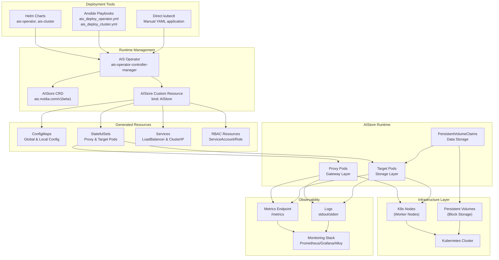
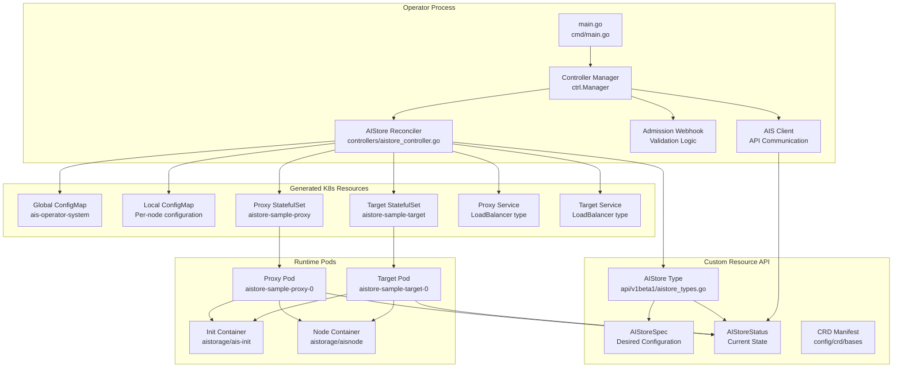
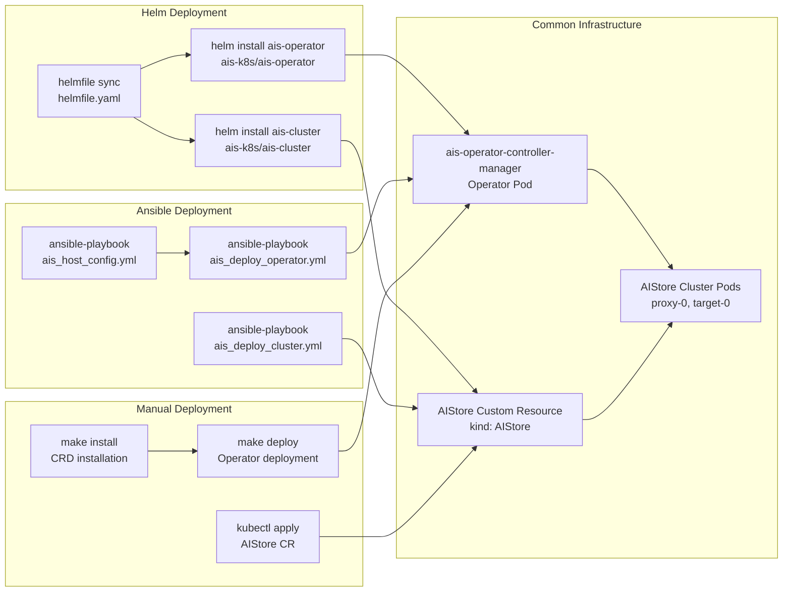
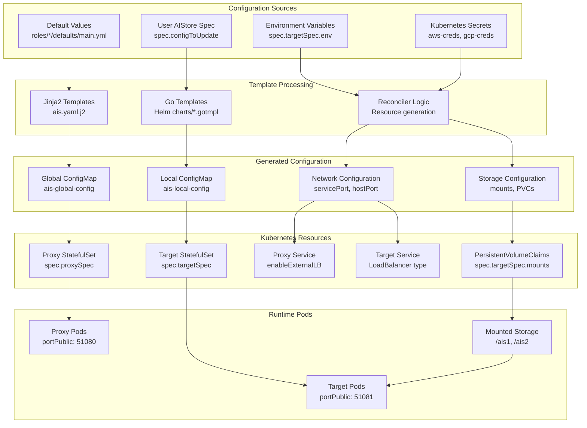
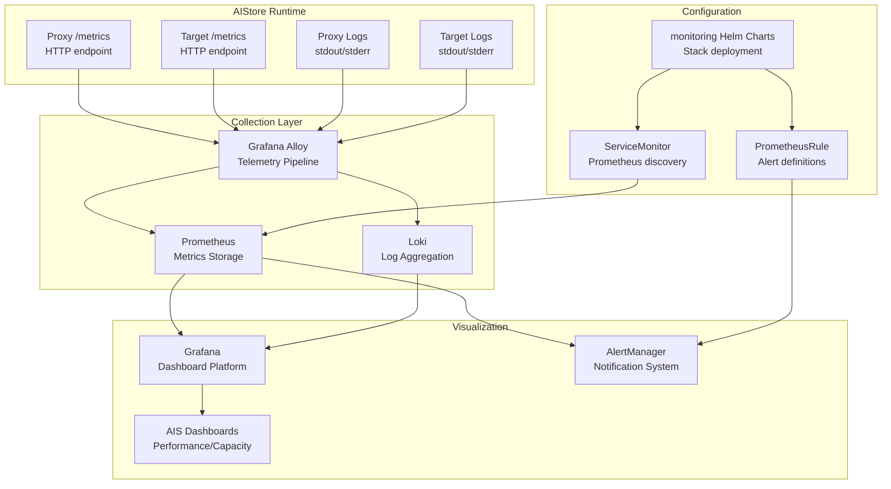

<!-- source: DeepWiki mcp.deepwiki.com · repo NVIDIA/ais-k8s · page 1 Overview · fetched 2026-10-26 -->

# Overview

Relevant source files

The following files were used as context for generating this wiki page:

- [README.md](README.md)
- [docs/COMPATIBILITY.md](docs/COMPATIBILITY.md)
- [docs/README.md](docs/README.md)
- [docs/network_configuration.md](docs/network_configuration.md)
- [docs/prerequisites.md](docs/prerequisites.md)
- [operator/README.md](operator/README.md)
- [operator/config/samples/ais_v1beta1_aistore.yaml](operator/config/samples/ais_v1beta1_aistore.yaml)
- [operator/config/samples/ais_v1beta1_aistore_tls_certmanager_csi.yaml](operator/config/samples/ais_v1beta1_aistore_tls_certmanager_csi.yaml)
- [operator/config/samples/ais_v1beta1_aistore_tracing.yaml](operator/config/samples/ais_v1beta1_aistore_tracing.yaml)
- [playbooks/README.md](playbooks/README.md)
- [playbooks/ais-deployment/docs/ais_cluster_management.md](playbooks/ais-deployment/docs/ais_cluster_management.md)
- [playbooks/host-config/README.md](playbooks/host-config/README.md)

This document provides a comprehensive overview of the AIStore Kubernetes (ais-k8s) repository, which serves as a complete toolkit for deploying and managing AIStore clusters in Kubernetes environments. AIStore is a lightweight, scalable object storage solution designed for AI applications that requires specialized Kubernetes integration for production deployments.

The ais-k8s repository encompasses four primary systems: the AIStore Kubernetes Operator for cluster lifecycle management, Helm Charts for package-based deployment, Ansible Playbooks for infrastructure automation, and a comprehensive monitoring stack. For detailed deployment instructions, see [Getting Started](#2). For operator-specific documentation, see [AIStore Kubernetes Operator](#3).

## System Architecture

The ais-k8s repository implements a multi-layered architecture that provides multiple deployment paths while converging on a unified runtime management system.

Sources: [README.md:1-36](), [operator/README.md:1-12](), [docs/README.md:35-89]()

## Core Components

### AIStore Kubernetes Operator

The operator implements the standard Kubernetes controller pattern to manage AIStore cluster lifecycle through custom resources. The core controller reconciles the desired state defined in `AIStore` custom resources with the actual cluster state.

Sources: [operator/README.md:1-12](), [operator/config/samples/ais_v1beta1_aistore.yaml:1-49]()

### Deployment Methods

The repository provides three primary deployment approaches, each targeting different use cases and automation levels.

Sources: [docs/README.md:39-71](), [operator/README.md:55-83](), [playbooks/ais-deployment/docs/ais_cluster_management.md:21-82]()

## Configuration and Resource Management

The operator transforms high-level AIStore specifications into concrete Kubernetes resources through a layered configuration system.

Sources: [operator/config/samples/ais_v1beta1_aistore.yaml:8-31](), [playbooks/ais-deployment/docs/ais_cluster_management.md:41-74]()

## Key Resource Specifications

The AIStore custom resource defines the complete cluster configuration through structured specifications:

| Component | Key Fields | Purpose |
|-----------|------------|---------|
| `spec.size` | Integer | Number of target pods in cluster |
| `spec.proxySpec` | `servicePort`, `hostPort`, `portPublic` | Proxy pod network configuration |
| `spec.targetSpec` | `servicePort`, `hostPort`, `mounts` | Target pod and storage configuration |
| `spec.targetSpec.mounts` | `path`, `size`, `label` | Persistent volume mount specifications |
| `spec.nodeImage` | Container image | AIStore runtime container |
| `spec.initImage` | Container image | Initialization container |
| `spec.enableExternalLB` | Boolean | External LoadBalancer service creation |
| `spec.configToUpdate` | Nested object | AIStore-specific configuration overrides |

Sources: [operator/config/samples/ais_v1beta1_aistore.yaml:1-49]()

## Monitoring and Observability

The monitoring stack provides comprehensive observability for AIStore clusters through industry-standard tools integrated with Kubernetes-native collection mechanisms.

Sources: [docs/README.md:122-127](), [monitoring/README.md]()

## Development and Testing Infrastructure

The repository includes comprehensive development tooling and continuous integration systems for maintaining code quality and deployment reliability.

| Component | Purpose | Key Files |
|-----------|---------|-----------|
| E2E Testing | End-to-end cluster validation | [tests/README.md]() |
| GitHub Actions | CI/CD pipeline automation | [.github/workflows/]() |
| Kind Integration | Local Kubernetes testing | Test configuration |
| Ginkgo Framework | Behavior-driven testing | Test specifications |
| Docker Build | Container image automation | [Makefile](), [Dockerfile]() |

The testing framework validates operator functionality across multiple Kubernetes distributions and deployment scenarios, ensuring compatibility with production environments.

Sources: [operator/README.md:329-332](), [operator/tests/README.md]()

---

