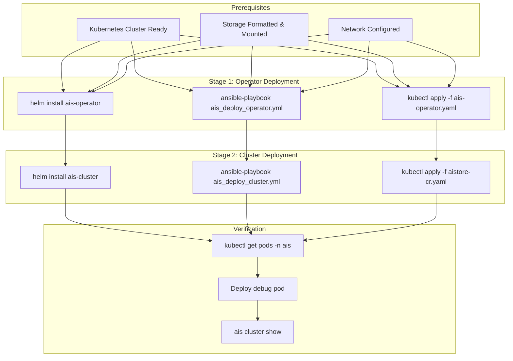
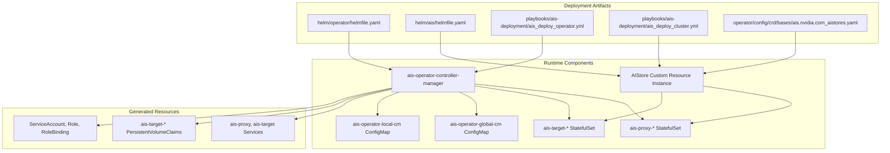

<!-- source: DeepWiki mcp.deepwiki.com · repo NVIDIA/ais-k8s · page 2 Getting Started · fetched 2026-10-26 -->

# Getting Started

<details>
<summary>Relevant source files</summary>

The following files were used as context for generating this wiki page:

- [README.md](README.md)
- [docs/COMPATIBILITY.md](docs/COMPATIBILITY.md)
- [docs/README.md](docs/README.md)
- [docs/diagrams/certificates.jpg](docs/diagrams/certificates.jpg)
- [docs/network_configuration.md](docs/network_configuration.md)
- [docs/prerequisites.md](docs/prerequisites.md)
- [helm/README.md](helm/README.md)
- [helm/ais/README.md](helm/ais/README.md)
- [helm/ais/config/tls-cert/sjc11.yaml](helm/ais/config/tls-cert/sjc11.yaml)
- [helm/cluster-issuer/config/sjc11.yaml](helm/cluster-issuer/config/sjc11.yaml)
- [helm/cluster-issuer/config/values-sample.yaml](helm/cluster-issuer/config/values-sample.yaml)
- [helm/cluster-issuer/helmfile.yaml](helm/cluster-issuer/helmfile.yaml)
- [helm/cluster-issuer/issuer-chart/Chart.yaml](helm/cluster-issuer/issuer-chart/Chart.yaml)
- [helm/cluster-issuer/issuer-chart/templates/ca.yaml](helm/cluster-issuer/issuer-chart/templates/ca.yaml)
- [helm/operator/config/tls-cert/sjc11.yaml](helm/operator/config/tls-cert/sjc11.yaml)
- [playbooks/README.md](playbooks/README.md)
- [playbooks/ais-deployment/docs/ais_cluster_management.md](playbooks/ais-deployment/docs/ais_cluster_management.md)
- [playbooks/host-config/README.md](playbooks/host-config/README.md)

</details>


This page provides a quick-start guide for deploying AIStore clusters on Kubernetes using the ais-k8s repository. It covers basic prerequisites, deployment workflows, and initial verification steps to get your first AIStore cluster running.

For detailed deployment procedures and advanced configuration, see [Deployment Methods](#4). For comprehensive prerequisites and system tuning, see [Advanced Configuration](#7). For operator internals and custom resource specifications, see [AIStore Kubernetes Operator](#3).

## Prerequisites Overview

Before deploying AIStore, your Kubernetes environment must meet several basic requirements:

### Infrastructure Requirements

| Component | Requirement | Notes |
|-----------|-------------|-------|
| **Kubernetes** | v1.27+ (v1.31+ recommended) | Any managed or self-hosted cluster |
| **Operating System** | Linux-based (Ubuntu 22.04+ or RHEL 8+ recommended) | Must support extended attributes |
| **Storage** | Formatted drives with XFS filesystem | Each target node needs dedicated storage |
| **Network** | Intra-cluster connectivity, internet access | Ports 51080-51083 for AIStore services |
| **Tools** | `kubectl`, `helm` (optional), `ansible` (optional) | Depends on chosen deployment method |

### Storage Preparation

The AIStore operator does **not** format disks or create persistent volumes. You must:

1. **Format drives** with XFS filesystem and extended attributes enabled
2. **Mount drives** to consistent paths (e.g., `/ais/nvme0n1`, `/ais/nvme1n1`)  
3. **Create PersistentVolumes** referencing the mounted storage

The [ais_datafs_mkfs playbook](playbooks/host-config/docs/ais_datafs.md:1-1)() automates drive formatting, or use the [host-config playbooks](playbooks/host-config/README.md:1-1)() for complete system setup.

**Sources:** [docs/prerequisites.md:15-23](), [docs/README.md:29-33](), [playbooks/host-config/README.md:16-18]()

## Deployment Workflow Overview

AIStore deployment follows a two-stage process regardless of the chosen deployment method:



**Deployment Methods Comparison**

| Method | Best For | Key Files | Automation Level |
|--------|----------|-----------|------------------|
| **Helm** | Package management, GitOps | [helm/operator/helmfile.yaml](), [helm/ais/helmfile.yaml]() | Medium |
| **Ansible** | Full automation, production | [playbooks/ais-deployment/ais_deploy_operator.yml](), [playbooks/ais-deployment/ais_deploy_cluster.yml]() | High |  
| **Manual** | Development, testing | [operator/config/manager/manager.yaml](), Custom AIStore CRDs | Low |

**Sources:** [docs/README.md:35-70](), [helm/README.md:26-62](), [playbooks/ais-deployment/docs/ais_cluster_management.md:19-83]()

## Quick Start Methods

### Method 1: Helm Deployment (Recommended)

Helm provides the most straightforward deployment path for most users:

```bash
# Add AIStore Helm repository
helm repo add aistore https://nvidia.github.io/ais-k8s
helm repo update

# Install the operator
helm install ais-operator aistore/ais-operator \
  --namespace ais-operator-system \
  --create-namespace

# Install AIStore cluster  
helm install ais-cluster aistore/ais-cluster \
  --namespace ais \
  --create-namespace \
  --set target.mountPaths='{"/ais/nvme0n1","/ais/nvme1n1"}' \
  --set target.size="2Ti"
```

Key configuration files for customization:
- [helm/operator/config/values-sample.yaml]()
- [helm/ais/config/values-sample.yaml]()

### Method 2: Ansible Automation

For complete automation including host configuration:

```bash
# Configure hosts (optional but recommended)
ansible-playbook -i hosts.ini ais_host_config.yml -e ais_hosts=ais

# Deploy complete stack
ansible-playbook -i hosts.ini ais_deploy.yml -e cluster=ais
```

Key configuration files:
- [playbooks/hosts-example.ini]() - Inventory template
- [playbooks/ais-deployment/vars/ais_mpaths.yml]() - Storage configuration
- [playbooks/ais-deployment/roles/ais_deploy_operator/defaults/main.yml]() - Operator settings

### Method 3: Manual Deployment

For development or custom scenarios:

```bash
# Deploy operator
kubectl apply -f https://github.com/NVIDIA/ais-k8s/releases/download/v2.2.0/ais-operator.yaml

# Create AIStore custom resource (example)
kubectl apply -f - <<EOF
apiVersion: ais.nvidia.com/v1beta1
kind: AIStore
metadata:
  name: ais
  namespace: ais
spec:
  size: 3
  image: aistorage/aisnode:v3.28
  targetSpec:
    mounts:
    - path: "/ais/nvme0n1"
      size: "2Ti"
    - path: "/ais/nvme1n1" 
      size: "2Ti"
EOF
```

**Sources:** [helm/README.md:44-62](), [playbooks/README.md:28-39](), [docs/README.md:47-70](), [docs/COMPATIBILITY.md:44-66]()

## Component Architecture and File Mapping

The following diagram shows how deployment artifacts map to runtime components:



**Key Custom Resource Reconciliation Flow:**

The [AIStoreReconciler](operator/controllers/aistore_controller.go:1-1)() watches `AIStore` custom resources and generates:

1. **ConfigMaps**: Global and local AIStore configuration
2. **StatefulSets**: `ais-proxy` and `ais-target` workloads  
3. **Services**: Load balancers for proxy and target access
4. **PVCs**: Storage claims for target pods
5. **RBAC**: Required permissions for AIStore pods

**Sources:** [operator/controllers/aistore_controller.go:1-1](), [operator/api/v1beta1/aistore_types.go:1-1](), [helm/ais/charts/ais-cluster/templates/ais.yaml:1-1]()

## Post-Deployment Verification

### Check Pod Status

Verify all AIStore components are running:

```bash
# Check operator
kubectl get pods -n ais-operator-system

# Check AIStore cluster 
kubectl get pods -n ais
kubectl get aistore -n ais
```

Expected output shows all pods in `Running` state and AIStore custom resource in `Ready` condition.

### Deploy Debug Pod

Use the provided debug pod for cluster interaction:

```bash
kubectl apply -f https://raw.githubusercontent.com/NVIDIA/ais-k8s/main/manifests/debug/aisnode_debug.yaml

# Access debug pod
kubectl -n ais exec -it pods/aisnode-debug -- bash

# Inside debug pod
export AIS_ENDPOINT=http://ais-proxy:51080
ais cluster show
```

The [aisnode_debug.yaml](manifests/debug/aisnode_debug.yaml:1-1)() includes the AIStore CLI pre-installed for cluster management.

### Verify Cluster Health

Key verification commands inside the debug pod:

```bash
# Cluster status
ais cluster show

# Node information  
ais cluster show proxy
ais cluster show target

# Storage information
ais storage mountpath
ais storage capacity
```

**Sources:** [docs/README.md:91-121](), [manifests/debug/aisnode_debug.yaml:1-1]()

## Next Steps

After successful deployment and verification:

1. **External Access**: Configure ingress or load balancers for external access - see [Operator Documentation](#3)
2. **Monitoring**: Set up Prometheus and Grafana monitoring - see [Monitoring and Observability](#5)  
3. **Security**: Configure TLS certificates and authentication - see [TLS and Security](#7.2)
4. **Cloud Integration**: Connect to cloud storage backends - see [Cloud Backend Integration](#7.3)
5. **Performance Testing**: Run load tests with `aisloader` - see [Development and Testing](#6)

For production deployments, also review:
- [Multi-Environment Deployment](#7.1) for environment-specific configurations
- [Troubleshooting Guide](#8.3) for common deployment issues
- [Configuration Reference](#8.1) for complete AIStore CRD documentation

**Sources:** [docs/README.md:122-139](), [monitoring/README.md:1-1]()

---

