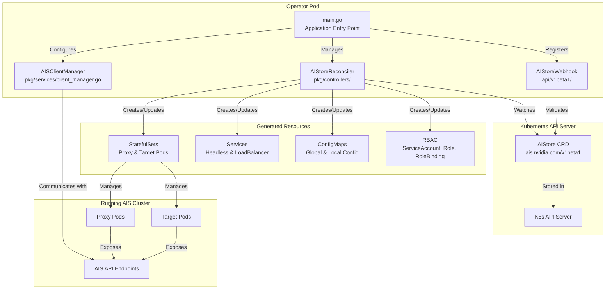
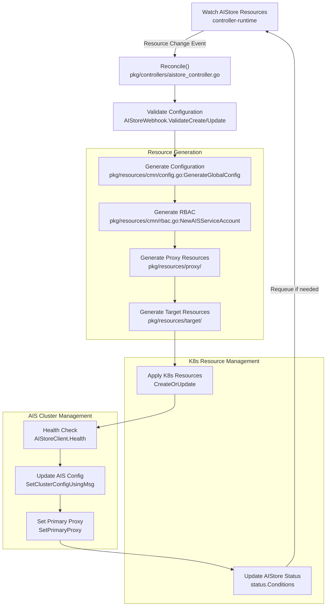
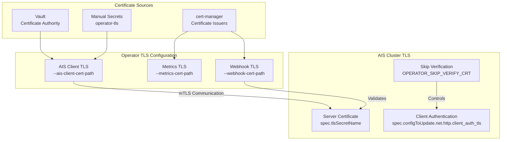

<!-- source: DeepWiki mcp.deepwiki.com · repo NVIDIA/ais-k8s · page 3 AIStore Kubernetes Operator · fetched 2026-10-26 -->

# AIStore Kubernetes Operator

Relevant source files

The following files were used as context for generating this wiki page:

- [.gitlab-ci.yml](.gitlab-ci.yml)
- [operator/CHANGELOG.md](operator/CHANGELOG.md)
- [operator/Makefile](operator/Makefile)
- [operator/README.md](operator/README.md)
- [operator/cmd/main.go](operator/cmd/main.go)
- [operator/config/samples/ais_v1beta1_aistore.yaml](operator/config/samples/ais_v1beta1_aistore.yaml)
- [operator/config/samples/ais_v1beta1_aistore_tls_certmanager_csi.yaml](operator/config/samples/ais_v1beta1_aistore_tls_certmanager_csi.yaml)
- [operator/config/samples/ais_v1beta1_aistore_tracing.yaml](operator/config/samples/ais_v1beta1_aistore_tracing.yaml)
- [operator/go.mod](operator/go.mod)
- [operator/go.sum](operator/go.sum)
- [operator/pkg/resources/cmn/config.go](operator/pkg/resources/cmn/config.go)
- [operator/pkg/resources/cmn/rbac.go](operator/pkg/resources/cmn/rbac.go)
- [operator/pkg/services/aisapi.go](operator/pkg/services/aisapi.go)
- [operator/pkg/services/client_manager.go](operator/pkg/services/client_manager.go)
- [operator/pkg/services/mocks/client.go](operator/pkg/services/mocks/client.go)
- [operator/scripts/test.sh](operator/scripts/test.sh)
- [operator/tests/tutils/ais_cluster.go](operator/tests/tutils/ais_cluster.go)

The AIStore Kubernetes Operator is the core system component that manages the lifecycle of AIStore clusters on Kubernetes. This document provides an overview of the operator's purpose, architecture, and key functionality. For detailed information about the operator's internal architecture, see [Operator Architecture](#3.1). For specifics about the AIStore Custom Resource Definition, see [Custom Resources](#3.2). For details about how the operator manages Kubernetes resources, see [Resource Management](#3.3).

The operator extends the native Kubernetes API through Custom Resource Definitions (CRDs) to provide declarative management of AIStore clusters, handling deployment, scaling, upgrades, and decommissioning operations automatically.

## Operator Overview

The AIStore Kubernetes Operator is built using the [Operator SDK](https://sdk.operatorframework.io/) and follows the standard Kubernetes controller pattern. It watches for changes to `AIStore` custom resources and reconciles the actual cluster state with the desired state specified in the resource.

### Core Operator Architecture

**Operator Core Architecture**

The operator consists of several key components that work together to manage AIStore clusters. The main controller reconciles the desired state with actual cluster state, while the webhook validates configurations before they are applied.

Sources: [operator/cmd/main.go:47-225](), [operator/pkg/controllers/](), [operator/api/v1beta1/](), [operator/pkg/services/client_manager.go:56-63]()

## Reconciliation Loop

The operator implements the standard Kubernetes controller reconciliation pattern, continuously monitoring and adjusting cluster state based on the `AIStore` custom resource specifications.

### Reconciliation Flow

**Reconciliation Flow Diagram**

The reconciliation process begins when the controller-runtime framework detects changes to `AIStore` resources. The operator validates the configuration, generates the necessary Kubernetes resources, applies them to the cluster, and then communicates with the running AIS cluster to ensure proper configuration.

Sources: [operator/pkg/controllers/](), [operator/pkg/resources/cmn/config.go:28-38](), [operator/pkg/resources/cmn/rbac.go:83-91](), [operator/pkg/services/aisapi.go:104-130]()

## Resource Management

The operator generates and manages a comprehensive set of Kubernetes resources to support AIStore cluster operations. Each `AIStore` custom resource results in the creation of multiple dependent resources.

### Generated Kubernetes Resources

| Resource Type | Purpose | Key Files |
|---------------|---------|-----------|
| **StatefulSets** | Manages proxy and target pods with stable identities | `pkg/resources/proxy/`, `pkg/resources/target/` |
| **Services** | Provides network access (headless and LoadBalancer) | `pkg/resources/proxy/service.go`, `pkg/resources/target/service.go` |
| **ConfigMaps** | Stores AIS configuration (global and local) | `pkg/resources/cmn/config.go` |
| **ServiceAccount** | Provides pod identity and RBAC permissions | `pkg/resources/cmn/rbac.go:83-91` |
| **Role & RoleBinding** | Grants necessary Kubernetes API permissions | `pkg/resources/cmn/rbac.go:36-81` |
| **PersistentVolumeClaims** | Manages storage for target pods | Generated based on `targetSpec.mounts` |

The operator uses a declarative approach where each resource is generated based on the `AIStore` specification and applied using the controller-runtime's `CreateOrUpdate` pattern.

Sources: [operator/pkg/resources/](), [operator/pkg/resources/cmn/rbac.go:36-91](), [operator/pkg/resources/cmn/config.go:24-38]()

## TLS and Security Configuration

The operator supports comprehensive TLS configuration for both its own operation and the AIStore clusters it manages.

### Operator TLS Architecture

**TLS Configuration Architecture**

The operator supports multiple TLS configurations including webhook validation, metrics serving, and client authentication with AIStore clusters. Certificate management can be handled through cert-manager, Vault, or manual secret creation.

Sources: [operator/cmd/main.go:65-74](), [operator/pkg/services/client_manager.go:167-179](), [operator/config/samples/ais_v1beta1_aistore_tls_certmanager_csi.yaml:70-78]()

### TLS Configuration Options

The operator provides several TLS-related configuration options:

- **Webhook TLS**: Required for admission webhook validation, configured via `--webhook-cert-path`
- **Metrics TLS**: Optional HTTPS serving for metrics endpoint, configured via `--metrics-cert-path`  
- **AIS Client TLS**: Enables mTLS communication with AIStore clusters, configured via `--ais-client-cert-path`
- **Certificate Verification**: Controlled by `OPERATOR_SKIP_VERIFY_CRT` environment variable

The operator automatically loads CA certificates from `/etc/ais/ca` when validating AIS cluster certificates and supports per-cluster certificate paths when `--ais-client-cert-per-cluster` is enabled.

Sources: [operator/pkg/services/client_manager.go:28-33](), [operator/pkg/services/client_manager.go:225-257](), [operator/pkg/services/client_manager.go:218-223]()

## Testing Framework

The operator includes a comprehensive testing framework supporting both unit tests and end-to-end testing scenarios.

### Test Infrastructure

The testing infrastructure uses [Ginkgo](https://onsi.github.io/ginkgo/) for BDD-style testing and includes utilities for creating test clusters and validating operator behavior.

**Key Testing Components:**
- **Unit Tests**: Test individual components and functions in isolation
- **E2E Tests**: Test complete operator functionality against real Kubernetes clusters
- **Test Utilities**: Helper functions for creating test AIStore clusters in [operator/tests/tutils/ais_cluster.go:79-83]()
- **CI Integration**: GitLab CI configuration for automated testing in [.gitlab-ci.yml:96-117]()

The test framework supports both ephemeral clusters (for CI) and persistent clusters (for development) through environment variables like `TEST_EPHEMERAL_CLUSTER`.

Sources: [operator/tests/tutils/ais_cluster.go:24-32](), [operator/tests/tutils/ais_cluster.go:62-77](), [operator/scripts/test.sh:15-22](), [.gitlab-ci.yml:36-53]()

## Development and Build Process

The operator uses a standard Go development workflow with Make-based automation for building, testing, and deployment.

### Build and Development Workflow

Key development commands defined in [operator/Makefile:51-331]():

- `make build` - Builds the operator binary
- `make docker-build` - Creates container image  
- `make deploy` - Deploys operator to Kubernetes cluster
- `make test` - Runs unit tests
- `make test-e2e` - Runs end-to-end tests
- `make manifests` - Generates CRD and RBAC manifests
- `make generate` - Updates auto-generated code

The operator follows semantic versioning with version information embedded during build time through the `BUILD_VERSION` variable.

Sources: [operator/Makefile:1-331](), [operator/go.mod:1-131](), [operator/cmd/main.go:36-38]()

---

