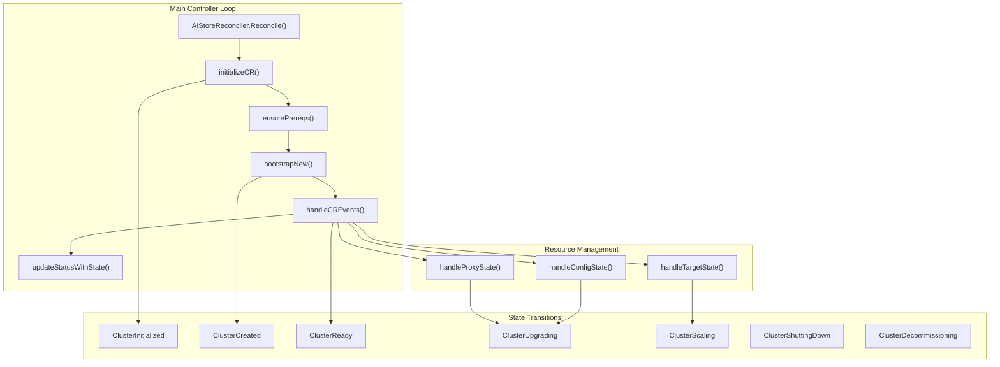
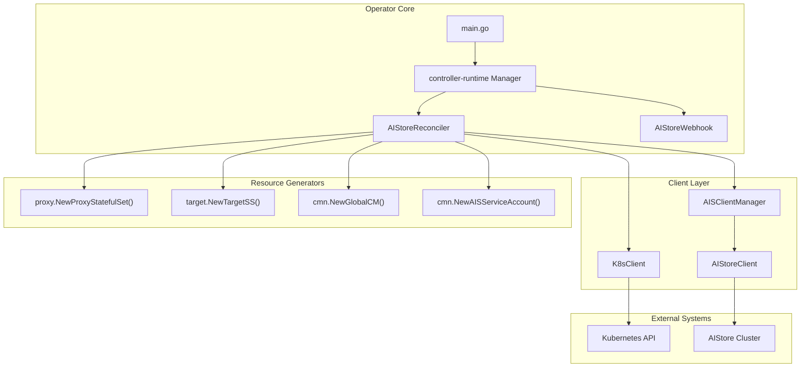
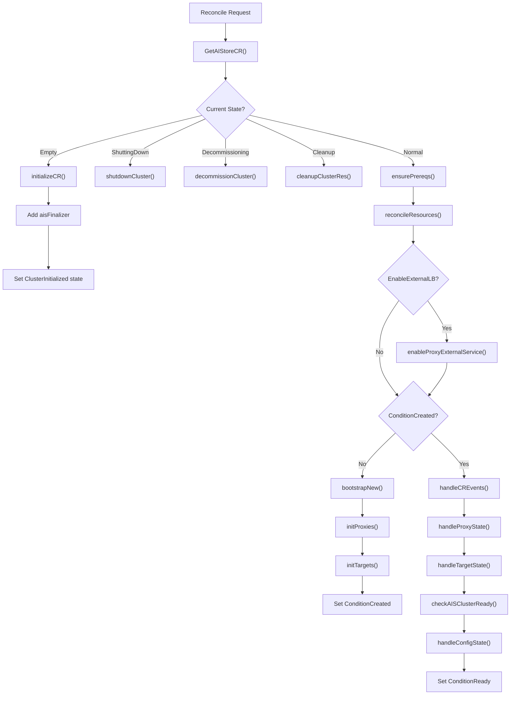
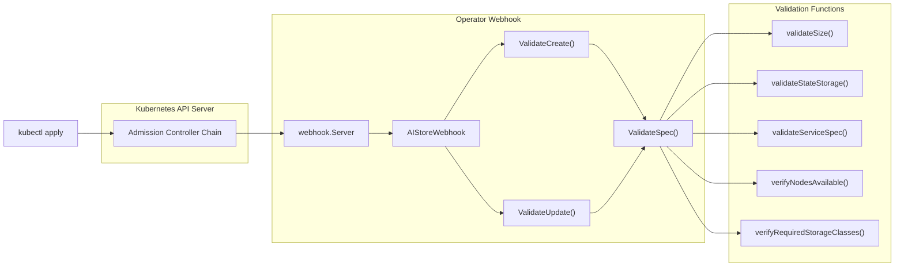
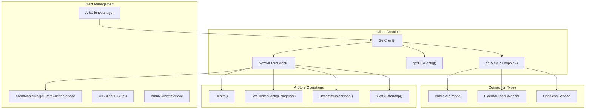
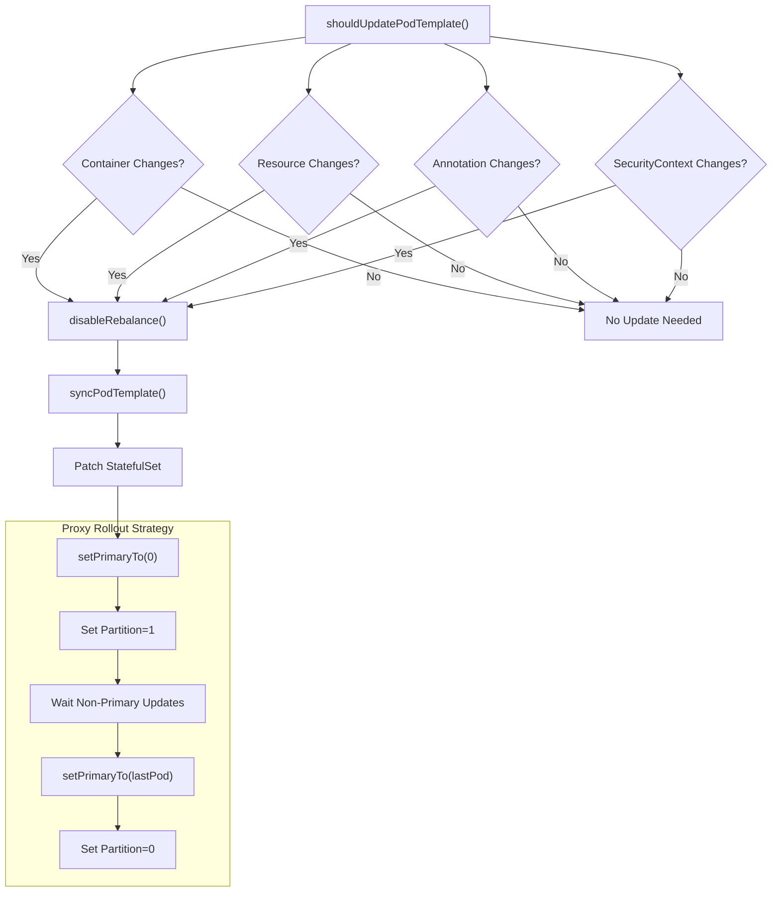

<!-- source: DeepWiki mcp.deepwiki.com · repo NVIDIA/ais-k8s · page 3.1 Operator Architecture · fetched 2026-10-26 -->

# Operator Architecture

Relevant source files

The following files were used as context for generating this wiki page:

- [operator/CHANGELOG.md](operator/CHANGELOG.md)
- [operator/api/v1beta1/aistore_webhook.go](operator/api/v1beta1/aistore_webhook.go)
- [operator/cmd/main.go](operator/cmd/main.go)
- [operator/pkg/client/api.go](operator/pkg/client/api.go)
- [operator/pkg/controllers/cluster_cleanup.go](operator/pkg/controllers/cluster_cleanup.go)
- [operator/pkg/controllers/cluster_controller.go](operator/pkg/controllers/cluster_controller.go)
- [operator/pkg/controllers/cluster_controller_test.go](operator/pkg/controllers/cluster_controller_test.go)
- [operator/pkg/controllers/proxy_controller.go](operator/pkg/controllers/proxy_controller.go)
- [operator/pkg/controllers/target_controllers.go](operator/pkg/controllers/target_controllers.go)
- [operator/pkg/resources/cmn/rbac.go](operator/pkg/resources/cmn/rbac.go)
- [operator/pkg/services/aisapi.go](operator/pkg/services/aisapi.go)
- [operator/pkg/services/client_manager.go](operator/pkg/services/client_manager.go)
- [operator/pkg/services/mocks/client.go](operator/pkg/services/mocks/client.go)

This page covers the internal architecture of the AIStore Kubernetes operator, including the reconciliation loop, component relationships, and key subsystems. For information about deploying the operator, see [Deployment Methods](#4). For details about the Custom Resource Definition and configuration options, see [Custom Resources](#3.2).

## Core Reconciliation Architecture

The AIStore operator follows the standard Kubernetes controller pattern with a primary reconciler that manages the lifecycle of AIStore clusters through custom resources.

The `AIStoreReconciler` implements the main reconciliation logic with distinct phases for initialization, bootstrapping, and ongoing management. Each reconciliation cycle moves the cluster through well-defined states based on the current conditions and desired configuration.

**Sources:** [operator/pkg/controllers/cluster_controller.go:43-152]()

## Component Architecture

The operator consists of several key components that work together to manage AIStore clusters:

The `AIStoreReconciler` serves as the central orchestrator, delegating to specialized components for Kubernetes API interactions, AIStore API communication, and resource generation. The controller-runtime `Manager` handles the lifecycle and dependency injection for all components.

**Sources:** [operator/cmd/main.go:149-180](), [operator/pkg/controllers/cluster_controller.go:42-59]()

## Reconciliation Flow Details

The reconciler implements a sophisticated state machine that handles various cluster lifecycle scenarios:

The reconciler maintains consistent state progression through careful ordering of operations and requeue logic for operations that require multiple reconciliation cycles to complete.

**Sources:** [operator/pkg/controllers/cluster_controller.go:75-152](), [operator/pkg/controllers/cluster_controller.go:354-441](), [operator/pkg/controllers/cluster_controller.go:479-530]()

## Admission Webhook System

The operator includes an admission webhook that validates AIStore custom resource specifications before they are persisted to etcd:

The webhook performs comprehensive validation including cluster sizing, storage configuration, port specifications, and resource availability checks against the target Kubernetes cluster.

**Sources:** [operator/api/v1beta1/aistore_webhook.go:32-142](), [operator/cmd/main.go:182-191]()

## AIS API Client Management

The operator maintains connections to AIStore clusters through a sophisticated client management system that handles authentication, TLS configuration, and connection pooling:

The client manager automatically selects the appropriate connection method based on cluster configuration and caches clients for reuse across reconciliation cycles.

**Sources:** [operator/pkg/services/client_manager.go:56-110](), [operator/pkg/services/aisapi.go:104-130]()

## Resource Generation and Management

The operator generates all necessary Kubernetes resources through specialized factory functions that ensure consistency and proper ownership relationships:

```mermaid
graph TB
    subgraph "Resource Categories"
        RBAC["RBAC Resources"]
        Config["Configuration"]
        StatefulSets["StatefulSets"]
        Services["Services"]
        Storage["Storage"]
    end
    
    subgraph "RBAC Generation"
        ServiceAccount["NewAISServiceAccount()"]
        Role["NewAISRBACRole()"]
        RoleBinding["NewAISRBACRoleBinding()"]
    end
    
    subgraph "Configuration Generation"
        GlobalCM["NewGlobalCM()"]
        ProxyCM["NewProxyCM()"]
        TargetCM["NewTargetCM()"]
        StatsDCM["NewStatsDCM()"]
    end
    
    subgraph "Workload Generation"
        ProxySS["NewProxyStatefulSet()"]
        TargetSS["NewTargetSS()"]
        ProxyHeadlessSvc["NewProxyHeadlessSvc()"]
        TargetHeadlessSvc["NewTargetHeadlessSvc()"]
        ProxyLBSvc["NewProxyLoadBalancerSVC()"]
        TargetLBSvcList["NewLoadBalancerSVCList()"]
    end
    
    subgraph "Management Functions"
        CreateOrUpdate["CreateOrUpdateResource()"]
        SetOwnerRef["SetControllerReference()"]
        PatchStatus["patchStatus()"]
    end
    
    RBAC --> ServiceAccount
    RBAC --> Role
    RBAC --> RoleBinding
    
    Config --> GlobalCM
    Config --> ProxyCM
    Config --> TargetCM
    Config --> StatsDCM
    
    StatefulSets --> ProxySS
    StatefulSets --> TargetSS
    
    Services --> ProxyHeadlessSvc
    Services --> TargetHeadlessSvc
    Services --> ProxyLBSvc
    Services --> TargetLBSvcList
    
    ServiceAccount --> CreateOrUpdate
    GlobalCM --> CreateOrUpdate
    ProxySS --> CreateOrUpdate
    CreateOrUpdate --> SetOwnerRef
    CreateOrUpdate --> PatchStatus
```

Each resource type has dedicated factory functions that generate properly configured Kubernetes objects with appropriate labels, annotations, and owner references for garbage collection.

**Sources:** [operator/pkg/controllers/cluster_controller.go:631-664](), [operator/pkg/resources/cmn/rbac.go:36-91](), [operator/pkg/client/api.go:234-270]()

## Pod Template Synchronization

The operator implements sophisticated pod template comparison and synchronization logic to handle rolling updates while maintaining cluster stability:

The pod template synchronization includes special handling for proxy rolling updates to ensure the primary proxy is updated last, maintaining cluster availability throughout the upgrade process.

**Sources:** [operator/pkg/controllers/cluster_controller.go:759-900](), [operator/pkg/controllers/proxy_controller.go:166-251](), [operator/pkg/controllers/target_controllers.go:269-290]()

---

