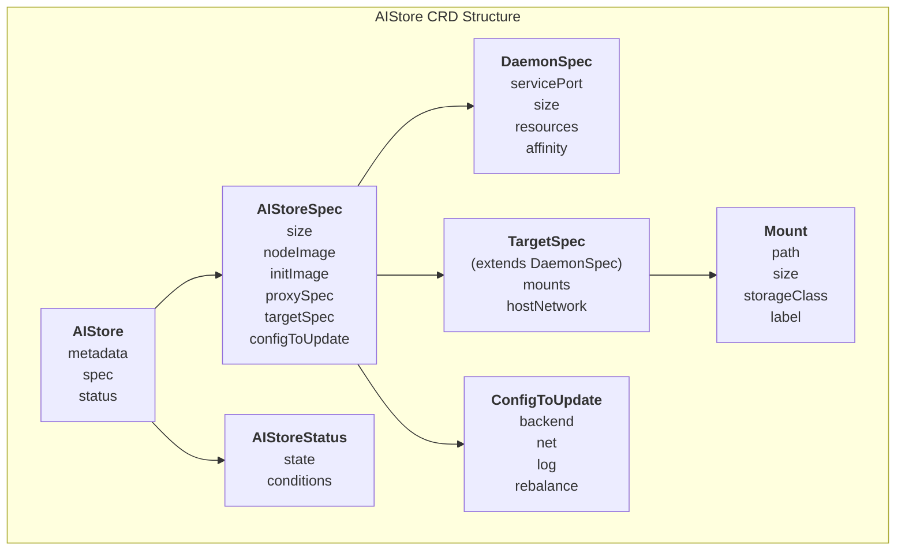
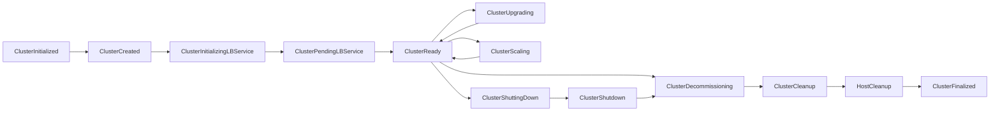

<!-- source: DeepWiki mcp.deepwiki.com · repo NVIDIA/ais-k8s · page 3.2 Custom Resources · fetched 2026-10-26 -->

# Custom Resources

<details>
<summary>Relevant source files</summary>

The following files were used as context for generating this wiki page:

- [operator/README.md](operator/README.md)
- [operator/api/v1beta1/aisconfig.go](operator/api/v1beta1/aisconfig.go)
- [operator/api/v1beta1/aistore_types.go](operator/api/v1beta1/aistore_types.go)
- [operator/api/v1beta1/util_types.go](operator/api/v1beta1/util_types.go)
- [operator/api/v1beta1/zz_generated.deepcopy.go](operator/api/v1beta1/zz_generated.deepcopy.go)
- [operator/config/samples/ais_v1beta1_aistore.yaml](operator/config/samples/ais_v1beta1_aistore.yaml)
- [operator/config/samples/ais_v1beta1_aistore_tls_certmanager_csi.yaml](operator/config/samples/ais_v1beta1_aistore_tls_certmanager_csi.yaml)
- [operator/config/samples/ais_v1beta1_aistore_tracing.yaml](operator/config/samples/ais_v1beta1_aistore_tracing.yaml)
- [operator/pkg/resources/cmn/configmap.go](operator/pkg/resources/cmn/configmap.go)
- [operator/pkg/resources/cmn/env.go](operator/pkg/resources/cmn/env.go)
- [operator/pkg/resources/cmn/res.go](operator/pkg/resources/cmn/res.go)
- [operator/pkg/resources/cmn/statefulset.go](operator/pkg/resources/cmn/statefulset.go)
- [operator/pkg/resources/cmn/statefulset_test.go](operator/pkg/resources/cmn/statefulset_test.go)
- [operator/pkg/resources/proxy/statefulset.go](operator/pkg/resources/proxy/statefulset.go)
- [operator/pkg/resources/target/statefulset.go](operator/pkg/resources/target/statefulset.go)

</details>


This page documents the Custom Resource Definitions (CRDs) used by the AIStore Kubernetes Operator to declaratively manage AIStore clusters. The custom resources serve as the primary interface between users and the operator, defining the desired state of AIStore deployments.

For information about how the operator processes these resources, see [Operator Architecture](#3.1). For details on how custom resources are translated into Kubernetes objects, see [Resource Management](#3.3).

## AIStore Custom Resource Overview

The AIStore operator defines a single primary custom resource type that encapsulates the entire cluster specification. This resource follows Kubernetes conventions with a spec-status pattern for declarative management.

**AIStore Custom Resource Structure**


Sources: [operator/api/v1beta1/aistore_types.go:87-192](), [operator/api/v1beta1/aistore_types.go:296-302]()

## Core Resource Types

### AIStore Resource

The `AIStore` custom resource is the primary interface for managing AIStore clusters. It defines the complete desired state of an AIStore deployment.

| Field | Type | Description |
|-------|------|-------------|
| `metadata` | `metav1.ObjectMeta` | Standard Kubernetes metadata |
| `spec` | `AIStoreSpec` | Desired cluster configuration |
| `status` | `AIStoreStatus` | Observed cluster state |

**Key Methods:**
- `GetProxySize()` and `GetTargetSize()` - Calculate effective cluster sizes
- `GetDefaultProxyURL()` - Generate internal proxy endpoint URLs
- `ShouldDecommission()` - Determine if cluster should be torn down

Sources: [operator/api/v1beta1/aistore_types.go:296-302](), [operator/api/v1beta1/aistore_types.go:377-389]()

### AIStoreSpec Structure

The `AIStoreSpec` defines the desired configuration for an AIStore cluster:

```yaml
spec:
  size: 3                              # Overall cluster size
  nodeImage: "aistorage/aisnode:v3.25" # AIStore daemon image
  initImage: "aistorage/ais-init:v3.25" # Initialization container image
  stateStorageClass: "fast-ssd"        # Storage class for state persistence
  enableExternalLB: true               # Enable external access
  
  proxySpec:                           # Proxy (gateway) configuration
    size: 2                            # Override cluster size for proxies
    servicePort: 51080
    resources: { ... }
    
  targetSpec:                          # Target (storage) configuration  
    size: 3                            # Override cluster size for targets
    servicePort: 51081
    mounts:                            # Storage mount points
      - path: "/ais1"
        size: 100Gi
        storageClass: "fast-storage"
        
  configToUpdate:                      # AIS-specific configuration
    rebalance:
      enabled: true
    net:
      http:
        use_https: true
```

Sources: [operator/api/v1beta1/aistore_types.go:87-192](), [operator/config/samples/ais_v1beta1_aistore.yaml:1-49]()

### Daemon Specifications

Both proxy and target pods share a common `DaemonSpec` structure for deployment configuration:

**DaemonSpec Fields:**
- `servicePort`, `publicPort`, `intraControlPort`, `intraDataPort` - Network configuration
- `size` - Number of replicas (overrides cluster-level size)
- `resources` - CPU, memory, and storage requirements
- `affinity`, `nodeSelector`, `tolerations` - Pod placement controls
- `env` - Additional environment variables

**TargetSpec Extensions:**
- `mounts` - Array of `Mount` objects defining storage volumes
- `hostNetwork` - Enable host networking for multi-homing
- `disablePodAntiAffinity` - Allow multiple targets per node (testing only)

Sources: [operator/api/v1beta1/aistore_types.go:218-264](), [operator/api/v1beta1/aistore_types.go:266-276]()

## Storage Mount Configuration

Target nodes require storage mount configuration through the `Mount` type:

```yaml
targetSpec:
  mounts:
    - path: "/ais1"           # Mount path inside container
      size: 100Gi             # PVC size request
      storageClass: "fast"    # Kubernetes StorageClass
      label: "disk1"          # AIS disk label for sharing
      selector:               # PV selector (optional)
        matchLabels:
          disk-type: "nvme"
```

**Mount Label Usage:**
- Same `label` allows mount paths to share underlying storage
- Required for development environments without dedicated disks
- Enables disk-less operation when label doesn't match actual hardware

Sources: [operator/api/v1beta1/aistore_types.go:278-287](), [operator/config/samples/ais_v1beta1_aistore.yaml:22-31]()

## Cluster State Management

**Cluster State Lifecycle**


**Cluster States:**
- `ClusterReady` - Fully operational cluster
- `ClusterUpgrading` - Rolling update in progress  
- `ClusterScaling` - Replica count changes
- `ClusterDecommissioning` - Permanent teardown initiated

**Condition Types:**
- `ConditionReady` - Cluster operational status
- `ConditionCreated` - Basic resources exist
- `ConditionReadyRebalance` - Rebalancing capability status

Sources: [operator/api/v1beta1/aistore_types.go:30-57](), [operator/api/v1beta1/aistore_types.go:61-77]()

## AIS Configuration Management

The `ConfigToUpdate` structure provides fine-grained control over AIStore daemon configuration:

**Major Configuration Sections:**
- `backend` - Cloud provider backend settings
- `net.http` - TLS and networking configuration  
- `log` - Logging levels and rotation
- `rebalance` - Data rebalancing behavior
- `space` - Storage capacity thresholds
- `timeout` - Various timeout values

**Example TLS Configuration:**
```yaml
configToUpdate:
  net:
    http:
      use_https: true
      server_crt: "/var/certs/tls.crt"
      server_key: "/var/certs/tls.key"
      skip_verify: true
```

The operator converts these settings to AIStore's native configuration format using the `Convert()` method.

Sources: [operator/api/v1beta1/aisconfig.go:18-252](), [operator/api/v1beta1/aisconfig.go:275-279]()

## Security and Secret Integration

The AIStore resource integrates with Kubernetes secrets for secure credential management:

**Secret Reference Fields:**
- `tlsSecretName` - TLS certificates for HTTPS
- `awsSecretName`, `gcpSecretName`, `ociSecretName` - Cloud provider credentials
- `authNSecretName` - Authentication signing keys
- `tracingTokenSecretName` - Distributed tracing tokens

**Certificate Manager Integration:**
- `tlsCertManagerIssuerName` - Cert-manager issuer for automatic certificates
- Supports CSI driver integration for dynamic certificate provisioning

Sources: [operator/api/v1beta1/aistore_types.go:153-183](), [operator/config/samples/ais_v1beta1_aistore_tls_certmanager_csi.yaml:44-91]()

## Resource Validation and Webhooks

The operator includes validation webhooks to ensure resource correctness:

**Built-in Validations:**
- Cluster size must be specified either globally or per-daemon type
- Storage mount paths must be absolute
- Resource quantities must be valid Kubernetes formats
- Network ports must be within valid ranges

**Custom Validation Rules:**
```go
// Example validation from CRD annotations
+kubebuilder:validation:XValidation:rule="(has(self.targetSpec.size) && has(self.proxySpec.size)) || (has(self.size) && self.size > 0)",message="Invalid cluster size"
```

Sources: [operator/api/v1beta1/aistore_types.go:88](), [operator/README.md:22-26]()

## Custom Resource Examples

**Minimal Development Cluster:**
```yaml
apiVersion: ais.nvidia.com/v1beta1
kind: AIStore
metadata:
  name: dev-cluster
spec:
  size: 1
  nodeImage: "aistorage/aisnode:latest"
  initImage: "aistorage/ais-init:latest"
  proxySpec:
    servicePort: 51080
  targetSpec:
    servicePort: 51081
    mounts:
      - path: "/ais1"
        size: 10Gi
        label: "shared-disk"  # Allow disk sharing for development
```

**Production Cluster with External Access:**
```yaml
apiVersion: ais.nvidia.com/v1beta1
kind: AIStore
metadata:
  name: prod-cluster
spec:
  size: 6
  enableExternalLB: true
  stateStorageClass: "fast-ssd"
  nodeImage: "aistorage/aisnode:v3.25"
  initImage: "aistorage/ais-init:v3.25"
  
  proxySpec:
    size: 3
    resources:
      requests:
        memory: "4Gi"
        cpu: "2"
  
  targetSpec:
    size: 6
    resources:
      requests:
        memory: "8Gi"
        cpu: "4"
    mounts:
      - path: "/ais1"
        size: 1Ti
        storageClass: "fast-nvme"
      - path: "/ais2" 
        size: 1Ti
        storageClass: "fast-nvme"
```

Sources: [operator/config/samples/ais_v1beta1_aistore.yaml:1-49](), [operator/config/samples/ais_v1beta1_aistore_tracing.yaml:1-49]()

---

