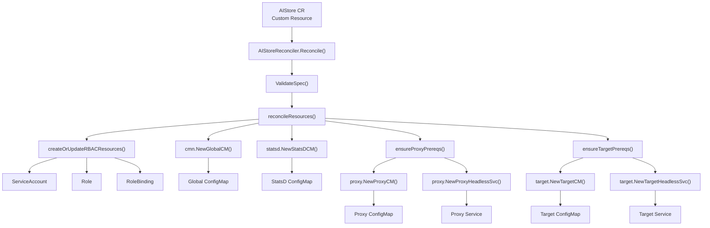
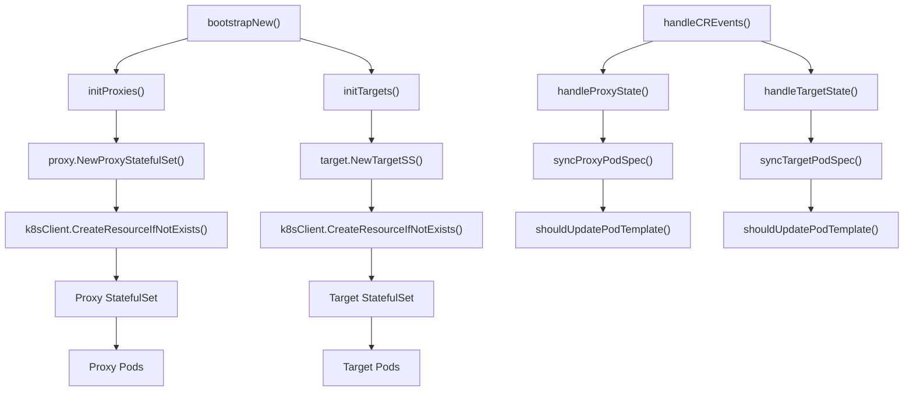
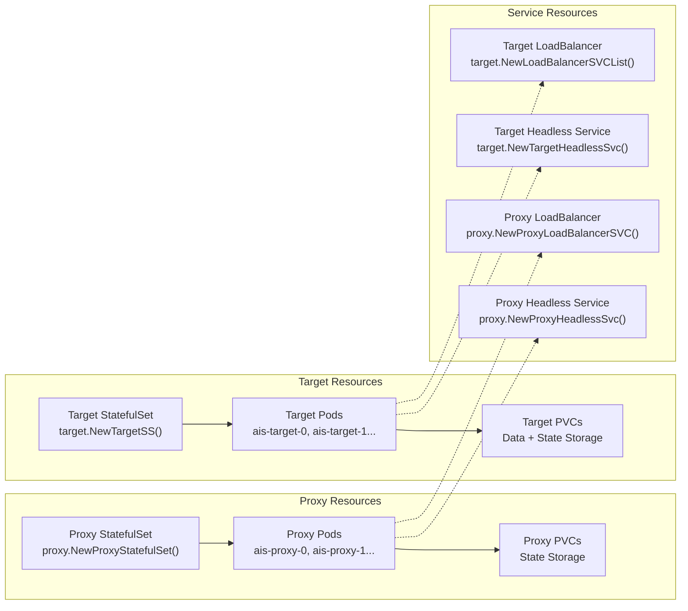
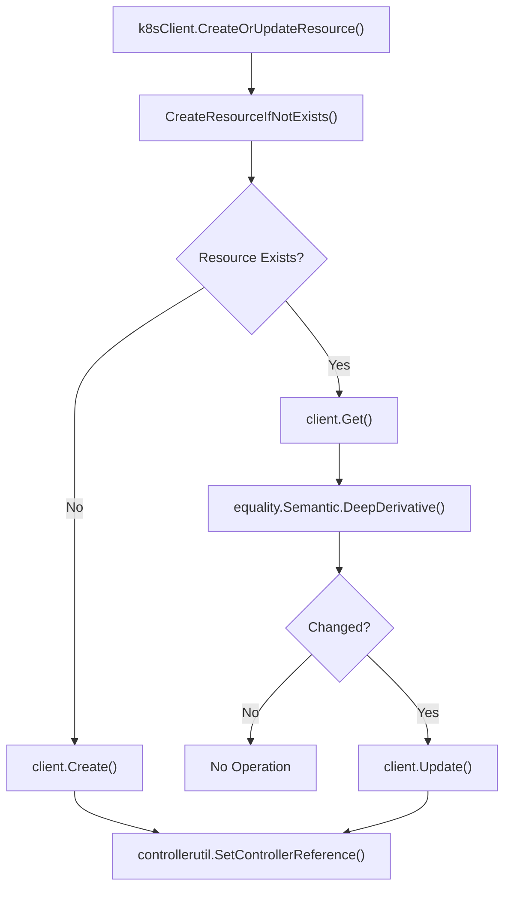
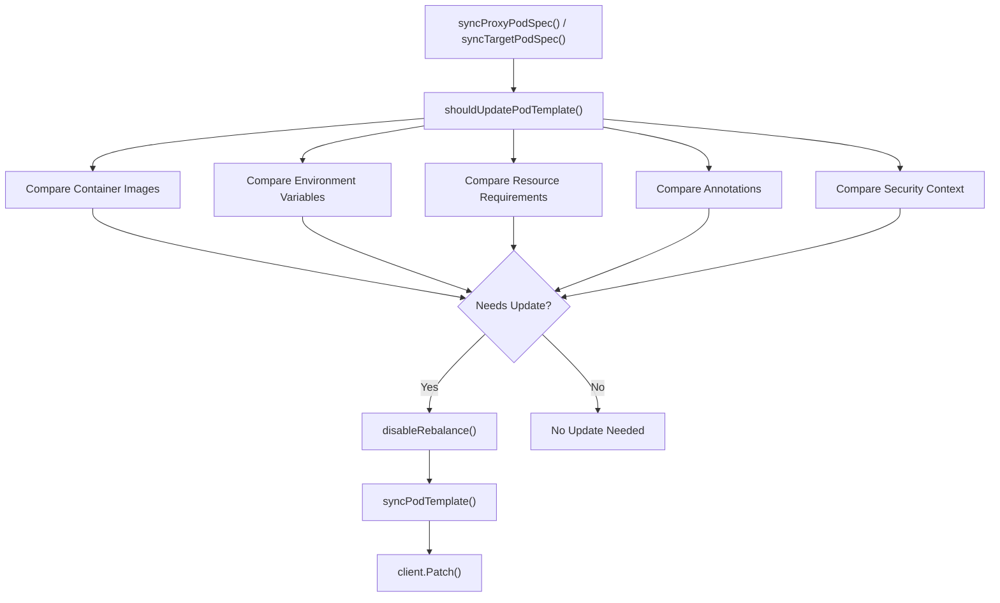
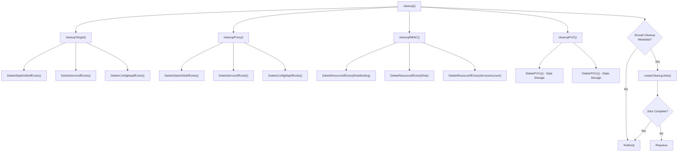
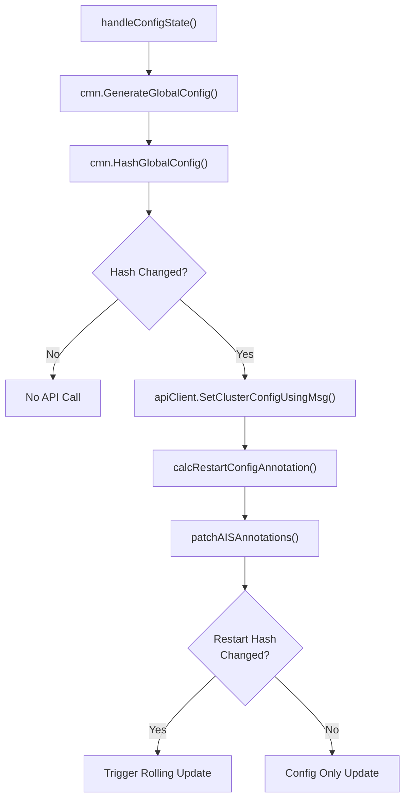

<!-- source: DeepWiki mcp.deepwiki.com · repo NVIDIA/ais-k8s · page 3.3 Resource Management · fetched 2026-10-26 -->

# Resource Management

Relevant source files

The following files were used as context for generating this wiki page:

- [operator/api/v1beta1/aistore_webhook.go](operator/api/v1beta1/aistore_webhook.go)
- [operator/pkg/client/api.go](operator/pkg/client/api.go)
- [operator/pkg/controllers/cluster_cleanup.go](operator/pkg/controllers/cluster_cleanup.go)
- [operator/pkg/controllers/cluster_controller.go](operator/pkg/controllers/cluster_controller.go)
- [operator/pkg/controllers/cluster_controller_test.go](operator/pkg/controllers/cluster_controller_test.go)
- [operator/pkg/controllers/proxy_controller.go](operator/pkg/controllers/proxy_controller.go)
- [operator/pkg/controllers/target_controllers.go](operator/pkg/controllers/target_controllers.go)
- [operator/pkg/resources/proxy/configmap.go](operator/pkg/resources/proxy/configmap.go)
- [operator/pkg/resources/target/configmap.go](operator/pkg/resources/target/configmap.go)

This page covers how the AIStore Kubernetes Operator generates, manages, and maintains Kubernetes resources throughout the cluster lifecycle. This includes the creation and synchronization of ConfigMaps, StatefulSets, Services, RBAC resources, and their coordinated lifecycle management.

For information about the operator's internal architecture and reconciliation loops, see [Operator Architecture](#3.1). For details on the AIStore Custom Resource Definition specifications, see [Custom Resources](#3.2).

## Resource Generation Flow

The operator follows a structured approach to resource generation, starting from the AIStore custom resource specification and producing all necessary Kubernetes resources.

### Primary Resource Generation Pipeline

Sources: [operator/pkg/controllers/cluster_controller.go:354-392](), [operator/pkg/controllers/cluster_controller.go:631-664](), [operator/pkg/controllers/proxy_controller.go:32-53](), [operator/pkg/controllers/target_controllers.go:27-47]()

### StatefulSet Creation and Management

Sources: [operator/pkg/controllers/cluster_controller.go:444-469](), [operator/pkg/controllers/proxy_controller.go:55-94](), [operator/pkg/controllers/target_controllers.go:49-64](), [operator/pkg/controllers/cluster_controller.go:479-530]()

## Core Resource Types

The operator manages several categories of Kubernetes resources, each with specific purposes and lifecycle patterns.

### Configuration Resources

| Resource Type | Purpose | Generator Function | Location |
|---------------|---------|-------------------|----------|
| Global ConfigMap | Cluster-wide AIS configuration | `cmn.NewGlobalCM()` | Global to cluster |
| Proxy ConfigMap | Proxy-specific local config | `proxy.NewProxyCM()` | Per proxy deployment |
| Target ConfigMap | Target-specific local config | `target.NewTargetCM()` | Per target deployment |
| StatsD ConfigMap | Metrics collection config | `statsd.NewStatsDCM()` | Global to cluster |

Sources: [operator/pkg/controllers/cluster_controller.go:363-387](), [operator/pkg/resources/proxy/configmap.go:25-40](), [operator/pkg/resources/target/configmap.go:26-40]()

### Workload Resources

The operator creates and manages StatefulSets for both proxy and target daemons:

Sources: [operator/pkg/controllers/proxy_controller.go:64-65](), [operator/pkg/controllers/target_controllers.go:51](), [operator/pkg/controllers/proxy_controller.go:47-51](), [operator/pkg/controllers/target_controllers.go:41-45]()

### RBAC Resources

The operator creates minimal RBAC resources for cluster operations:

- **ServiceAccount**: `cmn.NewAISServiceAccount()` - Service account for AIS pods
- **Role**: `cmn.NewAISRBACRole()` - Permissions for cluster operations  
- **RoleBinding**: `cmn.NewAISRBACRoleBinding()` - Binds role to service account

Sources: [operator/pkg/controllers/cluster_controller.go:633-650]()

## Resource Lifecycle Management

### Create and Update Operations

The operator uses a standardized pattern for resource management through the `K8sClient` wrapper:

Sources: [operator/pkg/client/api.go:250-270](), [operator/pkg/client/api.go:234-248]()

### Pod Template Synchronization

StatefulSet updates require careful pod template synchronization to trigger rolling updates:

Sources: [operator/pkg/controllers/cluster_controller.go:759-805](), [operator/pkg/controllers/cluster_controller.go:842-900](), [operator/pkg/controllers/proxy_controller.go:166-199](), [operator/pkg/controllers/target_controllers.go:269-290]()

### Resource Cleanup and Finalization

The cleanup process handles resource removal in dependency order:

Sources: [operator/pkg/controllers/cluster_cleanup.go:21-44](), [operator/pkg/controllers/target_controllers.go:66-75](), [operator/pkg/controllers/proxy_controller.go:117-124](), [operator/pkg/controllers/cluster_cleanup.go:106-138]()

## Resource Synchronization Patterns

### Configuration Hash Management

The operator tracks configuration changes using hash annotations to minimize unnecessary API calls:

- **Config Hash**: `cmn.ConfigHashAnnotation` - Tracks global config changes
- **Restart Hash**: `cmn.RestartConfigHashAnnotation` - Tracks changes requiring pod restart

Sources: [operator/pkg/controllers/cluster_controller.go:538-569](), [operator/pkg/controllers/cluster_controller.go:584-608](), [operator/pkg/controllers/cluster_controller.go:611-629]()

### External LoadBalancer Management

When `EnableExternalLB` is specified, the operator manages additional LoadBalancer services:

- **Proxy LoadBalancer**: Single service for all proxy pods
- **Target LoadBalancers**: Individual services per target pod for direct access

The operator ensures external IPs are allocated before proceeding with cluster initialization.

Sources: [operator/pkg/controllers/cluster_controller.go:402-434](), [operator/pkg/controllers/proxy_controller.go:342-367](), [operator/pkg/controllers/target_controllers.go:313-341]()

---

