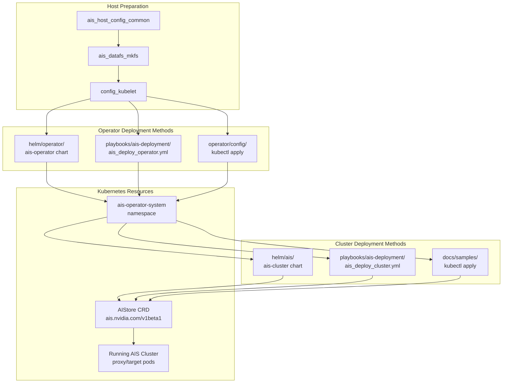
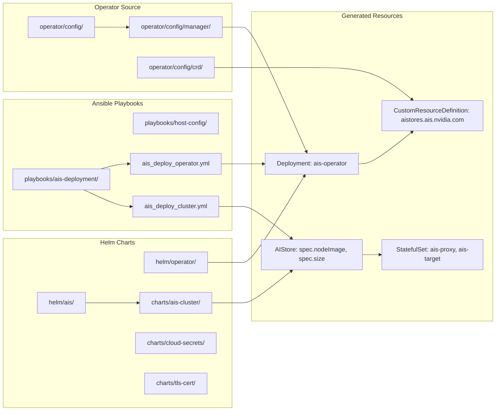
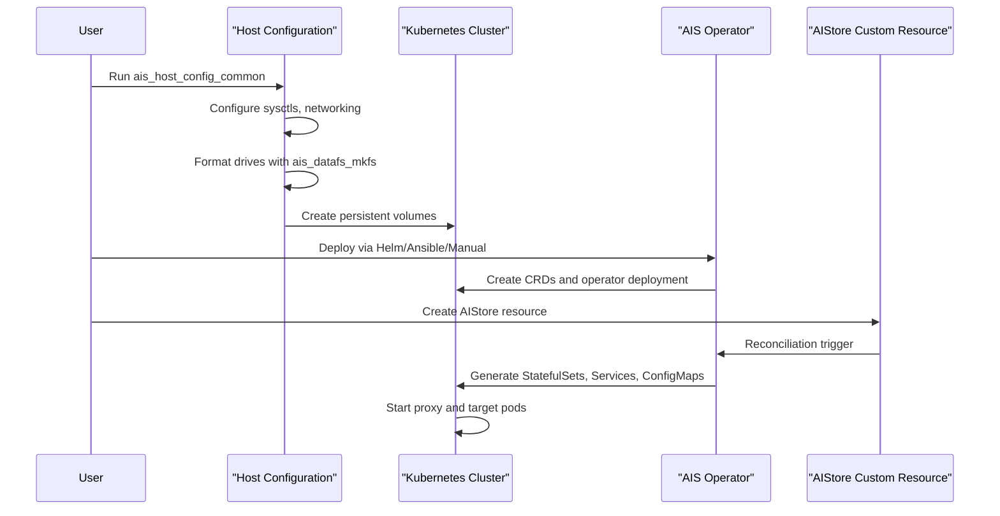

<!-- source: DeepWiki mcp.deepwiki.com · repo NVIDIA/ais-k8s · page 4 Deployment Methods · fetched 2026-10-26 -->

# Deployment Methods

Relevant source files

The following files were used as context for generating this wiki page:

- [README.md](README.md)
- [docs/COMPATIBILITY.md](docs/COMPATIBILITY.md)
- [docs/README.md](docs/README.md)
- [docs/diagrams/certificates.jpg](docs/diagrams/certificates.jpg)
- [docs/network_configuration.md](docs/network_configuration.md)
- [docs/prerequisites.md](docs/prerequisites.md)
- [helm/README.md](helm/README.md)
- [helm/ais/README.md](helm/ais/README.md)
- [helm/ais/config/tls-cert/sjc11.yaml](helm/ais/config/tls-cert/sjc11.yaml)
- [helm/cluster-issuer/config/sjc11.yaml](helm/cluster-issuer/config/sjc11.yaml)
- [helm/cluster-issuer/config/values-sample.yaml](helm/cluster-issuer/config/values-sample.yaml)
- [helm/cluster-issuer/helmfile.yaml](helm/cluster-issuer/helmfile.yaml)
- [helm/cluster-issuer/issuer-chart/Chart.yaml](helm/cluster-issuer/issuer-chart/Chart.yaml)
- [helm/cluster-issuer/issuer-chart/templates/ca.yaml](helm/cluster-issuer/issuer-chart/templates/ca.yaml)
- [helm/operator/config/tls-cert/sjc11.yaml](helm/operator/config/tls-cert/sjc11.yaml)
- [playbooks/README.md](playbooks/README.md)
- [playbooks/ais-deployment/docs/ais_cluster_management.md](playbooks/ais-deployment/docs/ais_cluster_management.md)
- [playbooks/host-config/README.md](playbooks/host-config/README.md)

This document provides an overview of the different approaches available for deploying AIStore clusters on Kubernetes. It covers the three primary deployment methods—Helm charts, Ansible playbooks, and manual deployment—and explains how they relate to each other within the overall deployment workflow.

For detailed instructions on using specific deployment tools, see [Helm Chart Deployment](#4.1), [Ansible Playbook Deployment](#4.2), and [Manual Deployment](#4.3). For information about the operator architecture that these tools manage, see [AIStore Kubernetes Operator](#3).

## Overview

AIStore Kubernetes deployments follow a consistent two-phase approach regardless of the chosen method:

1. **Operator Deployment**: Deploy the AIS Kubernetes Operator that manages AIStore custom resources
2. **Cluster Deployment**: Create AIStore custom resources that the operator reconciles into running clusters

Each deployment method provides different levels of automation and control, from fully automated Ansible playbooks to granular manual kubectl commands.

## Deployment Method Architecture

**Sources:** [docs/README.md:35-70](), [playbooks/README.md:16-42](), [helm/README.md:10-62]()

## Component and File Structure Mapping

**Sources:** [playbooks/ais-deployment/docs/ais_cluster_management.md:21-33](), [helm/ais/README.md:72-77](), [operator/README.md]()

## Deployment Method Comparison

| Aspect | Helm Charts | Ansible Playbooks | Manual Deployment |
|--------|-------------|-------------------|-------------------|
| **Automation Level** | Medium | High | Low |
| **Host Configuration** | Manual prerequisite | Automated via `ais_host_config_common` | Manual prerequisite |
| **Operator Deployment** | `helmfile sync` | `ais_deploy_operator.yml` | `kubectl apply` |
| **Cluster Deployment** | `helmfile sync` | `ais_deploy_cluster.yml` | `kubectl apply` |
| **Configuration Management** | `values.yaml` files | Ansible variables | Direct YAML editing |
| **Environment Support** | Multiple environments via helmfile | Inventory-based environments | Single environment |
| **TLS Certificate Management** | `tls-cert` chart with cert-manager | Manual certificate setup | Manual certificate setup |
| **Cloud Secrets** | `cloud-secrets` chart | Cloud playbooks | Manual secret creation |
| **PV Creation** | `ais-create-pv` chart | `create_pv` playbook | Manual PV creation |
| **Best For** | GitOps workflows | Complete automation | Development/testing |

**Sources:** [docs/README.md:39-70](), [helm/README.md:26-62](), [playbooks/ais-deployment/docs/ais_cluster_management.md:20-82]()

## Prerequisites and Dependencies

All deployment methods require the same foundational setup:

### Host Configuration
- Kubernetes cluster with properly configured nodes
- Formatted storage drives with XFS filesystem
- Network performance tuning and port configuration
- Persistent volumes created for AIStore data

### Kubernetes Requirements
- Kubernetes v1.27 or later (v1.31+ recommended)
- `kubectl` access to the cluster
- Sufficient resources for operator and AIStore pods

### Tool-Specific Requirements

**Helm Deployment:**
- Helm 3.x installed locally
- `helm-diff` plugin
- Helmfile for multi-environment management

**Ansible Deployment:**
- Ansible installed on control host
- Inventory file configured with target hosts
- Required Ansible collections via `install_requirements.yml`

**Manual Deployment:**
- Direct kubectl access to cluster
- Understanding of Kubernetes manifest structure

**Sources:** [docs/prerequisites.md:7-23](), [helm/README.md:13-25](), [playbooks/README.md:5-14]()

## Deployment Flow Sequence

**Sources:** [playbooks/host-config/README.md:30-42](), [docs/README.md:52-79]()

The choice of deployment method depends on your specific requirements for automation, environment management, and operational complexity. Each method ultimately produces the same running AIStore cluster managed by the Kubernetes operator, but provides different paths to achieve that goal.

---

