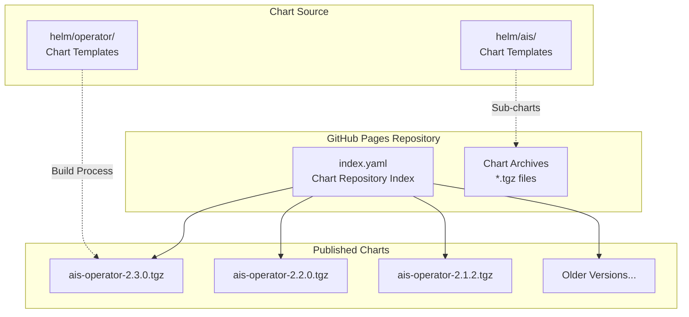
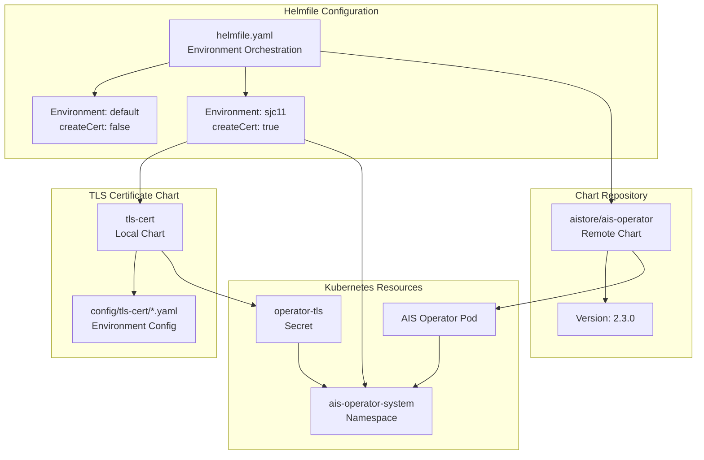
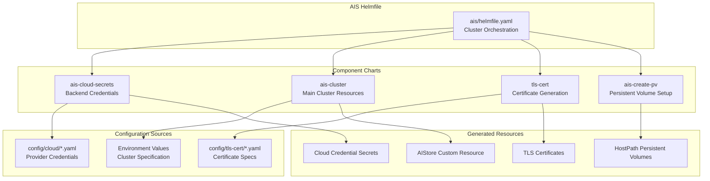
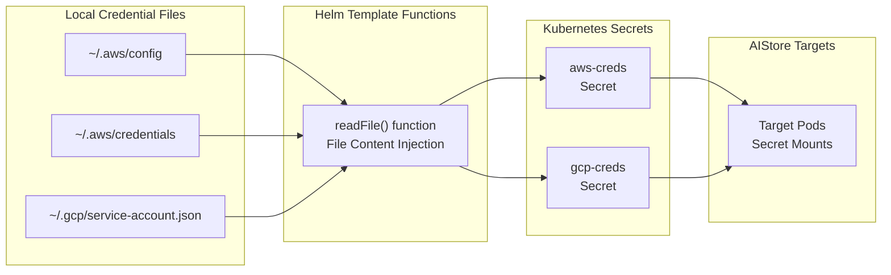
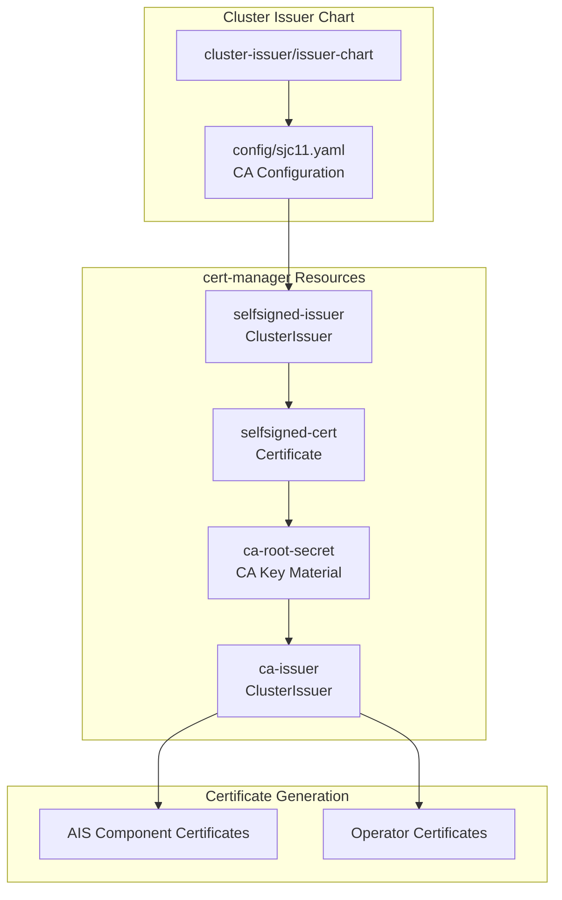

<!-- source: DeepWiki mcp.deepwiki.com · repo NVIDIA/ais-k8s · page 4.1 Helm Chart Deployment · fetched 2026-10-26 -->

# Helm Chart Deployment

<details>
<summary>Relevant source files</summary>

The following files were used as context for generating this wiki page:

- [docs/diagrams/certificates.jpg](docs/diagrams/certificates.jpg)
- [helm/README.md](helm/README.md)
- [helm/ais/README.md](helm/ais/README.md)
- [helm/ais/config/tls-cert/sjc11.yaml](helm/ais/config/tls-cert/sjc11.yaml)
- [helm/cluster-issuer/config/sjc11.yaml](helm/cluster-issuer/config/sjc11.yaml)
- [helm/cluster-issuer/config/values-sample.yaml](helm/cluster-issuer/config/values-sample.yaml)
- [helm/cluster-issuer/helmfile.yaml](helm/cluster-issuer/helmfile.yaml)
- [helm/cluster-issuer/issuer-chart/Chart.yaml](helm/cluster-issuer/issuer-chart/Chart.yaml)
- [helm/cluster-issuer/issuer-chart/templates/ca.yaml](helm/cluster-issuer/issuer-chart/templates/ca.yaml)
- [helm/operator/config/tls-cert/sjc11.yaml](helm/operator/config/tls-cert/sjc11.yaml)
- [helm/operator/helmfile.yaml](helm/operator/helmfile.yaml)
- [pages/charts/ais-operator-2.0.0.tgz](pages/charts/ais-operator-2.0.0.tgz)
- [pages/charts/ais-operator-2.0.1.tgz](pages/charts/ais-operator-2.0.1.tgz)
- [pages/charts/ais-operator-2.1.0.tgz](pages/charts/ais-operator-2.1.0.tgz)
- [pages/charts/ais-operator-2.1.1.tgz](pages/charts/ais-operator-2.1.1.tgz)
- [pages/charts/ais-operator-2.1.2.tgz](pages/charts/ais-operator-2.1.2.tgz)
- [pages/charts/ais-operator-2.2.0.tgz](pages/charts/ais-operator-2.2.0.tgz)
- [pages/charts/ais-operator-2.3.0.tgz](pages/charts/ais-operator-2.3.0.tgz)
- [pages/charts/index.yaml](pages/charts/index.yaml)
- [playbooks/ais-deployment/roles/ais_deploy_operator/defaults/main.yml](playbooks/ais-deployment/roles/ais_deploy_operator/defaults/main.yml)
- [playbooks/ais-deployment/roles/ais_undeploy_operator/files/undeploy-operator.sh](playbooks/ais-deployment/roles/ais_undeploy_operator/files/undeploy-operator.sh)
- [playbooks/ais-deployment/roles/install_rancher_lpp/defaults/main.yaml](playbooks/ais-deployment/roles/install_rancher_lpp/defaults/main.yaml)
- [playbooks/ais-deployment/roles/install_rancher_lpp/tasks/main.yaml](playbooks/ais-deployment/roles/install_rancher_lpp/tasks/main.yaml)
- [playbooks/ais_deploy.yml](playbooks/ais_deploy.yml)

</details>


This page covers using Helm charts to deploy the AIStore Kubernetes operator and clusters. It includes chart repository configuration, operator deployment, cluster deployment, and supporting components like TLS certificates and cloud credentials. For complete automation using Ansible playbooks, see [Ansible Playbook Deployment](#4.2). For direct kubectl deployment in development scenarios, see [Manual Deployment](#4.3).

## Chart Repository and Distribution

The AIStore project publishes Helm charts through a GitHub Pages repository hosted at `https://nvidia.github.io/ais-k8s/charts/`. The chart repository contains multiple versions of the `ais-operator` chart with automated releases managed through GitHub Actions.

### Chart Repository Structure



The repository index at [pages/charts/index.yaml:1-124]() defines available chart versions with metadata including:
- Chart version and application version
- Digest for integrity verification  
- Download URLs pointing to GitHub Pages
- Creation timestamps

**Sources:** [pages/charts/index.yaml:1-124](), [helm/README.md:1-64]()

## Operator Deployment with Helmfile

The operator deployment uses Helmfile for orchestration, providing environment-specific configurations and dependency management. The primary configuration is defined in [helm/operator/helmfile.yaml:1-36]().

### Operator Deployment Architecture



The Helmfile defines two primary releases:
- `operator-tls-cert`: Conditional TLS certificate creation using local `tls-cert` chart
- `ais-operator`: Main operator deployment from remote `aistore/ais-operator` chart

Environment-specific behavior is controlled through the `createCert.enabled` value, with the `sjc11` environment enabling TLS certificate generation.

**Sources:** [helm/operator/helmfile.yaml:1-36](), [helm/operator/config/tls-cert/sjc11.yaml:1-25]()

## AIS Cluster Deployment

AIS cluster deployment uses a multi-chart approach with several supporting components managed through a separate Helmfile configuration. The cluster deployment supports HTTPS, cloud backend integration, and persistent volume management.

### Cluster Deployment Components



**Sources:** [helm/ais/README.md:1-78](), [helm/ais/config/tls-cert/sjc11.yaml:1-33]()

### HTTPS and TLS Configuration

TLS deployment is enabled by setting `protocol: https` in the AIS chart values, with optional certificate generation through the `tls-cert` sub-chart. The TLS configuration supports:

| Configuration | Purpose | Chart |
|---------------|---------|--------|
| `https.skipVerifyCert` | Disable certificate verification | ais-cluster |
| `https.tlsSecret` | Mount existing certificate secret | ais-cluster |
| `certificate.dnsNames` | Certificate Subject Alternative Names | tls-cert |
| `certificate.issuerRef` | Certificate Authority reference | tls-cert |

The certificate specification includes DNS names for intra-cluster communication patterns:
- `*.ais-proxy.ais.svc.cluster.local` for proxy services
- `*.ais-target.ais.svc.cluster.local` for target services  
- External hostnames for load balancer access

**Sources:** [helm/ais/README.md:3-25](), [helm/ais/config/tls-cert/sjc11.yaml:11-33]()

### Cloud Backend Integration

Cloud credential management is handled through the `ais-cloud-secrets` chart, which creates Kubernetes secrets from local credential files. Configuration supports multiple cloud providers:



Cloud secrets are enabled by setting `cloud-secrets.enabled: true` in the Helmfile environment configuration. The chart templates use Helm's `readFile` function to inject local credential files into Kubernetes secrets.

**Sources:** [helm/ais/README.md:26-49]()

## Cluster Issuer and PKI Management

For TLS deployments without existing certificate infrastructure, the repository includes a `cluster-issuer` chart that establishes a self-signed Certificate Authority using cert-manager.

### PKI Bootstrap Process



The cluster issuer chart creates a three-stage PKI bootstrap:
1. Self-signed ClusterIssuer for initial CA certificate generation
2. CA Certificate stored in `ca-root-secret` 
3. CA-backed ClusterIssuer for application certificate issuance

**Sources:** [helm/cluster-issuer/issuer-chart/templates/ca.yaml:1-38](), [helm/cluster-issuer/config/sjc11.yaml:1-22]()

## Persistent Volume Management

The AIS deployment supports automated HostPath persistent volume creation through the `ais-create-pv` component. When `ais-create-pv.enabled: true`, the deployment runs [helm/ais/scripts/create-pvs.sh]() to template and create persistent volumes for each target mount path.

### PV Creation Workflow

| Component | Function | Configuration |
|-----------|----------|---------------|
| `create-pvs.sh` | Script execution | Helm post-install hook |
| `storageClass` | PV provisioning | Chart values override |
| Mount paths | Target storage | AIStore Custom Resource |

Alternative storage classes can be specified to use existing persistent volume provisioners instead of HostPath volumes.

**Sources:** [helm/ais/README.md:51-58]()

## Deployment Execution

Helm chart deployment is executed using Helmfile commands with environment-specific targeting:

```bash
# Deploy operator with TLS in sjc11 environment
cd helm/operator
helmfile sync -e sjc11

# Deploy AIS cluster 
cd helm/ais  
helmfile sync --environment production

# Remove deployment
helmfile delete --environment production
```

The deployment process follows dependency order managed by Helmfile, ensuring TLS certificates and cloud secrets are created before the main AIStore components.

**Sources:** [helm/ais/README.md:59-70](), [helm/README.md:44-62]()

---

