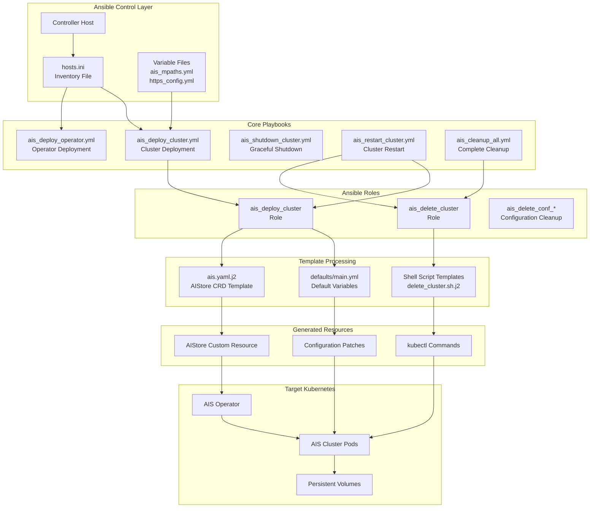
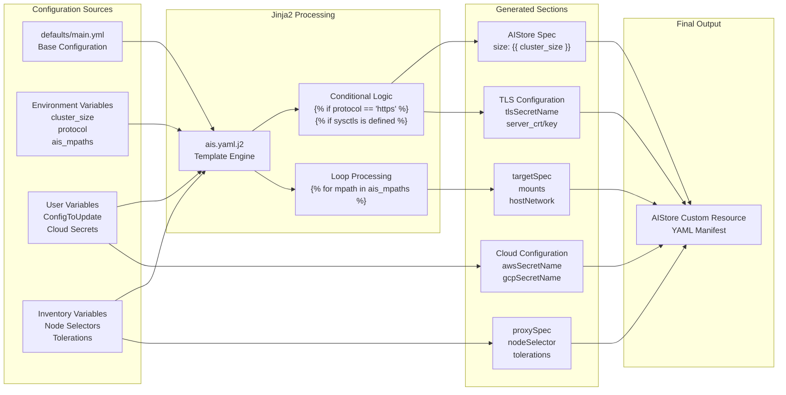
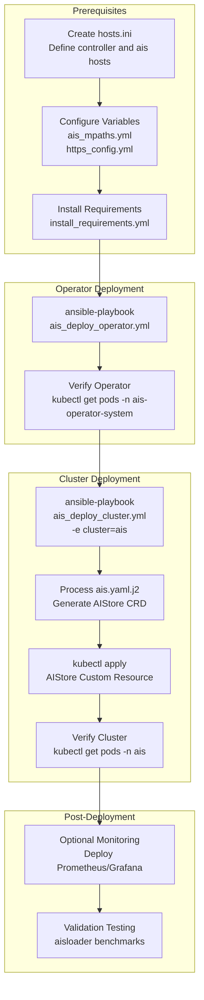

<!-- source: DeepWiki mcp.deepwiki.com · repo NVIDIA/ais-k8s · page 4.2 Ansible Playbook Deployment · fetched 2026-10-26 -->

# Ansible Playbook Deployment

Relevant source files

The following files were used as context for generating this wiki page:

- [docs/multiple_targets_per_node.md](docs/multiple_targets_per_node.md)
- [docs/samples/sample-multi-target-deployment.yml](docs/samples/sample-multi-target-deployment.yml)
- [docs/samples/sample-pv.yaml](docs/samples/sample-pv.yaml)
- [playbooks/ais-deployment/README.md](playbooks/ais-deployment/README.md)
- [playbooks/ais-deployment/ais_downscale_cluster.yml](playbooks/ais-deployment/ais_downscale_cluster.yml)
- [playbooks/ais-deployment/ais_restart_cluster.yml](playbooks/ais-deployment/ais_restart_cluster.yml)
- [playbooks/ais-deployment/ais_shutdown_cluster.yml](playbooks/ais-deployment/ais_shutdown_cluster.yml)
- [playbooks/ais-deployment/docs/switch_protocol.md](playbooks/ais-deployment/docs/switch_protocol.md)
- [playbooks/ais-deployment/roles/ais_delete_cluster/templates/delete_cluster.sh.j2](playbooks/ais-deployment/roles/ais_delete_cluster/templates/delete_cluster.sh.j2)
- [playbooks/ais-deployment/roles/ais_delete_conf_host_path/tasks/main.yaml](playbooks/ais-deployment/roles/ais_delete_conf_host_path/tasks/main.yaml)
- [playbooks/ais-deployment/roles/ais_delete_conf_state_storage/tasks/main.yaml](playbooks/ais-deployment/roles/ais_delete_conf_state_storage/tasks/main.yaml)
- [playbooks/ais-deployment/roles/ais_deploy_cluster/defaults/main.yml](playbooks/ais-deployment/roles/ais_deploy_cluster/defaults/main.yml)
- [playbooks/ais-deployment/roles/ais_deploy_cluster/templates/ais.yaml.j2](playbooks/ais-deployment/roles/ais_deploy_cluster/templates/ais.yaml.j2)

This document covers automated deployment and lifecycle management of AIStore clusters using Ansible playbooks. The playbooks provide complete orchestration of the AIStore Kubernetes Operator and cluster resources through declarative configuration and role-based automation.

For Helm-based deployment approaches, see [Helm Chart Deployment](#4.1). For direct kubectl deployment methods, see [Manual Deployment](#4.3). For details about the underlying operator system, see [AIStore Kubernetes Operator](#3).

## Overview

The Ansible deployment approach provides comprehensive automation for AIStore cluster lifecycle management through a collection of playbooks and roles. The system uses Jinja2 templating to generate AIStore Custom Resources from configuration variables, enabling consistent deployments across multiple environments.

### Core Components

The Ansible deployment system consists of several key components:

| Component | Purpose | Location |
|-----------|---------|----------|
| Playbooks | High-level automation workflows | `playbooks/ais-deployment/*.yml` |
| Roles | Reusable task collections | `playbooks/ais-deployment/roles/` |
| Templates | Jinja2 templates for resource generation | `playbooks/ais-deployment/roles/*/templates/` |
| Variables | Configuration parameters | `playbooks/ais-deployment/roles/*/defaults/` |

Sources: [playbooks/ais-deployment/README.md:1-22]()

## Playbook Architecture

Sources: [playbooks/ais-deployment/README.md:5-22](), [playbooks/ais-deployment/roles/ais_deploy_cluster/templates/ais.yaml.j2:1-113]()

## Configuration Management

The Ansible deployment uses a hierarchical configuration system that combines default values, environment-specific settings, and user overrides to generate the final AIStore Custom Resource.

### Default Configuration

The base configuration is defined in the role defaults, providing sensible values for all deployment parameters:

| Parameter | Default Value | Purpose |
|-----------|---------------|---------|
| `init_image` | `aistorage/ais-init:v3.29` | AIStore initialization container |
| `node_image` | `aistorage/aisnode:v3.29` | Main AIStore node container |
| `logs_image` | `aistorage/ais-logs:v1.0` | Log collection sidecar |
| `cluster_domain` | `cluster.local` | Kubernetes cluster domain |
| `dynamic_state_sc` | `local-path` | Storage class for state volumes |
| `host_network` | `false` | Host networking for target pods |

Sources: [playbooks/ais-deployment/roles/ais_deploy_cluster/defaults/main.yml:1-44]()

### Template Processing Flow

Sources: [playbooks/ais-deployment/roles/ais_deploy_cluster/templates/ais.yaml.j2:1-113](), [playbooks/ais-deployment/roles/ais_deploy_cluster/defaults/main.yml:1-44]()

## Core Playbooks

### Operator Deployment

The `ais_deploy_operator.yml` playbook installs the AIStore Kubernetes Operator, which is a prerequisite for cluster deployment. This playbook typically uses Helm charts or direct manifest application to deploy the operator components.

### Cluster Deployment

The `ais_deploy_cluster.yml` playbook creates the AIStore cluster by generating and applying the AIStore Custom Resource. The playbook uses the `ais_deploy_cluster` role, which processes the Jinja2 template with configuration variables.

Key template sections include:

- **Basic Cluster Configuration**: Cluster size and namespace settings [playbooks/ais-deployment/roles/ais_deploy_cluster/templates/ais.yaml.j2:6-10]()
- **Proxy Specification**: Port configuration, node selection, and tolerations [playbooks/ais-deployment/roles/ais_deploy_cluster/templates/ais.yaml.j2:23-40]()
- **Target Specification**: Storage mounts, networking, and security context [playbooks/ais-deployment/roles/ais_deploy_cluster/templates/ais.yaml.j2:42-74]()
- **TLS Configuration**: Certificate mounting and HTTPS settings [playbooks/ais-deployment/roles/ais_deploy_cluster/templates/ais.yaml.j2:12-21]()

### Lifecycle Management

| Playbook | Function | Key Operations |
|----------|----------|----------------|
| `ais_shutdown_cluster.yml` | Graceful shutdown | Patches AIStore CRD with `shutdownCluster: true` |
| `ais_restart_cluster.yml` | Cluster restart with config changes | Deletes cluster, optionally cleans config, redeploys |
| `ais_decommission_cluster.yml` | Complete removal | Removes all resources including PVCs and node labels |
| `ais_cleanup_all.yml` | Data and metadata cleanup | Removes all data AND configuration |

Sources: [playbooks/ais-deployment/README.md:7-22](), [playbooks/ais-deployment/ais_shutdown_cluster.yml:27-29]()

## Deployment Workflow

The typical deployment workflow follows this sequence:

Sources: [playbooks/ais-deployment/README.md:3](), [playbooks/ais-deployment/roles/ais_deploy_cluster/templates/ais.yaml.j2:1-113]()

## Advanced Operations

### Protocol Switching

The `ais_restart_cluster.yml` playbook supports switching between HTTP and HTTPS protocols while preserving user data. The process involves:

1. **Configuration Update**: Update cluster configuration via AIS CLI
2. **Graceful Shutdown**: Execute `ais cluster shutdown -y`
3. **Certificate Setup**: Generate or update TLS certificates
4. **Cluster Restart**: Run playbook with updated protocol settings

Sources: [playbooks/ais-deployment/docs/switch_protocol.md:5-37](), [playbooks/ais-deployment/ais_restart_cluster.yml:1-97]()

### Configuration Cleanup

The restart playbook supports selective configuration cleanup through the `delete_conf` parameter:

- **State Storage Cleanup**: Removes PVCs with specified `stateStorageClass` [playbooks/ais-deployment/roles/ais_delete_conf_state_storage/tasks/main.yaml:2-7]()
- **Host Path Cleanup**: Removes configuration files from `hostPathPrefix` [playbooks/ais-deployment/roles/ais_delete_conf_host_path/tasks/main.yaml:1-4]()

### Cluster Scaling

The `ais_downscale_cluster.yml` playbook provides interactive cluster scaling by patching the AIStore Custom Resource size field [playbooks/ais-deployment/ais_downscale_cluster.yml:9-10]().

Sources: [playbooks/ais-deployment/ais_restart_cluster.yml:45-86](), [playbooks/ais-deployment/ais_downscale_cluster.yml:1-13]()

---

