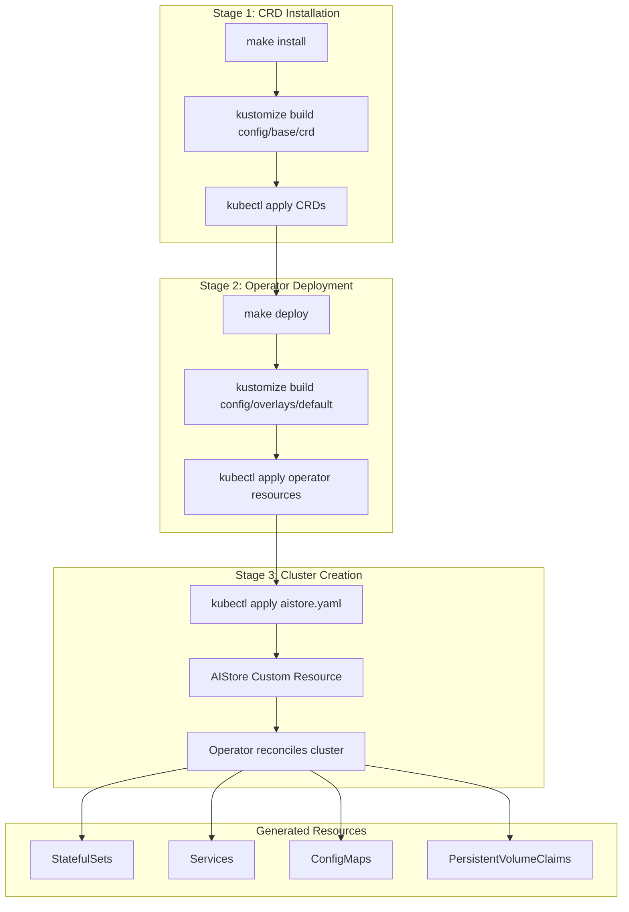
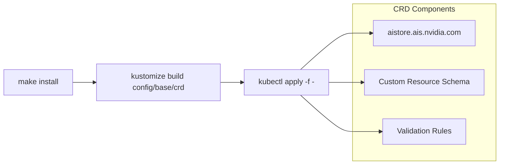
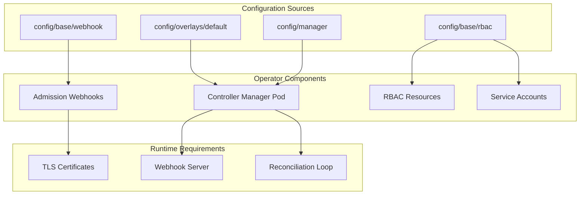
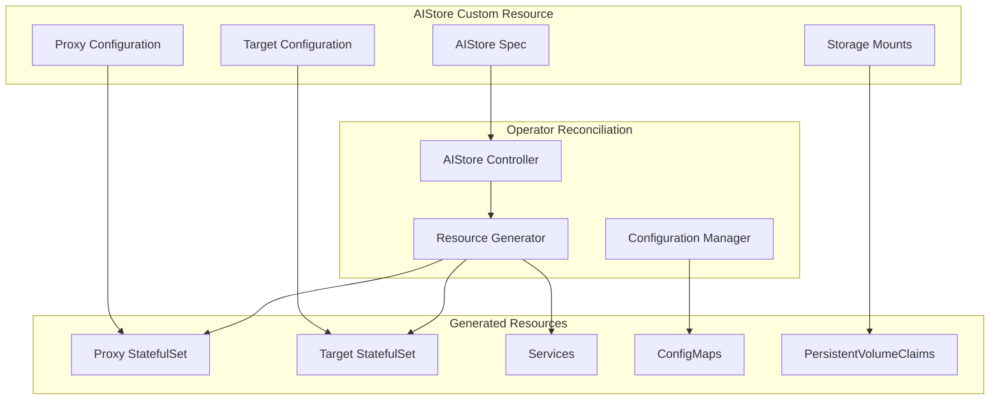
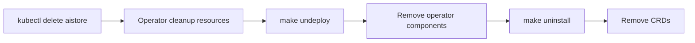

<!-- source: DeepWiki mcp.deepwiki.com · repo NVIDIA/ais-k8s · page 4.3 Manual Deployment · fetched 2026-10-26 -->

# Manual Deployment

<details>
<summary>Relevant source files</summary>

The following files were used as context for generating this wiki page:

- [.gitlab-ci.yml](.gitlab-ci.yml)
- [operator/Makefile](operator/Makefile)
- [operator/README.md](operator/README.md)
- [operator/config/samples/ais_v1beta1_aistore.yaml](operator/config/samples/ais_v1beta1_aistore.yaml)
- [operator/config/samples/ais_v1beta1_aistore_tls_certmanager_csi.yaml](operator/config/samples/ais_v1beta1_aistore_tls_certmanager_csi.yaml)
- [operator/config/samples/ais_v1beta1_aistore_tracing.yaml](operator/config/samples/ais_v1beta1_aistore_tracing.yaml)
- [operator/go.mod](operator/go.mod)
- [operator/go.sum](operator/go.sum)
- [operator/pkg/resources/cmn/config.go](operator/pkg/resources/cmn/config.go)
- [operator/scripts/test.sh](operator/scripts/test.sh)
- [operator/tests/tutils/ais_cluster.go](operator/tests/tutils/ais_cluster.go)

</details>


This document covers the direct deployment of the AIStore Kubernetes Operator and AIStore clusters using kubectl and make commands. Manual deployment provides the most granular control over the deployment process and is ideal for development, testing, and custom scenarios where automated deployment tools may not be suitable.

For automated deployments using package managers, see [Helm Chart Deployment](#4.1). For infrastructure automation, see [Ansible Playbook Deployment](#4.2).

## Prerequisites

Manual deployment requires:
- Kubernetes cluster with administrative access
- `kubectl` configured to communicate with the cluster
- `make` and `go` development tools
- Certificate provider (cert-manager recommended) for operator webhooks

## Manual Deployment Workflow

The manual deployment process follows a three-stage approach: CRD installation, operator deployment, and cluster creation.



**Manual Deployment Workflow**

Sources: [operator/Makefile:216-230](), [operator/README.md:57-82]()

## Step 1: Install Custom Resource Definitions

The first step installs the AIStore CRDs that define the schema for AIStore custom resources.

```bash
make install
```

This command executes the `install` target which builds and applies the CRD manifests:



**CRD Installation Process**

The CRDs are generated from Go type definitions and include validation rules for AIStore specifications.

Sources: [operator/Makefile:216-217](), [operator/api/v1beta1]()

## Step 2: Deploy the Operator

Deploy the operator components including the controller manager, webhooks, and RBAC resources:

```bash
IMG=aistorage/ais-operator:latest make deploy
```

The `deploy` target uses kustomize to build and apply the complete operator deployment:



**Operator Deployment Architecture**

Sources: [operator/Makefile:224-226](), [operator/config/overlays/default](), [operator/README.md:62-71]()

## Step 3: Create AIStore Clusters

Once the operator is running, create AIStore clusters by applying custom resource manifests:

```bash
kubectl create namespace ais
kubectl apply -f config/samples/ais_v1beta1_aistore.yaml -n ais
```

The operator reconciles the AIStore custom resource and creates the necessary Kubernetes resources:



**AIStore Cluster Creation Process**

Sources: [operator/config/samples/ais_v1beta1_aistore.yaml](), [operator/README.md:73-82]()

## Configuration Options

### Basic Cluster Configuration

The minimal AIStore configuration includes proxy and target specifications:

| Field | Description | Default |
|-------|-------------|---------|
| `size` | Number of target nodes | 1 |
| `proxySpec.servicePort` | Proxy service port | 51080 |
| `targetSpec.servicePort` | Target service port | 51081 |
| `targetSpec.mounts` | Storage mount points | Required |

### Container Images

Specify the container images for AIStore components:

```yaml
nodeImage: "aistorage/aisnode:v3.29"
initImage: "aistorage/ais-init:v3.29"
```

### Storage Configuration

Define persistent storage for target nodes:

```yaml
targetSpec:
  mounts:
    - path: "/ais1"
      size: 10Gi
      label: "disk1"
    - path: "/ais2" 
      size: 10Gi
      label: "disk1"
```

Sources: [operator/config/samples/ais_v1beta1_aistore.yaml:22-30]()

## Advanced Configuration Examples

### External Load Balancer Access

Enable external access through load balancer services:

```yaml
enableExternalLB: true
```

### HTTPS/TLS Configuration

Configure TLS encryption for AIStore communication:

```yaml
configToUpdate:
  net:
    http:
      server_crt: "/var/certs/tls.crt"
      server_key: "/var/certs/tls.key"
      use_https: true
      skip_verify: true
tlsSecretName: "ais-tls-certs"
```

### Cloud Backend Integration

Configure cloud storage backends:

```yaml
awsSecretName: "aws-creds"
gcpSecretName: "gcp-creds"
```

Sources: [operator/config/samples/ais_v1beta1_aistore_tls_certmanager_csi.yaml:70-78](), [operator/README.md:221-232]()

## Verification and Monitoring

After deployment, verify the operator and cluster status:

```bash
# Check operator status
kubectl get pods -n ais-operator-system

# Check AIStore cluster status  
kubectl get aistore -n ais

# Check individual pods
kubectl get pods -n ais
```

Expected output shows running proxy and target pods:

```
NAME                     READY   STATUS    RESTARTS   AGE
aistore-sample-proxy-0   1/1     Running   0          2m8s
aistore-sample-target-0  1/1     Running   0          2m21s
```

Sources: [operator/README.md:67-82]()

## Cleanup and Removal

### Remove AIStore Clusters

Delete specific AIStore clusters:

```bash
kubectl delete aistore aistore-sample -n ais
```

### Undeploy Operator

Remove the operator while preserving CRDs:

```bash
make undeploy
```

### Complete Removal

Remove both operator and CRDs:

```bash
make undeploy
make uninstall
```

The cleanup process follows this sequence:



**Cleanup Sequence**

Sources: [operator/Makefile:220-221](), [operator/Makefile:229-230]()

## Development and Testing

### Local Development

For development scenarios, use the following pattern:

```bash
# Build and test locally
make build
make test

# Install CRDs for testing
make install

# Run operator locally (development mode)
make run
```

### Building Custom Images

Build and deploy custom operator images:

```bash
# Build custom image
IMG=myregistry/ais-operator:dev make docker-build

# Push to registry
IMG=myregistry/ais-operator:dev make docker-push

# Deploy with custom image
IMG=myregistry/ais-operator:dev make deploy
```

Sources: [operator/Makefile:151-168](), [operator/README.md:319-327]()

## When to Use Manual Deployment

Manual deployment is recommended for:

- **Development and Testing**: Full control over each deployment step
- **Custom Environments**: Non-standard Kubernetes configurations
- **Debugging**: Step-by-step troubleshooting of deployment issues
- **Learning**: Understanding the complete deployment process
- **CI/CD Integration**: Building custom automation workflows

For production deployments with standardized configurations, consider using [Helm Chart Deployment](#4.1) or [Ansible Playbook Deployment](#4.2) for better automation and repeatability.

Sources: [operator/README.md:14-332](), [operator/Makefile]()

---

