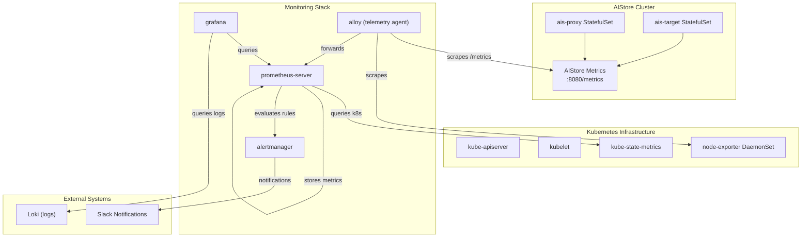
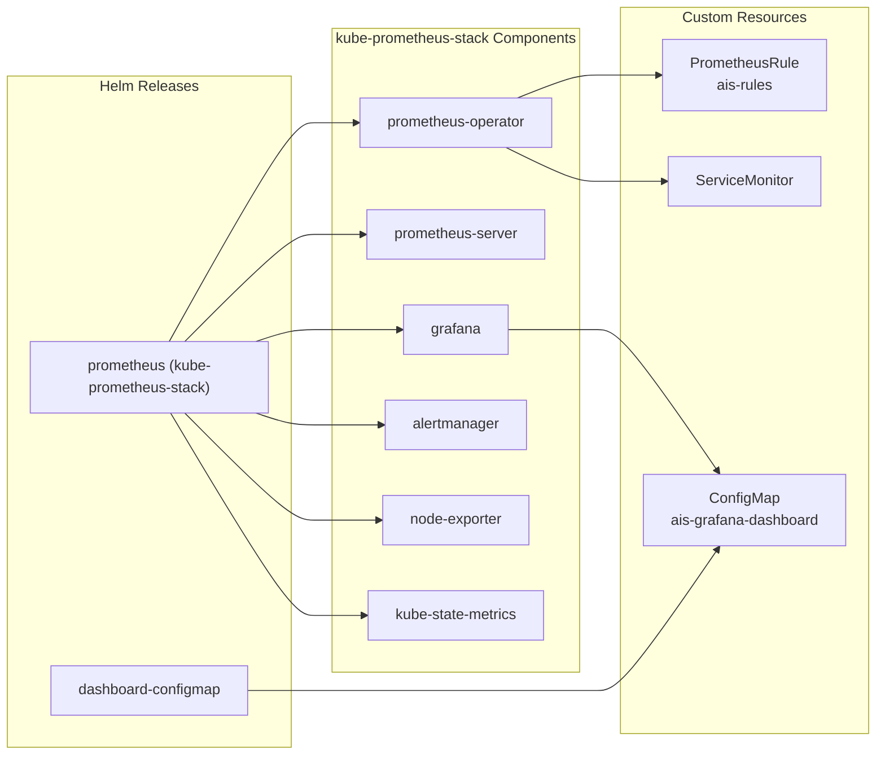

<!-- source: DeepWiki mcp.deepwiki.com · repo NVIDIA/ais-k8s · page 5 Monitoring and Observability · fetched 2026-10-26 -->

# Monitoring and Observability

<details>
<summary>Relevant source files</summary>

The following files were used as context for generating this wiki page:

- [monitoring/kube-prom/README.md](monitoring/kube-prom/README.md)
- [monitoring/kube-prom/dashboard-configmap/ais_dashboard.json](monitoring/kube-prom/dashboard-configmap/ais_dashboard.json)
- [monitoring/kube-prom/dashboard-configmap/ais_dashboard_old.json](monitoring/kube-prom/dashboard-configmap/ais_dashboard_old.json)
- [monitoring/kube-prom/dashboard-configmap/templates/configmap.yaml](monitoring/kube-prom/dashboard-configmap/templates/configmap.yaml)
- [monitoring/kube-prom/environments/dev/values.yaml.gotmpl](monitoring/kube-prom/environments/dev/values.yaml.gotmpl)
- [monitoring/kube-prom/environments/prod/values.yaml.gotmpl](monitoring/kube-prom/environments/prod/values.yaml.gotmpl)
- [monitoring/kube-prom/helmfile.yaml](monitoring/kube-prom/helmfile.yaml)
- [monitoring/kube-prom/values/alert-rules.yaml](monitoring/kube-prom/values/alert-rules.yaml)
- [monitoring/kube-prom/values/alertmanager.yaml.gotmpl](monitoring/kube-prom/values/alertmanager.yaml.gotmpl)
- [monitoring/kube-prom/values/grafana.yaml.gotmpl](monitoring/kube-prom/values/grafana.yaml.gotmpl)
- [monitoring/kube-prom/values/kube-state-metrics.yaml.gotmpl](monitoring/kube-prom/values/kube-state-metrics.yaml.gotmpl)

</details>


This document covers the comprehensive monitoring and observability stack for AIStore Kubernetes deployments. The system provides metrics collection, visualization, and alerting capabilities specifically designed for monitoring AIStore cluster health, performance, and capacity across Kubernetes environments.

For information about the AIStore Operator's internal metrics and telemetry, see [AIStore Kubernetes Operator](#3). For deployment configuration of the monitoring stack, see [Deployment Methods](#4).

## Architecture Overview

The monitoring system is built on the kube-prometheus-stack and provides a complete observability solution for AIStore clusters.



Sources: [monitoring/kube-prom/helmfile.yaml:16-35](), [monitoring/kube-prom/values/grafana.yaml.gotmpl:28-33]()

## Component Architecture

The monitoring stack consists of several interconnected components deployed via Helmfile orchestration.



Sources: [monitoring/kube-prom/helmfile.yaml:16-35](), [monitoring/kube-prom/dashboard-configmap/templates/configmap.yaml:1-23]()

## Core Components

### Prometheus Server
The central metrics collection and storage system configured with AIStore-specific scraping targets and retention policies.

| Component | Configuration | Purpose |
|-----------|---------------|---------|
| `prometheus-server` | [values/prometheus.yaml.gotmpl]() | Metrics collection and storage |
| Storage | Configurable PVC size via `prometheus.pvSize` | Persistent metric storage |
| Retention | Configurable retention period | Historical data management |

### Grafana Dashboards
Pre-configured dashboards provide comprehensive visualization of AIStore cluster metrics.

**Primary Dashboard Panels:**
- **Capacity Monitoring**: Used storage percentage, total capacity
- **Performance Metrics**: GET/PUT throughput, request latency, requests per second
- **Health Status**: Unavailable nodes, proxy/target availability, error rates
- **Hardware Monitoring**: CPU usage, memory utilization, load averages

**Dashboard Files:**
- [monitoring/kube-prom/dashboard-configmap/ais_dashboard.json:1-40]() - Current AIStore dashboard
- [monitoring/kube-prom/dashboard-configmap/ais_dashboard_old.json:1-40]() - Legacy dashboard version

Sources: [monitoring/kube-prom/dashboard-configmap/ais_dashboard.json:94-127](), [monitoring/kube-prom/values/grafana.yaml.gotmpl:22-35]()

### AlertManager
Handles alert routing and notifications with support for multiple receivers including Slack integration.

**Alert Configuration:**
```yaml
route:
  receiver: 'slack-notifications'
  group_by: ['alertname']
  group_wait: 10s
  group_interval: 2m
  repeat_interval: 12h
```

Sources: [monitoring/kube-prom/values/alertmanager.yaml.gotmpl:23-28]()

## AIStore-Specific Metrics

The monitoring system collects comprehensive metrics from AIStore components through standardized endpoints.

### Target Metrics
Key performance indicators collected from AIStore target nodes:

| Metric Pattern | Description | Dashboard Usage |
|----------------|-------------|-----------------|
| `ais_target_get_count` | GET request count | Request rate calculations |
| `ais_target_put_count` | PUT request count | Request rate calculations |
| `ais_target_get_bytes` | GET throughput bytes | Throughput monitoring |
| `ais_target_put_bytes` | PUT throughput bytes | Throughput monitoring |
| `ais_target_err_get_count` | GET error count | Error rate tracking |
| `ais_target_err_put_count` | PUT error count | Error rate tracking |
| `ais_target_disk_util` | Disk utilization percentage | Storage monitoring |
| `ais_target_state_flags` | Node state flags bitfield | Health status alerts |

### State Flag Monitoring
AIStore uses a bitfield system for node state tracking with specific alert rules:

```yaml
# Example alert for out of space condition
- alert: AISOutOfSpace
  expr: (floor(ais_target_state_flags / 256)) % 2 == 1
  for: 1m
  labels:
    severity: critical
```

Sources: [monitoring/kube-prom/values/alert-rules.yaml:134-141](), [monitoring/kube-prom/dashboard-configmap/ais_dashboard.json:362-367]()

## Alert Rules Configuration

The system implements comprehensive alerting for both AIStore-specific and infrastructure-level issues.

### Critical Alerts
High-priority alerts requiring immediate attention:

| Alert Name | Condition | Severity |
|------------|-----------|----------|
| `AISLowDiskCapacity` | Disk space > 90% used | critical |
| `AISTargetDown` | Target replica unavailable | critical |
| `AISProxyDown` | Proxy replica unavailable | critical |
| `K8sNodeDown` | Kubernetes node not ready | critical |
| `AISOutOfSpace` | Target reports out of space | critical |
| `AISOutOfMemory` | Target reports out of memory | critical |

### Warning Alerts
Conditions requiring monitoring but not immediate action:

| Alert Name | Condition | Severity |
|------------|-----------|----------|
| `AISLowDiskCapacityInfo` | Disk space > 75% used | info |
| `AISRebalancing` | Cluster rebalancing in progress | warning |
| `AISResilvering` | Data resilvering in progress | warning |
| `AISMaintenanceMode` | Node in maintenance mode | warning |

Sources: [monitoring/kube-prom/values/alert-rules.yaml:14-29](), [monitoring/kube-prom/values/alert-rules.yaml:38-53]()

## Deployment Configuration

### Environment-Specific Values
The monitoring stack supports multiple deployment environments with customizable configurations:

**Production Environment:**
```yaml
affinity:
  nodeLabelKey: monitoring
  nodeLabelValue: true

grafana:
  storageClass: oci-bv
  pvSize: 20Gi

prometheus:
  storageClass: oci-bv
  pvSize: 50Gi
```

**Development Environment:**
```yaml
grafana:
  storageClass: local-path
  pvSize: 20Gi

prometheus:
  storageClass: local-path
  pvSize: 20Gi
```

Sources: [monitoring/kube-prom/environments/prod/values.yaml.gotmpl:3-17](), [monitoring/kube-prom/environments/dev/values.yaml.gotmpl:7-13]()

### Deployment Commands
Standard deployment using Helmfile with environment-specific configuration:

```bash
# Template configuration
set -a; . ../oci-iad.env ; set +a; helmfile -e prod template

# Deploy to environment
set -a; . ../oci-iad.env ; set +a; helmfile -e prod sync
```

Sources: [monitoring/kube-prom/README.md:29-33]()

## Integration Points

### Kubernetes Metrics
The system integrates with standard Kubernetes monitoring components:

- **kube-state-metrics**: Provides Kubernetes object state metrics
- **node-exporter**: Collects hardware and OS-level metrics
- **kubelet**: Built-in Kubernetes node metrics

### External Log Aggregation
Grafana is pre-configured with Loki integration for log correlation:

```yaml
additionalDataSources:
  - name: Loki
    type: loki
    url: http://loki-gateway.monitoring.svc.cluster.local
    access: proxy
    editable: true
```

Sources: [monitoring/kube-prom/values/grafana.yaml.gotmpl:28-33](), [monitoring/kube-prom/values/kube-state-metrics.yaml.gotmpl:15-17]()

---

