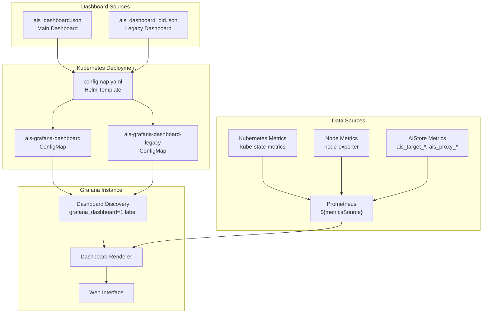

<!-- source: DeepWiki mcp.deepwiki.com · repo NVIDIA/ais-k8s · page 5.2 Dashboards and Visualization · fetched 2026-10-26 -->

# Dashboards and Visualization

<details>
<summary>Relevant source files</summary>

The following files were used as context for generating this wiki page:

- [monitoring/kube-prom/dashboard-configmap/ais_dashboard.json](monitoring/kube-prom/dashboard-configmap/ais_dashboard.json)
- [monitoring/kube-prom/dashboard-configmap/ais_dashboard_old.json](monitoring/kube-prom/dashboard-configmap/ais_dashboard_old.json)
- [monitoring/kube-prom/dashboard-configmap/templates/configmap.yaml](monitoring/kube-prom/dashboard-configmap/templates/configmap.yaml)

</details>


This page covers the Grafana dashboards and visualization components used to monitor AIStore clusters deployed on Kubernetes. The dashboards provide comprehensive monitoring of cluster health, performance metrics, storage utilization, and operational status through a web-based interface.

For information about metrics collection and data sources, see [Metrics Collection](#5.1). For alerting configuration based on dashboard metrics, see [Alerting Configuration](#5.3).

## Dashboard Architecture

The AIStore monitoring system uses Grafana dashboards that are automatically deployed as Kubernetes ConfigMaps and discovered by the Grafana instance running in the monitoring stack.



**Sources:** [monitoring/kube-prom/dashboard-configmap/templates/configmap.yaml:1-23](), [monitoring/kube-prom/dashboard-configmap/ais_dashboard.json:1-50]()

## Dashboard Data Flow

The dashboards consume metrics from multiple sources through Prometheus, with configurable data source references and template variables for multi-cluster support.

```mermaid
graph LR
    subgraph "Template Variables"
        CLUSTER_VAR["${cluster}<br/>Cluster Filter"]
        NAMESPACE_VAR["${namespace}<br/>Namespace Filter"] 
        NODE_VAR["${node}<br/>Node Filter"]
        TARGET_VAR["${target}<br/>Target Filter"]
        INTERVAL_VAR["${interval}<br/>Time Interval"]
        METRICS_SRC["${metricsSource}<br/>Prometheus UID"]
    end
    
    subgraph "Prometheus Queries"
        AIS_QUERY["ais_target_get_bytes{node_id=~\"$target\", cluster=~\"${cluster}\"}"]
        KUBE_QUERY["kube_statefulset_status_replicas{statefulset=~\".*proxy$\", namespace=\"${namespace}\"}"]
        NODE_QUERY["node_filesystem_avail_bytes{instance=~\"^${node}$\", mountpoint=~\"/ais/.*\"}"]
    end
    
    subgraph "Panel Types"
        GAUGE_PANEL["Gauge Panels<br/>Used Capacity, CPU, RAM"]
        STAT_PANEL["Stat Panels<br/>Throughput, Error Count"]
        TIMESERIES_PANEL["Time Series Panels<br/>Performance Trends"]
    end
    
    CLUSTER_VAR --> AIS_QUERY
    CLUSTER_VAR --> KUBE_QUERY
    NODE_VAR --> NODE_QUERY
    TARGET_VAR --> AIS_QUERY
    NAMESPACE_VAR --> KUBE_QUERY
    INTERVAL_VAR --> AIS_QUERY
    METRICS_SRC --> AIS_QUERY
    
    AIS_QUERY --> STAT_PANEL
    AIS_QUERY --> TIMESERIES_PANEL
    KUBE_QUERY --> STAT_PANEL
    NODE_QUERY --> GAUGE_PANEL
```

**Sources:** [monitoring/kube-prom/dashboard-configmap/ais_dashboard.json:44-46](), [monitoring/kube-prom/dashboard-configmap/ais_dashboard.json:117-118](), [monitoring/kube-prom/dashboard-configmap/ais_dashboard.json:363-364]()

## Main Dashboard Sections

### Cluster Overview Section

The main dashboard row provides high-level cluster status with key performance indicators displayed as gauges and statistics.

| Panel | Metric | Description |
|-------|--------|-------------|
| Used Capacity | `node_filesystem_avail_bytes` / `node_filesystem_size_bytes` | Storage utilization percentage across cluster |
| Total Capacity | `sum(node_filesystem_size_bytes)` | Raw storage capacity available |
| Error Rate | `ais_target_err_get_count` + `ais_target_err_put_count` | Combined GET/PUT error count |
| GET Throughput | `rate(ais_target_get_bytes)` | Current read throughput in bytes/sec |
| PUT Throughput | `rate(ais_target_put_bytes)` | Current write throughput in bytes/sec |

**Sources:** [monitoring/kube-prom/dashboard-configmap/ais_dashboard.json:48-127](), [monitoring/kube-prom/dashboard-configmap/ais_dashboard.json:307-370](), [monitoring/kube-prom/dashboard-configmap/ais_dashboard.json:832-895]()

### Hardware Status Section

Hardware monitoring panels track physical resource utilization across cluster nodes.

| Component | Panels | Key Metrics |
|-----------|--------|-------------|
| CPU | CPU Busy, Core Count | `node_cpu_seconds_total`, CPU utilization percentage |
| Memory | RAM, RAM Total | `node_memory_MemTotal_bytes`, `node_memory_MemAvailable_bytes` |
| Load | Load (5m) | `node_load5` normalized by CPU count |
| Uptime | Uptime | `ais_target_uptime` minimum across cluster |

**Sources:** [monitoring/kube-prom/dashboard-configmap/ais_dashboard.json:1156-1196](), [monitoring/kube-prom/dashboard-configmap/ais_dashboard.json:1320-1374](), [monitoring/kube-prom/dashboard-configmap/ais_dashboard.json:1464-1541]()

### Target Metrics Section

Detailed AIStore target node performance tracking with time-series visualizations.

| Metric Category | Panels | Description |
|-----------------|---------|-------------|
| Throughput | Total GET/PUT Throughput, By Bucket, By Node | Request throughput analysis |
| Object Size | Average GET/PUT Object Size | Object size distribution tracking |
| Disk I/O | Disk Read/Write per Node, Utilization | Storage subsystem performance |
| Latency | GET/PUT Latency per Node | Request latency monitoring |

**Sources:** [monitoring/kube-prom/dashboard-configmap/ais_dashboard.json:1706-1755](), [monitoring/kube-prom/dashboard-configmap/ais_dashboard.json:1940-1989](), [monitoring/kube-prom/dashboard-configmap/ais_dashboard.json:2164-2212]()

## ConfigMap Deployment

The dashboard deployment uses Helm templates to package JSON dashboard definitions into Kubernetes ConfigMaps with automatic discovery labels.

```yaml
apiVersion: v1
kind: ConfigMap
metadata:
  name: ais-grafana-dashboard
  namespace: monitoring
  labels:
    grafana_dashboard: "1"
data:
  ais-dashboard.json: |-
{{ .Files.Get "ais_dashboard.json" | indent 4 }}
```

The `grafana_dashboard: "1"` label enables automatic discovery by Grafana's dashboard provisioning system. The template uses Helm's `.Files.Get` function to embed the JSON dashboard definition with proper indentation.

**Sources:** [monitoring/kube-prom/dashboard-configmap/templates/configmap.yaml:1-11](), [monitoring/kube-prom/dashboard-configmap/templates/configmap.yaml:19-23]()

## Template Variables and Filters

### Variable Configuration

The dashboards support multi-cluster and multi-environment monitoring through template variables that filter metrics across different dimensions.

| Variable | Purpose | Query Source |
|----------|---------|--------------|
| `cluster` | Filter metrics by cluster name | Label values from metrics |
| `namespace` | Filter Kubernetes resources | Kubernetes API |
| `node` | Filter by physical nodes | `node_exporter` instances |
| `target` | Filter AIStore targets | `ais_target_*` metric labels |
| `proxy` | Filter AIStore proxies | `ais_proxy_*` metric labels |
| `interval` | Time range for rate calculations | User selection |

### Data Source Variables

| Variable | Default | Description |
|----------|---------|-------------|
| `metricsSource` | `${metricsSource}` | Prometheus data source UID for multi-instance support |
| `datasource` | `${datasource}` | Alternative data source reference for expressions |

**Sources:** [monitoring/kube-prom/dashboard-configmap/ais_dashboard.json:113-115](), [monitoring/kube-prom/dashboard-configmap/ais_dashboard.json:507-508](), [monitoring/kube-prom/dashboard-configmap/ais_dashboard.json:1740-1741]()

## Key Metric Queries

### Storage Capacity Calculation

```promql
(1-sum(node_filesystem_avail_bytes{instance=~"^${node}$", job="node-exporter", mountpoint=~"/ais/.*", fstype!="rootfs", cluster=~"${cluster}"})/ sum(node_filesystem_size_bytes{instance=~"^${node}$", job="node-exporter", mountpoint=~"/ais/.*", fstype!="rootfs", cluster=~"${cluster}"})) * 100
```

### Throughput Rate Calculation

```promql
sum(rate(ais_target_get_bytes{node_id=~"$target", cluster=~"${cluster}"}[$interval]))
```

### Error Rate Aggregation

```promql
sum(increase(ais_target_err_get_count{node_id=~"$target", cluster=~"${cluster}"}[$interval])) + sum(increase(ais_target_err_put_count{node_id=~"$target", cluster=~"${cluster}"}[$interval]))
```

**Sources:** [monitoring/kube-prom/dashboard-configmap/ais_dashboard.json:118-119](), [monitoring/kube-prom/dashboard-configmap/ais_dashboard.json:363-364](), [monitoring/kube-prom/dashboard-configmap/ais_dashboard.json:268-296]()

## Dashboard Versioning

### Current Dashboard Features

The main dashboard (`ais_dashboard.json`) includes:
- Modern Grafana 11.x panel types and configurations
- Advanced time series visualizations with statistical calculations
- Expression-based metric combinations for complex calculations
- Binary unit formatting (`binBps`) for throughput metrics
- Enhanced threshold configurations with multiple color gradients

### Legacy Dashboard Support

The legacy dashboard (`ais_dashboard_old.json`) provides:
- Compatibility with older Grafana versions
- Simplified panel configurations
- Alternative metric queries for different AIStore versions
- MiB/s unit formatting for throughput display

**Sources:** [monitoring/kube-prom/dashboard-configmap/ais_dashboard.json:327-328](), [monitoring/kube-prom/dashboard-configmap/ais_dashboard_old.json:306-307](), [monitoring/kube-prom/dashboard-configmap/templates/configmap.yaml:14-23]()

---

