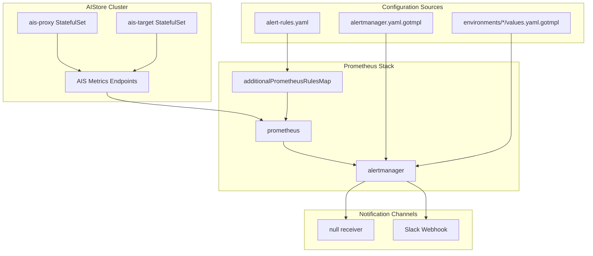
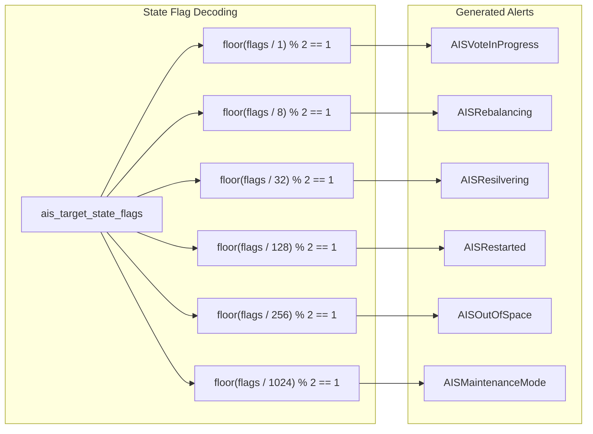
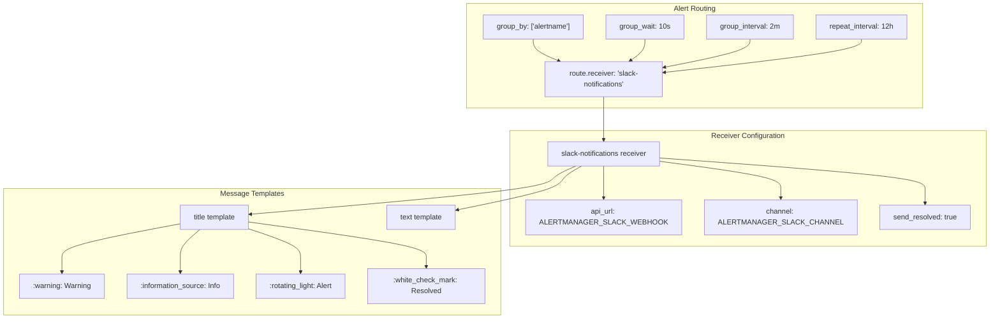
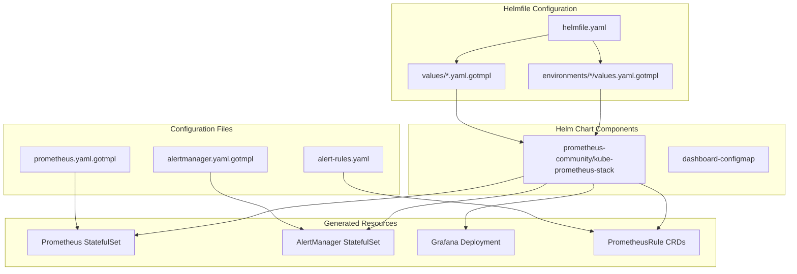

<!-- source: DeepWiki mcp.deepwiki.com · repo NVIDIA/ais-k8s · page 5.3 Alerting Configuration · fetched 2026-10-26 -->

# Alerting Configuration

<details>
<summary>Relevant source files</summary>

The following files were used as context for generating this wiki page:

- [monitoring/kube-prom/README.md](monitoring/kube-prom/README.md)
- [monitoring/kube-prom/environments/dev/values.yaml.gotmpl](monitoring/kube-prom/environments/dev/values.yaml.gotmpl)
- [monitoring/kube-prom/environments/prod/values.yaml.gotmpl](monitoring/kube-prom/environments/prod/values.yaml.gotmpl)
- [monitoring/kube-prom/helmfile.yaml](monitoring/kube-prom/helmfile.yaml)
- [monitoring/kube-prom/values/alert-rules.yaml](monitoring/kube-prom/values/alert-rules.yaml)
- [monitoring/kube-prom/values/alertmanager.yaml.gotmpl](monitoring/kube-prom/values/alertmanager.yaml.gotmpl)
- [monitoring/kube-prom/values/grafana.yaml.gotmpl](monitoring/kube-prom/values/grafana.yaml.gotmpl)
- [monitoring/kube-prom/values/kube-state-metrics.yaml.gotmpl](monitoring/kube-prom/values/kube-state-metrics.yaml.gotmpl)

</details>


This document covers the configuration and setup of AlertManager for AIStore clusters running on Kubernetes. It details the alert rules specific to AIStore components, notification routing configuration, and environment-specific alerting setups.

For information about metrics collection that feeds these alerts, see [Metrics Collection](#5.1). For dashboard setup that complements alerting, see [Dashboards and Visualization](#5.2).

## AlertManager Architecture

AlertManager serves as the central component for handling alerts generated by Prometheus based on AIStore metrics. The system is deployed as part of the `kube-prometheus-stack` Helm chart and integrates with AIStore-specific alert rules.



Sources: [monitoring/kube-prom/values/alertmanager.yaml.gotmpl:1-74](), [monitoring/kube-prom/values/alert-rules.yaml:1-246](), [monitoring/kube-prom/helmfile.yaml:22-35]()

## Alert Rules Configuration

AIStore alert rules are defined in the `additionalPrometheusRulesMap` configuration under the `ais-rules` group. The rules monitor various aspects of AIStore cluster health and performance.

### Alert Categories

| Category | Alert Examples | Severity Levels |
|----------|----------------|-----------------|
| **Disk Management** | `AISHighDiskIOUtilization`, `AISLowDiskCapacity`, `AISOutOfSpace` | `critical`, `info` |
| **Node Availability** | `AISProxyDown`, `AISTargetDown`, `K8sNodeDown` | `critical` |
| **System Resources** | `K8sHighMemoryUtilization`, `K8sHighCpuUtilization`, `AISOutOfMemory` | `critical` |
| **Cluster Operations** | `AISRebalancing`, `AISResilvering`, `AISVoteInProgress` | `warning` |
| **Data Integrity** | `AISChecksumError`, `AISDiskFault`, `AISNoMountpaths` | `critical` |
| **Security** | `AISCertWillSoonExpire`, `AISCertificateExpired`, `AISCertificateInvalid` | `warning`, `critical` |

### AIStore State Flag Alerts

AIStore uses bit flags in the `ais_target_state_flags` metric to report various states. The alert rules decode these flags using mathematical expressions:



Sources: [monitoring/kube-prom/values/alert-rules.yaml:86-94](), [monitoring/kube-prom/values/alert-rules.yaml:134-141](), [monitoring/kube-prom/values/alert-rules.yaml:150-157]()

## Notification Configuration

AlertManager supports multiple notification channels through its receiver configuration. The primary implementation uses Slack integration with customizable message formatting.

### Slack Integration

The Slack notification configuration includes:

- **Webhook URL**: Configured via `ALERTMANAGER_SLACK_WEBHOOK` environment variable
- **Channel**: Specified through `ALERTMANAGER_SLACK_CHANNEL` environment variable  
- **Message Templates**: Custom formatting for different alert severities
- **Resolution Notifications**: Automatic notifications when alerts resolve



Sources: [monitoring/kube-prom/values/alertmanager.yaml.gotmpl:17-66]()

### Alert Routing Logic

The routing configuration includes special handling for different alert types:

| Route Match | Receiver | Purpose |
|-------------|----------|---------|
| `alertname: InfoInhibitor` | `null` | Suppresses info-level noise |
| `alertname: KubeVersionMismatch` | inhibited | Prevents known false positives |
| `severity: critical` | `slack-notifications` | High-priority alerts |
| `severity: warning` | `slack-notifications` | Medium-priority alerts |
| `severity: info` | `slack-notifications` | Informational alerts |

Sources: [monitoring/kube-prom/values/alertmanager.yaml.gotmpl:20-41]()

## Environment-Specific Configuration

Different environments use separate configuration files to customize alerting behavior and notification targets.

### Production Environment

Production configuration requires mandatory Slack webhook and channel settings:

```yaml
slack:
  webhook: {{ requiredEnv "ALERTMANAGER_SLACK_WEBHOOK" }}
  channel: {{ requiredEnv "ALERTMANAGER_SLACK_CHANNEL" }}
```

Additional production-specific settings include:
- Node affinity for dedicated monitoring nodes
- Larger persistent volume sizes for alert history
- Storage class optimized for cloud environments (`oci-bv`)

Sources: [monitoring/kube-prom/environments/prod/values.yaml.gotmpl:7-9]()

### Development Environment

Development configuration provides more relaxed requirements:

```yaml
slack:
  webhook: {{ env "ALERTMANAGER_SLACK_WEBHOOK" | default "" }}
  channel: {{ env "ALERTMANAGER_SLACK_CHANNEL" | default "" }}
```

Development-specific settings include:
- Local storage class (`local-path`)
- Smaller persistent volumes for resource efficiency
- Optional Slack configuration for testing

Sources: [monitoring/kube-prom/environments/dev/values.yaml.gotmpl:3-5]()

## Deployment and Management

AlertManager configuration is deployed through the `kube-prometheus-stack` Helm chart using Helmfile orchestration.

### Deployment Architecture



Sources: [monitoring/kube-prom/helmfile.yaml:16-35]()

### Deployment Commands

Environment-specific deployment uses Helmfile with environment variables:

```bash
# Template configuration for validation
set -a; . ../oci-iad.env ; set +a; helmfile -e prod template

# Deploy to production environment  
set -a; . ../oci-iad.env ; set +a; helmfile -e prod sync
```

The deployment process ensures:
- Environment variables are loaded before templating
- Dependencies between charts are respected (`dashboard-configmap` before `prometheus`)
- Configuration validation occurs before deployment

Sources: [monitoring/kube-prom/README.md:28-33]()

---

