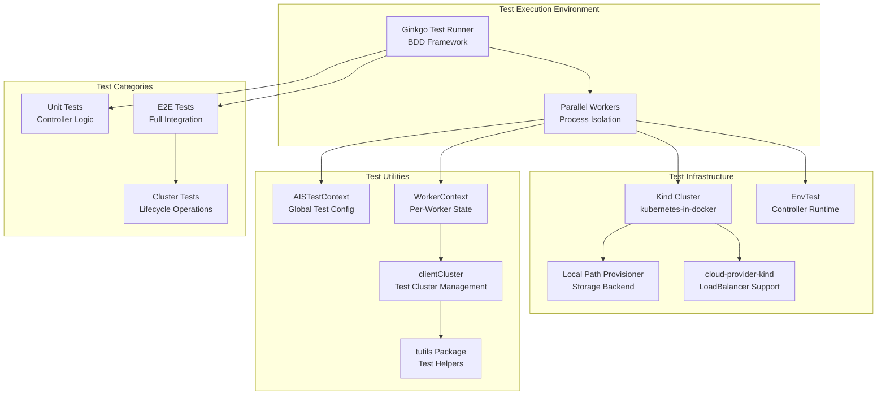
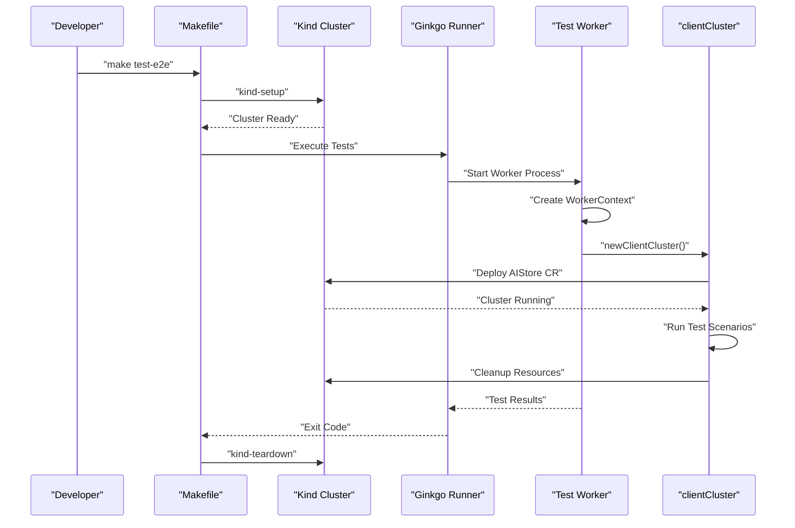
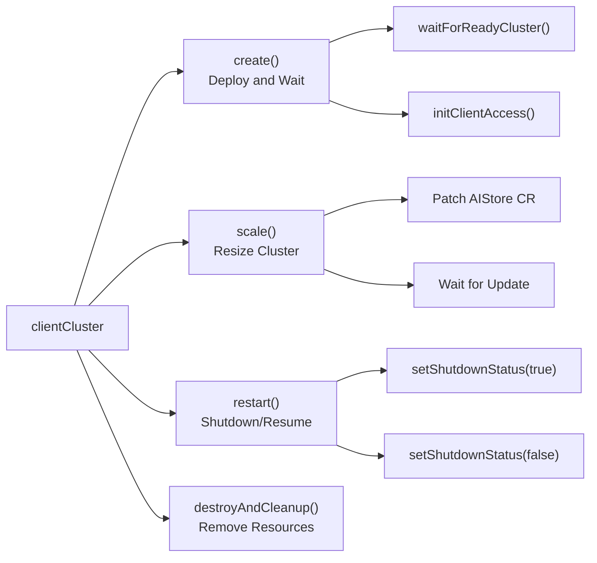
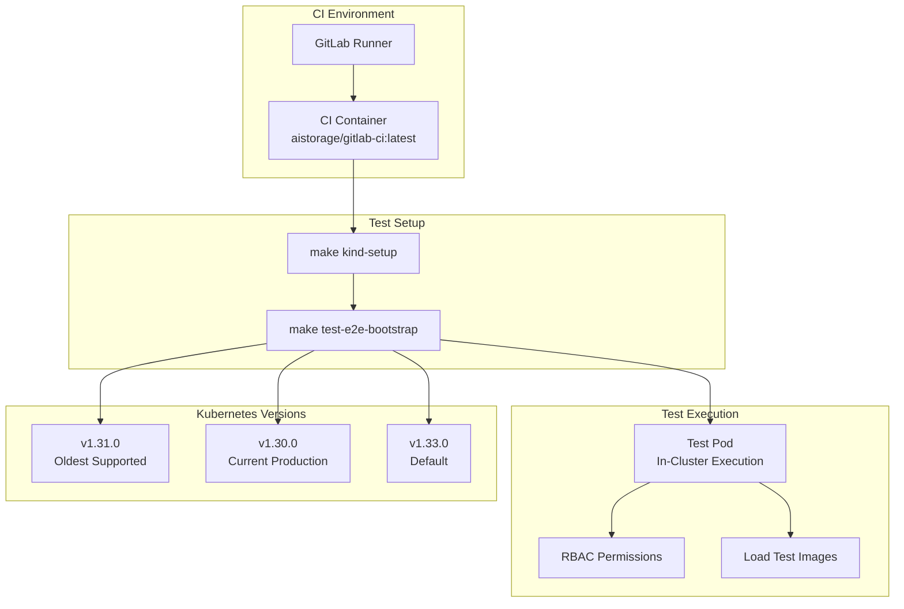

<!-- source: DeepWiki mcp.deepwiki.com · repo NVIDIA/ais-k8s · page 6 Development and Testing · fetched 2026-10-26 -->

# Development and Testing

<details>
<summary>Relevant source files</summary>

The following files were used as context for generating this wiki page:

- [.gitlab-ci.yml](.gitlab-ci.yml)
- [operator/Makefile](operator/Makefile)
- [operator/go.mod](operator/go.mod)
- [operator/go.sum](operator/go.sum)
- [operator/pkg/resources/cmn/config.go](operator/pkg/resources/cmn/config.go)
- [operator/scripts/test.sh](operator/scripts/test.sh)
- [operator/tests/ci/test_in_cluster.sh](operator/tests/ci/test_in_cluster.sh)
- [operator/tests/e2e/client_cluster.go](operator/tests/e2e/client_cluster.go)
- [operator/tests/e2e/cluster_test.go](operator/tests/e2e/cluster_test.go)
- [operator/tests/e2e/suite_test.go](operator/tests/e2e/suite_test.go)
- [operator/tests/tutils/ais_cluster.go](operator/tests/tutils/ais_cluster.go)
- [operator/tests/tutils/ais_test_context.go](operator/tests/tutils/ais_test_context.go)
- [operator/tests/tutils/api.go](operator/tests/tutils/api.go)
- [operator/tests/tutils/utils.go](operator/tests/tutils/utils.go)

</details>


This document covers the testing frameworks, CI/CD pipeline, and development workflow for the AIStore Kubernetes operator. It provides guidance for developers contributing to the project, including how to set up a local development environment, run tests, and understand the testing infrastructure.

For information about deployment methods and configuration, see [Deployment Methods](#4). For details about the operator architecture itself, see [AIStore Kubernetes Operator](#3).

## Testing Framework Overview

The AIStore operator uses a comprehensive testing strategy built around end-to-end (E2E) testing with the Ginkgo BDD framework. The testing infrastructure supports both local development and automated CI/CD pipelines.

### Testing Architecture



**Sources:** [operator/tests/e2e/suite_test.go:64-166](), [operator/Makefile:96-109](), [operator/tests/tutils/ais_test_context.go:30-41]()

### Test Execution Flow



**Sources:** [operator/tests/e2e/client_cluster.go:102-106](), [operator/scripts/test.sh:15-22](), [operator/Makefile:112-117]()

## Local Development Setup

### Prerequisites

The development environment requires several tools that are automatically installed via the Makefile:

- **Go 1.24+** - Required for building and testing
- **Docker** - For container operations and Kind clusters  
- **kubectl** - Kubernetes command-line tool
- **Kind** - Kubernetes in Docker for local testing
- **Ginkgo** - BDD testing framework

### Environment Configuration

Key environment variables control test behavior:

| Variable | Purpose | Default |
|----------|---------|---------|
| `TEST_STORAGECLASS` | Storage class for test PVs | `"ais-operator-test-storage"` |
| `TEST_STORAGE_HOSTPATH` | Host path for storage | `/etc/ais/<random>` |
| `TEST_EPHEMERAL_CLUSTER` | Use ephemeral test clusters | `false` |
| `AIS_TEST_NODE_IMAGE` | AIStore node image | `"aistorage/aisnode:v3.29"` |
| `AIS_TEST_INIT_IMAGE` | AIStore init image | `"aistorage/ais-init:v3.29"` |

**Sources:** [operator/tests/tutils/ais_test_context.go:14-28](), [operator/tests/tutils/ais_cluster.go:24-32]()

### Setting Up Local Environment

1. **Install Dependencies**
```bash
make kind helm controller-gen envtest
```

2. **Create Kind Cluster**
```bash
make kind-setup
```

3. **Install Supporting Infrastructure**
```bash
make test-e2e-bootstrap
```

This sets up:
- Local Path Provisioner for storage ([operator/Makefile:120-121]())
- cloud-provider-kind for LoadBalancer support ([operator/Makefile:126-127]())

**Sources:** [operator/Makefile:301-310](), [operator/Makefile:119-131]()

## Running Tests

### Test Categories

The project includes several types of tests accessible through Makefile targets:

#### Unit Tests
```bash
make test
```
Runs controller unit tests using EnvTest framework ([operator/Makefile:97-99]()).

#### End-to-End Tests
```bash
make test-e2e
```
Runs full integration tests against a Kind cluster ([operator/Makefile:105-106]()).

#### In-Cluster Tests
```bash
make test-e2e-in-cluster
```
Executes tests inside a Kubernetes cluster using a test pod ([operator/Makefile:108-109]()).

### Test Configuration

Tests use the `AISTestContext` struct to manage configuration:

```go
type AISTestContext struct {
    K8sProvider       string
    StorageClass      string  
    StorageHostPath   string
    NodeImage         string
    InitImage         string
    PreviousNodeImage string
    PreviousInitImage string
    LogsImage         string
    Ephemeral         bool
    APIMode           string
}
```

**Sources:** [operator/tests/tutils/ais_test_context.go:30-41]()

### Parallel Test Execution

The test suite supports parallel execution using Ginkgo's worker processes. Each worker:

1. Creates an isolated namespace ([operator/tests/e2e/suite_test.go:113-114]())
2. Manages its own `WorkerContext` ([operator/tests/e2e/suite_test.go:159-165]())
3. Runs tests independently to avoid conflicts

**Sources:** [operator/scripts/test.sh:15-19](), [operator/tests/e2e/suite_test.go:117-133]()

## Test Utilities and Infrastructure

### Core Test Utilities

The `tutils` package provides essential testing infrastructure:

#### Cluster Management
- `NewAISCluster()` - Creates test cluster specifications ([operator/tests/tutils/ais_cluster.go:79-83]())
- `DestroyCluster()` - Cleans up cluster resources ([operator/tests/tutils/api.go:104-114]())
- `WaitForClusterToBeReady()` - Waits for cluster readiness ([operator/tests/tutils/api.go:396-408]())

#### Resource Validation
- `CheckResExistence()` - Validates Kubernetes resource creation/deletion ([operator/tests/tutils/api.go:56-100]())
- `EventuallySSExists()` - Checks StatefulSet existence ([operator/tests/tutils/api.go:262-272]())
- `EventuallyServiceExists()` - Validates Service resources ([operator/tests/tutils/api.go:228-234]())

#### Persistent Volume Management
- `CreatePV()` - Creates test persistent volumes ([operator/tests/tutils/api.go:322-356]())
- `DestroyPV()` - Cleans up persistent volumes ([operator/tests/tutils/api.go:124-141]())

**Sources:** [operator/tests/tutils/api.go:37-45](), [operator/tests/tutils/ais_cluster.go:34-56]()

### Client Cluster Abstraction

The `clientCluster` struct provides high-level cluster operations for tests:



**Sources:** [operator/tests/e2e/client_cluster.go:42-51](), [operator/tests/e2e/client_cluster.go:102-106]()

## CI/CD Pipeline

### GitLab CI Configuration

The CI pipeline is defined in `.gitlab-ci.yml` with multiple stages:

#### Build Stage (`operator:build`)
- **Linting**: Code formatting and style checks ([.gitlab-ci.yml:55-67]())
- **Build**: Compile operator binary ([.gitlab-ci.yml:69-74]())

#### Test Stage (`operator:test`)
- **Unit Tests**: Controller logic validation ([.gitlab-ci.yml:91-96]())
- **E2E Tests**: Full integration testing ([.gitlab-ci.yml:98-100]())
- **Compatibility Tests**: Multiple Kubernetes versions ([.gitlab-ci.yml:102-116]())

**Sources:** [.gitlab-ci.yml:11-17](), [.gitlab-ci.yml:36-53]()

### CI Test Execution



**Sources:** [.gitlab-ci.yml:1-9](), [operator/tests/ci/test_in_cluster.sh:1-26](), [.gitlab-ci.yml:107-109]()

### In-Cluster Test Execution

For CI environments, tests run inside the Kubernetes cluster using a dedicated test pod:

1. **RBAC Setup**: Apply necessary permissions ([operator/tests/ci/test_in_cluster.sh:10-11]())
2. **Image Loading**: Load test images into Kind cluster ([operator/tests/ci/test_in_cluster.sh:14]())
3. **Pod Deployment**: Create test pod with environment ([operator/tests/ci/test_in_cluster.sh:17]())
4. **Source Copy**: Copy operator source into pod ([operator/tests/ci/test_in_cluster.sh:23]())
5. **Test Execution**: Run E2E tests inside pod ([operator/tests/ci/test_in_cluster.sh:26]())

**Sources:** [operator/tests/ci/test_in_cluster.sh:1-26]()

## Code Quality and Validation

### Linting and Formatting

The project enforces code quality through multiple checks:

- **Go Formatting**: `make fmt-check` validates code formatting ([operator/Makefile:141-143]())
- **Linting**: `make lint` runs golangci-lint ([operator/Makefile:133-135]())
- **Generated Code**: Validation of generated manifests and code ([.gitlab-ci.yml:66-67]())

### Code Generation

Several Makefile targets handle code generation:

- `make generate` - Generate DeepCopy methods and mocks ([operator/Makefile:84-86]())
- `make manifests` - Generate CRDs and RBAC manifests ([operator/Makefile:80-81]())

**Sources:** [operator/Makefile:78-95](), [operator/Makefile:133-147]()

---

