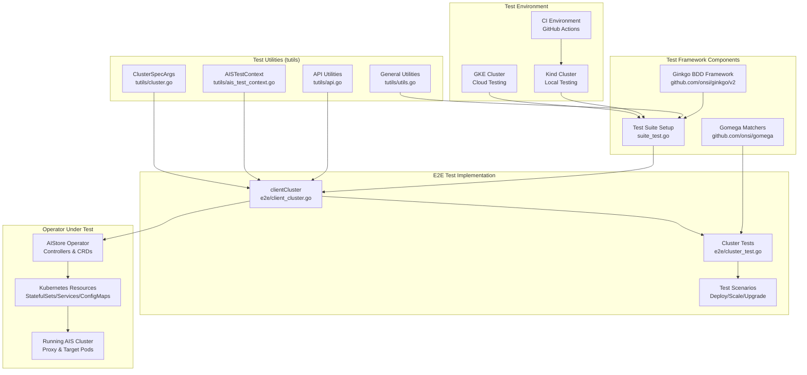
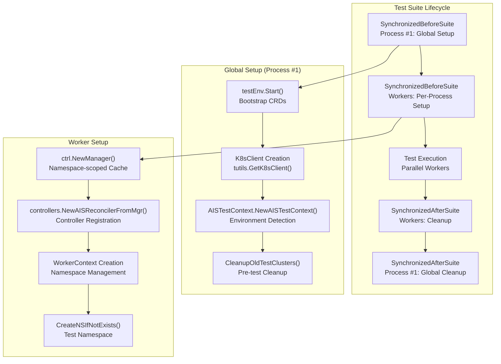
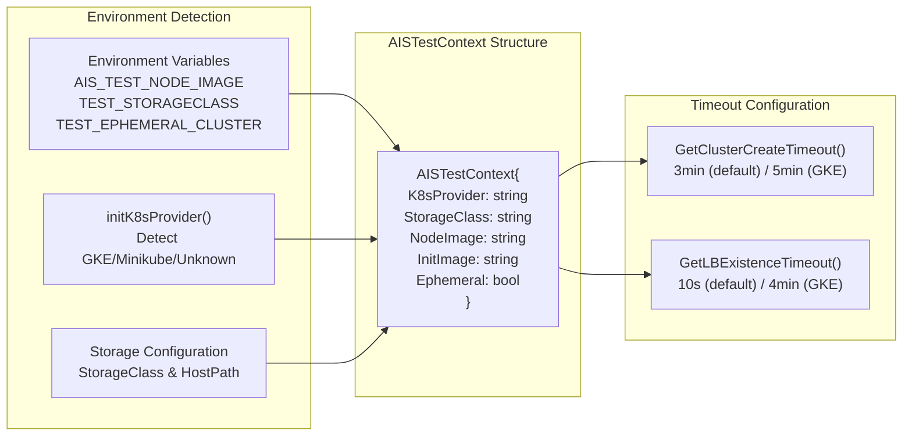
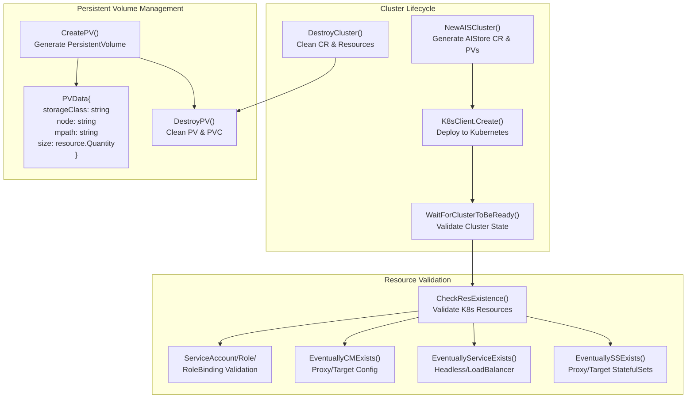
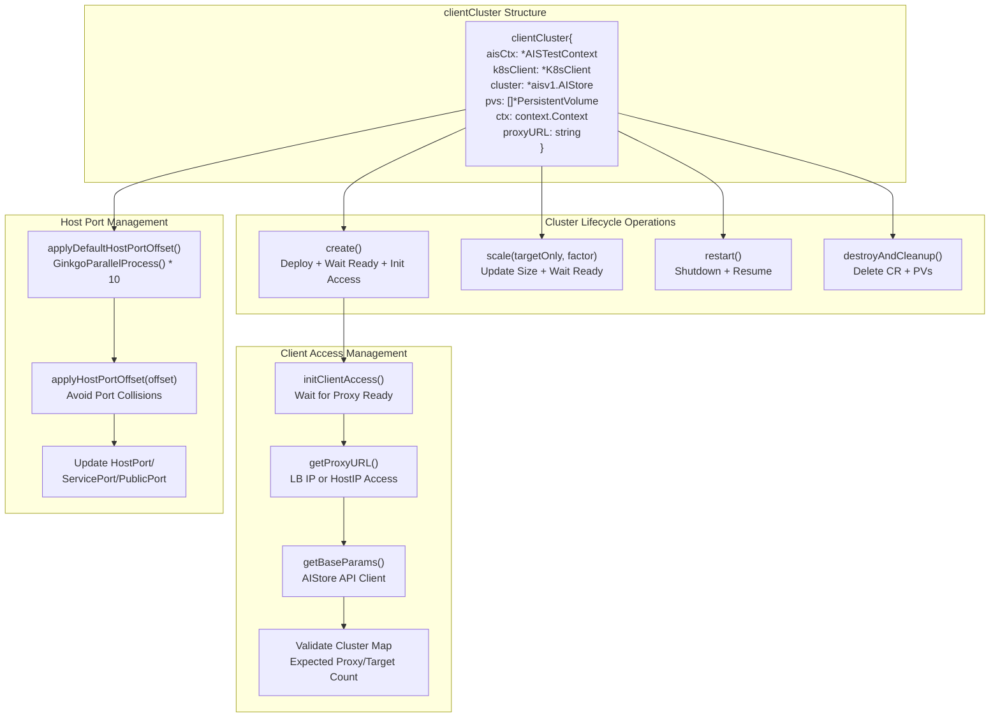
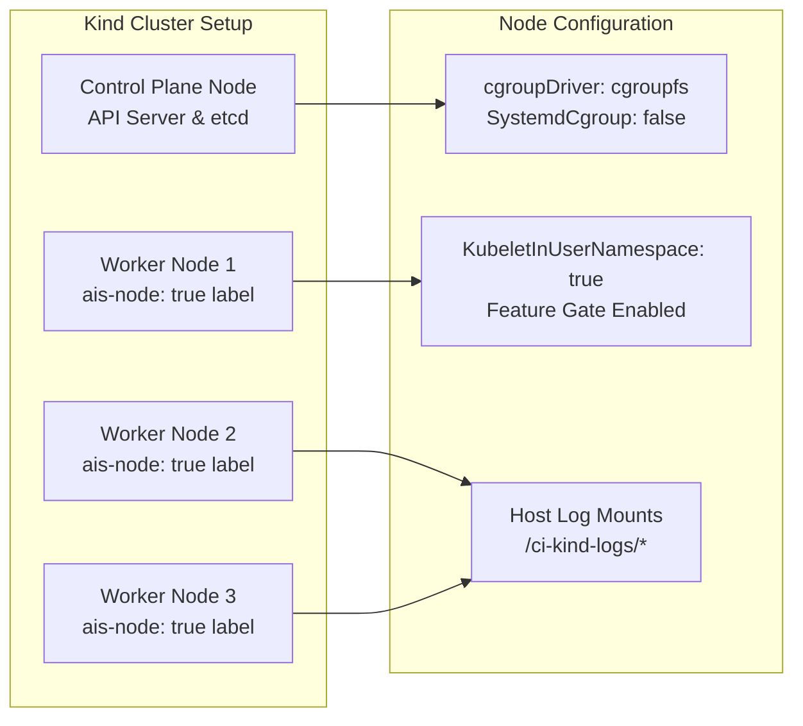
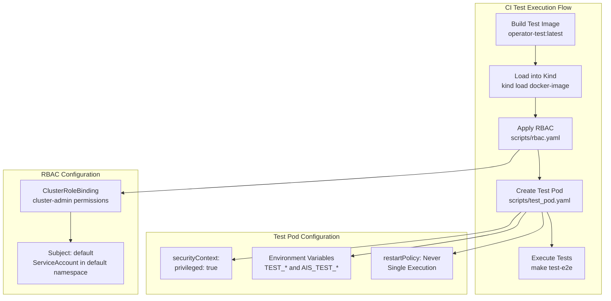
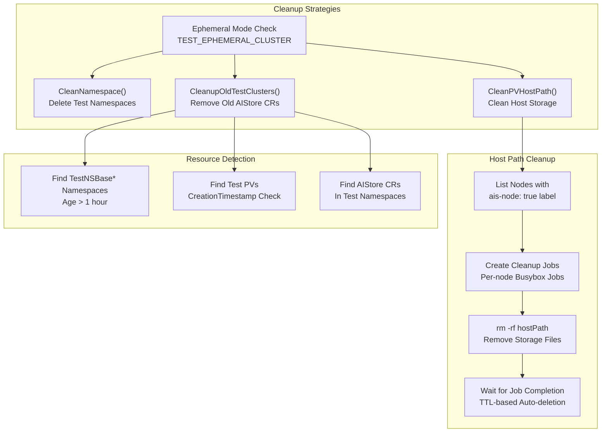

<!-- source: DeepWiki mcp.deepwiki.com · repo NVIDIA/ais-k8s · page 6.1 Testing Framework · fetched 2026-10-26 -->

# Testing Framework

Relevant source files

The following files were used as context for generating this wiki page:

- [operator/scripts/rbac.yaml](operator/scripts/rbac.yaml)
- [operator/scripts/test_in_cluster.sh](operator/scripts/test_in_cluster.sh)
- [operator/scripts/test_pod.yaml](operator/scripts/test_pod.yaml)
- [operator/tests/README.md](operator/tests/README.md)
- [operator/tests/ci/kind_cluster_ci.yaml](operator/tests/ci/kind_cluster_ci.yaml)
- [operator/tests/ci/test_in_cluster.sh](operator/tests/ci/test_in_cluster.sh)
- [operator/tests/e2e/client_cluster.go](operator/tests/e2e/client_cluster.go)
- [operator/tests/e2e/cluster_test.go](operator/tests/e2e/cluster_test.go)
- [operator/tests/e2e/suite_test.go](operator/tests/e2e/suite_test.go)
- [operator/tests/tutils/ais_test_context.go](operator/tests/tutils/ais_test_context.go)
- [operator/tests/tutils/api.go](operator/tests/tutils/api.go)
- [operator/tests/tutils/utils.go](operator/tests/tutils/utils.go)

This document covers the comprehensive testing framework for the AIStore Kubernetes operator, including end-to-end integration tests, test utilities, and CI automation. The framework validates operator functionality, cluster lifecycle management, and resource reconciliation across different Kubernetes environments.

For information about the CI/CD pipeline that executes these tests, see [CI/CD Pipeline](#6.2). For local development setup including test execution, see [Local Development Setup](#6.3).

## Test Architecture Overview

The testing framework is built around the Ginkgo BDD testing framework and provides comprehensive validation of the AIStore operator across multiple scenarios.

**Sources**: [operator/tests/e2e/suite_test.go:1-192](), [operator/tests/e2e/client_cluster.go:1-352](), [operator/tests/tutils/api.go:1-627]()

The framework consists of four main layers:
- **Test Framework**: Ginkgo/Gomega providing BDD-style test structure and assertions
- **Test Utilities**: The `tutils` package providing cluster management and validation utilities
- **E2E Implementation**: Test scenarios and cluster lifecycle management
- **Test Environment**: Support for various Kubernetes environments

## Test Framework Components

### Ginkgo BDD Framework

The framework uses Ginkgo for BDD-style test organization with structured test contexts and lifecycle hooks.

**Sources**: [operator/tests/e2e/suite_test.go:64-191]()

The test suite uses synchronized before/after hooks to manage global resources efficiently:
- **Process #1** handles global setup including CRD bootstrapping and environment detection
- **Worker processes** create namespace-scoped managers to prevent cross-test interference
- **Parallel execution** is supported through worker-specific namespaces and resource isolation

### Test Context Management

The `AISTestContext` provides environment-specific configuration for test execution.

**Sources**: [operator/tests/tutils/ais_test_context.go:30-144]()

The `AISTestContext` struct centralizes environment configuration including:
- Container image specifications for nodes and init containers
- Storage class and host path configuration
- Provider-specific timeout adjustments for GKE vs local environments

## Test Utilities Package

The `tutils` package provides comprehensive utilities for cluster lifecycle management and resource validation.

### Cluster Management Utilities

**Sources**: [operator/tests/tutils/api.go:102-114](), [operator/tests/tutils/api.go:56-100](), [operator/tests/tutils/api.go:322-356]()

Key utility functions include:
- `DestroyCluster()` - Deletes AIStore CR and waits for cleanup
- `CheckResExistence()` - Validates all expected Kubernetes resources exist
- `CreatePV()` - Creates persistent volumes with proper node affinity
- Various `Eventually*()` functions for async resource validation

### Resource Validation Framework

The framework provides comprehensive resource validation using Gomega's `Eventually` patterns:

| Function | Purpose | Resources Validated |
|----------|---------|-------------------|
| `EventuallyCMExists()` | ConfigMap validation | Global config, proxy config, target config, statsD config |
| `EventuallyServiceExists()` | Service validation | Headless services, LoadBalancer services |
| `EventuallySSExists()` | StatefulSet validation | Proxy StatefulSet, Target StatefulSet |
| `EventuallyResourceExists()` | Generic resource validation | RBAC resources (ServiceAccount, Role, RoleBinding) |
| `EventuallyPodsIsSize()` | Pod count validation | Running proxy/target pod counts |

**Sources**: [operator/tests/tutils/api.go:211-294]()

## E2E Test Implementation

### clientCluster Management

The `clientCluster` struct encapsulates test cluster lifecycle and provides high-level operations for test scenarios.

**Sources**: [operator/tests/e2e/client_cluster.go:44-74](), [operator/tests/e2e/client_cluster.go:102-106](), [operator/tests/e2e/client_cluster.go:202-222]()

The `clientCluster` struct provides:
- **Lifecycle Management**: Create, scale, restart, and destroy operations
- **Client Access**: Automatic proxy URL discovery and AIStore API client initialization
- **Port Management**: Automatic host port offset calculation for parallel test execution
- **Resource Tracking**: PersistentVolume management and cleanup

### Test Scenarios

The E2E test suite covers comprehensive operator functionality through structured test contexts:

```mermaid
graph TB
    subgraph "Deploy and Destroy Tests"
        BASIC_DEPLOY["Basic Cluster Deployment<br/>Without External LB"]
        LB_DEPLOY["LoadBalancer Deployment<br/>With External LB"]
        HETERO_DEPLOY["Heterogeneous Deployment<br/>Multiple Targets per Node"]
    end
    
    subgraph "Multiple Deployment Tests"
        SAME_NS["Two Clusters Same Namespace<br/>Port Offset Management"]
        DIFF_NS["Same Name Different Namespaces<br/>Namespace Isolation"]
    end
    
    subgraph "Cluster Operations Tests"
        UPGRADE_TEST["Image Upgrade Test<br/>Previous -> Current Image"]
        SCALE_UP["Scale Up Test<br/>Add Proxy/Target Nodes"]
        SCALE_DOWN["Scale Down Test<br/>Remove Nodes Safely"]
    end
    
    subgraph "Data Safety Tests"
        RESTART_DATA["Restart Retention Test<br/>Data Persists After Restart"]
        SCALE_DOWN_DATA["Scale Down Safety<br/>Data Preserved During Scale"]
        CLEANUP_DATA["CleanupData Test<br/>Data Wiped on Destroy"]
        RECOVERY_TEST["Recovery Test<br/>CleanupMetadata=false"]
    end
    
    BASIC_DEPLOY --> LB_DEPLOY
    LB_DEPLOY --> HETERO_DEPLOY
    
    SAME_NS --> DIFF_NS
    
    UPGRADE_TEST --> SCALE_UP
    SCALE_UP --> SCALE_DOWN
    
    RESTART_DATA --> SCALE_DOWN_DATA
    SCALE_DOWN_DATA --> CLEANUP_DATA
    CLEANUP_DATA --> RECOVERY_TEST
```

**Sources**: [operator/tests/e2e/cluster_test.go:28-97](), [operator/tests/e2e/cluster_test.go:99-115](), [operator/tests/e2e/cluster_test.go:117-168](), [operator/tests/e2e/cluster_test.go:170-310]()

Test scenarios validate:
- **Basic Functionality**: Cluster deployment with and without external LoadBalancers
- **Multi-Cluster**: Namespace isolation and port collision avoidance
- **Lifecycle Operations**: Image upgrades and cluster scaling operations
- **Data Safety**: Data persistence across operations and cleanup behavior

## Test Environment Configuration

### Environment Variables

The testing framework supports extensive configuration through environment variables:

| Variable | Purpose | Default Value |
|----------|---------|---------------|
| `AIS_TEST_NODE_IMAGE` | Node container image | `aistorage/aisnode:v3.29` |
| `AIS_TEST_PREV_NODE_IMAGE` | Previous node image for upgrades | `aistorage/aisnode:v3.28` |
| `AIS_TEST_INIT_IMAGE` | Init container image | `aistorage/ais-init:v3.29` |
| `AIS_TEST_PREV_INIT_IMAGE` | Previous init image for upgrades | `aistorage/ais-init:v3.28` |
| `TEST_STORAGECLASS` | Storage class for PVCs | `ais-operator-test-storage` |
| `TEST_STORAGE_HOSTPATH` | Host path for storage | `/etc/ais/<random>` |
| `TEST_EPHEMERAL_CLUSTER` | Ephemeral cluster testing | `false` |
| `AIS_TEST_API_MODE` | API access mode | Internal DNS |

**Sources**: [operator/tests/tutils/ais_test_context.go:14-28](), [operator/tests/README.md:17-30]()

### Kind Cluster Configuration

For local testing, the framework uses Kind clusters with specific configuration for AIStore requirements:

**Sources**: [operator/tests/ci/kind_cluster_ci.yaml:1-37]()

The Kind configuration provides:
- **Multi-node setup**: 1 control plane + 3 worker nodes for realistic testing
- **Node labels**: `ais-node: true` labels for AIStore node selection
- **Log mounting**: Host path mounts for log collection in CI
- **cgroup configuration**: Compatible settings for containerized environments

## CI Integration

### Test Pod Execution

The CI system executes tests within Kubernetes pods to provide realistic testing conditions:

**Sources**: [operator/tests/ci/test_in_cluster.sh:1-26](), [operator/scripts/test_pod.yaml:1-32](), [operator/scripts/rbac.yaml:1-12]()

The CI execution provides:
- **Containerized Testing**: Tests run within Kubernetes pods for isolation
- **Privileged Access**: Required for hostPath volume operations and node management
- **Environment Injection**: All configuration passed through environment variables
- **RBAC Setup**: Cluster-admin permissions for full operator testing

### Cleanup and Resource Management

The framework implements comprehensive cleanup to prevent resource leaks:

**Sources**: [operator/tests/tutils/utils.go:40-103](), [operator/tests/tutils/api.go:522-591]()

The cleanup system provides:
- **Conditional Cleanup**: Skipped for ephemeral clusters (Kind in CI)
- **Comprehensive Scope**: Namespaces, CRs, PVs, and host storage
- **Job-based Host Cleanup**: Kubernetes Jobs for secure host path cleanup
- **Age-based Detection**: Only cleans resources older than 1 hour

---

