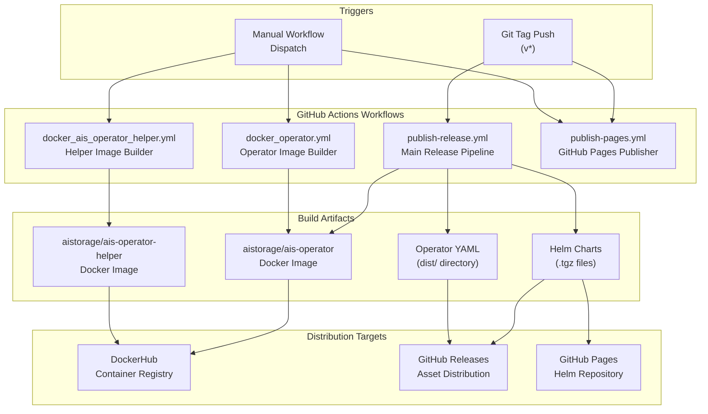
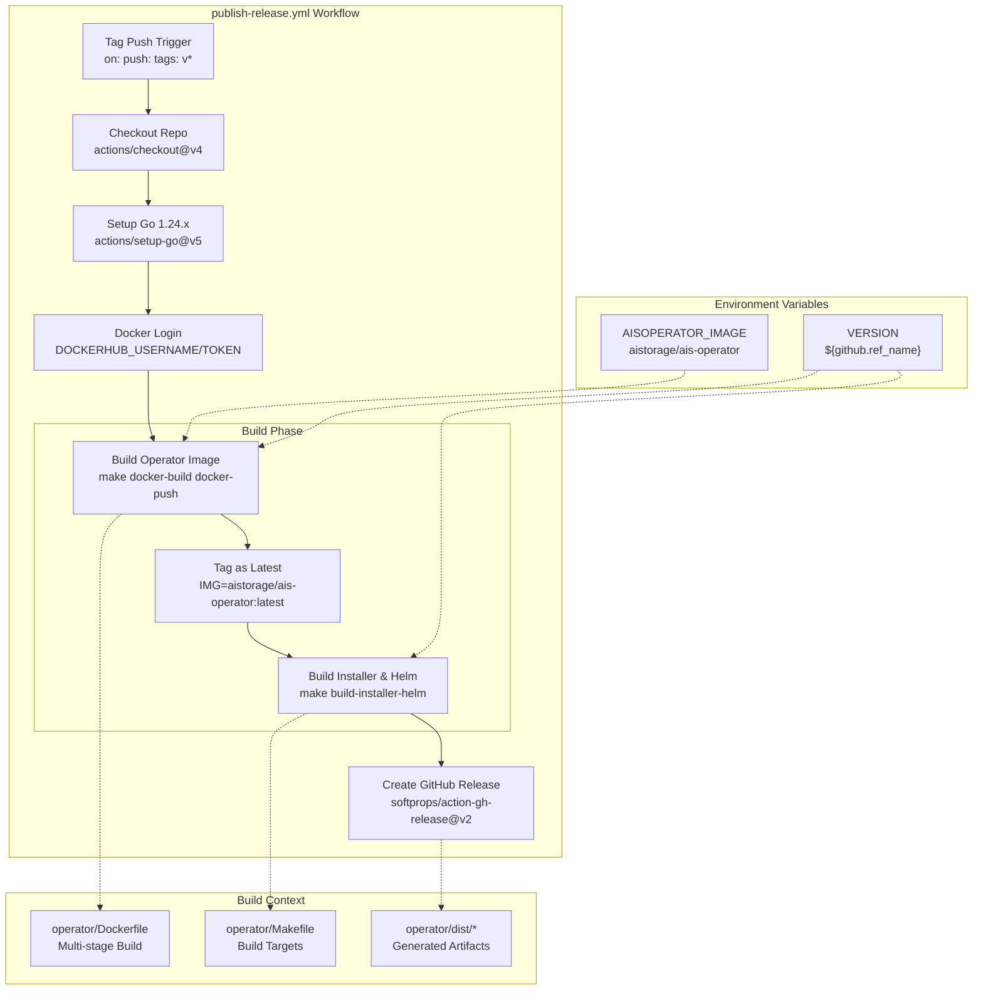
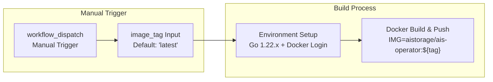
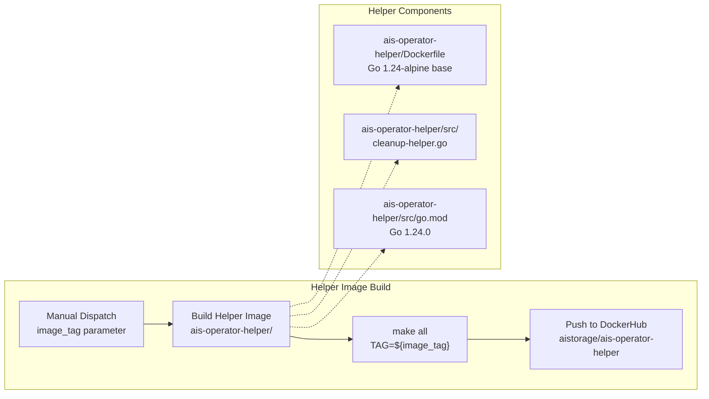
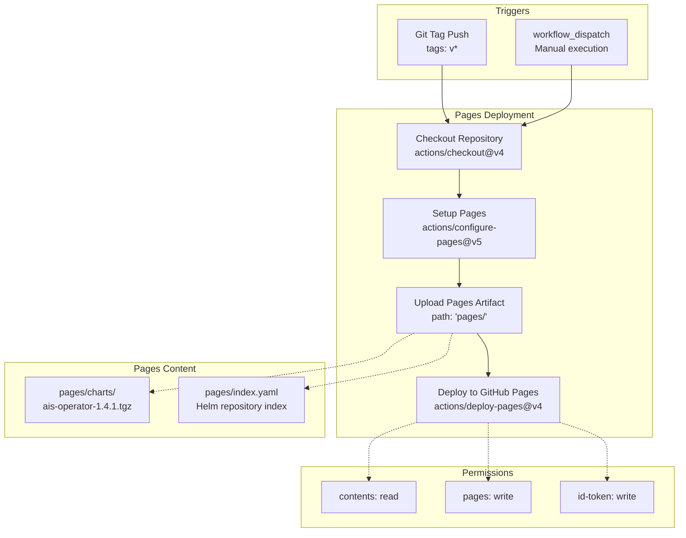
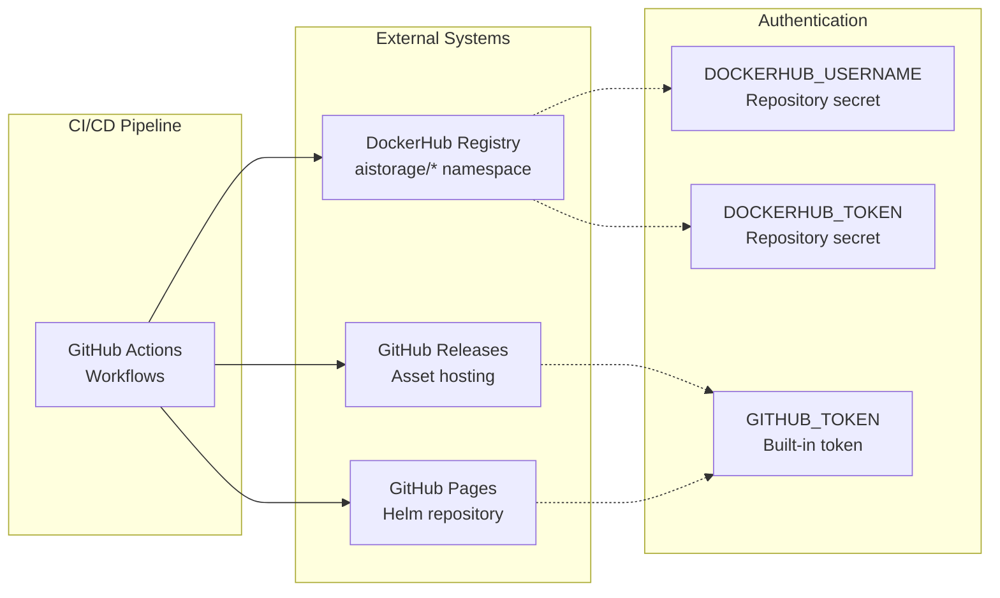

<!-- source: DeepWiki mcp.deepwiki.com · repo NVIDIA/ais-k8s · page 6.2 CI/CD Pipeline · fetched 2026-10-26 -->

# CI/CD Pipeline

Relevant source files

The following files were used as context for generating this wiki page:

- [.github/workflows/docker_ais_operator_helper.yml](.github/workflows/docker_ais_operator_helper.yml)
- [.github/workflows/docker_operator.yml](.github/workflows/docker_operator.yml)
- [.github/workflows/publish-pages.yml](.github/workflows/publish-pages.yml)
- [.github/workflows/publish-release.yml](.github/workflows/publish-release.yml)
- [.gitignore](.gitignore)
- [ais-operator-helper/Dockerfile](ais-operator-helper/Dockerfile)
- [ais-operator-helper/src/go.mod](ais-operator-helper/src/go.mod)
- [operator/Dockerfile](operator/Dockerfile)
- [pages/charts/ais-operator-1.4.1.tgz](pages/charts/ais-operator-1.4.1.tgz)

## Purpose and Scope

This document covers the Continuous Integration and Continuous Deployment (CI/CD) pipeline for the AIStore Kubernetes project. The CI/CD system automates the building, testing, and publishing of operator components, container images, and Helm charts. 

The pipeline focuses on the automated release and distribution aspects of the system. For information about the testing framework that validates these builds, see [Testing Framework](#6.1). For details on how the published artifacts are used in deployments, see [Deployment Methods](#4).

## Pipeline Architecture

The CI/CD system consists of four main GitHub Actions workflows that handle different aspects of the build and release process:

**Sources:** [.github/workflows/publish-release.yml:1-46](), [.github/workflows/docker_operator.yml:1-33](), [.github/workflows/docker_ais_operator_helper.yml:1-27](), [.github/workflows/publish-pages.yml:1-42]()

## Release Pipeline

The main release pipeline is triggered by Git tag pushes and orchestrates the complete build and publish process:

**Sources:** [.github/workflows/publish-release.yml:3-6](), [.github/workflows/publish-release.yml:8-11](), [.github/workflows/publish-release.yml:28-33](), [.github/workflows/publish-release.yml:35-39](), [.github/workflows/publish-release.yml:41-45]()

### Docker Image Build Process

The operator Docker image is built using a multi-stage process defined in the Dockerfile:

| Stage | Base Image | Purpose | Key Components |
|-------|------------|---------|----------------|
| Builder | `golang:1.24` | Compile Go binary | [`cmd/main.go`](), [`api/`](), [`pkg/`]() |
| Runtime | `gcr.io/distroless/static:nonroot` | Minimal runtime | Manager binary only |

The build incorporates version information through build-time variables:
- `BUILD_VERSION`: Set from Git tag via `${{ env.VERSION }}`
- `BUILD_TIME`: Automatically set during build
- Build flags: `-ldflags "-w -s -X 'main.build=${BUILD_VERSION}' -X 'main.buildtime=${BUILD_TIME}'"`

**Sources:** [operator/Dockerfile:1-36](), [.github/workflows/publish-release.yml:31]()

## On-Demand Workflows

### Operator Image Builder

The `docker_operator.yml` workflow allows manual building and publishing of operator images with custom tags:

**Sources:** [.github/workflows/docker_operator.yml:4-9](), [.github/workflows/docker_operator.yml:29-33]()

### Helper Image Builder

The `docker_ais_operator_helper.yml` workflow builds the operator helper image containing cleanup utilities:

**Sources:** [.github/workflows/docker_ais_operator_helper.yml:4-10](), [.github/workflows/docker_ais_operator_helper.yml:22-26](), [ais-operator-helper/Dockerfile:1-13](), [ais-operator-helper/src/go.mod:1-3]()

## GitHub Pages Publishing

The GitHub Pages workflow publishes Helm charts to create a public Helm repository:

**Sources:** [.github/workflows/publish-pages.yml:3-8](), [.github/workflows/publish-pages.yml:9-13](), [.github/workflows/publish-pages.yml:31-42](), [pages/charts/ais-operator-1.4.1.tgz:1]()

## Integration with Deployment Ecosystem

The CI/CD pipeline serves as the foundation for the entire deployment ecosystem by providing versioned, tested artifacts:

| Artifact Type | CI/CD Output | Deployment Usage |
|---------------|--------------|------------------|
| Operator Image | `aistorage/ais-operator:v*` | Pulled by Kubernetes during operator deployment |
| Helper Image | `aistorage/ais-operator-helper:*` | Used by cleanup jobs and operator helpers |
| Helm Charts | Published to GitHub Pages | Downloaded by `helm install` commands |
| Release Assets | `operator/dist/*` files | Used for manual kubectl deployments |

### External System Dependencies

The pipeline integrates with several external systems:

**Sources:** [.github/workflows/publish-release.yml:22-27](), [.github/workflows/docker_operator.yml:23-27](), [.github/workflows/publish-pages.yml:28-30]()

The published artifacts are then consumed by the various deployment methods documented in [Deployment Methods](#4), including Helm chart deployments ([Helm Chart Deployment](#4.1)), Ansible automation ([Ansible Playbook Deployment](#4.2)), and manual installations ([Manual Deployment](#4.3)).

---

