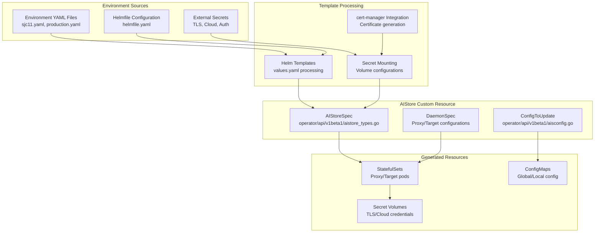
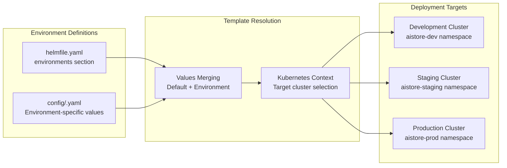
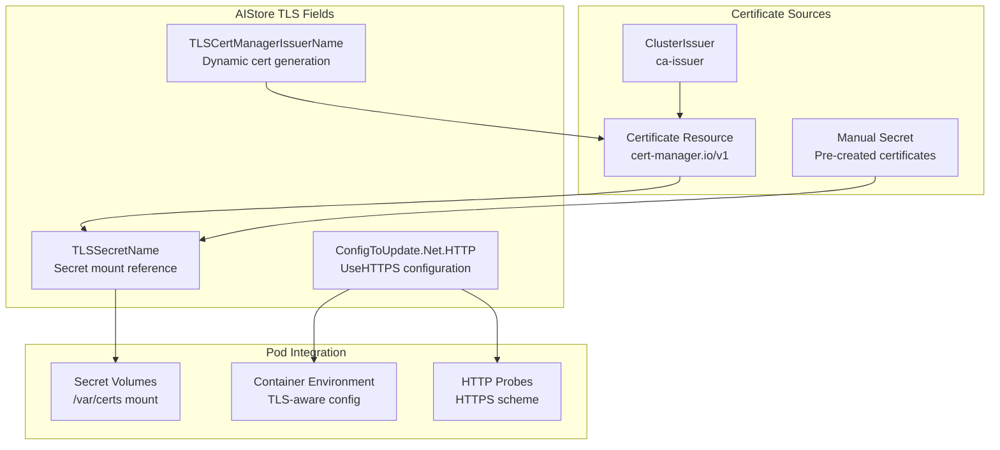
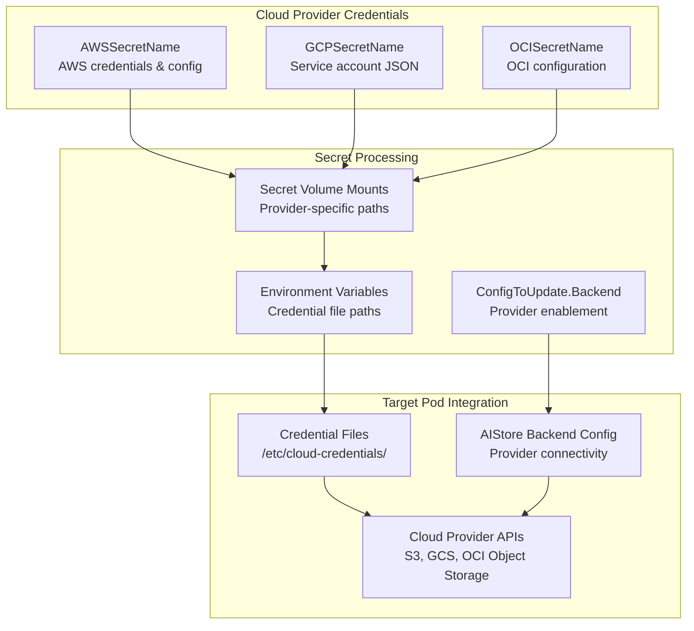

<!-- source: DeepWiki mcp.deepwiki.com · repo NVIDIA/ais-k8s · page 7 Advanced Configuration · fetched 2026-10-26 -->

# Advanced Configuration

<details>
<summary>Relevant source files</summary>

The following files were used as context for generating this wiki page:

- [docs/diagrams/certificates.jpg](docs/diagrams/certificates.jpg)
- [helm/README.md](helm/README.md)
- [helm/ais/README.md](helm/ais/README.md)
- [helm/ais/config/tls-cert/sjc11.yaml](helm/ais/config/tls-cert/sjc11.yaml)
- [helm/cluster-issuer/config/sjc11.yaml](helm/cluster-issuer/config/sjc11.yaml)
- [helm/cluster-issuer/config/values-sample.yaml](helm/cluster-issuer/config/values-sample.yaml)
- [helm/cluster-issuer/helmfile.yaml](helm/cluster-issuer/helmfile.yaml)
- [helm/cluster-issuer/issuer-chart/Chart.yaml](helm/cluster-issuer/issuer-chart/Chart.yaml)
- [helm/cluster-issuer/issuer-chart/templates/ca.yaml](helm/cluster-issuer/issuer-chart/templates/ca.yaml)
- [helm/operator/config/tls-cert/sjc11.yaml](helm/operator/config/tls-cert/sjc11.yaml)
- [operator/api/v1beta1/aisconfig.go](operator/api/v1beta1/aisconfig.go)
- [operator/api/v1beta1/aistore_types.go](operator/api/v1beta1/aistore_types.go)
- [operator/api/v1beta1/util_types.go](operator/api/v1beta1/util_types.go)
- [operator/api/v1beta1/zz_generated.deepcopy.go](operator/api/v1beta1/zz_generated.deepcopy.go)
- [operator/pkg/resources/cmn/configmap.go](operator/pkg/resources/cmn/configmap.go)
- [operator/pkg/resources/cmn/env.go](operator/pkg/resources/cmn/env.go)
- [operator/pkg/resources/cmn/res.go](operator/pkg/resources/cmn/res.go)
- [operator/pkg/resources/cmn/statefulset.go](operator/pkg/resources/cmn/statefulset.go)
- [operator/pkg/resources/cmn/statefulset_test.go](operator/pkg/resources/cmn/statefulset_test.go)
- [operator/pkg/resources/proxy/statefulset.go](operator/pkg/resources/proxy/statefulset.go)
- [operator/pkg/resources/target/statefulset.go](operator/pkg/resources/target/statefulset.go)

</details>


This page covers advanced deployment scenarios for AIStore Kubernetes clusters, including multi-environment setups, security configurations, and cloud backend integration. It focuses on production-ready configurations beyond basic deployment.

For basic deployment methods, see [Deployment Methods](#4). For operator architecture details, see [AIStore Kubernetes Operator](#3). For comprehensive configuration reference, see [Configuration Reference](#8.1).

## Configuration Architecture Overview

The advanced configuration system operates through multiple layers that work together to provide environment-specific, secure, and cloud-integrated AIStore deployments.

### Configuration Flow Diagram



Sources: [operator/api/v1beta1/aistore_types.go:87-192](), [operator/api/v1beta1/aisconfig.go:19-252](), [helm/ais/config/tls-cert/sjc11.yaml:1-33]()

### Core Configuration Components

The advanced configuration system is built around several key components:

| Component | Code Entity | Purpose |
|-----------|-------------|---------|
| **Environment Config** | `helmfile.yaml` environments | Environment-specific value overrides |
| **AIStore Spec** | `AIStoreSpec` struct | Declarative cluster configuration |
| **Config Updates** | `ConfigToUpdate` struct | Runtime AIStore configuration |
| **Secret Management** | `*SecretName` fields | Secure credential injection |
| **TLS Integration** | `TLSSecretName`, `TLSCertManagerIssuerName` | Certificate management |

Sources: [operator/api/v1beta1/aistore_types.go:88-192](), [helm/ais/helmfile.yaml]()

## Multi-Environment Configuration

Multi-environment deployment enables consistent AIStore clusters across development, staging, and production environments with environment-specific customizations.

### Environment Structure



The environment configuration pattern uses Helmfile to manage multiple environments with shared base configurations and environment-specific overrides:

```yaml
# helmfile.yaml structure
environments:
  development:
    kubeContext: dev-cluster
  staging:
    kubeContext: staging-cluster
  production:
    kubeContext: prod-cluster
```

Sources: [helm/cluster-issuer/helmfile.yaml:1-10](), [helm/ais/config/tls-cert/sjc11.yaml:1-33]()

### Environment-Specific AIStore Configuration

Each environment can customize AIStore cluster parameters through the `AIStoreSpec` fields:

| Configuration Area | AIStoreSpec Fields | Environment Use Cases |
|-------------------|-------------------|---------------------|
| **Cluster Sizing** | `Size`, `ProxySpec.Size`, `TargetSpec.Size` | Dev: Small, Prod: Large |
| **Storage Classes** | `StateStorageClass`, `Mount.StorageClass` | Dev: local-path, Prod: high-performance |
| **Resource Limits** | `DaemonSpec.Resources` | Environment-appropriate sizing |
| **Network Configuration** | `EnableExternalLB`, `NetAttachment` | Production external access |
| **Security Settings** | `TLSSecretName`, `AuthNSecretName` | Production security requirements |

The operator reconciles these specifications into environment-appropriate Kubernetes resources through the reconciliation loop in the controller.

Sources: [operator/api/v1beta1/aistore_types.go:87-192](), [operator/pkg/resources/proxy/statefulset.go:57-86](), [operator/pkg/resources/target/statefulset.go:53-82]()

## TLS and Security Configuration

TLS configuration provides end-to-end encryption for AIStore clusters using cert-manager integration and Kubernetes secret management.

### TLS Configuration Flow



### Certificate Management Integration

The operator integrates with cert-manager through two mechanisms:

1. **Automatic Certificate Generation**: Using `TLSCertManagerIssuerName` field
2. **Pre-existing Secrets**: Using `TLSSecretName` field

The TLS configuration affects multiple operator components:

- **Probe Configuration**: The `newHTTPProbeHandle` function in [operator/pkg/resources/cmn/res.go:35-58]() automatically switches to HTTPS scheme when `UseHTTPS` is enabled
- **Volume Mounts**: TLS secrets are mounted as volumes in both proxy and target pods
- **AIStore Configuration**: The `UseHTTPS` configuration propagates to AIStore's internal configuration

```go
// TLS detection logic
func (ais *AIStore) UseHTTPS() bool {
    return ais.Spec.ConfigToUpdate != nil && 
           ais.Spec.ConfigToUpdate.Net != nil && 
           ais.Spec.ConfigToUpdate.Net.HTTP != nil && 
           ais.Spec.ConfigToUpdate.Net.HTTP.UseHTTPS != nil && 
           *ais.Spec.ConfigToUpdate.Net.HTTP.UseHTTPS
}
```

Sources: [operator/api/v1beta1/aistore_types.go:469-471](), [operator/pkg/resources/cmn/res.go:35-58](), [helm/ais/config/tls-cert/sjc11.yaml:1-33]()

### Authentication and Authorization

AIStore supports JWT-based authentication through the `AuthNSecretName` configuration:

| Security Component | Configuration Field | Implementation |
|-------------------|-------------------|----------------|
| **JWT Signing Key** | `AuthNSecretName` | Kubernetes secret with signing key |
| **Authentication Enable** | `ConfigToUpdate.Auth.Enabled` | Runtime auth configuration |
| **Secret Injection** | Environment variable `SIGNING-KEY` | Container environment |

The authentication configuration is processed in the container environment setup:

```go
// Authentication secret injection
if ais.Spec.AuthNSecretName != nil {
    baseEnv = append(baseEnv, cmn.EnvFromSecret(
        aisenv.AisAuthSecretKey, 
        *ais.Spec.AuthNSecretName, 
        cmn.EnvAuthNSecretKey
    ))
}
```

Sources: [operator/api/v1beta1/aistore_types.go:174-183](), [operator/pkg/resources/proxy/statefulset.go:153-155](), [operator/pkg/resources/cmn/env.go:28]()

## Cloud Backend Integration

Cloud backend integration enables AIStore clusters to use cloud storage providers as backend storage through credential management and configuration.

### Cloud Provider Support Matrix



### Cloud Credential Configuration

Each cloud provider requires specific credential configuration patterns:

| Provider | Secret Field | Environment Variable | Mount Path |
|----------|--------------|---------------------|------------|
| **AWS** | `AWSSecretName` | `AWS_CONFIG_FILE`, `AWS_SHARED_CREDENTIALS_FILE` | `/etc/aws/` |
| **GCP** | `GCPSecretName` | `GOOGLE_APPLICATION_CREDENTIALS` | `/etc/gcp/gcp.json` |
| **OCI** | `OCISecretName` | `OCI_CLI_CONFIG_FILE` | `/etc/oci/config` |

The cloud credential injection is handled in the target container environment setup:

```go
// GCP credential injection
if ais.Spec.GCPSecretName != nil {
    baseEnv = append(baseEnv, cmn.EnvFromValue(
        cmn.EnvGoogleCreds, 
        filepath.Join(cmn.GCPDir, "gcp.json")
    ))
}

// OCI credential injection  
if ais.Spec.OCISecretName != nil {
    baseEnv = append(baseEnv, cmn.EnvFromValue(
        cmn.EnvOCIConfig, 
        filepath.Join(cmn.OCIDir, "config")
    ))
}
```

Sources: [operator/api/v1beta1/aistore_types.go:153-163](), [operator/pkg/resources/target/statefulset.go:151-158](), [operator/pkg/resources/cmn/env.go:32-33]()

### Backend Provider Configuration

Cloud backend integration is enabled through the `ConfigToUpdate.Backend` field, which accepts a map of provider names to enable:

```go
type ConfigToUpdate struct {
    Backend *map[string]Empty `json:"backend,omitempty"`
    // ... other fields
}
```

The backend configuration allows AIStore to:

- **Detect Available Providers**: Based on mounted credentials
- **Enable Provider-Specific Features**: Storage class mapping, tiering policies
- **Configure Access Patterns**: Read-through, write-through, or cache-only modes

The operator determines backend availability through the `HasCloudBackend()` method:

```go
func (ais *AIStore) HasCloudBackend() bool {
    return ais.Spec.AWSSecretName != nil || 
           ais.Spec.GCPSecretName != nil || 
           ais.Spec.OCISecretName != nil
}
```

Sources: [operator/api/v1beta1/aisconfig.go:19-21](), [operator/api/v1beta1/aistore_types.go:465-467]()

## Advanced Runtime Configuration

Beyond basic deployment, AIStore clusters support extensive runtime configuration through the `ConfigToUpdate` structure, enabling fine-tuning of performance, behavior, and feature settings.

### Configuration Categories

The `ConfigToUpdate` structure provides configuration across multiple operational areas:

| Category | Configuration Struct | Key Settings |
|----------|---------------------|--------------|
| **Storage Management** | `LRUConfToUpdate`, `SpaceConfToUpdate` | Eviction policies, space watermarks |
| **Network & HTTP** | `NetConfToUpdate`, `HTTPConfToUpdate` | Connection limits, timeouts, TLS |
| **Replication & EC** | `MirrorConfToUpdate`, `ECConfToUpdate` | Mirror copies, erasure coding |
| **Performance** | `TransportConfToUpdate`, `MemsysConfToUpdate` | Buffer sizes, memory management |
| **Monitoring** | `LogConfToUpdate`, `TracingConfToUpdate` | Log levels, distributed tracing |

### Runtime Configuration Application

Configuration updates are applied through the operator's reconciliation process:

1. **Configuration Validation**: The `ConfigToUpdate.Convert()` method validates and transforms configurations
2. **ConfigMap Generation**: Updated configurations are rendered into Kubernetes ConfigMaps
3. **Pod Restart Coordination**: Configuration changes trigger controlled pod restarts via annotation hashing

```go
// Configuration conversion for runtime application
func (c *ConfigToUpdate) Convert() (*aiscmn.ConfigToSet, error) {
    toUpdate := &aiscmn.ConfigToSet{}
    err := cos.MorphMarshal(c, toUpdate)
    return toUpdate, err
}
```

Sources: [operator/api/v1beta1/aisconfig.go:275-279](), [operator/pkg/resources/cmn/configmap.go:18-45]()

---

