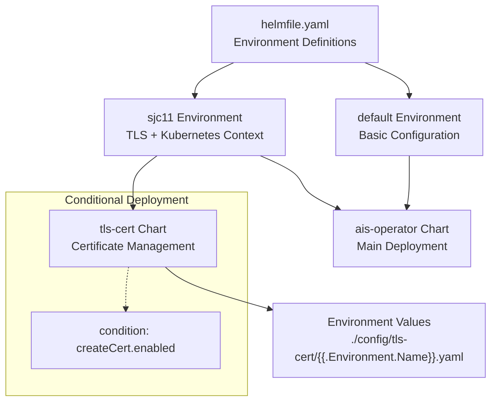
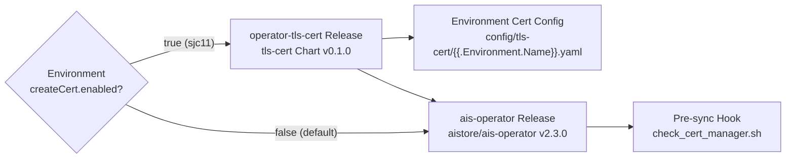
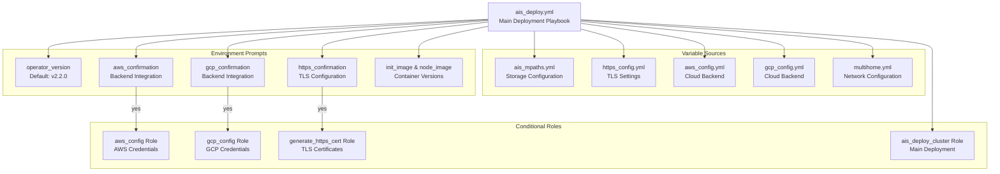
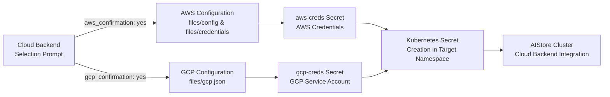
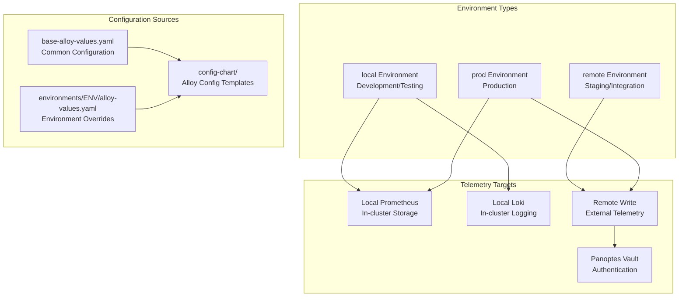
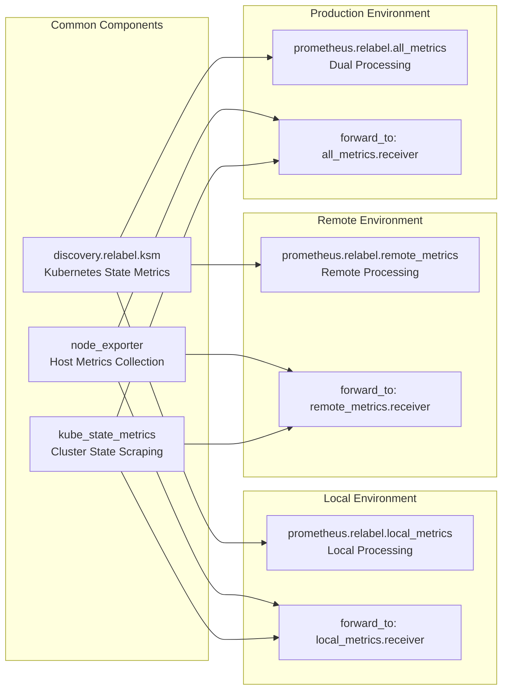
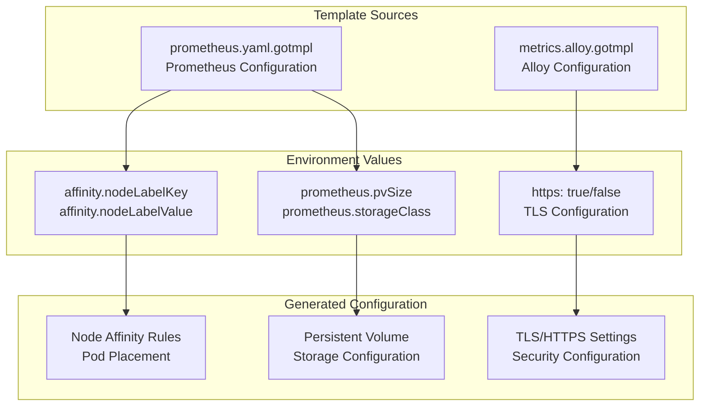
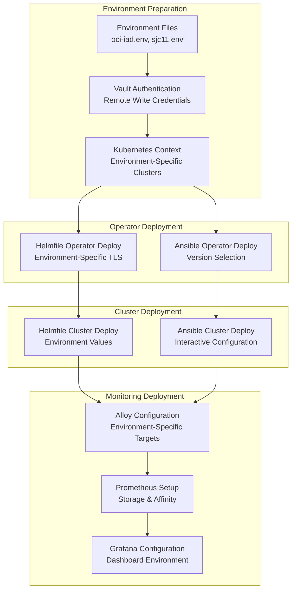

<!-- source: DeepWiki mcp.deepwiki.com · repo NVIDIA/ais-k8s · page 7.1 Multi-Environment Deployment · fetched 2026-10-26 -->

# Multi-Environment Deployment

Relevant source files

The following files were used as context for generating this wiki page:

- [helm/operator/helmfile.yaml](helm/operator/helmfile.yaml)
- [monitoring/alloy/README.md](monitoring/alloy/README.md)
- [monitoring/alloy/config-chart/environments/local/metrics.alloy.gotmpl](monitoring/alloy/config-chart/environments/local/metrics.alloy.gotmpl)
- [monitoring/alloy/config-chart/environments/prod/metrics.alloy.gotmpl](monitoring/alloy/config-chart/environments/prod/metrics.alloy.gotmpl)
- [monitoring/alloy/config-chart/environments/remote/metrics.alloy.gotmpl](monitoring/alloy/config-chart/environments/remote/metrics.alloy.gotmpl)
- [monitoring/kube-prom/values/prometheus.yaml.gotmpl](monitoring/kube-prom/values/prometheus.yaml.gotmpl)
- [playbooks/ais-deployment/roles/ais_deploy_operator/defaults/main.yml](playbooks/ais-deployment/roles/ais_deploy_operator/defaults/main.yml)
- [playbooks/ais-deployment/roles/ais_undeploy_operator/files/undeploy-operator.sh](playbooks/ais-deployment/roles/ais_undeploy_operator/files/undeploy-operator.sh)
- [playbooks/ais-deployment/roles/install_rancher_lpp/defaults/main.yaml](playbooks/ais-deployment/roles/install_rancher_lpp/defaults/main.yaml)
- [playbooks/ais-deployment/roles/install_rancher_lpp/tasks/main.yaml](playbooks/ais-deployment/roles/install_rancher_lpp/tasks/main.yaml)
- [playbooks/ais_deploy.yml](playbooks/ais_deploy.yml)

## Purpose and Scope

This document covers deploying AIStore clusters across multiple environments (development, staging, production) with environment-specific configurations. Multi-environment deployment enables different settings, resource allocations, monitoring configurations, and integration patterns based on the target environment.

For basic deployment methods, see [Deployment Methods](#4). For security-specific configurations across environments, see [TLS and Security](#7.2).

## Environment Configuration Patterns

AIStore Kubernetes deployments support several patterns for managing multiple environments:

- **Helmfile environments** - Declarative environment definitions with specific values
- **Ansible variable overrides** - Environment-specific variable files and prompts  
- **Monitoring environment configs** - Different telemetry pipelines per environment
- **Template-based configuration** - Go templates with environment-specific value injection

### Environment Types

The codebase defines several standard environment types:

| Environment | Purpose | Configuration Pattern |
|-------------|---------|----------------------|
| `default` | Basic deployment without additional features | Minimal configuration |
| `sjc11` | Production environment with TLS | Full security configuration |
| `local` | Development/testing | Local Prometheus/Loki targets |
| `remote` | Staging/integration | Remote telemetry endpoints |
| `prod` | Production monitoring | Dual local/remote telemetry |

Sources: [helm/operator/helmfile.yaml:1-36](), [monitoring/alloy/README.md:17-19]()

## Helmfile Environment Management

### Environment Definition Structure

Helmfile provides the primary mechanism for environment-specific deployments:

**Environment-Specific Configuration Flow**

The Helmfile configuration uses conditional deployment based on environment values:

- **Default environment**: Deploys only the operator without TLS certificates
- **sjc11 environment**: Enables TLS certificate creation and uses specific Kubernetes context
- **Environment-specific values**: Loaded from `./config/tls-cert/{{ .Environment.Name }}.yaml`

Sources: [helm/operator/helmfile.yaml:1-36]()

### TLS Certificate Management

**TLS Certificate Deployment Pattern**

Environment-specific TLS certificate deployment follows this pattern:
1. Environment determines if `createCert.enabled` is true
2. Conditional deployment of `tls-cert` chart in `ais-operator-system` namespace
3. Environment-specific certificate configuration loaded from template path
4. Pre-sync hook validates cert-manager availability

Sources: [helm/operator/helmfile.yaml:17-36]()

## Ansible Multi-Environment Support

### Environment Variable Integration

The Ansible deployment system supports environment-specific configurations through variable files and interactive prompts:

**Environment-Specific Deployment Roles**

The Ansible system implements environment-specific configuration through conditional role execution:

- **Cloud Backend Integration**: AWS and GCP roles execute based on user confirmation
- **TLS Configuration**: HTTPS role activates when TLS is required
- **Namespace Management**: Dynamic namespace creation based on cluster variable
- **Version Management**: Interactive prompts for operator and image versions

Sources: [playbooks/ais_deploy.yml:1-133]()

### Cloud Backend Environment Configuration

**Cloud Backend Environment Pattern**

Environment-specific cloud backend configuration follows this workflow:
1. Interactive prompt determines cloud provider
2. Credential files must exist in role-specific `files/` directories
3. Kubernetes secrets created in target cluster namespace
4. AIStore cluster configured with appropriate backend credentials

Sources: [playbooks/ais_deploy.yml:39-84]()

## Monitoring Environment Configuration

### Alloy Multi-Environment Architecture

The monitoring stack implements sophisticated environment-specific configurations using Alloy (OpenTelemetry Collector):

**Environment-Specific Telemetry Patterns**

Each environment implements different telemetry strategies:
- **Local**: Writes only to in-cluster Prometheus and Loki instances
- **Remote**: Writes only to environment-configured remote endpoints  
- **Production**: Writes to both local and remote targets for redundancy

Sources: [monitoring/alloy/README.md:17-19]()

### Environment-Specific Alloy Configuration

**Environment-Specific Metric Forwarding**

The Alloy configuration implements environment-specific metric processing:
- **Local**: Routes to `local_metrics.receiver` for in-cluster storage
- **Remote**: Routes to `remote_metrics.receiver` for external telemetry
- **Production**: Routes to `all_metrics.receiver` for dual destination

Sources: [monitoring/alloy/config-chart/environments/local/metrics.alloy.gotmpl:1-18](), [monitoring/alloy/config-chart/environments/remote/metrics.alloy.gotmpl:1-18](), [monitoring/alloy/config-chart/environments/prod/metrics.alloy.gotmpl:1-18]()

## Environment-Specific Values and Overrides

### Template-Based Configuration

Environment-specific values are applied through Go template processing:

**Template Processing Pattern**

Environment-specific configuration uses conditional template processing:
- **Affinity Configuration**: Node placement rules based on label key/value pairs
- **Storage Configuration**: PV size and storage class per environment
- **HTTPS Configuration**: TLS settings enabled via environment flags

Sources: [monitoring/kube-prom/values/prometheus.yaml.gotmpl:6-17](), [monitoring/alloy/README.md:37]()

### Environment Variable Integration

Environment-specific deployment commands demonstrate variable integration patterns:

| Command Pattern | Environment | Configuration Source |
|----------------|-------------|---------------------|
| `set -a; . ../oci-iad.env ; set +a; helmfile -e prod template` | Production | External environment file |
| `helmfile -e prod --set https=true sync` | Production with HTTPS | Command-line override |
| `ansible-playbook -e cluster=ais` | Ansible deployment | Runtime variable |

**Environment Variable Loading**

The deployment system supports multiple variable loading mechanisms:
- **Shell environment files**: Loaded with `set -a; . file.env; set +a` pattern
- **Helmfile overrides**: Command-line `--set` parameters  
- **Ansible runtime variables**: `-e` parameter for dynamic values

Sources: [monitoring/alloy/README.md:29-37]()

## Deployment Workflow for Multiple Environments

### Complete Multi-Environment Setup

**Multi-Environment Deployment Sequence**

The complete multi-environment deployment follows this sequence:
1. **Environment Preparation**: Load environment variables and configure authentication
2. **Operator Deployment**: Deploy environment-specific operator configuration
3. **Cluster Deployment**: Deploy AIStore cluster with environment-appropriate settings
4. **Monitoring Setup**: Configure telemetry pipeline for environment-specific targets

Sources: [helm/operator/helmfile.yaml:1-36](), [playbooks/ais_deploy.yml:1-133](), [monitoring/alloy/README.md:21-37]()

---

