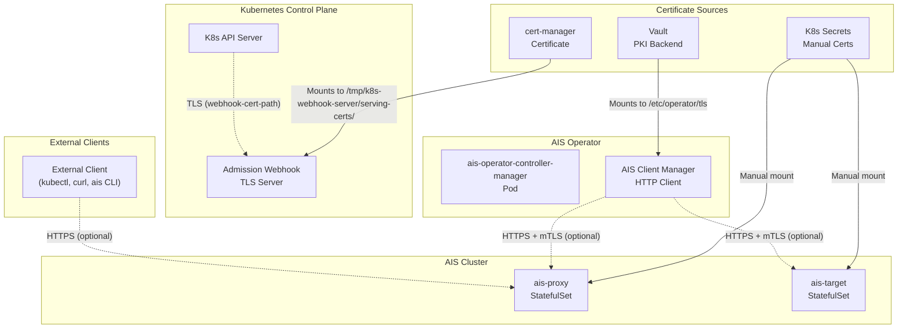
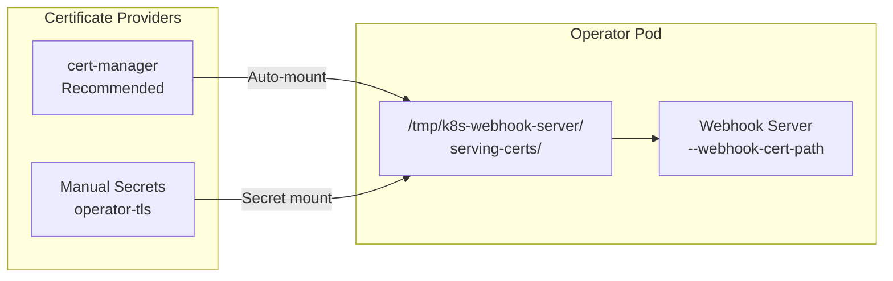
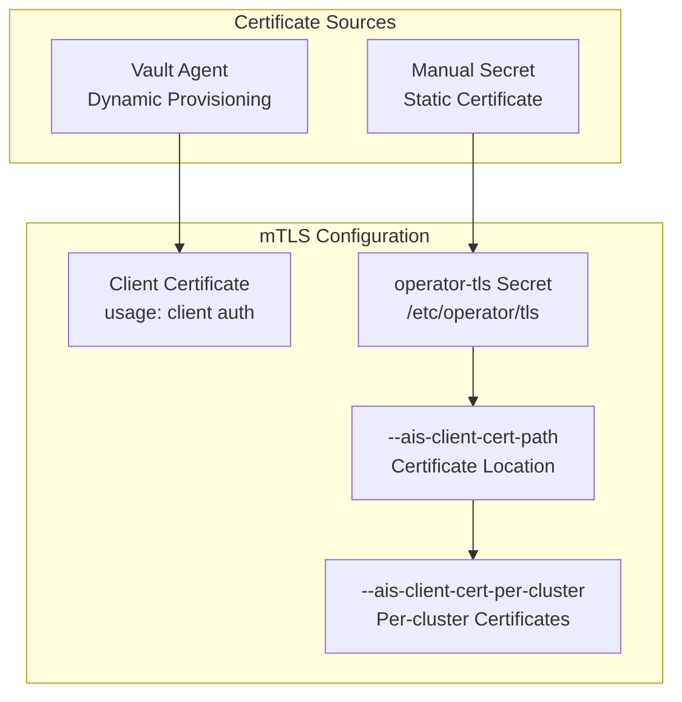
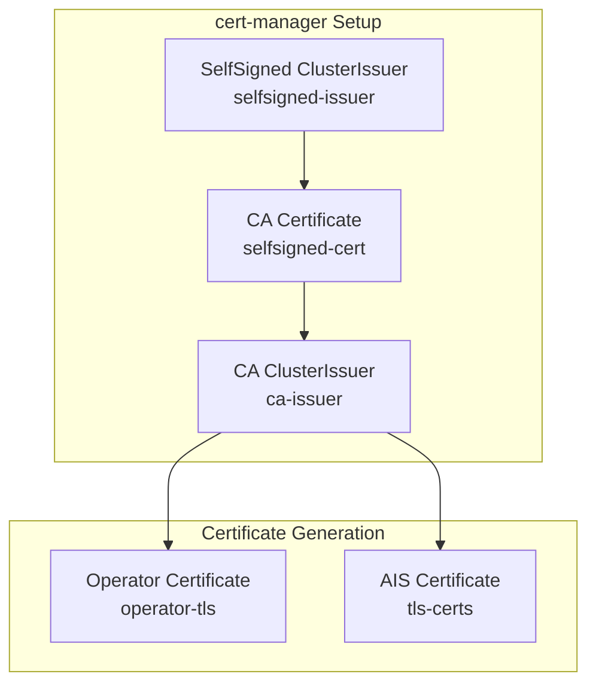

<!-- source: DeepWiki mcp.deepwiki.com · repo NVIDIA/ais-k8s · page 7.2 TLS and Security · fetched 2026-10-26 -->

# TLS and Security

<details>
<summary>Relevant source files</summary>

The following files were used as context for generating this wiki page:

- [docs/diagrams/certificates.jpg](docs/diagrams/certificates.jpg)
- [helm/README.md](helm/README.md)
- [helm/ais/README.md](helm/ais/README.md)
- [helm/ais/config/tls-cert/sjc11.yaml](helm/ais/config/tls-cert/sjc11.yaml)
- [helm/cluster-issuer/config/sjc11.yaml](helm/cluster-issuer/config/sjc11.yaml)
- [helm/cluster-issuer/config/values-sample.yaml](helm/cluster-issuer/config/values-sample.yaml)
- [helm/cluster-issuer/helmfile.yaml](helm/cluster-issuer/helmfile.yaml)
- [helm/cluster-issuer/issuer-chart/Chart.yaml](helm/cluster-issuer/issuer-chart/Chart.yaml)
- [helm/cluster-issuer/issuer-chart/templates/ca.yaml](helm/cluster-issuer/issuer-chart/templates/ca.yaml)
- [helm/operator/config/tls-cert/sjc11.yaml](helm/operator/config/tls-cert/sjc11.yaml)
- [operator/README.md](operator/README.md)
- [operator/config/samples/ais_v1beta1_aistore.yaml](operator/config/samples/ais_v1beta1_aistore.yaml)
- [operator/config/samples/ais_v1beta1_aistore_tls_certmanager_csi.yaml](operator/config/samples/ais_v1beta1_aistore_tls_certmanager_csi.yaml)
- [operator/config/samples/ais_v1beta1_aistore_tracing.yaml](operator/config/samples/ais_v1beta1_aistore_tracing.yaml)

</details>


## Purpose and Scope

This document covers Transport Layer Security (TLS) configuration and security best practices for AIStore Kubernetes deployments. It explains how to secure communications between the AIS operator, AIS clusters, and external clients through proper certificate management and HTTPS configuration.

For information about cloud backend authentication, see [Cloud Backend Integration](#7.3). For general deployment configuration, see [Advanced Configuration](#7).

## TLS Architecture Overview

The AIStore Kubernetes system implements TLS security at multiple layers:



**TLS Components:**
- **Admission Webhook**: Validates AIStore custom resources using TLS
- **Operator Client**: Communicates with AIS clusters over HTTPS with optional mTLS
- **AIS Cluster**: Serves HTTPS endpoints with configurable certificate verification

Sources: [operator/README.md:22-54](), [docs/diagrams/certificates.jpg]()

## Admission Webhook Security

The AIS operator employs admission webhooks to validate AIStore custom resources. These webhooks require TLS certificates to secure communication with the Kubernetes API server.

### Certificate Provisioning

The operator loads webhook certificates from the `webhook-cert-path` argument, which defaults to `/tmp/k8s-webhook-server/serving-certs/`:



**Deployment Options:**

| Method | Configuration | Use Case |
|--------|---------------|----------|
| cert-manager | Automatic certificate provisioning | Production deployments |
| Manual secrets | `operator-tls` secret in operator namespace | Development/testing |
| Quick deploy | `make deploy` with basic cert-manager | Initial setup |

Sources: [operator/README.md:24-30](), [helm/operator/config/tls-cert/sjc11.yaml:1-25]()

## Operator-to-AIS Communication Security

The operator communicates with deployed AIS clusters through the AIS API. This communication can be secured with HTTPS and mutual TLS (mTLS).

### Certificate Verification Configuration

By default, the operator skips certificate verification when communicating with HTTPS-enabled AIS clusters. This can be controlled via environment variables:

```yaml
# config/default/manager_env_patch.yaml
env:
- name: OPERATOR_SKIP_VERIFY_CRT
  value: "False"  # Enable certificate verification
```

### Trusted CA Configuration

For AIS clusters using untrusted or self-signed certificates, create a ConfigMap to establish trust:

```yaml
apiVersion: v1
kind: ConfigMap
metadata:
  name: ais-operator-ais-ca
  namespace: ais-operator-system
data:
  ca.crt: |
    -----BEGIN CERTIFICATE-----
    # Your CA certificate content
    -----END CERTIFICATE-----
```

The operator automatically mounts this ConfigMap to `/etc/ais/ca` and trusts any `.crt` or `.pem` files found there.

### Mutual TLS (mTLS) Configuration

For enhanced security, the operator supports client certificate authentication:



**Per-cluster Certificate Support:**
- When `ais-client-cert-per-cluster` is enabled, the operator appends namespace and cluster name to the certificate path
- Example: `/etc/operator/tls/aisNamespace/aisCluster`

Sources: [operator/README.md:31-53](), [operator/config/default/manager_env_patch.yaml:35]()

## AIS Cluster HTTPS Configuration

AIS clusters can be deployed with HTTPS enabled through the `configToUpdate.net.http` configuration section:

### Basic HTTPS Configuration

```yaml
apiVersion: ais.nvidia.com/v1beta1
kind: AIStore
metadata:
  name: aistore-sample
spec:
  configToUpdate:
    net:
      http:
        server_crt: "/var/certs/tls.crt"
        server_key: "/var/certs/tls.key"
        use_https: true
        skip_verify: true  # For self-signed certificates
        client_ca_tls: "/var/certs/ca.crt"
        client_auth_tls: 0  # Client authentication level
```

### Certificate Mounting Options

**Secret Mount:**
```yaml
spec:
  tlsSecretName: "tls-certs"  # Mounts to /var/certs
```

**cert-manager CSI Driver:**
```yaml
spec:
  tlsCertManagerIssuerName: "ais"  # References cert-manager Issuer
```

### Certificate Requirements

For proper operation, certificates must include appropriate Subject Alternative Names (SANs):

```yaml
# helm/ais/config/tls-cert/sjc11.yaml
certificate:
  dnsNames:
    - "localhost"                              # Readiness/liveness checks
    - "ais-proxy"                             # Target registration
    - "ais-target"                            # Target registration  
    - "*.ais-proxy.ais.svc.cluster.local"    # Intra-cluster communication
    - "*.ais-target.ais.svc.cluster.local"   # Intra-cluster communication
    - "ais-proxy.ais"                        # Operator communication
```

Sources: [operator/README.md:239-301](), [operator/config/samples/ais_v1beta1_aistore_tls_certmanager_csi.yaml:70-84](), [helm/ais/config/tls-cert/sjc11.yaml:11-21]()

## Certificate Management Options

The system supports multiple certificate management approaches:

### cert-manager Integration

**Self-signed Cluster Issuer:**


**Vault Integration:**
```yaml
# operator/config/samples/ais_v1beta1_aistore_tls_certmanager_csi.yaml
apiVersion: cert-manager.io/v1
kind: Issuer
metadata:
  name: ais
spec:
  vault:
    path: signing/path/ais
    server: https://vaultaddress
    auth:
      kubernetes:
        role: ais
        mountPath: /v1/auth/path
```

### Helm Chart Certificate Generation

The Helm charts provide automated certificate generation:

```yaml
# helm/ais/README.md configuration
protocol: https
https:
  skipVerifyCert: false
  tlsSecret: "tls-certs"
```

**Chart Components:**

| Chart | Purpose | Configuration |
|-------|---------|---------------|
| `cluster-issuer` | Sets up self-signed ClusterIssuer | [cluster-issuer/config/]() |
| `tls-cert` | Generates certificates from Issuer | [ais/charts/tls-cert/]() |
| `ais-cluster` | Deploys AIS with certificate mounts | [ais/charts/ais-cluster/]() |

Sources: [helm/cluster-issuer/issuer-chart/templates/ca.yaml:1-38](), [helm/ais/README.md:16-25](), [operator/config/samples/ais_v1beta1_aistore_tls_certmanager_csi.yaml:27-42]()

## Security Best Practices

### Certificate Verification

**Production Deployments:**
- Always set `OPERATOR_SKIP_VERIFY_CRT=False`
- Use trusted CA certificates or properly configured CA trust
- Implement certificate rotation policies

**Development/Testing:**
- `skip_verify: true` is acceptable for self-signed certificates
- Use cert-manager for consistent certificate management
- Implement proper SAN configuration for all communication paths

### Client Authentication

**CLI Configuration:**
```bash
# Skip certificate verification for testing
ais config cli set cluster.skip_verify_crt true

# Use exported certificate
kubectl get secret tls-certs -n ais-operator-system \
  -o jsonpath='{.data.tls\.crt}' | base64 --decode > tls.crt
curl --cacert tls.crt https://your-ais-cluster-url
```

**mTLS Implementation:**
- Use client certificates with `usage: client auth`
- Implement per-cluster certificate isolation when required
- Configure appropriate `client_auth_tls` levels based on security requirements

### Secret Management

**Kubernetes Secrets:**
- Use proper RBAC to restrict secret access
- Implement secret rotation where possible
- Separate operator and AIS cluster certificates

**External Secret Management:**
- Integrate with Vault or similar systems for dynamic certificate provisioning
- Use service account token authentication for cert-manager Vault integration
- Implement proper secret lifecycle management

Sources: [operator/README.md:279-301](), [operator/README.md:42-51]()

## Configuration Mapping

The following table maps high-level TLS concepts to specific configuration entities:

| Security Component | Configuration Location | Code Entity | Default Value |
|-------------------|----------------------|-------------|---------------|
| Webhook TLS | `--webhook-cert-path` | `webhook-cert-path` arg | `/tmp/k8s-webhook-server/serving-certs/` |
| Operator CA Trust | ConfigMap | `ais-operator-ais-ca` | `/etc/ais/ca` |
| Operator Client Cert | `--ais-client-cert-path` | `ais-client-cert-path` arg | `/etc/operator/tls` |
| AIS HTTPS Config | `configToUpdate.net.http` | `AIStoreSpec.ConfigToUpdate` | HTTP enabled |
| AIS Certificate Mount | `tlsSecretName` | `AIStoreSpec.TLSSecretName` | `/var/certs` |
| Certificate Verification | `OPERATOR_SKIP_VERIFY_CRT` | Environment variable | `True` (skip) |

Sources: [operator/README.md:26](), [operator/README.md:37-38](), [operator/README.md:48](), [operator/config/samples/ais_v1beta1_aistore_tls_certmanager_csi.yaml:72-78]()

---

