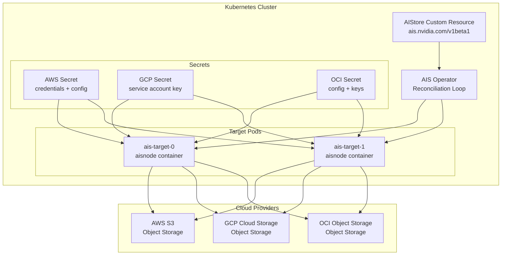
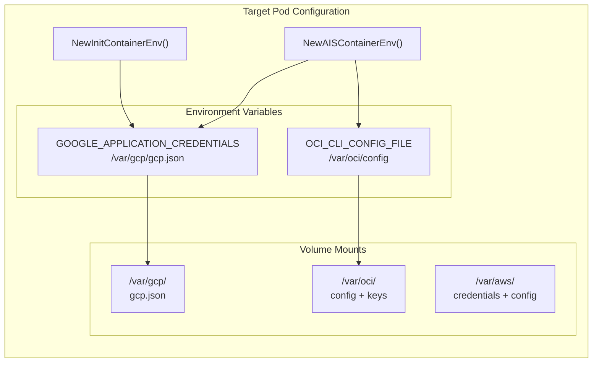
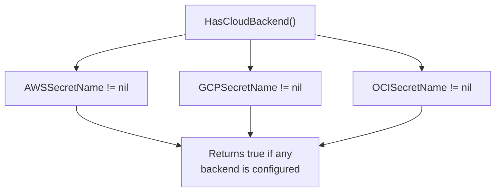

<!-- source: DeepWiki mcp.deepwiki.com · repo NVIDIA/ais-k8s · page 7.3 Cloud Backend Integration · fetched 2026-10-26 -->

# Cloud Backend Integration

<details>
<summary>Relevant source files</summary>

The following files were used as context for generating this wiki page:

- [docs/multiple_targets_per_node.md](docs/multiple_targets_per_node.md)
- [docs/samples/sample-multi-target-deployment.yml](docs/samples/sample-multi-target-deployment.yml)
- [docs/samples/sample-pv.yaml](docs/samples/sample-pv.yaml)
- [operator/api/v1beta1/aisconfig.go](operator/api/v1beta1/aisconfig.go)
- [operator/api/v1beta1/aistore_types.go](operator/api/v1beta1/aistore_types.go)
- [operator/api/v1beta1/util_types.go](operator/api/v1beta1/util_types.go)
- [operator/api/v1beta1/zz_generated.deepcopy.go](operator/api/v1beta1/zz_generated.deepcopy.go)
- [operator/pkg/resources/cmn/configmap.go](operator/pkg/resources/cmn/configmap.go)
- [operator/pkg/resources/cmn/env.go](operator/pkg/resources/cmn/env.go)
- [operator/pkg/resources/cmn/res.go](operator/pkg/resources/cmn/res.go)
- [operator/pkg/resources/cmn/statefulset.go](operator/pkg/resources/cmn/statefulset.go)
- [operator/pkg/resources/cmn/statefulset_test.go](operator/pkg/resources/cmn/statefulset_test.go)
- [operator/pkg/resources/proxy/statefulset.go](operator/pkg/resources/proxy/statefulset.go)
- [operator/pkg/resources/target/statefulset.go](operator/pkg/resources/target/statefulset.go)
- [playbooks/ais-deployment/roles/ais_deploy_cluster/defaults/main.yml](playbooks/ais-deployment/roles/ais_deploy_cluster/defaults/main.yml)
- [playbooks/ais-deployment/roles/ais_deploy_cluster/templates/ais.yaml.j2](playbooks/ais-deployment/roles/ais_deploy_cluster/templates/ais.yaml.j2)

</details>


This document covers the configuration and integration of AIStore with external cloud storage backends, including AWS S3, Google Cloud Platform (GCP), and Oracle Cloud Infrastructure (OCI). It explains how to configure credentials, mount secrets, and enable AIStore target nodes to access cloud storage services.

For information about multi-environment deployment configurations, see [Multi-Environment Deployment](#7.1). For TLS and security configuration, see [TLS and Security](#7.2).

## Overview

AIStore supports seamless integration with major cloud storage providers as backend storage systems. This enables AIStore to act as a high-performance caching and acceleration layer in front of cloud object storage, while maintaining the ability to tier data to and from cloud backends.

## Cloud Backend Architecture



Sources: [operator/api/v1beta1/aistore_types.go:153-163](), [operator/pkg/resources/target/statefulset.go:151-158]()

## Supported Cloud Providers

The AIStore operator supports three major cloud storage backends:

| Provider | Secret Field | Environment Variable | Configuration File Location |
|----------|-------------|---------------------|---------------------------|
| AWS S3 | `awsSecretName` | `AWS_PROFILE`, `AWS_CONFIG_FILE` | `/var/aws/` |
| Google Cloud | `gcpSecretName` | `GOOGLE_APPLICATION_CREDENTIALS` | `/var/gcp/gcp.json` |
| Oracle Cloud | `ociSecretName` | `OCI_CLI_CONFIG_FILE` | `/var/oci/config` |

Sources: [operator/api/v1beta1/aistore_types.go:155-163](), [operator/pkg/resources/cmn/env.go:31-34]()

## Configuration Process

### AIStore Custom Resource Configuration

Cloud backend integration is configured through the AIStore Custom Resource by specifying secret names for each provider:

```yaml
apiVersion: ais.nvidia.com/v1beta1
kind: AIStore
metadata:
  name: ais
  namespace: ais
spec:
  # AWS S3 integration
  awsSecretName: "aws-credentials"
  
  # Google Cloud Storage integration
  gcpSecretName: "gcp-service-account"
  
  # Oracle Cloud Infrastructure integration
  ociSecretName: "oci-credentials"
```

Sources: [operator/api/v1beta1/aistore_types.go:155-163](), [playbooks/ais-deployment/roles/ais_deploy_cluster/templates/ais.yaml.j2:89-97]()

### Secret Creation and Management

Each cloud provider requires specific credential formats stored as Kubernetes secrets:

#### AWS Secrets
AWS credentials should include both the credentials file and configuration:
- `credentials`: AWS access key and secret
- `config`: AWS region and output format settings

#### GCP Secrets  
GCP integration requires a service account key file:
- `gcp.json`: Service account JSON key file with appropriate storage permissions

#### OCI Secrets
OCI integration requires configuration and key files:
- `config`: OCI CLI configuration file
- Private key files referenced by the config

Sources: [operator/pkg/resources/target/statefulset.go:151-158]()

## Runtime Integration Implementation

### Environment Variable Configuration

The operator configures target containers with appropriate environment variables for each enabled cloud backend:



Sources: [operator/pkg/resources/target/statefulset.go:146-160]()

### Volume Mount Strategy

The operator automatically mounts cloud credential secrets into target pods at standardized paths:

- **GCP**: Mounted at `/var/gcp/` with `gcp.json` file
- **OCI**: Mounted at `/var/oci/` with config and key files  
- **AWS**: Mounted at `/var/aws/` with credentials and config files

This is implemented in the target StatefulSet generation logic where secrets are conditionally mounted based on the presence of secret names in the AIStore spec.

Sources: [operator/pkg/resources/target/statefulset.go:151-158](), [operator/pkg/resources/cmn/env.go:31-34]()

### Backend Detection Logic

The operator includes logic to detect when cloud backends are configured:



This method is used throughout the operator to conditionally enable cloud-specific functionality and configurations.

Sources: [operator/api/v1beta1/aistore_types.go:465-467]()

### Ansible Deployment Integration

For Ansible-based deployments, cloud backend configuration is managed through role variables:

- `gcp_secret_name`: Name of the GCP credentials secret
- `aws_secret_name`: Name of the AWS credentials secret

These variables are templated into the AIStore Custom Resource during deployment, providing a declarative way to specify cloud integration requirements.

Sources: [playbooks/ais-deployment/roles/ais_deploy_cluster/defaults/main.yml:5-7](), [playbooks/ais-deployment/roles/ais_deploy_cluster/templates/ais.yaml.j2:89-97]()

---

