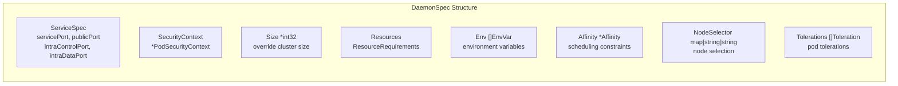
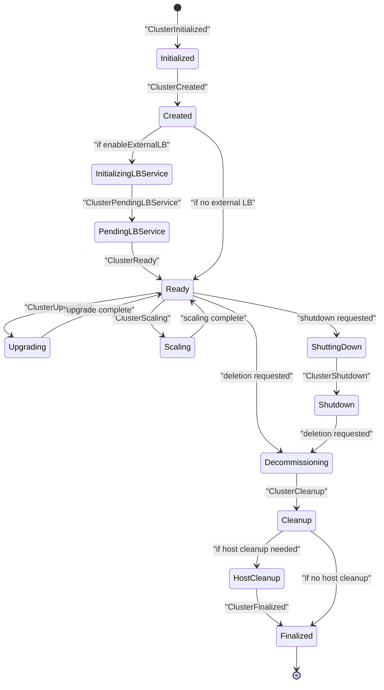
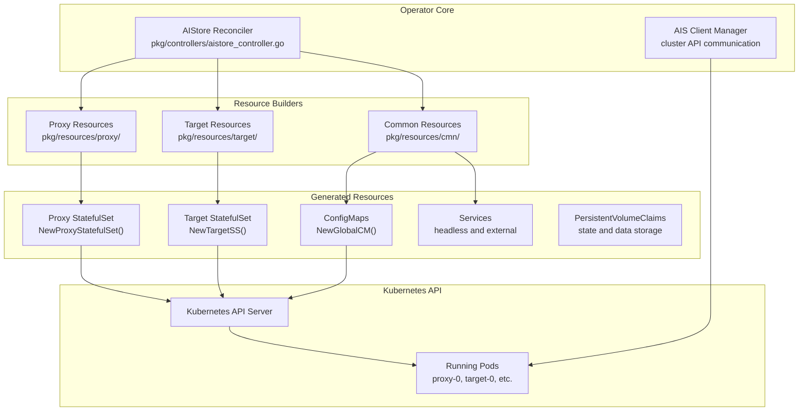
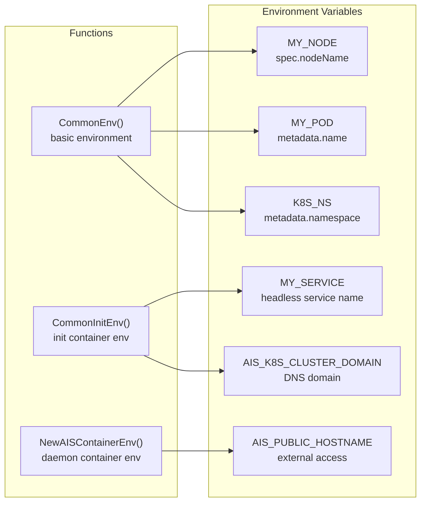
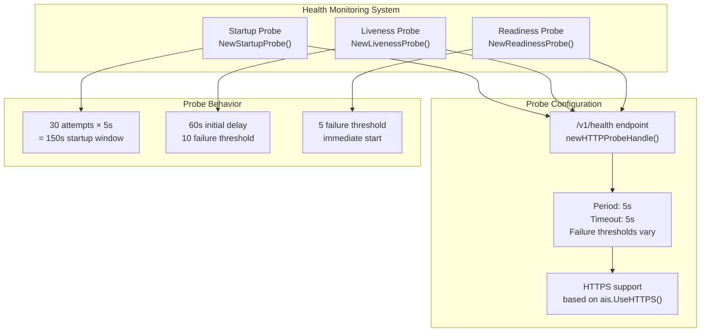
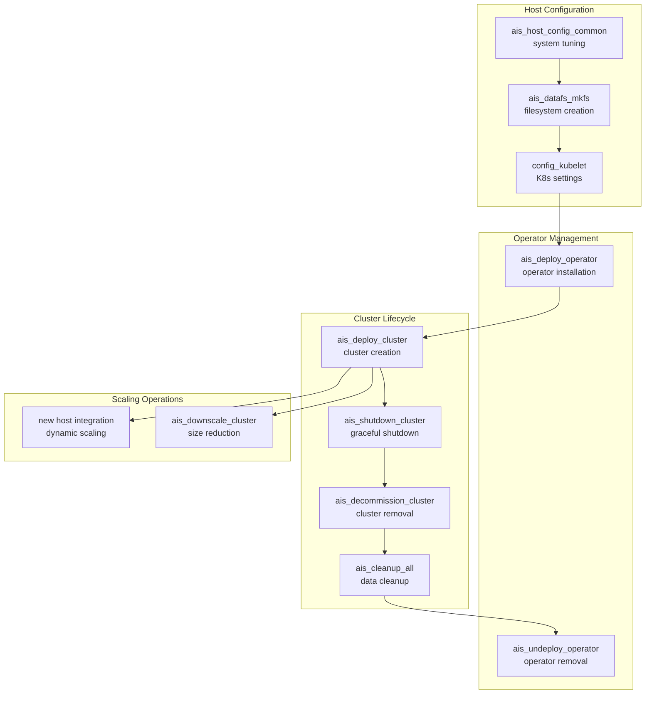

<!-- source: DeepWiki mcp.deepwiki.com · repo NVIDIA/ais-k8s · page 8 Reference Documentation · fetched 2026-10-26 -->

# Reference Documentation

<details>
<summary>Relevant source files</summary>

The following files were used as context for generating this wiki page:

- [README.md](README.md)
- [docs/COMPATIBILITY.md](docs/COMPATIBILITY.md)
- [docs/README.md](docs/README.md)
- [docs/network_configuration.md](docs/network_configuration.md)
- [docs/prerequisites.md](docs/prerequisites.md)
- [operator/api/v1beta1/aisconfig.go](operator/api/v1beta1/aisconfig.go)
- [operator/api/v1beta1/aistore_types.go](operator/api/v1beta1/aistore_types.go)
- [operator/api/v1beta1/util_types.go](operator/api/v1beta1/util_types.go)
- [operator/api/v1beta1/zz_generated.deepcopy.go](operator/api/v1beta1/zz_generated.deepcopy.go)
- [operator/pkg/resources/cmn/configmap.go](operator/pkg/resources/cmn/configmap.go)
- [operator/pkg/resources/cmn/env.go](operator/pkg/resources/cmn/env.go)
- [operator/pkg/resources/cmn/res.go](operator/pkg/resources/cmn/res.go)
- [operator/pkg/resources/cmn/statefulset.go](operator/pkg/resources/cmn/statefulset.go)
- [operator/pkg/resources/cmn/statefulset_test.go](operator/pkg/resources/cmn/statefulset_test.go)
- [operator/pkg/resources/proxy/statefulset.go](operator/pkg/resources/proxy/statefulset.go)
- [operator/pkg/resources/target/statefulset.go](operator/pkg/resources/target/statefulset.go)
- [playbooks/README.md](playbooks/README.md)
- [playbooks/ais-deployment/docs/ais_cluster_management.md](playbooks/ais-deployment/docs/ais_cluster_management.md)
- [playbooks/host-config/README.md](playbooks/host-config/README.md)

</details>


This page provides comprehensive reference materials for the AIStore Kubernetes deployment system, including complete API specifications, configuration options, resource management details, and troubleshooting guidance. This documentation serves as the authoritative reference for all aspects of deploying and managing AIStore clusters on Kubernetes.

For deployment procedures and getting started guides, see [Getting Started](#2). For operator architecture details, see [AIStore Kubernetes Operator](#3). For monitoring setup, see [Monitoring and Observability](#5).

## AIStore Custom Resource API Reference

The AIStore Kubernetes Operator manages clusters through a custom resource definition that provides declarative configuration for all aspects of an AIStore deployment.

### AIStore CRD Structure

The following diagram shows the complete structure of the AIStore custom resource and its relationships:

```mermaid
graph TB
    subgraph "AIStore CRD"
        AIStore["AIStore<br/>metadata + spec + status"]
        AIStoreSpec["AIStoreSpec<br/>desired state"]
        AIStoreStatus["AIStoreStatus<br/>current state"]
        
        AIStore --> AIStoreSpec
        AIStore --> AIStoreStatus
    end
    
    subgraph "Core Specification"
        Size["Size *int32<br/>cluster size"]
        NodeImage["NodeImage string<br/>aisnode container"]
        InitImage["InitImage string<br/>ais-init container"]
        ProxySpec["ProxySpec DaemonSpec<br/>proxy configuration"]
        TargetSpec["TargetSpec TargetSpec<br/>target configuration"]
        
        AIStoreSpec --> Size
        AIStoreSpec --> NodeImage
        AIStoreSpec --> InitImage
        AIStoreSpec --> ProxySpec
        AIStoreSpec --> TargetSpec
    end
    
    subgraph "DaemonSpec Components"
        ServiceSpec["ServiceSpec<br/>ports configuration"]
        SecurityContext["SecurityContext<br/>pod security"]
        Resources["Resources<br/>CPU/memory limits"]
        Affinity["Affinity<br/>scheduling rules"]
        
        ProxySpec --> ServiceSpec
        ProxySpec --> SecurityContext
        ProxySpec --> Resources
        ProxySpec --> Affinity
    end
    
    subgraph "TargetSpec Extensions"
        Mounts["Mounts []Mount<br/>storage configuration"]
        HostNetwork["HostNetwork *bool<br/>networking mode"]
        DisablePodAntiAffinity["DisablePodAntiAffinity *bool<br/>scheduling flexibility"]
        
        TargetSpec --> Mounts
        TargetSpec --> HostNetwork
        TargetSpec --> DisablePodAntiAffinity
    end
    
    subgraph "Configuration"
        ConfigToUpdate["ConfigToUpdate<br/>AIS runtime config"]
        StateStorageClass["StateStorageClass *string<br/>persistent state"]
        TLSSecretName["TLSSecretName *string<br/>HTTPS certificates"]
        
        AIStoreSpec --> ConfigToUpdate
        AIStoreSpec --> StateStorageClass
        AIStoreSpec --> TLSSecretName
    end
    
    subgraph "Status Information"
        State["State ClusterState<br/>lifecycle state"]
        Conditions["Conditions []Condition<br/>detailed status"]
        
        AIStoreStatus --> State
        AIStoreStatus --> Conditions
    end
```



Sources: [operator/api/v1beta1/aistore_types.go:87-192](), [operator/api/v1beta1/aistore_types.go:194-207]()

### Core Specification Fields

| Field | Type | Required | Description |
|-------|------|----------|-------------|
| `size` | `*int32` | No | Default cluster size for both proxies and targets |
| `nodeImage` | `string` | Yes | Container image for AIStore daemon pods |
| `initImage` | `string` | Yes | Container image for initialization containers |
| `proxySpec` | `DaemonSpec` | Yes | Proxy pod specification |
| `targetSpec` | `TargetSpec` | Yes | Target pod specification |
| `enableExternalLB` | `bool` | No | Enable external LoadBalancer service |

Sources: [operator/api/v1beta1/aistore_types.go:87-192]()

### DaemonSpec Configuration

The `DaemonSpec` structure defines common configuration for both proxy and target pods:



Sources: [operator/api/v1beta1/aistore_types.go:218-264]()

### Target-Specific Configuration

The `TargetSpec` extends `DaemonSpec` with target-specific options:

| Field | Type | Description |
|-------|------|-------------|
| `mounts` | `[]Mount` | Storage mount configurations |
| `disablePodAntiAffinity` | `*bool` | Allow multiple targets per node |
| `hostNetwork` | `*bool` | Use host networking for multihoming |

The `Mount` structure defines storage configuration:

| Field | Type | Description |
|-------|------|-------------|
| `path` | `string` | Mount path in container |
| `size` | `resource.Quantity` | Storage size request |
| `storageClass` | `*string` | Kubernetes StorageClass name |
| `selector` | `*metav1.LabelSelector` | PV selection criteria |
| `label` | `*string` | Mountpath label for grouping |

Sources: [operator/api/v1beta1/aistore_types.go:266-287]()

### Cluster State Management

The operator manages cluster lifecycle through defined states and conditions:



Sources: [operator/api/v1beta1/aistore_types.go:30-57](), [operator/api/v1beta1/aistore_types.go:61-77]()

## Configuration Reference

The AIStore operator supports extensive configuration through the `ConfigToUpdate` structure, which maps to AIStore's native configuration system.

### Configuration Structure Overview

```mermaid
graph TB
    subgraph "ConfigToUpdate Structure"
        ConfigToUpdate["ConfigToUpdate<br/>Root configuration"]
        
        Backend["Backend *map[string]Empty<br/>cloud backend config"]
        Mirror["Mirror *MirrorConfToUpdate<br/>data mirroring"]
        EC["EC *ECConfToUpdate<br/>erasure coding"]
        Log["Log *LogConfToUpdate<br/>logging configuration"]
        Net["Net *NetConfToUpdate<br/>network settings"]
        Auth["Auth *AuthConfToUpdate<br/>authentication"]
        
        ConfigToUpdate --> Backend
        ConfigToUpdate --> Mirror
        ConfigToUpdate --> EC
        ConfigToUpdate --> Log
        ConfigToUpdate --> Net
        ConfigToUpdate --> Auth
        
        Timeout["Timeout *TimeoutConfToUpdate"]
        Client["Client *ClientConfToUpdate"]
        Space["Space *SpaceConfToUpdate"]
        LRU["LRU *LRUConfToUpdate"]
        Disk["Disk *DiskConfToUpdate"]
        
        ConfigToUpdate --> Timeout
        ConfigToUpdate --> Client
        ConfigToUpdate --> Space
        ConfigToUpdate --> LRU
        ConfigToUpdate --> Disk
    end
    
    subgraph "Advanced Configuration"
        Rebalance["Rebalance *RebalanceConfToUpdate<br/>data rebalancing"]
        Transport["Transport *TransportConfToUpdate<br/>internal transport"]
        Memsys["Memsys *MemsysConfToUpdate<br/>memory management"]
        RateLimit["RateLimit *RateLimitConfToUpdate<br/>rate limiting"]
        
        ConfigToUpdate --> Rebalance
        ConfigToUpdate --> Transport
        ConfigToUpdate --> Memsys
        ConfigToUpdate --> RateLimit
    end
```



Sources: [operator/api/v1beta1/aisconfig.go:19-48]()

### Network Configuration

The network configuration supports HTTPS/TLS setup and various HTTP parameters:

| Field | Type | Description |
|-------|------|-------------|
| `useHTTPS` | `*bool` | Enable HTTPS for cluster communication |
| `certificate` | `*string` | Path to TLS certificate |
| `certKey` | `*string` | Path to TLS private key |
| `clientCA` | `*string` | Client CA certificate path |
| `skipVerifyCrt` | `*bool` | Skip certificate verification |

Sources: [operator/api/v1beta1/aisconfig.go:160-174]()

### Storage and Performance Configuration

| Configuration | Key Fields | Description |
|---------------|------------|-------------|
| **Space Management** | `lowWM`, `highWM`, `cleanupWM`, `oos` | Watermarks for disk usage (0-100%) |
| **LRU Cache** | `enabled`, `dontEvictTime`, `capacityUpdTime` | Least Recently Used eviction policy |
| **Disk Monitoring** | `diskUtilLowWM`, `diskUtilHighWM`, `iostatTimeLong` | Disk utilization monitoring |
| **Memory System** | `minFree`, `defaultBufSize`, `sizeToGC` | Memory management parameters |

Sources: [operator/api/v1beta1/aisconfig.go:110-225]()

## Resource Management System

The operator generates and manages Kubernetes resources through a structured system of resource builders and managers.

### Resource Generation Flow



Sources: [operator/pkg/resources/proxy/statefulset.go:57-86](), [operator/pkg/resources/target/statefulset.go:53-83](), [operator/pkg/resources/cmn/configmap.go:19-45]()

### StatefulSet Generation

The operator creates StatefulSets for both proxy and target pods with specific configurations:

#### Proxy StatefulSet Configuration

The `NewProxyStatefulSet` function creates proxy deployments with:

| Component | Function/Field | Description |
|-----------|---------------|-------------|
| **Pod Template** | `proxyPodSpec()` | Container and volume specifications |
| **Init Container** | `populate-env` | Environment setup using `InitImage` |
| **Main Container** | `ais-node` | AIStore daemon using `NodeImage` |
| **Service Configuration** | `headlessSVCName()` | Internal service discovery |
| **Volume Claims** | `proxyVC()` | State storage PVCs |

Sources: [operator/pkg/resources/proxy/statefulset.go:57-86](), [operator/pkg/resources/proxy/statefulset.go:92-137]()

#### Target StatefulSet Configuration

The `NewTargetSS` function creates target deployments with additional storage configuration:

| Component | Function/Field | Description |
|-----------|---------------|-------------|
| **Pod Spec** | `targetPodSpec()` | Target-specific pod configuration |
| **Volume Mounts** | `volumeMounts()` | Data and state mount configurations |
| **PVC Templates** | `targetPVC()` | Data storage claims from `Mount` specs |
| **Affinity Rules** | `createTargetAffinity()` | Anti-affinity for distribution |

Sources: [operator/pkg/resources/target/statefulset.go:53-83](), [operator/pkg/resources/target/statefulset.go:177-217]()

### Environment Variable Management

The operator configures containers with environment variables for cluster communication:



Sources: [operator/pkg/resources/cmn/env.go:15-34](), [operator/pkg/resources/cmn/env.go:37-55]()

### Configuration Management

The operator generates AIStore configuration through ConfigMaps:

| Function | Purpose | Content |
|----------|---------|---------|
| `NewGlobalCM()` | Global cluster configuration | AIStore runtime configuration JSON |
| `GenerateGlobalConfig()` | Config generation | Converts CRD spec to AIStore format |
| `AISConfigMapName()` | Local configuration | Daemon-specific configuration |

Sources: [operator/pkg/resources/cmn/configmap.go:19-45]()

## Container and Pod Configuration

### Container Specifications

The operator configures multiple container types within AIStore pods:

#### Init Container Configuration

| Component | Configuration | Purpose |
|-----------|--------------|---------|
| **Image** | `ais.Spec.InitImage` | Container image for initialization |
| **Environment** | `NewInitContainerEnv()` | Cluster discovery variables |
| **Arguments** | `NewInitContainerArgs()` | Configuration file generation |
| **Volume Mounts** | `NewInitVolumeMounts()` | Template and output directories |

#### Main AIStore Container

| Component | Configuration | Purpose |
|-----------|--------------|---------|
| **Image** | `ais.Spec.NodeImage` | AIStore daemon container |
| **Command** | `["aisnode"]` | AIStore executable |
| **Arguments** | `NewAISContainerArgs()` | Runtime configuration paths |
| **Environment** | `NewAISContainerEnv()` | Runtime environment variables |
| **Probes** | `NewStartupProbe()`, `NewLivenessProbe()`, `NewReadinessProbe()` | Health monitoring |

#### Optional Log Sidecar

| Component | Configuration | Purpose |
|-----------|--------------|---------|
| **Condition** | `ais.Spec.LogSidecarImage != nil` | Optional log collection |
| **Container** | `NewLogSidecar()` | Log streaming container |
| **Volume Mount** | `newLogsVolumeMount()` | Shared log directory |

Sources: [operator/pkg/resources/proxy/statefulset.go:92-137](), [operator/pkg/resources/target/statefulset.go:85-132](), [operator/pkg/resources/cmn/statefulset.go:49-59]()

### Health Monitoring

The operator configures comprehensive health monitoring for AIStore pods:



Sources: [operator/pkg/resources/cmn/res.go:35-93]()

## Deployment Methods and Integration

### Available Deployment Approaches

The system provides multiple deployment methods for different use cases:

| Method | Tool | Use Case | Configuration |
|--------|------|----------|---------------|
| **Helm Charts** | `helm install` | Production deployments | Values-based configuration |
| **Ansible Playbooks** | `ansible-playbook` | Automated lifecycle management | Inventory-based configuration |
| **Manual kubectl** | `kubectl apply` | Development and testing | Direct YAML manipulation |

Sources: [docs/README.md:41-70]()

### Ansible Playbook System

The Ansible integration provides comprehensive cluster lifecycle management:



Sources: [playbooks/README.md:17-82](), [playbooks/ais-deployment/docs/ais_cluster_management.md:8-125]()

### Host Configuration Requirements

The playbooks configure hosts for optimal AIStore performance:

| Playbook | Purpose | Key Configurations |
|----------|---------|-------------------|
| `ais_host_config_common` | System optimization | Network tuning, kernel parameters |
| `ais_datafs_mkfs` | Storage preparation | XFS filesystem with recommended mount options |
| `config_kubelet` | Kubernetes settings | Unsafe sysctls, kubelet configuration |

Recommended XFS mount options: `noatime,nodiratime,logbufs=8,logbsize=256k,largeio,inode64,swalloc,allocsize=131072k,nobarrier`

Sources: [docs/prerequisites.md:15-23](), [playbooks/host-config/README.md:14-42]()

## Troubleshooting Reference

### Common Configuration Issues

| Issue | Symptoms | Resolution |
|-------|----------|------------|
| **Pod Stuck in Pending** | Insufficient resources or scheduling constraints | Check node resources, PV availability, affinity rules |
| **Init Container Failures** | Config generation errors | Verify init image compatibility, check logs |
| **Startup Probe Failures** | Pods restart during initialization | Increase startup probe failure threshold |
| **Storage Mount Issues** | PVC binding failures | Verify StorageClass, PV availability, mount path permissions |

### State Validation Commands

```bash
# Check AIStore resource status
kubectl get aistore -n ais-namespace

# Examine detailed cluster state
kubectl describe aistore cluster-name -n ais-namespace

# Monitor pod status and events
kubectl get pods -n ais-namespace -w
kubectl describe pods -n ais-namespace

# Check operator logs
kubectl logs -n ais-operator-system deployment/ais-operator-controller-manager
```

### Configuration Validation

The operator performs validation through kubebuilder annotations:

| Validation | Field | Rule |
|------------|-------|------|
| **Cluster Size** | `spec` | `(has(targetSpec.size) && has(proxySpec.size)) \|\| (has(size) && size > 0)` |
| **Space Watermarks** | `space.*WM` | `Minimum=0, Maximum=100` |
| **Image Names** | `nodeImage`, `initImage` | `MinLength=1` |

Sources: [operator/api/v1beta1/aistore_types.go:88](), [operator/api/v1beta1/aisconfig.go:111-122]()

### Compatibility Matrix

Ensure version compatibility between components:

| AIStore Version | Required Operator Version | Init Container Version |
|-----------------|---------------------------|------------------------|
| v3.28+ | v2.3.0+ | Match aisnode version |
| v3.27 | v1.6.0+ | v3.27 |
| v3.26 | v1.6.0+ | v3.26 |

Sources: [docs/COMPATIBILITY.md:6-39]()

---

