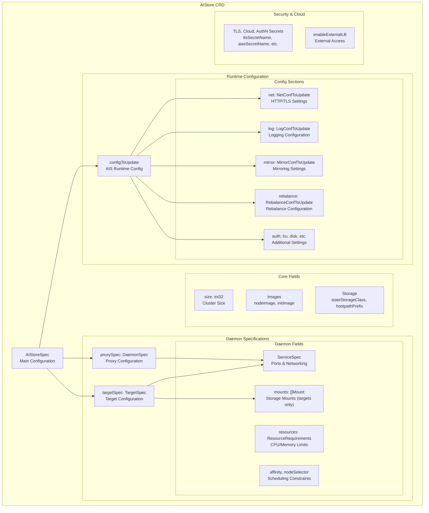
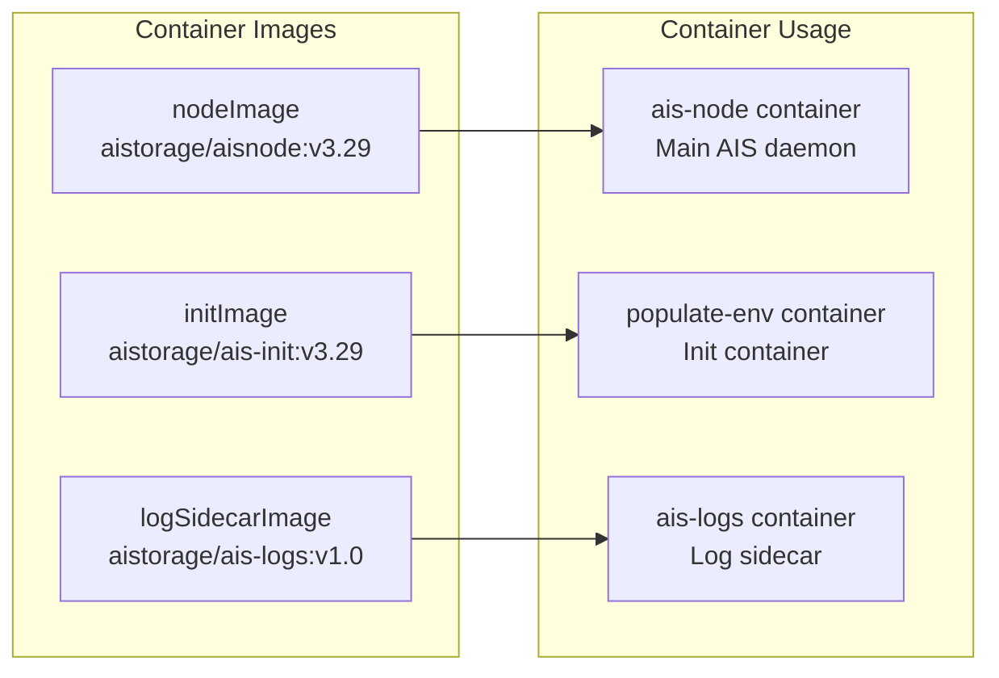
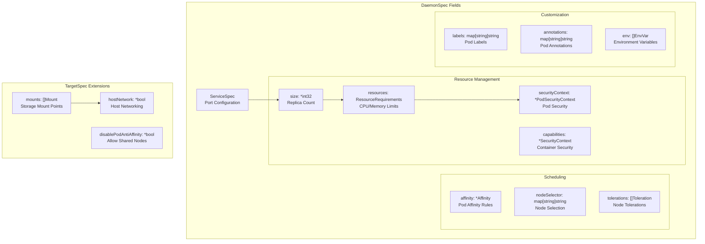

<!-- source: DeepWiki mcp.deepwiki.com · repo NVIDIA/ais-k8s · page 8.1 Configuration Reference · fetched 2026-10-26 -->

# Configuration Reference

<details>
<summary>Relevant source files</summary>

The following files were used as context for generating this wiki page:

- [docs/multiple_targets_per_node.md](docs/multiple_targets_per_node.md)
- [docs/samples/sample-multi-target-deployment.yml](docs/samples/sample-multi-target-deployment.yml)
- [docs/samples/sample-pv.yaml](docs/samples/sample-pv.yaml)
- [operator/api/v1beta1/aisconfig.go](operator/api/v1beta1/aisconfig.go)
- [operator/api/v1beta1/aistore_types.go](operator/api/v1beta1/aistore_types.go)
- [operator/api/v1beta1/util_types.go](operator/api/v1beta1/util_types.go)
- [operator/api/v1beta1/zz_generated.deepcopy.go](operator/api/v1beta1/zz_generated.deepcopy.go)
- [operator/pkg/resources/cmn/configmap.go](operator/pkg/resources/cmn/configmap.go)
- [operator/pkg/resources/cmn/env.go](operator/pkg/resources/cmn/env.go)
- [operator/pkg/resources/cmn/res.go](operator/pkg/resources/cmn/res.go)
- [operator/pkg/resources/cmn/statefulset.go](operator/pkg/resources/cmn/statefulset.go)
- [operator/pkg/resources/cmn/statefulset_test.go](operator/pkg/resources/cmn/statefulset_test.go)
- [operator/pkg/resources/proxy/statefulset.go](operator/pkg/resources/proxy/statefulset.go)
- [operator/pkg/resources/target/statefulset.go](operator/pkg/resources/target/statefulset.go)
- [playbooks/ais-deployment/roles/ais_deploy_cluster/defaults/main.yml](playbooks/ais-deployment/roles/ais_deploy_cluster/defaults/main.yml)
- [playbooks/ais-deployment/roles/ais_deploy_cluster/templates/ais.yaml.j2](playbooks/ais-deployment/roles/ais_deploy_cluster/templates/ais.yaml.j2)

</details>


This document provides a comprehensive reference for all configuration options available in the AIStore Custom Resource Definition (CRD). It covers the complete `AIStoreSpec` structure, runtime configuration options through `ConfigToUpdate`, and deployment specifications for proxy and target daemons.

For information about deploying clusters using these configurations, see [Helm Chart Deployment](#4.1) and [Ansible Playbook Deployment](#4.2). For API documentation of the custom resource structure, see [API Reference](#8.2).

## AIStore CRD Structure Overview

The AIStore custom resource provides a declarative interface for configuring AIStore clusters in Kubernetes. The configuration is organized into several key sections:



**AIStore CRD Configuration Hierarchy**

Sources: [operator/api/v1beta1/aistore_types.go:87-192](), [operator/api/v1beta1/aisconfig.go:19-48]()

## Core Specification Fields

The top-level `AIStoreSpec` contains cluster-wide configuration settings:

| Field | Type | Required | Description |
|-------|------|----------|-------------|
| `size` | `*int32` | Optional | Default cluster size (proxies and targets). Can be overridden by individual daemon specs |
| `nodeImage` | `string` | Required | Container image for `aisnode` containers |
| `initImage` | `string` | Required | Container image for `ais-init` containers |
| `logSidecarImage` | `*string` | Optional | Container image for `ais-logs` sidecar containers |
| `stateStorageClass` | `*string` | Optional | Storage class for dynamic state volume provisioning |
| `hostpathPrefix` | `*string` | Optional | **Deprecated**: Host path for state storage |
| `clusterDomain` | `*string` | Optional | Kubernetes cluster domain name (default: "cluster.local") |
| `logsDirectory` | `string` | Optional | Host directory for storing AIS logs |
| `enableExternalLB` | `bool` | Required | Enable external access via LoadBalancer service |
| `shutdownCluster` | `*bool` | Optional | Gracefully shutdown cluster while preserving data |
| `cleanupMetadata` | `*bool` | Optional | Remove cluster metadata during decommissioning |
| `cleanupData` | `*bool` | Optional | Remove user data and PVCs during decommissioning |

Sources: [operator/api/v1beta1/aistore_types.go:87-192]()

### Image Configuration



**Container Image Configuration**

Sources: [playbooks/ais-deployment/roles/ais_deploy_cluster/defaults/main.yml:1-3](), [operator/pkg/resources/proxy/statefulset.go:107-108](), [operator/pkg/resources/target/statefulset.go:100-101]()

## Runtime Configuration (`configToUpdate`)

The `configToUpdate` field allows overriding AIStore's default runtime configuration:

### Networking Configuration

```yaml
configToUpdate:
  net:
    http:
      use_https: true
      server_crt: "/var/certs/tls.crt"
      server_key: "/var/certs/tls.key"
      client_ca_tls: "/var/certs/ca.crt"
      skip_verify: false
      idle_conn_time: "90s"
```

| Field | Type | Description |
|-------|------|-------------|
| `use_https` | `*bool` | Enable HTTPS for all communications |
| `server_crt` | `*string` | Path to TLS certificate file |
| `server_key` | `*string` | Path to TLS private key file |
| `client_ca_tls` | `*string` | Path to client CA certificate |
| `skip_verify` | `*bool` | Skip TLS certificate verification |
| `idle_conn_time` | `*Duration` | HTTP idle connection timeout |

Sources: [operator/api/v1beta1/aisconfig.go:157-174](), [playbooks/ais-deployment/roles/ais_deploy_cluster/templates/ais.yaml.j2:12-21]()

### Storage and Performance Configuration

```yaml
configToUpdate:
  mirror:
    enabled: true
    copies: 2
  rebalance:
    enabled: true
    bundle_multiplier: 4
  lru:
    enabled: true
    dont_evict_time: "120m"
```

| Section | Key Fields | Description |
|---------|------------|-------------|
| `mirror` | `enabled`, `copies`, `burst_buffer` | Object mirroring configuration |
| `rebalance` | `enabled`, `dest_retry_time`, `compression` | Cluster rebalancing settings |
| `lru` | `enabled`, `dont_evict_time`, `capacity_upd_time` | LRU eviction policy |
| `disk` | `disk_util_low_wm`, `disk_util_high_wm` | Disk utilization thresholds |
| `space` | `cleanupwm`, `lowwm`, `highwm`, `out_of_space` | Space management watermarks |

Sources: [operator/api/v1beta1/aisconfig.go:49-62](), [operator/api/v1beta1/aisconfig.go:136-143](), [operator/api/v1beta1/aisconfig.go:124-128]()

### Logging Configuration

```yaml
configToUpdate:
  log:
    level: 3
    max_size: "4MB"
    max_total: "128MB"
    to_stderr: false
```

| Field | Type | Description |
|-------|------|-------------|
| `level` | `*cos.LogLevel` | Log verbosity level (0-5) |
| `max_size` | `*SizeIEC` | Maximum size per log file |
| `max_total` | `*SizeIEC` | Maximum total log storage |
| `to_stderr` | `*bool` | Output logs to stderr |
| `flush_time` | `*Duration` | Log buffer flush interval |

Sources: [operator/api/v1beta1/aisconfig.go:63-70]()

## Daemon Specifications

Both proxy and target daemons share a common `DaemonSpec` structure with additional target-specific fields:



**Daemon Specification Structure**

Sources: [operator/api/v1beta1/aistore_types.go:217-276]()

### Service Port Configuration

Each daemon type requires specific port configurations:

| Field | Type | Description |
|-------|------|-------------|
| `servicePort` | `intstr.IntOrString` | Primary service port |
| `portPublic` | `intstr.IntOrString` | Public network port |
| `portIntraControl` | `intstr.IntOrString` | Intra-cluster control port |
| `portIntraData` | `intstr.IntOrString` | Intra-cluster data port |
| `hostPort` | `*int32` | Host port for external access |

**Default Port Assignments:**
- **Proxy**: servicePort=51080, intraControl=51082, intraData=51083
- **Target**: servicePort=51081, intraControl=51082, intraData=51083

Sources: [operator/api/v1beta1/aistore_types.go:209-215](), [playbooks/ais-deployment/roles/ais_deploy_cluster/templates/ais.yaml.j2:23-51]()

### Target Storage Mounts

Targets require storage mount specifications for data storage:

```yaml
targetSpec:
  mounts:
    - path: /ais/sda
      size: 5T
      storageClass: "ais-local-storage"
      selector:
        matchLabels:
          disk: "sda"
    - path: /ais/sdb
      size: 5T
      storageClass: "ais-local-storage"
```

| Field | Type | Description |
|-------|------|-------------|
| `path` | `string` | Mount path inside container |
| `size` | `resource.Quantity` | Storage size request |
| `storageClass` | `*string` | Kubernetes storage class |
| `selector` | `*metav1.LabelSelector` | PV selector for static provisioning |
| `label` | `*string` | Mountpath label for disk sharing/grouping |

Sources: [operator/api/v1beta1/aistore_types.go:278-287](), [docs/samples/sample-multi-target-deployment.yml:91-94]()

## Security and Cloud Integration

### Secret Configuration

AIStore supports various secret types for security and cloud integration:

| Field | Purpose | Secret Keys |
|-------|---------|-------------|
| `tlsSecretName` | TLS certificates | `tls.crt`, `tls.key`, `ca.crt` |
| `awsSecretName` | AWS credentials | AWS credential keys |
| `gcpSecretName` | GCP credentials | `gcp.json` |
| `ociSecretName` | OCI credentials | `config` |
| `authNSecretName` | JWT signing key | `SIGNING-KEY` |
| `tracingTokenSecretName` | Tracing token | Token for trace exporter |

### External Access Configuration

```yaml
spec:
  enableExternalLB: true
  apiMode: "external"  # or "internal"
```

When `enableExternalLB` is true, the operator creates LoadBalancer services for external cluster access.

Sources: [operator/api/v1beta1/aistore_types.go:153-183](), [operator/pkg/resources/target/statefulset.go:151-158]()

## Advanced Configuration

### Multi-Target Per Node Deployment

For enhanced availability, multiple targets can be deployed on the same node:

```yaml
targetSpec:
  disablePodAntiAffinity: true
  size: 4  # More targets than nodes
  mounts:
    - path: /data1
      size: 1T
    - path: /data2  
      size: 1T
```

### Host Networking

For multi-homing scenarios, targets can use host networking:

```yaml
targetSpec:
  hostNetwork: true
```

This enables targets to access multiple network interfaces on the host.

Sources: [operator/api/v1beta1/aistore_types.go:274-276](), [docs/multiple_targets_per_node.md:41]()

### Cluster Lifecycle Management

```yaml
spec:
  shutdownCluster: true     # Graceful shutdown
  cleanupMetadata: false    # Preserve metadata
  cleanupData: false        # Preserve user data
```

These flags control cluster shutdown and cleanup behavior during CR deletion.

Sources: [operator/api/v1beta1/aistore_types.go:131-147]()

## Configuration Examples

### Basic Development Cluster

```yaml
apiVersion: ais.nvidia.com/v1beta1
kind: AIStore
metadata:
  name: dev-cluster
spec:
  size: 1
  nodeImage: "aistorage/aisnode:latest"
  initImage: "aistorage/ais-init:latest"
  enableExternalLB: false
  
  proxySpec:
    servicePort: 8080
    portPublic: 8080
    portIntraControl: 8081
    portIntraData: 8082
    
  targetSpec:
    servicePort: 8083
    portPublic: 8083
    portIntraControl: 8081
    portIntraData: 8082
    mounts:
      - path: /tmp/ais
        size: 10Gi
```

### Production HTTPS Cluster

```yaml
apiVersion: ais.nvidia.com/v1beta1
kind: AIStore
metadata:
  name: prod-cluster
spec:
  size: 6
  nodeImage: "aistorage/aisnode:v3.29"
  initImage: "aistorage/ais-init:v3.29"
  enableExternalLB: true
  tlsSecretName: "ais-tls-certs"
  
  configToUpdate:
    net:
      http:
        use_https: true
        server_crt: "/var/certs/tls.crt"
        server_key: "/var/certs/tls.key"
    rebalance:
      enabled: true
    mirror:
      enabled: true
      copies: 2
      
  proxySpec:
    resources:
      requests:
        cpu: "2"
        memory: "4Gi"
    nodeSelector:
      node-role: "ais-proxy"
      
  targetSpec:
    resources:
      requests:
        cpu: "4"
        memory: "8Gi"
    nodeSelector:
      node-role: "ais-target"
    mounts:
      - path: /ais/nvme0
        size: 1Ti
        storageClass: "fast-ssd"
      - path: /ais/nvme1
        size: 1Ti
        storageClass: "fast-ssd"
```

Sources: [docs/samples/sample-multi-target-deployment.yml:55-100](), [playbooks/ais-deployment/roles/ais_deploy_cluster/templates/ais.yaml.j2]()

---

