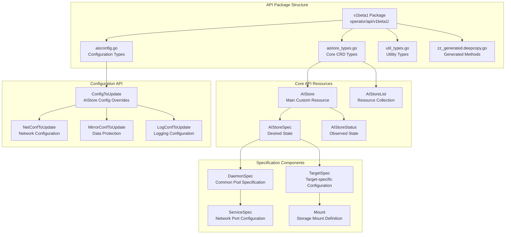
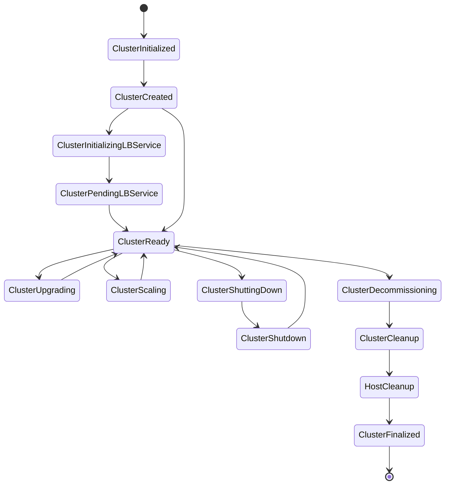
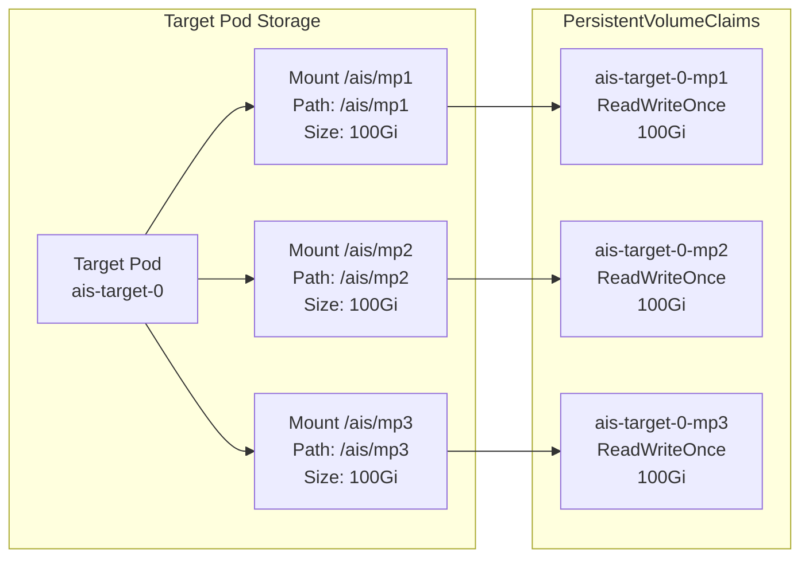
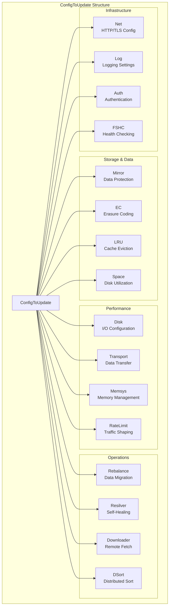
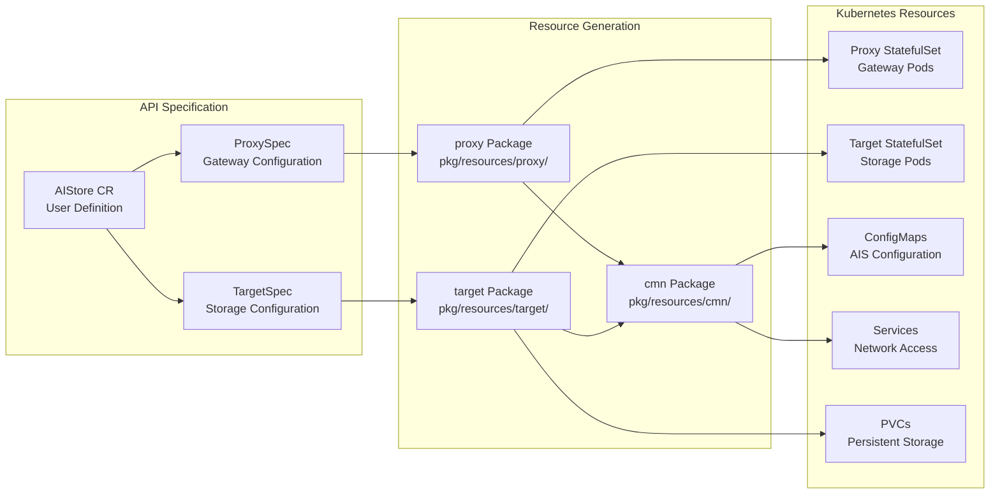

<!-- source: DeepWiki mcp.deepwiki.com · repo NVIDIA/ais-k8s · page 8.2 API Reference · fetched 2026-10-26 -->

# API Reference

<details>
<summary>Relevant source files</summary>

The following files were used as context for generating this wiki page:

- [operator/api/v1beta1/aisconfig.go](operator/api/v1beta1/aisconfig.go)
- [operator/api/v1beta1/aistore_types.go](operator/api/v1beta1/aistore_types.go)
- [operator/api/v1beta1/util_types.go](operator/api/v1beta1/util_types.go)
- [operator/api/v1beta1/zz_generated.deepcopy.go](operator/api/v1beta1/zz_generated.deepcopy.go)
- [operator/hack/boilerplate.go.txt](operator/hack/boilerplate.go.txt)
- [operator/pkg/resources/cmn/configmap.go](operator/pkg/resources/cmn/configmap.go)
- [operator/pkg/resources/cmn/env.go](operator/pkg/resources/cmn/env.go)
- [operator/pkg/resources/cmn/res.go](operator/pkg/resources/cmn/res.go)
- [operator/pkg/resources/cmn/statefulset.go](operator/pkg/resources/cmn/statefulset.go)
- [operator/pkg/resources/cmn/statefulset_test.go](operator/pkg/resources/cmn/statefulset_test.go)
- [operator/pkg/resources/proxy/statefulset.go](operator/pkg/resources/proxy/statefulset.go)
- [operator/pkg/resources/target/statefulset.go](operator/pkg/resources/target/statefulset.go)

</details>


This document provides comprehensive reference documentation for the AIStore Kubernetes Operator API. It covers the custom resource definitions, specification schemas, status fields, and programmatic interfaces used to deploy and manage AIStore clusters in Kubernetes.

For configuration parameter details, see [Configuration Reference](#8.1). For deployment procedures and troubleshooting, see [Troubleshooting Guide](#8.3).

## Core API Architecture

The AIStore Operator API is built around Kubernetes Custom Resource Definitions (CRDs) that follow the standard Kubernetes resource model with declarative specifications and observed status reporting.



**Sources:** [operator/api/v1beta1/aistore_types.go:1-499](), [operator/api/v1beta1/aisconfig.go:1-280](), [operator/api/v1beta1/util_types.go:1-31]()

## AIStore Custom Resource

The `AIStore` custom resource is the primary API object for deploying and managing AIStore clusters. It follows the standard Kubernetes resource pattern with TypeMeta, ObjectMeta, Spec, and Status fields.

### Resource Definition

| Field | Type | Description |
|-------|------|-------------|
| `apiVersion` | string | `ais.nvidia.com/v1beta1` |
| `kind` | string | `AIStore` |
| `metadata` | ObjectMeta | Standard Kubernetes metadata |
| `spec` | AIStoreSpec | Desired cluster configuration |
| `status` | AIStoreStatus | Observed cluster state |

### Cluster State Management

The operator manages cluster lifecycle through a well-defined state machine implemented in the `ClusterState` type:



**Sources:** [operator/api/v1beta1/aistore_types.go:20-57](), [operator/api/v1beta1/aistore_types.go:347-354]()

## AIStoreSpec API

The `AIStoreSpec` defines the desired state of an AIStore cluster with comprehensive configuration options for container images, networking, storage, and cluster behavior.

### Core Configuration Fields

| Field | Type | Required | Description |
|-------|------|----------|-------------|
| `size` | *int32 | No | Default cluster size (proxies and targets) |
| `nodeImage` | string | Yes | Container image for `aisnode` |
| `initImage` | string | Yes | Container image for `ais-init` |
| `logSidecarImage` | *string | No | Container image for `ais-logs` sidecar |
| `proxySpec` | DaemonSpec | Yes | Proxy daemon configuration |
| `targetSpec` | TargetSpec | Yes | Target daemon configuration |

### Storage Configuration

| Field | Type | Description |
|-------|------|-------------|
| `stateStorageClass` | *string | StorageClass for state persistence |
| `hostpathPrefix` | *string | **Deprecated:** Host path for state storage |

### Network Configuration

| Field | Type | Description |
|-------|------|-------------|
| `enableExternalLB` | bool | Enable external LoadBalancer access |
| `apiMode` | *string | API communication mode |
| `networkAttachment` | *string | Additional network attachments |
| `clusterDomain` | *string | Kubernetes cluster domain (default: cluster.local) |
| `hostnameMap` | map[string]string | Multi-home hostname mappings |

### Cloud Integration

| Field | Type | Description |
|-------|------|-------------|
| `awsSecretName` | *string | AWS credentials secret |
| `gcpSecretName` | *string | GCP credentials secret |
| `ociSecretName` | *string | OCI credentials secret |

### Security Configuration

| Field | Type | Description |
|-------|------|-------------|
| `tlsSecretName` | *string | TLS certificate secret |
| `tlsCertManagerIssuerName` | *string | Cert Manager issuer |
| `authNSecretName` | *string | AuthN JWT signing key secret |
| `imagePullSecrets` | []LocalObjectReference | Container registry secrets |

**Sources:** [operator/api/v1beta1/aistore_types.go:87-192]()

## DaemonSpec and ServiceSpec

The `DaemonSpec` provides common configuration for both proxy and target pods, while `ServiceSpec` defines network port configuration.

### DaemonSpec Fields

| Field | Type | Description |
|-------|------|-------------|
| `size` | *int32 | Override cluster size for this daemon type |
| `servicePort` | IntOrString | Primary service port |
| `publicPort` | IntOrString | Public network port |
| `intraControlPort` | IntOrString | Intra-cluster control port |
| `intraDataPort` | IntOrString | Intra-cluster data port |
| `resources` | ResourceRequirements | CPU/memory resource requests/limits |
| `securityContext` | *PodSecurityContext | Pod-level security settings |
| `containerSecurity` | *SecurityContext | Container-level security settings |
| `annotations` | map[string]string | Additional pod annotations |
| `labels` | map[string]string | Additional pod labels |
| `env` | []EnvVar | Environment variable overrides |
| `affinity` | *Affinity | Pod scheduling constraints |
| `nodeSelector` | map[string]string | Node selection labels |
| `tolerations` | []Toleration | Node taint tolerations |
| `hostPort` | *int32 | Host port for host networking |

**Sources:** [operator/api/v1beta1/aistore_types.go:209-264]()

## TargetSpec Configuration

The `TargetSpec` extends `DaemonSpec` with target-specific configuration for storage mounts and networking options.

### Target-Specific Fields

| Field | Type | Description |
|-------|------|-------------|
| `mounts` | []Mount | Storage mount configurations |
| `disablePodAntiAffinity` | *bool | Allow multiple targets per node |
| `hostNetwork` | *bool | Enable host networking for multi-homing |

### Mount Configuration

The `Mount` type defines persistent storage attachments for target pods:

| Field | Type | Description |
|-------|------|-------------|
| `path` | string | Mount path inside container |
| `size` | Quantity | Storage size request |
| `storageClass` | *string | Kubernetes StorageClass |
| `selector` | *LabelSelector | PV selection criteria |
| `label` | *string | Mountpath label for grouping |



**Sources:** [operator/api/v1beta1/aistore_types.go:266-287](), [operator/pkg/resources/target/statefulset.go:177-217]()

## AIStoreStatus API

The `AIStoreStatus` reports the observed state of the AIStore cluster using Kubernetes standard condition patterns.

### Status Fields

| Field | Type | Description |
|-------|------|-------------|
| `state` | ClusterState | Current high-level cluster state |
| `conditions` | []Condition | Detailed condition information |

### Standard Conditions

| Condition Type | Description |
|----------------|-------------|
| `Initialized` | Cluster has been initialized |
| `Created` | Cluster resources have been created |
| `Ready` | Cluster is fully operational |
| `ReadyRebalance` | Cluster is ready for rebalancing |

### Condition Management Methods

The `AIStore` type provides methods for managing status conditions:

| Method | Description |
|--------|-------------|
| `AddOrUpdateCondition(c *Condition)` | Add or update a condition |
| `IsConditionTrue(conditionType ClusterConditionType) bool` | Check condition status |
| `SetCondition(conditionType ClusterConditionType)` | Set condition to True |
| `SetConditionFalse(conditionType, reason, message)` | Set condition to False |

**Sources:** [operator/api/v1beta1/aistore_types.go:194-207](), [operator/api/v1beta1/aistore_types.go:304-345]()

## Configuration API

The configuration API allows fine-grained control over AIStore cluster behavior through the `ConfigToUpdate` structure, which mirrors AIStore's native configuration schema.

### Core Configuration Categories



### Key Configuration Types

| Configuration | Key Fields | Purpose |
|---------------|------------|---------|
| `NetConfToUpdate` | `HTTP.UseHTTPS`, `HTTP.Certificate` | TLS and HTTP configuration |
| `MirrorConfToUpdate` | `Enabled`, `Copies`, `Burst` | Data replication settings |
| `LogConfToUpdate` | `Level`, `MaxSize`, `MaxTotal` | Logging behavior |
| `RebalanceConfToUpdate` | `Enabled`, `Compression` | Cluster rebalancing |
| `SpaceConfToUpdate` | `CleanupWM`, `LowWM`, `HighWM` | Disk space management |

**Sources:** [operator/api/v1beta1/aisconfig.go:18-252]()

## Utility Types

The API includes specialized types for improved validation and serialization:

### Duration Type

Custom duration type with string serialization for better YAML/JSON handling:

```go
// +kubebuilder:validation:Type=string
type Duration cos.Duration
```

### SizeIEC Type

Human-readable size specification with IEC binary prefixes:

```go
// +kubebuilder:validation:Type=string  
type SizeIEC cos.SizeIEC
```

These types support values like `"30s"`, `"5m"`, `"2h"` for durations and `"1Gi"`, `"500Mi"`, `"2Ti"` for sizes.

**Sources:** [operator/api/v1beta1/util_types.go:18-31]()

## Resource Management Integration

The operator translates AIStore specifications into Kubernetes resources through dedicated resource management packages:



### Key Integration Points

| Package | Primary Function | Key Methods |
|---------|------------------|-------------|
| `proxy` | Proxy StatefulSet generation | `NewProxyStatefulSet()`, `BasicLabels()` |
| `target` | Target StatefulSet generation | `NewTargetSS()`, `defineDataPVCs()` |
| `cmn` | Common resource utilities | `NewGlobalCM()`, `NewDaemonPorts()` |

**Sources:** [operator/pkg/resources/proxy/statefulset.go:57-86](), [operator/pkg/resources/target/statefulset.go:53-83](), [operator/pkg/resources/cmn/configmap.go:18-45]()

## Lifecycle Management Methods

The `AIStore` type provides methods for lifecycle state management and cluster operations:

### State Query Methods

| Method | Return Type | Description |
|--------|-------------|-------------|
| `HasState(state ClusterState)` | bool | Check current state |
| `ShouldStartShutdown()` | bool | Determine if shutdown should begin |
| `ShouldBeShutdown()` | bool | Check if cluster should be shut down |
| `ShouldDecommission()` | bool | Determine if decommissioning should start |
| `IsMarkedForDeletion()` | bool | Check if CR has deletion timestamp |

### Configuration Methods

| Method | Return Type | Description |
|--------|-------------|-------------|
| `GetProxySize()` | int32 | Get effective proxy count |
| `GetTargetSize()` | int32 | Get effective target count |
| `UseHostNetwork()` | bool | Check if host networking is enabled |
| `UseHTTPS()` | bool | Check if HTTPS is configured |
| `HasCloudBackend()` | bool | Check if cloud backends are configured |

### URL Generation Methods

| Method | Return Type | Description |
|--------|-------------|-------------|
| `GetDefaultProxyURL()` | string | Primary proxy URL for API access |
| `GetDiscoveryProxyURL()` | string | Discovery service URL |
| `ProxyStatefulSetName()` | string | Proxy StatefulSet resource name |

**Sources:** [operator/api/v1beta1/aistore_types.go:355-485]()

---

