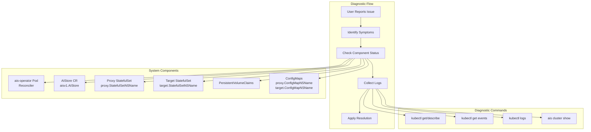
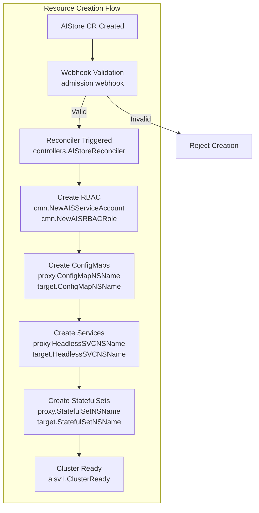

<!-- source: DeepWiki mcp.deepwiki.com · repo NVIDIA/ais-k8s · page 8.3 Troubleshooting Guide · fetched 2026-10-26 -->

# Troubleshooting Guide

<details>
<summary>Relevant source files</summary>

The following files were used as context for generating this wiki page:

- [README.md](README.md)
- [docs/COMPATIBILITY.md](docs/COMPATIBILITY.md)
- [docs/README.md](docs/README.md)
- [docs/network_configuration.md](docs/network_configuration.md)
- [docs/prerequisites.md](docs/prerequisites.md)
- [operator/tests/ci/test_in_cluster.sh](operator/tests/ci/test_in_cluster.sh)
- [operator/tests/e2e/client_cluster.go](operator/tests/e2e/client_cluster.go)
- [operator/tests/e2e/cluster_test.go](operator/tests/e2e/cluster_test.go)
- [operator/tests/e2e/suite_test.go](operator/tests/e2e/suite_test.go)
- [operator/tests/tutils/ais_test_context.go](operator/tests/tutils/ais_test_context.go)
- [operator/tests/tutils/api.go](operator/tests/tutils/api.go)
- [operator/tests/tutils/utils.go](operator/tests/tutils/utils.go)
- [playbooks/README.md](playbooks/README.md)
- [playbooks/ais-deployment/docs/ais_cluster_management.md](playbooks/ais-deployment/docs/ais_cluster_management.md)
- [playbooks/host-config/README.md](playbooks/host-config/README.md)

</details>


This guide provides diagnostic procedures and solutions for common issues encountered when deploying and managing AIStore clusters using the AIStore Kubernetes Operator. It covers operator deployment failures, cluster creation problems, networking issues, storage problems, and operational maintenance tasks.

For general deployment instructions, see [Getting Started](#2). For monitoring and observability setup, see [Monitoring and Observability](#5). For development environment setup, see [Local Development Setup](#6.3).

## Diagnostic Overview

Understanding the AIStore operator architecture is essential for effective troubleshooting. The system uses a controller pattern where the operator continuously reconciles the desired state (defined in `AIStore` custom resources) with the actual cluster state.

## Troubleshooting Architecture



Sources: [operator/tests/tutils/api.go:56-100](), [operator/tests/e2e/client_cluster.go:324-351]()

## Operator Issues

### Operator Pod Not Starting

**Symptoms**: `ais-operator` pod in `CrashLoopBackOff` or `Pending` state

**Diagnostic Commands**:
```bash
kubectl get pods -n ais-operator-system
kubectl describe pod -n ais-operator-system -l control-plane=ais-operator
kubectl logs -n ais-operator-system -l control-plane=ais-operator
```

**Common Causes**:

1. **Insufficient RBAC Permissions**
   - Check if ClusterRole and ClusterRoleBinding exist
   - Verify ServiceAccount has required permissions

2. **Image Pull Issues**
   - Verify image name and tag in deployment
   - Check network connectivity to container registry
   - Validate image pull secrets if using private registry

3. **Resource Constraints**
   - Check node resources and pod resource requests
   - Verify no resource quotas blocking pod creation

**Resolution**:
```bash
# Check RBAC resources
kubectl get clusterrole,clusterrolebinding -l app.kubernetes.io/name=ais-operator

# Verify operator deployment
kubectl get deployment -n ais-operator-system
kubectl describe deployment ais-operator-controller-manager -n ais-operator-system
```

### Operator Not Reconciling AIStore Resources

**Symptoms**: AIStore custom resource exists but no proxy/target pods created

**Diagnostic Commands**:
```bash
kubectl get aistore -A
kubectl describe aistore <cluster-name> -n <namespace>
kubectl get events -n <namespace> --sort-by='.lastTimestamp'
```

**Check Operator Status**:
```bash
# Verify operator is watching the namespace
kubectl logs -n ais-operator-system -l control-plane=ais-operator --tail=100

# Check if AIStore CRD is properly installed
kubectl get crd aistore.ais.nvidia.com
kubectl describe crd aistore.ais.nvidia.com
```

Sources: [operator/tests/tutils/api.go:47-54](), [operator/tests/e2e/suite_test.go:118-134]()

## Cluster Deployment Issues

### AIStore Custom Resource Validation Failures

**Symptoms**: `AIStore` resource rejected during creation or update

The operator includes admission webhooks that validate AIStore specifications before allowing resource creation.

**Diagnostic Commands**:
```bash
kubectl describe aistore <cluster-name> -n <namespace>
kubectl get events -n <namespace> | grep "admission webhook"
```

**Common Validation Errors**:

1. **Invalid Size Configuration**
   - `spec.size` must be > 0
   - `spec.targetSpec.size` (if specified) must be ≤ `spec.size`

2. **Resource Conflicts**
   - Port conflicts between proxy and target specifications
   - Invalid storage class references
   - Malformed image references

### Resource Creation Sequence Issues

The operator creates resources in a specific sequence. Understanding this helps identify where failures occur.



**Diagnostic Procedure**:
```bash
# Check each resource type in order
kubectl get serviceaccount,role,rolebinding -n <namespace> -l app.kubernetes.io/name=<cluster-name>
kubectl get configmap -n <namespace> -l app.kubernetes.io/name=<cluster-name>
kubectl get service -n <namespace> -l app.kubernetes.io/name=<cluster-name>
kubectl get statefulset -n <namespace> -l app.kubernetes.io/name=<cluster-name>
```

Sources: [operator/tests/tutils/api.go:62-99](), [operator/tests/e2e/client_cluster.go:138-146]()

### StatefulSet Pod Creation Failures

**Symptoms**: StatefulSets exist but pods remain in `Pending` or fail to start

**Check StatefulSet Status**:
```bash
kubectl get statefulset -n <namespace>
kubectl describe statefulset <cluster-name>-proxy -n <namespace>
kubectl describe statefulset <cluster-name>-target -n <namespace>
```

**Common Issues**:

1. **PVC Binding Failures**
   ```bash
   kubectl get pvc -n <namespace>
   kubectl describe pvc <pvc-name> -n <namespace>
   ```

2. **Node Scheduling Issues**
   ```bash
   kubectl get pods -n <namespace> -o wide
   kubectl describe pod <pod-name> -n <namespace>
   ```

3. **Resource Constraints**
   ```bash
   kubectl top nodes
   kubectl describe node <node-name>
   ```

## Pod Status and Readiness Issues

### Pod Readiness Failures

AIStore pods must pass both Kubernetes readiness probes and internal cluster registration.

**Check Pod Readiness**:
```bash
kubectl get pods -n <namespace> -o wide
kubectl describe pod <pod-name> -n <namespace>
```

The test utilities provide comprehensive readiness checking logic:

```bash
# Check individual pod readiness status
kubectl get pod <pod-name> -n <namespace> -o jsonpath='{.status.conditions[?(@.type=="Ready")].status}'

# Check container readiness within pod
kubectl get pod <pod-name> -n <namespace> -o jsonpath='{.status.containerStatuses[*].ready}'
```

**AIStore Cluster Map Validation**:
```bash
# Access debug pod or proxy directly
kubectl exec -it <proxy-pod> -n <namespace> -- ais cluster show
```

Sources: [operator/tests/tutils/api.go:442-470](), [operator/tests/e2e/client_cluster.go:154-177]()

### Container Startup Issues

**Check Container Logs**:
```bash
# AIS node container logs
kubectl logs <pod-name> -n <namespace> -c aisnode

# Init container logs
kubectl logs <pod-name> -n <namespace> -c ais-init

# Logs sidecar container
kubectl logs <pod-name> -n <namespace> -c ais-logs
```

**Common Startup Failures**:

1. **Configuration Issues**
   - Verify ConfigMap content: `kubectl get configmap <cluster-name>-proxy -n <namespace> -o yaml`
   - Check mount paths and permissions

2. **Storage Mount Failures**
   - Verify PVC mounting: `kubectl describe pod <pod-name> -n <namespace>`
   - Check node disk availability and permissions

3. **Network Configuration**
   - Verify service discovery works between pods
   - Check DNS resolution within pods

## Storage and Persistent Volume Issues

### PVC Binding Problems

**Symptoms**: Pods stuck in `Pending` state due to unbound PVCs

**Diagnostic Commands**:
```bash
kubectl get pv,pvc -n <namespace>
kubectl describe pvc <pvc-name> -n <namespace>
```

**Check Storage Class**:
```bash
kubectl get storageclass
kubectl describe storageclass <storage-class-name>
```

**Common Issues**:

1. **No Available PVs**
   - For static provisioning, ensure PVs exist and match PVC requirements
   - Check PV node affinity matches pod scheduling

2. **Storage Class Provisioning Failures**
   - Verify dynamic provisioner is running
   - Check provisioner logs and events

3. **Permission Issues**
   - Verify filesystem permissions on host paths
   - Check SELinux/AppArmor policies if applicable

### Data Persistence Issues

**Verify Data Persistence**:
```bash
# Check mount points within AIStore pods
kubectl exec <target-pod> -n <namespace> -- df -h

# Verify AIStore can write to storage
kubectl exec <target-pod> -n <namespace> -- ls -la /ais/
```

Sources: [operator/tests/tutils/api.go:322-356](), [operator/tests/tutils/api.go:124-141]()

## Networking Issues

### Service Discovery Problems

**Symptoms**: Pods cannot communicate with each other or external access fails

**Check Services**:
```bash
kubectl get services -n <namespace>
kubectl describe service <cluster-name>-proxy -n <namespace>
kubectl describe service <cluster-name>-target -n <namespace>
```

**DNS Resolution Testing**:
```bash
# From within a pod
kubectl exec <pod-name> -n <namespace> -- nslookup <cluster-name>-proxy.<namespace>.svc.cluster.local

# Test inter-pod connectivity
kubectl exec <proxy-pod> -n <namespace> -- curl <cluster-name>-target.<namespace>.svc.cluster.local:51081/v1/health
```

### External Access Issues

**Check External Load Balancer** (if `enableExternalLB: true`):
```bash
kubectl get service <cluster-name>-proxy-lb -n <namespace>
kubectl describe service <cluster-name>-proxy-lb -n <namespace>
```

**Port Configuration Issues**:
- Verify proxy and target port specifications don't conflict
- Check host port availability if using `hostPort`
- Validate firewall rules allow required ports

Sources: [operator/tests/e2e/client_cluster.go:224-247](), [operator/tests/tutils/api.go:483-504]()

## Scaling and Update Operations

### Scaling Failures

**Symptoms**: Cluster scale operations don't complete or fail

**Monitor Scaling Progress**:
```bash
kubectl get aistore <cluster-name> -n <namespace> -o yaml
kubectl get statefulset -n <namespace> -w
```

**Check Scaling Events**:
```bash
kubectl get events -n <namespace> --field-selector reason=ScalingReplicaSet
kubectl describe statefulset <cluster-name>-target -n <namespace>
```

**Common Scaling Issues**:

1. **Insufficient Resources**
   - Verify nodes have capacity for additional pods
   - Check resource quotas and limits

2. **PVC Provisioning Delays**
   - Monitor PVC creation for new replicas
   - Verify storage provisioner can handle increased load

3. **Rebalancing Operations**
   - AIStore automatically rebalances data during scaling
   - Monitor cluster status: `kubectl exec <proxy-pod> -n <namespace> -- ais show rebalance`

Sources: [operator/tests/e2e/client_cluster.go:269-293](), [operator/tests/e2e/cluster_test.go:117-168]()

### Upgrade Issues

**Image Update Problems**:
```bash
# Check current images
kubectl get statefulset <cluster-name>-proxy -n <namespace> -o jsonpath='{.spec.template.spec.containers[0].image}'

# Monitor rolling update
kubectl rollout status statefulset/<cluster-name>-proxy -n <namespace>
kubectl rollout status statefulset/<cluster-name>-target -n <namespace>
```

**Compatibility Issues**:
- Verify AIStore and operator version compatibility (see [Compatibility Matrix](#8.1))
- Check for breaking changes in release notes
- Validate init container version matches AIStore version

## Cleanup and Recovery Procedures

### Safe Cluster Shutdown

```bash
# Graceful shutdown via operator
kubectl patch aistore <cluster-name> -n <namespace> --type=merge -p '{"spec": {"shutdownCluster": true}}'

# Wait for pods to terminate
kubectl get pods -n <namespace> -w
```

### Force Cleanup Procedures

**When Normal Deletion Fails**:
```bash
# Remove finalizers if stuck
kubectl patch aistore <cluster-name> -n <namespace> --type=json -p='[{"op": "remove", "path": "/metadata/finalizers"}]'

# Force delete stuck pods
kubectl delete pod <pod-name> -n <namespace> --force --grace-period=0
```

**PVC and PV Cleanup**:
```bash
# List PVCs for the cluster
kubectl get pvc -n <namespace> -l app.kubernetes.io/name=<cluster-name>

# Delete PVCs (will trigger PV deletion based on reclaim policy)
kubectl delete pvc -n <namespace> -l app.kubernetes.io/name=<cluster-name>
```

Sources: [operator/tests/tutils/api.go:102-114](), [operator/tests/tutils/utils.go:105-117](), [operator/tests/e2e/client_cluster.go:295-313]()

### Data Recovery

**Cluster Recovery from Persistent Data**:
When `cleanupMetadata: false`, clusters can recover existing data:

```bash
# Verify data exists on nodes
kubectl exec <target-pod> -n <namespace> -- ls -la /ais/

# Check AIStore metadata recovery
kubectl exec <proxy-pod> -n <namespace> -- ais cluster show
```

**Data Safety Validation**:
```bash
# List existing buckets after recovery
kubectl exec <proxy-pod> -n <namespace> -- ais bucket ls

# Verify object integrity
kubectl exec <proxy-pod> -n <namespace> -- ais object ls ais://<bucket-name>
```

Sources: [operator/tests/e2e/cluster_test.go:275-309]()

## Performance and Resource Monitoring

### Resource Usage Analysis

```bash
# Pod resource consumption
kubectl top pods -n <namespace>

# Node resource usage
kubectl top nodes

# Detailed resource breakdown
kubectl describe node <node-name>
```

### AIStore Performance Metrics

```bash
# Cluster statistics
kubectl exec <proxy-pod> -n <namespace> -- ais show cluster stats

# Individual target statistics
kubectl exec <target-pod> -n <namespace> -- ais show disk

# Network performance
kubectl exec <proxy-pod> -n <namespace> -- ais show performance counters
```

## Common Error Patterns

### Reconciliation Loop Errors

**Symptoms**: Operator logs show repeated reconciliation attempts

**Check Operator Logs**:
```bash
kubectl logs -n ais-operator-system -l control-plane=ais-operator | grep ERROR
```

**Common Patterns**:
- Resource conflicts preventing reconciliation
- External dependencies unavailable (storage, networking)
- Configuration validation failures

### Image Pull Errors

**Registry Access Issues**:
```bash
# Test image pull manually
kubectl run test-pod --image=<ais-image> --rm -it --restart=Never -- /bin/bash

# Check image pull secrets
kubectl get secrets -n <namespace> | grep regcred
```

### Node Affinity and Scheduling Issues

**Check Node Labels and Taints**:
```bash
kubectl get nodes --show-labels
kubectl describe node <node-name> | grep -A5 -B5 "Taints\|Labels"
```

This troubleshooting guide provides systematic approaches to diagnosing and resolving common AIStore operator issues. For additional support, consult the test utilities in [operator/tests/tutils/]() which demonstrate comprehensive validation procedures used in the project's test suite.