# Page: Overview

# Overview

<details>
<summary>Relevant source files</summary>

The following files were used as context for generating this wiki page:

- [README.md](README.md)
- [docs/COMPATIBILITY.md](docs/COMPATIBILITY.md)
- [docs/README.md](docs/README.md)
- [docs/network_configuration.md](docs/network_configuration.md)
- [docs/prerequisites.md](docs/prerequisites.md)
- [operator/README.md](operator/README.md)
- [operator/config/samples/ais_v1beta1_aistore.yaml](operator/config/samples/ais_v1beta1_aistore.yaml)
- [operator/config/samples/ais_v1beta1_aistore_tls_certmanager_csi.yaml](operator/config/samples/ais_v1beta1_aistore_tls_certmanager_csi.yaml)
- [operator/config/samples/ais_v1beta1_aistore_tracing.yaml](operator/config/samples/ais_v1beta1_aistore_tracing.yaml)
- [playbooks/README.md](playbooks/README.md)
- [playbooks/ais-deployment/docs/ais_cluster_management.md](playbooks/ais-deployment/docs/ais_cluster_management.md)
- [playbooks/host-config/README.md](playbooks/host-config/README.md)

</details>


This document provides a comprehensive overview of the AIStore Kubernetes (ais-k8s) repository, which serves as a complete toolkit for deploying and managing AIStore clusters in Kubernetes environments. AIStore is a lightweight, scalable object storage solution designed for AI applications that requires specialized Kubernetes integration for production deployments.

The ais-k8s repository encompasses four primary systems: the AIStore Kubernetes Operator for cluster lifecycle management, Helm Charts for package-based deployment, Ansible Playbooks for infrastructure automation, and a comprehensive monitoring stack. For detailed deployment instructions, see [Getting Started](#2). For operator-specific documentation, see [AIStore Kubernetes Operator](#3).

## System Architecture

The ais-k8s repository implements a multi-layered architecture that provides multiple deployment paths while converging on a unified runtime management system.

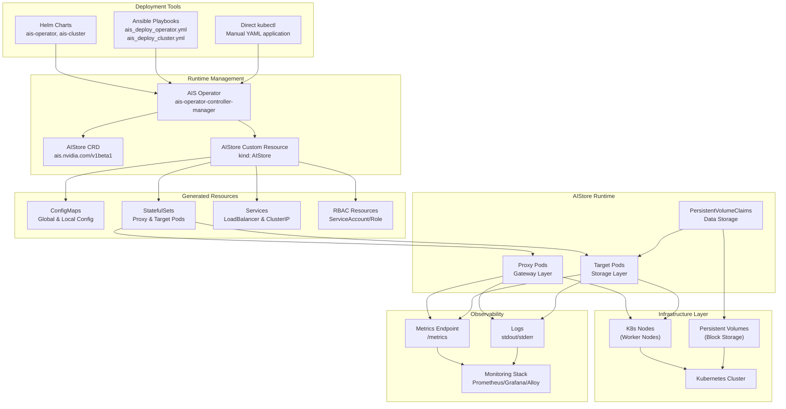

Sources: [README.md:1-36](), [operator/README.md:1-12](), [docs/README.md:35-89]()

## Core Components

### AIStore Kubernetes Operator

The operator implements the standard Kubernetes controller pattern to manage AIStore cluster lifecycle through custom resources. The core controller reconciles the desired state defined in `AIStore` custom resources with the actual cluster state.

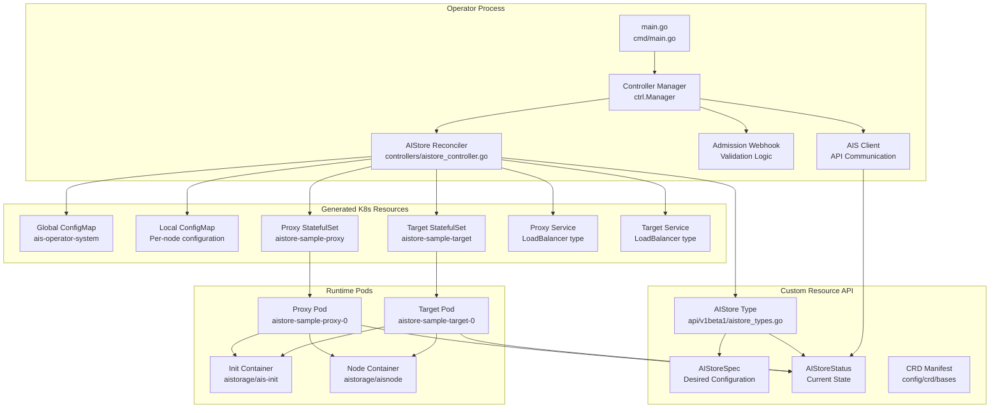

Sources: [operator/README.md:1-12](), [operator/config/samples/ais_v1beta1_aistore.yaml:1-49]()

### Deployment Methods

The repository provides three primary deployment approaches, each targeting different use cases and automation levels.

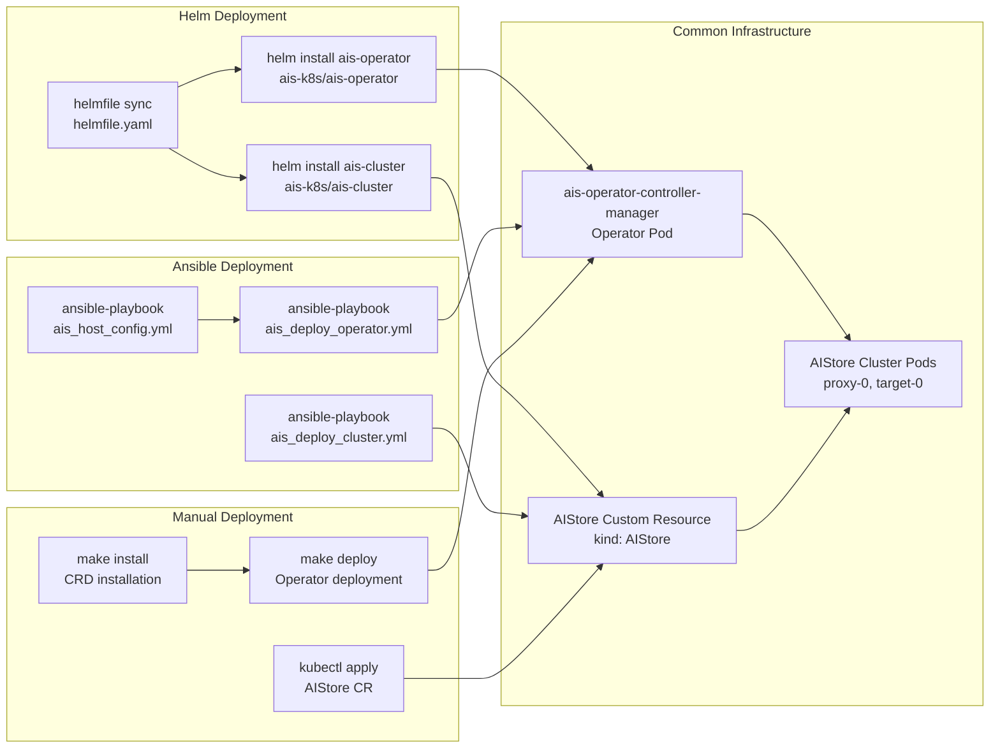

Sources: [docs/README.md:39-71](), [operator/README.md:55-83](), [playbooks/ais-deployment/docs/ais_cluster_management.md:21-82]()

## Configuration and Resource Management

The operator transforms high-level AIStore specifications into concrete Kubernetes resources through a layered configuration system.

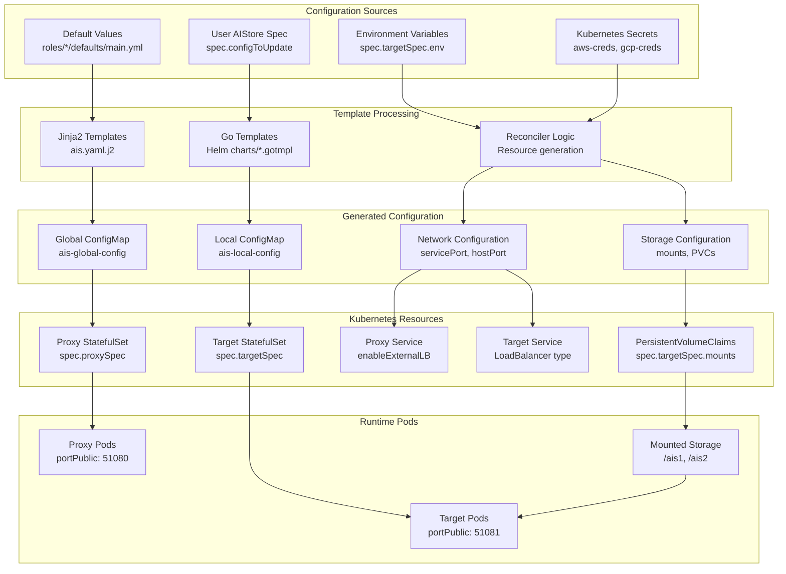

Sources: [operator/config/samples/ais_v1beta1_aistore.yaml:8-31](), [playbooks/ais-deployment/docs/ais_cluster_management.md:41-74]()

## Key Resource Specifications

The AIStore custom resource defines the complete cluster configuration through structured specifications:

| Component | Key Fields | Purpose |
|-----------|------------|---------|
| `spec.size` | Integer | Number of target pods in cluster |
| `spec.proxySpec` | `servicePort`, `hostPort`, `portPublic` | Proxy pod network configuration |
| `spec.targetSpec` | `servicePort`, `hostPort`, `mounts` | Target pod and storage configuration |
| `spec.targetSpec.mounts` | `path`, `size`, `label` | Persistent volume mount specifications |
| `spec.nodeImage` | Container image | AIStore runtime container |
| `spec.initImage` | Container image | Initialization container |
| `spec.enableExternalLB` | Boolean | External LoadBalancer service creation |
| `spec.configToUpdate` | Nested object | AIStore-specific configuration overrides |

Sources: [operator/config/samples/ais_v1beta1_aistore.yaml:1-49]()

## Monitoring and Observability

The monitoring stack provides comprehensive observability for AIStore clusters through industry-standard tools integrated with Kubernetes-native collection mechanisms.

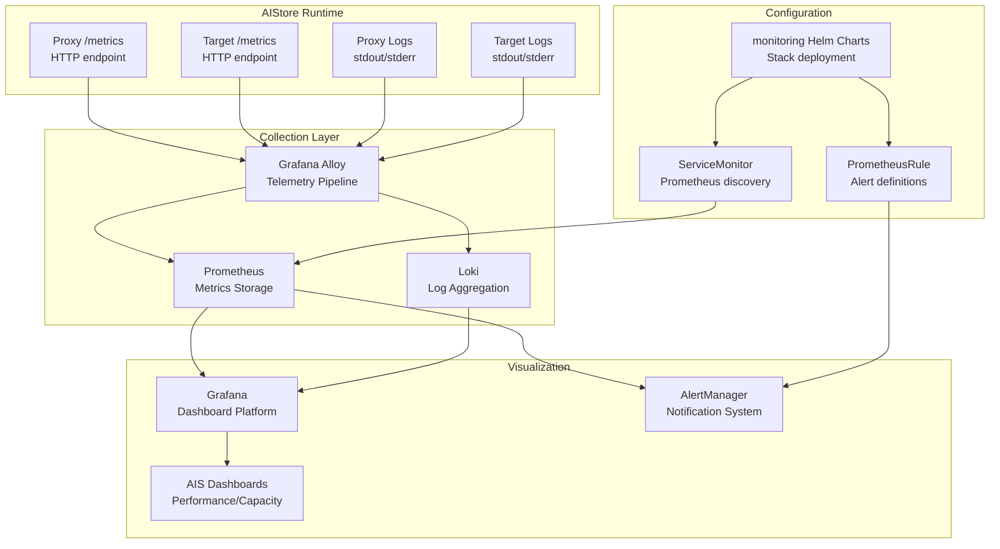

Sources: [docs/README.md:122-127](), [monitoring/README.md]()

## Development and Testing Infrastructure

The repository includes comprehensive development tooling and continuous integration systems for maintaining code quality and deployment reliability.

| Component | Purpose | Key Files |
|-----------|---------|-----------|
| E2E Testing | End-to-end cluster validation | [tests/README.md]() |
| GitHub Actions | CI/CD pipeline automation | [.github/workflows/]() |
| Kind Integration | Local Kubernetes testing | Test configuration |
| Ginkgo Framework | Behavior-driven testing | Test specifications |
| Docker Build | Container image automation | [Makefile](), [Dockerfile]() |

The testing framework validates operator functionality across multiple Kubernetes distributions and deployment scenarios, ensuring compatibility with production environments.

Sources: [operator/README.md:329-332](), [operator/tests/README.md]()

---

# Page: Getting Started

# Getting Started

<details>
<summary>Relevant source files</summary>

The following files were used as context for generating this wiki page:

- [README.md](README.md)
- [docs/COMPATIBILITY.md](docs/COMPATIBILITY.md)
- [docs/README.md](docs/README.md)
- [docs/diagrams/certificates.jpg](docs/diagrams/certificates.jpg)
- [docs/network_configuration.md](docs/network_configuration.md)
- [docs/prerequisites.md](docs/prerequisites.md)
- [helm/README.md](helm/README.md)
- [helm/ais/README.md](helm/ais/README.md)
- [helm/ais/config/tls-cert/sjc11.yaml](helm/ais/config/tls-cert/sjc11.yaml)
- [helm/cluster-issuer/config/sjc11.yaml](helm/cluster-issuer/config/sjc11.yaml)
- [helm/cluster-issuer/config/values-sample.yaml](helm/cluster-issuer/config/values-sample.yaml)
- [helm/cluster-issuer/helmfile.yaml](helm/cluster-issuer/helmfile.yaml)
- [helm/cluster-issuer/issuer-chart/Chart.yaml](helm/cluster-issuer/issuer-chart/Chart.yaml)
- [helm/cluster-issuer/issuer-chart/templates/ca.yaml](helm/cluster-issuer/issuer-chart/templates/ca.yaml)
- [helm/operator/config/tls-cert/sjc11.yaml](helm/operator/config/tls-cert/sjc11.yaml)
- [playbooks/README.md](playbooks/README.md)
- [playbooks/ais-deployment/docs/ais_cluster_management.md](playbooks/ais-deployment/docs/ais_cluster_management.md)
- [playbooks/host-config/README.md](playbooks/host-config/README.md)

</details>


This page provides a quick-start guide for deploying AIStore clusters on Kubernetes using the ais-k8s repository. It covers basic prerequisites, deployment workflows, and initial verification steps to get your first AIStore cluster running.

For detailed deployment procedures and advanced configuration, see [Deployment Methods](#4). For comprehensive prerequisites and system tuning, see [Advanced Configuration](#7). For operator internals and custom resource specifications, see [AIStore Kubernetes Operator](#3).

## Prerequisites Overview

Before deploying AIStore, your Kubernetes environment must meet several basic requirements:

### Infrastructure Requirements

| Component | Requirement | Notes |
|-----------|-------------|-------|
| **Kubernetes** | v1.27+ (v1.31+ recommended) | Any managed or self-hosted cluster |
| **Operating System** | Linux-based (Ubuntu 22.04+ or RHEL 8+ recommended) | Must support extended attributes |
| **Storage** | Formatted drives with XFS filesystem | Each target node needs dedicated storage |
| **Network** | Intra-cluster connectivity, internet access | Ports 51080-51083 for AIStore services |
| **Tools** | `kubectl`, `helm` (optional), `ansible` (optional) | Depends on chosen deployment method |

### Storage Preparation

The AIStore operator does **not** format disks or create persistent volumes. You must:

1. **Format drives** with XFS filesystem and extended attributes enabled
2. **Mount drives** to consistent paths (e.g., `/ais/nvme0n1`, `/ais/nvme1n1`)  
3. **Create PersistentVolumes** referencing the mounted storage

The [ais_datafs_mkfs playbook](playbooks/host-config/docs/ais_datafs.md:1-1)() automates drive formatting, or use the [host-config playbooks](playbooks/host-config/README.md:1-1)() for complete system setup.

**Sources:** [docs/prerequisites.md:15-23](), [docs/README.md:29-33](), [playbooks/host-config/README.md:16-18]()

## Deployment Workflow Overview

AIStore deployment follows a two-stage process regardless of the chosen deployment method:

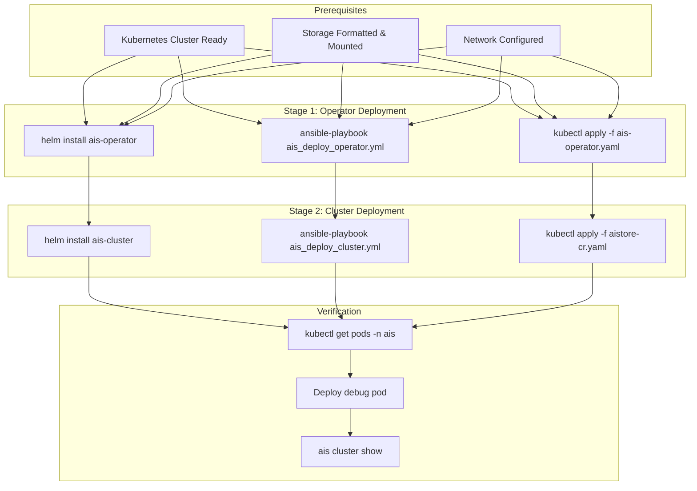

**Deployment Methods Comparison**

| Method | Best For | Key Files | Automation Level |
|--------|----------|-----------|------------------|
| **Helm** | Package management, GitOps | [helm/operator/helmfile.yaml](), [helm/ais/helmfile.yaml]() | Medium |
| **Ansible** | Full automation, production | [playbooks/ais-deployment/ais_deploy_operator.yml](), [playbooks/ais-deployment/ais_deploy_cluster.yml]() | High |  
| **Manual** | Development, testing | [operator/config/manager/manager.yaml](), Custom AIStore CRDs | Low |

**Sources:** [docs/README.md:35-70](), [helm/README.md:26-62](), [playbooks/ais-deployment/docs/ais_cluster_management.md:19-83]()

## Quick Start Methods

### Method 1: Helm Deployment (Recommended)

Helm provides the most straightforward deployment path for most users:

```bash
# Add AIStore Helm repository
helm repo add aistore https://nvidia.github.io/ais-k8s
helm repo update

# Install the operator
helm install ais-operator aistore/ais-operator \
  --namespace ais-operator-system \
  --create-namespace

# Install AIStore cluster  
helm install ais-cluster aistore/ais-cluster \
  --namespace ais \
  --create-namespace \
  --set target.mountPaths='{"/ais/nvme0n1","/ais/nvme1n1"}' \
  --set target.size="2Ti"
```

Key configuration files for customization:
- [helm/operator/config/values-sample.yaml]()
- [helm/ais/config/values-sample.yaml]()

### Method 2: Ansible Automation

For complete automation including host configuration:

```bash
# Configure hosts (optional but recommended)
ansible-playbook -i hosts.ini ais_host_config.yml -e ais_hosts=ais

# Deploy complete stack
ansible-playbook -i hosts.ini ais_deploy.yml -e cluster=ais
```

Key configuration files:
- [playbooks/hosts-example.ini]() - Inventory template
- [playbooks/ais-deployment/vars/ais_mpaths.yml]() - Storage configuration
- [playbooks/ais-deployment/roles/ais_deploy_operator/defaults/main.yml]() - Operator settings

### Method 3: Manual Deployment

For development or custom scenarios:

```bash
# Deploy operator
kubectl apply -f https://github.com/NVIDIA/ais-k8s/releases/download/v2.2.0/ais-operator.yaml

# Create AIStore custom resource (example)
kubectl apply -f - <<EOF
apiVersion: ais.nvidia.com/v1beta1
kind: AIStore
metadata:
  name: ais
  namespace: ais
spec:
  size: 3
  image: aistorage/aisnode:v3.28
  targetSpec:
    mounts:
    - path: "/ais/nvme0n1"
      size: "2Ti"
    - path: "/ais/nvme1n1" 
      size: "2Ti"
EOF
```

**Sources:** [helm/README.md:44-62](), [playbooks/README.md:28-39](), [docs/README.md:47-70](), [docs/COMPATIBILITY.md:44-66]()

## Component Architecture and File Mapping

The following diagram shows how deployment artifacts map to runtime components:

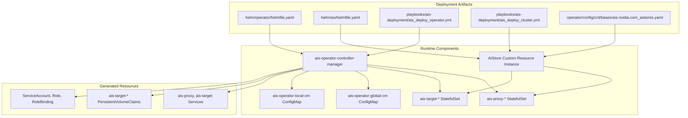

**Key Custom Resource Reconciliation Flow:**

The [AIStoreReconciler](operator/controllers/aistore_controller.go:1-1)() watches `AIStore` custom resources and generates:

1. **ConfigMaps**: Global and local AIStore configuration
2. **StatefulSets**: `ais-proxy` and `ais-target` workloads  
3. **Services**: Load balancers for proxy and target access
4. **PVCs**: Storage claims for target pods
5. **RBAC**: Required permissions for AIStore pods

**Sources:** [operator/controllers/aistore_controller.go:1-1](), [operator/api/v1beta1/aistore_types.go:1-1](), [helm/ais/charts/ais-cluster/templates/ais.yaml:1-1]()

## Post-Deployment Verification

### Check Pod Status

Verify all AIStore components are running:

```bash
# Check operator
kubectl get pods -n ais-operator-system

# Check AIStore cluster 
kubectl get pods -n ais
kubectl get aistore -n ais
```

Expected output shows all pods in `Running` state and AIStore custom resource in `Ready` condition.

### Deploy Debug Pod

Use the provided debug pod for cluster interaction:

```bash
kubectl apply -f https://raw.githubusercontent.com/NVIDIA/ais-k8s/main/manifests/debug/aisnode_debug.yaml

# Access debug pod
kubectl -n ais exec -it pods/aisnode-debug -- bash

# Inside debug pod
export AIS_ENDPOINT=http://ais-proxy:51080
ais cluster show
```

The [aisnode_debug.yaml](manifests/debug/aisnode_debug.yaml:1-1)() includes the AIStore CLI pre-installed for cluster management.

### Verify Cluster Health

Key verification commands inside the debug pod:

```bash
# Cluster status
ais cluster show

# Node information  
ais cluster show proxy
ais cluster show target

# Storage information
ais storage mountpath
ais storage capacity
```

**Sources:** [docs/README.md:91-121](), [manifests/debug/aisnode_debug.yaml:1-1]()

## Next Steps

After successful deployment and verification:

1. **External Access**: Configure ingress or load balancers for external access - see [Operator Documentation](#3)
2. **Monitoring**: Set up Prometheus and Grafana monitoring - see [Monitoring and Observability](#5)  
3. **Security**: Configure TLS certificates and authentication - see [TLS and Security](#7.2)
4. **Cloud Integration**: Connect to cloud storage backends - see [Cloud Backend Integration](#7.3)
5. **Performance Testing**: Run load tests with `aisloader` - see [Development and Testing](#6)

For production deployments, also review:
- [Multi-Environment Deployment](#7.1) for environment-specific configurations
- [Troubleshooting Guide](#8.3) for common deployment issues
- [Configuration Reference](#8.1) for complete AIStore CRD documentation

**Sources:** [docs/README.md:122-139](), [monitoring/README.md:1-1]()

---

# Page: AIStore Kubernetes Operator

# AIStore Kubernetes Operator

<details>
<summary>Relevant source files</summary>

The following files were used as context for generating this wiki page:

- [.gitlab-ci.yml](.gitlab-ci.yml)
- [operator/CHANGELOG.md](operator/CHANGELOG.md)
- [operator/Makefile](operator/Makefile)
- [operator/README.md](operator/README.md)
- [operator/cmd/main.go](operator/cmd/main.go)
- [operator/config/samples/ais_v1beta1_aistore.yaml](operator/config/samples/ais_v1beta1_aistore.yaml)
- [operator/config/samples/ais_v1beta1_aistore_tls_certmanager_csi.yaml](operator/config/samples/ais_v1beta1_aistore_tls_certmanager_csi.yaml)
- [operator/config/samples/ais_v1beta1_aistore_tracing.yaml](operator/config/samples/ais_v1beta1_aistore_tracing.yaml)
- [operator/go.mod](operator/go.mod)
- [operator/go.sum](operator/go.sum)
- [operator/pkg/resources/cmn/config.go](operator/pkg/resources/cmn/config.go)
- [operator/pkg/resources/cmn/rbac.go](operator/pkg/resources/cmn/rbac.go)
- [operator/pkg/services/aisapi.go](operator/pkg/services/aisapi.go)
- [operator/pkg/services/client_manager.go](operator/pkg/services/client_manager.go)
- [operator/pkg/services/mocks/client.go](operator/pkg/services/mocks/client.go)
- [operator/scripts/test.sh](operator/scripts/test.sh)
- [operator/tests/tutils/ais_cluster.go](operator/tests/tutils/ais_cluster.go)

</details>


The AIStore Kubernetes Operator is the core system component that manages the lifecycle of AIStore clusters on Kubernetes. This document provides an overview of the operator's purpose, architecture, and key functionality. For detailed information about the operator's internal architecture, see [Operator Architecture](#3.1). For specifics about the AIStore Custom Resource Definition, see [Custom Resources](#3.2). For details about how the operator manages Kubernetes resources, see [Resource Management](#3.3).

The operator extends the native Kubernetes API through Custom Resource Definitions (CRDs) to provide declarative management of AIStore clusters, handling deployment, scaling, upgrades, and decommissioning operations automatically.

## Operator Overview

The AIStore Kubernetes Operator is built using the [Operator SDK](https://sdk.operatorframework.io/) and follows the standard Kubernetes controller pattern. It watches for changes to `AIStore` custom resources and reconciles the actual cluster state with the desired state specified in the resource.

### Core Operator Architecture

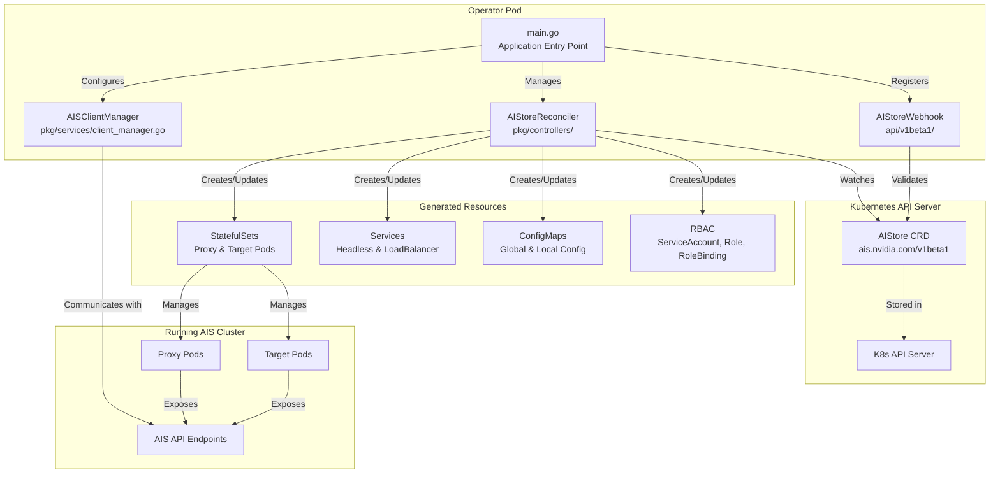

**Operator Core Architecture**

The operator consists of several key components that work together to manage AIStore clusters. The main controller reconciles the desired state with actual cluster state, while the webhook validates configurations before they are applied.

Sources: [operator/cmd/main.go:47-225](), [operator/pkg/controllers/](), [operator/api/v1beta1/](), [operator/pkg/services/client_manager.go:56-63]()

## Reconciliation Loop

The operator implements the standard Kubernetes controller reconciliation pattern, continuously monitoring and adjusting cluster state based on the `AIStore` custom resource specifications.

### Reconciliation Flow

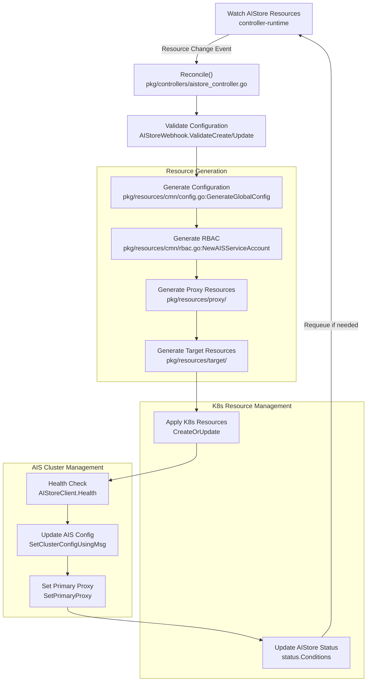

**Reconciliation Flow Diagram**

The reconciliation process begins when the controller-runtime framework detects changes to `AIStore` resources. The operator validates the configuration, generates the necessary Kubernetes resources, applies them to the cluster, and then communicates with the running AIS cluster to ensure proper configuration.

Sources: [operator/pkg/controllers/](), [operator/pkg/resources/cmn/config.go:28-38](), [operator/pkg/resources/cmn/rbac.go:83-91](), [operator/pkg/services/aisapi.go:104-130]()

## Resource Management

The operator generates and manages a comprehensive set of Kubernetes resources to support AIStore cluster operations. Each `AIStore` custom resource results in the creation of multiple dependent resources.

### Generated Kubernetes Resources

| Resource Type | Purpose | Key Files |
|---------------|---------|-----------|
| **StatefulSets** | Manages proxy and target pods with stable identities | `pkg/resources/proxy/`, `pkg/resources/target/` |
| **Services** | Provides network access (headless and LoadBalancer) | `pkg/resources/proxy/service.go`, `pkg/resources/target/service.go` |
| **ConfigMaps** | Stores AIS configuration (global and local) | `pkg/resources/cmn/config.go` |
| **ServiceAccount** | Provides pod identity and RBAC permissions | `pkg/resources/cmn/rbac.go:83-91` |
| **Role & RoleBinding** | Grants necessary Kubernetes API permissions | `pkg/resources/cmn/rbac.go:36-81` |
| **PersistentVolumeClaims** | Manages storage for target pods | Generated based on `targetSpec.mounts` |

The operator uses a declarative approach where each resource is generated based on the `AIStore` specification and applied using the controller-runtime's `CreateOrUpdate` pattern.

Sources: [operator/pkg/resources/](), [operator/pkg/resources/cmn/rbac.go:36-91](), [operator/pkg/resources/cmn/config.go:24-38]()

## TLS and Security Configuration

The operator supports comprehensive TLS configuration for both its own operation and the AIStore clusters it manages.

### Operator TLS Architecture

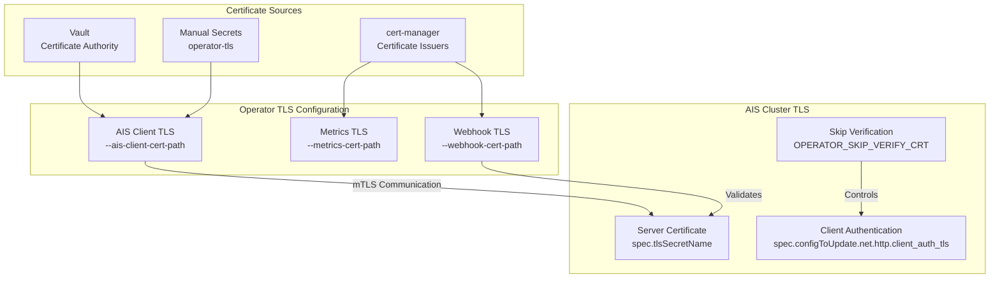

**TLS Configuration Architecture**

The operator supports multiple TLS configurations including webhook validation, metrics serving, and client authentication with AIStore clusters. Certificate management can be handled through cert-manager, Vault, or manual secret creation.

Sources: [operator/cmd/main.go:65-74](), [operator/pkg/services/client_manager.go:167-179](), [operator/config/samples/ais_v1beta1_aistore_tls_certmanager_csi.yaml:70-78]()

### TLS Configuration Options

The operator provides several TLS-related configuration options:

- **Webhook TLS**: Required for admission webhook validation, configured via `--webhook-cert-path`
- **Metrics TLS**: Optional HTTPS serving for metrics endpoint, configured via `--metrics-cert-path`  
- **AIS Client TLS**: Enables mTLS communication with AIStore clusters, configured via `--ais-client-cert-path`
- **Certificate Verification**: Controlled by `OPERATOR_SKIP_VERIFY_CRT` environment variable

The operator automatically loads CA certificates from `/etc/ais/ca` when validating AIS cluster certificates and supports per-cluster certificate paths when `--ais-client-cert-per-cluster` is enabled.

Sources: [operator/pkg/services/client_manager.go:28-33](), [operator/pkg/services/client_manager.go:225-257](), [operator/pkg/services/client_manager.go:218-223]()

## Testing Framework

The operator includes a comprehensive testing framework supporting both unit tests and end-to-end testing scenarios.

### Test Infrastructure

The testing infrastructure uses [Ginkgo](https://onsi.github.io/ginkgo/) for BDD-style testing and includes utilities for creating test clusters and validating operator behavior.

**Key Testing Components:**
- **Unit Tests**: Test individual components and functions in isolation
- **E2E Tests**: Test complete operator functionality against real Kubernetes clusters
- **Test Utilities**: Helper functions for creating test AIStore clusters in [operator/tests/tutils/ais_cluster.go:79-83]()
- **CI Integration**: GitLab CI configuration for automated testing in [.gitlab-ci.yml:96-117]()

The test framework supports both ephemeral clusters (for CI) and persistent clusters (for development) through environment variables like `TEST_EPHEMERAL_CLUSTER`.

Sources: [operator/tests/tutils/ais_cluster.go:24-32](), [operator/tests/tutils/ais_cluster.go:62-77](), [operator/scripts/test.sh:15-22](), [.gitlab-ci.yml:36-53]()

## Development and Build Process

The operator uses a standard Go development workflow with Make-based automation for building, testing, and deployment.

### Build and Development Workflow

Key development commands defined in [operator/Makefile:51-331]():

- `make build` - Builds the operator binary
- `make docker-build` - Creates container image  
- `make deploy` - Deploys operator to Kubernetes cluster
- `make test` - Runs unit tests
- `make test-e2e` - Runs end-to-end tests
- `make manifests` - Generates CRD and RBAC manifests
- `make generate` - Updates auto-generated code

The operator follows semantic versioning with version information embedded during build time through the `BUILD_VERSION` variable.

Sources: [operator/Makefile:1-331](), [operator/go.mod:1-131](), [operator/cmd/main.go:36-38]()

---

# Page: Operator Architecture

# Operator Architecture

<details>
<summary>Relevant source files</summary>

The following files were used as context for generating this wiki page:

- [operator/CHANGELOG.md](operator/CHANGELOG.md)
- [operator/api/v1beta1/aistore_webhook.go](operator/api/v1beta1/aistore_webhook.go)
- [operator/cmd/main.go](operator/cmd/main.go)
- [operator/pkg/client/api.go](operator/pkg/client/api.go)
- [operator/pkg/controllers/cluster_cleanup.go](operator/pkg/controllers/cluster_cleanup.go)
- [operator/pkg/controllers/cluster_controller.go](operator/pkg/controllers/cluster_controller.go)
- [operator/pkg/controllers/cluster_controller_test.go](operator/pkg/controllers/cluster_controller_test.go)
- [operator/pkg/controllers/proxy_controller.go](operator/pkg/controllers/proxy_controller.go)
- [operator/pkg/controllers/target_controllers.go](operator/pkg/controllers/target_controllers.go)
- [operator/pkg/resources/cmn/rbac.go](operator/pkg/resources/cmn/rbac.go)
- [operator/pkg/services/aisapi.go](operator/pkg/services/aisapi.go)
- [operator/pkg/services/client_manager.go](operator/pkg/services/client_manager.go)
- [operator/pkg/services/mocks/client.go](operator/pkg/services/mocks/client.go)

</details>


This page covers the internal architecture of the AIStore Kubernetes operator, including the reconciliation loop, component relationships, and key subsystems. For information about deploying the operator, see [Deployment Methods](#4). For details about the Custom Resource Definition and configuration options, see [Custom Resources](#3.2).

## Core Reconciliation Architecture

The AIStore operator follows the standard Kubernetes controller pattern with a primary reconciler that manages the lifecycle of AIStore clusters through custom resources.

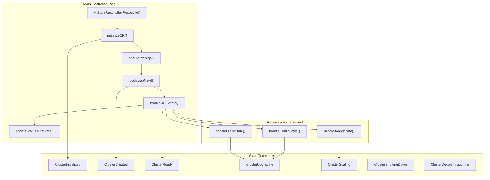

The `AIStoreReconciler` implements the main reconciliation logic with distinct phases for initialization, bootstrapping, and ongoing management. Each reconciliation cycle moves the cluster through well-defined states based on the current conditions and desired configuration.

**Sources:** [operator/pkg/controllers/cluster_controller.go:43-152]()

## Component Architecture

The operator consists of several key components that work together to manage AIStore clusters:

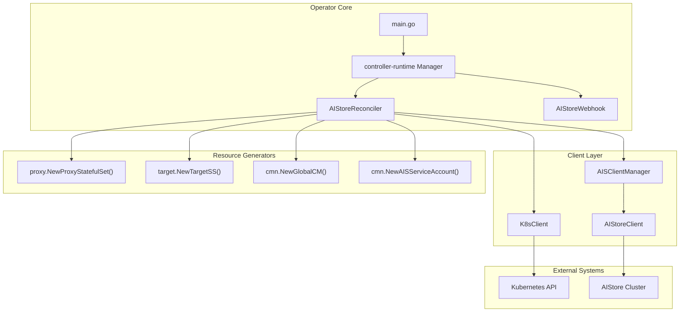

The `AIStoreReconciler` serves as the central orchestrator, delegating to specialized components for Kubernetes API interactions, AIStore API communication, and resource generation. The controller-runtime `Manager` handles the lifecycle and dependency injection for all components.

**Sources:** [operator/cmd/main.go:149-180](), [operator/pkg/controllers/cluster_controller.go:42-59]()

## Reconciliation Flow Details

The reconciler implements a sophisticated state machine that handles various cluster lifecycle scenarios:

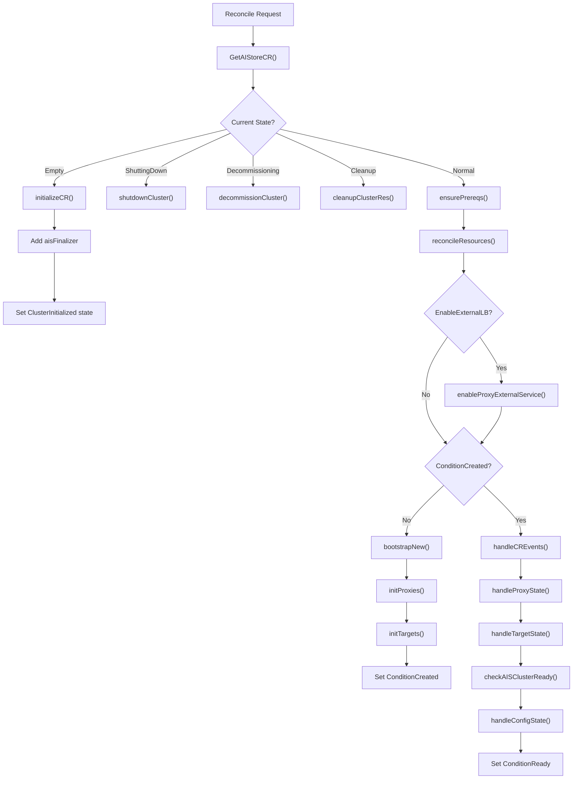

The reconciler maintains consistent state progression through careful ordering of operations and requeue logic for operations that require multiple reconciliation cycles to complete.

**Sources:** [operator/pkg/controllers/cluster_controller.go:75-152](), [operator/pkg/controllers/cluster_controller.go:354-441](), [operator/pkg/controllers/cluster_controller.go:479-530]()

## Admission Webhook System

The operator includes an admission webhook that validates AIStore custom resource specifications before they are persisted to etcd:

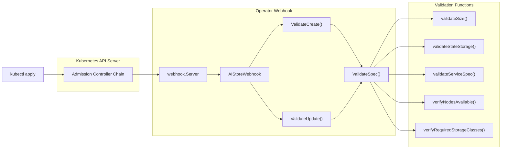

The webhook performs comprehensive validation including cluster sizing, storage configuration, port specifications, and resource availability checks against the target Kubernetes cluster.

**Sources:** [operator/api/v1beta1/aistore_webhook.go:32-142](), [operator/cmd/main.go:182-191]()

## AIS API Client Management

The operator maintains connections to AIStore clusters through a sophisticated client management system that handles authentication, TLS configuration, and connection pooling:

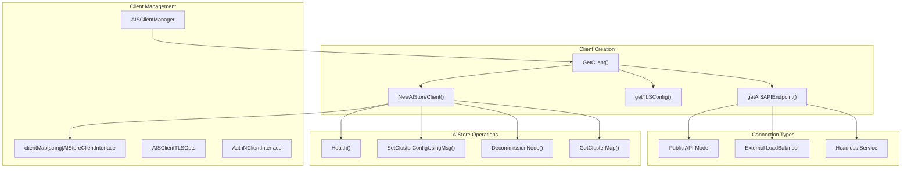

The client manager automatically selects the appropriate connection method based on cluster configuration and caches clients for reuse across reconciliation cycles.

**Sources:** [operator/pkg/services/client_manager.go:56-110](), [operator/pkg/services/aisapi.go:104-130]()

## Resource Generation and Management

The operator generates all necessary Kubernetes resources through specialized factory functions that ensure consistency and proper ownership relationships:

```mermaid
graph TB
    subgraph "Resource Categories"
        RBAC["RBAC Resources"]
        Config["Configuration"]
        StatefulSets["StatefulSets"]
        Services["Services"]
        Storage["Storage"]
    end
    
    subgraph "RBAC Generation"
        ServiceAccount["NewAISServiceAccount()"]
        Role["NewAISRBACRole()"]
        RoleBinding["NewAISRBACRoleBinding()"]
    end
    
    subgraph "Configuration Generation"
        GlobalCM["NewGlobalCM()"]
        ProxyCM["NewProxyCM()"]
        TargetCM["NewTargetCM()"]
        StatsDCM["NewStatsDCM()"]
    end
    
    subgraph "Workload Generation"
        ProxySS["NewProxyStatefulSet()"]
        TargetSS["NewTargetSS()"]
        ProxyHeadlessSvc["NewProxyHeadlessSvc()"]
        TargetHeadlessSvc["NewTargetHeadlessSvc()"]
        ProxyLBSvc["NewProxyLoadBalancerSVC()"]
        TargetLBSvcList["NewLoadBalancerSVCList()"]
    end
    
    subgraph "Management Functions"
        CreateOrUpdate["CreateOrUpdateResource()"]
        SetOwnerRef["SetControllerReference()"]
        PatchStatus["patchStatus()"]
    end
    
    RBAC --> ServiceAccount
    RBAC --> Role
    RBAC --> RoleBinding
    
    Config --> GlobalCM
    Config --> ProxyCM
    Config --> TargetCM
    Config --> StatsDCM
    
    StatefulSets --> ProxySS
    StatefulSets --> TargetSS
    
    Services --> ProxyHeadlessSvc
    Services --> TargetHeadlessSvc
    Services --> ProxyLBSvc
    Services --> TargetLBSvcList
    
    ServiceAccount --> CreateOrUpdate
    GlobalCM --> CreateOrUpdate
    ProxySS --> CreateOrUpdate
    CreateOrUpdate --> SetOwnerRef
    CreateOrUpdate --> PatchStatus
```

Each resource type has dedicated factory functions that generate properly configured Kubernetes objects with appropriate labels, annotations, and owner references for garbage collection.

**Sources:** [operator/pkg/controllers/cluster_controller.go:631-664](), [operator/pkg/resources/cmn/rbac.go:36-91](), [operator/pkg/client/api.go:234-270]()

## Pod Template Synchronization

The operator implements sophisticated pod template comparison and synchronization logic to handle rolling updates while maintaining cluster stability:

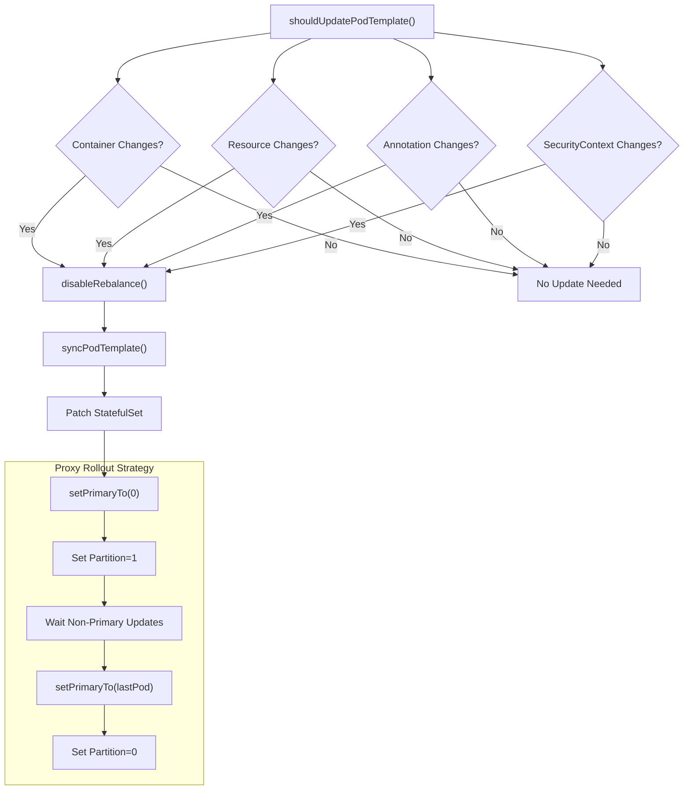

The pod template synchronization includes special handling for proxy rolling updates to ensure the primary proxy is updated last, maintaining cluster availability throughout the upgrade process.

**Sources:** [operator/pkg/controllers/cluster_controller.go:759-900](), [operator/pkg/controllers/proxy_controller.go:166-251](), [operator/pkg/controllers/target_controllers.go:269-290]()

---

# Page: Custom Resources

# Custom Resources

<details>
<summary>Relevant source files</summary>

The following files were used as context for generating this wiki page:

- [operator/README.md](operator/README.md)
- [operator/api/v1beta1/aisconfig.go](operator/api/v1beta1/aisconfig.go)
- [operator/api/v1beta1/aistore_types.go](operator/api/v1beta1/aistore_types.go)
- [operator/api/v1beta1/util_types.go](operator/api/v1beta1/util_types.go)
- [operator/api/v1beta1/zz_generated.deepcopy.go](operator/api/v1beta1/zz_generated.deepcopy.go)
- [operator/config/samples/ais_v1beta1_aistore.yaml](operator/config/samples/ais_v1beta1_aistore.yaml)
- [operator/config/samples/ais_v1beta1_aistore_tls_certmanager_csi.yaml](operator/config/samples/ais_v1beta1_aistore_tls_certmanager_csi.yaml)
- [operator/config/samples/ais_v1beta1_aistore_tracing.yaml](operator/config/samples/ais_v1beta1_aistore_tracing.yaml)
- [operator/pkg/resources/cmn/configmap.go](operator/pkg/resources/cmn/configmap.go)
- [operator/pkg/resources/cmn/env.go](operator/pkg/resources/cmn/env.go)
- [operator/pkg/resources/cmn/res.go](operator/pkg/resources/cmn/res.go)
- [operator/pkg/resources/cmn/statefulset.go](operator/pkg/resources/cmn/statefulset.go)
- [operator/pkg/resources/cmn/statefulset_test.go](operator/pkg/resources/cmn/statefulset_test.go)
- [operator/pkg/resources/proxy/statefulset.go](operator/pkg/resources/proxy/statefulset.go)
- [operator/pkg/resources/target/statefulset.go](operator/pkg/resources/target/statefulset.go)

</details>


This page documents the Custom Resource Definitions (CRDs) used by the AIStore Kubernetes Operator to declaratively manage AIStore clusters. The custom resources serve as the primary interface between users and the operator, defining the desired state of AIStore deployments.

For information about how the operator processes these resources, see [Operator Architecture](#3.1). For details on how custom resources are translated into Kubernetes objects, see [Resource Management](#3.3).

## AIStore Custom Resource Overview

The AIStore operator defines a single primary custom resource type that encapsulates the entire cluster specification. This resource follows Kubernetes conventions with a spec-status pattern for declarative management.

**AIStore Custom Resource Structure**
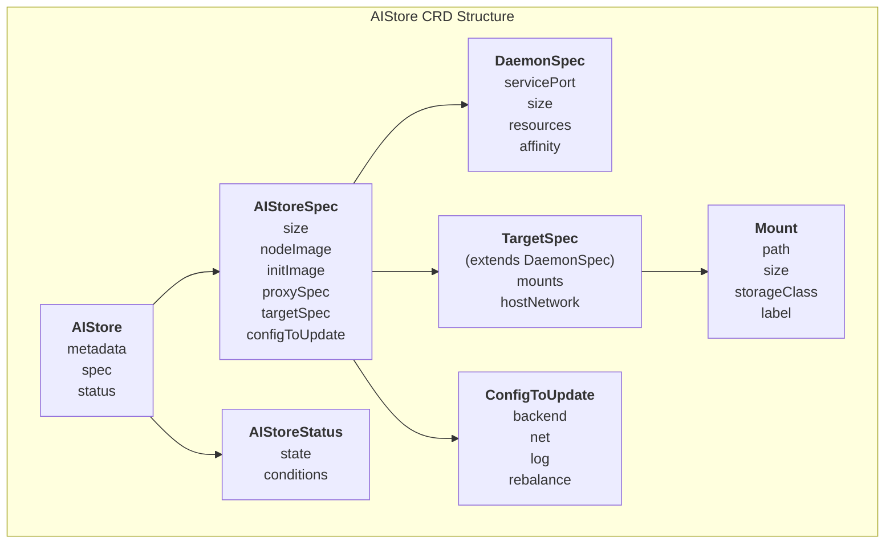

Sources: [operator/api/v1beta1/aistore_types.go:87-192](), [operator/api/v1beta1/aistore_types.go:296-302]()

## Core Resource Types

### AIStore Resource

The `AIStore` custom resource is the primary interface for managing AIStore clusters. It defines the complete desired state of an AIStore deployment.

| Field | Type | Description |
|-------|------|-------------|
| `metadata` | `metav1.ObjectMeta` | Standard Kubernetes metadata |
| `spec` | `AIStoreSpec` | Desired cluster configuration |
| `status` | `AIStoreStatus` | Observed cluster state |

**Key Methods:**
- `GetProxySize()` and `GetTargetSize()` - Calculate effective cluster sizes
- `GetDefaultProxyURL()` - Generate internal proxy endpoint URLs
- `ShouldDecommission()` - Determine if cluster should be torn down

Sources: [operator/api/v1beta1/aistore_types.go:296-302](), [operator/api/v1beta1/aistore_types.go:377-389]()

### AIStoreSpec Structure

The `AIStoreSpec` defines the desired configuration for an AIStore cluster:

```yaml
spec:
  size: 3                              # Overall cluster size
  nodeImage: "aistorage/aisnode:v3.25" # AIStore daemon image
  initImage: "aistorage/ais-init:v3.25" # Initialization container image
  stateStorageClass: "fast-ssd"        # Storage class for state persistence
  enableExternalLB: true               # Enable external access
  
  proxySpec:                           # Proxy (gateway) configuration
    size: 2                            # Override cluster size for proxies
    servicePort: 51080
    resources: { ... }
    
  targetSpec:                          # Target (storage) configuration  
    size: 3                            # Override cluster size for targets
    servicePort: 51081
    mounts:                            # Storage mount points
      - path: "/ais1"
        size: 100Gi
        storageClass: "fast-storage"
        
  configToUpdate:                      # AIS-specific configuration
    rebalance:
      enabled: true
    net:
      http:
        use_https: true
```

Sources: [operator/api/v1beta1/aistore_types.go:87-192](), [operator/config/samples/ais_v1beta1_aistore.yaml:1-49]()

### Daemon Specifications

Both proxy and target pods share a common `DaemonSpec` structure for deployment configuration:

**DaemonSpec Fields:**
- `servicePort`, `publicPort`, `intraControlPort`, `intraDataPort` - Network configuration
- `size` - Number of replicas (overrides cluster-level size)
- `resources` - CPU, memory, and storage requirements
- `affinity`, `nodeSelector`, `tolerations` - Pod placement controls
- `env` - Additional environment variables

**TargetSpec Extensions:**
- `mounts` - Array of `Mount` objects defining storage volumes
- `hostNetwork` - Enable host networking for multi-homing
- `disablePodAntiAffinity` - Allow multiple targets per node (testing only)

Sources: [operator/api/v1beta1/aistore_types.go:218-264](), [operator/api/v1beta1/aistore_types.go:266-276]()

## Storage Mount Configuration

Target nodes require storage mount configuration through the `Mount` type:

```yaml
targetSpec:
  mounts:
    - path: "/ais1"           # Mount path inside container
      size: 100Gi             # PVC size request
      storageClass: "fast"    # Kubernetes StorageClass
      label: "disk1"          # AIS disk label for sharing
      selector:               # PV selector (optional)
        matchLabels:
          disk-type: "nvme"
```

**Mount Label Usage:**
- Same `label` allows mount paths to share underlying storage
- Required for development environments without dedicated disks
- Enables disk-less operation when label doesn't match actual hardware

Sources: [operator/api/v1beta1/aistore_types.go:278-287](), [operator/config/samples/ais_v1beta1_aistore.yaml:22-31]()

## Cluster State Management

**Cluster State Lifecycle**
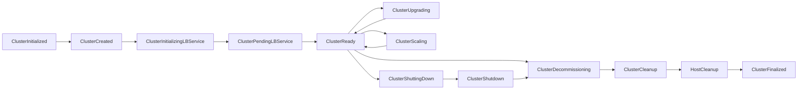

**Cluster States:**
- `ClusterReady` - Fully operational cluster
- `ClusterUpgrading` - Rolling update in progress  
- `ClusterScaling` - Replica count changes
- `ClusterDecommissioning` - Permanent teardown initiated

**Condition Types:**
- `ConditionReady` - Cluster operational status
- `ConditionCreated` - Basic resources exist
- `ConditionReadyRebalance` - Rebalancing capability status

Sources: [operator/api/v1beta1/aistore_types.go:30-57](), [operator/api/v1beta1/aistore_types.go:61-77]()

## AIS Configuration Management

The `ConfigToUpdate` structure provides fine-grained control over AIStore daemon configuration:

**Major Configuration Sections:**
- `backend` - Cloud provider backend settings
- `net.http` - TLS and networking configuration  
- `log` - Logging levels and rotation
- `rebalance` - Data rebalancing behavior
- `space` - Storage capacity thresholds
- `timeout` - Various timeout values

**Example TLS Configuration:**
```yaml
configToUpdate:
  net:
    http:
      use_https: true
      server_crt: "/var/certs/tls.crt"
      server_key: "/var/certs/tls.key"
      skip_verify: true
```

The operator converts these settings to AIStore's native configuration format using the `Convert()` method.

Sources: [operator/api/v1beta1/aisconfig.go:18-252](), [operator/api/v1beta1/aisconfig.go:275-279]()

## Security and Secret Integration

The AIStore resource integrates with Kubernetes secrets for secure credential management:

**Secret Reference Fields:**
- `tlsSecretName` - TLS certificates for HTTPS
- `awsSecretName`, `gcpSecretName`, `ociSecretName` - Cloud provider credentials
- `authNSecretName` - Authentication signing keys
- `tracingTokenSecretName` - Distributed tracing tokens

**Certificate Manager Integration:**
- `tlsCertManagerIssuerName` - Cert-manager issuer for automatic certificates
- Supports CSI driver integration for dynamic certificate provisioning

Sources: [operator/api/v1beta1/aistore_types.go:153-183](), [operator/config/samples/ais_v1beta1_aistore_tls_certmanager_csi.yaml:44-91]()

## Resource Validation and Webhooks

The operator includes validation webhooks to ensure resource correctness:

**Built-in Validations:**
- Cluster size must be specified either globally or per-daemon type
- Storage mount paths must be absolute
- Resource quantities must be valid Kubernetes formats
- Network ports must be within valid ranges

**Custom Validation Rules:**
```go
// Example validation from CRD annotations
+kubebuilder:validation:XValidation:rule="(has(self.targetSpec.size) && has(self.proxySpec.size)) || (has(self.size) && self.size > 0)",message="Invalid cluster size"
```

Sources: [operator/api/v1beta1/aistore_types.go:88](), [operator/README.md:22-26]()

## Custom Resource Examples

**Minimal Development Cluster:**
```yaml
apiVersion: ais.nvidia.com/v1beta1
kind: AIStore
metadata:
  name: dev-cluster
spec:
  size: 1
  nodeImage: "aistorage/aisnode:latest"
  initImage: "aistorage/ais-init:latest"
  proxySpec:
    servicePort: 51080
  targetSpec:
    servicePort: 51081
    mounts:
      - path: "/ais1"
        size: 10Gi
        label: "shared-disk"  # Allow disk sharing for development
```

**Production Cluster with External Access:**
```yaml
apiVersion: ais.nvidia.com/v1beta1
kind: AIStore
metadata:
  name: prod-cluster
spec:
  size: 6
  enableExternalLB: true
  stateStorageClass: "fast-ssd"
  nodeImage: "aistorage/aisnode:v3.25"
  initImage: "aistorage/ais-init:v3.25"
  
  proxySpec:
    size: 3
    resources:
      requests:
        memory: "4Gi"
        cpu: "2"
  
  targetSpec:
    size: 6
    resources:
      requests:
        memory: "8Gi"
        cpu: "4"
    mounts:
      - path: "/ais1"
        size: 1Ti
        storageClass: "fast-nvme"
      - path: "/ais2" 
        size: 1Ti
        storageClass: "fast-nvme"
```

Sources: [operator/config/samples/ais_v1beta1_aistore.yaml:1-49](), [operator/config/samples/ais_v1beta1_aistore_tracing.yaml:1-49]()

---

# Page: Resource Management

# Resource Management

<details>
<summary>Relevant source files</summary>

The following files were used as context for generating this wiki page:

- [operator/api/v1beta1/aistore_webhook.go](operator/api/v1beta1/aistore_webhook.go)
- [operator/pkg/client/api.go](operator/pkg/client/api.go)
- [operator/pkg/controllers/cluster_cleanup.go](operator/pkg/controllers/cluster_cleanup.go)
- [operator/pkg/controllers/cluster_controller.go](operator/pkg/controllers/cluster_controller.go)
- [operator/pkg/controllers/cluster_controller_test.go](operator/pkg/controllers/cluster_controller_test.go)
- [operator/pkg/controllers/proxy_controller.go](operator/pkg/controllers/proxy_controller.go)
- [operator/pkg/controllers/target_controllers.go](operator/pkg/controllers/target_controllers.go)
- [operator/pkg/resources/proxy/configmap.go](operator/pkg/resources/proxy/configmap.go)
- [operator/pkg/resources/target/configmap.go](operator/pkg/resources/target/configmap.go)

</details>


This page covers how the AIStore Kubernetes Operator generates, manages, and maintains Kubernetes resources throughout the cluster lifecycle. This includes the creation and synchronization of ConfigMaps, StatefulSets, Services, RBAC resources, and their coordinated lifecycle management.

For information about the operator's internal architecture and reconciliation loops, see [Operator Architecture](#3.1). For details on the AIStore Custom Resource Definition specifications, see [Custom Resources](#3.2).

## Resource Generation Flow

The operator follows a structured approach to resource generation, starting from the AIStore custom resource specification and producing all necessary Kubernetes resources.

### Primary Resource Generation Pipeline

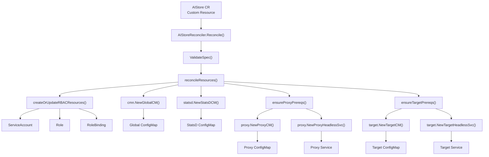

Sources: [operator/pkg/controllers/cluster_controller.go:354-392](), [operator/pkg/controllers/cluster_controller.go:631-664](), [operator/pkg/controllers/proxy_controller.go:32-53](), [operator/pkg/controllers/target_controllers.go:27-47]()

### StatefulSet Creation and Management

```mermaid
graph TD
    Bootstrap["bootstrapNew()"] --> InitProxies["initProxies()"]
    Bootstrap --> InitTargets["initTargets()"]
    
    InitProxies --> ProxySS["proxy.NewProxyStatefulSet()"]
    InitTargets --> TargetSS["target.NewTargetSS()"]
    
    ProxySS --> CreateProxy["k8sClient.CreateResourceIfNotExists()"]
    TargetSS --> CreateTarget["k8sClient.CreateResourceIfNotExists()"]
    
    CreateProxy --> ProxyStatefulSet["Proxy StatefulSet"]
    CreateTarget --> TargetStatefulSet["Target StatefulSet"]
    
    ProxyStatefulSet --> ProxyPods["Proxy Pods"]
    TargetStatefulSet --> TargetPods["Target Pods"]
    
    HandleEvents["handleCREvents()"] --> HandleProxyState["handleProxyState()"]
    HandleEvents --> HandleTargetState["handleTargetState()"]
    
    HandleProxyState --> SyncProxyPodSpec["syncProxyPodSpec()"]
    HandleTargetState --> SyncTargetPodSpec["syncTargetPodSpec()"]
    
    SyncProxyPodSpec --> UpdateProxyTemplate["shouldUpdatePodTemplate()"]
    SyncTargetPodSpec --> UpdateTargetTemplate["shouldUpdatePodTemplate()"]
```

Sources: [operator/pkg/controllers/cluster_controller.go:444-469](), [operator/pkg/controllers/proxy_controller.go:55-94](), [operator/pkg/controllers/target_controllers.go:49-64](), [operator/pkg/controllers/cluster_controller.go:479-530]()

## Core Resource Types

The operator manages several categories of Kubernetes resources, each with specific purposes and lifecycle patterns.

### Configuration Resources

| Resource Type | Purpose | Generator Function | Location |
|---------------|---------|-------------------|----------|
| Global ConfigMap | Cluster-wide AIS configuration | `cmn.NewGlobalCM()` | Global to cluster |
| Proxy ConfigMap | Proxy-specific local config | `proxy.NewProxyCM()` | Per proxy deployment |
| Target ConfigMap | Target-specific local config | `target.NewTargetCM()` | Per target deployment |
| StatsD ConfigMap | Metrics collection config | `statsd.NewStatsDCM()` | Global to cluster |

Sources: [operator/pkg/controllers/cluster_controller.go:363-387](), [operator/pkg/resources/proxy/configmap.go:25-40](), [operator/pkg/resources/target/configmap.go:26-40]()

### Workload Resources

The operator creates and manages StatefulSets for both proxy and target daemons:

```mermaid
graph LR
    subgraph "Proxy Resources"
        ProxyStatefulSet["Proxy StatefulSet<br/>proxy.NewProxyStatefulSet()"]
        ProxyPods["Proxy Pods<br/>ais-proxy-0, ais-proxy-1..."]
        ProxyPVC["Proxy PVCs<br/>State Storage"]
    end
    
    subgraph "Target Resources"
        TargetStatefulSet["Target StatefulSet<br/>target.NewTargetSS()"]
        TargetPods["Target Pods<br/>ais-target-0, ais-target-1..."]
        TargetPVC["Target PVCs<br/>Data + State Storage"]
    end
    
    ProxyStatefulSet --> ProxyPods
    ProxyPods --> ProxyPVC
    TargetStatefulSet --> TargetPods
    TargetPods --> TargetPVC
    
    subgraph "Service Resources"
        ProxyHeadless["Proxy Headless Service<br/>proxy.NewProxyHeadlessSvc()"]
        TargetHeadless["Target Headless Service<br/>target.NewTargetHeadlessSvc()"]
        ProxyLB["Proxy LoadBalancer<br/>proxy.NewProxyLoadBalancerSVC()"]
        TargetLB["Target LoadBalancer<br/>target.NewLoadBalancerSVCList()"]
    end
    
    ProxyPods -.-> ProxyHeadless
    TargetPods -.-> TargetHeadless
    ProxyPods -.-> ProxyLB
    TargetPods -.-> TargetLB
```

Sources: [operator/pkg/controllers/proxy_controller.go:64-65](), [operator/pkg/controllers/target_controllers.go:51](), [operator/pkg/controllers/proxy_controller.go:47-51](), [operator/pkg/controllers/target_controllers.go:41-45]()

### RBAC Resources

The operator creates minimal RBAC resources for cluster operations:

- **ServiceAccount**: `cmn.NewAISServiceAccount()` - Service account for AIS pods
- **Role**: `cmn.NewAISRBACRole()` - Permissions for cluster operations  
- **RoleBinding**: `cmn.NewAISRBACRoleBinding()` - Binds role to service account

Sources: [operator/pkg/controllers/cluster_controller.go:633-650]()

## Resource Lifecycle Management

### Create and Update Operations

The operator uses a standardized pattern for resource management through the `K8sClient` wrapper:

```mermaid
graph TD
    CreateOrUpdate["k8sClient.CreateOrUpdateResource()"] --> CheckExists["CreateResourceIfNotExists()"]
    CheckExists --> Exists{Resource Exists?}
    
    Exists -->|No| Create["client.Create()"]
    Exists -->|Yes| GetExisting["client.Get()"]
    
    GetExisting --> Compare["equality.Semantic.DeepDerivative()"]
    Compare --> Changed{Changed?}
    
    Changed -->|No| NoOp["No Operation"]
    Changed -->|Yes| Update["client.Update()"]
    
    Create --> SetOwner["controllerutil.SetControllerReference()"]
    Update --> SetOwner
```

Sources: [operator/pkg/client/api.go:250-270](), [operator/pkg/client/api.go:234-248]()

### Pod Template Synchronization

StatefulSet updates require careful pod template synchronization to trigger rolling updates:

```mermaid
graph TD
    SyncPodSpec["syncProxyPodSpec() / syncTargetPodSpec()"] --> ShouldUpdate["shouldUpdatePodTemplate()"]
    
    ShouldUpdate --> CheckImage["Compare Container Images"]
    ShouldUpdate --> CheckEnv["Compare Environment Variables"]
    ShouldUpdate --> CheckResources["Compare Resource Requirements"]
    ShouldUpdate --> CheckAnnotations["Compare Annotations"]
    ShouldUpdate --> CheckSecurity["Compare Security Context"]
    
    CheckImage --> NeedsUpdate{Needs Update?}
    CheckEnv --> NeedsUpdate
    CheckResources --> NeedsUpdate
    CheckAnnotations --> NeedsUpdate
    CheckSecurity --> NeedsUpdate
    
    NeedsUpdate -->|Yes| DisableRebalance["disableRebalance()"]
    NeedsUpdate -->|No| NoUpdate["No Update Needed"]
    
    DisableRebalance --> SyncTemplate["syncPodTemplate()"]
    SyncTemplate --> PatchStatefulSet["client.Patch()"]
```

Sources: [operator/pkg/controllers/cluster_controller.go:759-805](), [operator/pkg/controllers/cluster_controller.go:842-900](), [operator/pkg/controllers/proxy_controller.go:166-199](), [operator/pkg/controllers/target_controllers.go:269-290]()

### Resource Cleanup and Finalization

The cleanup process handles resource removal in dependency order:

```mermaid
graph TD
    Cleanup["cleanup()"] --> CleanupTarget["cleanupTarget()"]
    Cleanup --> CleanupProxy["cleanupProxy()"]
    Cleanup --> CleanupRBAC["cleanupRBAC()"]
    Cleanup --> CleanupPVC["cleanupPVC()"]
    
    CleanupTarget --> DeleteTargetSS["DeleteStatefulSetIfExists()"]
    CleanupTarget --> DeleteTargetSvc["DeleteServiceIfExists()"]
    CleanupTarget --> DeleteTargetCM["DeleteConfigMapIfExists()"]
    
    CleanupProxy --> DeleteProxySS["DeleteStatefulSetIfExists()"]
    CleanupProxy --> DeleteProxySvc["DeleteServiceIfExists()"]
    CleanupProxy --> DeleteProxyCM["DeleteConfigMapIfExists()"]
    
    CleanupRBAC --> DeleteRoleBinding["DeleteResourceIfExists(RoleBinding)"]
    CleanupRBAC --> DeleteRole["DeleteResourceIfExists(Role)"]
    CleanupRBAC --> DeleteSA["DeleteResourceIfExists(ServiceAccount)"]
    
    CleanupPVC --> DeleteDataPVCs["DeletePVCs() - Data Storage"]
    CleanupPVC --> DeleteStatePVCs["DeletePVCs() - State Storage"]
    
    Cleanup --> CreateCleanupJobs{Should Cleanup<br/>Metadata?}
    CreateCleanupJobs -->|Yes| HostCleanup["createCleanupJobs()"]
    CreateCleanupJobs -->|No| Finalize["finalize()"]
    
    HostCleanup --> JobsComplete{Jobs Complete?}
    JobsComplete -->|Yes| Finalize
    JobsComplete -->|No| Requeue["Requeue"]
```

Sources: [operator/pkg/controllers/cluster_cleanup.go:21-44](), [operator/pkg/controllers/target_controllers.go:66-75](), [operator/pkg/controllers/proxy_controller.go:117-124](), [operator/pkg/controllers/cluster_cleanup.go:106-138]()

## Resource Synchronization Patterns

### Configuration Hash Management

The operator tracks configuration changes using hash annotations to minimize unnecessary API calls:

- **Config Hash**: `cmn.ConfigHashAnnotation` - Tracks global config changes
- **Restart Hash**: `cmn.RestartConfigHashAnnotation` - Tracks changes requiring pod restart

```mermaid
graph TD
    HandleConfig["handleConfigState()"] --> GenerateConfig["cmn.GenerateGlobalConfig()"]
    GenerateConfig --> HashConfig["cmn.HashGlobalConfig()"]
    
    HashConfig --> CompareHash{Hash Changed?}
    CompareHash -->|No| NoUpdate["No API Call"]
    CompareHash -->|Yes| UpdateCluster["apiClient.SetClusterConfigUsingMsg()"]
    
    UpdateCluster --> CalcRestart["calcRestartConfigAnnotation()"]
    CalcRestart --> PatchAnnotations["patchAISAnnotations()"]
    
    PatchAnnotations --> CheckRestart{Restart Hash<br/>Changed?}
    CheckRestart -->|Yes| TriggerRollout["Trigger Rolling Update"]
    CheckRestart -->|No| ConfigOnly["Config Only Update"]
```

Sources: [operator/pkg/controllers/cluster_controller.go:538-569](), [operator/pkg/controllers/cluster_controller.go:584-608](), [operator/pkg/controllers/cluster_controller.go:611-629]()

### External LoadBalancer Management

When `EnableExternalLB` is specified, the operator manages additional LoadBalancer services:

- **Proxy LoadBalancer**: Single service for all proxy pods
- **Target LoadBalancers**: Individual services per target pod for direct access

The operator ensures external IPs are allocated before proceeding with cluster initialization.

Sources: [operator/pkg/controllers/cluster_controller.go:402-434](), [operator/pkg/controllers/proxy_controller.go:342-367](), [operator/pkg/controllers/target_controllers.go:313-341]()

---

# Page: Deployment Methods

# Deployment Methods

<details>
<summary>Relevant source files</summary>

The following files were used as context for generating this wiki page:

- [README.md](README.md)
- [docs/COMPATIBILITY.md](docs/COMPATIBILITY.md)
- [docs/README.md](docs/README.md)
- [docs/diagrams/certificates.jpg](docs/diagrams/certificates.jpg)
- [docs/network_configuration.md](docs/network_configuration.md)
- [docs/prerequisites.md](docs/prerequisites.md)
- [helm/README.md](helm/README.md)
- [helm/ais/README.md](helm/ais/README.md)
- [helm/ais/config/tls-cert/sjc11.yaml](helm/ais/config/tls-cert/sjc11.yaml)
- [helm/cluster-issuer/config/sjc11.yaml](helm/cluster-issuer/config/sjc11.yaml)
- [helm/cluster-issuer/config/values-sample.yaml](helm/cluster-issuer/config/values-sample.yaml)
- [helm/cluster-issuer/helmfile.yaml](helm/cluster-issuer/helmfile.yaml)
- [helm/cluster-issuer/issuer-chart/Chart.yaml](helm/cluster-issuer/issuer-chart/Chart.yaml)
- [helm/cluster-issuer/issuer-chart/templates/ca.yaml](helm/cluster-issuer/issuer-chart/templates/ca.yaml)
- [helm/operator/config/tls-cert/sjc11.yaml](helm/operator/config/tls-cert/sjc11.yaml)
- [playbooks/README.md](playbooks/README.md)
- [playbooks/ais-deployment/docs/ais_cluster_management.md](playbooks/ais-deployment/docs/ais_cluster_management.md)
- [playbooks/host-config/README.md](playbooks/host-config/README.md)

</details>


This document provides an overview of the different approaches available for deploying AIStore clusters on Kubernetes. It covers the three primary deployment methods—Helm charts, Ansible playbooks, and manual deployment—and explains how they relate to each other within the overall deployment workflow.

For detailed instructions on using specific deployment tools, see [Helm Chart Deployment](#4.1), [Ansible Playbook Deployment](#4.2), and [Manual Deployment](#4.3). For information about the operator architecture that these tools manage, see [AIStore Kubernetes Operator](#3).

## Overview

AIStore Kubernetes deployments follow a consistent two-phase approach regardless of the chosen method:

1. **Operator Deployment**: Deploy the AIS Kubernetes Operator that manages AIStore custom resources
2. **Cluster Deployment**: Create AIStore custom resources that the operator reconciles into running clusters

Each deployment method provides different levels of automation and control, from fully automated Ansible playbooks to granular manual kubectl commands.

## Deployment Method Architecture

```mermaid
graph TB
    subgraph "Host Preparation"
        HOSTCONFIG["ais_host_config_common"]
        DISKFORMAT["ais_datafs_mkfs"]
        KUBELET["config_kubelet"]
    end
    
    subgraph "Operator Deployment Methods"
        HELMOP["helm/operator/<br/>ais-operator chart"]
        ANSIBLEOP["playbooks/ais-deployment/<br/>ais_deploy_operator.yml"]
        MANUALOP["operator/config/<br/>kubectl apply"]
    end
    
    subgraph "Cluster Deployment Methods"
        HELMCLUSTER["helm/ais/<br/>ais-cluster chart"]
        ANSIBLECLUSTER["playbooks/ais-deployment/<br/>ais_deploy_cluster.yml"]
        MANUALCLUSTER["docs/samples/<br/>kubectl apply"]
    end
    
    subgraph "Kubernetes Resources"
        OPERATOR["ais-operator-system<br/>namespace"]
        AISTORE["AIStore CRD<br/>ais.nvidia.com/v1beta1"]
        CLUSTER["Running AIS Cluster<br/>proxy/target pods"]
    end
    
    HOSTCONFIG --> DISKFORMAT
    DISKFORMAT --> KUBELET
    
    KUBELET --> HELMOP
    KUBELET --> ANSIBLEOP
    KUBELET --> MANUALOP
    
    HELMOP --> OPERATOR
    ANSIBLEOP --> OPERATOR
    MANUALOP --> OPERATOR
    
    OPERATOR --> HELMCLUSTER
    OPERATOR --> ANSIBLECLUSTER
    OPERATOR --> MANUALCLUSTER
    
    HELMCLUSTER --> AISTORE
    ANSIBLECLUSTER --> AISTORE
    MANUALCLUSTER --> AISTORE
    
    AISTORE --> CLUSTER
```

**Sources:** [docs/README.md:35-70](), [playbooks/README.md:16-42](), [helm/README.md:10-62]()

## Component and File Structure Mapping

```mermaid
graph LR
    subgraph "Ansible Playbooks"
        HOSTPLAYBOOKS["playbooks/host-config/"]
        DEPLOYPLAYBOOKS["playbooks/ais-deployment/"]
        OPPLAYBOOK["ais_deploy_operator.yml"]
        CLUSTERPLAYBOOK["ais_deploy_cluster.yml"]
    end
    
    subgraph "Helm Charts"
        OPERATORCHART["helm/operator/"]
        AISCHART["helm/ais/"]
        CLUSTERCHART["charts/ais-cluster/"]
        SECRETSCHART["charts/cloud-secrets/"]
        TLSCHART["charts/tls-cert/"]
    end
    
    subgraph "Operator Source"
        OPERATORCONFIG["operator/config/"]
        OPERATORMANIFESTS["operator/config/manager/"]
        OPERATORCRD["operator/config/crd/"]
    end
    
    subgraph "Generated Resources"
        AISOPERATOR["Deployment: ais-operator"]
        AISCRD["CustomResourceDefinition: aistores.ais.nvidia.com"]
        AISTORERESOURCE["AIStore: spec.nodeImage, spec.size"]
        STATEFULSETS["StatefulSet: ais-proxy, ais-target"]
    end
    
    DEPLOYPLAYBOOKS --> OPPLAYBOOK
    OPPLAYBOOK --> AISOPERATOR
    DEPLOYPLAYBOOKS --> CLUSTERPLAYBOOK
    CLUSTERPLAYBOOK --> AISTORERESOURCE
    
    OPERATORCHART --> AISOPERATOR
    AISCHART --> CLUSTERCHART
    CLUSTERCHART --> AISTORERESOURCE
    
    OPERATORCONFIG --> OPERATORMANIFESTS
    OPERATORMANIFESTS --> AISOPERATOR
    OPERATORCRD --> AISCRD
    
    AISOPERATOR --> AISCRD
    AISTORERESOURCE --> STATEFULSETS
```

**Sources:** [playbooks/ais-deployment/docs/ais_cluster_management.md:21-33](), [helm/ais/README.md:72-77](), [operator/README.md]()

## Deployment Method Comparison

| Aspect | Helm Charts | Ansible Playbooks | Manual Deployment |
|--------|-------------|-------------------|-------------------|
| **Automation Level** | Medium | High | Low |
| **Host Configuration** | Manual prerequisite | Automated via `ais_host_config_common` | Manual prerequisite |
| **Operator Deployment** | `helmfile sync` | `ais_deploy_operator.yml` | `kubectl apply` |
| **Cluster Deployment** | `helmfile sync` | `ais_deploy_cluster.yml` | `kubectl apply` |
| **Configuration Management** | `values.yaml` files | Ansible variables | Direct YAML editing |
| **Environment Support** | Multiple environments via helmfile | Inventory-based environments | Single environment |
| **TLS Certificate Management** | `tls-cert` chart with cert-manager | Manual certificate setup | Manual certificate setup |
| **Cloud Secrets** | `cloud-secrets` chart | Cloud playbooks | Manual secret creation |
| **PV Creation** | `ais-create-pv` chart | `create_pv` playbook | Manual PV creation |
| **Best For** | GitOps workflows | Complete automation | Development/testing |

**Sources:** [docs/README.md:39-70](), [helm/README.md:26-62](), [playbooks/ais-deployment/docs/ais_cluster_management.md:20-82]()

## Prerequisites and Dependencies

All deployment methods require the same foundational setup:

### Host Configuration
- Kubernetes cluster with properly configured nodes
- Formatted storage drives with XFS filesystem
- Network performance tuning and port configuration
- Persistent volumes created for AIStore data

### Kubernetes Requirements
- Kubernetes v1.27 or later (v1.31+ recommended)
- `kubectl` access to the cluster
- Sufficient resources for operator and AIStore pods

### Tool-Specific Requirements

**Helm Deployment:**
- Helm 3.x installed locally
- `helm-diff` plugin
- Helmfile for multi-environment management

**Ansible Deployment:**
- Ansible installed on control host
- Inventory file configured with target hosts
- Required Ansible collections via `install_requirements.yml`

**Manual Deployment:**
- Direct kubectl access to cluster
- Understanding of Kubernetes manifest structure

**Sources:** [docs/prerequisites.md:7-23](), [helm/README.md:13-25](), [playbooks/README.md:5-14]()

## Deployment Flow Sequence

```mermaid
sequenceDiagram
    participant User
    participant HostConfig as "Host Configuration"
    participant K8sCluster as "Kubernetes Cluster"
    participant Operator as "AIS Operator"
    participant AIStore as "AIStore Custom Resource"
    
    User->>HostConfig: Run ais_host_config_common
    HostConfig->>HostConfig: Configure sysctls, networking
    HostConfig->>HostConfig: Format drives with ais_datafs_mkfs
    HostConfig->>K8sCluster: Create persistent volumes
    
    User->>Operator: Deploy via Helm/Ansible/Manual
    Operator->>K8sCluster: Create CRDs and operator deployment
    
    User->>AIStore: Create AIStore resource
    AIStore->>Operator: Reconciliation trigger
    Operator->>K8sCluster: Generate StatefulSets, Services, ConfigMaps
    K8sCluster->>K8sCluster: Start proxy and target pods
```

**Sources:** [playbooks/host-config/README.md:30-42](), [docs/README.md:52-79]()

The choice of deployment method depends on your specific requirements for automation, environment management, and operational complexity. Each method ultimately produces the same running AIStore cluster managed by the Kubernetes operator, but provides different paths to achieve that goal.

---

# Page: Helm Chart Deployment

# Helm Chart Deployment

<details>
<summary>Relevant source files</summary>

The following files were used as context for generating this wiki page:

- [docs/diagrams/certificates.jpg](docs/diagrams/certificates.jpg)
- [helm/README.md](helm/README.md)
- [helm/ais/README.md](helm/ais/README.md)
- [helm/ais/config/tls-cert/sjc11.yaml](helm/ais/config/tls-cert/sjc11.yaml)
- [helm/cluster-issuer/config/sjc11.yaml](helm/cluster-issuer/config/sjc11.yaml)
- [helm/cluster-issuer/config/values-sample.yaml](helm/cluster-issuer/config/values-sample.yaml)
- [helm/cluster-issuer/helmfile.yaml](helm/cluster-issuer/helmfile.yaml)
- [helm/cluster-issuer/issuer-chart/Chart.yaml](helm/cluster-issuer/issuer-chart/Chart.yaml)
- [helm/cluster-issuer/issuer-chart/templates/ca.yaml](helm/cluster-issuer/issuer-chart/templates/ca.yaml)
- [helm/operator/config/tls-cert/sjc11.yaml](helm/operator/config/tls-cert/sjc11.yaml)
- [helm/operator/helmfile.yaml](helm/operator/helmfile.yaml)
- [pages/charts/ais-operator-2.0.0.tgz](pages/charts/ais-operator-2.0.0.tgz)
- [pages/charts/ais-operator-2.0.1.tgz](pages/charts/ais-operator-2.0.1.tgz)
- [pages/charts/ais-operator-2.1.0.tgz](pages/charts/ais-operator-2.1.0.tgz)
- [pages/charts/ais-operator-2.1.1.tgz](pages/charts/ais-operator-2.1.1.tgz)
- [pages/charts/ais-operator-2.1.2.tgz](pages/charts/ais-operator-2.1.2.tgz)
- [pages/charts/ais-operator-2.2.0.tgz](pages/charts/ais-operator-2.2.0.tgz)
- [pages/charts/ais-operator-2.3.0.tgz](pages/charts/ais-operator-2.3.0.tgz)
- [pages/charts/index.yaml](pages/charts/index.yaml)
- [playbooks/ais-deployment/roles/ais_deploy_operator/defaults/main.yml](playbooks/ais-deployment/roles/ais_deploy_operator/defaults/main.yml)
- [playbooks/ais-deployment/roles/ais_undeploy_operator/files/undeploy-operator.sh](playbooks/ais-deployment/roles/ais_undeploy_operator/files/undeploy-operator.sh)
- [playbooks/ais-deployment/roles/install_rancher_lpp/defaults/main.yaml](playbooks/ais-deployment/roles/install_rancher_lpp/defaults/main.yaml)
- [playbooks/ais-deployment/roles/install_rancher_lpp/tasks/main.yaml](playbooks/ais-deployment/roles/install_rancher_lpp/tasks/main.yaml)
- [playbooks/ais_deploy.yml](playbooks/ais_deploy.yml)

</details>


This page covers using Helm charts to deploy the AIStore Kubernetes operator and clusters. It includes chart repository configuration, operator deployment, cluster deployment, and supporting components like TLS certificates and cloud credentials. For complete automation using Ansible playbooks, see [Ansible Playbook Deployment](#4.2). For direct kubectl deployment in development scenarios, see [Manual Deployment](#4.3).

## Chart Repository and Distribution

The AIStore project publishes Helm charts through a GitHub Pages repository hosted at `https://nvidia.github.io/ais-k8s/charts/`. The chart repository contains multiple versions of the `ais-operator` chart with automated releases managed through GitHub Actions.

### Chart Repository Structure

```mermaid
graph TB
    subgraph "GitHub Pages Repository"
        INDEX["index.yaml<br/>Chart Repository Index"]
        CHARTS["Chart Archives<br/>*.tgz files"]
    end
    
    subgraph "Published Charts"
        OP_230["ais-operator-2.3.0.tgz"]
        OP_220["ais-operator-2.2.0.tgz"]
        OP_212["ais-operator-2.1.2.tgz"]
        OLDER["Older Versions..."]
    end
    
    subgraph "Chart Source"
        HELM_OP["helm/operator/<br/>Chart Templates"]
        HELM_AIS["helm/ais/<br/>Chart Templates"]
    end
    
    INDEX --> OP_230
    INDEX --> OP_220
    INDEX --> OP_212
    INDEX --> OLDER
    
    HELM_OP -.->|"Build Process"| OP_230
    HELM_AIS -.->|"Sub-charts"| CHARTS
```

The repository index at [pages/charts/index.yaml:1-124]() defines available chart versions with metadata including:
- Chart version and application version
- Digest for integrity verification  
- Download URLs pointing to GitHub Pages
- Creation timestamps

**Sources:** [pages/charts/index.yaml:1-124](), [helm/README.md:1-64]()

## Operator Deployment with Helmfile

The operator deployment uses Helmfile for orchestration, providing environment-specific configurations and dependency management. The primary configuration is defined in [helm/operator/helmfile.yaml:1-36]().

### Operator Deployment Architecture

```mermaid
graph TB
    subgraph "Helmfile Configuration"
        HF["helmfile.yaml<br/>Environment Orchestration"]
        ENV_DEFAULT["Environment: default<br/>createCert: false"]
        ENV_SJC11["Environment: sjc11<br/>createCert: true"]
    end
    
    subgraph "Chart Repository"
        REPO["aistore/ais-operator<br/>Remote Chart"]
        VER["Version: 2.3.0"]
    end
    
    subgraph "TLS Certificate Chart"
        TLS_CHART["tls-cert<br/>Local Chart"]
        TLS_CONFIG["config/tls-cert/*.yaml<br/>Environment Config"]
    end
    
    subgraph "Kubernetes Resources"
        OPERATOR_NS["ais-operator-system<br/>Namespace"]
        OPERATOR_POD["AIS Operator Pod"]
        TLS_SECRET["operator-tls<br/>Secret"]
    end
    
    HF --> ENV_DEFAULT
    HF --> ENV_SJC11
    ENV_SJC11 --> TLS_CHART
    HF --> REPO
    REPO --> VER
    TLS_CHART --> TLS_CONFIG
    
    ENV_SJC11 --> OPERATOR_NS
    REPO --> OPERATOR_POD
    TLS_CHART --> TLS_SECRET
    
    OPERATOR_POD --> OPERATOR_NS
    TLS_SECRET --> OPERATOR_NS
```

The Helmfile defines two primary releases:
- `operator-tls-cert`: Conditional TLS certificate creation using local `tls-cert` chart
- `ais-operator`: Main operator deployment from remote `aistore/ais-operator` chart

Environment-specific behavior is controlled through the `createCert.enabled` value, with the `sjc11` environment enabling TLS certificate generation.

**Sources:** [helm/operator/helmfile.yaml:1-36](), [helm/operator/config/tls-cert/sjc11.yaml:1-25]()

## AIS Cluster Deployment

AIS cluster deployment uses a multi-chart approach with several supporting components managed through a separate Helmfile configuration. The cluster deployment supports HTTPS, cloud backend integration, and persistent volume management.

### Cluster Deployment Components

```mermaid
graph TB
    subgraph "AIS Helmfile"
        AIS_HF["ais/helmfile.yaml<br/>Cluster Orchestration"]
    end
    
    subgraph "Component Charts"
        CLOUD_SEC["ais-cloud-secrets<br/>Backend Credentials"]
        AIS_CLUSTER["ais-cluster<br/>Main Cluster Resources"]
        TLS_CERT["tls-cert<br/>Certificate Generation"]
        CREATE_PV["ais-create-pv<br/>Persistent Volume Setup"]
    end
    
    subgraph "Configuration Sources"
        CLOUD_CONFIG["config/cloud/*.yaml<br/>Provider Credentials"]
        TLS_CONFIG["config/tls-cert/*.yaml<br/>Certificate Specs"]
        CLUSTER_CONFIG["Environment Values<br/>Cluster Specification"]
    end
    
    subgraph "Generated Resources"
        SECRETS["Cloud Credential Secrets"]
        CERTS["TLS Certificates"]
        AISTORE_CR["AIStore Custom Resource"]
        PVS["HostPath Persistent Volumes"]
    end
    
    AIS_HF --> CLOUD_SEC
    AIS_HF --> AIS_CLUSTER
    AIS_HF --> TLS_CERT
    AIS_HF --> CREATE_PV
    
    CLOUD_SEC --> CLOUD_CONFIG
    TLS_CERT --> TLS_CONFIG
    AIS_CLUSTER --> CLUSTER_CONFIG
    
    CLOUD_SEC --> SECRETS
    TLS_CERT --> CERTS
    AIS_CLUSTER --> AISTORE_CR
    CREATE_PV --> PVS
```

**Sources:** [helm/ais/README.md:1-78](), [helm/ais/config/tls-cert/sjc11.yaml:1-33]()

### HTTPS and TLS Configuration

TLS deployment is enabled by setting `protocol: https` in the AIS chart values, with optional certificate generation through the `tls-cert` sub-chart. The TLS configuration supports:

| Configuration | Purpose | Chart |
|---------------|---------|--------|
| `https.skipVerifyCert` | Disable certificate verification | ais-cluster |
| `https.tlsSecret` | Mount existing certificate secret | ais-cluster |
| `certificate.dnsNames` | Certificate Subject Alternative Names | tls-cert |
| `certificate.issuerRef` | Certificate Authority reference | tls-cert |

The certificate specification includes DNS names for intra-cluster communication patterns:
- `*.ais-proxy.ais.svc.cluster.local` for proxy services
- `*.ais-target.ais.svc.cluster.local` for target services  
- External hostnames for load balancer access

**Sources:** [helm/ais/README.md:3-25](), [helm/ais/config/tls-cert/sjc11.yaml:11-33]()

### Cloud Backend Integration

Cloud credential management is handled through the `ais-cloud-secrets` chart, which creates Kubernetes secrets from local credential files. Configuration supports multiple cloud providers:

```mermaid
graph LR
    subgraph "Local Credential Files"
        AWS_CONFIG["~/.aws/config"]
        AWS_CREDS["~/.aws/credentials"] 
        GCP_JSON["~/.gcp/service-account.json"]
    end
    
    subgraph "Helm Template Functions"
        READ_FILE["readFile() function<br/>File Content Injection"]
    end
    
    subgraph "Kubernetes Secrets"
        AWS_SECRET["aws-creds<br/>Secret"]
        GCP_SECRET["gcp-creds<br/>Secret"]
    end
    
    subgraph "AIStore Targets"
        TARGET_PODS["Target Pods<br/>Secret Mounts"]
    end
    
    AWS_CONFIG --> READ_FILE
    AWS_CREDS --> READ_FILE
    GCP_JSON --> READ_FILE
    
    READ_FILE --> AWS_SECRET
    READ_FILE --> GCP_SECRET
    
    AWS_SECRET --> TARGET_PODS
    GCP_SECRET --> TARGET_PODS
```

Cloud secrets are enabled by setting `cloud-secrets.enabled: true` in the Helmfile environment configuration. The chart templates use Helm's `readFile` function to inject local credential files into Kubernetes secrets.

**Sources:** [helm/ais/README.md:26-49]()

## Cluster Issuer and PKI Management

For TLS deployments without existing certificate infrastructure, the repository includes a `cluster-issuer` chart that establishes a self-signed Certificate Authority using cert-manager.

### PKI Bootstrap Process

```mermaid
graph TB
    subgraph "Cluster Issuer Chart"
        ISSUER_CHART["cluster-issuer/issuer-chart"]
        ISSUER_CONFIG["config/sjc11.yaml<br/>CA Configuration"]
    end
    
    subgraph "cert-manager Resources"
        SELF_SIGNED["selfsigned-issuer<br/>ClusterIssuer"]
        CA_CERT["selfsigned-cert<br/>Certificate"]
        CA_SECRET["ca-root-secret<br/>CA Key Material"]
        CA_ISSUER["ca-issuer<br/>ClusterIssuer"]
    end
    
    subgraph "Certificate Generation"
        AIS_CERTS["AIS Component Certificates"]
        OP_CERTS["Operator Certificates"]
    end
    
    ISSUER_CHART --> ISSUER_CONFIG
    ISSUER_CONFIG --> SELF_SIGNED
    SELF_SIGNED --> CA_CERT
    CA_CERT --> CA_SECRET
    CA_SECRET --> CA_ISSUER
    
    CA_ISSUER --> AIS_CERTS
    CA_ISSUER --> OP_CERTS
```

The cluster issuer chart creates a three-stage PKI bootstrap:
1. Self-signed ClusterIssuer for initial CA certificate generation
2. CA Certificate stored in `ca-root-secret` 
3. CA-backed ClusterIssuer for application certificate issuance

**Sources:** [helm/cluster-issuer/issuer-chart/templates/ca.yaml:1-38](), [helm/cluster-issuer/config/sjc11.yaml:1-22]()

## Persistent Volume Management

The AIS deployment supports automated HostPath persistent volume creation through the `ais-create-pv` component. When `ais-create-pv.enabled: true`, the deployment runs [helm/ais/scripts/create-pvs.sh]() to template and create persistent volumes for each target mount path.

### PV Creation Workflow

| Component | Function | Configuration |
|-----------|----------|---------------|
| `create-pvs.sh` | Script execution | Helm post-install hook |
| `storageClass` | PV provisioning | Chart values override |
| Mount paths | Target storage | AIStore Custom Resource |

Alternative storage classes can be specified to use existing persistent volume provisioners instead of HostPath volumes.

**Sources:** [helm/ais/README.md:51-58]()

## Deployment Execution

Helm chart deployment is executed using Helmfile commands with environment-specific targeting:

```bash
# Deploy operator with TLS in sjc11 environment
cd helm/operator
helmfile sync -e sjc11

# Deploy AIS cluster 
cd helm/ais  
helmfile sync --environment production

# Remove deployment
helmfile delete --environment production
```

The deployment process follows dependency order managed by Helmfile, ensuring TLS certificates and cloud secrets are created before the main AIStore components.

**Sources:** [helm/ais/README.md:59-70](), [helm/README.md:44-62]()

---

# Page: Ansible Playbook Deployment

# Ansible Playbook Deployment

<details>
<summary>Relevant source files</summary>

The following files were used as context for generating this wiki page:

- [docs/multiple_targets_per_node.md](docs/multiple_targets_per_node.md)
- [docs/samples/sample-multi-target-deployment.yml](docs/samples/sample-multi-target-deployment.yml)
- [docs/samples/sample-pv.yaml](docs/samples/sample-pv.yaml)
- [playbooks/ais-deployment/README.md](playbooks/ais-deployment/README.md)
- [playbooks/ais-deployment/ais_downscale_cluster.yml](playbooks/ais-deployment/ais_downscale_cluster.yml)
- [playbooks/ais-deployment/ais_restart_cluster.yml](playbooks/ais-deployment/ais_restart_cluster.yml)
- [playbooks/ais-deployment/ais_shutdown_cluster.yml](playbooks/ais-deployment/ais_shutdown_cluster.yml)
- [playbooks/ais-deployment/docs/switch_protocol.md](playbooks/ais-deployment/docs/switch_protocol.md)
- [playbooks/ais-deployment/roles/ais_delete_cluster/templates/delete_cluster.sh.j2](playbooks/ais-deployment/roles/ais_delete_cluster/templates/delete_cluster.sh.j2)
- [playbooks/ais-deployment/roles/ais_delete_conf_host_path/tasks/main.yaml](playbooks/ais-deployment/roles/ais_delete_conf_host_path/tasks/main.yaml)
- [playbooks/ais-deployment/roles/ais_delete_conf_state_storage/tasks/main.yaml](playbooks/ais-deployment/roles/ais_delete_conf_state_storage/tasks/main.yaml)
- [playbooks/ais-deployment/roles/ais_deploy_cluster/defaults/main.yml](playbooks/ais-deployment/roles/ais_deploy_cluster/defaults/main.yml)
- [playbooks/ais-deployment/roles/ais_deploy_cluster/templates/ais.yaml.j2](playbooks/ais-deployment/roles/ais_deploy_cluster/templates/ais.yaml.j2)

</details>


This document covers automated deployment and lifecycle management of AIStore clusters using Ansible playbooks. The playbooks provide complete orchestration of the AIStore Kubernetes Operator and cluster resources through declarative configuration and role-based automation.

For Helm-based deployment approaches, see [Helm Chart Deployment](#4.1). For direct kubectl deployment methods, see [Manual Deployment](#4.3). For details about the underlying operator system, see [AIStore Kubernetes Operator](#3).

## Overview

The Ansible deployment approach provides comprehensive automation for AIStore cluster lifecycle management through a collection of playbooks and roles. The system uses Jinja2 templating to generate AIStore Custom Resources from configuration variables, enabling consistent deployments across multiple environments.

### Core Components

The Ansible deployment system consists of several key components:

| Component | Purpose | Location |
|-----------|---------|----------|
| Playbooks | High-level automation workflows | `playbooks/ais-deployment/*.yml` |
| Roles | Reusable task collections | `playbooks/ais-deployment/roles/` |
| Templates | Jinja2 templates for resource generation | `playbooks/ais-deployment/roles/*/templates/` |
| Variables | Configuration parameters | `playbooks/ais-deployment/roles/*/defaults/` |

Sources: [playbooks/ais-deployment/README.md:1-22]()

## Playbook Architecture

```mermaid
graph TB
    subgraph "Ansible Control Layer"
        CONTROLLER["Controller Host"]
        INVENTORY["hosts.ini<br/>Inventory File"]
        VARS["Variable Files<br/>ais_mpaths.yml<br/>https_config.yml"]
    end
    
    subgraph "Core Playbooks"
        DEPLOY_OP["ais_deploy_operator.yml<br/>Operator Deployment"]
        DEPLOY_CLUSTER["ais_deploy_cluster.yml<br/>Cluster Deployment"]
        SHUTDOWN["ais_shutdown_cluster.yml<br/>Graceful Shutdown"]
        RESTART["ais_restart_cluster.yml<br/>Cluster Restart"]
        CLEANUP["ais_cleanup_all.yml<br/>Complete Cleanup"]
    end
    
    subgraph "Ansible Roles"
        CLUSTER_ROLE["ais_deploy_cluster<br/>Role"]
        DELETE_ROLE["ais_delete_cluster<br/>Role"]
        CONF_DELETE["ais_delete_conf_*<br/>Configuration Cleanup"]
    end
    
    subgraph "Template Processing"
        JINJA_TEMPLATE["ais.yaml.j2<br/>AIStore CRD Template"]
        DEFAULTS["defaults/main.yml<br/>Default Variables"]
        SHELL_SCRIPTS["Shell Script Templates<br/>delete_cluster.sh.j2"]
    end
    
    subgraph "Generated Resources"
        AISTORE_CRD["AIStore Custom Resource"]
        KUBECTL_COMMANDS["kubectl Commands"]
        CONFIG_PATCHES["Configuration Patches"]
    end
    
    subgraph "Target Kubernetes"
        OPERATOR["AIS Operator"]
        CLUSTER["AIS Cluster Pods"]
        STORAGE["Persistent Volumes"]
    end
    
    CONTROLLER --> INVENTORY
    INVENTORY --> DEPLOY_OP
    INVENTORY --> DEPLOY_CLUSTER
    VARS --> DEPLOY_CLUSTER
    
    DEPLOY_CLUSTER --> CLUSTER_ROLE
    RESTART --> DELETE_ROLE
    RESTART --> CLUSTER_ROLE
    CLEANUP --> DELETE_ROLE
    
    CLUSTER_ROLE --> JINJA_TEMPLATE
    CLUSTER_ROLE --> DEFAULTS
    DELETE_ROLE --> SHELL_SCRIPTS
    
    JINJA_TEMPLATE --> AISTORE_CRD
    SHELL_SCRIPTS --> KUBECTL_COMMANDS
    DEFAULTS --> CONFIG_PATCHES
    
    AISTORE_CRD --> OPERATOR
    KUBECTL_COMMANDS --> CLUSTER
    CONFIG_PATCHES --> CLUSTER
    
    OPERATOR --> CLUSTER
    CLUSTER --> STORAGE
```

Sources: [playbooks/ais-deployment/README.md:5-22](), [playbooks/ais-deployment/roles/ais_deploy_cluster/templates/ais.yaml.j2:1-113]()

## Configuration Management

The Ansible deployment uses a hierarchical configuration system that combines default values, environment-specific settings, and user overrides to generate the final AIStore Custom Resource.

### Default Configuration

The base configuration is defined in the role defaults, providing sensible values for all deployment parameters:

| Parameter | Default Value | Purpose |
|-----------|---------------|---------|
| `init_image` | `aistorage/ais-init:v3.29` | AIStore initialization container |
| `node_image` | `aistorage/aisnode:v3.29` | Main AIStore node container |
| `logs_image` | `aistorage/ais-logs:v1.0` | Log collection sidecar |
| `cluster_domain` | `cluster.local` | Kubernetes cluster domain |
| `dynamic_state_sc` | `local-path` | Storage class for state volumes |
| `host_network` | `false` | Host networking for target pods |

Sources: [playbooks/ais-deployment/roles/ais_deploy_cluster/defaults/main.yml:1-44]()

### Template Processing Flow

```mermaid
graph LR
    subgraph "Configuration Sources"
        DEFAULTS["defaults/main.yml<br/>Base Configuration"]
        ENV_VARS["Environment Variables<br/>cluster_size<br/>protocol<br/>ais_mpaths"]
        USER_VARS["User Variables<br/>ConfigToUpdate<br/>Cloud Secrets"]
        INVENTORY["Inventory Variables<br/>Node Selectors<br/>Tolerations"]
    end
    
    subgraph "Jinja2 Processing"
        TEMPLATE["ais.yaml.j2<br/>Template Engine"]
        CONDITIONALS["Conditional Logic<br/><br/>"]
        LOOPS["Loop Processing<br/>"]
    end
    
    subgraph "Generated Sections"
        SPEC["AIStore Spec<br/>size: {{ cluster_size }}"]
        PROXY_SPEC["proxySpec<br/>nodeSelector<br/>tolerations"]
        TARGET_SPEC["targetSpec<br/>mounts<br/>hostNetwork"]
        TLS_CONFIG["TLS Configuration<br/>tlsSecretName<br/>server_crt/key"]
        CLOUD_CONFIG["Cloud Configuration<br/>awsSecretName<br/>gcpSecretName"]
    end
    
    subgraph "Final Output"
        CRD["AIStore Custom Resource<br/>YAML Manifest"]
    end
    
    DEFAULTS --> TEMPLATE
    ENV_VARS --> TEMPLATE
    USER_VARS --> TEMPLATE
    INVENTORY --> TEMPLATE
    
    TEMPLATE --> CONDITIONALS
    TEMPLATE --> LOOPS
    
    CONDITIONALS --> SPEC
    CONDITIONALS --> TLS_CONFIG
    LOOPS --> TARGET_SPEC
    INVENTORY --> PROXY_SPEC
    USER_VARS --> CLOUD_CONFIG
    
    SPEC --> CRD
    PROXY_SPEC --> CRD
    TARGET_SPEC --> CRD
    TLS_CONFIG --> CRD
    CLOUD_CONFIG --> CRD
```

Sources: [playbooks/ais-deployment/roles/ais_deploy_cluster/templates/ais.yaml.j2:1-113](), [playbooks/ais-deployment/roles/ais_deploy_cluster/defaults/main.yml:1-44]()

## Core Playbooks

### Operator Deployment

The `ais_deploy_operator.yml` playbook installs the AIStore Kubernetes Operator, which is a prerequisite for cluster deployment. This playbook typically uses Helm charts or direct manifest application to deploy the operator components.

### Cluster Deployment

The `ais_deploy_cluster.yml` playbook creates the AIStore cluster by generating and applying the AIStore Custom Resource. The playbook uses the `ais_deploy_cluster` role, which processes the Jinja2 template with configuration variables.

Key template sections include:

- **Basic Cluster Configuration**: Cluster size and namespace settings [playbooks/ais-deployment/roles/ais_deploy_cluster/templates/ais.yaml.j2:6-10]()
- **Proxy Specification**: Port configuration, node selection, and tolerations [playbooks/ais-deployment/roles/ais_deploy_cluster/templates/ais.yaml.j2:23-40]()
- **Target Specification**: Storage mounts, networking, and security context [playbooks/ais-deployment/roles/ais_deploy_cluster/templates/ais.yaml.j2:42-74]()
- **TLS Configuration**: Certificate mounting and HTTPS settings [playbooks/ais-deployment/roles/ais_deploy_cluster/templates/ais.yaml.j2:12-21]()

### Lifecycle Management

| Playbook | Function | Key Operations |
|----------|----------|----------------|
| `ais_shutdown_cluster.yml` | Graceful shutdown | Patches AIStore CRD with `shutdownCluster: true` |
| `ais_restart_cluster.yml` | Cluster restart with config changes | Deletes cluster, optionally cleans config, redeploys |
| `ais_decommission_cluster.yml` | Complete removal | Removes all resources including PVCs and node labels |
| `ais_cleanup_all.yml` | Data and metadata cleanup | Removes all data AND configuration |

Sources: [playbooks/ais-deployment/README.md:7-22](), [playbooks/ais-deployment/ais_shutdown_cluster.yml:27-29]()

## Deployment Workflow

The typical deployment workflow follows this sequence:

```mermaid
graph TD
    subgraph "Prerequisites"
        INVENTORY_SETUP["Create hosts.ini<br/>Define controller and ais hosts"]
        VAR_CONFIG["Configure Variables<br/>ais_mpaths.yml<br/>https_config.yml"]
        REQ_INSTALL["Install Requirements<br/>install_requirements.yml"]
    end
    
    subgraph "Operator Deployment"
        DEPLOY_OP_CMD["ansible-playbook<br/>ais_deploy_operator.yml"]
        OP_VALIDATION["Verify Operator<br/>kubectl get pods -n ais-operator-system"]
    end
    
    subgraph "Cluster Deployment"
        DEPLOY_CLUSTER_CMD["ansible-playbook<br/>ais_deploy_cluster.yml<br/>-e cluster=ais"]
        TEMPLATE_PROC["Process ais.yaml.j2<br/>Generate AIStore CRD"]
        APPLY_CRD["kubectl apply<br/>AIStore Custom Resource"]
        CLUSTER_VALIDATION["Verify Cluster<br/>kubectl get pods -n ais"]
    end
    
    subgraph "Post-Deployment"
        MONITORING_SETUP["Optional Monitoring<br/>Deploy Prometheus/Grafana"]
        TESTING["Validation Testing<br/>aisloader benchmarks"]
    end
    
    INVENTORY_SETUP --> VAR_CONFIG
    VAR_CONFIG --> REQ_INSTALL
    REQ_INSTALL --> DEPLOY_OP_CMD
    
    DEPLOY_OP_CMD --> OP_VALIDATION
    OP_VALIDATION --> DEPLOY_CLUSTER_CMD
    
    DEPLOY_CLUSTER_CMD --> TEMPLATE_PROC
    TEMPLATE_PROC --> APPLY_CRD
    APPLY_CRD --> CLUSTER_VALIDATION
    
    CLUSTER_VALIDATION --> MONITORING_SETUP
    MONITORING_SETUP --> TESTING
```

Sources: [playbooks/ais-deployment/README.md:3](), [playbooks/ais-deployment/roles/ais_deploy_cluster/templates/ais.yaml.j2:1-113]()

## Advanced Operations

### Protocol Switching

The `ais_restart_cluster.yml` playbook supports switching between HTTP and HTTPS protocols while preserving user data. The process involves:

1. **Configuration Update**: Update cluster configuration via AIS CLI
2. **Graceful Shutdown**: Execute `ais cluster shutdown -y`
3. **Certificate Setup**: Generate or update TLS certificates
4. **Cluster Restart**: Run playbook with updated protocol settings

Sources: [playbooks/ais-deployment/docs/switch_protocol.md:5-37](), [playbooks/ais-deployment/ais_restart_cluster.yml:1-97]()

### Configuration Cleanup

The restart playbook supports selective configuration cleanup through the `delete_conf` parameter:

- **State Storage Cleanup**: Removes PVCs with specified `stateStorageClass` [playbooks/ais-deployment/roles/ais_delete_conf_state_storage/tasks/main.yaml:2-7]()
- **Host Path Cleanup**: Removes configuration files from `hostPathPrefix` [playbooks/ais-deployment/roles/ais_delete_conf_host_path/tasks/main.yaml:1-4]()

### Cluster Scaling

The `ais_downscale_cluster.yml` playbook provides interactive cluster scaling by patching the AIStore Custom Resource size field [playbooks/ais-deployment/ais_downscale_cluster.yml:9-10]().

Sources: [playbooks/ais-deployment/ais_restart_cluster.yml:45-86](), [playbooks/ais-deployment/ais_downscale_cluster.yml:1-13]()

---

# Page: Manual Deployment

# Manual Deployment

<details>
<summary>Relevant source files</summary>

The following files were used as context for generating this wiki page:

- [.gitlab-ci.yml](.gitlab-ci.yml)
- [operator/Makefile](operator/Makefile)
- [operator/README.md](operator/README.md)
- [operator/config/samples/ais_v1beta1_aistore.yaml](operator/config/samples/ais_v1beta1_aistore.yaml)
- [operator/config/samples/ais_v1beta1_aistore_tls_certmanager_csi.yaml](operator/config/samples/ais_v1beta1_aistore_tls_certmanager_csi.yaml)
- [operator/config/samples/ais_v1beta1_aistore_tracing.yaml](operator/config/samples/ais_v1beta1_aistore_tracing.yaml)
- [operator/go.mod](operator/go.mod)
- [operator/go.sum](operator/go.sum)
- [operator/pkg/resources/cmn/config.go](operator/pkg/resources/cmn/config.go)
- [operator/scripts/test.sh](operator/scripts/test.sh)
- [operator/tests/tutils/ais_cluster.go](operator/tests/tutils/ais_cluster.go)

</details>


This document covers the direct deployment of the AIStore Kubernetes Operator and AIStore clusters using kubectl and make commands. Manual deployment provides the most granular control over the deployment process and is ideal for development, testing, and custom scenarios where automated deployment tools may not be suitable.

For automated deployments using package managers, see [Helm Chart Deployment](#4.1). For infrastructure automation, see [Ansible Playbook Deployment](#4.2).

## Prerequisites

Manual deployment requires:
- Kubernetes cluster with administrative access
- `kubectl` configured to communicate with the cluster
- `make` and `go` development tools
- Certificate provider (cert-manager recommended) for operator webhooks

## Manual Deployment Workflow

The manual deployment process follows a three-stage approach: CRD installation, operator deployment, and cluster creation.

```mermaid
graph TD
    subgraph "Stage 1: CRD Installation"
        A[make install] --> B["kustomize build config/base/crd"]
        B --> C["kubectl apply CRDs"]
    end
    
    subgraph "Stage 2: Operator Deployment"
        D[make deploy] --> E["kustomize build config/overlays/default"]
        E --> F["kubectl apply operator resources"]
    end
    
    subgraph "Stage 3: Cluster Creation"
        G["kubectl apply aistore.yaml"] --> H["AIStore Custom Resource"]
        H --> I["Operator reconciles cluster"]
    end
    
    C --> D
    F --> G
    
    subgraph "Generated Resources"
        J["StatefulSets"]
        K["Services"]
        L["ConfigMaps"]
        M["PersistentVolumeClaims"]
    end
    
    I --> J
    I --> K
    I --> L
    I --> M
```

**Manual Deployment Workflow**

Sources: [operator/Makefile:216-230](), [operator/README.md:57-82]()

## Step 1: Install Custom Resource Definitions

The first step installs the AIStore CRDs that define the schema for AIStore custom resources.

```bash
make install
```

This command executes the `install` target which builds and applies the CRD manifests:

```mermaid
graph LR
    A["make install"] --> B["kustomize build config/base/crd"]
    B --> C["kubectl apply -f -"]
    
    subgraph "CRD Components"
        D["aistore.ais.nvidia.com"]
        E["Custom Resource Schema"]
        F["Validation Rules"]
    end
    
    C --> D
    C --> E
    C --> F
```

**CRD Installation Process**

The CRDs are generated from Go type definitions and include validation rules for AIStore specifications.

Sources: [operator/Makefile:216-217](), [operator/api/v1beta1]()

## Step 2: Deploy the Operator

Deploy the operator components including the controller manager, webhooks, and RBAC resources:

```bash
IMG=aistorage/ais-operator:latest make deploy
```

The `deploy` target uses kustomize to build and apply the complete operator deployment:

```mermaid
graph TB
    subgraph "Operator Components"
        A["Controller Manager Pod"]
        B["Admission Webhooks"]
        C["RBAC Resources"]
        D["Service Accounts"]
    end
    
    subgraph "Configuration Sources"
        E["config/overlays/default"]
        F["config/manager"]
        G["config/base/rbac"]
        H["config/base/webhook"]
    end
    
    E --> A
    F --> A
    G --> C
    G --> D
    H --> B
    
    subgraph "Runtime Requirements"
        I["TLS Certificates"]
        J["Webhook Server"]
        K["Reconciliation Loop"]
    end
    
    A --> J
    A --> K
    B --> I
```

**Operator Deployment Architecture**

Sources: [operator/Makefile:224-226](), [operator/config/overlays/default](), [operator/README.md:62-71]()

## Step 3: Create AIStore Clusters

Once the operator is running, create AIStore clusters by applying custom resource manifests:

```bash
kubectl create namespace ais
kubectl apply -f config/samples/ais_v1beta1_aistore.yaml -n ais
```

The operator reconciles the AIStore custom resource and creates the necessary Kubernetes resources:

```mermaid
graph TD
    subgraph "AIStore Custom Resource"
        A["AIStore Spec"]
        B["Proxy Configuration"]
        C["Target Configuration"]
        D["Storage Mounts"]
    end
    
    subgraph "Operator Reconciliation"
        E["AIStore Controller"]
        F["Resource Generator"]
        G["Configuration Manager"]
    end
    
    subgraph "Generated Resources"
        H["Proxy StatefulSet"]
        I["Target StatefulSet"]
        J["Services"]
        K["ConfigMaps"]
        L["PersistentVolumeClaims"]
    end
    
    A --> E
    E --> F
    F --> H
    F --> I
    F --> J
    
    G --> K
    D --> L
    
    B --> H
    C --> I
```

**AIStore Cluster Creation Process**

Sources: [operator/config/samples/ais_v1beta1_aistore.yaml](), [operator/README.md:73-82]()

## Configuration Options

### Basic Cluster Configuration

The minimal AIStore configuration includes proxy and target specifications:

| Field | Description | Default |
|-------|-------------|---------|
| `size` | Number of target nodes | 1 |
| `proxySpec.servicePort` | Proxy service port | 51080 |
| `targetSpec.servicePort` | Target service port | 51081 |
| `targetSpec.mounts` | Storage mount points | Required |

### Container Images

Specify the container images for AIStore components:

```yaml
nodeImage: "aistorage/aisnode:v3.29"
initImage: "aistorage/ais-init:v3.29"
```

### Storage Configuration

Define persistent storage for target nodes:

```yaml
targetSpec:
  mounts:
    - path: "/ais1"
      size: 10Gi
      label: "disk1"
    - path: "/ais2" 
      size: 10Gi
      label: "disk1"
```

Sources: [operator/config/samples/ais_v1beta1_aistore.yaml:22-30]()

## Advanced Configuration Examples

### External Load Balancer Access

Enable external access through load balancer services:

```yaml
enableExternalLB: true
```

### HTTPS/TLS Configuration

Configure TLS encryption for AIStore communication:

```yaml
configToUpdate:
  net:
    http:
      server_crt: "/var/certs/tls.crt"
      server_key: "/var/certs/tls.key"
      use_https: true
      skip_verify: true
tlsSecretName: "ais-tls-certs"
```

### Cloud Backend Integration

Configure cloud storage backends:

```yaml
awsSecretName: "aws-creds"
gcpSecretName: "gcp-creds"
```

Sources: [operator/config/samples/ais_v1beta1_aistore_tls_certmanager_csi.yaml:70-78](), [operator/README.md:221-232]()

## Verification and Monitoring

After deployment, verify the operator and cluster status:

```bash
# Check operator status
kubectl get pods -n ais-operator-system

# Check AIStore cluster status  
kubectl get aistore -n ais

# Check individual pods
kubectl get pods -n ais
```

Expected output shows running proxy and target pods:

```
NAME                     READY   STATUS    RESTARTS   AGE
aistore-sample-proxy-0   1/1     Running   0          2m8s
aistore-sample-target-0  1/1     Running   0          2m21s
```

Sources: [operator/README.md:67-82]()

## Cleanup and Removal

### Remove AIStore Clusters

Delete specific AIStore clusters:

```bash
kubectl delete aistore aistore-sample -n ais
```

### Undeploy Operator

Remove the operator while preserving CRDs:

```bash
make undeploy
```

### Complete Removal

Remove both operator and CRDs:

```bash
make undeploy
make uninstall
```

The cleanup process follows this sequence:

```mermaid
graph LR
    A["kubectl delete aistore"] --> B["Operator cleanup resources"]
    B --> C["make undeploy"]
    C --> D["Remove operator components"]
    D --> E["make uninstall"]
    E --> F["Remove CRDs"]
```

**Cleanup Sequence**

Sources: [operator/Makefile:220-221](), [operator/Makefile:229-230]()

## Development and Testing

### Local Development

For development scenarios, use the following pattern:

```bash
# Build and test locally
make build
make test

# Install CRDs for testing
make install

# Run operator locally (development mode)
make run
```

### Building Custom Images

Build and deploy custom operator images:

```bash
# Build custom image
IMG=myregistry/ais-operator:dev make docker-build

# Push to registry
IMG=myregistry/ais-operator:dev make docker-push

# Deploy with custom image
IMG=myregistry/ais-operator:dev make deploy
```

Sources: [operator/Makefile:151-168](), [operator/README.md:319-327]()

## When to Use Manual Deployment

Manual deployment is recommended for:

- **Development and Testing**: Full control over each deployment step
- **Custom Environments**: Non-standard Kubernetes configurations
- **Debugging**: Step-by-step troubleshooting of deployment issues
- **Learning**: Understanding the complete deployment process
- **CI/CD Integration**: Building custom automation workflows

For production deployments with standardized configurations, consider using [Helm Chart Deployment](#4.1) or [Ansible Playbook Deployment](#4.2) for better automation and repeatability.

Sources: [operator/README.md:14-332](), [operator/Makefile]()

---

# Page: Monitoring and Observability

# Monitoring and Observability

<details>
<summary>Relevant source files</summary>

The following files were used as context for generating this wiki page:

- [monitoring/kube-prom/README.md](monitoring/kube-prom/README.md)
- [monitoring/kube-prom/dashboard-configmap/ais_dashboard.json](monitoring/kube-prom/dashboard-configmap/ais_dashboard.json)
- [monitoring/kube-prom/dashboard-configmap/ais_dashboard_old.json](monitoring/kube-prom/dashboard-configmap/ais_dashboard_old.json)
- [monitoring/kube-prom/dashboard-configmap/templates/configmap.yaml](monitoring/kube-prom/dashboard-configmap/templates/configmap.yaml)
- [monitoring/kube-prom/environments/dev/values.yaml.gotmpl](monitoring/kube-prom/environments/dev/values.yaml.gotmpl)
- [monitoring/kube-prom/environments/prod/values.yaml.gotmpl](monitoring/kube-prom/environments/prod/values.yaml.gotmpl)
- [monitoring/kube-prom/helmfile.yaml](monitoring/kube-prom/helmfile.yaml)
- [monitoring/kube-prom/values/alert-rules.yaml](monitoring/kube-prom/values/alert-rules.yaml)
- [monitoring/kube-prom/values/alertmanager.yaml.gotmpl](monitoring/kube-prom/values/alertmanager.yaml.gotmpl)
- [monitoring/kube-prom/values/grafana.yaml.gotmpl](monitoring/kube-prom/values/grafana.yaml.gotmpl)
- [monitoring/kube-prom/values/kube-state-metrics.yaml.gotmpl](monitoring/kube-prom/values/kube-state-metrics.yaml.gotmpl)

</details>


This document covers the comprehensive monitoring and observability stack for AIStore Kubernetes deployments. The system provides metrics collection, visualization, and alerting capabilities specifically designed for monitoring AIStore cluster health, performance, and capacity across Kubernetes environments.

For information about the AIStore Operator's internal metrics and telemetry, see [AIStore Kubernetes Operator](#3). For deployment configuration of the monitoring stack, see [Deployment Methods](#4).

## Architecture Overview

The monitoring system is built on the kube-prometheus-stack and provides a complete observability solution for AIStore clusters.

```mermaid
graph TB
    subgraph "AIStore Cluster"
        AIS_PROXY["ais-proxy StatefulSet"]
        AIS_TARGET["ais-target StatefulSet"]
        AIS_METRICS["AIStore Metrics<br/>:8080/metrics"]
    end
    
    subgraph "Kubernetes Infrastructure"
        KUBE_API["kube-apiserver"]
        KUBELET["kubelet"]
        NODE_EXPORTER["node-exporter DaemonSet"]
        KUBE_STATE["kube-state-metrics"]
    end
    
    subgraph "Monitoring Stack"
        PROMETHEUS["prometheus-server"]
        ALERTMANAGER["alertmanager"]
        GRAFANA["grafana"]
        ALLOY["alloy (telemetry agent)"]
    end
    
    subgraph "External Systems"
        SLACK["Slack Notifications"]
        LOKI["Loki (logs)"]
    end
    
    AIS_PROXY --> AIS_METRICS
    AIS_TARGET --> AIS_METRICS
    
    ALLOY -->|"scrapes /metrics"| AIS_METRICS
    ALLOY -->|"scrapes"| NODE_EXPORTER
    ALLOY -->|"forwards"| PROMETHEUS
    
    PROMETHEUS -->|"queries k8s"| KUBE_STATE
    PROMETHEUS -->|"stores metrics"| PROMETHEUS
    PROMETHEUS -->|"evaluates rules"| ALERTMANAGER
    
    GRAFANA -->|"queries"| PROMETHEUS
    GRAFANA -->|"queries logs"| LOKI
    
    ALERTMANAGER -->|"notifications"| SLACK
```

Sources: [monitoring/kube-prom/helmfile.yaml:16-35](), [monitoring/kube-prom/values/grafana.yaml.gotmpl:28-33]()

## Component Architecture

The monitoring stack consists of several interconnected components deployed via Helmfile orchestration.

```mermaid
graph LR
    subgraph "Helm Releases"
        DASHBOARD_CM["dashboard-configmap"]
        PROMETHEUS_STACK["prometheus (kube-prometheus-stack)"]
    end
    
    subgraph "kube-prometheus-stack Components"
        PROM_OPERATOR["prometheus-operator"]
        PROM_SERVER["prometheus-server"]
        GRAFANA_POD["grafana"]
        ALERTMGR["alertmanager"]
        NODE_EXP["node-exporter"]
        KUBE_STATE_POD["kube-state-metrics"]
    end
    
    subgraph "Custom Resources"
        PROMETHEUS_RULES["PrometheusRule<br/>ais-rules"]
        SERVICE_MONITOR["ServiceMonitor"]
        CONFIGMAP_DASH["ConfigMap<br/>ais-grafana-dashboard"]
    end
    
    DASHBOARD_CM --> CONFIGMAP_DASH
    PROMETHEUS_STACK --> PROM_OPERATOR
    PROMETHEUS_STACK --> PROM_SERVER
    PROMETHEUS_STACK --> GRAFANA_POD
    PROMETHEUS_STACK --> ALERTMGR
    PROMETHEUS_STACK --> NODE_EXP
    PROMETHEUS_STACK --> KUBE_STATE_POD
    
    PROM_OPERATOR --> PROMETHEUS_RULES
    PROM_OPERATOR --> SERVICE_MONITOR
    
    GRAFANA_POD --> CONFIGMAP_DASH
```

Sources: [monitoring/kube-prom/helmfile.yaml:16-35](), [monitoring/kube-prom/dashboard-configmap/templates/configmap.yaml:1-23]()

## Core Components

### Prometheus Server
The central metrics collection and storage system configured with AIStore-specific scraping targets and retention policies.

| Component | Configuration | Purpose |
|-----------|---------------|---------|
| `prometheus-server` | [values/prometheus.yaml.gotmpl]() | Metrics collection and storage |
| Storage | Configurable PVC size via `prometheus.pvSize` | Persistent metric storage |
| Retention | Configurable retention period | Historical data management |

### Grafana Dashboards
Pre-configured dashboards provide comprehensive visualization of AIStore cluster metrics.

**Primary Dashboard Panels:**
- **Capacity Monitoring**: Used storage percentage, total capacity
- **Performance Metrics**: GET/PUT throughput, request latency, requests per second
- **Health Status**: Unavailable nodes, proxy/target availability, error rates
- **Hardware Monitoring**: CPU usage, memory utilization, load averages

**Dashboard Files:**
- [monitoring/kube-prom/dashboard-configmap/ais_dashboard.json:1-40]() - Current AIStore dashboard
- [monitoring/kube-prom/dashboard-configmap/ais_dashboard_old.json:1-40]() - Legacy dashboard version

Sources: [monitoring/kube-prom/dashboard-configmap/ais_dashboard.json:94-127](), [monitoring/kube-prom/values/grafana.yaml.gotmpl:22-35]()

### AlertManager
Handles alert routing and notifications with support for multiple receivers including Slack integration.

**Alert Configuration:**
```yaml
route:
  receiver: 'slack-notifications'
  group_by: ['alertname']
  group_wait: 10s
  group_interval: 2m
  repeat_interval: 12h
```

Sources: [monitoring/kube-prom/values/alertmanager.yaml.gotmpl:23-28]()

## AIStore-Specific Metrics

The monitoring system collects comprehensive metrics from AIStore components through standardized endpoints.

### Target Metrics
Key performance indicators collected from AIStore target nodes:

| Metric Pattern | Description | Dashboard Usage |
|----------------|-------------|-----------------|
| `ais_target_get_count` | GET request count | Request rate calculations |
| `ais_target_put_count` | PUT request count | Request rate calculations |
| `ais_target_get_bytes` | GET throughput bytes | Throughput monitoring |
| `ais_target_put_bytes` | PUT throughput bytes | Throughput monitoring |
| `ais_target_err_get_count` | GET error count | Error rate tracking |
| `ais_target_err_put_count` | PUT error count | Error rate tracking |
| `ais_target_disk_util` | Disk utilization percentage | Storage monitoring |
| `ais_target_state_flags` | Node state flags bitfield | Health status alerts |

### State Flag Monitoring
AIStore uses a bitfield system for node state tracking with specific alert rules:

```yaml
# Example alert for out of space condition
- alert: AISOutOfSpace
  expr: (floor(ais_target_state_flags / 256)) % 2 == 1
  for: 1m
  labels:
    severity: critical
```

Sources: [monitoring/kube-prom/values/alert-rules.yaml:134-141](), [monitoring/kube-prom/dashboard-configmap/ais_dashboard.json:362-367]()

## Alert Rules Configuration

The system implements comprehensive alerting for both AIStore-specific and infrastructure-level issues.

### Critical Alerts
High-priority alerts requiring immediate attention:

| Alert Name | Condition | Severity |
|------------|-----------|----------|
| `AISLowDiskCapacity` | Disk space > 90% used | critical |
| `AISTargetDown` | Target replica unavailable | critical |
| `AISProxyDown` | Proxy replica unavailable | critical |
| `K8sNodeDown` | Kubernetes node not ready | critical |
| `AISOutOfSpace` | Target reports out of space | critical |
| `AISOutOfMemory` | Target reports out of memory | critical |

### Warning Alerts
Conditions requiring monitoring but not immediate action:

| Alert Name | Condition | Severity |
|------------|-----------|----------|
| `AISLowDiskCapacityInfo` | Disk space > 75% used | info |
| `AISRebalancing` | Cluster rebalancing in progress | warning |
| `AISResilvering` | Data resilvering in progress | warning |
| `AISMaintenanceMode` | Node in maintenance mode | warning |

Sources: [monitoring/kube-prom/values/alert-rules.yaml:14-29](), [monitoring/kube-prom/values/alert-rules.yaml:38-53]()

## Deployment Configuration

### Environment-Specific Values
The monitoring stack supports multiple deployment environments with customizable configurations:

**Production Environment:**
```yaml
affinity:
  nodeLabelKey: monitoring
  nodeLabelValue: true

grafana:
  storageClass: oci-bv
  pvSize: 20Gi

prometheus:
  storageClass: oci-bv
  pvSize: 50Gi
```

**Development Environment:**
```yaml
grafana:
  storageClass: local-path
  pvSize: 20Gi

prometheus:
  storageClass: local-path
  pvSize: 20Gi
```

Sources: [monitoring/kube-prom/environments/prod/values.yaml.gotmpl:3-17](), [monitoring/kube-prom/environments/dev/values.yaml.gotmpl:7-13]()

### Deployment Commands
Standard deployment using Helmfile with environment-specific configuration:

```bash
# Template configuration
set -a; . ../oci-iad.env ; set +a; helmfile -e prod template

# Deploy to environment
set -a; . ../oci-iad.env ; set +a; helmfile -e prod sync
```

Sources: [monitoring/kube-prom/README.md:29-33]()

## Integration Points

### Kubernetes Metrics
The system integrates with standard Kubernetes monitoring components:

- **kube-state-metrics**: Provides Kubernetes object state metrics
- **node-exporter**: Collects hardware and OS-level metrics
- **kubelet**: Built-in Kubernetes node metrics

### External Log Aggregation
Grafana is pre-configured with Loki integration for log correlation:

```yaml
additionalDataSources:
  - name: Loki
    type: loki
    url: http://loki-gateway.monitoring.svc.cluster.local
    access: proxy
    editable: true
```

Sources: [monitoring/kube-prom/values/grafana.yaml.gotmpl:28-33](), [monitoring/kube-prom/values/kube-state-metrics.yaml.gotmpl:15-17]()

---

# Page: Metrics Collection

# Metrics Collection

<details>
<summary>Relevant source files</summary>

The following files were used as context for generating this wiki page:

- [monitoring/alloy/README.md](monitoring/alloy/README.md)
- [monitoring/alloy/config-chart/common/common.alloy.gotmpl](monitoring/alloy/config-chart/common/common.alloy.gotmpl)
- [monitoring/alloy/config-chart/common/config.alloy.gotmpl](monitoring/alloy/config-chart/common/config.alloy.gotmpl)
- [monitoring/alloy/config-chart/common/logs.alloy.gotmpl](monitoring/alloy/config-chart/common/logs.alloy.gotmpl)
- [monitoring/alloy/config-chart/common/metrics.alloy.gotmpl](monitoring/alloy/config-chart/common/metrics.alloy.gotmpl)
- [monitoring/alloy/config-chart/environments/local/metrics.alloy.gotmpl](monitoring/alloy/config-chart/environments/local/metrics.alloy.gotmpl)
- [monitoring/alloy/config-chart/environments/prod/logs.alloy.gotmpl](monitoring/alloy/config-chart/environments/prod/logs.alloy.gotmpl)
- [monitoring/alloy/config-chart/environments/prod/metrics.alloy.gotmpl](monitoring/alloy/config-chart/environments/prod/metrics.alloy.gotmpl)
- [monitoring/alloy/config-chart/environments/remote/metrics.alloy.gotmpl](monitoring/alloy/config-chart/environments/remote/metrics.alloy.gotmpl)
- [monitoring/alloy/environments/local/values.yaml.gotmpl](monitoring/alloy/environments/local/values.yaml.gotmpl)
- [monitoring/alloy/environments/prod/values.yaml.gotmpl](monitoring/alloy/environments/prod/values.yaml.gotmpl)
- [monitoring/alloy/environments/remote/values.yaml.gotmpl](monitoring/alloy/environments/remote/values.yaml.gotmpl)
- [monitoring/kube-prom/values/prometheus.yaml.gotmpl](monitoring/kube-prom/values/prometheus.yaml.gotmpl)
- [monitoring/vault/README.md](monitoring/vault/README.md)
- [monitoring/vault/update_secret.sh](monitoring/vault/update_secret.sh)

</details>


This document covers the metrics collection system for AIStore Kubernetes deployments, including Prometheus integration, Alloy telemetry collection, and remote monitoring endpoints. The system collects metrics from AIStore components, Kubernetes infrastructure, and system resources using Grafana Alloy as the primary telemetry agent.

For information about dashboards and visualization of collected metrics, see [Dashboards and Visualization](#5.2). For alerting configuration based on these metrics, see [Alerting Configuration](#5.3).

## Architecture Overview

The metrics collection system uses Grafana Alloy as the central telemetry collector that discovers AIStore pods, scrapes metrics, and forwards them to both local and remote storage backends.

**Metrics Collection Architecture**

```mermaid
graph TB
    subgraph "AIS Cluster"
        ProxyPods["ais-proxy pods<br/>component=proxy"]
        TargetPods["ais-target pods<br/>component=target"]
        SystemMetrics["Node System<br/>unix exporter"]
    end
    
    subgraph "Kubernetes Metrics"
        KSM["kube-state-metrics<br/>Kubernetes resources"]
        KubeletMetrics["kubelet<br/>Node metrics"]
    end
    
    subgraph "Alloy Agent"
        ServiceDiscovery["discovery.kubernetes<br/>Pod discovery"]
        PrometheusExporter["prometheus.exporter.unix<br/>System metrics"]
        PrometheusScrape["prometheus.scrape<br/>Metrics collection"]
        PrometheusRelabel["prometheus.relabel<br/>Label processing"]
    end
    
    subgraph "Storage Backends"
        LocalPrometheus["Local Prometheus<br/>prometheus.remote_write.local"]
        RemoteNGC["NGC Endpoint<br/>prometheus.remote_write.ngc"]
        RemotePanoptes["Panoptes OTLP<br/>otelcol.exporter.otlphttp"]
    end
    
    %% Discovery and scraping
    ServiceDiscovery -->|"discovers"| ProxyPods
    ServiceDiscovery -->|"discovers"| TargetPods
    ServiceDiscovery -->|"discovers"| KSM
    
    %% Metrics collection
    PrometheusScrape -->|"scrapes /metrics"| ProxyPods
    PrometheusScrape -->|"scrapes /metrics"| TargetPods
    PrometheusScrape -->|"scrapes"| KSM
    PrometheusExporter -->|"exports"| SystemMetrics
    
    %% Processing and forwarding
    PrometheusScrape --> PrometheusRelabel
    PrometheusExporter --> PrometheusRelabel
    
    %% Storage routing
    PrometheusRelabel -->|"local env"| LocalPrometheus
    PrometheusRelabel -->|"remote env"| RemoteNGC
    PrometheusRelabel -->|"panoptes"| RemotePanoptes
```

Sources: [monitoring/alloy/config-chart/common/metrics.alloy.gotmpl:78-182]()

## Alloy Configuration Components

Alloy uses a modular configuration system with environment-specific overrides. The configuration is built from multiple template files that define different aspects of metrics collection.

**Alloy Configuration Structure**

```mermaid
graph TB
    subgraph "Configuration Templates"
        CommonConfig["common/config.alloy.gotmpl<br/>Main config entry"]
        CommonMetrics["common/metrics.alloy.gotmpl<br/>Base metrics config"]
        CommonLogs["common/logs.alloy.gotmpl<br/>Base logs config"]
        CommonAuth["common/common.alloy.gotmpl<br/>Authentication"]
    end
    
    subgraph "Environment Overrides"
        ProdMetrics["environments/prod/metrics.alloy.gotmpl<br/>Production routing"]
        LocalMetrics["environments/local/metrics.alloy.gotmpl<br/>Local-only routing"]
        RemoteMetrics["environments/remote/metrics.alloy.gotmpl<br/>Remote-only routing"]
    end
    
    subgraph "Values Configuration"
        ProdValues["environments/prod/values.yaml.gotmpl<br/>NGC/Panoptes endpoints"]
        LocalValues["environments/local/values.yaml.gotmpl<br/>Local cluster services"]
        RemoteValues["environments/remote/values.yaml.gotmpl<br/>Remote endpoints only"]
    end
    
    subgraph "Generated Configuration"
        AlloyConfigMap["ConfigMap: alloy-config<br/>Final Alloy configuration"]
    end
    
    %% Template composition
    CommonConfig --> CommonMetrics
    CommonConfig --> CommonLogs
    CommonConfig --> CommonAuth
    CommonConfig --> ProdMetrics
    CommonConfig --> LocalMetrics
    CommonConfig --> RemoteMetrics
    
    %% Values injection
    ProdValues --> ProdMetrics
    LocalValues --> LocalMetrics
    RemoteValues --> RemoteMetrics
    
    %% Final output
    CommonConfig --> AlloyConfigMap
    ProdMetrics --> AlloyConfigMap
    LocalMetrics --> AlloyConfigMap
    RemoteMetrics --> AlloyConfigMap
```

Sources: [monitoring/alloy/config-chart/common/config.alloy.gotmpl:1-5](), [monitoring/alloy/config-chart/environments/prod/values.yaml.gotmpl:1-16](), [monitoring/alloy/config-chart/environments/local/values.yaml.gotmpl:1-5]()

## Service Discovery and Scraping

Alloy automatically discovers AIStore pods and other Kubernetes resources using label selectors and scrapes metrics from their endpoints.

### AIStore Pod Discovery

The system discovers AIStore proxy and target pods using Kubernetes service discovery with specific label selectors:

| Component | Discovery Config | Labels | Scrape Path |
|-----------|------------------|---------|-------------|
| Proxy Pods | `discovery.kubernetes.ais_proxy_pods` | `app=ais,component=proxy` | `/metrics` |
| Target Pods | `discovery.kubernetes.ais_target_pods` | `app=ais,component=target` | `/metrics` |
| System Metrics | `prometheus.exporter.unix.system` | N/A (local exporter) | Auto-generated |
| Kube State | `discovery.kubernetes.kube_state_metrics` | `app.kubernetes.io/name=kube-state-metrics` | Default |

**Service Discovery Flow**

```mermaid
graph LR
    subgraph "Kubernetes API"
        PodAPI["Pod API<br/>List/Watch pods"]
        ServiceAPI["Service API<br/>List/Watch services"]
    end
    
    subgraph "Alloy Discovery"
        ProxyDiscovery["discovery.kubernetes.ais_proxy_pods<br/>role=pod, label=app=ais,component=proxy"]
        TargetDiscovery["discovery.kubernetes.ais_target_pods<br/>role=pod, label=app=ais,component=target"]
        KSMDiscovery["discovery.kubernetes.kube_state_metrics<br/>app.kubernetes.io/name=kube-state-metrics"]
    end
    
    subgraph "Relabeling"
        AISRelabel["discovery.relabel.all_aisnode<br/>Filter ais-node containers"]
        KSMRelabel["discovery.relabel.ksm<br/>Filter port 8080"]
    end
    
    subgraph "Scrape Targets"
        AISTargets["AIStore scrape targets<br/>proxy + target pods"]
        KSMTargets["KSM scrape targets<br/>metrics endpoints"]
    end
    
    %% Discovery flow
    PodAPI --> ProxyDiscovery
    PodAPI --> TargetDiscovery
    PodAPI --> KSMDiscovery
    
    %% Relabeling
    ProxyDiscovery --> AISRelabel
    TargetDiscovery --> AISRelabel
    KSMDiscovery --> KSMRelabel
    
    %% Final targets
    AISRelabel --> AISTargets
    KSMRelabel --> KSMTargets
```

Sources: [monitoring/alloy/config-chart/common/metrics.alloy.gotmpl:78-120](), [monitoring/alloy/config-chart/common/metrics.alloy.gotmpl:140-156]()

### Metrics Scraping Configuration

The `prometheus.scrape` components collect metrics from discovered targets with specific configurations:

```yaml
# AIStore metrics scraping
prometheus.scrape "aistore" {
  targets = discovery.relabel.all_aisnode.output
  job_name = "aistore"
  scrape_interval = "30s"
  metrics_path = "/metrics"
}

# System metrics from unix exporter
prometheus.scrape "system" {
  targets = prometheus.exporter.unix.system.targets
}

# Kubernetes state metrics
prometheus.scrape "kube_state_metrics" {
  targets = discovery.relabel.ksm.output
  scrape_interval = "10s"
}
```

Sources: [monitoring/alloy/config-chart/common/metrics.alloy.gotmpl:158-170](), [monitoring/alloy/config-chart/common/metrics.alloy.gotmpl:135-138](), [monitoring/alloy/config-chart/environments/prod/metrics.alloy.gotmpl:14-18]()

## Metrics Processing and Routing

Alloy processes collected metrics through a series of relabeling stages before forwarding them to storage backends. The routing depends on the deployment environment.

### Label Processing

The system applies several relabeling rules to normalize and enrich metrics:

| Relabeling Rule | Purpose | Configuration |
|-----------------|---------|---------------|
| Component Label | Add component type (proxy/target) | `source_labels: [__meta_kubernetes_pod_label_component]` |
| Pod Name | Add pod identifier | `source_labels: [__meta_kubernetes_pod_name]` |
| Transaction ID | Aggregate high-cardinality labels | `source_labels: [xid], replacement: "aggregated"` |
| Job Label | Add job name for node exporter | `target_label: job, replacement: "node-exporter"` |

### Environment-Specific Routing

The metrics routing varies by deployment environment:

**Production Environment** (`environments/prod/`): Forwards to both local and remote endpoints
- `prometheus.relabel.all_metrics.receiver` routes to local and remote
- Supports NGC and Panoptes remote write endpoints

**Local Environment** (`environments/local/`): Forwards only to local cluster services
- `prometheus.relabel.local_metrics.receiver` routes to local Prometheus
- Local gateway: `http://prometheus-kube-prometheus-prometheus.monitoring.svc.cluster.local:9090/api/v1/write`

**Remote Environment** (`environments/remote/`): Forwards only to remote endpoints
- `prometheus.relabel.remote_metrics.receiver` routes to NGC/Panoptes
- No local storage configured

Sources: [monitoring/alloy/config-chart/common/metrics.alloy.gotmpl:172-182](), [monitoring/alloy/config-chart/environments/prod/metrics.alloy.gotmpl:1-18](), [monitoring/alloy/config-chart/environments/local/metrics.alloy.gotmpl:1-18]()

## Remote Write Endpoints

The system supports multiple remote write endpoints for metrics forwarding, configured through environment variables.

### NGC Endpoint Configuration

```yaml
prometheus.remote_write "ngc" {
  endpoint {
    url = "{{ .Values.mimir.ngc_endpoint }}"
    remote_timeout = "15s"
  }
  external_labels = {
    cluster = "{{ .Values.remote.label }}",
    tenant = "anonymous",
  }
}
```

### Panoptes OTLP Endpoint

For Panoptes integration, metrics are converted to OTLP format:

```yaml
otelcol.receiver.prometheus "panoptes_receiver_import" {
  output {
    metrics = [otelcol.processor.attributes.panoptes_insert_label.input]
  }
}

otelcol.exporter.otlphttp "panoptes_metrics_export" {
  client {
    auth = otelcol.auth.oauth2.azure_oidc.handler
    endpoint = "{{ .Values.mimir.panoptes_endpoint }}"
  }
}
```

### Environment Variables

Remote endpoints are configured through environment variables:

| Variable | Purpose | Used In |
|----------|---------|---------|
| `MIMIR_ENDPOINT_NGC` | NGC Mimir endpoint URL | Production, Remote |
| `MIMIR_ENDPOINT_PANOPTES` | Panoptes OTLP endpoint URL | Production, Remote |
| `CLUSTER_LABEL` | Cluster identifier for remote labels | Production, Remote |
| `REMOTE_AUTH_SECRET` | Kubernetes secret name for auth | Production, Remote |
| `REMOTE_AUTH_SCOPE` | OAuth2 scope for authentication | Production, Remote |

Sources: [monitoring/alloy/config-chart/common/metrics.alloy.gotmpl:6-32](), [monitoring/alloy/environments/prod/values.yaml.gotmpl:9-16](), [monitoring/alloy/environments/remote/values.yaml.gotmpl:6-13]()

## Authentication Configuration

Remote write endpoints require OAuth2 authentication configured through Kubernetes secrets and Vault integration.

### OAuth2 Setup

The authentication flow uses Azure OIDC for Panoptes endpoints:

```yaml
otelcol.auth.oauth2 "azure_oidc" {
  client_id = convert.nonsensitive(remote.kubernetes.secret.azure_oidc.data.azure_app_client_id)
  client_secret = remote.kubernetes.secret.azure_oidc.data.azure_app_client_secret
  scopes = ["{{ .Values.remote.scope}}"]
  token_url = convert.nonsensitive(remote.kubernetes.secret.azure_oidc.data.azure_token_url)
}
```

### Secret Management

Authentication credentials are managed through:

1. **Vault Integration**: Secrets stored in HashiCorp Vault
2. **Kubernetes Secrets**: Vault secrets projected into cluster
3. **Alloy Secret Reference**: Configuration references the secret

The `update_secret.sh` script synchronizes Vault secrets to Kubernetes:

```bash
vault kv get -format json -field data $VAULT_ALLOY_SECRET | jq -r 'to_entries[] | "--from-literal=\(.key)=\(.value)"' | \
  xargs kubectl create secret generic -n monitoring $LOCAL_ALLOY_SECRET
```

Sources: [monitoring/alloy/config-chart/common/common.alloy.gotmpl:8-13](), [monitoring/vault/update_secret.sh:5-6](), [monitoring/vault/README.md:1-6]()

## System Metrics Collection

Alloy collects system-level metrics using the built-in Unix exporter with specific device filtering to focus on relevant storage and network interfaces.

### Unix Exporter Configuration

The `prometheus.exporter.unix` component is configured to collect metrics from:

**Disk Metrics**: Only NVME and SCSI devices
- `device_include = "^(nvme\\d+|sd[a-z]+)"`

**Network Metrics**: Excludes virtual interfaces
- `device_exclude = "^(veth|lo|flannel|cni).*"`

**Filesystem Metrics**: Excludes system mounts
- `mount_points_exclude = "^/(dev|var|proc|run|sys|tmp)($|/)"`

This configuration ensures that only relevant storage devices (NVME SSDs and SCSI disks) and physical network interfaces are monitored, reducing metric cardinality while focusing on hardware that impacts AIStore performance.

Sources: [monitoring/alloy/config-chart/common/metrics.alloy.gotmpl:122-133]()

---

# Page: Dashboards and Visualization

# Dashboards and Visualization

<details>
<summary>Relevant source files</summary>

The following files were used as context for generating this wiki page:

- [monitoring/kube-prom/dashboard-configmap/ais_dashboard.json](monitoring/kube-prom/dashboard-configmap/ais_dashboard.json)
- [monitoring/kube-prom/dashboard-configmap/ais_dashboard_old.json](monitoring/kube-prom/dashboard-configmap/ais_dashboard_old.json)
- [monitoring/kube-prom/dashboard-configmap/templates/configmap.yaml](monitoring/kube-prom/dashboard-configmap/templates/configmap.yaml)

</details>


This page covers the Grafana dashboards and visualization components used to monitor AIStore clusters deployed on Kubernetes. The dashboards provide comprehensive monitoring of cluster health, performance metrics, storage utilization, and operational status through a web-based interface.

For information about metrics collection and data sources, see [Metrics Collection](#5.1). For alerting configuration based on dashboard metrics, see [Alerting Configuration](#5.3).

## Dashboard Architecture

The AIStore monitoring system uses Grafana dashboards that are automatically deployed as Kubernetes ConfigMaps and discovered by the Grafana instance running in the monitoring stack.

```mermaid
graph TB
    subgraph "Dashboard Sources"
        MAIN_DASH["ais_dashboard.json<br/>Main Dashboard"]
        LEGACY_DASH["ais_dashboard_old.json<br/>Legacy Dashboard"]
    end
    
    subgraph "Kubernetes Deployment"
        HELM_TEMPLATE["configmap.yaml<br/>Helm Template"]
        CONFIGMAP_MAIN["ais-grafana-dashboard<br/>ConfigMap"]
        CONFIGMAP_LEGACY["ais-grafana-dashboard-legacy<br/>ConfigMap"]
    end
    
    subgraph "Grafana Instance"
        DISCOVERY["Dashboard Discovery<br/>grafana_dashboard=1 label"]
        RENDERER["Dashboard Renderer"]
        WEB_UI["Web Interface"]
    end
    
    subgraph "Data Sources"
        PROMETHEUS["Prometheus<br/>${metricsSource}"]
        KUBE_METRICS["Kubernetes Metrics<br/>kube-state-metrics"]
        NODE_METRICS["Node Metrics<br/>node-exporter"]
        AIS_METRICS["AIStore Metrics<br/>ais_target_*, ais_proxy_*"]
    end
    
    MAIN_DASH --> HELM_TEMPLATE
    LEGACY_DASH --> HELM_TEMPLATE
    HELM_TEMPLATE --> CONFIGMAP_MAIN
    HELM_TEMPLATE --> CONFIGMAP_LEGACY
    CONFIGMAP_MAIN --> DISCOVERY
    CONFIGMAP_LEGACY --> DISCOVERY
    DISCOVERY --> RENDERER
    RENDERER --> WEB_UI
    
    PROMETHEUS --> RENDERER
    KUBE_METRICS --> PROMETHEUS
    NODE_METRICS --> PROMETHEUS  
    AIS_METRICS --> PROMETHEUS
```

**Sources:** [monitoring/kube-prom/dashboard-configmap/templates/configmap.yaml:1-23](), [monitoring/kube-prom/dashboard-configmap/ais_dashboard.json:1-50]()

## Dashboard Data Flow

The dashboards consume metrics from multiple sources through Prometheus, with configurable data source references and template variables for multi-cluster support.

```mermaid
graph LR
    subgraph "Template Variables"
        CLUSTER_VAR["${cluster}<br/>Cluster Filter"]
        NAMESPACE_VAR["${namespace}<br/>Namespace Filter"] 
        NODE_VAR["${node}<br/>Node Filter"]
        TARGET_VAR["${target}<br/>Target Filter"]
        INTERVAL_VAR["${interval}<br/>Time Interval"]
        METRICS_SRC["${metricsSource}<br/>Prometheus UID"]
    end
    
    subgraph "Prometheus Queries"
        AIS_QUERY["ais_target_get_bytes{node_id=~\"$target\", cluster=~\"${cluster}\"}"]
        KUBE_QUERY["kube_statefulset_status_replicas{statefulset=~\".*proxy$\", namespace=\"${namespace}\"}"]
        NODE_QUERY["node_filesystem_avail_bytes{instance=~\"^${node}$\", mountpoint=~\"/ais/.*\"}"]
    end
    
    subgraph "Panel Types"
        GAUGE_PANEL["Gauge Panels<br/>Used Capacity, CPU, RAM"]
        STAT_PANEL["Stat Panels<br/>Throughput, Error Count"]
        TIMESERIES_PANEL["Time Series Panels<br/>Performance Trends"]
    end
    
    CLUSTER_VAR --> AIS_QUERY
    CLUSTER_VAR --> KUBE_QUERY
    NODE_VAR --> NODE_QUERY
    TARGET_VAR --> AIS_QUERY
    NAMESPACE_VAR --> KUBE_QUERY
    INTERVAL_VAR --> AIS_QUERY
    METRICS_SRC --> AIS_QUERY
    
    AIS_QUERY --> STAT_PANEL
    AIS_QUERY --> TIMESERIES_PANEL
    KUBE_QUERY --> STAT_PANEL
    NODE_QUERY --> GAUGE_PANEL
```

**Sources:** [monitoring/kube-prom/dashboard-configmap/ais_dashboard.json:44-46](), [monitoring/kube-prom/dashboard-configmap/ais_dashboard.json:117-118](), [monitoring/kube-prom/dashboard-configmap/ais_dashboard.json:363-364]()

## Main Dashboard Sections

### Cluster Overview Section

The main dashboard row provides high-level cluster status with key performance indicators displayed as gauges and statistics.

| Panel | Metric | Description |
|-------|--------|-------------|
| Used Capacity | `node_filesystem_avail_bytes` / `node_filesystem_size_bytes` | Storage utilization percentage across cluster |
| Total Capacity | `sum(node_filesystem_size_bytes)` | Raw storage capacity available |
| Error Rate | `ais_target_err_get_count` + `ais_target_err_put_count` | Combined GET/PUT error count |
| GET Throughput | `rate(ais_target_get_bytes)` | Current read throughput in bytes/sec |
| PUT Throughput | `rate(ais_target_put_bytes)` | Current write throughput in bytes/sec |

**Sources:** [monitoring/kube-prom/dashboard-configmap/ais_dashboard.json:48-127](), [monitoring/kube-prom/dashboard-configmap/ais_dashboard.json:307-370](), [monitoring/kube-prom/dashboard-configmap/ais_dashboard.json:832-895]()

### Hardware Status Section

Hardware monitoring panels track physical resource utilization across cluster nodes.

| Component | Panels | Key Metrics |
|-----------|--------|-------------|
| CPU | CPU Busy, Core Count | `node_cpu_seconds_total`, CPU utilization percentage |
| Memory | RAM, RAM Total | `node_memory_MemTotal_bytes`, `node_memory_MemAvailable_bytes` |
| Load | Load (5m) | `node_load5` normalized by CPU count |
| Uptime | Uptime | `ais_target_uptime` minimum across cluster |

**Sources:** [monitoring/kube-prom/dashboard-configmap/ais_dashboard.json:1156-1196](), [monitoring/kube-prom/dashboard-configmap/ais_dashboard.json:1320-1374](), [monitoring/kube-prom/dashboard-configmap/ais_dashboard.json:1464-1541]()

### Target Metrics Section

Detailed AIStore target node performance tracking with time-series visualizations.

| Metric Category | Panels | Description |
|-----------------|---------|-------------|
| Throughput | Total GET/PUT Throughput, By Bucket, By Node | Request throughput analysis |
| Object Size | Average GET/PUT Object Size | Object size distribution tracking |
| Disk I/O | Disk Read/Write per Node, Utilization | Storage subsystem performance |
| Latency | GET/PUT Latency per Node | Request latency monitoring |

**Sources:** [monitoring/kube-prom/dashboard-configmap/ais_dashboard.json:1706-1755](), [monitoring/kube-prom/dashboard-configmap/ais_dashboard.json:1940-1989](), [monitoring/kube-prom/dashboard-configmap/ais_dashboard.json:2164-2212]()

## ConfigMap Deployment

The dashboard deployment uses Helm templates to package JSON dashboard definitions into Kubernetes ConfigMaps with automatic discovery labels.

```yaml
apiVersion: v1
kind: ConfigMap
metadata:
  name: ais-grafana-dashboard
  namespace: monitoring
  labels:
    grafana_dashboard: "1"
data:
  ais-dashboard.json: |-
{{ .Files.Get "ais_dashboard.json" | indent 4 }}
```

The `grafana_dashboard: "1"` label enables automatic discovery by Grafana's dashboard provisioning system. The template uses Helm's `.Files.Get` function to embed the JSON dashboard definition with proper indentation.

**Sources:** [monitoring/kube-prom/dashboard-configmap/templates/configmap.yaml:1-11](), [monitoring/kube-prom/dashboard-configmap/templates/configmap.yaml:19-23]()

## Template Variables and Filters

### Variable Configuration

The dashboards support multi-cluster and multi-environment monitoring through template variables that filter metrics across different dimensions.

| Variable | Purpose | Query Source |
|----------|---------|--------------|
| `cluster` | Filter metrics by cluster name | Label values from metrics |
| `namespace` | Filter Kubernetes resources | Kubernetes API |
| `node` | Filter by physical nodes | `node_exporter` instances |
| `target` | Filter AIStore targets | `ais_target_*` metric labels |
| `proxy` | Filter AIStore proxies | `ais_proxy_*` metric labels |
| `interval` | Time range for rate calculations | User selection |

### Data Source Variables

| Variable | Default | Description |
|----------|---------|-------------|
| `metricsSource` | `${metricsSource}` | Prometheus data source UID for multi-instance support |
| `datasource` | `${datasource}` | Alternative data source reference for expressions |

**Sources:** [monitoring/kube-prom/dashboard-configmap/ais_dashboard.json:113-115](), [monitoring/kube-prom/dashboard-configmap/ais_dashboard.json:507-508](), [monitoring/kube-prom/dashboard-configmap/ais_dashboard.json:1740-1741]()

## Key Metric Queries

### Storage Capacity Calculation

```promql
(1-sum(node_filesystem_avail_bytes{instance=~"^${node}$", job="node-exporter", mountpoint=~"/ais/.*", fstype!="rootfs", cluster=~"${cluster}"})/ sum(node_filesystem_size_bytes{instance=~"^${node}$", job="node-exporter", mountpoint=~"/ais/.*", fstype!="rootfs", cluster=~"${cluster}"})) * 100
```

### Throughput Rate Calculation

```promql
sum(rate(ais_target_get_bytes{node_id=~"$target", cluster=~"${cluster}"}[$interval]))
```

### Error Rate Aggregation

```promql
sum(increase(ais_target_err_get_count{node_id=~"$target", cluster=~"${cluster}"}[$interval])) + sum(increase(ais_target_err_put_count{node_id=~"$target", cluster=~"${cluster}"}[$interval]))
```

**Sources:** [monitoring/kube-prom/dashboard-configmap/ais_dashboard.json:118-119](), [monitoring/kube-prom/dashboard-configmap/ais_dashboard.json:363-364](), [monitoring/kube-prom/dashboard-configmap/ais_dashboard.json:268-296]()

## Dashboard Versioning

### Current Dashboard Features

The main dashboard (`ais_dashboard.json`) includes:
- Modern Grafana 11.x panel types and configurations
- Advanced time series visualizations with statistical calculations
- Expression-based metric combinations for complex calculations
- Binary unit formatting (`binBps`) for throughput metrics
- Enhanced threshold configurations with multiple color gradients

### Legacy Dashboard Support

The legacy dashboard (`ais_dashboard_old.json`) provides:
- Compatibility with older Grafana versions
- Simplified panel configurations
- Alternative metric queries for different AIStore versions
- MiB/s unit formatting for throughput display

**Sources:** [monitoring/kube-prom/dashboard-configmap/ais_dashboard.json:327-328](), [monitoring/kube-prom/dashboard-configmap/ais_dashboard_old.json:306-307](), [monitoring/kube-prom/dashboard-configmap/templates/configmap.yaml:14-23]()

---

# Page: Alerting Configuration

# Alerting Configuration

<details>
<summary>Relevant source files</summary>

The following files were used as context for generating this wiki page:

- [monitoring/kube-prom/README.md](monitoring/kube-prom/README.md)
- [monitoring/kube-prom/environments/dev/values.yaml.gotmpl](monitoring/kube-prom/environments/dev/values.yaml.gotmpl)
- [monitoring/kube-prom/environments/prod/values.yaml.gotmpl](monitoring/kube-prom/environments/prod/values.yaml.gotmpl)
- [monitoring/kube-prom/helmfile.yaml](monitoring/kube-prom/helmfile.yaml)
- [monitoring/kube-prom/values/alert-rules.yaml](monitoring/kube-prom/values/alert-rules.yaml)
- [monitoring/kube-prom/values/alertmanager.yaml.gotmpl](monitoring/kube-prom/values/alertmanager.yaml.gotmpl)
- [monitoring/kube-prom/values/grafana.yaml.gotmpl](monitoring/kube-prom/values/grafana.yaml.gotmpl)
- [monitoring/kube-prom/values/kube-state-metrics.yaml.gotmpl](monitoring/kube-prom/values/kube-state-metrics.yaml.gotmpl)

</details>


This document covers the configuration and setup of AlertManager for AIStore clusters running on Kubernetes. It details the alert rules specific to AIStore components, notification routing configuration, and environment-specific alerting setups.

For information about metrics collection that feeds these alerts, see [Metrics Collection](#5.1). For dashboard setup that complements alerting, see [Dashboards and Visualization](#5.2).

## AlertManager Architecture

AlertManager serves as the central component for handling alerts generated by Prometheus based on AIStore metrics. The system is deployed as part of the `kube-prometheus-stack` Helm chart and integrates with AIStore-specific alert rules.

```mermaid
graph TB
    subgraph "Prometheus Stack"
        PROM["prometheus"]
        AM["alertmanager"]
        RULES["additionalPrometheusRulesMap"]
    end
    
    subgraph "AIStore Cluster"
        PROXY["ais-proxy StatefulSet"]
        TARGET["ais-target StatefulSet"]
        METRICS["AIS Metrics Endpoints"]
    end
    
    subgraph "Configuration Sources"
        ALERTRULES["alert-rules.yaml"]
        AMCONFIG["alertmanager.yaml.gotmpl"]
        ENVCONFIG["environments/*/values.yaml.gotmpl"]
    end
    
    subgraph "Notification Channels"
        SLACK["Slack Webhook"]
        NULL["null receiver"]
    end
    
    METRICS --> PROM
    ALERTRULES --> RULES
    AMCONFIG --> AM
    ENVCONFIG --> AM
    RULES --> PROM
    PROM --> AM
    AM --> SLACK
    AM --> NULL
    
    PROXY --> METRICS
    TARGET --> METRICS
```

Sources: [monitoring/kube-prom/values/alertmanager.yaml.gotmpl:1-74](), [monitoring/kube-prom/values/alert-rules.yaml:1-246](), [monitoring/kube-prom/helmfile.yaml:22-35]()

## Alert Rules Configuration

AIStore alert rules are defined in the `additionalPrometheusRulesMap` configuration under the `ais-rules` group. The rules monitor various aspects of AIStore cluster health and performance.

### Alert Categories

| Category | Alert Examples | Severity Levels |
|----------|----------------|-----------------|
| **Disk Management** | `AISHighDiskIOUtilization`, `AISLowDiskCapacity`, `AISOutOfSpace` | `critical`, `info` |
| **Node Availability** | `AISProxyDown`, `AISTargetDown`, `K8sNodeDown` | `critical` |
| **System Resources** | `K8sHighMemoryUtilization`, `K8sHighCpuUtilization`, `AISOutOfMemory` | `critical` |
| **Cluster Operations** | `AISRebalancing`, `AISResilvering`, `AISVoteInProgress` | `warning` |
| **Data Integrity** | `AISChecksumError`, `AISDiskFault`, `AISNoMountpaths` | `critical` |
| **Security** | `AISCertWillSoonExpire`, `AISCertificateExpired`, `AISCertificateInvalid` | `warning`, `critical` |

### AIStore State Flag Alerts

AIStore uses bit flags in the `ais_target_state_flags` metric to report various states. The alert rules decode these flags using mathematical expressions:

```mermaid
graph LR
    subgraph "State Flag Decoding"
        METRIC["ais_target_state_flags"]
        VOTE["floor(flags / 1) % 2 == 1"]
        REBALANCE["floor(flags / 8) % 2 == 1"]
        RESILVER["floor(flags / 32) % 2 == 1"]
        RESTART["floor(flags / 128) % 2 == 1"]
        OUTOFSPACE["floor(flags / 256) % 2 == 1"]
        MAINTENANCE["floor(flags / 1024) % 2 == 1"]
    end
    
    subgraph "Generated Alerts"
        VOTEALERT["AISVoteInProgress"]
        REBALANCEALERT["AISRebalancing"]
        RESILVERALERT["AISResilvering"]
        RESTARTALERT["AISRestarted"]
        SPACEALERT["AISOutOfSpace"]
        MAINTALERT["AISMaintenanceMode"]
    end
    
    METRIC --> VOTE
    METRIC --> REBALANCE
    METRIC --> RESILVER
    METRIC --> RESTART
    METRIC --> OUTOFSPACE
    METRIC --> MAINTENANCE
    
    VOTE --> VOTEALERT
    REBALANCE --> REBALANCEALERT
    RESILVER --> RESILVERALERT
    RESTART --> RESTARTALERT
    OUTOFSPACE --> SPACEALERT
    MAINTENANCE --> MAINTALERT
```

Sources: [monitoring/kube-prom/values/alert-rules.yaml:86-94](), [monitoring/kube-prom/values/alert-rules.yaml:134-141](), [monitoring/kube-prom/values/alert-rules.yaml:150-157]()

## Notification Configuration

AlertManager supports multiple notification channels through its receiver configuration. The primary implementation uses Slack integration with customizable message formatting.

### Slack Integration

The Slack notification configuration includes:

- **Webhook URL**: Configured via `ALERTMANAGER_SLACK_WEBHOOK` environment variable
- **Channel**: Specified through `ALERTMANAGER_SLACK_CHANNEL` environment variable  
- **Message Templates**: Custom formatting for different alert severities
- **Resolution Notifications**: Automatic notifications when alerts resolve

```mermaid
graph TB
    subgraph "Alert Routing"
        ROUTE["route.receiver: 'slack-notifications'"]
        GROUPBY["group_by: ['alertname']"]
        GROUPWAIT["group_wait: 10s"]
        GROUPINT["group_interval: 2m"]
        REPEAT["repeat_interval: 12h"]
    end
    
    subgraph "Receiver Configuration"
        SLACKREC["slack-notifications receiver"]
        APIURL["api_url: ALERTMANAGER_SLACK_WEBHOOK"]
        CHANNEL["channel: ALERTMANAGER_SLACK_CHANNEL"]
        SENDRES["send_resolved: true"]
    end
    
    subgraph "Message Templates"
        TITLE["title template"]
        TEXT["text template"]
        WARN[":warning: Warning"]
        INFO[":information_source: Info"]
        CRIT[":rotating_light: Alert"]
        RESOLVED[":white_check_mark: Resolved"]
    end
    
    ROUTE --> SLACKREC
    GROUPBY --> ROUTE
    GROUPWAIT --> ROUTE
    GROUPINT --> ROUTE
    REPEAT --> ROUTE
    
    SLACKREC --> APIURL
    SLACKREC --> CHANNEL
    SLACKREC --> SENDRES
    SLACKREC --> TITLE
    SLACKREC --> TEXT
    
    TITLE --> WARN
    TITLE --> INFO
    TITLE --> CRIT
    TITLE --> RESOLVED
```

Sources: [monitoring/kube-prom/values/alertmanager.yaml.gotmpl:17-66]()

### Alert Routing Logic

The routing configuration includes special handling for different alert types:

| Route Match | Receiver | Purpose |
|-------------|----------|---------|
| `alertname: InfoInhibitor` | `null` | Suppresses info-level noise |
| `alertname: KubeVersionMismatch` | inhibited | Prevents known false positives |
| `severity: critical` | `slack-notifications` | High-priority alerts |
| `severity: warning` | `slack-notifications` | Medium-priority alerts |
| `severity: info` | `slack-notifications` | Informational alerts |

Sources: [monitoring/kube-prom/values/alertmanager.yaml.gotmpl:20-41]()

## Environment-Specific Configuration

Different environments use separate configuration files to customize alerting behavior and notification targets.

### Production Environment

Production configuration requires mandatory Slack webhook and channel settings:

```yaml
slack:
  webhook: {{ requiredEnv "ALERTMANAGER_SLACK_WEBHOOK" }}
  channel: {{ requiredEnv "ALERTMANAGER_SLACK_CHANNEL" }}
```

Additional production-specific settings include:
- Node affinity for dedicated monitoring nodes
- Larger persistent volume sizes for alert history
- Storage class optimized for cloud environments (`oci-bv`)

Sources: [monitoring/kube-prom/environments/prod/values.yaml.gotmpl:7-9]()

### Development Environment

Development configuration provides more relaxed requirements:

```yaml
slack:
  webhook: {{ env "ALERTMANAGER_SLACK_WEBHOOK" | default "" }}
  channel: {{ env "ALERTMANAGER_SLACK_CHANNEL" | default "" }}
```

Development-specific settings include:
- Local storage class (`local-path`)
- Smaller persistent volumes for resource efficiency
- Optional Slack configuration for testing

Sources: [monitoring/kube-prom/environments/dev/values.yaml.gotmpl:3-5]()

## Deployment and Management

AlertManager configuration is deployed through the `kube-prometheus-stack` Helm chart using Helmfile orchestration.

### Deployment Architecture

```mermaid
graph TB
    subgraph "Helmfile Configuration"
        HELMFILE["helmfile.yaml"]
        ENVVALUES["environments/*/values.yaml.gotmpl"]
        COMPONENTVALS["values/*.yaml.gotmpl"]
    end
    
    subgraph "Helm Chart Components"
        PROMCHART["prometheus-community/kube-prometheus-stack"]
        DASHBOARDCM["dashboard-configmap"]
    end
    
    subgraph "Generated Resources"
        PROMETHEUS["Prometheus StatefulSet"]
        ALERTMANAGER["AlertManager StatefulSet"]
        GRAFANA["Grafana Deployment"]
        ALERTRULES["PrometheusRule CRDs"]
    end
    
    subgraph "Configuration Files"
        AMCONFIG["alertmanager.yaml.gotmpl"]
        ALERTRULESFILE["alert-rules.yaml"]
        PROMETHEUSCONFIG["prometheus.yaml.gotmpl"]
    end
    
    HELMFILE --> ENVVALUES
    HELMFILE --> COMPONENTVALS
    ENVVALUES --> PROMCHART
    COMPONENTVALS --> PROMCHART
    
    PROMCHART --> PROMETHEUS
    PROMCHART --> ALERTMANAGER
    PROMCHART --> GRAFANA
    PROMCHART --> ALERTRULES
    
    AMCONFIG --> ALERTMANAGER
    ALERTRULESFILE --> ALERTRULES
    PROMETHEUSCONFIG --> PROMETHEUS
```

Sources: [monitoring/kube-prom/helmfile.yaml:16-35]()

### Deployment Commands

Environment-specific deployment uses Helmfile with environment variables:

```bash
# Template configuration for validation
set -a; . ../oci-iad.env ; set +a; helmfile -e prod template

# Deploy to production environment  
set -a; . ../oci-iad.env ; set +a; helmfile -e prod sync
```

The deployment process ensures:
- Environment variables are loaded before templating
- Dependencies between charts are respected (`dashboard-configmap` before `prometheus`)
- Configuration validation occurs before deployment

Sources: [monitoring/kube-prom/README.md:28-33]()

---

# Page: Development and Testing

# Development and Testing

<details>
<summary>Relevant source files</summary>

The following files were used as context for generating this wiki page:

- [.gitlab-ci.yml](.gitlab-ci.yml)
- [operator/Makefile](operator/Makefile)
- [operator/go.mod](operator/go.mod)
- [operator/go.sum](operator/go.sum)
- [operator/pkg/resources/cmn/config.go](operator/pkg/resources/cmn/config.go)
- [operator/scripts/test.sh](operator/scripts/test.sh)
- [operator/tests/ci/test_in_cluster.sh](operator/tests/ci/test_in_cluster.sh)
- [operator/tests/e2e/client_cluster.go](operator/tests/e2e/client_cluster.go)
- [operator/tests/e2e/cluster_test.go](operator/tests/e2e/cluster_test.go)
- [operator/tests/e2e/suite_test.go](operator/tests/e2e/suite_test.go)
- [operator/tests/tutils/ais_cluster.go](operator/tests/tutils/ais_cluster.go)
- [operator/tests/tutils/ais_test_context.go](operator/tests/tutils/ais_test_context.go)
- [operator/tests/tutils/api.go](operator/tests/tutils/api.go)
- [operator/tests/tutils/utils.go](operator/tests/tutils/utils.go)

</details>


This document covers the testing frameworks, CI/CD pipeline, and development workflow for the AIStore Kubernetes operator. It provides guidance for developers contributing to the project, including how to set up a local development environment, run tests, and understand the testing infrastructure.

For information about deployment methods and configuration, see [Deployment Methods](#4). For details about the operator architecture itself, see [AIStore Kubernetes Operator](#3).

## Testing Framework Overview

The AIStore operator uses a comprehensive testing strategy built around end-to-end (E2E) testing with the Ginkgo BDD framework. The testing infrastructure supports both local development and automated CI/CD pipelines.

### Testing Architecture

```mermaid
graph TB
    subgraph "Test Execution Environment"
        GINKGO["Ginkgo Test Runner<br/>BDD Framework"]
        WORKERS["Parallel Workers<br/>Process Isolation"]
    end
    
    subgraph "Test Infrastructure" 
        KIND["Kind Cluster<br/>kubernetes-in-docker"]
        ENVTEST["EnvTest<br/>Controller Runtime"]
        LPP["Local Path Provisioner<br/>Storage Backend"]
        CLOUDKIND["cloud-provider-kind<br/>LoadBalancer Support"]
    end
    
    subgraph "Test Utilities"
        AISCTX["AISTestContext<br/>Global Test Config"]
        WORKERCTX["WorkerContext<br/>Per-Worker State"]
        CLIENTCLUSTER["clientCluster<br/>Test Cluster Management"]
        TUTILS["tutils Package<br/>Test Helpers"]
    end
    
    subgraph "Test Categories"
        UNIT["Unit Tests<br/>Controller Logic"]
        E2E["E2E Tests<br/>Full Integration"]
        CLUSTER["Cluster Tests<br/>Lifecycle Operations"]
    end
    
    GINKGO --> WORKERS
    WORKERS --> KIND
    WORKERS --> ENVTEST
    KIND --> LPP
    KIND --> CLOUDKIND
    
    WORKERS --> AISCTX
    WORKERS --> WORKERCTX
    WORKERCTX --> CLIENTCLUSTER
    CLIENTCLUSTER --> TUTILS
    
    GINKGO --> UNIT
    GINKGO --> E2E
    E2E --> CLUSTER
```

**Sources:** [operator/tests/e2e/suite_test.go:64-166](), [operator/Makefile:96-109](), [operator/tests/tutils/ais_test_context.go:30-41]()

### Test Execution Flow

```mermaid
sequenceDiagram
    participant DEV as "Developer"
    participant MAKE as "Makefile"
    participant KIND as "Kind Cluster"
    participant GINKGO as "Ginkgo Runner"
    participant WORKER as "Test Worker"
    participant CLUSTER as "clientCluster"
    
    DEV->>MAKE: "make test-e2e"
    MAKE->>KIND: "kind-setup"
    KIND-->>MAKE: "Cluster Ready"
    MAKE->>GINKGO: "Execute Tests"
    
    GINKGO->>WORKER: "Start Worker Process"
    WORKER->>WORKER: "Create WorkerContext"
    WORKER->>CLUSTER: "newClientCluster()"
    
    CLUSTER->>KIND: "Deploy AIStore CR"
    KIND-->>CLUSTER: "Cluster Running"
    CLUSTER->>CLUSTER: "Run Test Scenarios"
    CLUSTER->>KIND: "Cleanup Resources"
    
    WORKER-->>GINKGO: "Test Results"
    GINKGO-->>MAKE: "Exit Code"
    MAKE->>KIND: "kind-teardown"
```

**Sources:** [operator/tests/e2e/client_cluster.go:102-106](), [operator/scripts/test.sh:15-22](), [operator/Makefile:112-117]()

## Local Development Setup

### Prerequisites

The development environment requires several tools that are automatically installed via the Makefile:

- **Go 1.24+** - Required for building and testing
- **Docker** - For container operations and Kind clusters  
- **kubectl** - Kubernetes command-line tool
- **Kind** - Kubernetes in Docker for local testing
- **Ginkgo** - BDD testing framework

### Environment Configuration

Key environment variables control test behavior:

| Variable | Purpose | Default |
|----------|---------|---------|
| `TEST_STORAGECLASS` | Storage class for test PVs | `"ais-operator-test-storage"` |
| `TEST_STORAGE_HOSTPATH` | Host path for storage | `/etc/ais/<random>` |
| `TEST_EPHEMERAL_CLUSTER` | Use ephemeral test clusters | `false` |
| `AIS_TEST_NODE_IMAGE` | AIStore node image | `"aistorage/aisnode:v3.29"` |
| `AIS_TEST_INIT_IMAGE` | AIStore init image | `"aistorage/ais-init:v3.29"` |

**Sources:** [operator/tests/tutils/ais_test_context.go:14-28](), [operator/tests/tutils/ais_cluster.go:24-32]()

### Setting Up Local Environment

1. **Install Dependencies**
```bash
make kind helm controller-gen envtest
```

2. **Create Kind Cluster**
```bash
make kind-setup
```

3. **Install Supporting Infrastructure**
```bash
make test-e2e-bootstrap
```

This sets up:
- Local Path Provisioner for storage ([operator/Makefile:120-121]())
- cloud-provider-kind for LoadBalancer support ([operator/Makefile:126-127]())

**Sources:** [operator/Makefile:301-310](), [operator/Makefile:119-131]()

## Running Tests

### Test Categories

The project includes several types of tests accessible through Makefile targets:

#### Unit Tests
```bash
make test
```
Runs controller unit tests using EnvTest framework ([operator/Makefile:97-99]()).

#### End-to-End Tests
```bash
make test-e2e
```
Runs full integration tests against a Kind cluster ([operator/Makefile:105-106]()).

#### In-Cluster Tests
```bash
make test-e2e-in-cluster
```
Executes tests inside a Kubernetes cluster using a test pod ([operator/Makefile:108-109]()).

### Test Configuration

Tests use the `AISTestContext` struct to manage configuration:

```go
type AISTestContext struct {
    K8sProvider       string
    StorageClass      string  
    StorageHostPath   string
    NodeImage         string
    InitImage         string
    PreviousNodeImage string
    PreviousInitImage string
    LogsImage         string
    Ephemeral         bool
    APIMode           string
}
```

**Sources:** [operator/tests/tutils/ais_test_context.go:30-41]()

### Parallel Test Execution

The test suite supports parallel execution using Ginkgo's worker processes. Each worker:

1. Creates an isolated namespace ([operator/tests/e2e/suite_test.go:113-114]())
2. Manages its own `WorkerContext` ([operator/tests/e2e/suite_test.go:159-165]())
3. Runs tests independently to avoid conflicts

**Sources:** [operator/scripts/test.sh:15-19](), [operator/tests/e2e/suite_test.go:117-133]()

## Test Utilities and Infrastructure

### Core Test Utilities

The `tutils` package provides essential testing infrastructure:

#### Cluster Management
- `NewAISCluster()` - Creates test cluster specifications ([operator/tests/tutils/ais_cluster.go:79-83]())
- `DestroyCluster()` - Cleans up cluster resources ([operator/tests/tutils/api.go:104-114]())
- `WaitForClusterToBeReady()` - Waits for cluster readiness ([operator/tests/tutils/api.go:396-408]())

#### Resource Validation
- `CheckResExistence()` - Validates Kubernetes resource creation/deletion ([operator/tests/tutils/api.go:56-100]())
- `EventuallySSExists()` - Checks StatefulSet existence ([operator/tests/tutils/api.go:262-272]())
- `EventuallyServiceExists()` - Validates Service resources ([operator/tests/tutils/api.go:228-234]())

#### Persistent Volume Management
- `CreatePV()` - Creates test persistent volumes ([operator/tests/tutils/api.go:322-356]())
- `DestroyPV()` - Cleans up persistent volumes ([operator/tests/tutils/api.go:124-141]())

**Sources:** [operator/tests/tutils/api.go:37-45](), [operator/tests/tutils/ais_cluster.go:34-56]()

### Client Cluster Abstraction

The `clientCluster` struct provides high-level cluster operations for tests:

```mermaid
graph LR
    CC["clientCluster"]
    
    CC --> CREATE["create()<br/>Deploy and Wait"]
    CC --> SCALE["scale()<br/>Resize Cluster"] 
    CC --> RESTART["restart()<br/>Shutdown/Resume"]
    CC --> DESTROY["destroyAndCleanup()<br/>Remove Resources"]
    
    CREATE --> WAIT["waitForReadyCluster()"]
    CREATE --> INIT["initClientAccess()"]
    
    SCALE --> PATCH["Patch AIStore CR"]
    SCALE --> WAITUPDATE["Wait for Update"]
    
    RESTART --> SHUTDOWN["setShutdownStatus(true)"]
    RESTART --> RESUME["setShutdownStatus(false)"]
```

**Sources:** [operator/tests/e2e/client_cluster.go:42-51](), [operator/tests/e2e/client_cluster.go:102-106]()

## CI/CD Pipeline

### GitLab CI Configuration

The CI pipeline is defined in `.gitlab-ci.yml` with multiple stages:

#### Build Stage (`operator:build`)
- **Linting**: Code formatting and style checks ([.gitlab-ci.yml:55-67]())
- **Build**: Compile operator binary ([.gitlab-ci.yml:69-74]())

#### Test Stage (`operator:test`)
- **Unit Tests**: Controller logic validation ([.gitlab-ci.yml:91-96]())
- **E2E Tests**: Full integration testing ([.gitlab-ci.yml:98-100]())
- **Compatibility Tests**: Multiple Kubernetes versions ([.gitlab-ci.yml:102-116]())

**Sources:** [.gitlab-ci.yml:11-17](), [.gitlab-ci.yml:36-53]()

### CI Test Execution

```mermaid
graph TB
    subgraph "CI Environment"
        GITLAB["GitLab Runner"]
        CONTAINER["CI Container<br/>aistorage/gitlab-ci:latest"]
    end
    
    subgraph "Test Setup"
        KINDSETUP["make kind-setup"]
        BOOTSTRAP["make test-e2e-bootstrap"]
    end
    
    subgraph "Test Execution"
        TESTPOD["Test Pod<br/>In-Cluster Execution"]
        RBAC["RBAC Permissions"]
        IMAGELOAD["Load Test Images"]
    end
    
    subgraph "Kubernetes Versions"
        K8S131["v1.31.0<br/>Oldest Supported"]
        K8S130["v1.30.0<br/>Current Production"]
        K8S133["v1.33.0<br/>Default"]
    end
    
    GITLAB --> CONTAINER
    CONTAINER --> KINDSETUP
    KINDSETUP --> BOOTSTRAP
    BOOTSTRAP --> TESTPOD
    
    TESTPOD --> RBAC
    TESTPOD --> IMAGELOAD
    
    BOOTSTRAP --> K8S131
    BOOTSTRAP --> K8S130  
    BOOTSTRAP --> K8S133
```

**Sources:** [.gitlab-ci.yml:1-9](), [operator/tests/ci/test_in_cluster.sh:1-26](), [.gitlab-ci.yml:107-109]()

### In-Cluster Test Execution

For CI environments, tests run inside the Kubernetes cluster using a dedicated test pod:

1. **RBAC Setup**: Apply necessary permissions ([operator/tests/ci/test_in_cluster.sh:10-11]())
2. **Image Loading**: Load test images into Kind cluster ([operator/tests/ci/test_in_cluster.sh:14]())
3. **Pod Deployment**: Create test pod with environment ([operator/tests/ci/test_in_cluster.sh:17]())
4. **Source Copy**: Copy operator source into pod ([operator/tests/ci/test_in_cluster.sh:23]())
5. **Test Execution**: Run E2E tests inside pod ([operator/tests/ci/test_in_cluster.sh:26]())

**Sources:** [operator/tests/ci/test_in_cluster.sh:1-26]()

## Code Quality and Validation

### Linting and Formatting

The project enforces code quality through multiple checks:

- **Go Formatting**: `make fmt-check` validates code formatting ([operator/Makefile:141-143]())
- **Linting**: `make lint` runs golangci-lint ([operator/Makefile:133-135]())
- **Generated Code**: Validation of generated manifests and code ([.gitlab-ci.yml:66-67]())

### Code Generation

Several Makefile targets handle code generation:

- `make generate` - Generate DeepCopy methods and mocks ([operator/Makefile:84-86]())
- `make manifests` - Generate CRDs and RBAC manifests ([operator/Makefile:80-81]())

**Sources:** [operator/Makefile:78-95](), [operator/Makefile:133-147]()

---

# Page: Testing Framework

# Testing Framework

<details>
<summary>Relevant source files</summary>

The following files were used as context for generating this wiki page:

- [operator/scripts/rbac.yaml](operator/scripts/rbac.yaml)
- [operator/scripts/test_in_cluster.sh](operator/scripts/test_in_cluster.sh)
- [operator/scripts/test_pod.yaml](operator/scripts/test_pod.yaml)
- [operator/tests/README.md](operator/tests/README.md)
- [operator/tests/ci/kind_cluster_ci.yaml](operator/tests/ci/kind_cluster_ci.yaml)
- [operator/tests/ci/test_in_cluster.sh](operator/tests/ci/test_in_cluster.sh)
- [operator/tests/e2e/client_cluster.go](operator/tests/e2e/client_cluster.go)
- [operator/tests/e2e/cluster_test.go](operator/tests/e2e/cluster_test.go)
- [operator/tests/e2e/suite_test.go](operator/tests/e2e/suite_test.go)
- [operator/tests/tutils/ais_test_context.go](operator/tests/tutils/ais_test_context.go)
- [operator/tests/tutils/api.go](operator/tests/tutils/api.go)
- [operator/tests/tutils/utils.go](operator/tests/tutils/utils.go)

</details>


This document covers the comprehensive testing framework for the AIStore Kubernetes operator, including end-to-end integration tests, test utilities, and CI automation. The framework validates operator functionality, cluster lifecycle management, and resource reconciliation across different Kubernetes environments.

For information about the CI/CD pipeline that executes these tests, see [CI/CD Pipeline](#6.2). For local development setup including test execution, see [Local Development Setup](#6.3).

## Test Architecture Overview

The testing framework is built around the Ginkgo BDD testing framework and provides comprehensive validation of the AIStore operator across multiple scenarios.

```mermaid
graph TB
    subgraph "Test Framework Components"
        GINKGO["Ginkgo BDD Framework<br/>github.com/onsi/ginkgo/v2"]
        GOMEGA["Gomega Matchers<br/>github.com/onsi/gomega"]
        SUITE["Test Suite Setup<br/>suite_test.go"]
    end
    
    subgraph "Test Utilities (tutils)"
        TUTILS_API["API Utilities<br/>tutils/api.go"]
        TUTILS_UTILS["General Utilities<br/>tutils/utils.go"]
        AIS_CONTEXT["AISTestContext<br/>tutils/ais_test_context.go"]
        CLUSTER_SPEC["ClusterSpecArgs<br/>tutils/cluster.go"]
    end
    
    subgraph "E2E Test Implementation"
        CLIENT_CLUSTER["clientCluster<br/>e2e/client_cluster.go"]
        CLUSTER_TESTS["Cluster Tests<br/>e2e/cluster_test.go"]
        TEST_SCENARIOS["Test Scenarios<br/>Deploy/Scale/Upgrade"]
    end
    
    subgraph "Test Environment"
        KIND_CLUSTER["Kind Cluster<br/>Local Testing"]
        GKE_CLUSTER["GKE Cluster<br/>Cloud Testing"]
        CI_ENV["CI Environment<br/>GitHub Actions"]
    end
    
    subgraph "Operator Under Test"
        AIS_OPERATOR["AIStore Operator<br/>Controllers & CRDs"]
        K8S_RESOURCES["Kubernetes Resources<br/>StatefulSets/Services/ConfigMaps"]
        AIS_CLUSTER["Running AIS Cluster<br/>Proxy & Target Pods"]
    end
    
    GINKGO --> SUITE
    GOMEGA --> CLUSTER_TESTS
    SUITE --> CLIENT_CLUSTER
    
    TUTILS_API --> CLIENT_CLUSTER
    TUTILS_UTILS --> SUITE
    AIS_CONTEXT --> CLIENT_CLUSTER
    CLUSTER_SPEC --> CLIENT_CLUSTER
    
    CLIENT_CLUSTER --> CLUSTER_TESTS
    CLUSTER_TESTS --> TEST_SCENARIOS
    
    KIND_CLUSTER --> SUITE
    GKE_CLUSTER --> SUITE
    CI_ENV --> KIND_CLUSTER
    
    CLIENT_CLUSTER --> AIS_OPERATOR
    AIS_OPERATOR --> K8S_RESOURCES
    K8S_RESOURCES --> AIS_CLUSTER
```

**Sources**: [operator/tests/e2e/suite_test.go:1-192](), [operator/tests/e2e/client_cluster.go:1-352](), [operator/tests/tutils/api.go:1-627]()

The framework consists of four main layers:
- **Test Framework**: Ginkgo/Gomega providing BDD-style test structure and assertions
- **Test Utilities**: The `tutils` package providing cluster management and validation utilities
- **E2E Implementation**: Test scenarios and cluster lifecycle management
- **Test Environment**: Support for various Kubernetes environments

## Test Framework Components

### Ginkgo BDD Framework

The framework uses Ginkgo for BDD-style test organization with structured test contexts and lifecycle hooks.

```mermaid
graph TB
    subgraph "Test Suite Lifecycle"
        BEFORE_SUITE["SynchronizedBeforeSuite<br/>Process #1: Global Setup"]
        BEFORE_WORKER["SynchronizedBeforeSuite<br/>Workers: Per-Process Setup"]
        TEST_EXECUTION["Test Execution<br/>Parallel Workers"]
        AFTER_WORKER["SynchronizedAfterSuite<br/>Workers: Cleanup"]
        AFTER_SUITE["SynchronizedAfterSuite<br/>Process #1: Global Cleanup"]
    end
    
    subgraph "Global Setup (Process #1)"
        TESTENV_START["testEnv.Start()<br/>Bootstrap CRDs"]
        K8SCLIENT_INIT["K8sClient Creation<br/>tutils.GetK8sClient()"]
        AIS_CONTEXT_INIT["AISTestContext.NewAISTestContext()<br/>Environment Detection"]
        CLEANUP_OLD["CleanupOldTestClusters()<br/>Pre-test Cleanup"]
    end
    
    subgraph "Worker Setup"
        MANAGER_CREATE["ctrl.NewManager()<br/>Namespace-scoped Cache"]
        RECONCILER_SETUP["controllers.NewAISReconcilerFromMgr()<br/>Controller Registration"]
        WORKER_CONTEXT["WorkerContext Creation<br/>Namespace Management"]
        NAMESPACE_CREATE["CreateNSIfNotExists()<br/>Test Namespace"]
    end
    
    BEFORE_SUITE --> TESTENV_START
    TESTENV_START --> K8SCLIENT_INIT
    K8SCLIENT_INIT --> AIS_CONTEXT_INIT
    AIS_CONTEXT_INIT --> CLEANUP_OLD
    
    BEFORE_WORKER --> MANAGER_CREATE
    MANAGER_CREATE --> RECONCILER_SETUP
    RECONCILER_SETUP --> WORKER_CONTEXT
    WORKER_CONTEXT --> NAMESPACE_CREATE
    
    BEFORE_SUITE --> BEFORE_WORKER
    BEFORE_WORKER --> TEST_EXECUTION
    TEST_EXECUTION --> AFTER_WORKER
    AFTER_WORKER --> AFTER_SUITE
```

**Sources**: [operator/tests/e2e/suite_test.go:64-191]()

The test suite uses synchronized before/after hooks to manage global resources efficiently:
- **Process #1** handles global setup including CRD bootstrapping and environment detection
- **Worker processes** create namespace-scoped managers to prevent cross-test interference
- **Parallel execution** is supported through worker-specific namespaces and resource isolation

### Test Context Management

The `AISTestContext` provides environment-specific configuration for test execution.

```mermaid
graph LR
    subgraph "Environment Detection"
        ENV_VARS["Environment Variables<br/>AIS_TEST_NODE_IMAGE<br/>TEST_STORAGECLASS<br/>TEST_EPHEMERAL_CLUSTER"]
        K8S_PROVIDER["initK8sProvider()<br/>Detect GKE/Minikube/Unknown"]
        STORAGE_CONFIG["Storage Configuration<br/>StorageClass & HostPath"]
    end
    
    subgraph "AISTestContext Structure"
        CONTEXT["AISTestContext{<br/>K8sProvider: string<br/>StorageClass: string<br/>NodeImage: string<br/>InitImage: string<br/>Ephemeral: bool<br/>}"]
    end
    
    subgraph "Timeout Configuration"
        CLUSTER_TIMEOUT["GetClusterCreateTimeout()<br/>3min (default) / 5min (GKE)"]
        LB_TIMEOUT["GetLBExistenceTimeout()<br/>10s (default) / 4min (GKE)"]
    end
    
    ENV_VARS --> CONTEXT
    K8S_PROVIDER --> CONTEXT
    STORAGE_CONFIG --> CONTEXT
    CONTEXT --> CLUSTER_TIMEOUT
    CONTEXT --> LB_TIMEOUT
```

**Sources**: [operator/tests/tutils/ais_test_context.go:30-144]()

The `AISTestContext` struct centralizes environment configuration including:
- Container image specifications for nodes and init containers
- Storage class and host path configuration
- Provider-specific timeout adjustments for GKE vs local environments

## Test Utilities Package

The `tutils` package provides comprehensive utilities for cluster lifecycle management and resource validation.

### Cluster Management Utilities

```mermaid
graph TB
    subgraph "Cluster Lifecycle"
        CREATE_CLUSTER["NewAISCluster()<br/>Generate AIStore CR & PVs"]
        DEPLOY_CLUSTER["K8sClient.Create()<br/>Deploy to Kubernetes"]
        WAIT_READY["WaitForClusterToBeReady()<br/>Validate Cluster State"]
        DESTROY_CLUSTER["DestroyCluster()<br/>Clean CR & Resources"]
    end
    
    subgraph "Resource Validation"
        CHECK_EXISTENCE["CheckResExistence()<br/>Validate K8s Resources"]
        RBAC_CHECK["ServiceAccount/Role/<br/>RoleBinding Validation"]
        CONFIGMAP_CHECK["EventuallyCMExists()<br/>Proxy/Target Config"]
        SERVICE_CHECK["EventuallyServiceExists()<br/>Headless/LoadBalancer"]
        STATEFULSET_CHECK["EventuallySSExists()<br/>Proxy/Target StatefulSets"]
    end
    
    subgraph "Persistent Volume Management"
        CREATE_PV["CreatePV()<br/>Generate PersistentVolume"]
        PV_DATA["PVData{<br/>storageClass: string<br/>node: string<br/>mpath: string<br/>size: resource.Quantity<br/>}"]
        DESTROY_PV["DestroyPV()<br/>Clean PV & PVC"]
    end
    
    CREATE_CLUSTER --> DEPLOY_CLUSTER
    DEPLOY_CLUSTER --> WAIT_READY
    WAIT_READY --> CHECK_EXISTENCE
    
    CHECK_EXISTENCE --> RBAC_CHECK
    CHECK_EXISTENCE --> CONFIGMAP_CHECK
    CHECK_EXISTENCE --> SERVICE_CHECK
    CHECK_EXISTENCE --> STATEFULSET_CHECK
    
    CREATE_PV --> PV_DATA
    CREATE_PV --> DESTROY_PV
    DESTROY_CLUSTER --> DESTROY_PV
```

**Sources**: [operator/tests/tutils/api.go:102-114](), [operator/tests/tutils/api.go:56-100](), [operator/tests/tutils/api.go:322-356]()

Key utility functions include:
- `DestroyCluster()` - Deletes AIStore CR and waits for cleanup
- `CheckResExistence()` - Validates all expected Kubernetes resources exist
- `CreatePV()` - Creates persistent volumes with proper node affinity
- Various `Eventually*()` functions for async resource validation

### Resource Validation Framework

The framework provides comprehensive resource validation using Gomega's `Eventually` patterns:

| Function | Purpose | Resources Validated |
|----------|---------|-------------------|
| `EventuallyCMExists()` | ConfigMap validation | Global config, proxy config, target config, statsD config |
| `EventuallyServiceExists()` | Service validation | Headless services, LoadBalancer services |
| `EventuallySSExists()` | StatefulSet validation | Proxy StatefulSet, Target StatefulSet |
| `EventuallyResourceExists()` | Generic resource validation | RBAC resources (ServiceAccount, Role, RoleBinding) |
| `EventuallyPodsIsSize()` | Pod count validation | Running proxy/target pod counts |

**Sources**: [operator/tests/tutils/api.go:211-294]()

## E2E Test Implementation

### clientCluster Management

The `clientCluster` struct encapsulates test cluster lifecycle and provides high-level operations for test scenarios.

```mermaid
graph TB
    subgraph "clientCluster Structure"
        CLIENT_CLUSTER["clientCluster{<br/>aisCtx: *AISTestContext<br/>k8sClient: *K8sClient<br/>cluster: *aisv1.AIStore<br/>pvs: []*PersistentVolume<br/>ctx: context.Context<br/>proxyURL: string<br/>}"]
    end
    
    subgraph "Cluster Lifecycle Operations"
        CREATE["create()<br/>Deploy + Wait Ready + Init Access"]
        SCALE["scale(targetOnly, factor)<br/>Update Size + Wait Ready"]
        RESTART["restart()<br/>Shutdown + Resume"]
        DESTROY["destroyAndCleanup()<br/>Delete CR + PVs"]
    end
    
    subgraph "Client Access Management"
        INIT_ACCESS["initClientAccess()<br/>Wait for Proxy Ready"]
        GET_PROXY_URL["getProxyURL()<br/>LB IP or HostIP Access"]
        GET_BASE_PARAMS["getBaseParams()<br/>AIStore API Client"]
        WAIT_CLUSTER_MAP["Validate Cluster Map<br/>Expected Proxy/Target Count"]
    end
    
    subgraph "Host Port Management"
        DEFAULT_OFFSET["applyDefaultHostPortOffset()<br/>GinkgoParallelProcess() * 10"]
        CUSTOM_OFFSET["applyHostPortOffset(offset)<br/>Avoid Port Collisions"]
        UPDATE_PORTS["Update HostPort/<br/>ServicePort/PublicPort"]
    end
    
    CLIENT_CLUSTER --> CREATE
    CLIENT_CLUSTER --> SCALE
    CLIENT_CLUSTER --> RESTART
    CLIENT_CLUSTER --> DESTROY
    
    CREATE --> INIT_ACCESS
    INIT_ACCESS --> GET_PROXY_URL
    GET_PROXY_URL --> GET_BASE_PARAMS
    GET_BASE_PARAMS --> WAIT_CLUSTER_MAP
    
    CLIENT_CLUSTER --> DEFAULT_OFFSET
    DEFAULT_OFFSET --> CUSTOM_OFFSET
    CUSTOM_OFFSET --> UPDATE_PORTS
```

**Sources**: [operator/tests/e2e/client_cluster.go:44-74](), [operator/tests/e2e/client_cluster.go:102-106](), [operator/tests/e2e/client_cluster.go:202-222]()

The `clientCluster` struct provides:
- **Lifecycle Management**: Create, scale, restart, and destroy operations
- **Client Access**: Automatic proxy URL discovery and AIStore API client initialization
- **Port Management**: Automatic host port offset calculation for parallel test execution
- **Resource Tracking**: PersistentVolume management and cleanup

### Test Scenarios

The E2E test suite covers comprehensive operator functionality through structured test contexts:

```mermaid
graph TB
    subgraph "Deploy and Destroy Tests"
        BASIC_DEPLOY["Basic Cluster Deployment<br/>Without External LB"]
        LB_DEPLOY["LoadBalancer Deployment<br/>With External LB"]
        HETERO_DEPLOY["Heterogeneous Deployment<br/>Multiple Targets per Node"]
    end
    
    subgraph "Multiple Deployment Tests"
        SAME_NS["Two Clusters Same Namespace<br/>Port Offset Management"]
        DIFF_NS["Same Name Different Namespaces<br/>Namespace Isolation"]
    end
    
    subgraph "Cluster Operations Tests"
        UPGRADE_TEST["Image Upgrade Test<br/>Previous -> Current Image"]
        SCALE_UP["Scale Up Test<br/>Add Proxy/Target Nodes"]
        SCALE_DOWN["Scale Down Test<br/>Remove Nodes Safely"]
    end
    
    subgraph "Data Safety Tests"
        RESTART_DATA["Restart Retention Test<br/>Data Persists After Restart"]
        SCALE_DOWN_DATA["Scale Down Safety<br/>Data Preserved During Scale"]
        CLEANUP_DATA["CleanupData Test<br/>Data Wiped on Destroy"]
        RECOVERY_TEST["Recovery Test<br/>CleanupMetadata=false"]
    end
    
    BASIC_DEPLOY --> LB_DEPLOY
    LB_DEPLOY --> HETERO_DEPLOY
    
    SAME_NS --> DIFF_NS
    
    UPGRADE_TEST --> SCALE_UP
    SCALE_UP --> SCALE_DOWN
    
    RESTART_DATA --> SCALE_DOWN_DATA
    SCALE_DOWN_DATA --> CLEANUP_DATA
    CLEANUP_DATA --> RECOVERY_TEST
```

**Sources**: [operator/tests/e2e/cluster_test.go:28-97](), [operator/tests/e2e/cluster_test.go:99-115](), [operator/tests/e2e/cluster_test.go:117-168](), [operator/tests/e2e/cluster_test.go:170-310]()

Test scenarios validate:
- **Basic Functionality**: Cluster deployment with and without external LoadBalancers
- **Multi-Cluster**: Namespace isolation and port collision avoidance
- **Lifecycle Operations**: Image upgrades and cluster scaling operations
- **Data Safety**: Data persistence across operations and cleanup behavior

## Test Environment Configuration

### Environment Variables

The testing framework supports extensive configuration through environment variables:

| Variable | Purpose | Default Value |
|----------|---------|---------------|
| `AIS_TEST_NODE_IMAGE` | Node container image | `aistorage/aisnode:v3.29` |
| `AIS_TEST_PREV_NODE_IMAGE` | Previous node image for upgrades | `aistorage/aisnode:v3.28` |
| `AIS_TEST_INIT_IMAGE` | Init container image | `aistorage/ais-init:v3.29` |
| `AIS_TEST_PREV_INIT_IMAGE` | Previous init image for upgrades | `aistorage/ais-init:v3.28` |
| `TEST_STORAGECLASS` | Storage class for PVCs | `ais-operator-test-storage` |
| `TEST_STORAGE_HOSTPATH` | Host path for storage | `/etc/ais/<random>` |
| `TEST_EPHEMERAL_CLUSTER` | Ephemeral cluster testing | `false` |
| `AIS_TEST_API_MODE` | API access mode | Internal DNS |

**Sources**: [operator/tests/tutils/ais_test_context.go:14-28](), [operator/tests/README.md:17-30]()

### Kind Cluster Configuration

For local testing, the framework uses Kind clusters with specific configuration for AIStore requirements:

```mermaid
graph LR
    subgraph "Kind Cluster Setup"
        CONTROL_PLANE["Control Plane Node<br/>API Server & etcd"]
        WORKER1["Worker Node 1<br/>ais-node: true label"]
        WORKER2["Worker Node 2<br/>ais-node: true label"] 
        WORKER3["Worker Node 3<br/>ais-node: true label"]
    end
    
    subgraph "Node Configuration"
        CGROUP_CONFIG["cgroupDriver: cgroupfs<br/>SystemdCgroup: false"]
        KUBELET_CONFIG["KubeletInUserNamespace: true<br/>Feature Gate Enabled"]
        LOG_MOUNTS["Host Log Mounts<br/>/ci-kind-logs/*"]
    end
    
    CONTROL_PLANE --> CGROUP_CONFIG
    WORKER1 --> KUBELET_CONFIG
    WORKER2 --> LOG_MOUNTS
    WORKER3 --> LOG_MOUNTS
```

**Sources**: [operator/tests/ci/kind_cluster_ci.yaml:1-37]()

The Kind configuration provides:
- **Multi-node setup**: 1 control plane + 3 worker nodes for realistic testing
- **Node labels**: `ais-node: true` labels for AIStore node selection
- **Log mounting**: Host path mounts for log collection in CI
- **cgroup configuration**: Compatible settings for containerized environments

## CI Integration

### Test Pod Execution

The CI system executes tests within Kubernetes pods to provide realistic testing conditions:

```mermaid
graph TB
    subgraph "CI Test Execution Flow"
        IMAGE_BUILD["Build Test Image<br/>operator-test:latest"]
        IMAGE_LOAD["Load into Kind<br/>kind load docker-image"]
        RBAC_APPLY["Apply RBAC<br/>scripts/rbac.yaml"]
        POD_CREATE["Create Test Pod<br/>scripts/test_pod.yaml"]
        TEST_EXEC["Execute Tests<br/>make test-e2e"]
    end
    
    subgraph "Test Pod Configuration"
        PRIVILEGED["securityContext:<br/>privileged: true"]
        ENV_VARS["Environment Variables<br/>TEST_* and AIS_TEST_*"]
        NEVER_RESTART["restartPolicy: Never<br/>Single Execution"]
    end
    
    subgraph "RBAC Configuration"
        CLUSTER_ADMIN["ClusterRoleBinding<br/>cluster-admin permissions"]
        DEFAULT_SA["Subject: default<br/>ServiceAccount in default namespace"]
    end
    
    IMAGE_BUILD --> IMAGE_LOAD
    IMAGE_LOAD --> RBAC_APPLY
    RBAC_APPLY --> POD_CREATE
    POD_CREATE --> TEST_EXEC
    
    POD_CREATE --> PRIVILEGED
    POD_CREATE --> ENV_VARS
    POD_CREATE --> NEVER_RESTART
    
    RBAC_APPLY --> CLUSTER_ADMIN
    CLUSTER_ADMIN --> DEFAULT_SA
```

**Sources**: [operator/tests/ci/test_in_cluster.sh:1-26](), [operator/scripts/test_pod.yaml:1-32](), [operator/scripts/rbac.yaml:1-12]()

The CI execution provides:
- **Containerized Testing**: Tests run within Kubernetes pods for isolation
- **Privileged Access**: Required for hostPath volume operations and node management
- **Environment Injection**: All configuration passed through environment variables
- **RBAC Setup**: Cluster-admin permissions for full operator testing

### Cleanup and Resource Management

The framework implements comprehensive cleanup to prevent resource leaks:

```mermaid
graph TB
    subgraph "Cleanup Strategies"
        EPHEMERAL_CHECK["Ephemeral Mode Check<br/>TEST_EPHEMERAL_CLUSTER"]
        NAMESPACE_CLEANUP["CleanNamespace()<br/>Delete Test Namespaces"]
        CLUSTER_CLEANUP["CleanupOldTestClusters()<br/>Remove Old AIStore CRs"]
        PV_CLEANUP["CleanPVHostPath()<br/>Clean Host Storage"]
    end
    
    subgraph "Host Path Cleanup"
        NODE_DISCOVERY["List Nodes with<br/>ais-node: true label"]
        JOB_CREATION["Create Cleanup Jobs<br/>Per-node Busybox Jobs"]
        FILE_DELETION["rm -rf hostPath<br/>Remove Storage Files"]
        JOB_COMPLETION["Wait for Job Completion<br/>TTL-based Auto-deletion"]
    end
    
    subgraph "Resource Detection"
        OLD_NAMESPACES["Find TestNSBase* Namespaces<br/>Age > 1 hour"]
        OLD_PVS["Find Test PVs<br/>CreationTimestamp Check"]
        OLD_CLUSTERS["Find AIStore CRs<br/>In Test Namespaces"]
    end
    
    EPHEMERAL_CHECK --> NAMESPACE_CLEANUP
    EPHEMERAL_CHECK --> CLUSTER_CLEANUP
    EPHEMERAL_CHECK --> PV_CLEANUP
    
    PV_CLEANUP --> NODE_DISCOVERY
    NODE_DISCOVERY --> JOB_CREATION
    JOB_CREATION --> FILE_DELETION
    FILE_DELETION --> JOB_COMPLETION
    
    CLUSTER_CLEANUP --> OLD_NAMESPACES
    CLUSTER_CLEANUP --> OLD_PVS
    CLUSTER_CLEANUP --> OLD_CLUSTERS
```

**Sources**: [operator/tests/tutils/utils.go:40-103](), [operator/tests/tutils/api.go:522-591]()

The cleanup system provides:
- **Conditional Cleanup**: Skipped for ephemeral clusters (Kind in CI)
- **Comprehensive Scope**: Namespaces, CRs, PVs, and host storage
- **Job-based Host Cleanup**: Kubernetes Jobs for secure host path cleanup
- **Age-based Detection**: Only cleans resources older than 1 hour

---

# Page: CI/CD Pipeline

# CI/CD Pipeline

<details>
<summary>Relevant source files</summary>

The following files were used as context for generating this wiki page:

- [.github/workflows/docker_ais_operator_helper.yml](.github/workflows/docker_ais_operator_helper.yml)
- [.github/workflows/docker_operator.yml](.github/workflows/docker_operator.yml)
- [.github/workflows/publish-pages.yml](.github/workflows/publish-pages.yml)
- [.github/workflows/publish-release.yml](.github/workflows/publish-release.yml)
- [.gitignore](.gitignore)
- [ais-operator-helper/Dockerfile](ais-operator-helper/Dockerfile)
- [ais-operator-helper/src/go.mod](ais-operator-helper/src/go.mod)
- [operator/Dockerfile](operator/Dockerfile)
- [pages/charts/ais-operator-1.4.1.tgz](pages/charts/ais-operator-1.4.1.tgz)

</details>


## Purpose and Scope

This document covers the Continuous Integration and Continuous Deployment (CI/CD) pipeline for the AIStore Kubernetes project. The CI/CD system automates the building, testing, and publishing of operator components, container images, and Helm charts. 

The pipeline focuses on the automated release and distribution aspects of the system. For information about the testing framework that validates these builds, see [Testing Framework](#6.1). For details on how the published artifacts are used in deployments, see [Deployment Methods](#4).

## Pipeline Architecture

The CI/CD system consists of four main GitHub Actions workflows that handle different aspects of the build and release process:

```mermaid
graph TB
    subgraph "Triggers"
        TAG_PUSH["Git Tag Push<br/>(v*)"]
        MANUAL_DISPATCH["Manual Workflow<br/>Dispatch"]
    end
    
    subgraph "GitHub Actions Workflows"
        RELEASE_WF["publish-release.yml<br/>Main Release Pipeline"]
        OPERATOR_WF["docker_operator.yml<br/>Operator Image Builder"]
        HELPER_WF["docker_ais_operator_helper.yml<br/>Helper Image Builder"]
        PAGES_WF["publish-pages.yml<br/>GitHub Pages Publisher"]
    end
    
    subgraph "Build Artifacts"
        OPERATOR_IMG["aistorage/ais-operator<br/>Docker Image"]
        HELPER_IMG["aistorage/ais-operator-helper<br/>Docker Image"]
        HELM_CHARTS["Helm Charts<br/>(.tgz files)"]
        INSTALL_YAML["Operator YAML<br/>(dist/ directory)"]
    end
    
    subgraph "Distribution Targets"
        DOCKERHUB["DockerHub<br/>Container Registry"]
        GITHUB_RELEASES["GitHub Releases<br/>Asset Distribution"]
        GITHUB_PAGES["GitHub Pages<br/>Helm Repository"]
    end
    
    TAG_PUSH --> RELEASE_WF
    TAG_PUSH --> PAGES_WF
    MANUAL_DISPATCH --> OPERATOR_WF
    MANUAL_DISPATCH --> HELPER_WF
    MANUAL_DISPATCH --> PAGES_WF
    
    RELEASE_WF --> OPERATOR_IMG
    RELEASE_WF --> HELM_CHARTS
    RELEASE_WF --> INSTALL_YAML
    OPERATOR_WF --> OPERATOR_IMG
    HELPER_WF --> HELPER_IMG
    
    OPERATOR_IMG --> DOCKERHUB
    HELPER_IMG --> DOCKERHUB
    HELM_CHARTS --> GITHUB_RELEASES
    INSTALL_YAML --> GITHUB_RELEASES
    HELM_CHARTS --> GITHUB_PAGES
```

**Sources:** [.github/workflows/publish-release.yml:1-46](), [.github/workflows/docker_operator.yml:1-33](), [.github/workflows/docker_ais_operator_helper.yml:1-27](), [.github/workflows/publish-pages.yml:1-42]()

## Release Pipeline

The main release pipeline is triggered by Git tag pushes and orchestrates the complete build and publish process:

```mermaid
graph TD
    subgraph "publish-release.yml Workflow"
        START["Tag Push Trigger<br/>on: push: tags: v*"]
        CHECKOUT["Checkout Repo<br/>actions/checkout@v4"]
        GO_SETUP["Setup Go 1.24.x<br/>actions/setup-go@v5"]
        DOCKER_LOGIN["Docker Login<br/>DOCKERHUB_USERNAME/TOKEN"]
        
        subgraph "Build Phase"
            BUILD_IMG["Build Operator Image<br/>make docker-build docker-push"]
            BUILD_LATEST["Tag as Latest<br/>IMG=aistorage/ais-operator:latest"]
            BUILD_HELM["Build Installer & Helm<br/>make build-installer-helm"]
        end
        
        GITHUB_RELEASE["Create GitHub Release<br/>softprops/action-gh-release@v2"]
    end
    
    subgraph "Build Context"
        DOCKERFILE["operator/Dockerfile<br/>Multi-stage Build"]
        MAKEFILE["operator/Makefile<br/>Build Targets"]
        DIST_DIR["operator/dist/*<br/>Generated Artifacts"]
    end
    
    subgraph "Environment Variables"
        AISOPERATOR_IMAGE["AISOPERATOR_IMAGE<br/>aistorage/ais-operator"]
        VERSION["VERSION<br/>${github.ref_name}"]
    end
    
    START --> CHECKOUT
    CHECKOUT --> GO_SETUP
    GO_SETUP --> DOCKER_LOGIN
    DOCKER_LOGIN --> BUILD_IMG
    BUILD_IMG --> BUILD_LATEST
    BUILD_LATEST --> BUILD_HELM
    BUILD_HELM --> GITHUB_RELEASE
    
    BUILD_IMG -.-> DOCKERFILE
    BUILD_HELM -.-> MAKEFILE
    GITHUB_RELEASE -.-> DIST_DIR
    
    AISOPERATOR_IMAGE -.-> BUILD_IMG
    VERSION -.-> BUILD_IMG
    VERSION -.-> BUILD_HELM
```

**Sources:** [.github/workflows/publish-release.yml:3-6](), [.github/workflows/publish-release.yml:8-11](), [.github/workflows/publish-release.yml:28-33](), [.github/workflows/publish-release.yml:35-39](), [.github/workflows/publish-release.yml:41-45]()

### Docker Image Build Process

The operator Docker image is built using a multi-stage process defined in the Dockerfile:

| Stage | Base Image | Purpose | Key Components |
|-------|------------|---------|----------------|
| Builder | `golang:1.24` | Compile Go binary | [`cmd/main.go`](), [`api/`](), [`pkg/`]() |
| Runtime | `gcr.io/distroless/static:nonroot` | Minimal runtime | Manager binary only |

The build incorporates version information through build-time variables:
- `BUILD_VERSION`: Set from Git tag via `${{ env.VERSION }}`
- `BUILD_TIME`: Automatically set during build
- Build flags: `-ldflags "-w -s -X 'main.build=${BUILD_VERSION}' -X 'main.buildtime=${BUILD_TIME}'"`

**Sources:** [operator/Dockerfile:1-36](), [.github/workflows/publish-release.yml:31]()

## On-Demand Workflows

### Operator Image Builder

The `docker_operator.yml` workflow allows manual building and publishing of operator images with custom tags:

```mermaid
graph LR
    subgraph "Manual Trigger"
        DISPATCH["workflow_dispatch<br/>Manual Trigger"]
        INPUT_TAG["image_tag Input<br/>Default: 'latest'"]
    end
    
    subgraph "Build Process"
        SETUP["Environment Setup<br/>Go 1.22.x + Docker Login"]
        BUILD["Docker Build & Push<br/>IMG=aistorage/ais-operator:${tag}"]
    end
    
    DISPATCH --> INPUT_TAG
    INPUT_TAG --> SETUP
    SETUP --> BUILD
```

**Sources:** [.github/workflows/docker_operator.yml:4-9](), [.github/workflows/docker_operator.yml:29-33]()

### Helper Image Builder

The `docker_ais_operator_helper.yml` workflow builds the operator helper image containing cleanup utilities:

```mermaid
graph LR
    subgraph "Helper Image Build"
        TRIGGER["Manual Dispatch<br/>image_tag parameter"]
        BUILD_HELPER["Build Helper Image<br/>ais-operator-helper/"]
        HELPER_MAKE["make all<br/>TAG=${image_tag}"]
        PUSH_HELPER["Push to DockerHub<br/>aistorage/ais-operator-helper"]
    end
    
    subgraph "Helper Components"
        HELPER_DOCKERFILE["ais-operator-helper/Dockerfile<br/>Go 1.24-alpine base"]
        CLEANUP_SRC["ais-operator-helper/src/<br/>cleanup-helper.go"]
        GO_MOD["ais-operator-helper/src/go.mod<br/>Go 1.24.0"]
    end
    
    TRIGGER --> BUILD_HELPER
    BUILD_HELPER --> HELPER_MAKE
    HELPER_MAKE --> PUSH_HELPER
    
    BUILD_HELPER -.-> HELPER_DOCKERFILE
    BUILD_HELPER -.-> CLEANUP_SRC
    BUILD_HELPER -.-> GO_MOD
```

**Sources:** [.github/workflows/docker_ais_operator_helper.yml:4-10](), [.github/workflows/docker_ais_operator_helper.yml:22-26](), [ais-operator-helper/Dockerfile:1-13](), [ais-operator-helper/src/go.mod:1-3]()

## GitHub Pages Publishing

The GitHub Pages workflow publishes Helm charts to create a public Helm repository:

```mermaid
graph TB
    subgraph "Triggers"
        TAG_TRIGGER["Git Tag Push<br/>tags: v*"]
        MANUAL_TRIGGER["workflow_dispatch<br/>Manual execution"]
    end
    
    subgraph "Pages Deployment"
        CHECKOUT_PAGES["Checkout Repository<br/>actions/checkout@v4"]
        SETUP_PAGES["Setup Pages<br/>actions/configure-pages@v5"]
        UPLOAD_ARTIFACT["Upload Pages Artifact<br/>path: 'pages/'"]
        DEPLOY_PAGES["Deploy to GitHub Pages<br/>actions/deploy-pages@v4"]
    end
    
    subgraph "Pages Content"
        HELM_TGZ["pages/charts/<br/>ais-operator-1.4.1.tgz"]
        INDEX_YAML["pages/index.yaml<br/>Helm repository index"]
    end
    
    subgraph "Permissions"
        CONTENTS_READ["contents: read"]
        PAGES_WRITE["pages: write"]
        ID_TOKEN_WRITE["id-token: write"]
    end
    
    TAG_TRIGGER --> CHECKOUT_PAGES
    MANUAL_TRIGGER --> CHECKOUT_PAGES
    CHECKOUT_PAGES --> SETUP_PAGES
    SETUP_PAGES --> UPLOAD_ARTIFACT
    UPLOAD_ARTIFACT --> DEPLOY_PAGES
    
    UPLOAD_ARTIFACT -.-> HELM_TGZ
    UPLOAD_ARTIFACT -.-> INDEX_YAML
    
    DEPLOY_PAGES -.-> CONTENTS_READ
    DEPLOY_PAGES -.-> PAGES_WRITE
    DEPLOY_PAGES -.-> ID_TOKEN_WRITE
```

**Sources:** [.github/workflows/publish-pages.yml:3-8](), [.github/workflows/publish-pages.yml:9-13](), [.github/workflows/publish-pages.yml:31-42](), [pages/charts/ais-operator-1.4.1.tgz:1]()

## Integration with Deployment Ecosystem

The CI/CD pipeline serves as the foundation for the entire deployment ecosystem by providing versioned, tested artifacts:

| Artifact Type | CI/CD Output | Deployment Usage |
|---------------|--------------|------------------|
| Operator Image | `aistorage/ais-operator:v*` | Pulled by Kubernetes during operator deployment |
| Helper Image | `aistorage/ais-operator-helper:*` | Used by cleanup jobs and operator helpers |
| Helm Charts | Published to GitHub Pages | Downloaded by `helm install` commands |
| Release Assets | `operator/dist/*` files | Used for manual kubectl deployments |

### External System Dependencies

The pipeline integrates with several external systems:

```mermaid
graph LR
    subgraph "CI/CD Pipeline"
        WORKFLOWS["GitHub Actions<br/>Workflows"]
    end
    
    subgraph "External Systems"
        DOCKERHUB_REG["DockerHub Registry<br/>aistorage/* namespace"]
        GITHUB_REL["GitHub Releases<br/>Asset hosting"]
        GITHUB_PG["GitHub Pages<br/>Helm repository"]
    end
    
    subgraph "Authentication"
        DOCKERHUB_USER["DOCKERHUB_USERNAME<br/>Repository secret"]
        DOCKERHUB_TOKEN["DOCKERHUB_TOKEN<br/>Repository secret"]
        GITHUB_TOKEN["GITHUB_TOKEN<br/>Built-in token"]
    end
    
    WORKFLOWS --> DOCKERHUB_REG
    WORKFLOWS --> GITHUB_REL
    WORKFLOWS --> GITHUB_PG
    
    DOCKERHUB_REG -.-> DOCKERHUB_USER
    DOCKERHUB_REG -.-> DOCKERHUB_TOKEN
    GITHUB_REL -.-> GITHUB_TOKEN
    GITHUB_PG -.-> GITHUB_TOKEN
```

**Sources:** [.github/workflows/publish-release.yml:22-27](), [.github/workflows/docker_operator.yml:23-27](), [.github/workflows/publish-pages.yml:28-30]()

The published artifacts are then consumed by the various deployment methods documented in [Deployment Methods](#4), including Helm chart deployments ([Helm Chart Deployment](#4.1)), Ansible automation ([Ansible Playbook Deployment](#4.2)), and manual installations ([Manual Deployment](#4.3)).

---

# Page: Local Development Setup

# Local Development Setup

<details>
<summary>Relevant source files</summary>

The following files were used as context for generating this wiki page:

- [.gitlab-ci.yml](.gitlab-ci.yml)
- [operator/Makefile](operator/Makefile)
- [operator/go.mod](operator/go.mod)
- [operator/go.sum](operator/go.sum)
- [operator/pkg/resources/cmn/config.go](operator/pkg/resources/cmn/config.go)
- [operator/scripts/test.sh](operator/scripts/test.sh)
- [operator/tests/README.md](operator/tests/README.md)
- [operator/tests/tutils/ais_cluster.go](operator/tests/tutils/ais_cluster.go)

</details>


This page covers setting up a local development environment for the AIStore Kubernetes operator, including prerequisites, building, testing, and debugging the operator locally. For information about the testing framework and test utilities, see [Testing Framework](#6.1). For details about the automated CI/CD processes, see [CI/CD Pipeline](#6.2).

## Prerequisites

### Required Tools

The development environment requires several tools to be installed on your local machine:

| Tool | Purpose | Installation |
|------|---------|-------------|
| Go 1.24+ | Building and running the operator | [golang.org](https://golang.org/dl/) |
| Docker or Podman | Building container images | [docker.com](https://docs.docker.com/get-docker/) |
| kubectl | Kubernetes cluster interaction | [kubernetes.io](https://kubernetes.io/docs/tasks/tools/) |
| make | Build automation | Usually pre-installed on Linux/macOS |

### Development Dependencies

The operator's `Makefile` automatically downloads and manages additional development tools in the `bin/` directory:

- **controller-gen**: Generates Kubernetes manifests and code
- **envtest**: Provides test Kubernetes API server
- **kind**: Creates local Kubernetes clusters
- **kustomize**: Kubernetes configuration management
- **ginkgo**: BDD testing framework
- **golangci-lint**: Go code linting

Sources: [operator/Makefile:239-310]()

## Local Development Workflow

```mermaid
graph TD
    DEV_START["Developer Starts"] --> CLONE["Clone Repository"]
    CLONE --> DEPS["Install Dependencies<br/>make controller-gen envtest"]
    DEPS --> CODE_GEN["Generate Code & Manifests<br/>make generate manifests"]
    CODE_GEN --> BUILD["Build Operator<br/>make build"]
    BUILD --> TEST_UNIT["Run Unit Tests<br/>make test"]
    TEST_UNIT --> KIND_SETUP["Setup Local Cluster<br/>make kind-setup"]
    KIND_SETUP --> DEPLOY_LOCAL["Deploy to Local Cluster<br/>make deploy"]
    DEPLOY_LOCAL --> TEST_E2E["Run E2E Tests<br/>make test-e2e"]
    TEST_E2E --> DEBUG["Debug & Iterate"]
    DEBUG --> CODE_CHANGE["Make Code Changes"]
    CODE_CHANGE --> CODE_GEN
    
    subgraph "Local Environment"
        LOCAL_K8S["Kind Cluster<br/>kind-$(KIND_CLUSTER_NAME)"]
        OPERATOR_POD["Operator Pod<br/>ais-operator-system"]
        TEST_CLUSTERS["Test AIS Clusters<br/>ais-op-test-*"]
    end
    
    KIND_SETUP --> LOCAL_K8S
    DEPLOY_LOCAL --> OPERATOR_POD
    TEST_E2E --> TEST_CLUSTERS
```

Sources: [operator/Makefile:96-117](), [operator/Makefile:149-158]()

## Setting Up the Development Environment

### 1. Clone and Initialize

```bash
git clone https://github.com/NVIDIA/ais-k8s.git
cd ais-k8s/operator
```

### 2. Install Development Dependencies

The `Makefile` provides targets for installing required tools:

```bash
# Install all development dependencies
make controller-gen envtest kind golangci-lint
```

This downloads tools to the local `bin/` directory as defined by the `LOCALBIN` variable.

### 3. Generate Code and Manifests

Before building, generate required code and Kubernetes manifests:

```bash
# Generate DeepCopy methods and other boilerplate
make generate

# Generate CRDs, RBAC, and webhook configurations  
make manifests
```

Sources: [operator/Makefile:79-86]()

### 4. Verify Code Quality

Run code formatting, linting, and validation:

```bash
# Format Go code
make fmt

# Run static analysis
make vet

# Run comprehensive linting
make lint

# Check formatting without changes
make fmt-check
```

Sources: [operator/Makefile:88-148]()

## Building the Operator

### Local Binary Build

Build the operator manager binary for local development:

```bash
make build
```

This creates `bin/manager` which can be run directly against a Kubernetes cluster.

### Container Image Build

Build the operator container image:

```bash
# Build with default image name
IMG=my-registry/ais-operator:dev make docker-build

# Push to registry
IMG=my-registry/ais-operator:dev make docker-push
```

Sources: [operator/Makefile:151-168]()

## Local Testing Setup

### Create Local Kubernetes Cluster

Use Kind to create a local test cluster:

```bash
# Create cluster with default configuration
make kind-setup

# Verify cluster is running
kubectl cluster-info --context kind-ais-operator-test
```

The cluster configuration is defined in `scripts/kind_cluster_local.yaml` for local development and `tests/ci/kind_cluster_ci.yaml` for CI environments.

### Bootstrap Test Environment

Set up required test dependencies:

```bash
# Install local-path-provisioner and cloud-provider-kind
make test-e2e-bootstrap
```

This installs:
- **local-path-provisioner**: Provides dynamic PV provisioning
- **cloud-provider-kind**: Enables LoadBalancer services in Kind

Sources: [operator/Makefile:101-131]()

### Run Tests

Execute different types of tests:

```bash
# Unit tests only
make test

# E2E tests (requires running cluster)
make test-e2e

# E2E tests inside cluster
make test-e2e-in-cluster

# Manual tests only
TEST_E2E_MODE=manual make test-e2e
```

## Development Components Architecture

```mermaid
graph TB
    subgraph "Development Tools"
        MAKE["Makefile<br/>Build Automation"]
        CONTROLLER_GEN["controller-gen<br/>Code Generation"]
        KUSTOMIZE["kustomize<br/>Manifest Management"]
        ENVTEST["envtest<br/>Test Environment"]
    end
    
    subgraph "Source Code"
        CMD["cmd/main.go<br/>Entry Point"]
        API["api/v1beta1/<br/>CRD Definitions"]
        CONTROLLERS["internal/controller/<br/>Reconciler Logic"]
        PKG["pkg/<br/>Shared Libraries"]
    end
    
    subgraph "Generated Artifacts"
        CRD_YAML["config/base/crd/<br/>CRD Manifests"]
        RBAC_YAML["config/base/rbac/<br/>RBAC Manifests"]
        DEEPCOPY["zz_generated.deepcopy.go<br/>Generated Methods"]
        MOCKS["mocks/<br/>Test Mocks"]
    end
    
    subgraph "Test Infrastructure"
        UNIT_TESTS["tests/unit/<br/>Unit Test Suites"]
        E2E_TESTS["tests/e2e/<br/>E2E Test Suites"]
        TEST_UTILS["tests/tutils/<br/>Test Utilities"]
        KIND_CONFIG["scripts/kind_cluster_local.yaml<br/>Local Cluster Config"]
    end
    
    MAKE --> CONTROLLER_GEN
    MAKE --> KUSTOMIZE
    CONTROLLER_GEN --> CRD_YAML
    CONTROLLER_GEN --> RBAC_YAML
    CONTROLLER_GEN --> DEEPCOPY
    
    API --> CONTROLLER_GEN
    CONTROLLERS --> CONTROLLER_GEN
    
    CMD --> CONTROLLERS
    CONTROLLERS --> PKG
    
    ENVTEST --> UNIT_TESTS
    KIND_CONFIG --> E2E_TESTS
    TEST_UTILS --> E2E_TESTS
```

Sources: [operator/Makefile:79-86](), [operator/go.mod:1-20](), [operator/tests/tutils/ais_cluster.go:1-25]()

## Test Environment Configuration

### Environment Variables

Customize the test environment using these variables:

| Variable | Purpose | Default |
|----------|---------|---------|
| `AIS_TEST_NODE_IMAGE` | AIS node container image | `aistorage/aisnode:v3.29` |
| `AIS_TEST_INIT_IMAGE` | AIS init container image | `aistorage/ais-init:v3.29` |
| `TEST_STORAGECLASS` | Storage class for test volumes | `ais-operator-test-storage` |
| `TEST_EPHEMERAL_CLUSTER` | Indicates ephemeral cluster testing | `false` |
| `KIND_CLUSTER_NAME` | Name of the Kind cluster | `ais-operator-test` |

### Test Cluster Configuration

The test framework creates AIS clusters using the `ClusterSpecArgs` structure:

```mermaid
graph LR
    TEST_CONTEXT["AISTestContext<br/>Global Test Config"] --> CLUSTER_ARGS["ClusterSpecArgs<br/>Cluster Configuration"]
    CLUSTER_ARGS --> AIS_CLUSTER["AIStore Custom Resource"]
    CLUSTER_ARGS --> PV_CREATION["PersistentVolume Creation"]
    
    subgraph "Test Resources"
        AIS_CR["AIStore CR<br/>ais-test-random"]
        PROXY_PODS["Proxy Pods<br/>StatefulSet"]
        TARGET_PODS["Target Pods<br/>StatefulSet"]
        PVS["PersistentVolumes<br/>Storage"]
    end
    
    AIS_CLUSTER --> AIS_CR
    PV_CREATION --> PVS
    AIS_CR --> PROXY_PODS
    AIS_CR --> TARGET_PODS
    PVS --> TARGET_PODS
```

Sources: [operator/tests/tutils/ais_cluster.go:34-56](), [operator/tests/tutils/ais_cluster.go:79-88]()

## Running the Operator Locally

### Direct Execution

Run the operator manager directly against a cluster:

```bash
# Run against the current kubectl context
make run

# Run with specific configuration
KUBECONFIG=/path/to/kubeconfig make run
```

### Deploy to Local Cluster

Deploy the operator to your Kind cluster:

```bash
# Install CRDs first
make install

# Deploy operator
IMG=my-registry/ais-operator:dev make deploy

# Verify deployment
kubectl get pods -n ais-operator-system
```

Sources: [operator/Makefile:215-230]()

## Development Debugging

### Operator Logs

Monitor operator logs during development:

```bash
# Follow operator logs
kubectl logs -f deployment/ais-operator-controller-manager -n ais-operator-system

# Get operator events
kubectl get events -n ais-operator-system --sort-by='.lastTimestamp'
```

### Test Debugging

Debug test failures:

```bash
# Run tests with verbose output
make test-e2e

# Run specific test suites
ginkgo -v tests/e2e/cluster/

# Check test cluster logs after failure
kubectl logs -l app=ais-proxy -n ais-op-test-<cluster-name>
```

### Configuration Debugging

The operator generates configuration hashes for tracking changes:

```mermaid
graph TD
    SPEC_CONFIG["AIStoreSpec.ConfigToUpdate<br/>User Configuration"] --> GLOBAL_CONFIG["GenerateGlobalConfig()<br/>Complete Configuration"]
    INITIAL_CONFIG["newInitialConfig()<br/>Static Configuration"] --> GLOBAL_CONFIG
    GLOBAL_CONFIG --> CONFIG_HASH["HashGlobalConfig()<br/>SHA256 Hash"]
    GLOBAL_CONFIG --> RESTART_HASH["HashRestartConfigs()<br/>Restart-only Hash"]
    
    CONFIG_HASH --> CONFIG_ANNOTATION["config.aistore.nvidia.com/hash<br/>Pod Annotation"]
    RESTART_HASH --> RESTART_ANNOTATION["config.aistore.nvidia.com/restart-hash<br/>Pod Annotation"]
    
    subgraph "Configuration Sources"
        DEFAULT_VALUES["Default Values<br/>defaultRebalanceState"]
        CLUSTER_STATE["Cluster State<br/>ConditionReadyRebalance"]
        BACKEND_CONFIG["Backend Configuration<br/>AWS/GCP/OCI Secrets"]
        AUTH_CONFIG["Authentication<br/>AuthNSecretName"]
    end
    
    DEFAULT_VALUES --> GLOBAL_CONFIG
    CLUSTER_STATE --> GLOBAL_CONFIG
    BACKEND_CONFIG --> GLOBAL_CONFIG
    AUTH_CONFIG --> GLOBAL_CONFIG
```

Sources: [operator/pkg/resources/cmn/config.go:24-38](), [operator/pkg/resources/cmn/config.go:98-118]()

## Cleanup

Clean up the development environment:

```bash
# Remove test dependencies
make test-e2e-teardown

# Delete Kind cluster
make kind-teardown

# Uninstall operator from cluster
make undeploy

# Remove CRDs
make uninstall
```

Sources: [operator/Makefile:116-131](), [operator/Makefile:219-230]()

---

# Page: Advanced Configuration

# Advanced Configuration

<details>
<summary>Relevant source files</summary>

The following files were used as context for generating this wiki page:

- [docs/diagrams/certificates.jpg](docs/diagrams/certificates.jpg)
- [helm/README.md](helm/README.md)
- [helm/ais/README.md](helm/ais/README.md)
- [helm/ais/config/tls-cert/sjc11.yaml](helm/ais/config/tls-cert/sjc11.yaml)
- [helm/cluster-issuer/config/sjc11.yaml](helm/cluster-issuer/config/sjc11.yaml)
- [helm/cluster-issuer/config/values-sample.yaml](helm/cluster-issuer/config/values-sample.yaml)
- [helm/cluster-issuer/helmfile.yaml](helm/cluster-issuer/helmfile.yaml)
- [helm/cluster-issuer/issuer-chart/Chart.yaml](helm/cluster-issuer/issuer-chart/Chart.yaml)
- [helm/cluster-issuer/issuer-chart/templates/ca.yaml](helm/cluster-issuer/issuer-chart/templates/ca.yaml)
- [helm/operator/config/tls-cert/sjc11.yaml](helm/operator/config/tls-cert/sjc11.yaml)
- [operator/api/v1beta1/aisconfig.go](operator/api/v1beta1/aisconfig.go)
- [operator/api/v1beta1/aistore_types.go](operator/api/v1beta1/aistore_types.go)
- [operator/api/v1beta1/util_types.go](operator/api/v1beta1/util_types.go)
- [operator/api/v1beta1/zz_generated.deepcopy.go](operator/api/v1beta1/zz_generated.deepcopy.go)
- [operator/pkg/resources/cmn/configmap.go](operator/pkg/resources/cmn/configmap.go)
- [operator/pkg/resources/cmn/env.go](operator/pkg/resources/cmn/env.go)
- [operator/pkg/resources/cmn/res.go](operator/pkg/resources/cmn/res.go)
- [operator/pkg/resources/cmn/statefulset.go](operator/pkg/resources/cmn/statefulset.go)
- [operator/pkg/resources/cmn/statefulset_test.go](operator/pkg/resources/cmn/statefulset_test.go)
- [operator/pkg/resources/proxy/statefulset.go](operator/pkg/resources/proxy/statefulset.go)
- [operator/pkg/resources/target/statefulset.go](operator/pkg/resources/target/statefulset.go)

</details>


This page covers advanced deployment scenarios for AIStore Kubernetes clusters, including multi-environment setups, security configurations, and cloud backend integration. It focuses on production-ready configurations beyond basic deployment.

For basic deployment methods, see [Deployment Methods](#4). For operator architecture details, see [AIStore Kubernetes Operator](#3). For comprehensive configuration reference, see [Configuration Reference](#8.1).

## Configuration Architecture Overview

The advanced configuration system operates through multiple layers that work together to provide environment-specific, secure, and cloud-integrated AIStore deployments.

### Configuration Flow Diagram

```mermaid
graph TD
    subgraph "Environment Sources"
        ENV_FILES["Environment YAML Files<br/>sjc11.yaml, production.yaml"]
        HELMFILE["Helmfile Configuration<br/>helmfile.yaml"]
        SECRETS["External Secrets<br/>TLS, Cloud, Auth"]
    end
    
    subgraph "Template Processing"
        HELM_TEMPLATES["Helm Templates<br/>values.yaml processing"]
        CERT_MANAGER["cert-manager Integration<br/>Certificate generation"]
        SECRET_MOUNT["Secret Mounting<br/>Volume configurations"]
    end
    
    subgraph "AIStore Custom Resource"
        AISTORE_SPEC["AIStoreSpec<br/>operator/api/v1beta1/aistore_types.go"]
        CONFIG_TO_UPDATE["ConfigToUpdate<br/>operator/api/v1beta1/aisconfig.go"]
        DAEMON_SPECS["DaemonSpec<br/>Proxy/Target configurations"]
    end
    
    subgraph "Generated Resources"
        STATEFULSETS["StatefulSets<br/>Proxy/Target pods"]
        CONFIGMAPS["ConfigMaps<br/>Global/Local config"]
        SECRET_VOLS["Secret Volumes<br/>TLS/Cloud credentials"]
    end
    
    ENV_FILES --> HELM_TEMPLATES
    HELMFILE --> HELM_TEMPLATES
    SECRETS --> SECRET_MOUNT
    CERT_MANAGER --> SECRET_MOUNT
    
    HELM_TEMPLATES --> AISTORE_SPEC
    SECRET_MOUNT --> AISTORE_SPEC
    
    AISTORE_SPEC --> STATEFULSETS
    CONFIG_TO_UPDATE --> CONFIGMAPS
    DAEMON_SPECS --> STATEFULSETS
    
    STATEFULSETS --> SECRET_VOLS
```

Sources: [operator/api/v1beta1/aistore_types.go:87-192](), [operator/api/v1beta1/aisconfig.go:19-252](), [helm/ais/config/tls-cert/sjc11.yaml:1-33]()

### Core Configuration Components

The advanced configuration system is built around several key components:

| Component | Code Entity | Purpose |
|-----------|-------------|---------|
| **Environment Config** | `helmfile.yaml` environments | Environment-specific value overrides |
| **AIStore Spec** | `AIStoreSpec` struct | Declarative cluster configuration |
| **Config Updates** | `ConfigToUpdate` struct | Runtime AIStore configuration |
| **Secret Management** | `*SecretName` fields | Secure credential injection |
| **TLS Integration** | `TLSSecretName`, `TLSCertManagerIssuerName` | Certificate management |

Sources: [operator/api/v1beta1/aistore_types.go:88-192](), [helm/ais/helmfile.yaml]()

## Multi-Environment Configuration

Multi-environment deployment enables consistent AIStore clusters across development, staging, and production environments with environment-specific customizations.

### Environment Structure

```mermaid
graph LR
    subgraph "Environment Definitions"
        HELMFILE_ENV["helmfile.yaml<br/>environments section"]
        ENV_CONFIGS["config/<env-name>.yaml<br/>Environment-specific values"]
    end
    
    subgraph "Template Resolution"
        VALUES_MERGE["Values Merging<br/>Default + Environment"]
        KUBE_CONTEXT["Kubernetes Context<br/>Target cluster selection"]
    end
    
    subgraph "Deployment Targets"
        DEV_CLUSTER["Development Cluster<br/>aistore-dev namespace"]
        STAGING_CLUSTER["Staging Cluster<br/>aistore-staging namespace"]
        PROD_CLUSTER["Production Cluster<br/>aistore-prod namespace"]
    end
    
    HELMFILE_ENV --> VALUES_MERGE
    ENV_CONFIGS --> VALUES_MERGE
    VALUES_MERGE --> KUBE_CONTEXT
    
    KUBE_CONTEXT --> DEV_CLUSTER
    KUBE_CONTEXT --> STAGING_CLUSTER
    KUBE_CONTEXT --> PROD_CLUSTER
```

The environment configuration pattern uses Helmfile to manage multiple environments with shared base configurations and environment-specific overrides:

```yaml
# helmfile.yaml structure
environments:
  development:
    kubeContext: dev-cluster
  staging:
    kubeContext: staging-cluster
  production:
    kubeContext: prod-cluster
```

Sources: [helm/cluster-issuer/helmfile.yaml:1-10](), [helm/ais/config/tls-cert/sjc11.yaml:1-33]()

### Environment-Specific AIStore Configuration

Each environment can customize AIStore cluster parameters through the `AIStoreSpec` fields:

| Configuration Area | AIStoreSpec Fields | Environment Use Cases |
|-------------------|-------------------|---------------------|
| **Cluster Sizing** | `Size`, `ProxySpec.Size`, `TargetSpec.Size` | Dev: Small, Prod: Large |
| **Storage Classes** | `StateStorageClass`, `Mount.StorageClass` | Dev: local-path, Prod: high-performance |
| **Resource Limits** | `DaemonSpec.Resources` | Environment-appropriate sizing |
| **Network Configuration** | `EnableExternalLB`, `NetAttachment` | Production external access |
| **Security Settings** | `TLSSecretName`, `AuthNSecretName` | Production security requirements |

The operator reconciles these specifications into environment-appropriate Kubernetes resources through the reconciliation loop in the controller.

Sources: [operator/api/v1beta1/aistore_types.go:87-192](), [operator/pkg/resources/proxy/statefulset.go:57-86](), [operator/pkg/resources/target/statefulset.go:53-82]()

## TLS and Security Configuration

TLS configuration provides end-to-end encryption for AIStore clusters using cert-manager integration and Kubernetes secret management.

### TLS Configuration Flow

```mermaid
graph TD
    subgraph "Certificate Sources"
        CLUSTER_ISSUER["ClusterIssuer<br/>ca-issuer"]
        CERT_REQUEST["Certificate Resource<br/>cert-manager.io/v1"]
        MANUAL_SECRET["Manual Secret<br/>Pre-created certificates"]
    end
    
    subgraph "AIStore TLS Fields"
        TLS_SECRET_NAME["TLSSecretName<br/>Secret mount reference"]
        TLS_CERT_MANAGER["TLSCertManagerIssuerName<br/>Dynamic cert generation"]
        HTTPS_CONFIG["ConfigToUpdate.Net.HTTP<br/>UseHTTPS configuration"]
    end
    
    subgraph "Pod Integration"
        SECRET_VOLUMES["Secret Volumes<br/>/var/certs mount"]
        CONTAINER_ENV["Container Environment<br/>TLS-aware config"]
        HTTP_PROBES["HTTP Probes<br/>HTTPS scheme"]
    end
    
    CLUSTER_ISSUER --> CERT_REQUEST
    CERT_REQUEST --> TLS_SECRET_NAME
    MANUAL_SECRET --> TLS_SECRET_NAME
    
    TLS_CERT_MANAGER --> CERT_REQUEST
    TLS_SECRET_NAME --> SECRET_VOLUMES
    HTTPS_CONFIG --> CONTAINER_ENV
    HTTPS_CONFIG --> HTTP_PROBES
```

### Certificate Management Integration

The operator integrates with cert-manager through two mechanisms:

1. **Automatic Certificate Generation**: Using `TLSCertManagerIssuerName` field
2. **Pre-existing Secrets**: Using `TLSSecretName` field

The TLS configuration affects multiple operator components:

- **Probe Configuration**: The `newHTTPProbeHandle` function in [operator/pkg/resources/cmn/res.go:35-58]() automatically switches to HTTPS scheme when `UseHTTPS` is enabled
- **Volume Mounts**: TLS secrets are mounted as volumes in both proxy and target pods
- **AIStore Configuration**: The `UseHTTPS` configuration propagates to AIStore's internal configuration

```go
// TLS detection logic
func (ais *AIStore) UseHTTPS() bool {
    return ais.Spec.ConfigToUpdate != nil && 
           ais.Spec.ConfigToUpdate.Net != nil && 
           ais.Spec.ConfigToUpdate.Net.HTTP != nil && 
           ais.Spec.ConfigToUpdate.Net.HTTP.UseHTTPS != nil && 
           *ais.Spec.ConfigToUpdate.Net.HTTP.UseHTTPS
}
```

Sources: [operator/api/v1beta1/aistore_types.go:469-471](), [operator/pkg/resources/cmn/res.go:35-58](), [helm/ais/config/tls-cert/sjc11.yaml:1-33]()

### Authentication and Authorization

AIStore supports JWT-based authentication through the `AuthNSecretName` configuration:

| Security Component | Configuration Field | Implementation |
|-------------------|-------------------|----------------|
| **JWT Signing Key** | `AuthNSecretName` | Kubernetes secret with signing key |
| **Authentication Enable** | `ConfigToUpdate.Auth.Enabled` | Runtime auth configuration |
| **Secret Injection** | Environment variable `SIGNING-KEY` | Container environment |

The authentication configuration is processed in the container environment setup:

```go
// Authentication secret injection
if ais.Spec.AuthNSecretName != nil {
    baseEnv = append(baseEnv, cmn.EnvFromSecret(
        aisenv.AisAuthSecretKey, 
        *ais.Spec.AuthNSecretName, 
        cmn.EnvAuthNSecretKey
    ))
}
```

Sources: [operator/api/v1beta1/aistore_types.go:174-183](), [operator/pkg/resources/proxy/statefulset.go:153-155](), [operator/pkg/resources/cmn/env.go:28]()

## Cloud Backend Integration

Cloud backend integration enables AIStore clusters to use cloud storage providers as backend storage through credential management and configuration.

### Cloud Provider Support Matrix

```mermaid
graph TB
    subgraph "Cloud Provider Credentials"
        AWS_SECRET["AWSSecretName<br/>AWS credentials & config"]
        GCP_SECRET["GCPSecretName<br/>Service account JSON"]
        OCI_SECRET["OCISecretName<br/>OCI configuration"]
    end
    
    subgraph "Secret Processing"
        SECRET_VOLUMES["Secret Volume Mounts<br/>Provider-specific paths"]
        ENV_VARS["Environment Variables<br/>Credential file paths"]
        CONFIG_UPDATE["ConfigToUpdate.Backend<br/>Provider enablement"]
    end
    
    subgraph "Target Pod Integration"
        CREDENTIAL_FILES["Credential Files<br/>/etc/cloud-credentials/"]
        AISTORE_CONFIG["AIStore Backend Config<br/>Provider connectivity"]
        BACKEND_API["Cloud Provider APIs<br/>S3, GCS, OCI Object Storage"]
    end
    
    AWS_SECRET --> SECRET_VOLUMES
    GCP_SECRET --> SECRET_VOLUMES
    OCI_SECRET --> SECRET_VOLUMES
    
    SECRET_VOLUMES --> ENV_VARS
    CONFIG_UPDATE --> AISTORE_CONFIG
    ENV_VARS --> CREDENTIAL_FILES
    
    CREDENTIAL_FILES --> BACKEND_API
    AISTORE_CONFIG --> BACKEND_API
```

### Cloud Credential Configuration

Each cloud provider requires specific credential configuration patterns:

| Provider | Secret Field | Environment Variable | Mount Path |
|----------|--------------|---------------------|------------|
| **AWS** | `AWSSecretName` | `AWS_CONFIG_FILE`, `AWS_SHARED_CREDENTIALS_FILE` | `/etc/aws/` |
| **GCP** | `GCPSecretName` | `GOOGLE_APPLICATION_CREDENTIALS` | `/etc/gcp/gcp.json` |
| **OCI** | `OCISecretName` | `OCI_CLI_CONFIG_FILE` | `/etc/oci/config` |

The cloud credential injection is handled in the target container environment setup:

```go
// GCP credential injection
if ais.Spec.GCPSecretName != nil {
    baseEnv = append(baseEnv, cmn.EnvFromValue(
        cmn.EnvGoogleCreds, 
        filepath.Join(cmn.GCPDir, "gcp.json")
    ))
}

// OCI credential injection  
if ais.Spec.OCISecretName != nil {
    baseEnv = append(baseEnv, cmn.EnvFromValue(
        cmn.EnvOCIConfig, 
        filepath.Join(cmn.OCIDir, "config")
    ))
}
```

Sources: [operator/api/v1beta1/aistore_types.go:153-163](), [operator/pkg/resources/target/statefulset.go:151-158](), [operator/pkg/resources/cmn/env.go:32-33]()

### Backend Provider Configuration

Cloud backend integration is enabled through the `ConfigToUpdate.Backend` field, which accepts a map of provider names to enable:

```go
type ConfigToUpdate struct {
    Backend *map[string]Empty `json:"backend,omitempty"`
    // ... other fields
}
```

The backend configuration allows AIStore to:

- **Detect Available Providers**: Based on mounted credentials
- **Enable Provider-Specific Features**: Storage class mapping, tiering policies
- **Configure Access Patterns**: Read-through, write-through, or cache-only modes

The operator determines backend availability through the `HasCloudBackend()` method:

```go
func (ais *AIStore) HasCloudBackend() bool {
    return ais.Spec.AWSSecretName != nil || 
           ais.Spec.GCPSecretName != nil || 
           ais.Spec.OCISecretName != nil
}
```

Sources: [operator/api/v1beta1/aisconfig.go:19-21](), [operator/api/v1beta1/aistore_types.go:465-467]()

## Advanced Runtime Configuration

Beyond basic deployment, AIStore clusters support extensive runtime configuration through the `ConfigToUpdate` structure, enabling fine-tuning of performance, behavior, and feature settings.

### Configuration Categories

The `ConfigToUpdate` structure provides configuration across multiple operational areas:

| Category | Configuration Struct | Key Settings |
|----------|---------------------|--------------|
| **Storage Management** | `LRUConfToUpdate`, `SpaceConfToUpdate` | Eviction policies, space watermarks |
| **Network & HTTP** | `NetConfToUpdate`, `HTTPConfToUpdate` | Connection limits, timeouts, TLS |
| **Replication & EC** | `MirrorConfToUpdate`, `ECConfToUpdate` | Mirror copies, erasure coding |
| **Performance** | `TransportConfToUpdate`, `MemsysConfToUpdate` | Buffer sizes, memory management |
| **Monitoring** | `LogConfToUpdate`, `TracingConfToUpdate` | Log levels, distributed tracing |

### Runtime Configuration Application

Configuration updates are applied through the operator's reconciliation process:

1. **Configuration Validation**: The `ConfigToUpdate.Convert()` method validates and transforms configurations
2. **ConfigMap Generation**: Updated configurations are rendered into Kubernetes ConfigMaps
3. **Pod Restart Coordination**: Configuration changes trigger controlled pod restarts via annotation hashing

```go
// Configuration conversion for runtime application
func (c *ConfigToUpdate) Convert() (*aiscmn.ConfigToSet, error) {
    toUpdate := &aiscmn.ConfigToSet{}
    err := cos.MorphMarshal(c, toUpdate)
    return toUpdate, err
}
```

Sources: [operator/api/v1beta1/aisconfig.go:275-279](), [operator/pkg/resources/cmn/configmap.go:18-45]()

---

# Page: Multi-Environment Deployment

# Multi-Environment Deployment

<details>
<summary>Relevant source files</summary>

The following files were used as context for generating this wiki page:

- [helm/operator/helmfile.yaml](helm/operator/helmfile.yaml)
- [monitoring/alloy/README.md](monitoring/alloy/README.md)
- [monitoring/alloy/config-chart/environments/local/metrics.alloy.gotmpl](monitoring/alloy/config-chart/environments/local/metrics.alloy.gotmpl)
- [monitoring/alloy/config-chart/environments/prod/metrics.alloy.gotmpl](monitoring/alloy/config-chart/environments/prod/metrics.alloy.gotmpl)
- [monitoring/alloy/config-chart/environments/remote/metrics.alloy.gotmpl](monitoring/alloy/config-chart/environments/remote/metrics.alloy.gotmpl)
- [monitoring/kube-prom/values/prometheus.yaml.gotmpl](monitoring/kube-prom/values/prometheus.yaml.gotmpl)
- [playbooks/ais-deployment/roles/ais_deploy_operator/defaults/main.yml](playbooks/ais-deployment/roles/ais_deploy_operator/defaults/main.yml)
- [playbooks/ais-deployment/roles/ais_undeploy_operator/files/undeploy-operator.sh](playbooks/ais-deployment/roles/ais_undeploy_operator/files/undeploy-operator.sh)
- [playbooks/ais-deployment/roles/install_rancher_lpp/defaults/main.yaml](playbooks/ais-deployment/roles/install_rancher_lpp/defaults/main.yaml)
- [playbooks/ais-deployment/roles/install_rancher_lpp/tasks/main.yaml](playbooks/ais-deployment/roles/install_rancher_lpp/tasks/main.yaml)
- [playbooks/ais_deploy.yml](playbooks/ais_deploy.yml)

</details>


## Purpose and Scope

This document covers deploying AIStore clusters across multiple environments (development, staging, production) with environment-specific configurations. Multi-environment deployment enables different settings, resource allocations, monitoring configurations, and integration patterns based on the target environment.

For basic deployment methods, see [Deployment Methods](#4). For security-specific configurations across environments, see [TLS and Security](#7.2).

## Environment Configuration Patterns

AIStore Kubernetes deployments support several patterns for managing multiple environments:

- **Helmfile environments** - Declarative environment definitions with specific values
- **Ansible variable overrides** - Environment-specific variable files and prompts  
- **Monitoring environment configs** - Different telemetry pipelines per environment
- **Template-based configuration** - Go templates with environment-specific value injection

### Environment Types

The codebase defines several standard environment types:

| Environment | Purpose | Configuration Pattern |
|-------------|---------|----------------------|
| `default` | Basic deployment without additional features | Minimal configuration |
| `sjc11` | Production environment with TLS | Full security configuration |
| `local` | Development/testing | Local Prometheus/Loki targets |
| `remote` | Staging/integration | Remote telemetry endpoints |
| `prod` | Production monitoring | Dual local/remote telemetry |

Sources: [helm/operator/helmfile.yaml:1-36](), [monitoring/alloy/README.md:17-19]()

## Helmfile Environment Management

### Environment Definition Structure

Helmfile provides the primary mechanism for environment-specific deployments:

```mermaid
graph TD
    HelmfileConfig["helmfile.yaml<br/>Environment Definitions"]
    DefaultEnv["default Environment<br/>Basic Configuration"]
    SJC11Env["sjc11 Environment<br/>TLS + Kubernetes Context"]
    
    TLSChart["tls-cert Chart<br/>Certificate Management"]
    OperatorChart["ais-operator Chart<br/>Main Deployment"]
    
    EnvValues["Environment Values<br/>./config/tls-cert/{{.Environment.Name}}.yaml"]
    
    HelmfileConfig --> DefaultEnv
    HelmfileConfig --> SJC11Env
    
    DefaultEnv --> OperatorChart
    SJC11Env --> TLSChart
    SJC11Env --> OperatorChart
    
    TLSChart --> EnvValues
    
    subgraph "Conditional Deployment"
        TLSChart
        Condition["condition: createCert.enabled"]
        TLSChart -.-> Condition
    end
```

**Environment-Specific Configuration Flow**

The Helmfile configuration uses conditional deployment based on environment values:

- **Default environment**: Deploys only the operator without TLS certificates
- **sjc11 environment**: Enables TLS certificate creation and uses specific Kubernetes context
- **Environment-specific values**: Loaded from `./config/tls-cert/{{ .Environment.Name }}.yaml`

Sources: [helm/operator/helmfile.yaml:1-36]()

### TLS Certificate Management

```mermaid
graph LR
    EnvCheck{"Environment<br/>createCert.enabled?"}
    CertChart["operator-tls-cert Release<br/>tls-cert Chart v0.1.0"]
    CertConfig["Environment Cert Config<br/>config/tls-cert/{{.Environment.Name}}.yaml"]
    OperatorDeploy["ais-operator Release<br/>aistore/ais-operator v2.3.0"]
    CertManagerCheck["Pre-sync Hook<br/>check_cert_manager.sh"]
    
    EnvCheck -->|"true (sjc11)"| CertChart
    EnvCheck -->|"false (default)"| OperatorDeploy
    CertChart --> CertConfig
    CertChart --> OperatorDeploy
    OperatorDeploy --> CertManagerCheck
```

**TLS Certificate Deployment Pattern**

Environment-specific TLS certificate deployment follows this pattern:
1. Environment determines if `createCert.enabled` is true
2. Conditional deployment of `tls-cert` chart in `ais-operator-system` namespace
3. Environment-specific certificate configuration loaded from template path
4. Pre-sync hook validates cert-manager availability

Sources: [helm/operator/helmfile.yaml:17-36]()

## Ansible Multi-Environment Support

### Environment Variable Integration

The Ansible deployment system supports environment-specific configurations through variable files and interactive prompts:

```mermaid
graph TD
    AnsiblePlaybook["ais_deploy.yml<br/>Main Deployment Playbook"]
    
    subgraph "Variable Sources"
        MPaths["ais_mpaths.yml<br/>Storage Configuration"]
        HTTPSConfig["https_config.yml<br/>TLS Settings"]
        AWSConfig["aws_config.yml<br/>Cloud Backend"]
        GCPConfig["gcp_config.yml<br/>Cloud Backend"] 
        Multihome["multihome.yml<br/>Network Configuration"]
    end
    
    subgraph "Environment Prompts"
        OperatorVersion["operator_version<br/>Default: v2.2.0"]
        AWSConfirm["aws_confirmation<br/>Backend Integration"]
        GCPConfirm["gcp_confirmation<br/>Backend Integration"]
        HTTPSConfirm["https_confirmation<br/>TLS Configuration"]
        Images["init_image & node_image<br/>Container Versions"]
    end
    
    subgraph "Conditional Roles"
        AWSRole["aws_config Role<br/>AWS Credentials"]
        GCPRole["gcp_config Role<br/>GCP Credentials"]
        HTTPSRole["generate_https_cert Role<br/>TLS Certificates"]
        ClusterRole["ais_deploy_cluster Role<br/>Main Deployment"]
    end
    
    AnsiblePlaybook --> MPaths
    AnsiblePlaybook --> HTTPSConfig
    AnsiblePlaybook --> AWSConfig
    AnsiblePlaybook --> GCPConfig
    AnsiblePlaybook --> Multihome
    
    AnsiblePlaybook --> OperatorVersion
    AnsiblePlaybook --> AWSConfirm
    AnsiblePlaybook --> GCPConfirm
    AnsiblePlaybook --> HTTPSConfirm
    AnsiblePlaybook --> Images
    
    AWSConfirm -->|"yes"| AWSRole
    GCPConfirm -->|"yes"| GCPRole
    HTTPSConfirm -->|"yes"| HTTPSRole
    AnsiblePlaybook --> ClusterRole
```

**Environment-Specific Deployment Roles**

The Ansible system implements environment-specific configuration through conditional role execution:

- **Cloud Backend Integration**: AWS and GCP roles execute based on user confirmation
- **TLS Configuration**: HTTPS role activates when TLS is required
- **Namespace Management**: Dynamic namespace creation based on cluster variable
- **Version Management**: Interactive prompts for operator and image versions

Sources: [playbooks/ais_deploy.yml:1-133]()

### Cloud Backend Environment Configuration

```mermaid
graph LR
    CloudPrompt["Cloud Backend<br/>Selection Prompt"]
    AWSPath["AWS Configuration<br/>files/config & files/credentials"]
    GCPPath["GCP Configuration<br/>files/gcp.json"]
    
    SecretCreation["Kubernetes Secret<br/>Creation in Target Namespace"]
    AWSSecret["aws-creds Secret<br/>AWS Credentials"]
    GCPSecret["gcp-creds Secret<br/>GCP Service Account"]
    
    ClusterDeployment["AIStore Cluster<br/>Cloud Backend Integration"]
    
    CloudPrompt -->|"aws_confirmation: yes"| AWSPath
    CloudPrompt -->|"gcp_confirmation: yes"| GCPPath
    
    AWSPath --> AWSSecret
    GCPPath --> GCPSecret
    
    AWSSecret --> SecretCreation
    GCPSecret --> SecretCreation
    
    SecretCreation --> ClusterDeployment
```

**Cloud Backend Environment Pattern**

Environment-specific cloud backend configuration follows this workflow:
1. Interactive prompt determines cloud provider
2. Credential files must exist in role-specific `files/` directories
3. Kubernetes secrets created in target cluster namespace
4. AIStore cluster configured with appropriate backend credentials

Sources: [playbooks/ais_deploy.yml:39-84]()

## Monitoring Environment Configuration

### Alloy Multi-Environment Architecture

The monitoring stack implements sophisticated environment-specific configurations using Alloy (OpenTelemetry Collector):

```mermaid
graph TD
    subgraph "Environment Types"
        LocalEnv["local Environment<br/>Development/Testing"]
        RemoteEnv["remote Environment<br/>Staging/Integration"] 
        ProdEnv["prod Environment<br/>Production"]
    end
    
    subgraph "Configuration Sources"
        BaseConfig["base-alloy-values.yaml<br/>Common Configuration"]
        EnvOverrides["environments/ENV/alloy-values.yaml<br/>Environment Overrides"]
        ConfigChart["config-chart/<br/>Alloy Config Templates"]
    end
    
    subgraph "Telemetry Targets"
        LocalProm["Local Prometheus<br/>In-cluster Storage"]
        LocalLoki["Local Loki<br/>In-cluster Logging"]
        RemoteWrite["Remote Write<br/>External Telemetry"]
        PanoptesVault["Panoptes Vault<br/>Authentication"]
    end
    
    LocalEnv --> LocalProm
    LocalEnv --> LocalLoki
    RemoteEnv --> RemoteWrite
    ProdEnv --> LocalProm
    ProdEnv --> RemoteWrite
    
    BaseConfig --> ConfigChart
    EnvOverrides --> ConfigChart
    
    RemoteWrite --> PanoptesVault
```

**Environment-Specific Telemetry Patterns**

Each environment implements different telemetry strategies:
- **Local**: Writes only to in-cluster Prometheus and Loki instances
- **Remote**: Writes only to environment-configured remote endpoints  
- **Production**: Writes to both local and remote targets for redundancy

Sources: [monitoring/alloy/README.md:17-19]()

### Environment-Specific Alloy Configuration

```mermaid
graph LR
    subgraph "Common Components"
        BaseDiscovery["discovery.relabel.ksm<br/>Kubernetes State Metrics"]
        NodeExporter["node_exporter<br/>Host Metrics Collection"]
        KSMScrape["kube_state_metrics<br/>Cluster State Scraping"]
    end
    
    subgraph "Local Environment"
        LocalRelabel["prometheus.relabel.local_metrics<br/>Local Processing"]
        LocalForward["forward_to: local_metrics.receiver"]
    end
    
    subgraph "Remote Environment"  
        RemoteRelabel["prometheus.relabel.remote_metrics<br/>Remote Processing"]
        RemoteForward["forward_to: remote_metrics.receiver"]
    end
    
    subgraph "Production Environment"
        ProdRelabel["prometheus.relabel.all_metrics<br/>Dual Processing"]
        ProdForward["forward_to: all_metrics.receiver"]
    end
    
    BaseDiscovery --> LocalRelabel
    BaseDiscovery --> RemoteRelabel
    BaseDiscovery --> ProdRelabel
    
    NodeExporter --> LocalForward
    NodeExporter --> RemoteForward
    NodeExporter --> ProdForward
    
    KSMScrape --> LocalForward
    KSMScrape --> RemoteForward
    KSMScrape --> ProdForward
```

**Environment-Specific Metric Forwarding**

The Alloy configuration implements environment-specific metric processing:
- **Local**: Routes to `local_metrics.receiver` for in-cluster storage
- **Remote**: Routes to `remote_metrics.receiver` for external telemetry
- **Production**: Routes to `all_metrics.receiver` for dual destination

Sources: [monitoring/alloy/config-chart/environments/local/metrics.alloy.gotmpl:1-18](), [monitoring/alloy/config-chart/environments/remote/metrics.alloy.gotmpl:1-18](), [monitoring/alloy/config-chart/environments/prod/metrics.alloy.gotmpl:1-18]()

## Environment-Specific Values and Overrides

### Template-Based Configuration

Environment-specific values are applied through Go template processing:

```mermaid
graph TD
    subgraph "Template Sources"
        PrometheusTemplate["prometheus.yaml.gotmpl<br/>Prometheus Configuration"]
        AlloyTemplate["metrics.alloy.gotmpl<br/>Alloy Configuration"]
    end
    
    subgraph "Environment Values"
        AffinityConfig["affinity.nodeLabelKey<br/>affinity.nodeLabelValue"]
        StorageConfig["prometheus.pvSize<br/>prometheus.storageClass"]
        HTTPSConfig["https: true/false<br/>TLS Configuration"]
    end
    
    subgraph "Generated Configuration"
        NodeAffinity["Node Affinity Rules<br/>Pod Placement"]
        PersistentVolume["Persistent Volume<br/>Storage Configuration"]
        TLSSettings["TLS/HTTPS Settings<br/>Security Configuration"]
    end
    
    PrometheusTemplate --> AffinityConfig
    PrometheusTemplate --> StorageConfig
    AlloyTemplate --> HTTPSConfig
    
    AffinityConfig --> NodeAffinity
    StorageConfig --> PersistentVolume
    HTTPSConfig --> TLSSettings
```

**Template Processing Pattern**

Environment-specific configuration uses conditional template processing:
- **Affinity Configuration**: Node placement rules based on label key/value pairs
- **Storage Configuration**: PV size and storage class per environment
- **HTTPS Configuration**: TLS settings enabled via environment flags

Sources: [monitoring/kube-prom/values/prometheus.yaml.gotmpl:6-17](), [monitoring/alloy/README.md:37]()

### Environment Variable Integration

Environment-specific deployment commands demonstrate variable integration patterns:

| Command Pattern | Environment | Configuration Source |
|----------------|-------------|---------------------|
| `set -a; . ../oci-iad.env ; set +a; helmfile -e prod template` | Production | External environment file |
| `helmfile -e prod --set https=true sync` | Production with HTTPS | Command-line override |
| `ansible-playbook -e cluster=ais` | Ansible deployment | Runtime variable |

**Environment Variable Loading**

The deployment system supports multiple variable loading mechanisms:
- **Shell environment files**: Loaded with `set -a; . file.env; set +a` pattern
- **Helmfile overrides**: Command-line `--set` parameters  
- **Ansible runtime variables**: `-e` parameter for dynamic values

Sources: [monitoring/alloy/README.md:29-37]()

## Deployment Workflow for Multiple Environments

### Complete Multi-Environment Setup

```mermaid
graph TD
    subgraph "Environment Preparation"
        EnvFiles["Environment Files<br/>oci-iad.env, sjc11.env"]
        VaultSetup["Vault Authentication<br/>Remote Write Credentials"]
        KubeContext["Kubernetes Context<br/>Environment-Specific Clusters"]
    end
    
    subgraph "Operator Deployment"
        HelmfileOperator["Helmfile Operator Deploy<br/>Environment-Specific TLS"]
        AnsibleOperator["Ansible Operator Deploy<br/>Version Selection"]
    end
    
    subgraph "Cluster Deployment"
        HelmfileCluster["Helmfile Cluster Deploy<br/>Environment Values"]
        AnsibleCluster["Ansible Cluster Deploy<br/>Interactive Configuration"]
    end
    
    subgraph "Monitoring Deployment"
        AlloyConfig["Alloy Configuration<br/>Environment-Specific Targets"]
        PrometheusSetup["Prometheus Setup<br/>Storage & Affinity"]
        GrafanaConfig["Grafana Configuration<br/>Dashboard Environment"]
    end
    
    EnvFiles --> VaultSetup
    VaultSetup --> KubeContext
    KubeContext --> HelmfileOperator
    KubeContext --> AnsibleOperator
    
    HelmfileOperator --> HelmfileCluster
    AnsibleOperator --> AnsibleCluster
    
    HelmfileCluster --> AlloyConfig
    AnsibleCluster --> AlloyConfig
    AlloyConfig --> PrometheusSetup
    PrometheusSetup --> GrafanaConfig
```

**Multi-Environment Deployment Sequence**

The complete multi-environment deployment follows this sequence:
1. **Environment Preparation**: Load environment variables and configure authentication
2. **Operator Deployment**: Deploy environment-specific operator configuration
3. **Cluster Deployment**: Deploy AIStore cluster with environment-appropriate settings
4. **Monitoring Setup**: Configure telemetry pipeline for environment-specific targets

Sources: [helm/operator/helmfile.yaml:1-36](), [playbooks/ais_deploy.yml:1-133](), [monitoring/alloy/README.md:21-37]()

---

# Page: TLS and Security

# TLS and Security

<details>
<summary>Relevant source files</summary>

The following files were used as context for generating this wiki page:

- [docs/diagrams/certificates.jpg](docs/diagrams/certificates.jpg)
- [helm/README.md](helm/README.md)
- [helm/ais/README.md](helm/ais/README.md)
- [helm/ais/config/tls-cert/sjc11.yaml](helm/ais/config/tls-cert/sjc11.yaml)
- [helm/cluster-issuer/config/sjc11.yaml](helm/cluster-issuer/config/sjc11.yaml)
- [helm/cluster-issuer/config/values-sample.yaml](helm/cluster-issuer/config/values-sample.yaml)
- [helm/cluster-issuer/helmfile.yaml](helm/cluster-issuer/helmfile.yaml)
- [helm/cluster-issuer/issuer-chart/Chart.yaml](helm/cluster-issuer/issuer-chart/Chart.yaml)
- [helm/cluster-issuer/issuer-chart/templates/ca.yaml](helm/cluster-issuer/issuer-chart/templates/ca.yaml)
- [helm/operator/config/tls-cert/sjc11.yaml](helm/operator/config/tls-cert/sjc11.yaml)
- [operator/README.md](operator/README.md)
- [operator/config/samples/ais_v1beta1_aistore.yaml](operator/config/samples/ais_v1beta1_aistore.yaml)
- [operator/config/samples/ais_v1beta1_aistore_tls_certmanager_csi.yaml](operator/config/samples/ais_v1beta1_aistore_tls_certmanager_csi.yaml)
- [operator/config/samples/ais_v1beta1_aistore_tracing.yaml](operator/config/samples/ais_v1beta1_aistore_tracing.yaml)

</details>


## Purpose and Scope

This document covers Transport Layer Security (TLS) configuration and security best practices for AIStore Kubernetes deployments. It explains how to secure communications between the AIS operator, AIS clusters, and external clients through proper certificate management and HTTPS configuration.

For information about cloud backend authentication, see [Cloud Backend Integration](#7.3). For general deployment configuration, see [Advanced Configuration](#7).

## TLS Architecture Overview

The AIStore Kubernetes system implements TLS security at multiple layers:

```mermaid
graph TB
    subgraph "External Clients"
        CLIENT["External Client<br/>(kubectl, curl, ais CLI)"]
    end
    
    subgraph "Kubernetes Control Plane"
        APISERVER["K8s API Server"]
        WEBHOOK["Admission Webhook<br/>TLS Server"]
    end
    
    subgraph "AIS Operator"
        OPERATOR["ais-operator-controller-manager<br/>Pod"]
        OPERCLIENT["AIS Client Manager<br/>HTTP Client"]
    end
    
    subgraph "AIS Cluster"
        PROXY["ais-proxy<br/>StatefulSet"]
        TARGET["ais-target<br/>StatefulSet"]
    end
    
    subgraph "Certificate Sources"
        CERTMANAGER["cert-manager<br/>Certificate"]
        VAULT["Vault<br/>PKI Backend"]
        SECRETS["K8s Secrets<br/>Manual Certs"]
    end
    
    %% TLS Connections
    CLIENT -.->|"HTTPS (optional)"| PROXY
    APISERVER -.->|"TLS (webhook-cert-path)"| WEBHOOK
    OPERCLIENT -.->|"HTTPS + mTLS (optional)"| PROXY
    OPERCLIENT -.->|"HTTPS + mTLS (optional)"| TARGET
    
    %% Certificate Provisioning
    CERTMANAGER -->|"Mounts to /tmp/k8s-webhook-server/serving-certs/"| WEBHOOK
    VAULT -->|"Mounts to /etc/operator/tls"| OPERCLIENT
    SECRETS -->|"Manual mount"| PROXY
    SECRETS -->|"Manual mount"| TARGET
```

**TLS Components:**
- **Admission Webhook**: Validates AIStore custom resources using TLS
- **Operator Client**: Communicates with AIS clusters over HTTPS with optional mTLS
- **AIS Cluster**: Serves HTTPS endpoints with configurable certificate verification

Sources: [operator/README.md:22-54](), [docs/diagrams/certificates.jpg]()

## Admission Webhook Security

The AIS operator employs admission webhooks to validate AIStore custom resources. These webhooks require TLS certificates to secure communication with the Kubernetes API server.

### Certificate Provisioning

The operator loads webhook certificates from the `webhook-cert-path` argument, which defaults to `/tmp/k8s-webhook-server/serving-certs/`:

```mermaid
graph LR
    subgraph "Certificate Providers"
        CERTMGR["cert-manager<br/>Recommended"]
        MANUAL["Manual Secrets<br/>operator-tls"]
    end
    
    subgraph "Operator Pod"
        WEBHOOKSERVER["Webhook Server<br/>--webhook-cert-path"]
        CERTPATH["/tmp/k8s-webhook-server/<br/>serving-certs/"]
    end
    
    CERTMGR -->|"Auto-mount"| CERTPATH
    MANUAL -->|"Secret mount"| CERTPATH
    CERTPATH --> WEBHOOKSERVER
```

**Deployment Options:**

| Method | Configuration | Use Case |
|--------|---------------|----------|
| cert-manager | Automatic certificate provisioning | Production deployments |
| Manual secrets | `operator-tls` secret in operator namespace | Development/testing |
| Quick deploy | `make deploy` with basic cert-manager | Initial setup |

Sources: [operator/README.md:24-30](), [helm/operator/config/tls-cert/sjc11.yaml:1-25]()

## Operator-to-AIS Communication Security

The operator communicates with deployed AIS clusters through the AIS API. This communication can be secured with HTTPS and mutual TLS (mTLS).

### Certificate Verification Configuration

By default, the operator skips certificate verification when communicating with HTTPS-enabled AIS clusters. This can be controlled via environment variables:

```yaml
# config/default/manager_env_patch.yaml
env:
- name: OPERATOR_SKIP_VERIFY_CRT
  value: "False"  # Enable certificate verification
```

### Trusted CA Configuration

For AIS clusters using untrusted or self-signed certificates, create a ConfigMap to establish trust:

```yaml
apiVersion: v1
kind: ConfigMap
metadata:
  name: ais-operator-ais-ca
  namespace: ais-operator-system
data:
  ca.crt: |
    -----BEGIN CERTIFICATE-----
    # Your CA certificate content
    -----END CERTIFICATE-----
```

The operator automatically mounts this ConfigMap to `/etc/ais/ca` and trusts any `.crt` or `.pem` files found there.

### Mutual TLS (mTLS) Configuration

For enhanced security, the operator supports client certificate authentication:

```mermaid
graph TB
    subgraph "mTLS Configuration"
        CLIENTCERT["Client Certificate<br/>usage: client auth"]
        SECRET["operator-tls Secret<br/>/etc/operator/tls"]
        CERTPATH["--ais-client-cert-path<br/>Certificate Location"]
        PERCLUSTER["--ais-client-cert-per-cluster<br/>Per-cluster Certificates"]
    end
    
    subgraph "Certificate Sources"
        VAULT["Vault Agent<br/>Dynamic Provisioning"]
        MANUAL["Manual Secret<br/>Static Certificate"]
    end
    
    VAULT --> CLIENTCERT
    MANUAL --> SECRET
    SECRET --> CERTPATH
    CERTPATH --> PERCLUSTER
```

**Per-cluster Certificate Support:**
- When `ais-client-cert-per-cluster` is enabled, the operator appends namespace and cluster name to the certificate path
- Example: `/etc/operator/tls/aisNamespace/aisCluster`

Sources: [operator/README.md:31-53](), [operator/config/default/manager_env_patch.yaml:35]()

## AIS Cluster HTTPS Configuration

AIS clusters can be deployed with HTTPS enabled through the `configToUpdate.net.http` configuration section:

### Basic HTTPS Configuration

```yaml
apiVersion: ais.nvidia.com/v1beta1
kind: AIStore
metadata:
  name: aistore-sample
spec:
  configToUpdate:
    net:
      http:
        server_crt: "/var/certs/tls.crt"
        server_key: "/var/certs/tls.key"
        use_https: true
        skip_verify: true  # For self-signed certificates
        client_ca_tls: "/var/certs/ca.crt"
        client_auth_tls: 0  # Client authentication level
```

### Certificate Mounting Options

**Secret Mount:**
```yaml
spec:
  tlsSecretName: "tls-certs"  # Mounts to /var/certs
```

**cert-manager CSI Driver:**
```yaml
spec:
  tlsCertManagerIssuerName: "ais"  # References cert-manager Issuer
```

### Certificate Requirements

For proper operation, certificates must include appropriate Subject Alternative Names (SANs):

```yaml
# helm/ais/config/tls-cert/sjc11.yaml
certificate:
  dnsNames:
    - "localhost"                              # Readiness/liveness checks
    - "ais-proxy"                             # Target registration
    - "ais-target"                            # Target registration  
    - "*.ais-proxy.ais.svc.cluster.local"    # Intra-cluster communication
    - "*.ais-target.ais.svc.cluster.local"   # Intra-cluster communication
    - "ais-proxy.ais"                        # Operator communication
```

Sources: [operator/README.md:239-301](), [operator/config/samples/ais_v1beta1_aistore_tls_certmanager_csi.yaml:70-84](), [helm/ais/config/tls-cert/sjc11.yaml:11-21]()

## Certificate Management Options

The system supports multiple certificate management approaches:

### cert-manager Integration

**Self-signed Cluster Issuer:**
```mermaid
graph TB
    subgraph "cert-manager Setup"
        SELFSIGNED["SelfSigned ClusterIssuer<br/>selfsigned-issuer"]
        CACERT["CA Certificate<br/>selfsigned-cert"]
        CAISSUER["CA ClusterIssuer<br/>ca-issuer"]
    end
    
    subgraph "Certificate Generation"
        OPCERT["Operator Certificate<br/>operator-tls"]
        AISCERT["AIS Certificate<br/>tls-certs"]
    end
    
    SELFSIGNED --> CACERT
    CACERT --> CAISSUER
    CAISSUER --> OPCERT
    CAISSUER --> AISCERT
```

**Vault Integration:**
```yaml
# operator/config/samples/ais_v1beta1_aistore_tls_certmanager_csi.yaml
apiVersion: cert-manager.io/v1
kind: Issuer
metadata:
  name: ais
spec:
  vault:
    path: signing/path/ais
    server: https://vaultaddress
    auth:
      kubernetes:
        role: ais
        mountPath: /v1/auth/path
```

### Helm Chart Certificate Generation

The Helm charts provide automated certificate generation:

```yaml
# helm/ais/README.md configuration
protocol: https
https:
  skipVerifyCert: false
  tlsSecret: "tls-certs"
```

**Chart Components:**

| Chart | Purpose | Configuration |
|-------|---------|---------------|
| `cluster-issuer` | Sets up self-signed ClusterIssuer | [cluster-issuer/config/]() |
| `tls-cert` | Generates certificates from Issuer | [ais/charts/tls-cert/]() |
| `ais-cluster` | Deploys AIS with certificate mounts | [ais/charts/ais-cluster/]() |

Sources: [helm/cluster-issuer/issuer-chart/templates/ca.yaml:1-38](), [helm/ais/README.md:16-25](), [operator/config/samples/ais_v1beta1_aistore_tls_certmanager_csi.yaml:27-42]()

## Security Best Practices

### Certificate Verification

**Production Deployments:**
- Always set `OPERATOR_SKIP_VERIFY_CRT=False`
- Use trusted CA certificates or properly configured CA trust
- Implement certificate rotation policies

**Development/Testing:**
- `skip_verify: true` is acceptable for self-signed certificates
- Use cert-manager for consistent certificate management
- Implement proper SAN configuration for all communication paths

### Client Authentication

**CLI Configuration:**
```bash
# Skip certificate verification for testing
ais config cli set cluster.skip_verify_crt true

# Use exported certificate
kubectl get secret tls-certs -n ais-operator-system \
  -o jsonpath='{.data.tls\.crt}' | base64 --decode > tls.crt
curl --cacert tls.crt https://your-ais-cluster-url
```

**mTLS Implementation:**
- Use client certificates with `usage: client auth`
- Implement per-cluster certificate isolation when required
- Configure appropriate `client_auth_tls` levels based on security requirements

### Secret Management

**Kubernetes Secrets:**
- Use proper RBAC to restrict secret access
- Implement secret rotation where possible
- Separate operator and AIS cluster certificates

**External Secret Management:**
- Integrate with Vault or similar systems for dynamic certificate provisioning
- Use service account token authentication for cert-manager Vault integration
- Implement proper secret lifecycle management

Sources: [operator/README.md:279-301](), [operator/README.md:42-51]()

## Configuration Mapping

The following table maps high-level TLS concepts to specific configuration entities:

| Security Component | Configuration Location | Code Entity | Default Value |
|-------------------|----------------------|-------------|---------------|
| Webhook TLS | `--webhook-cert-path` | `webhook-cert-path` arg | `/tmp/k8s-webhook-server/serving-certs/` |
| Operator CA Trust | ConfigMap | `ais-operator-ais-ca` | `/etc/ais/ca` |
| Operator Client Cert | `--ais-client-cert-path` | `ais-client-cert-path` arg | `/etc/operator/tls` |
| AIS HTTPS Config | `configToUpdate.net.http` | `AIStoreSpec.ConfigToUpdate` | HTTP enabled |
| AIS Certificate Mount | `tlsSecretName` | `AIStoreSpec.TLSSecretName` | `/var/certs` |
| Certificate Verification | `OPERATOR_SKIP_VERIFY_CRT` | Environment variable | `True` (skip) |

Sources: [operator/README.md:26](), [operator/README.md:37-38](), [operator/README.md:48](), [operator/config/samples/ais_v1beta1_aistore_tls_certmanager_csi.yaml:72-78]()

---

# Page: Cloud Backend Integration

# Cloud Backend Integration

<details>
<summary>Relevant source files</summary>

The following files were used as context for generating this wiki page:

- [docs/multiple_targets_per_node.md](docs/multiple_targets_per_node.md)
- [docs/samples/sample-multi-target-deployment.yml](docs/samples/sample-multi-target-deployment.yml)
- [docs/samples/sample-pv.yaml](docs/samples/sample-pv.yaml)
- [operator/api/v1beta1/aisconfig.go](operator/api/v1beta1/aisconfig.go)
- [operator/api/v1beta1/aistore_types.go](operator/api/v1beta1/aistore_types.go)
- [operator/api/v1beta1/util_types.go](operator/api/v1beta1/util_types.go)
- [operator/api/v1beta1/zz_generated.deepcopy.go](operator/api/v1beta1/zz_generated.deepcopy.go)
- [operator/pkg/resources/cmn/configmap.go](operator/pkg/resources/cmn/configmap.go)
- [operator/pkg/resources/cmn/env.go](operator/pkg/resources/cmn/env.go)
- [operator/pkg/resources/cmn/res.go](operator/pkg/resources/cmn/res.go)
- [operator/pkg/resources/cmn/statefulset.go](operator/pkg/resources/cmn/statefulset.go)
- [operator/pkg/resources/cmn/statefulset_test.go](operator/pkg/resources/cmn/statefulset_test.go)
- [operator/pkg/resources/proxy/statefulset.go](operator/pkg/resources/proxy/statefulset.go)
- [operator/pkg/resources/target/statefulset.go](operator/pkg/resources/target/statefulset.go)
- [playbooks/ais-deployment/roles/ais_deploy_cluster/defaults/main.yml](playbooks/ais-deployment/roles/ais_deploy_cluster/defaults/main.yml)
- [playbooks/ais-deployment/roles/ais_deploy_cluster/templates/ais.yaml.j2](playbooks/ais-deployment/roles/ais_deploy_cluster/templates/ais.yaml.j2)

</details>


This document covers the configuration and integration of AIStore with external cloud storage backends, including AWS S3, Google Cloud Platform (GCP), and Oracle Cloud Infrastructure (OCI). It explains how to configure credentials, mount secrets, and enable AIStore target nodes to access cloud storage services.

For information about multi-environment deployment configurations, see [Multi-Environment Deployment](#7.1). For TLS and security configuration, see [TLS and Security](#7.2).

## Overview

AIStore supports seamless integration with major cloud storage providers as backend storage systems. This enables AIStore to act as a high-performance caching and acceleration layer in front of cloud object storage, while maintaining the ability to tier data to and from cloud backends.

## Cloud Backend Architecture

```mermaid
graph TB
    subgraph "Kubernetes Cluster"
        AIS_CR["AIStore Custom Resource<br/>ais.nvidia.com/v1beta1"]
        OPERATOR["AIS Operator<br/>Reconciliation Loop"]
        
        subgraph "Target Pods"
            TARGET1["ais-target-0<br/>aisnode container"]
            TARGET2["ais-target-1<br/>aisnode container"]
        end
        
        subgraph "Secrets"
            AWS_SECRET["AWS Secret<br/>credentials + config"]
            GCP_SECRET["GCP Secret<br/>service account key"]
            OCI_SECRET["OCI Secret<br/>config + keys"]
        end
    end
    
    subgraph "Cloud Providers"
        AWS_S3["AWS S3<br/>Object Storage"]
        GCP_STORAGE["GCP Cloud Storage<br/>Object Storage"]
        OCI_STORAGE["OCI Object Storage<br/>Object Storage"]
    end
    
    AIS_CR --> OPERATOR
    OPERATOR --> TARGET1
    OPERATOR --> TARGET2
    
    AWS_SECRET --> TARGET1
    GCP_SECRET --> TARGET1
    OCI_SECRET --> TARGET1
    
    AWS_SECRET --> TARGET2
    GCP_SECRET --> TARGET2
    OCI_SECRET --> TARGET2
    
    TARGET1 --> AWS_S3
    TARGET1 --> GCP_STORAGE
    TARGET1 --> OCI_STORAGE
    
    TARGET2 --> AWS_S3
    TARGET2 --> GCP_STORAGE
    TARGET2 --> OCI_STORAGE
```

Sources: [operator/api/v1beta1/aistore_types.go:153-163](), [operator/pkg/resources/target/statefulset.go:151-158]()

## Supported Cloud Providers

The AIStore operator supports three major cloud storage backends:

| Provider | Secret Field | Environment Variable | Configuration File Location |
|----------|-------------|---------------------|---------------------------|
| AWS S3 | `awsSecretName` | `AWS_PROFILE`, `AWS_CONFIG_FILE` | `/var/aws/` |
| Google Cloud | `gcpSecretName` | `GOOGLE_APPLICATION_CREDENTIALS` | `/var/gcp/gcp.json` |
| Oracle Cloud | `ociSecretName` | `OCI_CLI_CONFIG_FILE` | `/var/oci/config` |

Sources: [operator/api/v1beta1/aistore_types.go:155-163](), [operator/pkg/resources/cmn/env.go:31-34]()

## Configuration Process

### AIStore Custom Resource Configuration

Cloud backend integration is configured through the AIStore Custom Resource by specifying secret names for each provider:

```yaml
apiVersion: ais.nvidia.com/v1beta1
kind: AIStore
metadata:
  name: ais
  namespace: ais
spec:
  # AWS S3 integration
  awsSecretName: "aws-credentials"
  
  # Google Cloud Storage integration
  gcpSecretName: "gcp-service-account"
  
  # Oracle Cloud Infrastructure integration
  ociSecretName: "oci-credentials"
```

Sources: [operator/api/v1beta1/aistore_types.go:155-163](), [playbooks/ais-deployment/roles/ais_deploy_cluster/templates/ais.yaml.j2:89-97]()

### Secret Creation and Management

Each cloud provider requires specific credential formats stored as Kubernetes secrets:

#### AWS Secrets
AWS credentials should include both the credentials file and configuration:
- `credentials`: AWS access key and secret
- `config`: AWS region and output format settings

#### GCP Secrets  
GCP integration requires a service account key file:
- `gcp.json`: Service account JSON key file with appropriate storage permissions

#### OCI Secrets
OCI integration requires configuration and key files:
- `config`: OCI CLI configuration file
- Private key files referenced by the config

Sources: [operator/pkg/resources/target/statefulset.go:151-158]()

## Runtime Integration Implementation

### Environment Variable Configuration

The operator configures target containers with appropriate environment variables for each enabled cloud backend:

```mermaid
graph LR
    subgraph "Target Pod Configuration"
        INIT_ENV["NewInitContainerEnv()"]
        AIS_ENV["NewAISContainerEnv()"]
        
        subgraph "Environment Variables"
            GCP_CREDS["GOOGLE_APPLICATION_CREDENTIALS<br/>/var/gcp/gcp.json"]
            OCI_CONFIG["OCI_CLI_CONFIG_FILE<br/>/var/oci/config"]
        end
        
        subgraph "Volume Mounts"
            GCP_MOUNT["/var/gcp/<br/>gcp.json"]
            OCI_MOUNT["/var/oci/<br/>config + keys"]
            AWS_MOUNT["/var/aws/<br/>credentials + config"]
        end
    end
    
    INIT_ENV --> GCP_CREDS
    AIS_ENV --> GCP_CREDS
    AIS_ENV --> OCI_CONFIG
    
    GCP_CREDS --> GCP_MOUNT
    OCI_CONFIG --> OCI_MOUNT
```

Sources: [operator/pkg/resources/target/statefulset.go:146-160]()

### Volume Mount Strategy

The operator automatically mounts cloud credential secrets into target pods at standardized paths:

- **GCP**: Mounted at `/var/gcp/` with `gcp.json` file
- **OCI**: Mounted at `/var/oci/` with config and key files  
- **AWS**: Mounted at `/var/aws/` with credentials and config files

This is implemented in the target StatefulSet generation logic where secrets are conditionally mounted based on the presence of secret names in the AIStore spec.

Sources: [operator/pkg/resources/target/statefulset.go:151-158](), [operator/pkg/resources/cmn/env.go:31-34]()

### Backend Detection Logic

The operator includes logic to detect when cloud backends are configured:

```mermaid
graph TD
    CHECK_BACKENDS["HasCloudBackend()"]
    AWS_CHECK["AWSSecretName != nil"]
    GCP_CHECK["GCPSecretName != nil"] 
    OCI_CHECK["OCISecretName != nil"]
    
    RESULT["Returns true if any<br/>backend is configured"]
    
    CHECK_BACKENDS --> AWS_CHECK
    CHECK_BACKENDS --> GCP_CHECK
    CHECK_BACKENDS --> OCI_CHECK
    
    AWS_CHECK --> RESULT
    GCP_CHECK --> RESULT
    OCI_CHECK --> RESULT
```

This method is used throughout the operator to conditionally enable cloud-specific functionality and configurations.

Sources: [operator/api/v1beta1/aistore_types.go:465-467]()

### Ansible Deployment Integration

For Ansible-based deployments, cloud backend configuration is managed through role variables:

- `gcp_secret_name`: Name of the GCP credentials secret
- `aws_secret_name`: Name of the AWS credentials secret

These variables are templated into the AIStore Custom Resource during deployment, providing a declarative way to specify cloud integration requirements.

Sources: [playbooks/ais-deployment/roles/ais_deploy_cluster/defaults/main.yml:5-7](), [playbooks/ais-deployment/roles/ais_deploy_cluster/templates/ais.yaml.j2:89-97]()

---

# Page: Reference Documentation

# Reference Documentation

<details>
<summary>Relevant source files</summary>

The following files were used as context for generating this wiki page:

- [README.md](README.md)
- [docs/COMPATIBILITY.md](docs/COMPATIBILITY.md)
- [docs/README.md](docs/README.md)
- [docs/network_configuration.md](docs/network_configuration.md)
- [docs/prerequisites.md](docs/prerequisites.md)
- [operator/api/v1beta1/aisconfig.go](operator/api/v1beta1/aisconfig.go)
- [operator/api/v1beta1/aistore_types.go](operator/api/v1beta1/aistore_types.go)
- [operator/api/v1beta1/util_types.go](operator/api/v1beta1/util_types.go)
- [operator/api/v1beta1/zz_generated.deepcopy.go](operator/api/v1beta1/zz_generated.deepcopy.go)
- [operator/pkg/resources/cmn/configmap.go](operator/pkg/resources/cmn/configmap.go)
- [operator/pkg/resources/cmn/env.go](operator/pkg/resources/cmn/env.go)
- [operator/pkg/resources/cmn/res.go](operator/pkg/resources/cmn/res.go)
- [operator/pkg/resources/cmn/statefulset.go](operator/pkg/resources/cmn/statefulset.go)
- [operator/pkg/resources/cmn/statefulset_test.go](operator/pkg/resources/cmn/statefulset_test.go)
- [operator/pkg/resources/proxy/statefulset.go](operator/pkg/resources/proxy/statefulset.go)
- [operator/pkg/resources/target/statefulset.go](operator/pkg/resources/target/statefulset.go)
- [playbooks/README.md](playbooks/README.md)
- [playbooks/ais-deployment/docs/ais_cluster_management.md](playbooks/ais-deployment/docs/ais_cluster_management.md)
- [playbooks/host-config/README.md](playbooks/host-config/README.md)

</details>


This page provides comprehensive reference materials for the AIStore Kubernetes deployment system, including complete API specifications, configuration options, resource management details, and troubleshooting guidance. This documentation serves as the authoritative reference for all aspects of deploying and managing AIStore clusters on Kubernetes.

For deployment procedures and getting started guides, see [Getting Started](#2). For operator architecture details, see [AIStore Kubernetes Operator](#3). For monitoring setup, see [Monitoring and Observability](#5).

## AIStore Custom Resource API Reference

The AIStore Kubernetes Operator manages clusters through a custom resource definition that provides declarative configuration for all aspects of an AIStore deployment.

### AIStore CRD Structure

The following diagram shows the complete structure of the AIStore custom resource and its relationships:

```mermaid
graph TB
    subgraph "AIStore CRD"
        AIStore["AIStore<br/>metadata + spec + status"]
        AIStoreSpec["AIStoreSpec<br/>desired state"]
        AIStoreStatus["AIStoreStatus<br/>current state"]
        
        AIStore --> AIStoreSpec
        AIStore --> AIStoreStatus
    end
    
    subgraph "Core Specification"
        Size["Size *int32<br/>cluster size"]
        NodeImage["NodeImage string<br/>aisnode container"]
        InitImage["InitImage string<br/>ais-init container"]
        ProxySpec["ProxySpec DaemonSpec<br/>proxy configuration"]
        TargetSpec["TargetSpec TargetSpec<br/>target configuration"]
        
        AIStoreSpec --> Size
        AIStoreSpec --> NodeImage
        AIStoreSpec --> InitImage
        AIStoreSpec --> ProxySpec
        AIStoreSpec --> TargetSpec
    end
    
    subgraph "DaemonSpec Components"
        ServiceSpec["ServiceSpec<br/>ports configuration"]
        SecurityContext["SecurityContext<br/>pod security"]
        Resources["Resources<br/>CPU/memory limits"]
        Affinity["Affinity<br/>scheduling rules"]
        
        ProxySpec --> ServiceSpec
        ProxySpec --> SecurityContext
        ProxySpec --> Resources
        ProxySpec --> Affinity
    end
    
    subgraph "TargetSpec Extensions"
        Mounts["Mounts []Mount<br/>storage configuration"]
        HostNetwork["HostNetwork *bool<br/>networking mode"]
        DisablePodAntiAffinity["DisablePodAntiAffinity *bool<br/>scheduling flexibility"]
        
        TargetSpec --> Mounts
        TargetSpec --> HostNetwork
        TargetSpec --> DisablePodAntiAffinity
    end
    
    subgraph "Configuration"
        ConfigToUpdate["ConfigToUpdate<br/>AIS runtime config"]
        StateStorageClass["StateStorageClass *string<br/>persistent state"]
        TLSSecretName["TLSSecretName *string<br/>HTTPS certificates"]
        
        AIStoreSpec --> ConfigToUpdate
        AIStoreSpec --> StateStorageClass
        AIStoreSpec --> TLSSecretName
    end
    
    subgraph "Status Information"
        State["State ClusterState<br/>lifecycle state"]
        Conditions["Conditions []Condition<br/>detailed status"]
        
        AIStoreStatus --> State
        AIStoreStatus --> Conditions
    end
```

Sources: [operator/api/v1beta1/aistore_types.go:87-192](), [operator/api/v1beta1/aistore_types.go:194-207]()

### Core Specification Fields

| Field | Type | Required | Description |
|-------|------|----------|-------------|
| `size` | `*int32` | No | Default cluster size for both proxies and targets |
| `nodeImage` | `string` | Yes | Container image for AIStore daemon pods |
| `initImage` | `string` | Yes | Container image for initialization containers |
| `proxySpec` | `DaemonSpec` | Yes | Proxy pod specification |
| `targetSpec` | `TargetSpec` | Yes | Target pod specification |
| `enableExternalLB` | `bool` | No | Enable external LoadBalancer service |

Sources: [operator/api/v1beta1/aistore_types.go:87-192]()

### DaemonSpec Configuration

The `DaemonSpec` structure defines common configuration for both proxy and target pods:

```mermaid
graph LR
    subgraph "DaemonSpec Structure"
        ServiceSpec["ServiceSpec<br/>servicePort, publicPort<br/>intraControlPort, intraDataPort"]
        SecurityContext["SecurityContext<br/>*PodSecurityContext"]
        Size["Size *int32<br/>override cluster size"]
        Resources["Resources<br/>ResourceRequirements"]
        Env["Env []EnvVar<br/>environment variables"]
        Affinity["Affinity *Affinity<br/>scheduling constraints"]
        NodeSelector["NodeSelector map[string]string<br/>node selection"]
        Tolerations["Tolerations []Toleration<br/>pod tolerations"]
    end
```

Sources: [operator/api/v1beta1/aistore_types.go:218-264]()

### Target-Specific Configuration

The `TargetSpec` extends `DaemonSpec` with target-specific options:

| Field | Type | Description |
|-------|------|-------------|
| `mounts` | `[]Mount` | Storage mount configurations |
| `disablePodAntiAffinity` | `*bool` | Allow multiple targets per node |
| `hostNetwork` | `*bool` | Use host networking for multihoming |

The `Mount` structure defines storage configuration:

| Field | Type | Description |
|-------|------|-------------|
| `path` | `string` | Mount path in container |
| `size` | `resource.Quantity` | Storage size request |
| `storageClass` | `*string` | Kubernetes StorageClass name |
| `selector` | `*metav1.LabelSelector` | PV selection criteria |
| `label` | `*string` | Mountpath label for grouping |

Sources: [operator/api/v1beta1/aistore_types.go:266-287]()

### Cluster State Management

The operator manages cluster lifecycle through defined states and conditions:

```mermaid
stateDiagram-v2
    [*] --> Initialized: "ClusterInitialized"
    Initialized --> Created: "ClusterCreated"
    Created --> InitializingLBService: "if enableExternalLB"
    InitializingLBService --> PendingLBService: "ClusterPendingLBService"
    PendingLBService --> Ready: "ClusterReady"
    Created --> Ready: "if no external LB"
    
    Ready --> Upgrading: "ClusterUpgrading"
    Ready --> Scaling: "ClusterScaling"
    Ready --> ShuttingDown: "shutdown requested"
    
    Upgrading --> Ready: "upgrade complete"
    Scaling --> Ready: "scaling complete"
    ShuttingDown --> Shutdown: "ClusterShutdown"
    
    Ready --> Decommissioning: "deletion requested"
    Shutdown --> Decommissioning: "deletion requested"
    Decommissioning --> Cleanup: "ClusterCleanup"
    Cleanup --> HostCleanup: "if host cleanup needed"
    HostCleanup --> Finalized: "ClusterFinalized"
    Cleanup --> Finalized: "if no host cleanup"
    Finalized --> [*]
```

Sources: [operator/api/v1beta1/aistore_types.go:30-57](), [operator/api/v1beta1/aistore_types.go:61-77]()

## Configuration Reference

The AIStore operator supports extensive configuration through the `ConfigToUpdate` structure, which maps to AIStore's native configuration system.

### Configuration Structure Overview

```mermaid
graph TB
    subgraph "ConfigToUpdate Structure"
        ConfigToUpdate["ConfigToUpdate<br/>Root configuration"]
        
        Backend["Backend *map[string]Empty<br/>cloud backend config"]
        Mirror["Mirror *MirrorConfToUpdate<br/>data mirroring"]
        EC["EC *ECConfToUpdate<br/>erasure coding"]
        Log["Log *LogConfToUpdate<br/>logging configuration"]
        Net["Net *NetConfToUpdate<br/>network settings"]
        Auth["Auth *AuthConfToUpdate<br/>authentication"]
        
        ConfigToUpdate --> Backend
        ConfigToUpdate --> Mirror
        ConfigToUpdate --> EC
        ConfigToUpdate --> Log
        ConfigToUpdate --> Net
        ConfigToUpdate --> Auth
        
        Timeout["Timeout *TimeoutConfToUpdate"]
        Client["Client *ClientConfToUpdate"]
        Space["Space *SpaceConfToUpdate"]
        LRU["LRU *LRUConfToUpdate"]
        Disk["Disk *DiskConfToUpdate"]
        
        ConfigToUpdate --> Timeout
        ConfigToUpdate --> Client
        ConfigToUpdate --> Space
        ConfigToUpdate --> LRU
        ConfigToUpdate --> Disk
    end
    
    subgraph "Advanced Configuration"
        Rebalance["Rebalance *RebalanceConfToUpdate<br/>data rebalancing"]
        Transport["Transport *TransportConfToUpdate<br/>internal transport"]
        Memsys["Memsys *MemsysConfToUpdate<br/>memory management"]
        RateLimit["RateLimit *RateLimitConfToUpdate<br/>rate limiting"]
        
        ConfigToUpdate --> Rebalance
        ConfigToUpdate --> Transport
        ConfigToUpdate --> Memsys
        ConfigToUpdate --> RateLimit
    end
```

Sources: [operator/api/v1beta1/aisconfig.go:19-48]()

### Network Configuration

The network configuration supports HTTPS/TLS setup and various HTTP parameters:

| Field | Type | Description |
|-------|------|-------------|
| `useHTTPS` | `*bool` | Enable HTTPS for cluster communication |
| `certificate` | `*string` | Path to TLS certificate |
| `certKey` | `*string` | Path to TLS private key |
| `clientCA` | `*string` | Client CA certificate path |
| `skipVerifyCrt` | `*bool` | Skip certificate verification |

Sources: [operator/api/v1beta1/aisconfig.go:160-174]()

### Storage and Performance Configuration

| Configuration | Key Fields | Description |
|---------------|------------|-------------|
| **Space Management** | `lowWM`, `highWM`, `cleanupWM`, `oos` | Watermarks for disk usage (0-100%) |
| **LRU Cache** | `enabled`, `dontEvictTime`, `capacityUpdTime` | Least Recently Used eviction policy |
| **Disk Monitoring** | `diskUtilLowWM`, `diskUtilHighWM`, `iostatTimeLong` | Disk utilization monitoring |
| **Memory System** | `minFree`, `defaultBufSize`, `sizeToGC` | Memory management parameters |

Sources: [operator/api/v1beta1/aisconfig.go:110-225]()

## Resource Management System

The operator generates and manages Kubernetes resources through a structured system of resource builders and managers.

### Resource Generation Flow

```mermaid
graph TB
    subgraph "Operator Core"
        Reconciler["AIStore Reconciler<br/>pkg/controllers/aistore_controller.go"]
        ClientManager["AIS Client Manager<br/>cluster API communication"]
    end
    
    subgraph "Resource Builders"
        ProxyResources["Proxy Resources<br/>pkg/resources/proxy/"]
        TargetResources["Target Resources<br/>pkg/resources/target/"]
        CommonResources["Common Resources<br/>pkg/resources/cmn/"]
    end
    
    subgraph "Generated Resources"
        ProxyStatefulSet["Proxy StatefulSet<br/>NewProxyStatefulSet()"]
        TargetStatefulSet["Target StatefulSet<br/>NewTargetSS()"]
        ConfigMaps["ConfigMaps<br/>NewGlobalCM()"]
        Services["Services<br/>headless and external"]
        PVCs["PersistentVolumeClaims<br/>state and data storage"]
    end
    
    subgraph "Kubernetes API"
        K8sAPI["Kubernetes API Server"]
        Pods["Running Pods<br/>proxy-0, target-0, etc."]
    end
    
    Reconciler --> ProxyResources
    Reconciler --> TargetResources
    Reconciler --> CommonResources
    
    ProxyResources --> ProxyStatefulSet
    TargetResources --> TargetStatefulSet
    CommonResources --> ConfigMaps
    CommonResources --> Services
    
    ProxyStatefulSet --> K8sAPI
    TargetStatefulSet --> K8sAPI
    ConfigMaps --> K8sAPI
    
    K8sAPI --> Pods
    ClientManager --> Pods
```

Sources: [operator/pkg/resources/proxy/statefulset.go:57-86](), [operator/pkg/resources/target/statefulset.go:53-83](), [operator/pkg/resources/cmn/configmap.go:19-45]()

### StatefulSet Generation

The operator creates StatefulSets for both proxy and target pods with specific configurations:

#### Proxy StatefulSet Configuration

The `NewProxyStatefulSet` function creates proxy deployments with:

| Component | Function/Field | Description |
|-----------|---------------|-------------|
| **Pod Template** | `proxyPodSpec()` | Container and volume specifications |
| **Init Container** | `populate-env` | Environment setup using `InitImage` |
| **Main Container** | `ais-node` | AIStore daemon using `NodeImage` |
| **Service Configuration** | `headlessSVCName()` | Internal service discovery |
| **Volume Claims** | `proxyVC()` | State storage PVCs |

Sources: [operator/pkg/resources/proxy/statefulset.go:57-86](), [operator/pkg/resources/proxy/statefulset.go:92-137]()

#### Target StatefulSet Configuration

The `NewTargetSS` function creates target deployments with additional storage configuration:

| Component | Function/Field | Description |
|-----------|---------------|-------------|
| **Pod Spec** | `targetPodSpec()` | Target-specific pod configuration |
| **Volume Mounts** | `volumeMounts()` | Data and state mount configurations |
| **PVC Templates** | `targetPVC()` | Data storage claims from `Mount` specs |
| **Affinity Rules** | `createTargetAffinity()` | Anti-affinity for distribution |

Sources: [operator/pkg/resources/target/statefulset.go:53-83](), [operator/pkg/resources/target/statefulset.go:177-217]()

### Environment Variable Management

The operator configures containers with environment variables for cluster communication:

```mermaid
graph LR
    subgraph "Environment Variables"
        NodeEnv["MY_NODE<br/>spec.nodeName"]
        PodEnv["MY_POD<br/>metadata.name"]
        NSEnv["K8S_NS<br/>metadata.namespace"]
        ServiceEnv["MY_SERVICE<br/>headless service name"]
        ClusterDomain["AIS_K8S_CLUSTER_DOMAIN<br/>DNS domain"]
        PublicHostname["AIS_PUBLIC_HOSTNAME<br/>external access"]
    end
    
    subgraph "Functions"
        CommonEnv["CommonEnv()<br/>basic environment"]
        CommonInitEnv["CommonInitEnv()<br/>init container env"]
        NewAISContainerEnv["NewAISContainerEnv()<br/>daemon container env"]
    end
    
    CommonEnv --> NodeEnv
    CommonEnv --> PodEnv
    CommonEnv --> NSEnv
    
    CommonInitEnv --> ServiceEnv
    CommonInitEnv --> ClusterDomain
    
    NewAISContainerEnv --> PublicHostname
```

Sources: [operator/pkg/resources/cmn/env.go:15-34](), [operator/pkg/resources/cmn/env.go:37-55]()

### Configuration Management

The operator generates AIStore configuration through ConfigMaps:

| Function | Purpose | Content |
|----------|---------|---------|
| `NewGlobalCM()` | Global cluster configuration | AIStore runtime configuration JSON |
| `GenerateGlobalConfig()` | Config generation | Converts CRD spec to AIStore format |
| `AISConfigMapName()` | Local configuration | Daemon-specific configuration |

Sources: [operator/pkg/resources/cmn/configmap.go:19-45]()

## Container and Pod Configuration

### Container Specifications

The operator configures multiple container types within AIStore pods:

#### Init Container Configuration

| Component | Configuration | Purpose |
|-----------|--------------|---------|
| **Image** | `ais.Spec.InitImage` | Container image for initialization |
| **Environment** | `NewInitContainerEnv()` | Cluster discovery variables |
| **Arguments** | `NewInitContainerArgs()` | Configuration file generation |
| **Volume Mounts** | `NewInitVolumeMounts()` | Template and output directories |

#### Main AIStore Container

| Component | Configuration | Purpose |
|-----------|--------------|---------|
| **Image** | `ais.Spec.NodeImage` | AIStore daemon container |
| **Command** | `["aisnode"]` | AIStore executable |
| **Arguments** | `NewAISContainerArgs()` | Runtime configuration paths |
| **Environment** | `NewAISContainerEnv()` | Runtime environment variables |
| **Probes** | `NewStartupProbe()`, `NewLivenessProbe()`, `NewReadinessProbe()` | Health monitoring |

#### Optional Log Sidecar

| Component | Configuration | Purpose |
|-----------|--------------|---------|
| **Condition** | `ais.Spec.LogSidecarImage != nil` | Optional log collection |
| **Container** | `NewLogSidecar()` | Log streaming container |
| **Volume Mount** | `newLogsVolumeMount()` | Shared log directory |

Sources: [operator/pkg/resources/proxy/statefulset.go:92-137](), [operator/pkg/resources/target/statefulset.go:85-132](), [operator/pkg/resources/cmn/statefulset.go:49-59]()

### Health Monitoring

The operator configures comprehensive health monitoring for AIStore pods:

```mermaid
graph TB
    subgraph "Health Monitoring System"
        StartupProbe["Startup Probe<br/>NewStartupProbe()"]
        LivenessProbe["Liveness Probe<br/>NewLivenessProbe()"]
        ReadinessProbe["Readiness Probe<br/>NewReadinessProbe()"]
    end
    
    subgraph "Probe Configuration"
        HTTPEndpoint["/v1/health endpoint<br/>newHTTPProbeHandle()"]
        ProbeSettings["Period: 5s<br/>Timeout: 5s<br/>Failure thresholds vary"]
        HTTPSSupport["HTTPS support<br/>based on ais.UseHTTPS()"]
    end
    
    subgraph "Probe Behavior"
        StartupBehavior["30 attempts × 5s<br/>= 150s startup window"]
        LivenessBehavior["60s initial delay<br/>10 failure threshold"]
        ReadinessBehavior["5 failure threshold<br/>immediate start"]
    end
    
    StartupProbe --> HTTPEndpoint
    LivenessProbe --> HTTPEndpoint
    ReadinessProbe --> HTTPEndpoint
    
    HTTPEndpoint --> ProbeSettings
    ProbeSettings --> HTTPSSupport
    
    StartupProbe --> StartupBehavior
    LivenessProbe --> LivenessBehavior
    ReadinessProbe --> ReadinessBehavior
```

Sources: [operator/pkg/resources/cmn/res.go:35-93]()

## Deployment Methods and Integration

### Available Deployment Approaches

The system provides multiple deployment methods for different use cases:

| Method | Tool | Use Case | Configuration |
|--------|------|----------|---------------|
| **Helm Charts** | `helm install` | Production deployments | Values-based configuration |
| **Ansible Playbooks** | `ansible-playbook` | Automated lifecycle management | Inventory-based configuration |
| **Manual kubectl** | `kubectl apply` | Development and testing | Direct YAML manipulation |

Sources: [docs/README.md:41-70]()

### Ansible Playbook System

The Ansible integration provides comprehensive cluster lifecycle management:

```mermaid
graph TB
    subgraph "Host Configuration"
        HostConfig["ais_host_config_common<br/>system tuning"]
        DiskSetup["ais_datafs_mkfs<br/>filesystem creation"]
        KubeletConfig["config_kubelet<br/>K8s settings"]
    end
    
    subgraph "Operator Management"
        DeployOperator["ais_deploy_operator<br/>operator installation"]
        UndeployOperator["ais_undeploy_operator<br/>operator removal"]
    end
    
    subgraph "Cluster Lifecycle"
        DeployCluster["ais_deploy_cluster<br/>cluster creation"]
        ShutdownCluster["ais_shutdown_cluster<br/>graceful shutdown"]
        DecommissionCluster["ais_decommission_cluster<br/>cluster removal"]
        CleanupAll["ais_cleanup_all<br/>data cleanup"]
    end
    
    subgraph "Scaling Operations"
        AddNodes["new host integration<br/>dynamic scaling"]
        DownscaleCluster["ais_downscale_cluster<br/>size reduction"]
    end
    
    HostConfig --> DiskSetup
    DiskSetup --> KubeletConfig
    KubeletConfig --> DeployOperator
    DeployOperator --> DeployCluster
    
    DeployCluster --> ShutdownCluster
    ShutdownCluster --> DecommissionCluster
    DecommissionCluster --> CleanupAll
    CleanupAll --> UndeployOperator
    
    DeployCluster --> AddNodes
    DeployCluster --> DownscaleCluster
```

Sources: [playbooks/README.md:17-82](), [playbooks/ais-deployment/docs/ais_cluster_management.md:8-125]()

### Host Configuration Requirements

The playbooks configure hosts for optimal AIStore performance:

| Playbook | Purpose | Key Configurations |
|----------|---------|-------------------|
| `ais_host_config_common` | System optimization | Network tuning, kernel parameters |
| `ais_datafs_mkfs` | Storage preparation | XFS filesystem with recommended mount options |
| `config_kubelet` | Kubernetes settings | Unsafe sysctls, kubelet configuration |

Recommended XFS mount options: `noatime,nodiratime,logbufs=8,logbsize=256k,largeio,inode64,swalloc,allocsize=131072k,nobarrier`

Sources: [docs/prerequisites.md:15-23](), [playbooks/host-config/README.md:14-42]()

## Troubleshooting Reference

### Common Configuration Issues

| Issue | Symptoms | Resolution |
|-------|----------|------------|
| **Pod Stuck in Pending** | Insufficient resources or scheduling constraints | Check node resources, PV availability, affinity rules |
| **Init Container Failures** | Config generation errors | Verify init image compatibility, check logs |
| **Startup Probe Failures** | Pods restart during initialization | Increase startup probe failure threshold |
| **Storage Mount Issues** | PVC binding failures | Verify StorageClass, PV availability, mount path permissions |

### State Validation Commands

```bash
# Check AIStore resource status
kubectl get aistore -n ais-namespace

# Examine detailed cluster state
kubectl describe aistore cluster-name -n ais-namespace

# Monitor pod status and events
kubectl get pods -n ais-namespace -w
kubectl describe pods -n ais-namespace

# Check operator logs
kubectl logs -n ais-operator-system deployment/ais-operator-controller-manager
```

### Configuration Validation

The operator performs validation through kubebuilder annotations:

| Validation | Field | Rule |
|------------|-------|------|
| **Cluster Size** | `spec` | `(has(targetSpec.size) && has(proxySpec.size)) \|\| (has(size) && size > 0)` |
| **Space Watermarks** | `space.*WM` | `Minimum=0, Maximum=100` |
| **Image Names** | `nodeImage`, `initImage` | `MinLength=1` |

Sources: [operator/api/v1beta1/aistore_types.go:88](), [operator/api/v1beta1/aisconfig.go:111-122]()

### Compatibility Matrix

Ensure version compatibility between components:

| AIStore Version | Required Operator Version | Init Container Version |
|-----------------|---------------------------|------------------------|
| v3.28+ | v2.3.0+ | Match aisnode version |
| v3.27 | v1.6.0+ | v3.27 |
| v3.26 | v1.6.0+ | v3.26 |

Sources: [docs/COMPATIBILITY.md:6-39]()

---

# Page: Configuration Reference

# Configuration Reference

<details>
<summary>Relevant source files</summary>

The following files were used as context for generating this wiki page:

- [docs/multiple_targets_per_node.md](docs/multiple_targets_per_node.md)
- [docs/samples/sample-multi-target-deployment.yml](docs/samples/sample-multi-target-deployment.yml)
- [docs/samples/sample-pv.yaml](docs/samples/sample-pv.yaml)
- [operator/api/v1beta1/aisconfig.go](operator/api/v1beta1/aisconfig.go)
- [operator/api/v1beta1/aistore_types.go](operator/api/v1beta1/aistore_types.go)
- [operator/api/v1beta1/util_types.go](operator/api/v1beta1/util_types.go)
- [operator/api/v1beta1/zz_generated.deepcopy.go](operator/api/v1beta1/zz_generated.deepcopy.go)
- [operator/pkg/resources/cmn/configmap.go](operator/pkg/resources/cmn/configmap.go)
- [operator/pkg/resources/cmn/env.go](operator/pkg/resources/cmn/env.go)
- [operator/pkg/resources/cmn/res.go](operator/pkg/resources/cmn/res.go)
- [operator/pkg/resources/cmn/statefulset.go](operator/pkg/resources/cmn/statefulset.go)
- [operator/pkg/resources/cmn/statefulset_test.go](operator/pkg/resources/cmn/statefulset_test.go)
- [operator/pkg/resources/proxy/statefulset.go](operator/pkg/resources/proxy/statefulset.go)
- [operator/pkg/resources/target/statefulset.go](operator/pkg/resources/target/statefulset.go)
- [playbooks/ais-deployment/roles/ais_deploy_cluster/defaults/main.yml](playbooks/ais-deployment/roles/ais_deploy_cluster/defaults/main.yml)
- [playbooks/ais-deployment/roles/ais_deploy_cluster/templates/ais.yaml.j2](playbooks/ais-deployment/roles/ais_deploy_cluster/templates/ais.yaml.j2)

</details>


This document provides a comprehensive reference for all configuration options available in the AIStore Custom Resource Definition (CRD). It covers the complete `AIStoreSpec` structure, runtime configuration options through `ConfigToUpdate`, and deployment specifications for proxy and target daemons.

For information about deploying clusters using these configurations, see [Helm Chart Deployment](#4.1) and [Ansible Playbook Deployment](#4.2). For API documentation of the custom resource structure, see [API Reference](#8.2).

## AIStore CRD Structure Overview

The AIStore custom resource provides a declarative interface for configuring AIStore clusters in Kubernetes. The configuration is organized into several key sections:

```mermaid
graph TB
    subgraph "AIStore CRD"
        AIStoreSpec["AIStoreSpec<br/>Main Configuration"]
        
        subgraph "Core Fields"
            Size["size: int32<br/>Cluster Size"]
            Images["Images<br/>nodeImage, initImage"]
            Storage["Storage<br/>stateStorageClass, hostpathPrefix"]
        end
        
        subgraph "Runtime Configuration"
            ConfigToUpdate["configToUpdate<br/>AIS Runtime Config"]
            
            subgraph "Config Sections"
                Net["net: NetConfToUpdate<br/>HTTP/TLS Settings"]
                Log["log: LogConfToUpdate<br/>Logging Configuration"]
                Mirror["mirror: MirrorConfToUpdate<br/>Mirroring Settings"]
                Rebalance["rebalance: RebalanceConfToUpdate<br/>Rebalance Configuration"]
                Other["auth, lru, disk, etc.<br/>Additional Settings"]
            end
        end
        
        subgraph "Daemon Specifications"
            ProxySpec["proxySpec: DaemonSpec<br/>Proxy Configuration"]
            TargetSpec["targetSpec: TargetSpec<br/>Target Configuration"]
            
            subgraph "Daemon Fields"
                ServiceSpec["ServiceSpec<br/>Ports & Networking"]
                Resources["resources: ResourceRequirements<br/>CPU/Memory Limits"]
                Affinity["affinity, nodeSelector<br/>Scheduling Constraints"]
                Mounts["mounts: []Mount<br/>Storage Mounts (targets only)"]
            end
        end
        
        subgraph "Security & Cloud"
            Secrets["TLS, Cloud, AuthN Secrets<br/>tlsSecretName, awsSecretName, etc."]
            External["enableExternalLB<br/>External Access"]
        end
    end
    
    AIStoreSpec --> ConfigToUpdate
    AIStoreSpec --> ProxySpec
    AIStoreSpec --> TargetSpec
    ConfigToUpdate --> Net
    ConfigToUpdate --> Log
    ConfigToUpdate --> Mirror
    ConfigToUpdate --> Rebalance
    ConfigToUpdate --> Other
    ProxySpec --> ServiceSpec
    TargetSpec --> ServiceSpec
    TargetSpec --> Mounts
```

**AIStore CRD Configuration Hierarchy**

Sources: [operator/api/v1beta1/aistore_types.go:87-192](), [operator/api/v1beta1/aisconfig.go:19-48]()

## Core Specification Fields

The top-level `AIStoreSpec` contains cluster-wide configuration settings:

| Field | Type | Required | Description |
|-------|------|----------|-------------|
| `size` | `*int32` | Optional | Default cluster size (proxies and targets). Can be overridden by individual daemon specs |
| `nodeImage` | `string` | Required | Container image for `aisnode` containers |
| `initImage` | `string` | Required | Container image for `ais-init` containers |
| `logSidecarImage` | `*string` | Optional | Container image for `ais-logs` sidecar containers |
| `stateStorageClass` | `*string` | Optional | Storage class for dynamic state volume provisioning |
| `hostpathPrefix` | `*string` | Optional | **Deprecated**: Host path for state storage |
| `clusterDomain` | `*string` | Optional | Kubernetes cluster domain name (default: "cluster.local") |
| `logsDirectory` | `string` | Optional | Host directory for storing AIS logs |
| `enableExternalLB` | `bool` | Required | Enable external access via LoadBalancer service |
| `shutdownCluster` | `*bool` | Optional | Gracefully shutdown cluster while preserving data |
| `cleanupMetadata` | `*bool` | Optional | Remove cluster metadata during decommissioning |
| `cleanupData` | `*bool` | Optional | Remove user data and PVCs during decommissioning |

Sources: [operator/api/v1beta1/aistore_types.go:87-192]()

### Image Configuration

```mermaid
graph LR
    subgraph "Container Images"
        NodeImage["nodeImage<br/>aistorage/aisnode:v3.29"]
        InitImage["initImage<br/>aistorage/ais-init:v3.29"]
        LogImage["logSidecarImage<br/>aistorage/ais-logs:v1.0"]
    end
    
    subgraph "Container Usage"
        AISNode["ais-node container<br/>Main AIS daemon"]
        PopulateEnv["populate-env container<br/>Init container"]
        AISLogs["ais-logs container<br/>Log sidecar"]
    end
    
    NodeImage --> AISNode
    InitImage --> PopulateEnv
    LogImage --> AISLogs
```

**Container Image Configuration**

Sources: [playbooks/ais-deployment/roles/ais_deploy_cluster/defaults/main.yml:1-3](), [operator/pkg/resources/proxy/statefulset.go:107-108](), [operator/pkg/resources/target/statefulset.go:100-101]()

## Runtime Configuration (`configToUpdate`)

The `configToUpdate` field allows overriding AIStore's default runtime configuration:

### Networking Configuration

```yaml
configToUpdate:
  net:
    http:
      use_https: true
      server_crt: "/var/certs/tls.crt"
      server_key: "/var/certs/tls.key"
      client_ca_tls: "/var/certs/ca.crt"
      skip_verify: false
      idle_conn_time: "90s"
```

| Field | Type | Description |
|-------|------|-------------|
| `use_https` | `*bool` | Enable HTTPS for all communications |
| `server_crt` | `*string` | Path to TLS certificate file |
| `server_key` | `*string` | Path to TLS private key file |
| `client_ca_tls` | `*string` | Path to client CA certificate |
| `skip_verify` | `*bool` | Skip TLS certificate verification |
| `idle_conn_time` | `*Duration` | HTTP idle connection timeout |

Sources: [operator/api/v1beta1/aisconfig.go:157-174](), [playbooks/ais-deployment/roles/ais_deploy_cluster/templates/ais.yaml.j2:12-21]()

### Storage and Performance Configuration

```yaml
configToUpdate:
  mirror:
    enabled: true
    copies: 2
  rebalance:
    enabled: true
    bundle_multiplier: 4
  lru:
    enabled: true
    dont_evict_time: "120m"
```

| Section | Key Fields | Description |
|---------|------------|-------------|
| `mirror` | `enabled`, `copies`, `burst_buffer` | Object mirroring configuration |
| `rebalance` | `enabled`, `dest_retry_time`, `compression` | Cluster rebalancing settings |
| `lru` | `enabled`, `dont_evict_time`, `capacity_upd_time` | LRU eviction policy |
| `disk` | `disk_util_low_wm`, `disk_util_high_wm` | Disk utilization thresholds |
| `space` | `cleanupwm`, `lowwm`, `highwm`, `out_of_space` | Space management watermarks |

Sources: [operator/api/v1beta1/aisconfig.go:49-62](), [operator/api/v1beta1/aisconfig.go:136-143](), [operator/api/v1beta1/aisconfig.go:124-128]()

### Logging Configuration

```yaml
configToUpdate:
  log:
    level: 3
    max_size: "4MB"
    max_total: "128MB"
    to_stderr: false
```

| Field | Type | Description |
|-------|------|-------------|
| `level` | `*cos.LogLevel` | Log verbosity level (0-5) |
| `max_size` | `*SizeIEC` | Maximum size per log file |
| `max_total` | `*SizeIEC` | Maximum total log storage |
| `to_stderr` | `*bool` | Output logs to stderr |
| `flush_time` | `*Duration` | Log buffer flush interval |

Sources: [operator/api/v1beta1/aisconfig.go:63-70]()

## Daemon Specifications

Both proxy and target daemons share a common `DaemonSpec` structure with additional target-specific fields:

```mermaid
graph TB
    subgraph "DaemonSpec Fields"
        ServiceSpec["ServiceSpec<br/>Port Configuration"]
        
        subgraph "Resource Management"
            Size["size: *int32<br/>Replica Count"]
            Resources["resources: ResourceRequirements<br/>CPU/Memory Limits"]
            SecurityContext["securityContext: *PodSecurityContext<br/>Pod Security"]
            ContainerSecurity["capabilities: *SecurityContext<br/>Container Security"]
        end
        
        subgraph "Scheduling"
            Affinity["affinity: *Affinity<br/>Pod Affinity Rules"]
            NodeSelector["nodeSelector: map[string]string<br/>Node Selection"]
            Tolerations["tolerations: []Toleration<br/>Node Tolerations"]
        end
        
        subgraph "Customization"
            Labels["labels: map[string]string<br/>Pod Labels"]
            Annotations["annotations: map[string]string<br/>Pod Annotations"]
            Env["env: []EnvVar<br/>Environment Variables"]
        end
    end
    
    subgraph "TargetSpec Extensions"
        Mounts["mounts: []Mount<br/>Storage Mount Points"]
        HostNetwork["hostNetwork: *bool<br/>Host Networking"]
        DisableAntiAffinity["disablePodAntiAffinity: *bool<br/>Allow Shared Nodes"]
    end
    
    ServiceSpec --> Size
    Size --> Resources
    Resources --> SecurityContext
    Mounts --> HostNetwork
```

**Daemon Specification Structure**

Sources: [operator/api/v1beta1/aistore_types.go:217-276]()

### Service Port Configuration

Each daemon type requires specific port configurations:

| Field | Type | Description |
|-------|------|-------------|
| `servicePort` | `intstr.IntOrString` | Primary service port |
| `portPublic` | `intstr.IntOrString` | Public network port |
| `portIntraControl` | `intstr.IntOrString` | Intra-cluster control port |
| `portIntraData` | `intstr.IntOrString` | Intra-cluster data port |
| `hostPort` | `*int32` | Host port for external access |

**Default Port Assignments:**
- **Proxy**: servicePort=51080, intraControl=51082, intraData=51083
- **Target**: servicePort=51081, intraControl=51082, intraData=51083

Sources: [operator/api/v1beta1/aistore_types.go:209-215](), [playbooks/ais-deployment/roles/ais_deploy_cluster/templates/ais.yaml.j2:23-51]()

### Target Storage Mounts

Targets require storage mount specifications for data storage:

```yaml
targetSpec:
  mounts:
    - path: /ais/sda
      size: 5T
      storageClass: "ais-local-storage"
      selector:
        matchLabels:
          disk: "sda"
    - path: /ais/sdb
      size: 5T
      storageClass: "ais-local-storage"
```

| Field | Type | Description |
|-------|------|-------------|
| `path` | `string` | Mount path inside container |
| `size` | `resource.Quantity` | Storage size request |
| `storageClass` | `*string` | Kubernetes storage class |
| `selector` | `*metav1.LabelSelector` | PV selector for static provisioning |
| `label` | `*string` | Mountpath label for disk sharing/grouping |

Sources: [operator/api/v1beta1/aistore_types.go:278-287](), [docs/samples/sample-multi-target-deployment.yml:91-94]()

## Security and Cloud Integration

### Secret Configuration

AIStore supports various secret types for security and cloud integration:

| Field | Purpose | Secret Keys |
|-------|---------|-------------|
| `tlsSecretName` | TLS certificates | `tls.crt`, `tls.key`, `ca.crt` |
| `awsSecretName` | AWS credentials | AWS credential keys |
| `gcpSecretName` | GCP credentials | `gcp.json` |
| `ociSecretName` | OCI credentials | `config` |
| `authNSecretName` | JWT signing key | `SIGNING-KEY` |
| `tracingTokenSecretName` | Tracing token | Token for trace exporter |

### External Access Configuration

```yaml
spec:
  enableExternalLB: true
  apiMode: "external"  # or "internal"
```

When `enableExternalLB` is true, the operator creates LoadBalancer services for external cluster access.

Sources: [operator/api/v1beta1/aistore_types.go:153-183](), [operator/pkg/resources/target/statefulset.go:151-158]()

## Advanced Configuration

### Multi-Target Per Node Deployment

For enhanced availability, multiple targets can be deployed on the same node:

```yaml
targetSpec:
  disablePodAntiAffinity: true
  size: 4  # More targets than nodes
  mounts:
    - path: /data1
      size: 1T
    - path: /data2  
      size: 1T
```

### Host Networking

For multi-homing scenarios, targets can use host networking:

```yaml
targetSpec:
  hostNetwork: true
```

This enables targets to access multiple network interfaces on the host.

Sources: [operator/api/v1beta1/aistore_types.go:274-276](), [docs/multiple_targets_per_node.md:41]()

### Cluster Lifecycle Management

```yaml
spec:
  shutdownCluster: true     # Graceful shutdown
  cleanupMetadata: false    # Preserve metadata
  cleanupData: false        # Preserve user data
```

These flags control cluster shutdown and cleanup behavior during CR deletion.

Sources: [operator/api/v1beta1/aistore_types.go:131-147]()

## Configuration Examples

### Basic Development Cluster

```yaml
apiVersion: ais.nvidia.com/v1beta1
kind: AIStore
metadata:
  name: dev-cluster
spec:
  size: 1
  nodeImage: "aistorage/aisnode:latest"
  initImage: "aistorage/ais-init:latest"
  enableExternalLB: false
  
  proxySpec:
    servicePort: 8080
    portPublic: 8080
    portIntraControl: 8081
    portIntraData: 8082
    
  targetSpec:
    servicePort: 8083
    portPublic: 8083
    portIntraControl: 8081
    portIntraData: 8082
    mounts:
      - path: /tmp/ais
        size: 10Gi
```

### Production HTTPS Cluster

```yaml
apiVersion: ais.nvidia.com/v1beta1
kind: AIStore
metadata:
  name: prod-cluster
spec:
  size: 6
  nodeImage: "aistorage/aisnode:v3.29"
  initImage: "aistorage/ais-init:v3.29"
  enableExternalLB: true
  tlsSecretName: "ais-tls-certs"
  
  configToUpdate:
    net:
      http:
        use_https: true
        server_crt: "/var/certs/tls.crt"
        server_key: "/var/certs/tls.key"
    rebalance:
      enabled: true
    mirror:
      enabled: true
      copies: 2
      
  proxySpec:
    resources:
      requests:
        cpu: "2"
        memory: "4Gi"
    nodeSelector:
      node-role: "ais-proxy"
      
  targetSpec:
    resources:
      requests:
        cpu: "4"
        memory: "8Gi"
    nodeSelector:
      node-role: "ais-target"
    mounts:
      - path: /ais/nvme0
        size: 1Ti
        storageClass: "fast-ssd"
      - path: /ais/nvme1
        size: 1Ti
        storageClass: "fast-ssd"
```

Sources: [docs/samples/sample-multi-target-deployment.yml:55-100](), [playbooks/ais-deployment/roles/ais_deploy_cluster/templates/ais.yaml.j2]()

---

# Page: API Reference

# API Reference

<details>
<summary>Relevant source files</summary>

The following files were used as context for generating this wiki page:

- [operator/api/v1beta1/aisconfig.go](operator/api/v1beta1/aisconfig.go)
- [operator/api/v1beta1/aistore_types.go](operator/api/v1beta1/aistore_types.go)
- [operator/api/v1beta1/util_types.go](operator/api/v1beta1/util_types.go)
- [operator/api/v1beta1/zz_generated.deepcopy.go](operator/api/v1beta1/zz_generated.deepcopy.go)
- [operator/hack/boilerplate.go.txt](operator/hack/boilerplate.go.txt)
- [operator/pkg/resources/cmn/configmap.go](operator/pkg/resources/cmn/configmap.go)
- [operator/pkg/resources/cmn/env.go](operator/pkg/resources/cmn/env.go)
- [operator/pkg/resources/cmn/res.go](operator/pkg/resources/cmn/res.go)
- [operator/pkg/resources/cmn/statefulset.go](operator/pkg/resources/cmn/statefulset.go)
- [operator/pkg/resources/cmn/statefulset_test.go](operator/pkg/resources/cmn/statefulset_test.go)
- [operator/pkg/resources/proxy/statefulset.go](operator/pkg/resources/proxy/statefulset.go)
- [operator/pkg/resources/target/statefulset.go](operator/pkg/resources/target/statefulset.go)

</details>


This document provides comprehensive reference documentation for the AIStore Kubernetes Operator API. It covers the custom resource definitions, specification schemas, status fields, and programmatic interfaces used to deploy and manage AIStore clusters in Kubernetes.

For configuration parameter details, see [Configuration Reference](#8.1). For deployment procedures and troubleshooting, see [Troubleshooting Guide](#8.3).

## Core API Architecture

The AIStore Operator API is built around Kubernetes Custom Resource Definitions (CRDs) that follow the standard Kubernetes resource model with declarative specifications and observed status reporting.

```mermaid
graph TB
    subgraph "API Package Structure"
        V1BETA1["v1beta1 Package<br/>operator/api/v1beta1/"]
        AISTORE_TYPES["aistore_types.go<br/>Core CRD Types"]
        CONFIG_TYPES["aisconfig.go<br/>Configuration Types"]
        UTIL_TYPES["util_types.go<br/>Utility Types"]
        DEEPCOPY["zz_generated.deepcopy.go<br/>Generated Methods"]
    end
    
    subgraph "Core API Resources"
        AISTORE["AIStore<br/>Main Custom Resource"]
        AISTORE_SPEC["AIStoreSpec<br/>Desired State"]
        AISTORE_STATUS["AIStoreStatus<br/>Observed State"]
        AISTORE_LIST["AIStoreList<br/>Resource Collection"]
    end
    
    subgraph "Specification Components"
        DAEMON_SPEC["DaemonSpec<br/>Common Pod Specification"]
        TARGET_SPEC["TargetSpec<br/>Target-specific Configuration"]
        SERVICE_SPEC["ServiceSpec<br/>Network Port Configuration"]
        MOUNT["Mount<br/>Storage Mount Definition"]
    end
    
    subgraph "Configuration API"
        CONFIG_TO_UPDATE["ConfigToUpdate<br/>AIStore Config Overrides"]
        NET_CONFIG["NetConfToUpdate<br/>Network Configuration"]
        MIRROR_CONFIG["MirrorConfToUpdate<br/>Data Protection"]
        LOG_CONFIG["LogConfToUpdate<br/>Logging Configuration"]
    end
    
    V1BETA1 --> AISTORE_TYPES
    V1BETA1 --> CONFIG_TYPES
    V1BETA1 --> UTIL_TYPES
    V1BETA1 --> DEEPCOPY
    
    AISTORE_TYPES --> AISTORE
    AISTORE --> AISTORE_SPEC
    AISTORE --> AISTORE_STATUS
    AISTORE_TYPES --> AISTORE_LIST
    
    AISTORE_SPEC --> DAEMON_SPEC
    AISTORE_SPEC --> TARGET_SPEC
    DAEMON_SPEC --> SERVICE_SPEC
    TARGET_SPEC --> MOUNT
    
    CONFIG_TYPES --> CONFIG_TO_UPDATE
    CONFIG_TO_UPDATE --> NET_CONFIG
    CONFIG_TO_UPDATE --> MIRROR_CONFIG
    CONFIG_TO_UPDATE --> LOG_CONFIG
```

**Sources:** [operator/api/v1beta1/aistore_types.go:1-499](), [operator/api/v1beta1/aisconfig.go:1-280](), [operator/api/v1beta1/util_types.go:1-31]()

## AIStore Custom Resource

The `AIStore` custom resource is the primary API object for deploying and managing AIStore clusters. It follows the standard Kubernetes resource pattern with TypeMeta, ObjectMeta, Spec, and Status fields.

### Resource Definition

| Field | Type | Description |
|-------|------|-------------|
| `apiVersion` | string | `ais.nvidia.com/v1beta1` |
| `kind` | string | `AIStore` |
| `metadata` | ObjectMeta | Standard Kubernetes metadata |
| `spec` | AIStoreSpec | Desired cluster configuration |
| `status` | AIStoreStatus | Observed cluster state |

### Cluster State Management

The operator manages cluster lifecycle through a well-defined state machine implemented in the `ClusterState` type:

```mermaid
stateDiagram-v2
    [*] --> ClusterInitialized
    ClusterInitialized --> ClusterCreated
    ClusterCreated --> ClusterInitializingLBService
    ClusterInitializingLBService --> ClusterPendingLBService
    ClusterPendingLBService --> ClusterReady
    ClusterCreated --> ClusterReady
    
    ClusterReady --> ClusterUpgrading
    ClusterUpgrading --> ClusterReady
    
    ClusterReady --> ClusterScaling
    ClusterScaling --> ClusterReady
    
    ClusterReady --> ClusterShuttingDown
    ClusterShuttingDown --> ClusterShutdown
    ClusterShutdown --> ClusterReady
    
    ClusterReady --> ClusterDecommissioning
    ClusterDecommissioning --> ClusterCleanup
    ClusterCleanup --> HostCleanup
    HostCleanup --> ClusterFinalized
    ClusterFinalized --> [*]
```

**Sources:** [operator/api/v1beta1/aistore_types.go:20-57](), [operator/api/v1beta1/aistore_types.go:347-354]()

## AIStoreSpec API

The `AIStoreSpec` defines the desired state of an AIStore cluster with comprehensive configuration options for container images, networking, storage, and cluster behavior.

### Core Configuration Fields

| Field | Type | Required | Description |
|-------|------|----------|-------------|
| `size` | *int32 | No | Default cluster size (proxies and targets) |
| `nodeImage` | string | Yes | Container image for `aisnode` |
| `initImage` | string | Yes | Container image for `ais-init` |
| `logSidecarImage` | *string | No | Container image for `ais-logs` sidecar |
| `proxySpec` | DaemonSpec | Yes | Proxy daemon configuration |
| `targetSpec` | TargetSpec | Yes | Target daemon configuration |

### Storage Configuration

| Field | Type | Description |
|-------|------|-------------|
| `stateStorageClass` | *string | StorageClass for state persistence |
| `hostpathPrefix` | *string | **Deprecated:** Host path for state storage |

### Network Configuration

| Field | Type | Description |
|-------|------|-------------|
| `enableExternalLB` | bool | Enable external LoadBalancer access |
| `apiMode` | *string | API communication mode |
| `networkAttachment` | *string | Additional network attachments |
| `clusterDomain` | *string | Kubernetes cluster domain (default: cluster.local) |
| `hostnameMap` | map[string]string | Multi-home hostname mappings |

### Cloud Integration

| Field | Type | Description |
|-------|------|-------------|
| `awsSecretName` | *string | AWS credentials secret |
| `gcpSecretName` | *string | GCP credentials secret |
| `ociSecretName` | *string | OCI credentials secret |

### Security Configuration

| Field | Type | Description |
|-------|------|-------------|
| `tlsSecretName` | *string | TLS certificate secret |
| `tlsCertManagerIssuerName` | *string | Cert Manager issuer |
| `authNSecretName` | *string | AuthN JWT signing key secret |
| `imagePullSecrets` | []LocalObjectReference | Container registry secrets |

**Sources:** [operator/api/v1beta1/aistore_types.go:87-192]()

## DaemonSpec and ServiceSpec

The `DaemonSpec` provides common configuration for both proxy and target pods, while `ServiceSpec` defines network port configuration.

### DaemonSpec Fields

| Field | Type | Description |
|-------|------|-------------|
| `size` | *int32 | Override cluster size for this daemon type |
| `servicePort` | IntOrString | Primary service port |
| `publicPort` | IntOrString | Public network port |
| `intraControlPort` | IntOrString | Intra-cluster control port |
| `intraDataPort` | IntOrString | Intra-cluster data port |
| `resources` | ResourceRequirements | CPU/memory resource requests/limits |
| `securityContext` | *PodSecurityContext | Pod-level security settings |
| `containerSecurity` | *SecurityContext | Container-level security settings |
| `annotations` | map[string]string | Additional pod annotations |
| `labels` | map[string]string | Additional pod labels |
| `env` | []EnvVar | Environment variable overrides |
| `affinity` | *Affinity | Pod scheduling constraints |
| `nodeSelector` | map[string]string | Node selection labels |
| `tolerations` | []Toleration | Node taint tolerations |
| `hostPort` | *int32 | Host port for host networking |

**Sources:** [operator/api/v1beta1/aistore_types.go:209-264]()

## TargetSpec Configuration

The `TargetSpec` extends `DaemonSpec` with target-specific configuration for storage mounts and networking options.

### Target-Specific Fields

| Field | Type | Description |
|-------|------|-------------|
| `mounts` | []Mount | Storage mount configurations |
| `disablePodAntiAffinity` | *bool | Allow multiple targets per node |
| `hostNetwork` | *bool | Enable host networking for multi-homing |

### Mount Configuration

The `Mount` type defines persistent storage attachments for target pods:

| Field | Type | Description |
|-------|------|-------------|
| `path` | string | Mount path inside container |
| `size` | Quantity | Storage size request |
| `storageClass` | *string | Kubernetes StorageClass |
| `selector` | *LabelSelector | PV selection criteria |
| `label` | *string | Mountpath label for grouping |

```mermaid
graph LR
    subgraph "Target Pod Storage"
        TARGET_POD["Target Pod<br/>ais-target-0"]
        MOUNT1["Mount /ais/mp1<br/>Path: /ais/mp1<br/>Size: 100Gi"]
        MOUNT2["Mount /ais/mp2<br/>Path: /ais/mp2<br/>Size: 100Gi"]
        MOUNT3["Mount /ais/mp3<br/>Path: /ais/mp3<br/>Size: 100Gi"]
    end
    
    subgraph "PersistentVolumeClaims"
        PVC1["ais-target-0-mp1<br/>ReadWriteOnce<br/>100Gi"]
        PVC2["ais-target-0-mp2<br/>ReadWriteOnce<br/>100Gi"]
        PVC3["ais-target-0-mp3<br/>ReadWriteOnce<br/>100Gi"]
    end
    
    TARGET_POD --> MOUNT1
    TARGET_POD --> MOUNT2
    TARGET_POD --> MOUNT3
    
    MOUNT1 --> PVC1
    MOUNT2 --> PVC2
    MOUNT3 --> PVC3
```

**Sources:** [operator/api/v1beta1/aistore_types.go:266-287](), [operator/pkg/resources/target/statefulset.go:177-217]()

## AIStoreStatus API

The `AIStoreStatus` reports the observed state of the AIStore cluster using Kubernetes standard condition patterns.

### Status Fields

| Field | Type | Description |
|-------|------|-------------|
| `state` | ClusterState | Current high-level cluster state |
| `conditions` | []Condition | Detailed condition information |

### Standard Conditions

| Condition Type | Description |
|----------------|-------------|
| `Initialized` | Cluster has been initialized |
| `Created` | Cluster resources have been created |
| `Ready` | Cluster is fully operational |
| `ReadyRebalance` | Cluster is ready for rebalancing |

### Condition Management Methods

The `AIStore` type provides methods for managing status conditions:

| Method | Description |
|--------|-------------|
| `AddOrUpdateCondition(c *Condition)` | Add or update a condition |
| `IsConditionTrue(conditionType ClusterConditionType) bool` | Check condition status |
| `SetCondition(conditionType ClusterConditionType)` | Set condition to True |
| `SetConditionFalse(conditionType, reason, message)` | Set condition to False |

**Sources:** [operator/api/v1beta1/aistore_types.go:194-207](), [operator/api/v1beta1/aistore_types.go:304-345]()

## Configuration API

The configuration API allows fine-grained control over AIStore cluster behavior through the `ConfigToUpdate` structure, which mirrors AIStore's native configuration schema.

### Core Configuration Categories

```mermaid
graph TB
    subgraph "ConfigToUpdate Structure"
        CONFIG_ROOT["ConfigToUpdate"]
        
        subgraph "Storage & Data"
            MIRROR["Mirror<br/>Data Protection"]
            EC["EC<br/>Erasure Coding"]
            LRU["LRU<br/>Cache Eviction"]
            SPACE["Space<br/>Disk Utilization"]
        end
        
        subgraph "Performance"
            DISK["Disk<br/>I/O Configuration"]
            TRANSPORT["Transport<br/>Data Transfer"]
            MEMSYS["Memsys<br/>Memory Management"]
            RATELIMIT["RateLimit<br/>Traffic Shaping"]
        end
        
        subgraph "Operations"
            REBALANCE["Rebalance<br/>Data Migration"]
            RESILVER["Resilver<br/>Self-Healing"]
            DOWNLOADER["Downloader<br/>Remote Fetch"]
            DSORT["DSort<br/>Distributed Sort"]
        end
        
        subgraph "Infrastructure"
            NET["Net<br/>HTTP/TLS Config"]
            LOG["Log<br/>Logging Settings"]
            AUTH["Auth<br/>Authentication"]
            FSHC["FSHC<br/>Health Checking"]
        end
    end
    
    CONFIG_ROOT --> MIRROR
    CONFIG_ROOT --> EC
    CONFIG_ROOT --> LRU
    CONFIG_ROOT --> SPACE
    CONFIG_ROOT --> DISK
    CONFIG_ROOT --> TRANSPORT
    CONFIG_ROOT --> MEMSYS
    CONFIG_ROOT --> RATELIMIT
    CONFIG_ROOT --> REBALANCE
    CONFIG_ROOT --> RESILVER
    CONFIG_ROOT --> DOWNLOADER
    CONFIG_ROOT --> DSORT
    CONFIG_ROOT --> NET
    CONFIG_ROOT --> LOG
    CONFIG_ROOT --> AUTH
    CONFIG_ROOT --> FSHC
```

### Key Configuration Types

| Configuration | Key Fields | Purpose |
|---------------|------------|---------|
| `NetConfToUpdate` | `HTTP.UseHTTPS`, `HTTP.Certificate` | TLS and HTTP configuration |
| `MirrorConfToUpdate` | `Enabled`, `Copies`, `Burst` | Data replication settings |
| `LogConfToUpdate` | `Level`, `MaxSize`, `MaxTotal` | Logging behavior |
| `RebalanceConfToUpdate` | `Enabled`, `Compression` | Cluster rebalancing |
| `SpaceConfToUpdate` | `CleanupWM`, `LowWM`, `HighWM` | Disk space management |

**Sources:** [operator/api/v1beta1/aisconfig.go:18-252]()

## Utility Types

The API includes specialized types for improved validation and serialization:

### Duration Type

Custom duration type with string serialization for better YAML/JSON handling:

```go
// +kubebuilder:validation:Type=string
type Duration cos.Duration
```

### SizeIEC Type

Human-readable size specification with IEC binary prefixes:

```go
// +kubebuilder:validation:Type=string  
type SizeIEC cos.SizeIEC
```

These types support values like `"30s"`, `"5m"`, `"2h"` for durations and `"1Gi"`, `"500Mi"`, `"2Ti"` for sizes.

**Sources:** [operator/api/v1beta1/util_types.go:18-31]()

## Resource Management Integration

The operator translates AIStore specifications into Kubernetes resources through dedicated resource management packages:

```mermaid
graph LR
    subgraph "API Specification"
        AISTORE_CR["AIStore CR<br/>User Definition"]
        PROXY_SPEC["ProxySpec<br/>Gateway Configuration"]
        TARGET_SPEC["TargetSpec<br/>Storage Configuration"]
    end
    
    subgraph "Resource Generation"
        PROXY_PKG["proxy Package<br/>pkg/resources/proxy/"]
        TARGET_PKG["target Package<br/>pkg/resources/target/"]
        CMN_PKG["cmn Package<br/>pkg/resources/cmn/"]
    end
    
    subgraph "Kubernetes Resources"
        PROXY_SS["Proxy StatefulSet<br/>Gateway Pods"]
        TARGET_SS["Target StatefulSet<br/>Storage Pods"]
        CONFIGMAPS["ConfigMaps<br/>AIS Configuration"]
        SERVICES["Services<br/>Network Access"]
        PVCS["PVCs<br/>Persistent Storage"]
    end
    
    AISTORE_CR --> PROXY_SPEC
    AISTORE_CR --> TARGET_SPEC
    
    PROXY_SPEC --> PROXY_PKG
    TARGET_SPEC --> TARGET_PKG
    PROXY_PKG --> CMN_PKG
    TARGET_PKG --> CMN_PKG
    
    PROXY_PKG --> PROXY_SS
    TARGET_PKG --> TARGET_SS
    CMN_PKG --> CONFIGMAPS
    CMN_PKG --> SERVICES
    TARGET_PKG --> PVCS
```

### Key Integration Points

| Package | Primary Function | Key Methods |
|---------|------------------|-------------|
| `proxy` | Proxy StatefulSet generation | `NewProxyStatefulSet()`, `BasicLabels()` |
| `target` | Target StatefulSet generation | `NewTargetSS()`, `defineDataPVCs()` |
| `cmn` | Common resource utilities | `NewGlobalCM()`, `NewDaemonPorts()` |

**Sources:** [operator/pkg/resources/proxy/statefulset.go:57-86](), [operator/pkg/resources/target/statefulset.go:53-83](), [operator/pkg/resources/cmn/configmap.go:18-45]()

## Lifecycle Management Methods

The `AIStore` type provides methods for lifecycle state management and cluster operations:

### State Query Methods

| Method | Return Type | Description |
|--------|-------------|-------------|
| `HasState(state ClusterState)` | bool | Check current state |
| `ShouldStartShutdown()` | bool | Determine if shutdown should begin |
| `ShouldBeShutdown()` | bool | Check if cluster should be shut down |
| `ShouldDecommission()` | bool | Determine if decommissioning should start |
| `IsMarkedForDeletion()` | bool | Check if CR has deletion timestamp |

### Configuration Methods

| Method | Return Type | Description |
|--------|-------------|-------------|
| `GetProxySize()` | int32 | Get effective proxy count |
| `GetTargetSize()` | int32 | Get effective target count |
| `UseHostNetwork()` | bool | Check if host networking is enabled |
| `UseHTTPS()` | bool | Check if HTTPS is configured |
| `HasCloudBackend()` | bool | Check if cloud backends are configured |

### URL Generation Methods

| Method | Return Type | Description |
|--------|-------------|-------------|
| `GetDefaultProxyURL()` | string | Primary proxy URL for API access |
| `GetDiscoveryProxyURL()` | string | Discovery service URL |
| `ProxyStatefulSetName()` | string | Proxy StatefulSet resource name |

**Sources:** [operator/api/v1beta1/aistore_types.go:355-485]()

---

# Page: Troubleshooting Guide

# Troubleshooting Guide

<details>
<summary>Relevant source files</summary>

The following files were used as context for generating this wiki page:

- [README.md](README.md)
- [docs/COMPATIBILITY.md](docs/COMPATIBILITY.md)
- [docs/README.md](docs/README.md)
- [docs/network_configuration.md](docs/network_configuration.md)
- [docs/prerequisites.md](docs/prerequisites.md)
- [operator/tests/ci/test_in_cluster.sh](operator/tests/ci/test_in_cluster.sh)
- [operator/tests/e2e/client_cluster.go](operator/tests/e2e/client_cluster.go)
- [operator/tests/e2e/cluster_test.go](operator/tests/e2e/cluster_test.go)
- [operator/tests/e2e/suite_test.go](operator/tests/e2e/suite_test.go)
- [operator/tests/tutils/ais_test_context.go](operator/tests/tutils/ais_test_context.go)
- [operator/tests/tutils/api.go](operator/tests/tutils/api.go)
- [operator/tests/tutils/utils.go](operator/tests/tutils/utils.go)
- [playbooks/README.md](playbooks/README.md)
- [playbooks/ais-deployment/docs/ais_cluster_management.md](playbooks/ais-deployment/docs/ais_cluster_management.md)
- [playbooks/host-config/README.md](playbooks/host-config/README.md)

</details>


This guide provides diagnostic procedures and solutions for common issues encountered when deploying and managing AIStore clusters using the AIStore Kubernetes Operator. It covers operator deployment failures, cluster creation problems, networking issues, storage problems, and operational maintenance tasks.

For general deployment instructions, see [Getting Started](#2). For monitoring and observability setup, see [Monitoring and Observability](#5). For development environment setup, see [Local Development Setup](#6.3).

## Diagnostic Overview

Understanding the AIStore operator architecture is essential for effective troubleshooting. The system uses a controller pattern where the operator continuously reconciles the desired state (defined in `AIStore` custom resources) with the actual cluster state.

## Troubleshooting Architecture

```mermaid
graph TB
    subgraph "Diagnostic Flow"
        USER["User Reports Issue"]
        SYMPTOMS["Identify Symptoms"]
        COMPONENTS["Check Component Status"]
        LOGS["Collect Logs"]
        RESOLVE["Apply Resolution"]
    end
    
    subgraph "System Components"
        OPERATOR["ais-operator Pod<br/>Reconciler"]
        CR["AIStore CR<br/>aisv1.AIStore"]
        PROXY["Proxy StatefulSet<br/>proxy.StatefulSetNSName"]
        TARGET["Target StatefulSet<br/>target.StatefulSetNSName"]
        PVC["PersistentVolumeClaims"]
        CM["ConfigMaps<br/>proxy.ConfigMapNSName<br/>target.ConfigMapNSName"]
    end
    
    subgraph "Diagnostic Commands"
        KUBECTL["kubectl get/describe"]
        EVENTS["kubectl get events"]
        PODS["kubectl logs"]
        STATUS["ais cluster show"]
    end
    
    USER --> SYMPTOMS
    SYMPTOMS --> COMPONENTS
    COMPONENTS --> OPERATOR
    COMPONENTS --> CR
    COMPONENTS --> PROXY
    COMPONENTS --> TARGET
    COMPONENTS --> PVC
    COMPONENTS --> CM
    COMPONENTS --> LOGS
    LOGS --> KUBECTL
    LOGS --> EVENTS
    LOGS --> PODS
    LOGS --> STATUS
    LOGS --> RESOLVE
```

Sources: [operator/tests/tutils/api.go:56-100](), [operator/tests/e2e/client_cluster.go:324-351]()

## Operator Issues

### Operator Pod Not Starting

**Symptoms**: `ais-operator` pod in `CrashLoopBackOff` or `Pending` state

**Diagnostic Commands**:
```bash
kubectl get pods -n ais-operator-system
kubectl describe pod -n ais-operator-system -l control-plane=ais-operator
kubectl logs -n ais-operator-system -l control-plane=ais-operator
```

**Common Causes**:

1. **Insufficient RBAC Permissions**
   - Check if ClusterRole and ClusterRoleBinding exist
   - Verify ServiceAccount has required permissions

2. **Image Pull Issues**
   - Verify image name and tag in deployment
   - Check network connectivity to container registry
   - Validate image pull secrets if using private registry

3. **Resource Constraints**
   - Check node resources and pod resource requests
   - Verify no resource quotas blocking pod creation

**Resolution**:
```bash
# Check RBAC resources
kubectl get clusterrole,clusterrolebinding -l app.kubernetes.io/name=ais-operator

# Verify operator deployment
kubectl get deployment -n ais-operator-system
kubectl describe deployment ais-operator-controller-manager -n ais-operator-system
```

### Operator Not Reconciling AIStore Resources

**Symptoms**: AIStore custom resource exists but no proxy/target pods created

**Diagnostic Commands**:
```bash
kubectl get aistore -A
kubectl describe aistore <cluster-name> -n <namespace>
kubectl get events -n <namespace> --sort-by='.lastTimestamp'
```

**Check Operator Status**:
```bash
# Verify operator is watching the namespace
kubectl logs -n ais-operator-system -l control-plane=ais-operator --tail=100

# Check if AIStore CRD is properly installed
kubectl get crd aistore.ais.nvidia.com
kubectl describe crd aistore.ais.nvidia.com
```

Sources: [operator/tests/tutils/api.go:47-54](), [operator/tests/e2e/suite_test.go:118-134]()

## Cluster Deployment Issues

### AIStore Custom Resource Validation Failures

**Symptoms**: `AIStore` resource rejected during creation or update

The operator includes admission webhooks that validate AIStore specifications before allowing resource creation.

**Diagnostic Commands**:
```bash
kubectl describe aistore <cluster-name> -n <namespace>
kubectl get events -n <namespace> | grep "admission webhook"
```

**Common Validation Errors**:

1. **Invalid Size Configuration**
   - `spec.size` must be > 0
   - `spec.targetSpec.size` (if specified) must be ≤ `spec.size`

2. **Resource Conflicts**
   - Port conflicts between proxy and target specifications
   - Invalid storage class references
   - Malformed image references

### Resource Creation Sequence Issues

The operator creates resources in a specific sequence. Understanding this helps identify where failures occur.

```mermaid
graph TD
    subgraph "Resource Creation Flow"
        CR["AIStore CR Created"]
        VALIDATE["Webhook Validation<br/>admission webhook"]
        RECONCILE["Reconciler Triggered<br/>controllers.AIStoreReconciler"]
        RBAC["Create RBAC<br/>cmn.NewAISServiceAccount<br/>cmn.NewAISRBACRole"]
        CM["Create ConfigMaps<br/>proxy.ConfigMapNSName<br/>target.ConfigMapNSName"]
        SVC["Create Services<br/>proxy.HeadlessSVCNSName<br/>target.HeadlessSVCNSName"]
        SS["Create StatefulSets<br/>proxy.StatefulSetNSName<br/>target.StatefulSetNSName"]
        READY["Cluster Ready<br/>aisv1.ClusterReady"]
    end
    
    CR --> VALIDATE
    VALIDATE -->|Valid| RECONCILE
    VALIDATE -->|Invalid| REJECT["Reject Creation"]
    RECONCILE --> RBAC
    RBAC --> CM
    CM --> SVC
    SVC --> SS
    SS --> READY
```

**Diagnostic Procedure**:
```bash
# Check each resource type in order
kubectl get serviceaccount,role,rolebinding -n <namespace> -l app.kubernetes.io/name=<cluster-name>
kubectl get configmap -n <namespace> -l app.kubernetes.io/name=<cluster-name>
kubectl get service -n <namespace> -l app.kubernetes.io/name=<cluster-name>
kubectl get statefulset -n <namespace> -l app.kubernetes.io/name=<cluster-name>
```

Sources: [operator/tests/tutils/api.go:62-99](), [operator/tests/e2e/client_cluster.go:138-146]()

### StatefulSet Pod Creation Failures

**Symptoms**: StatefulSets exist but pods remain in `Pending` or fail to start

**Check StatefulSet Status**:
```bash
kubectl get statefulset -n <namespace>
kubectl describe statefulset <cluster-name>-proxy -n <namespace>
kubectl describe statefulset <cluster-name>-target -n <namespace>
```

**Common Issues**:

1. **PVC Binding Failures**
   ```bash
   kubectl get pvc -n <namespace>
   kubectl describe pvc <pvc-name> -n <namespace>
   ```

2. **Node Scheduling Issues**
   ```bash
   kubectl get pods -n <namespace> -o wide
   kubectl describe pod <pod-name> -n <namespace>
   ```

3. **Resource Constraints**
   ```bash
   kubectl top nodes
   kubectl describe node <node-name>
   ```

## Pod Status and Readiness Issues

### Pod Readiness Failures

AIStore pods must pass both Kubernetes readiness probes and internal cluster registration.

**Check Pod Readiness**:
```bash
kubectl get pods -n <namespace> -o wide
kubectl describe pod <pod-name> -n <namespace>
```

The test utilities provide comprehensive readiness checking logic:

```bash
# Check individual pod readiness status
kubectl get pod <pod-name> -n <namespace> -o jsonpath='{.status.conditions[?(@.type=="Ready")].status}'

# Check container readiness within pod
kubectl get pod <pod-name> -n <namespace> -o jsonpath='{.status.containerStatuses[*].ready}'
```

**AIStore Cluster Map Validation**:
```bash
# Access debug pod or proxy directly
kubectl exec -it <proxy-pod> -n <namespace> -- ais cluster show
```

Sources: [operator/tests/tutils/api.go:442-470](), [operator/tests/e2e/client_cluster.go:154-177]()

### Container Startup Issues

**Check Container Logs**:
```bash
# AIS node container logs
kubectl logs <pod-name> -n <namespace> -c aisnode

# Init container logs
kubectl logs <pod-name> -n <namespace> -c ais-init

# Logs sidecar container
kubectl logs <pod-name> -n <namespace> -c ais-logs
```

**Common Startup Failures**:

1. **Configuration Issues**
   - Verify ConfigMap content: `kubectl get configmap <cluster-name>-proxy -n <namespace> -o yaml`
   - Check mount paths and permissions

2. **Storage Mount Failures**
   - Verify PVC mounting: `kubectl describe pod <pod-name> -n <namespace>`
   - Check node disk availability and permissions

3. **Network Configuration**
   - Verify service discovery works between pods
   - Check DNS resolution within pods

## Storage and Persistent Volume Issues

### PVC Binding Problems

**Symptoms**: Pods stuck in `Pending` state due to unbound PVCs

**Diagnostic Commands**:
```bash
kubectl get pv,pvc -n <namespace>
kubectl describe pvc <pvc-name> -n <namespace>
```

**Check Storage Class**:
```bash
kubectl get storageclass
kubectl describe storageclass <storage-class-name>
```

**Common Issues**:

1. **No Available PVs**
   - For static provisioning, ensure PVs exist and match PVC requirements
   - Check PV node affinity matches pod scheduling

2. **Storage Class Provisioning Failures**
   - Verify dynamic provisioner is running
   - Check provisioner logs and events

3. **Permission Issues**
   - Verify filesystem permissions on host paths
   - Check SELinux/AppArmor policies if applicable

### Data Persistence Issues

**Verify Data Persistence**:
```bash
# Check mount points within AIStore pods
kubectl exec <target-pod> -n <namespace> -- df -h

# Verify AIStore can write to storage
kubectl exec <target-pod> -n <namespace> -- ls -la /ais/
```

Sources: [operator/tests/tutils/api.go:322-356](), [operator/tests/tutils/api.go:124-141]()

## Networking Issues

### Service Discovery Problems

**Symptoms**: Pods cannot communicate with each other or external access fails

**Check Services**:
```bash
kubectl get services -n <namespace>
kubectl describe service <cluster-name>-proxy -n <namespace>
kubectl describe service <cluster-name>-target -n <namespace>
```

**DNS Resolution Testing**:
```bash
# From within a pod
kubectl exec <pod-name> -n <namespace> -- nslookup <cluster-name>-proxy.<namespace>.svc.cluster.local

# Test inter-pod connectivity
kubectl exec <proxy-pod> -n <namespace> -- curl <cluster-name>-target.<namespace>.svc.cluster.local:51081/v1/health
```

### External Access Issues

**Check External Load Balancer** (if `enableExternalLB: true`):
```bash
kubectl get service <cluster-name>-proxy-lb -n <namespace>
kubectl describe service <cluster-name>-proxy-lb -n <namespace>
```

**Port Configuration Issues**:
- Verify proxy and target port specifications don't conflict
- Check host port availability if using `hostPort`
- Validate firewall rules allow required ports

Sources: [operator/tests/e2e/client_cluster.go:224-247](), [operator/tests/tutils/api.go:483-504]()

## Scaling and Update Operations

### Scaling Failures

**Symptoms**: Cluster scale operations don't complete or fail

**Monitor Scaling Progress**:
```bash
kubectl get aistore <cluster-name> -n <namespace> -o yaml
kubectl get statefulset -n <namespace> -w
```

**Check Scaling Events**:
```bash
kubectl get events -n <namespace> --field-selector reason=ScalingReplicaSet
kubectl describe statefulset <cluster-name>-target -n <namespace>
```

**Common Scaling Issues**:

1. **Insufficient Resources**
   - Verify nodes have capacity for additional pods
   - Check resource quotas and limits

2. **PVC Provisioning Delays**
   - Monitor PVC creation for new replicas
   - Verify storage provisioner can handle increased load

3. **Rebalancing Operations**
   - AIStore automatically rebalances data during scaling
   - Monitor cluster status: `kubectl exec <proxy-pod> -n <namespace> -- ais show rebalance`

Sources: [operator/tests/e2e/client_cluster.go:269-293](), [operator/tests/e2e/cluster_test.go:117-168]()

### Upgrade Issues

**Image Update Problems**:
```bash
# Check current images
kubectl get statefulset <cluster-name>-proxy -n <namespace> -o jsonpath='{.spec.template.spec.containers[0].image}'

# Monitor rolling update
kubectl rollout status statefulset/<cluster-name>-proxy -n <namespace>
kubectl rollout status statefulset/<cluster-name>-target -n <namespace>
```

**Compatibility Issues**:
- Verify AIStore and operator version compatibility (see [Compatibility Matrix](#8.1))
- Check for breaking changes in release notes
- Validate init container version matches AIStore version

## Cleanup and Recovery Procedures

### Safe Cluster Shutdown

```bash
# Graceful shutdown via operator
kubectl patch aistore <cluster-name> -n <namespace> --type=merge -p '{"spec": {"shutdownCluster": true}}'

# Wait for pods to terminate
kubectl get pods -n <namespace> -w
```

### Force Cleanup Procedures

**When Normal Deletion Fails**:
```bash
# Remove finalizers if stuck
kubectl patch aistore <cluster-name> -n <namespace> --type=json -p='[{"op": "remove", "path": "/metadata/finalizers"}]'

# Force delete stuck pods
kubectl delete pod <pod-name> -n <namespace> --force --grace-period=0
```

**PVC and PV Cleanup**:
```bash
# List PVCs for the cluster
kubectl get pvc -n <namespace> -l app.kubernetes.io/name=<cluster-name>

# Delete PVCs (will trigger PV deletion based on reclaim policy)
kubectl delete pvc -n <namespace> -l app.kubernetes.io/name=<cluster-name>
```

Sources: [operator/tests/tutils/api.go:102-114](), [operator/tests/tutils/utils.go:105-117](), [operator/tests/e2e/client_cluster.go:295-313]()

### Data Recovery

**Cluster Recovery from Persistent Data**:
When `cleanupMetadata: false`, clusters can recover existing data:

```bash
# Verify data exists on nodes
kubectl exec <target-pod> -n <namespace> -- ls -la /ais/

# Check AIStore metadata recovery
kubectl exec <proxy-pod> -n <namespace> -- ais cluster show
```

**Data Safety Validation**:
```bash
# List existing buckets after recovery
kubectl exec <proxy-pod> -n <namespace> -- ais bucket ls

# Verify object integrity
kubectl exec <proxy-pod> -n <namespace> -- ais object ls ais://<bucket-name>
```

Sources: [operator/tests/e2e/cluster_test.go:275-309]()

## Performance and Resource Monitoring

### Resource Usage Analysis

```bash
# Pod resource consumption
kubectl top pods -n <namespace>

# Node resource usage
kubectl top nodes

# Detailed resource breakdown
kubectl describe node <node-name>
```

### AIStore Performance Metrics

```bash
# Cluster statistics
kubectl exec <proxy-pod> -n <namespace> -- ais show cluster stats

# Individual target statistics
kubectl exec <target-pod> -n <namespace> -- ais show disk

# Network performance
kubectl exec <proxy-pod> -n <namespace> -- ais show performance counters
```

## Common Error Patterns

### Reconciliation Loop Errors

**Symptoms**: Operator logs show repeated reconciliation attempts

**Check Operator Logs**:
```bash
kubectl logs -n ais-operator-system -l control-plane=ais-operator | grep ERROR
```

**Common Patterns**:
- Resource conflicts preventing reconciliation
- External dependencies unavailable (storage, networking)
- Configuration validation failures

### Image Pull Errors

**Registry Access Issues**:
```bash
# Test image pull manually
kubectl run test-pod --image=<ais-image> --rm -it --restart=Never -- /bin/bash

# Check image pull secrets
kubectl get secrets -n <namespace> | grep regcred
```

### Node Affinity and Scheduling Issues

**Check Node Labels and Taints**:
```bash
kubectl get nodes --show-labels
kubectl describe node <node-name> | grep -A5 -B5 "Taints\|Labels"
```

This troubleshooting guide provides systematic approaches to diagnosing and resolving common AIStore operator issues. For additional support, consult the test utilities in [operator/tests/tutils/]() which demonstrate comprehensive validation procedures used in the project's test suite.