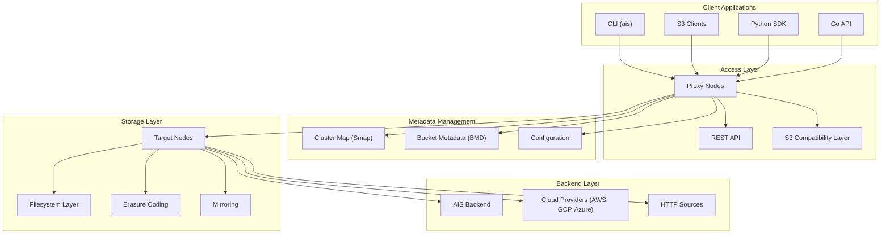
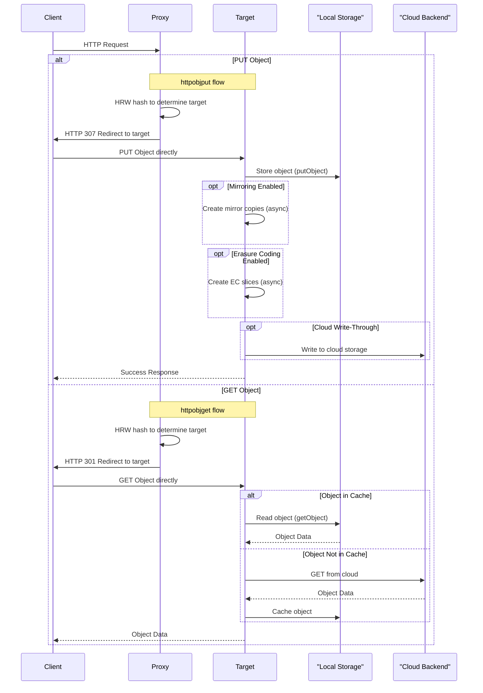
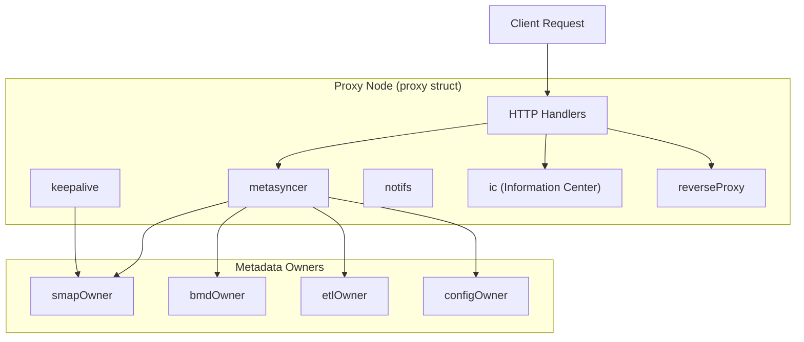
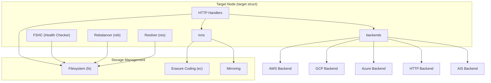
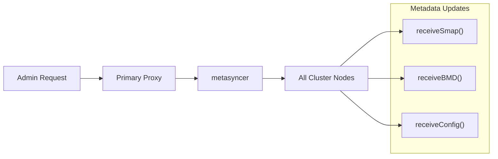
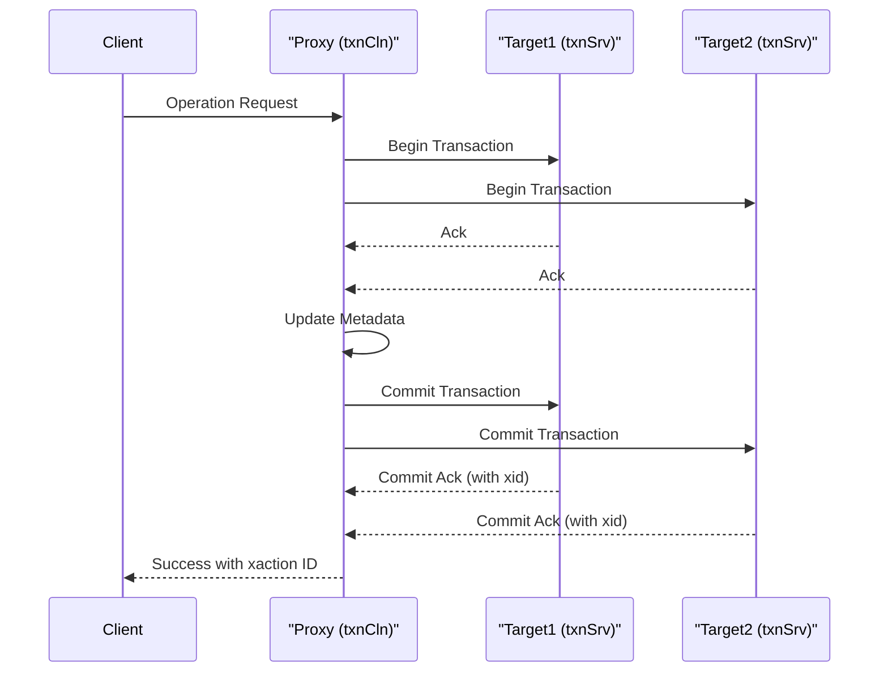
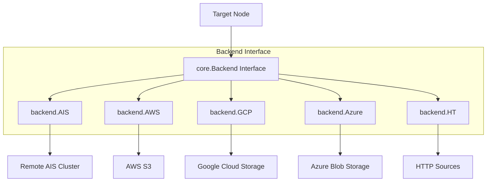
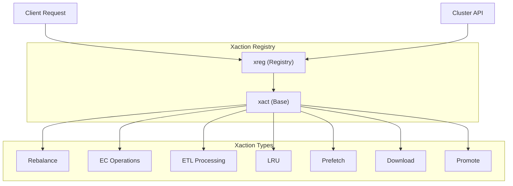

<!-- source: DeepWiki mcp.deepwiki.com · repo NVIDIA/aistore · page 1 Overview · fetched 2026-10-26 -->

# Overview

Relevant source files

The following files were used as context for generating this wiki page:

- [README.md](README.md)
- [ais/bucketmeta.go](ais/bucketmeta.go)
- [ais/clustermap.go](ais/clustermap.go)
- [ais/daemon.go](ais/daemon.go)
- [ais/earlystart.go](ais/earlystart.go)
- [ais/htcommon.go](ais/htcommon.go)
- [ais/htrun.go](ais/htrun.go)
- [ais/kalive.go](ais/kalive.go)
- [ais/metasync.go](ais/metasync.go)
- [ais/proxy.go](ais/proxy.go)
- [ais/prxclu.go](ais/prxclu.go)
- [ais/prxtxn.go](ais/prxtxn.go)
- [ais/rebmeta.go](ais/rebmeta.go)
- [ais/target.go](ais/target.go)
- [ais/tgtcp.go](ais/tgtcp.go)
- [ais/tgttxn.go](ais/tgttxn.go)
- [ais/txn.go](ais/txn.go)
- [ais/vote.go](ais/vote.go)
- [api/bucket.go](api/bucket.go)
- [api/client.go](api/client.go)
- [api/object.go](api/object.go)
- [cmd/aisinit/config.go](cmd/aisinit/config.go)
- [cmn/api.go](cmn/api.go)
- [cmn/config.go](cmn/config.go)
- [cmn/iter_fields.go](cmn/iter_fields.go)
- [cmn/tests/api_test.go](cmn/tests/api_test.go)
- [cmn/tests/common_test.go](cmn/tests/common_test.go)
- [cmn/tests/config_test.go](cmn/tests/config_test.go)
- [cmn/tests/configs/config.json](cmn/tests/configs/config.json)
- [cmn/tests/iter_fields_test.go](cmn/tests/iter_fields_test.go)
- [cmn/ver_const.go](cmn/ver_const.go)
- [deploy/dev/local/aisnode_config.fspaths.sh](deploy/dev/local/aisnode_config.fspaths.sh)
- [deploy/dev/local/aisnode_config.sh](deploy/dev/local/aisnode_config.sh)
- [docs/batch.md](docs/batch.md)
- [docs/bucket.md](docs/bucket.md)
- [docs/cli.md](docs/cli.md)
- [docs/cli/alias.md](docs/cli/alias.md)
- [docs/configuration.md](docs/configuration.md)
- [docs/docs.md](docs/docs.md)
- [docs/http_api.md](docs/http_api.md)
- [docs/index.md](docs/index.md)
- [docs/overview.md](docs/overview.md)
- [docs/providers.md](docs/providers.md)
- [docs/rebalance.md](docs/rebalance.md)
- [docs/storage_svcs.md](docs/storage_svcs.md)

AIStore (AIS) is a lightweight, built-from-scratch distributed object storage system designed specifically for AI and machine learning workloads. It features elastic clustering capabilities, linear scalability, and optimized performance characteristics for high-throughput data access patterns typical in deep learning applications.

This page provides a comprehensive overview of AIStore's architecture, core components, and key concepts. For information about deploying AIStore, see [Getting Started](#10), and for detailed API documentation, see [API Reference](#7.2).

## System Architecture

AIStore follows a distributed architecture with two primary node types:

1. **Proxy nodes** (also called gateways): Handle client requests, coordinate cluster operations, and manage metadata
2. **Target nodes**: Store and serve data from local disks, manage cache, and handle data operations

The system is designed to scale horizontally with performance increasing linearly as more target nodes are added.

**AIStore High-Level Architecture**

Sources:
- [ais/proxy.go:49-86]() - Proxy structure definition
- [ais/target.go:56-92]() - Target structure definition
- [cmn/config.go:50-168]() - Configuration structures
- [ais/clustermap.go:30-43]() - Cluster map definitions

## Key Terminology

| Term | Description |
|------|-------------|
| Proxy | Gateway node that handles client requests and cluster management |
| Target | Storage node that stores and serves data |
| Bucket | Container for objects with configurable properties |
| BMD | Bucket Metadata - cluster-wide registry of buckets and their properties |
| Smap | Cluster Map - contains information about all nodes in the cluster |
| Backend Provider | Storage provider that AIStore can interface with (AWS, GCP, Azure, etc.) |
| Mountpath | Local filesystem path used by target for object storage |
| Xaction | Extended Action - long-running asynchronous operation |

Sources:
- [README.md:1-56]() - Project overview
- [cmn/api.go:50-66]() - Bucket properties structure

## Data Flow

The following diagram illustrates how data flows through AIStore for common operations:

**Object Operation Flow**

Sources:
- [ais/proxy.go:708-771]() - Object GET handling in proxy
- [ais/proxy.go:772-870]() - Object PUT handling in proxy
- [ais/target.go:732-865]() - Object GET handling in target
- [ais/target.go:886-990]() - Object PUT handling in target

## Core Components

### Proxy Architecture

Proxy nodes are the entry points to the AIStore system. They handle client requests, manage cluster metadata, and orchestrate operations across target nodes.

**Proxy Node Components**

Sources:
- [ais/proxy.go:55-82]() - Proxy structure definition
- [ais/proxy.go:183-254]() - Proxy initialization
- [ais/proxy.go:437-494]() - HTTP handlers for object and bucket operations
- [ais/proxy.go:1010-1083]() - Metasync handler

### Target Architecture

Target nodes handle data storage and retrieval. They manage local disks, process object operations, and interact with backend providers for cloud integration.

**Target Node Components**

Sources:
- [ais/target.go:64-76]() - Target structure definition
- [ais/target.go:107-136]() - Backend interface implementation
- [ais/target.go:368-477]() - Target initialization and run
- [ais/target.go:554-574]() - HTTP handler registration

### Bucket System

Buckets in AIStore are containers for objects with configurable properties that determine behavior including replication, erasure coding, access control, and more.

**Bucket Properties**

| Property | Description | Default Source |
|----------|-------------|----------------|
| Provider | Backend provider (ais, aws, gcp, etc.) | User-specified |
| Checksum | Checksum type and validation | Global config |
| Versioning | Object versioning settings | Global config |
| Access | Access permissions | apc.AccessAll |
| EC | Erasure coding configuration | Global config |
| Mirror | Mirroring configuration | Global config |
| LRU | LRU eviction policy | Global config (disabled for AIS buckets) |
| RateLimit | Rate limiting configuration | Global config |

Sources:
- [cmn/api.go:50-66]() - Bucket properties structure (Bprops)
- [cmn/api.go:169-197]() - Default bucket properties initialization

### Cluster Management

AIStore uses several critical metadata structures to manage the cluster state:

1. **Smap (Cluster Map)**: Contains information about all nodes in the cluster, their roles, and network endpoints
2. **BMD (Bucket Metadata)**: Registry of all buckets and their properties
3. **Config**: Cluster and node configuration settings

These structures are maintained by the primary proxy and synchronized to all nodes through the metasync mechanism.

**Metadata Synchronization Flow**

Sources:
- [ais/metasync.go:33-41]() - Metasync system overview
- [ais/clustermap.go:30-43]() - Cluster map structure
- [ais/bucketmeta.go:30-35]() - Bucket metadata structure

## Advanced Features

### Transactions

For operations that span multiple nodes and require consistency, AIStore implements a transaction system with begin-commit-abort semantics.

**Transaction Flow**

Sources:
- [ais/prxtxn.go:30-135]() - Proxy transaction client (txnCln)
- [ais/tgttxn.go:38-178]() - Target transaction server (txnSrv)

### Backend Integration

AIStore seamlessly integrates with multiple backend storage providers, allowing it to serve as both a standalone storage system and a caching layer for cloud storage.

**Backend Provider Architecture**

Sources:
- [ais/target.go:107-136]() - Backend method in target
- [ais/backend/ais.go]() - AIS backend implementation
- [cmn/config.go:170-174]() - Backend configuration structures

### Extended Actions (Xactions)

AIStore uses extended actions (Xactions) for long-running operations like rebalancing, erasure coding, and object transformations.

**Xactions System**

Sources:
- [xact/README.md]() - Xactions documentation
- [xact/xreg/registry.go]() - Xaction registry implementation

## Conclusion

AIStore is a high-performance distributed object storage system optimized for AI and machine learning workloads. Its architecture consists of proxy and target nodes with a clear separation of concerns and extensive support for backend storage providers.

With features like erasure coding, mirroring, and ETL processing, AIStore provides a comprehensive solution for data storage and processing needs beyond just AI applications, including general object storage, caching, and distributed data transformation.

For more detailed information about using and administering AIStore, please refer to the specific wiki pages on [CLI](#7.1), [Bucket Management](#3), and [Deployment](#10).

Sources:
- [README.md:1-56]() - Project overview and features
- [cmn/ver_const.go:10-13]() - Version information

---

