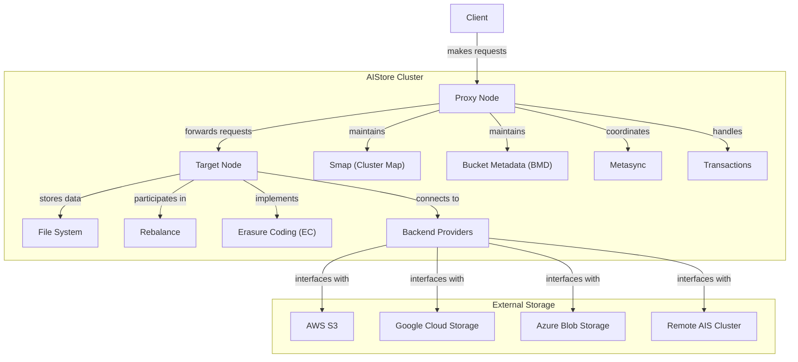
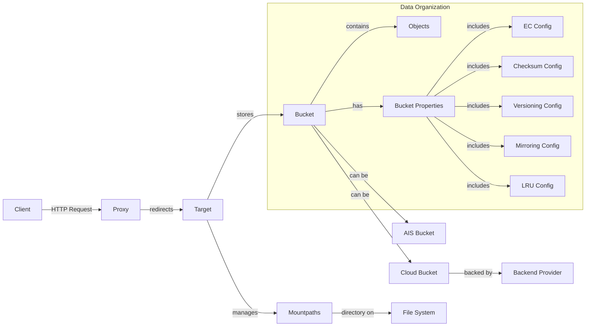
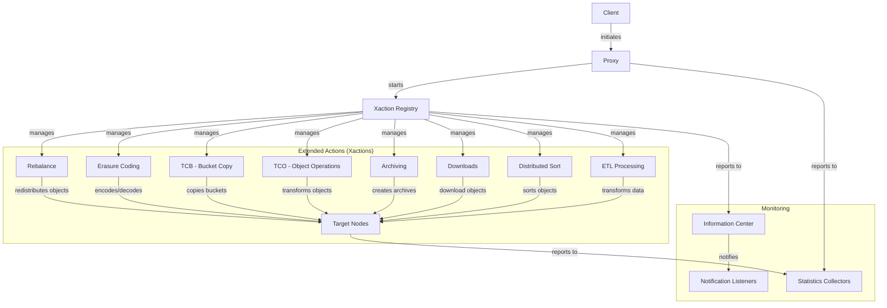

<!-- source: DeepWiki mcp.deepwiki.com · repo NVIDIA/aistore · page 1.1 Key Terminology · fetched 2026-10-26 -->

# Key Terminology

<details>
<summary>Relevant source files</summary>

The following files were used as context for generating this wiki page:

- [README.md](README.md)
- [ais/bucketmeta.go](ais/bucketmeta.go)
- [ais/clustermap.go](ais/clustermap.go)
- [ais/earlystart.go](ais/earlystart.go)
- [ais/htcommon.go](ais/htcommon.go)
- [ais/htrun.go](ais/htrun.go)
- [ais/kalive.go](ais/kalive.go)
- [ais/metasync.go](ais/metasync.go)
- [ais/proxy.go](ais/proxy.go)
- [ais/prxclu.go](ais/prxclu.go)
- [ais/prxtxn.go](ais/prxtxn.go)
- [ais/rebmeta.go](ais/rebmeta.go)
- [ais/target.go](ais/target.go)
- [ais/tgtcp.go](ais/tgtcp.go)
- [ais/tgtimpl.go](ais/tgtimpl.go)
- [ais/tgtobj.go](ais/tgtobj.go)
- [ais/tgttxn.go](ais/tgttxn.go)
- [ais/txn.go](ais/txn.go)
- [ais/vote.go](ais/vote.go)
- [api/bucket.go](api/bucket.go)
- [api/client.go](api/client.go)
- [api/object.go](api/object.go)
- [cmn/api.go](cmn/api.go)
- [cmn/err.go](cmn/err.go)
- [cmn/owt.go](cmn/owt.go)
- [cmn/ver_const.go](cmn/ver_const.go)
- [core/mock/target_mock.go](core/mock/target_mock.go)
- [core/target.go](core/target.go)
- [docs/batch.md](docs/batch.md)
- [docs/bucket.md](docs/bucket.md)
- [docs/cli.md](docs/cli.md)
- [docs/cli/alias.md](docs/cli/alias.md)
- [docs/configuration.md](docs/configuration.md)
- [docs/docs.md](docs/docs.md)
- [docs/http_api.md](docs/http_api.md)
- [docs/index.md](docs/index.md)
- [docs/overview.md](docs/overview.md)
- [docs/providers.md](docs/providers.md)
- [docs/rebalance.md](docs/rebalance.md)
- [docs/storage_svcs.md](docs/storage_svcs.md)
- [mirror/utils.go](mirror/utils.go)
- [mirror/utils_test.go](mirror/utils_test.go)

</details>


This page defines the key terms and concepts used throughout the AIStore system. Understanding these foundational elements will help you navigate the codebase and documentation more effectively. For detailed information about the system architecture, see [Core Architecture](#2).

## Core Components

### Nodes: Proxy and Target

AIStore clusters consist of two types of nodes:

1. **Proxy Node**: Acts as a gateway for client requests, maintains cluster metadata, and coordinates operations across the cluster.
   - Key responsibilities:
     - Forwards client requests to appropriate target nodes
     - Maintains and distributes the cluster map (Smap)
     - Manages bucket metadata (BMD)
     - Coordinates distributed transactions
     - Handles authentication and authorization

2. **Target Node**: Stores and manages actual data (objects), interacts with backend storage systems, and executes extended operations (xactions).
   - Key responsibilities:
     - Stores objects on local file systems
     - Executes data operations (read, write, delete)
     - Implements data protection mechanisms (erasure coding, mirroring)
     - Connects to remote storage backends
     - Participates in rebalancing and other distributed operations

#### Diagram: AIStore Node Types and Their Relationships



Sources: [ais/proxy.go:54-80](), [ais/target.go:56-76]()

### Cluster Map (Smap)

The Smap is a fundamental data structure that represents the current membership and topology of the AIStore cluster.

- Key features:
  - Identifies the primary proxy
  - Lists all proxy and target nodes with their network information
  - Maintains version information for cluster-wide consistency
  - Used for request routing and distributed operations

Sources: [ais/clustermap.go:30-39]()

### Bucket Metadata (BMD)

BMD is a cluster-wide metadata structure that maintains information about all buckets in the system.

- Key features:
  - Tracks all buckets and their properties
  - Distributed to all nodes via metasync
  - Used for bucket operations and policy enforcement

Sources: [ais/bucketmeta.go:1-16]()

## Storage Concepts

### Buckets

Buckets are logical containers for objects and serve as the primary organizational unit within AIStore.

- Types:
  - **AIS Buckets**: Native buckets managed entirely by AIStore
  - **Cloud Buckets**: Represent and can interact with buckets in cloud storage (AWS, GCP, Azure, etc.)
  - **Remote AIS Buckets**: Buckets in a remote AIStore cluster

- Key properties (managed by `Bprops` struct):
  - Checksum configuration
  - Erasure coding settings
  - LRU (Least Recently Used) policies
  - Mirroring configuration
  - Access control
  - Versioning settings
  - Rate limiting options

Sources: [cmn/api.go:50-66](), [docs/bucket.md:12-23]()

### Objects

Objects are the fundamental data entities stored in buckets.

- Key operations:
  - GET: Retrieve an object
  - PUT: Store an object
  - DELETE: Remove an object
  - HEAD: Get object metadata

- Properties:
  - Name
  - Content type
  - Size
  - Checksum
  - Version
  - Custom metadata

#### Diagram: Data Organization and Access Flow



Sources: [ais/proxy.go:709-912](), [ais/tgtobj.go:732-963](), [api/object.go:32-90]()

### Mountpaths

Mountpaths are filesystem directories used by target nodes to store objects.

- Key features:
  - Multiple mountpaths per target for increased capacity and parallelism
  - Health monitoring via FSHC (FileSystem Health Checker)
  - Can be added or removed at runtime

Sources: [ais/target.go:376-387]()

## Extended Operations (Xactions)

Xactions (extended actions) are long-running, asynchronous operations that execute across the cluster.

- Types of xactions:
  - **Rebalance**: Redistributes objects when cluster membership changes
  - **Erasure Coding (EC)**: Encodes and decodes objects for data protection
  - **Copy Bucket (TCB)**: Copies entire buckets
  - **Copy Objects (TCO)**: Copies selected objects
  - **Archiving**: Creates and manages archives
  - **Downloads**: Downloads objects from external sources
  - **Distributed Sort (dsort)**: Sorts and reshards objects
  - **ETL**: Transforms data during processing

#### Diagram: Extended Actions and Monitoring System



Sources: [ais/tgttxn.go:100-159]()

## Network and Communication

### REST API

AIStore provides a comprehensive REST API for operations on buckets, objects, and cluster management.

- Key endpoints:
  - `/v1/buckets`: Bucket operations ([ais/proxy.go:437-468]())
  - `/v1/objects`: Object operations ([ais/proxy.go:470-493]())
  - `/v1/daemon`: Daemon management ([ais/htrun.go:141-157]())
  - `/v1/cluster`: Cluster operations ([ais/prxclu.go:36-49]())
  - `/v1/download`: Download management
  - `/v1/etl`: ETL operations

Sources: [docs/http_api.md:10-16](), [ais/target.go:554-573]()

### S3 Compatibility

AIStore provides compatibility with Amazon S3 API for easier integration with existing applications.

- Endpoint: `/s3`
- Allows running unmodified S3 clients and applications against AIStore

Sources: [ais/proxy.go:226-232](), [ais/target.go:571](), [README.md:14]()

### Easy URL

A simplified URL scheme for accessing objects without using the full REST API path.

- Format: `/<provider>/<bucket>/<object>`
- Supported providers:
  - `gs`: Google Cloud Storage
  - `az`: Azure Blob Storage
  - `ais`: AIStore

Example:
```
GET /gs/my-bucket/object.txt  # Access Google Cloud Storage
GET /ais/local-bucket/data.csv # Access AIS bucket
```

Sources: [ais/proxy.go:497-587]()

## Backend Integration

### Backend Providers

AIStore can interface with various external storage systems through backend providers.

- Supported providers:
  - AWS S3
  - Google Cloud Storage
  - Azure Blob Storage
  - Oracle Cloud Infrastructure (OCI)
  - HTTP data sources
  - Remote AIStore clusters

Sources: [ais/target.go:106-128](), [ais/target.go:137-237](), [README.md:16]()

### Remote AIS Clusters

AIStore clusters can be interconnected, allowing visibility and access to objects across clusters.

- Features:
  - Attach remote clusters to create a global namespace
  - Access objects in remote clusters transparently
  - Copy data between clusters

Sources: [ais/proxy.go:62-72](), [ais/prxclu.go:235-267](), [README.md:74]()

## Transactions and Metadata Synchronization

### Transactions

Transactions are used to ensure consistency for operations that affect multiple nodes or require atomicity.

- Components:
  - `txnCln`: Client-side transaction context ([ais/prxtxn.go:33-45]())
  - `txnSrv`: Server-side transaction context ([ais/tgttxn.go:37-55]())
  - Phases: Begin, Commit, Abort

Sources: [ais/prxtxn.go:46-127](), [ais/tgttxn.go:59-177]()

### Metasync

Metasync is the process of synchronizing cluster metadata (Smap, BMD, etc.) across all nodes.

- Key features:
  - Ensures all nodes have consistent view of cluster state
  - Handles synchronization of Smap, BMD, and other metadata
  - Used during cluster membership changes and bucket operations

Sources: [ais/metasync.go:29-33]()

## Table: Common HTTP API Actions

| Action | Description | HTTP Method | Path |
|--------|-------------|-------------|------|
| `ActCreateBck` | Create bucket | POST | /v1/buckets |
| `ActListBuckets` | List buckets | GET | /v1/buckets |
| `ActListObjects` | List objects | GET | /v1/buckets/bucket-name |
| `ActPutObject` | Put object | PUT | /v1/objects/bucket-name/object-name |
| `ActGetObject` | Get object | GET | /v1/objects/bucket-name/object-name |
| `ActDeleteObject` | Delete object | DELETE | /v1/objects/bucket-name/object-name |
| `ActCopyBck` | Copy bucket | POST | /v1/buckets/bucket-name |
| `ActECEncode` | Erasure code objects | PUT | /v1/ec |
| `ActRebalance` | Rebalance cluster | POST | /v1/cluster |

Sources: [ais/proxy.go:437-493](), [docs/http_api.md:15-16]()

---

