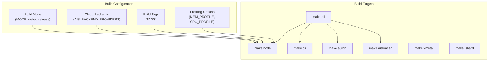
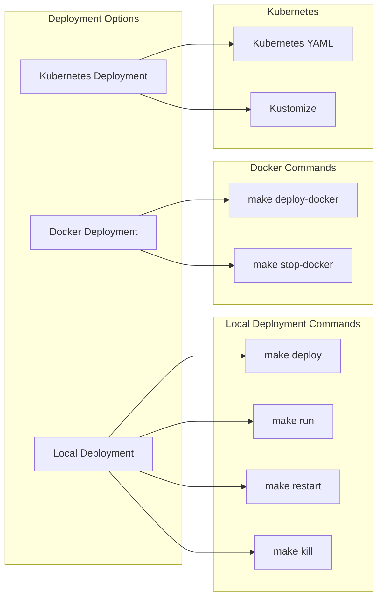
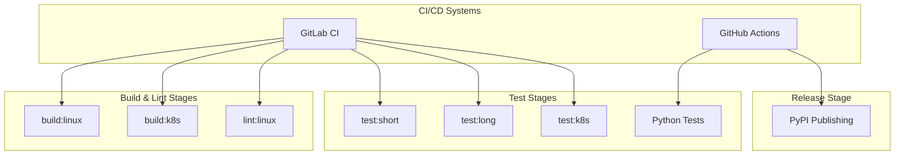
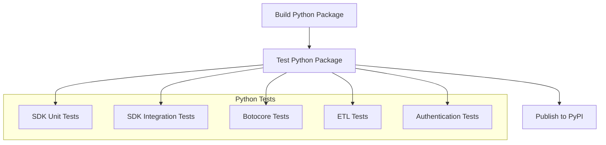

<!-- source: DeepWiki mcp.deepwiki.com · repo NVIDIA/aistore · page 10 Building and Deployment · fetched 2026-10-26 -->

# Building and Deployment

<details>
<summary>Relevant source files</summary>

The following files were used as context for generating this wiki page:

- [.github/workflows/build.yml](.github/workflows/build.yml)
- [.github/workflows/lint.yml](.github/workflows/lint.yml)
- [.github/workflows/pypi-publish.yml](.github/workflows/pypi-publish.yml)
- [.github/workflows/test-python-authn.yml](.github/workflows/test-python-authn.yml)
- [.github/workflows/test-python-etl.yml](.github/workflows/test-python-etl.yml)
- [.github/workflows/test-python.yml](.github/workflows/test-python.yml)
- [.github/workflows/test-short.yml](.github/workflows/test-short.yml)
- [.gitlab-ci.yml](.gitlab-ci.yml)
- [.golangci.yml](.golangci.yml)
- [Makefile](Makefile)
- [action.yml](action.yml)
- [docs/examples/etl-imagenet-dataset/train_aistore.py](docs/examples/etl-imagenet-dataset/train_aistore.py)
- [docs/examples/etl-imagenet-dataset/train_pytorch.py](docs/examples/etl-imagenet-dataset/train_pytorch.py)
- [docs/examples/etl-imagenet-wd/pytorch_wd.py](docs/examples/etl-imagenet-wd/pytorch_wd.py)
- [python/Makefile](python/Makefile)

</details>


This document explains how to build AIStore from source code and deploy it in different environments. It covers the build process, various deployment options, and basic configuration. For information about running tests, see [Testing](#9).

## Build System Overview

AIStore uses a Makefile-based build system with various targets for building different binaries including the main AIStore node, CLI tools, and utilities. The build system supports different configurations such as debug mode, cloud backend providers integration, and network transport options.



Sources: [Makefile:96-138](), [Makefile:98-109]()

## Building from Source

### Prerequisites

Before building AIStore, ensure you have:

1. Go 1.24 or later installed
2. Git for cloning the repository
3. Make utility

### Basic Build

To build the core AIStore components:

```bash
# Clone the repository
git clone https://github.com/NVIDIA/aistore.git
cd aistore

# Build all main components
make all

# Or build specific components
make node  # Build aisnode binary
make cli   # Build CLI
```

The build process produces binaries in `$GOPATH/bin` or `$GOBIN` if set.

Sources: [Makefile:96-138]()

### Build Modes and Options

AIStore supports various build modes and configurations:

| Option | Description | Example |
|--------|-------------|---------|
| `MODE` | Build mode (debug or production) | `MODE=debug make node` |
| `AIS_BACKEND_PROVIDERS` | Cloud backends to include | `AIS_BACKEND_PROVIDERS="aws azure gcp" make node` |
| `TAGS` | Additional build tags | `TAGS="nethttp oteltracing" make node` |
| `MEM_PROFILE` | Memory profiling output | `MEM_PROFILE=/tmp/mem make node` |
| `CPU_PROFILE` | CPU profiling output | `CPU_PROFILE=/tmp/cpu make node` |

#### Build Modes

1. **Debug Mode**: Builds with debug symbols and assertions enabled
   ```bash
   MODE=debug make node
   ```

2. **Production Mode** (default): Optimized build without debug symbols
   ```bash
   MODE="" make node
   ```

#### Cloud Backends

Include cloud storage providers:
```bash
AIS_BACKEND_PROVIDERS="aws azure gcp oci" make node
```

#### Transport Options

AIStore supports different transport layer implementations:

1. **fasthttp** (default): Uses the valyala/fasthttp package
2. **net/http**: Uses Go's standard HTTP package
   ```bash
   TAGS="nethttp" make node
   ```

Sources: [Makefile:9-86](), [.github/workflows/build.yml:26-47]()

### Cross-Compilation

The Makefile includes support for cross-compilation using Docker:

```bash
# Uncomment these lines in the Makefile
# CROSS_COMPILE = docker run --rm -v $(AISTORE_PATH):/go/src/n -w /go/src/n golang:1.24
# CROSS_COMPILE_CLI = docker run -e $(CGO_DISABLE) --rm -v $(AISTORE_PATH)/cmd/cli:/go/src/n -w /go/src/n golang:1.24
```

Sources: [Makefile:23-25]()

## Deployment Options

AIStore can be deployed in various environments:



Sources: [Makefile:153-214]()

### Local Deployment

Local deployment is useful for development and testing. The Makefile provides several targets:

```bash
# Deploy a new cluster (interactive mode allows you to specify number of proxies, targets, etc.)
make deploy

# Restart existing cluster without regenerating configs
make run

# Kill and restart cluster
make restart

# Kill all locally deployed clusters
make kill

# Remove all AIS related files and binaries
make clean
```

Non-interactive deployment with specific configuration:
```bash
# Deploy 7 targets (each with 4 mountpaths) and 2 proxies
make kill deploy <<< $'7\n2\n4\ny\ny\n'
```

Sources: [Makefile:153-184]()

### Docker Deployment

For containerized deployment:

```bash
# Deploy AIS cluster in Docker containers (with 3 mountpaths per target)
make deploy-docker

# Stop deployed Docker cluster
FLAGS="your-flags" make stop-docker
```

Sources: [Makefile:203-214]()

### Kubernetes Deployment

AIStore can be deployed on Kubernetes using the provided configurations. The repository contains Dockerfiles and Kubernetes manifests:

1. Node container: `deploy/prod/k8s/aisnode_container/Dockerfile`
2. Init container: `deploy/prod/k8s/aisinit_container/Dockerfile`

The CI/CD pipeline demonstrates building these containers:

```bash
# Build aisnode container
buildah build -t $FQ_AISNODE_IMAGE_NAME \
  -f deploy/prod/k8s/aisnode_container/Dockerfile \
  --build-arg mode="debug" \
  --build-arg providers="gcp aws oci" \
  --build-arg INSTALLER_IMAGE="docker.io/library/debian:bookworm" \
  --build-arg BUILDER_IMAGE="docker.io/library/golang:1.24"

# Build aisinit container
buildah build -t $FQ_AISINIT_IMAGE_NAME \
  -f deploy/prod/k8s/aisinit_container/Dockerfile
```

For development testing on Kubernetes, the repository includes kustomize configurations at `deploy/dev/k8s/kustomize/`.

Sources: [.gitlab-ci.yml:182-206](), [.github/workflows/test-python-etl.yml:22-26]()

## Configuration System

AIStore configuration is managed through a combination of environment variables, configuration files, and command-line arguments.

### Environment Variables

Important environment variables for deployment:

| Variable | Description | Example |
|----------|-------------|---------|
| `AIS_ENDPOINT` | Endpoint for the AIStore cluster | `http://localhost:8080` |
| `AIS_USE_HTTPS` | Enable HTTPS | `true` |
| `AIS_SKIP_VERIFY_CRT` | Skip certificate verification | `true` |
| `AIS_SERVER_CRT` | Server certificate path | `/path/to/cert.crt` |
| `AIS_SERVER_KEY` | Server key path | `/path/to/key.key` |
| `AIS_AUTHN_ENABLED` | Enable authentication | `true` |
| `AIS_AUTHN_SU_NAME` | Super user name for authentication | `admin` |
| `AIS_AUTHN_SU_PASS` | Super user password for authentication | `admin` |
| `AIS_NODE_FLAGS` | Additional flags for aisnode | `-memprofile=/tmp/mem` |

Sources: [.gitlab-ci.yml:326-331](), [.gitlab-ci.yml:399-404]()

## CI/CD Pipeline

AIStore uses both GitLab CI and GitHub Actions for continuous integration and delivery.



Sources: [.gitlab-ci.yml:27-32](), [.github/workflows/build.yml:1-47](), [.github/workflows/test-python.yml:1-60](), [.github/workflows/pypi-publish.yml:1-64]()

### GitLab CI

The GitLab CI pipeline is defined in `.gitlab-ci.yml` and consists of several stages:

1. **Build** - Builds AIStore binaries in various configurations
   - `build:linux` - Builds on Linux
   - `build:k8s` - Builds Kubernetes container images
   - `lint:linux` - Runs linting tools

2. **Test Short** - Runs short tests
   - Tests with different configurations (minimal, cloud backends, etc.)
   - Python unit and integration tests

3. **Test Long** - Runs long-running integration tests
   - Tests with different cloud backends
   - Extended Python tests

4. **Security** - Runs security scans

Sources: [.gitlab-ci.yml:27-32](), [.gitlab-ci.yml:162-777]()

### GitHub Actions

GitHub Actions are defined in `.github/workflows/` and include:

1. **Building** - Builds AIStore in various configurations
2. **Python SDK Tests** - Tests the Python SDK with different Python versions
3. **Python ETL Tests** - Tests ETL functionality in Kubernetes
4. **Go Tests** - Runs Go tests
5. **Python AuthN Tests** - Tests authentication functionality
6. **PyPI Publishing** - Publishes Python packages to PyPI

Sources: [.github/workflows/build.yml:1-47](), [.github/workflows/test-python.yml:1-60](), [.github/workflows/test-python-etl.yml:1-38](), [.github/workflows/test-short.yml:1-32](), [.github/workflows/test-python-authn.yml:1-60](), [.github/workflows/pypi-publish.yml:1-64]()

## Tools and Utilities

AIStore includes several tools and utilities that can be built and used:

1. **CLI** - Command-line interface for AIStore
   ```bash
   make cli
   ```

2. **aisloader** - Load testing tool
   ```bash
   make aisloader
   ```

3. **authn** - Authentication service
   ```bash
   make authn
   ```

4. **ishard** - Command line tool for shard operations
   ```bash
   make ishard
   ```

Sources: [Makefile:111-119](), [Makefile:130-138]()

## GitHub Action for Easy Integration

AIStore provides a GitHub Action for easy integration into other projects. It automates the setup and deployment of AIStore in GitHub Actions workflows:

```yaml
- name: Run AIStore
  uses: NVIDIA/aistore@main
  with:
    targets: '1'     # Number of storage targets
    proxies: '1'     # Number of proxies
    mountpaths: '1'  # Number of local mountpaths
```

This allows other projects to easily incorporate AIStore for testing or as a dependency.

Sources: [action.yml:1-35]()

## Code Quality and Static Analysis

AIStore uses several tools for maintaining code quality:

1. **golangci-lint** - For Go code linting
   ```bash
   make lint
   ```

2. **fmt-check** - For checking code formatting
   ```bash
   make fmt-check
   ```

3. **spell-check** - For checking spelling
   ```bash
   make spell-check
   ```

The CI pipeline runs these checks automatically, and there are also targets to fix issues:

```bash
# Fix code formatting
make fmt-fix

# Fix spelling issues
make spell-fix
```

Sources: [Makefile:256-294](), [.golangci.yml:1-210]()

## Python SDK Building and Publishing

AIStore includes a Python SDK that can be built and published to PyPI:



The Python package is tested on multiple Python versions (3.8 through 3.13) as part of the CI process. 

The Makefile in the `python` directory includes targets for building and testing:

```bash
cd python
make common_deps     # Install common dependencies
make botocore_deps   # Install Botocore dependencies
make python_tests    # Run all Python tests
```

For publishing to PyPI, there's a GitHub Action workflow that builds and publishes the package.

Sources: [python/Makefile:1-141](), [.github/workflows/pypi-publish.yml:1-64]()

## Conclusion

This document covered the key aspects of building and deploying AIStore, including the build system, deployment options, CI/CD pipeline, and tools. For more detailed information on specific components, refer to their respective documentation pages.

---

