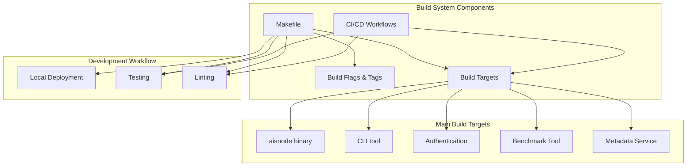
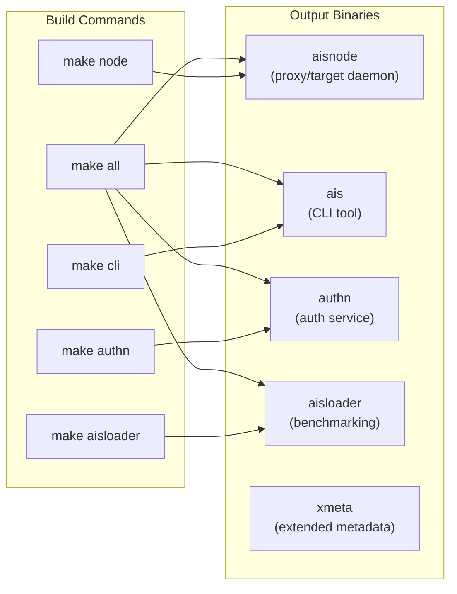
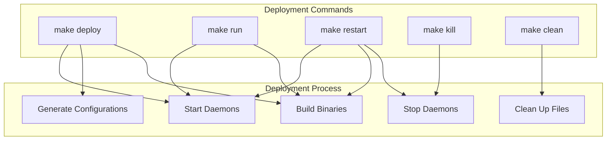
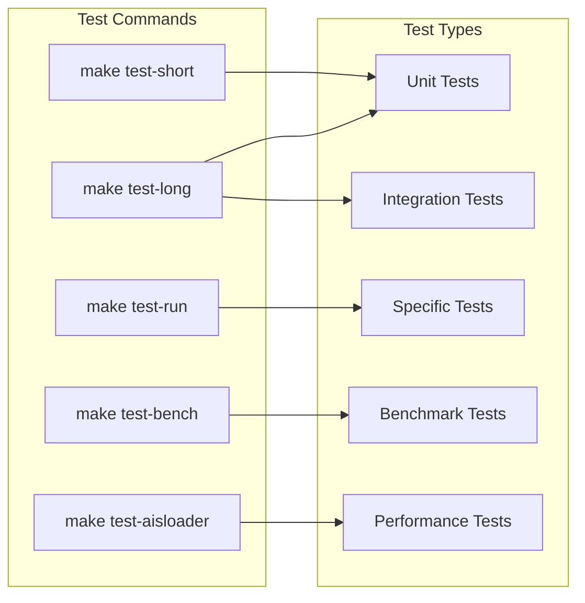
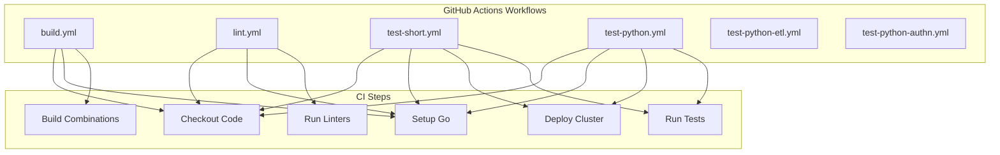

<!-- source: DeepWiki mcp.deepwiki.com · repo NVIDIA/aistore · page 10.1 Build System · fetched 2026-10-26 -->

# Build System

<details>
<summary>Relevant source files</summary>

The following files were used as context for generating this wiki page:

- [.github/workflows/build.yml](.github/workflows/build.yml)
- [.github/workflows/lint.yml](.github/workflows/lint.yml)
- [.github/workflows/pypi-publish.yml](.github/workflows/pypi-publish.yml)
- [.github/workflows/test-python-authn.yml](.github/workflows/test-python-authn.yml)
- [.github/workflows/test-python-etl.yml](.github/workflows/test-python-etl.yml)
- [.github/workflows/test-python.yml](.github/workflows/test-python.yml)
- [.github/workflows/test-short.yml](.github/workflows/test-short.yml)
- [.golangci.yml](.golangci.yml)
- [Makefile](Makefile)
- [action.yml](action.yml)

</details>


This document describes the build system for AIStore, focusing on the Makefile-based processes for building, deploying, testing, and maintaining the codebase. It covers build configurations, development workflows, and CI/CD integration. For information about deployment options, see [Building and Deployment](#10).

## Overview

AIStore uses a Makefile-based build system that supports various build configurations, local deployments, and CI/CD workflows. The build system enables developers to compile AIStore components with different features and configurations, run tests, and deploy local development environments.



Sources: [Makefile:1-335](), [.github/workflows/build.yml:1-48](), [.github/workflows/lint.yml:1-44]()

## Build Environment and Configuration

AIStore's build configuration is controlled by environment variables and build flags defined in the Makefile. These settings determine how components are compiled and what features are included.

### Build Modes

The build system supports two primary modes:

| Mode | Description | Compiler Flags | Use Case |
|------|-------------|----------------|----------|
| Production | Default mode with optimized binaries | `-w -s` flags to reduce binary size | Production deployment |
| Debug | Includes debug symbols and assertions | `-gcflags="all=-N -l"` and `debug` build tag | Development and debugging |

Sources: [Makefile:71-82]()

### Build Tags

Build tags control which features are compiled into the binaries:

| Build Tag | Purpose |
|-----------|---------|
| `aws`, `azure`, `gcp` | Enable cloud backend providers |
| `nethttp` | Use Go's net/http instead of fasthttp |
| `debug` | Enable debug features |
| `statsd` | Enable StatsD metrics instead of Prometheus |
| `mono` | Utilize go:linkname for monotonic time source |
| `oteltracing` | Enable OpenTelemetry tracing |

Sources: [Makefile:35-39](), [Makefile:63-69](), [Makefile:86](), [.github/workflows/build.yml:28-43]()

## Main Build Components



Sources: [Makefile:96-107](), [Makefile:111-118](), [Makefile:135-147]()

### Primary Build Targets

The Makefile provides several targets for building different components:

| Target | Description | Command | Output |
|--------|-------------|---------|--------|
| `all` | Build all main binaries | `make all` | aisnode, CLI, authn, aisloader |
| `node` | Build aisnode binary | `make node` | aisnode (proxy/target daemon) |
| `cli` | Build CLI tool | `make cli` | ais (command-line interface) |
| `authn` | Build authentication service | `make authn` | authn binary |
| `aisloader` | Build benchmarking tool | `make aisloader` | aisloader binary |
| `xmeta` | Build extended metadata service | `make xmeta` | xmeta binary |
| `aisinit` | Build initialization tool | `make aisinit` | aisinit binary |

Sources: [Makefile:94-147]()

### Build Configuration Examples

The build system supports various configurations through environment variables:

```
# Build with debug mode
MODE=debug make node

# Build with cloud backend support
TAGS="aws gcp azure" make node

# Build with race detection
GORACE='log_path=/tmp/race' make node

# Build with memory profiling
MEM_PROFILE=/tmp/mem make node

# Build with net/http instead of fasthttp
TAGS=nethttp make node

# Build with all features
TAGS="aws azure gcp statsd debug oteltracing" make node
```

Sources: [Makefile:315-334]()

## Development Workflow

The build system supports a streamlined development workflow with commands for deployment, testing, and cleanup.

### Local Deployment



Sources: [Makefile:154-183]()

Local deployment commands:

| Command | Description |
|---------|-------------|
| `make deploy` | Build and deploy a local AIStore cluster |
| `make run` | Restart the cluster with existing configurations |
| `make restart` | Kill running cluster and restart it |
| `make kill` | Stop all locally running AIStore processes |
| `make clean` | Remove all AIStore related files and binaries |

Examples:

```
# Deploy local cluster with interactive configuration
make deploy

# Deploy cluster with predefined configuration (7 targets, 2 proxies, 4 mountpaths each)
make kill deploy <<< $'7\n2\n4\ny\ny\n'

# Deploy cluster with AWS and GCP backends
TAGS="aws gcp" make kill deploy <<< $'7\n2\n'
```

Sources: [Makefile:154-183](), [Makefile:322-326]()

### Docker Deployment

The build system also supports Docker-based deployment:

| Command | Description |
|---------|-------------|
| `make deploy-docker` | Deploy AIStore cluster inside Docker containers |
| `make stop-docker` | Stop the Docker-based AIStore cluster |

Sources: [Makefile:203-213]()

## Testing and Quality Assurance

The build system includes comprehensive support for testing and quality assurance.

### Testing Commands



Sources: [Makefile:218-251]()

| Command | Description | Usage |
|---------|-------------|-------|
| `make test-short` | Run short tests | `BUCKET=tmp make test-short` |
| `make test-long` | Run all integration tests | `BUCKET=<bucket> make test-long` |
| `make test-run` | Run tests matching regex | `RE="testnameregex" make test-run` |
| `make test-bench` | Run benchmarking tests | `make test-bench` |
| `make test-aisloader` | Run aisloader tests | `make test-aisloader` |

Sources: [Makefile:218-251](), [Makefile:328-331]()

### Code Quality Tools

The build system integrates various linting and formatting tools:

| Command | Description |
|---------|-------------|
| `make lint` | Run golangci-lint on the codebase |
| `make lint-update` | Update golangci-lint to the latest version |
| `make fmt-check` | Check code formatting |
| `make fmt-fix` | Fix code formatting issues |
| `make spell-check` | Check for spelling errors |
| `make spell-fix` | Fix spelling errors |

Sources: [Makefile:257-293](), [.golangci.yml:1-211]()

## CI/CD Integration

The AIStore build system integrates with GitHub Actions for continuous integration and deployment.



Sources: [.github/workflows/build.yml:1-48](), [.github/workflows/lint.yml:1-44](), [.github/workflows/test-short.yml:1-32]()

### GitHub Actions Workflows

The CI/CD pipeline includes several GitHub Actions workflows:

| Workflow | Purpose |
|----------|---------|
| `build.yml` | Tests building aisnode with various configurations |
| `lint.yml` | Runs linting and formatting checks |
| `test-short.yml` | Runs short Go tests |
| `test-python.yml` | Tests the Python SDK |
| `test-python-etl.yml` | Tests Python ETL functionality |
| `test-python-authn.yml` | Tests Python authentication |
| `pypi-publish.yml` | Publishes Python SDK to PyPI |

Each workflow validates different aspects of the codebase to ensure quality and functionality.

Sources: [.github/workflows/build.yml:1-48](), [.github/workflows/lint.yml:1-44](), [.github/workflows/test-short.yml:1-32](), [.github/workflows/test-python.yml:1-51](), [.github/workflows/test-python-etl.yml:1-39](), [.github/workflows/test-python-authn.yml:1-60](), [.github/workflows/pypi-publish.yml:1-64]()

## Advanced Build Options

The build system supports several advanced options for specialized use cases.

### Profiling

AIStore supports memory and CPU profiling through build options:

```
# Enable memory profiling
MEM_PROFILE=/tmp/mem make deploy

# Enable CPU profiling
CPU_PROFILE=/tmp/cpu make deploy
```

When these options are enabled, the build uses a specialized version of the aisnode binary that includes profiling instrumentation.

Sources: [Makefile:51-61](), [Makefile:332-333]()

### Cross-Compilation

The Makefile includes commented examples for cross-compilation:

```
# Uncomment to cross-compile aisnode and cli, respectively:
# CROSS_COMPILE = docker run --rm -v $(AISTORE_PATH):/go/src/n -w /go/src/n golang:1.24
# CROSS_COMPILE_CLI = docker run -e $(CGO_DISABLE) --rm -v $(AISTORE_PATH)/cmd/cli:/go/src/n -w /go/src/n golang:1.24
```

When uncommented and configured, these variables enable cross-compilation using Docker containers.

Sources: [Makefile:23-25]()

## Common Operations

This table summarizes common build system operations:

| Operation | Command |
|-----------|---------|
| Build all components | `make all` |
| Build and deploy local cluster | `make deploy` |
| Run tests | `BUCKET=tmp make test-short` |
| Check code quality | `make ci` |
| Clean up local deployment | `make kill clean` |
| Update dependencies | `make mod-all` |
| Format code | `make fmt-fix` |

Sources: [Makefile:94-147](), [Makefile:154-183](), [Makefile:218-251](), [Makefile:253-293](), [Makefile:315-334]()

---

