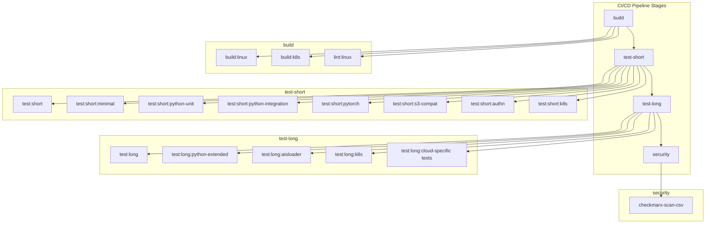
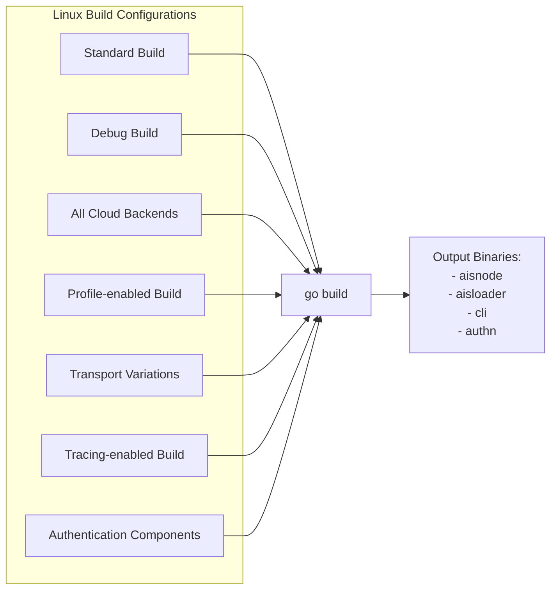
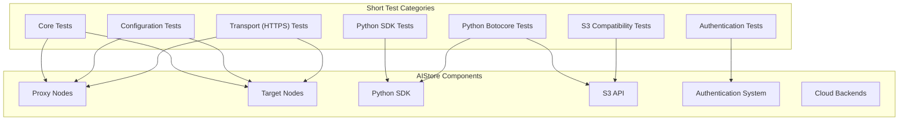
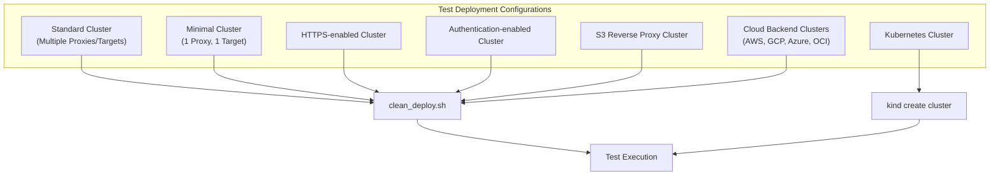
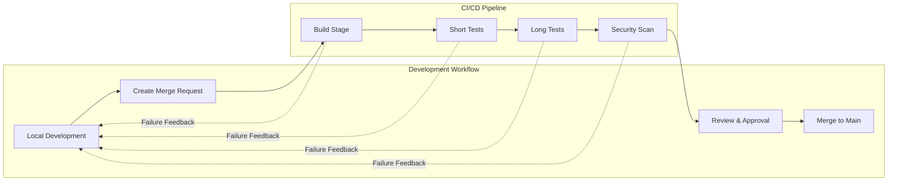

<!-- source: DeepWiki mcp.deepwiki.com · repo NVIDIA/aistore · page 10.2 CI/CD Pipeline · fetched 2026-10-26 -->

# CI/CD Pipeline

Relevant source files

The following files were used as context for generating this wiki page:

- [.gitlab-ci.yml](.gitlab-ci.yml)
- [docs/examples/etl-imagenet-dataset/train_aistore.py](docs/examples/etl-imagenet-dataset/train_aistore.py)
- [docs/examples/etl-imagenet-dataset/train_pytorch.py](docs/examples/etl-imagenet-dataset/train_pytorch.py)
- [docs/examples/etl-imagenet-wd/pytorch_wd.py](docs/examples/etl-imagenet-wd/pytorch_wd.py)
- [python/Makefile](python/Makefile)

This page documents the Continuous Integration and Continuous Deployment (CI/CD) pipeline used by AIStore. It covers the pipeline structure, build processes, test automation, and integration with the development workflow. For information about the build system itself, see [Build System](#10.1).

## Pipeline Overview

AIStore implements a comprehensive CI/CD pipeline using GitLab CI. The pipeline automates building, testing, and security scanning of the codebase, ensuring code quality and stability throughout the development process.

The pipeline is structured into four primary stages:

Sources: [.gitlab-ci.yml:1-782]()

## Configuration and Variables

The pipeline uses a set of defined variables to control execution environments, test parameters, and cloud integrations. These variables enable consistent testing across different environments and configurations.

### Key CI/CD Variables

| Variable | Purpose |
|----------|---------|
| `MODE` | Runtime mode (debug/production) |
| `CI_IMAGE` | Container image for pipeline execution |
| `NUM_TARGET` | Number of storage target nodes to use in tests |
| `NUM_PROXY` | Number of proxy nodes to use in tests |
| `FS_CNT` | Number of mountpaths (simulated disks) per target |
| `CLOUD_BCKS` | Set of cloud buckets used for testing |
| `GOOGLE_APPLICATION_CREDENTIALS` | GCP credentials file variable |
| `ORACLE_PRIVATE_KEY` | Oracle Cloud Infrastructure credentials |

Sources: [.gitlab-ci.yml:1-24]()

## Build Stage

The build stage compiles AIStore binaries and container images with various configurations to ensure the codebase builds successfully across different environments.

### Linux Builds

The Linux build job builds AIStore binaries with multiple configurations:
- Production mode (no debugging)
- Debug mode
- Various cloud backend providers (AWS, Azure, GCP, OCI)
- With memory and CPU profiling enabled
- With alternative transport layers (nethttp vs. fasthttp)
- With OpenTelemetry tracing
- Authentication components

Sources: [.gitlab-ci.yml:162-181]()

### Kubernetes Image Builds

AIStore is also built into container images for Kubernetes deployments:
- `aisnode` - Main AIStore container image
- `ais-init` - Initialization container image

These images are built using Buildah and pushed to the GitLab container registry.

Sources: [.gitlab-ci.yml:182-210]()

### Linting

The linting job runs several code quality checks:
- Go linting with different tag combinations
- Format checking
- Spell checking

Sources: [.gitlab-ci.yml:211-224]()

## Test Stages

The pipeline includes two test stages with different scopes and execution times:

### Short Tests

Short tests run within a 35-minute timeout and include:
- Core functionality tests
- Minimal configuration tests (single proxy, single target)
- S3 compatibility tests
- Authentication tests
- HTTPS tests
- Python unit and integration tests
- PyTorch integration tests

Sources: [.gitlab-ci.yml:226-474]()

### Long Tests

Long tests run with a 4-hour timeout and include:
- Extended functionality tests
- Performance testing with aisloader
- Cloud-specific tests (AWS, GCP, Azure, OCI)
- Extended Python SDK tests
- Kubernetes deployment tests

Sources: [.gitlab-ci.yml:476-556](), [.gitlab-ci.yml:589-776]()

### Python Tests

The pipeline includes specialized tests for the Python SDK and related components:
- Unit tests across multiple Python versions (3.8-3.13)
- Integration tests
- ETL tests (running on Kubernetes)
- Authentication-specific tests
- PyTorch integration tests
- Boto/S3 compatibility tests

Sources: [python/Makefile:1-141](), [.gitlab-ci.yml:259-304]()

### Kubernetes Tests

The pipeline includes dedicated jobs for testing AIStore in Kubernetes environments:
- Short tests focusing on ETL, configuration, and mountpath functionality
- Python ETL tests
- Long tests with full cluster configuration
- Performance tests using aisloader

Sources: [.gitlab-ci.yml:605-776]()

## Test Deployment Configurations

Different test jobs deploy AIStore with various configurations to ensure comprehensive testing:

Sources: [.gitlab-ci.yml:235-240](), [.gitlab-ci.yml:353-354](), [.gitlab-ci.yml:406-408](), [.gitlab-ci.yml:332-334](), [.gitlab-ci.yml:416-419](), [.gitlab-ci.yml:431-446](), [.gitlab-ci.yml:626-630]()

## Execution Rules and Triggers

The pipeline uses a set of rules to determine when jobs should execute:

- Default rules for all jobs (manual execution on `main` branch)
- Default test rules (skipping tests when MR has `skip-ci` label)
- Default run rules (MR, scheduled runs, or manual triggers)
- Special rules for scheduled jobs
- Change-based rules for ETL, authentication, and Python components

Sources: [.gitlab-ci.yml:39-92]()

## Artifact Collection

When tests fail, the pipeline collects log files as artifacts to aid in debugging:

- All `.INFO.*` log files from the `/tmp/ais` directory
- Artifacts are preserved for 1 day after job completion

Sources: [.gitlab-ci.yml:96-104]()

## Security Scanning

The security stage includes a Checkmarx scan job that performs static code analysis to identify potential security vulnerabilities.

Sources: [.gitlab-ci.yml:777-781]()

## Integration with Development Workflow

The pipeline is integrated with the development workflow through several mechanisms:

1. **Merge Request Triggers**: Pipeline automatically starts when an MR is created
2. **Scheduled Runs**: Periodic pipeline execution to catch issues between MRs
3. **Manual Triggers**: Ability to manually start the pipeline on demand
4. **Change-Based Rules**: Tests that only run when related files are modified

Sources: [.gitlab-ci.yml:69-92]()

## Special Test Categories

### ETL Testing

The pipeline includes specialized tests for ETL (Extract, Transform, Load) functionality, which is a core feature of AIStore. These tests include:

- Python ETL unit and integration tests
- ETL tests in Kubernetes environment
- ETL performance testing with aisloader and pyaisloader

Sources: [.gitlab-ci.yml:677-692]()

### PyTorch Integration

AIStore's integration with PyTorch is tested through dedicated jobs that validate the compatibility between AIStore and PyTorch for machine learning workflows.

Sources: [.gitlab-ci.yml:305-319](), [docs/examples/etl-imagenet-dataset/train_aistore.py:1-430](), [docs/examples/etl-imagenet-wd/pytorch_wd.py:1-506]()

## Summary

AIStore's CI/CD pipeline provides comprehensive automated testing and validation of the codebase. The pipeline is structured to:

1. Validate code builds across multiple configurations
2. Run short tests for quick feedback on basic functionality
3. Run extended tests for more thorough validation
4. Test integrations with cloud providers and other systems
5. Perform security scanning
6. Test Python SDK and integrations across multiple Python versions

This ensures that AIStore maintains high quality and reliability throughout its development lifecycle.