<!-- source: DeepWiki mcp.deepwiki.com · repo NVIDIA/aistore · page 2 Core Architecture · fetched 2026-10-26 -->

# Core Architecture

Relevant source files

The following files were used as context for generating this wiki page:

- [ais/bucketmeta.go](ais/bucketmeta.go)
- [ais/clustermap.go](ais/clustermap.go)
- [ais/daemon.go](ais/daemon.go)
- [ais/earlystart.go](ais/earlystart.go)
- [ais/htcommon.go](ais/htcommon.go)
- [ais/htrun.go](ais/htrun.go)
- [ais/kalive.go](ais/kalive.go)
- [ais/metasync.go](ais/metasync.go)
- [ais/proxy.go](ais/proxy.go)
- [ais/prxclu.go](ais/prxclu.go)
- [ais/prxtxn.go](ais/prxtxn.go)
- [ais/rebmeta.go](ais/rebmeta.go)
- [ais/target.go](ais/target.go)
- [ais/tgtcp.go](ais/tgtcp.go)
- [ais/tgttxn.go](ais/tgttxn.go)
- [ais/txn.go](ais/txn.go)
- [ais/vote.go](ais/vote.go)
- [api/bucket.go](api/bucket.go)
- [api/client.go](api/client.go)
- [api/object.go](api/object.go)
- [cmd/aisinit/config.go](cmd/aisinit/config.go)
- [cmn/api.go](cmn/api.go)
- [cmn/config.go](cmn/config.go)
- [cmn/iter_fields.go](cmn/iter_fields.go)
- [cmn/tests/api_test.go](cmn/tests/api_test.go)
- [cmn/tests/common_test.go](cmn/tests/common_test.go)
- [cmn/tests/config_test.go](cmn/tests/config_test.go)
- [cmn/tests/configs/config.json](cmn/tests/configs/config.json)
- [cmn/tests/iter_fields_test.go](cmn/tests/iter_fields_test.go)
- [deploy/dev/local/aisnode_config.fspaths.sh](deploy/dev/local/aisnode_config.fspaths.sh)
- [deploy/dev/local/aisnode_config.sh](deploy/dev/local/aisnode_config.sh)

This document describes the fundamental architecture of AIStore (AIS), including its node types, core components, and their interactions. For information about specific subsystems like rebalancing or erasure coding, please refer to their dedicated sections in the documentation.

## Overview

AIStore is a distributed object storage system designed for high-performance AI and deep learning workloads. It follows a clustered architecture with two primary node types:

1. **Proxy nodes**: The entry points for client requests that manage cluster state and coordinate operations
2. **Target nodes**: Storage nodes that handle data operations and manage physical storage resources

One proxy in the cluster is designated as the **primary** (leader), responsible for cluster-wide decision making, metadata management, and orchestrating distributed operations.

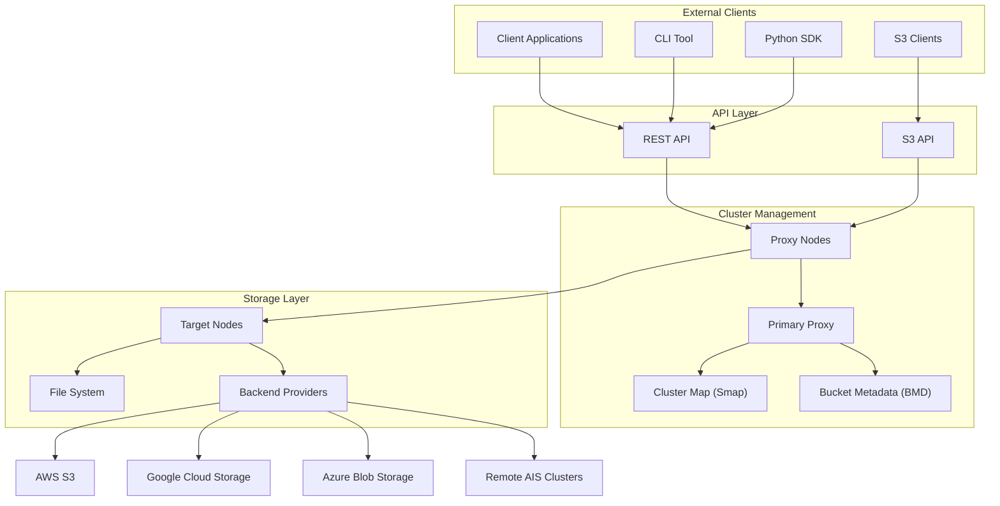

Sources:
- [ais/proxy.go:55-83]()
- [ais/target.go:56-76]()
- [api/client.go]()

## Common Node Infrastructure

Both proxy and target nodes are built on a common foundation called `htrun` (HTTP runner), which provides shared infrastructure for:

- HTTP server and request handling
- Node identity management
- Metadata access
- Configuration management
- Memory management
- Stats collection

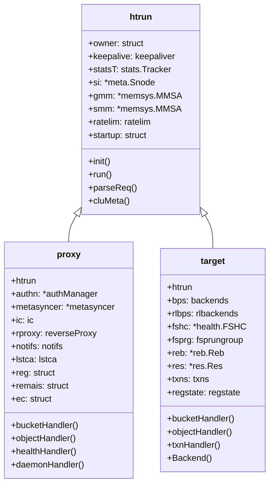

Sources:
- [ais/htrun.go:75-93]()
- [ais/proxy.go:55-83]()
- [ais/target.go:56-76]()

## Proxy Nodes

Proxy nodes handle client requests and manage cluster metadata. The primary proxy has additional responsibilities for cluster management and metadata distribution.

Key components and functionalities of proxy nodes include:

1. **API Handlers**: Process client HTTP requests for various endpoints
2. **Request Routing**: Direct requests to appropriate target nodes based on consistent hashing
3. **Metadata Management**: Manage and distribute cluster metadata (Smap, BMD)
4. **Information Center (IC)**: Handle inter-node communication and notifications
5. **Metasync**: Distribute metadata changes across the cluster

### Request Handlers

Proxy nodes register HTTP handlers for various endpoints, which process client requests and either respond directly or redirect to appropriate target nodes:

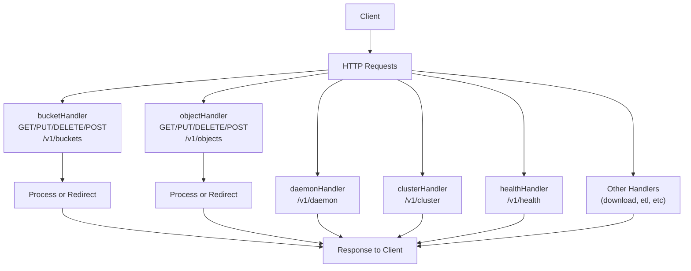

Sources:
- [ais/proxy.go:207-257]()
- [ais/proxy.go:437-493]()
- [ais/proxy.go:656-912]()

## Target Nodes

Target nodes handle actual data storage and retrieval operations, managing the local file system and integration with backend storage providers.

Key components and functionalities of target nodes include:

1. **Object Operations**: Handle GET, PUT, DELETE for objects
2. **Backend Integration**: Connect with various storage backends (AWS, GCP, Azure, etc.)
3. **File System Management**: Manage local storage resources
4. **Transaction Handling**: Execute distributed transactions
5. **Extended Actions**: Perform rebalancing, erasure coding, and other maintenance operations

### Backend Providers

Target nodes implement a common backend interface for interacting with different storage systems:

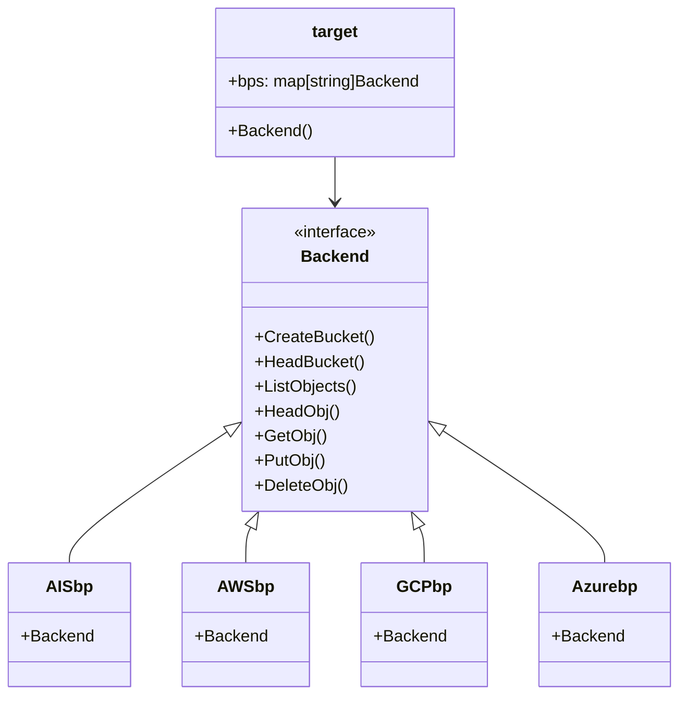

Sources:
- [ais/target.go:107-127]()
- [ais/target.go:137-161]()

## Metadata Management

AIStore manages cluster state through several key metadata structures:

### Cluster Map (Smap)

The Cluster Map (Smap) represents the cluster's topology and is the source of truth for:
- Which nodes are in the cluster (proxies and targets)
- Their roles, network addresses, and capabilities
- Which proxy is the primary

The Smap is versioned and immutable - updates create new versions that are distributed through the metasync system:

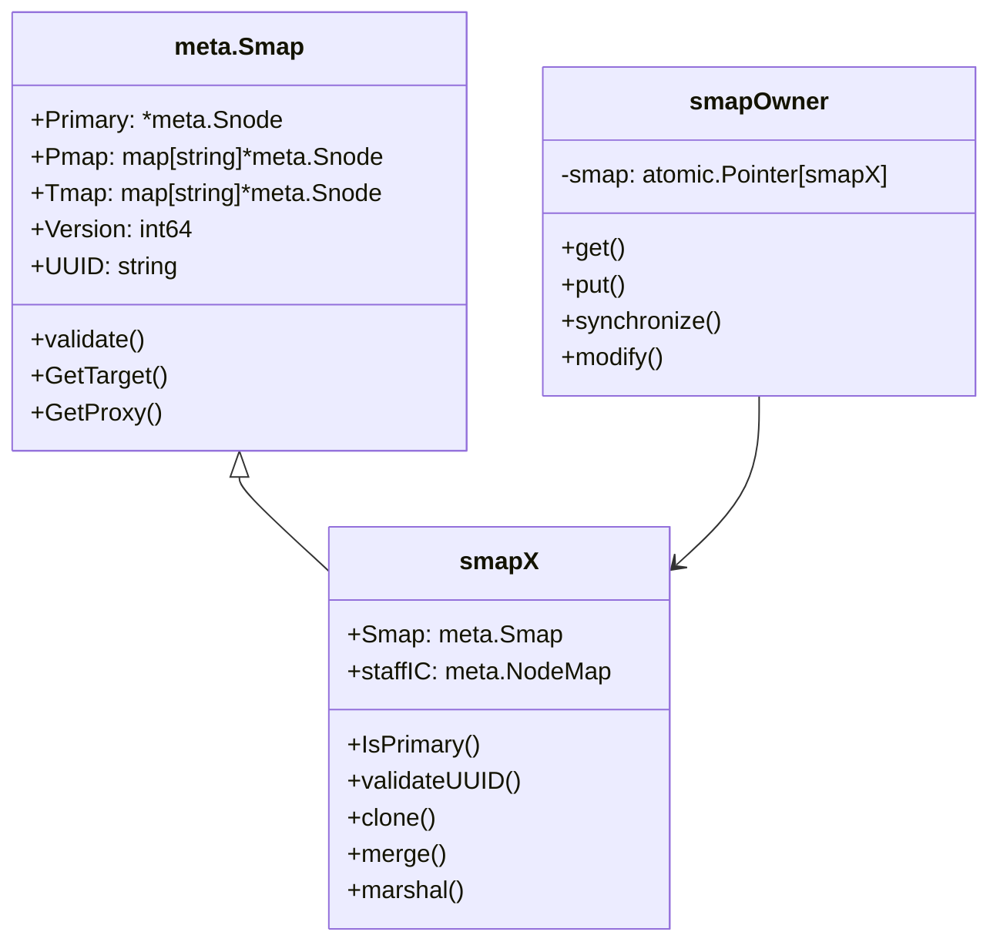

Sources:
- [ais/clustermap.go]()

### Bucket Metadata (BMD)

The Bucket Metadata (BMD) manages bucket configurations and properties:

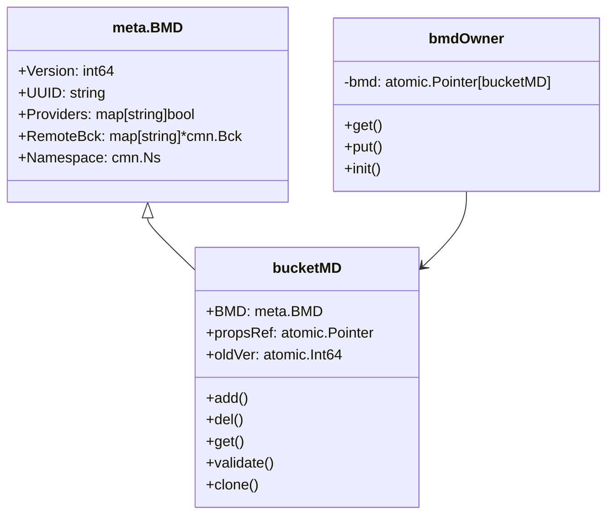

Sources:
- [ais/bucketmeta.go]()

## Object Operations

AIStore implements a redirection-based approach for object operations. Here's how a typical object GET flow works:

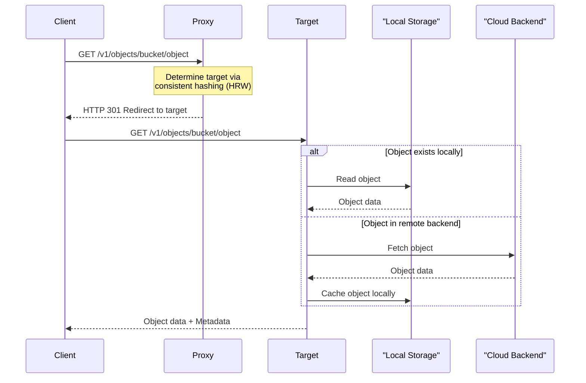

And for a PUT operation:

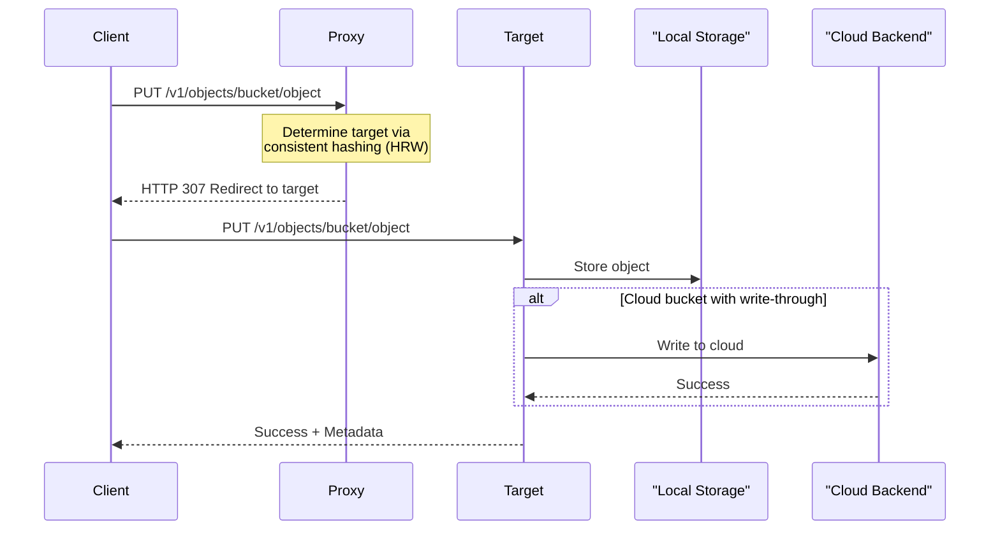

Sources:
- [ais/proxy.go:709-771]()
- [ais/proxy.go:774-870]()
- [ais/target.go:732-768]()
- [ais/target.go:888-963]()

## Transaction System

AIStore uses a two-phase commit protocol for distributed transactions, with components on both proxy and target nodes:

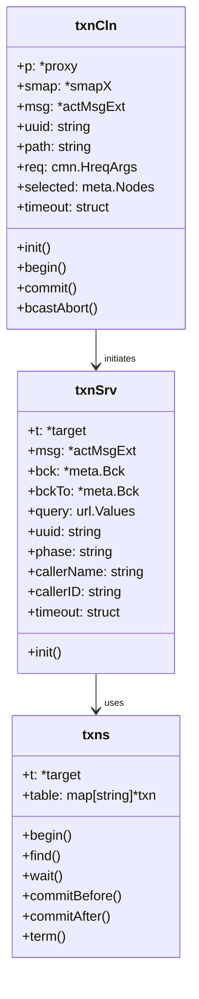

Transaction flow for operations like create bucket:

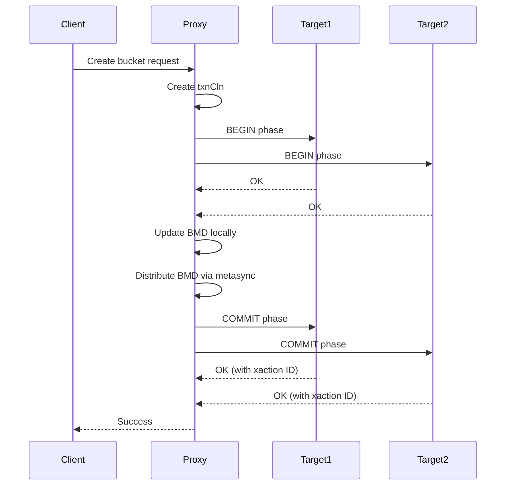

Sources:
- [ais/prxtxn.go:33-157]()
- [ais/tgttxn.go:37-178]()
- [ais/txn.go]()

## Metadata Synchronization

The metasync system ensures that metadata changes (Smap, BMD) are consistently propagated throughout the cluster:

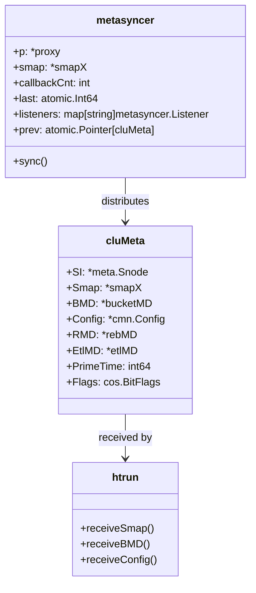

Primary proxy initiates metadata synchronization by creating a `cluMeta` package with updated metadata and distributing it to all nodes in the cluster.

Sources:
- [ais/metasync.go]()
- [ais/htrun.go]()

## Startup and Initialization

AIStore nodes follow a carefully designed startup sequence:

### Proxy Startup

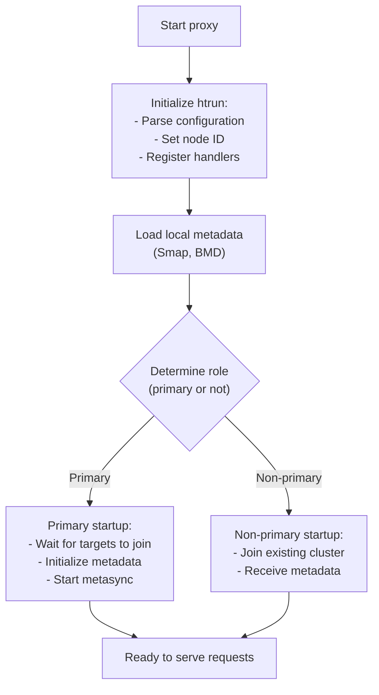

### Target Startup

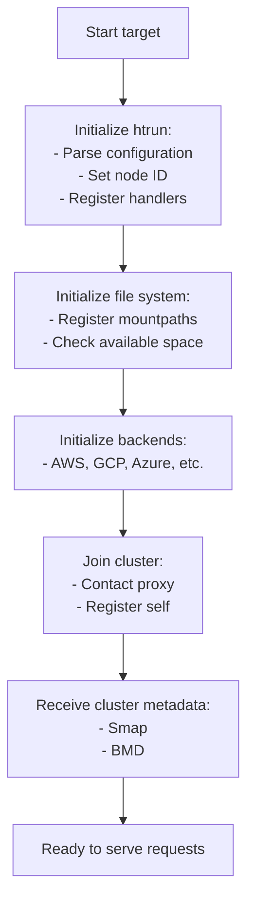

Sources:
- [ais/daemon.go]()
- [ais/proxy.go:183-254]()
- [ais/target.go:368-477]()
- [ais/earlystart.go:53-105]()

## Configuration System

AIStore uses a hierarchical configuration system that includes:

1. **Global (Cluster) Configuration**: Shared across all nodes
2. **Local Configuration**: Node-specific settings

The configuration is stored in a `cmn.Config` structure:

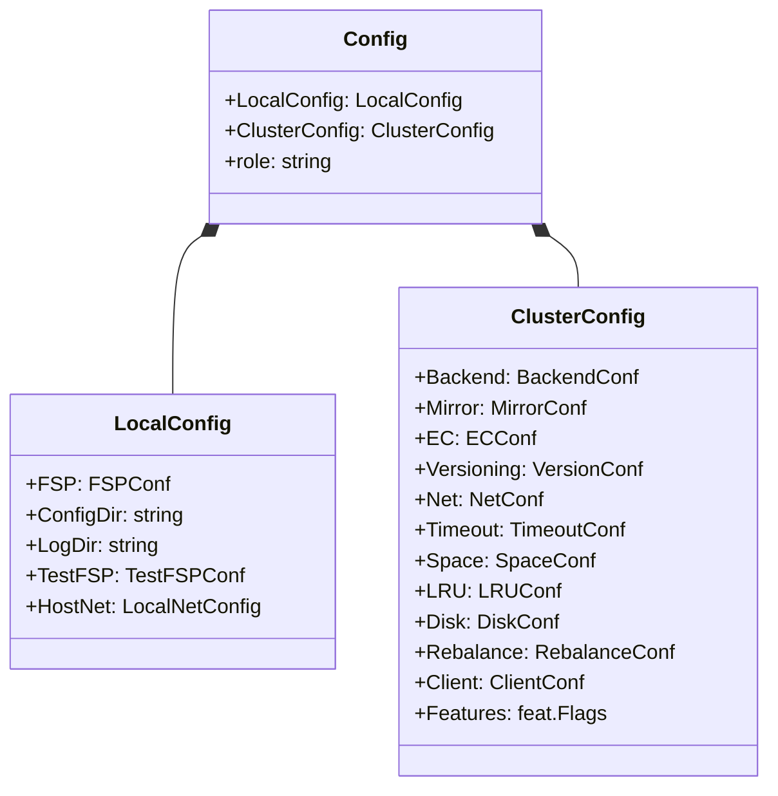

Configuration changes follow the same transaction and metasync patterns as other metadata updates.

Sources:
- [cmn/config.go:51-168]()

## Conclusion

AIStore's core architecture is designed for scalability, performance, and flexibility. The clear separation between proxy and target nodes, coupled with robust metadata management and synchronization, provides a solid foundation for a high-performance distributed object storage system.

Key architectural strengths include:
- Clear separation of concerns between proxy and target nodes
- Robust metadata management with versioning and consistent distribution
- Flexible backend integration supporting multiple cloud providers
- Scalable design with horizontal scaling of both proxy and target nodes
- Transaction-based approach for maintaining system consistency

Sources:
- [ais/proxy.go]()
- [ais/target.go]()
- [ais/htrun.go]()
- [cmn/config.go]()

---

