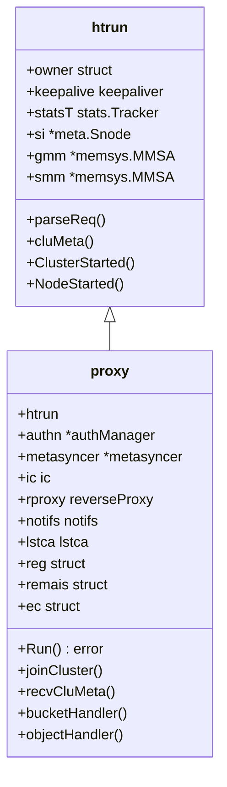
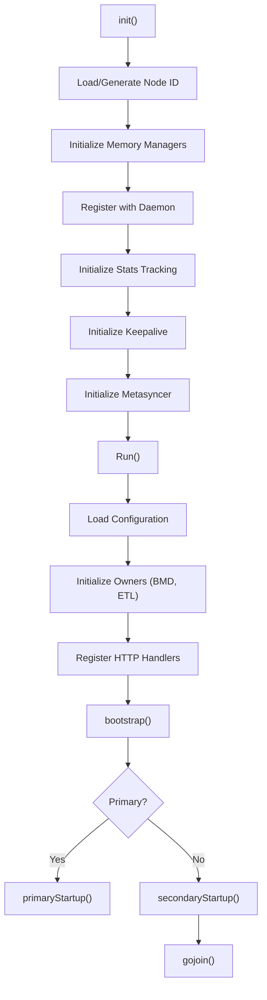
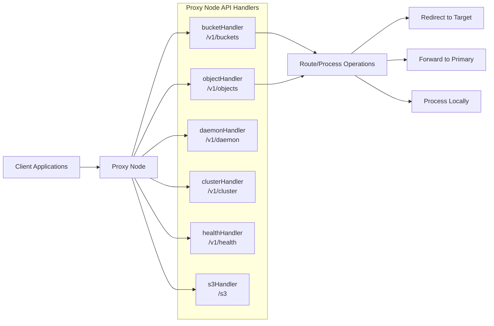
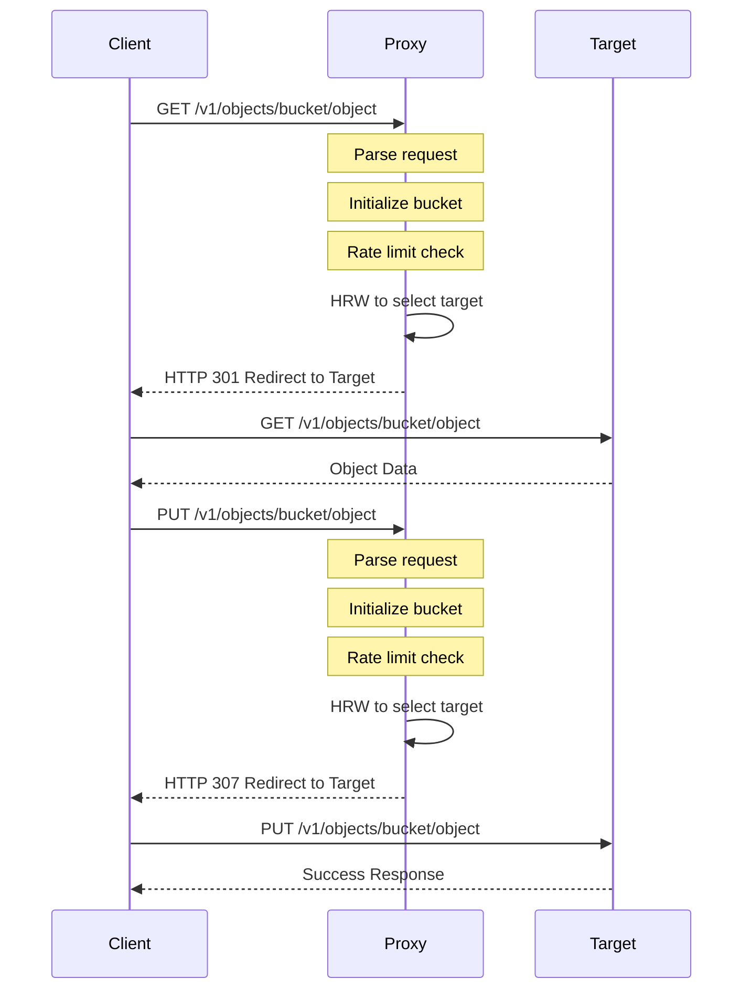
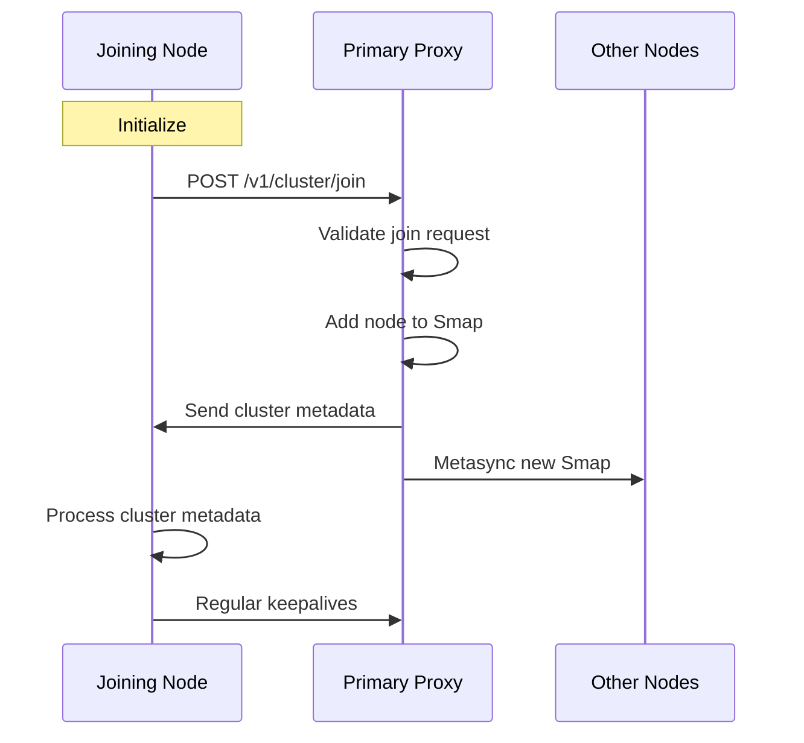
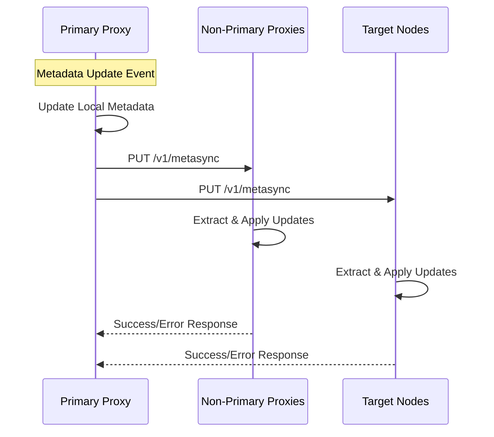
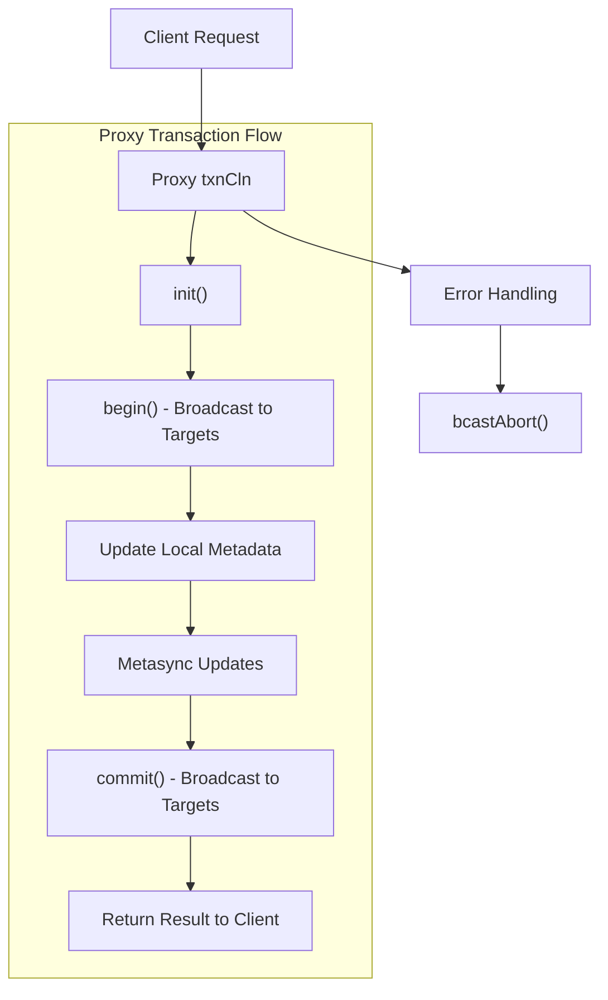
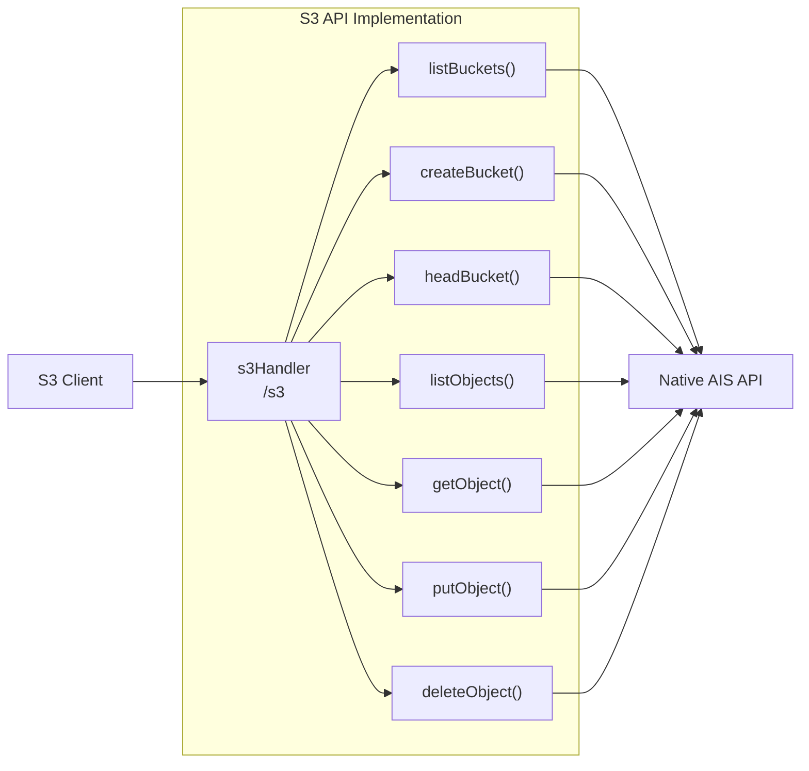

<!-- source: DeepWiki mcp.deepwiki.com · repo NVIDIA/aistore · page 2.1 Proxy Nodes · fetched 2026-10-26 -->

# Proxy Nodes

Relevant source files

The following files were used as context for generating this wiki page:

- [ais/backend/awsmpt.go](ais/backend/awsmpt.go)
- [ais/backend/mock_aws.go](ais/backend/mock_aws.go)
- [ais/backend/mock_azure.go](ais/backend/mock_azure.go)
- [ais/backend/mock_gcp.go](ais/backend/mock_gcp.go)
- [ais/bucketmeta.go](ais/bucketmeta.go)
- [ais/clustermap.go](ais/clustermap.go)
- [ais/earlystart.go](ais/earlystart.go)
- [ais/htcommon.go](ais/htcommon.go)
- [ais/htrun.go](ais/htrun.go)
- [ais/kalive.go](ais/kalive.go)
- [ais/metasync.go](ais/metasync.go)
- [ais/proxy.go](ais/proxy.go)
- [ais/prxclu.go](ais/prxclu.go)
- [ais/prxdl.go](ais/prxdl.go)
- [ais/prxs3.go](ais/prxs3.go)
- [ais/prxtxn.go](ais/prxtxn.go)
- [ais/rebmeta.go](ais/rebmeta.go)
- [ais/s3/const.go](ais/s3/const.go)
- [ais/s3/mpt.go](ais/s3/mpt.go)
- [ais/s3/types.go](ais/s3/types.go)
- [ais/s3/xattr.go](ais/s3/xattr.go)
- [ais/target.go](ais/target.go)
- [ais/tgtcp.go](ais/tgtcp.go)
- [ais/tgtdl.go](ais/tgtdl.go)
- [ais/tgts3.go](ais/tgts3.go)
- [ais/tgts3mpt.go](ais/tgts3mpt.go)
- [ais/tgttxn.go](ais/tgttxn.go)
- [ais/txn.go](ais/txn.go)
- [ais/vote.go](ais/vote.go)
- [api/bucket.go](api/bucket.go)
- [api/client.go](api/client.go)
- [api/object.go](api/object.go)
- [cmn/api.go](cmn/api.go)

This document describes proxy nodes in AIStore, which serve as the entry point and control plane for the cluster. Proxy nodes handle client requests, manage cluster membership, coordinate metadata distribution, and route operations to the appropriate target nodes. For information about target nodes, which handle data storage and processing, see [Target Nodes](#2.2).

## Proxy Node Architecture

In AIStore's architecture, proxy nodes play a critical role in cluster management and request handling. A key feature is the primary-backup architecture where one proxy node is designated as the primary, responsible for managing cluster membership and maintaining authoritative metadata, while other proxies operate in non-primary mode.

Key components of a proxy node include:

1. **Authentication Manager (`authn`)**: Handles authentication and authorization for API requests
2. **Metasyncer (`metasyncer`)**: Distributes metadata updates to all nodes in the cluster
3. **Information Center (`ic`)**: Tracks extended operations (xactions) across the cluster
4. **Reverse Proxy (`rproxy`)**: Forwards requests to other nodes when needed
5. **Notifications System (`notifs`)**: Manages notifications for cluster events
6. **Node Registration (`reg`)**: Handles registration of nodes joining the cluster
7. **Metadata Owners**: Through the inherited `htrun.owner` field, manages various cluster metadata:
   - Smap (cluster membership)
   - BMD (bucket metadata)
   - RMD (rebalance metadata)
   - Configuration
   - ETL (extract-transform-load) metadata

Sources:
- [ais/proxy.go:49-83]()
- [ais/htrun.go:75-92]()

## Initialization and Startup

When a proxy node starts up, it follows a specific initialization sequence:

The initialization process in `proxy.init()` includes:

1. Loading or generating a unique node ID
2. Initializing memory managers and network settings
3. Registering with the daemon rungroup
4. Setting up statistics tracking

The `Run()` method then:
1. Initializes owners for bucket metadata and ETL metadata
2. Registers HTTP API handlers
3. Calls `bootstrap()` to determine the node's role and initiate the appropriate startup process

The bootstrap sequence handles primary discovery and role determination based on:
- Environment variables
- Existing local Smap (if present)
- Configuration settings

Sources:
- [ais/proxy.go:87-121]()
- [ais/proxy.go:183-254]()
- [ais/earlystart.go:48-105]()

## Request Handling

Proxy nodes handle various client requests through a set of HTTP handlers registered during initialization:

The key API endpoints and their handlers include:

1. **Bucket Handler** (`/v1/buckets`): 
   - GET: List buckets or objects in a bucket
   - PUT: Perform bucket operations (archive)
   - POST: Create bucket, set bucket properties
   - DELETE: Destroy bucket or evict objects
   - HEAD: Get bucket properties/metadata

2. **Object Handler** (`/v1/objects`): 
   - GET: Retrieve objects
   - PUT: Upload objects
   - POST: Perform operations on objects
   - DELETE: Delete objects
   - HEAD: Get object metadata

3. **Cluster Handler** (`/v1/cluster`):
   - GET: Query cluster states and stats
   - POST: Handle node joins and keepalives
   - PUT/DELETE: Perform cluster management operations

4. **Health Handler** (`/v1/health`):
   - Reports node and cluster health status
   - Used for internal health monitoring

5. **S3 Handler** (`/s3`):
   - Provides S3-compatible API support

Sources:
- [ais/proxy.go:208-241]()
- [ais/proxy.go:437-493]()
- [ais/prxclu.go:36-53]()

## Object Operation Flow

A key function of proxy nodes is routing object operations to the appropriate target nodes:

### GET Object Flow

For GET requests (`httpobjget`), the proxy:

1. Parses the request to extract bucket and object names
2. Initializes the bucket context and checks if the bucket exists
3. Validates permissions (if configured)
4. Applies rate limiting if configured
5. Uses HRW (Highest Random Weight) hashing to select the target node
6. Redirects the client to the selected target node with HTTP 301

### PUT Object Flow

For PUT requests (`httpobjput`), the flow is similar, but with these differences:
1. The proxy uses a temporary (307) redirect instead of a permanent redirect
2. Additional headers may be set for operations like append
3. Different permissions are checked

Sources:
- [ais/proxy.go:709-772]()
- [ais/proxy.go:774-870]()

## Primary Role and Cluster Management

AIStore uses a primary-backup architecture for proxy nodes. The primary proxy is responsible for:
- Maintaining the authoritative cluster map (Smap)
- Handling node joins and departures
- Coordinating metadata distribution
- Managing bucket operations

### Node Registration and Cluster Join Process

When a node joins the cluster:

The joining process via `joinCluster()` involves:

1. The node sends a join request with its info to the primary
2. The primary validates the request and checks for duplicate IDs
3. The primary adds the node to the Smap
4. The primary sends back the current cluster metadata (Smap, BMD, etc.)
5. The primary syncs the updated Smap to all nodes
6. The joining node begins participating in cluster operations

Sources:
- [ais/proxy.go:256-269]()
- [ais/prxclu.go:352-553]()

## Metadata Management and Synchronization

Proxies manage several types of cluster metadata:

1. **Smap** (cluster map): Information about all nodes in the cluster
2. **BMD** (bucket metadata): Information about buckets and their properties
3. **RMD** (rebalance metadata): State of cluster rebalancing
4. **Configuration**: Cluster-wide configuration

The metasync process ensures all nodes have consistent metadata:

When metadata changes (like Smap updates), the primary:
1. Updates its local copy
2. Packages relevant updates into a payload (`cluMeta`)
3. Sends the payload to all nodes via PUT to `/v1/metasync`
4. Each node processes the updates via `recvCluMeta()`
5. Versioning ensures updates are applied in the correct order

The metasync handler (`metasyncHandler` in proxy.go) receives and processes metadata updates from the primary.

Sources:
- [ais/proxy.go:1010-1083]()
- [ais/metasync.go]()

## Transaction Management

For cluster-modifying operations, proxy nodes implement a transaction system to ensure consistency:

The transaction system, implemented via `txnCln`, provides a two-phase commit process:

1. **Begin Phase**: The proxy broadcasts a begin request to all targets
2. **Local Update**: The proxy updates its local metadata
3. **Metasync**: The updated metadata is distributed to all nodes
4. **Commit Phase**: The proxy broadcasts a commit request to finalize

If any stage fails, an abort is sent to roll back the operation.

This ensures atomic updates for operations like:
- Creating or destroying buckets
- Setting bucket properties
- Changing mirror settings (make-n-copies)
- Renaming buckets

Sources:
- [ais/prxtxn.go:33-163]()
- [ais/prxtxn.go:192-308]()

## S3 Compatibility

Proxy nodes provide S3-compatible API support through the `/s3` endpoint, allowing S3 clients to interact with AIStore without modification:

The S3 handler:
1. Parses and validates S3 requests
2. Translates them to AIStore's internal API
3. Processes the operation using AIStore's native functionality
4. Formats responses to be S3-compatible

Key S3 operations supported include:
- ListBuckets
- CreateBucket
- HeadBucket
- ListObjects
- GetObject
- PutObject
- DeleteObject

Sources:
- [ais/prxs3.go:37-309]()

## Primary vs Non-Primary Behavior

A proxy node's behavior differs based on whether it's operating as the primary:

### Primary Proxy
- Maintains the authoritative cluster map (Smap)
- Accepts and processes node join requests
- Coordinates metadata distribution
- Handles bucket creation/deletion
- Monitors node health through keepalives
- Initiates rebalancing when needed

### Non-Primary Proxy
- Forwards cluster management requests to the primary
- Routes object operations directly to targets
- Participates in primary elections when needed
- Monitors the primary's health

The proxy's health handler (`healthHandler`) handles both external health checks and internal keepalive requests. For cluster management operations, non-primary proxies use `forwardCP()` to redirect requests to the primary.

Sources:
- [ais/proxy.go:1102-1186]()
- [ais/htrun.go:1266-1300]()

## Conclusion

Proxy nodes form the control plane of AIStore, handling client requests, managing cluster membership, and coordinating metadata distribution. The primary-backup architecture ensures high availability and consistency of cluster operations, while the HRW-based routing of object operations enables efficient data access.

Understanding proxy node functionality is essential for managing AIStore clusters and developing applications that interact with the storage system.

---

