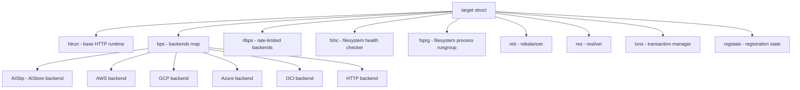
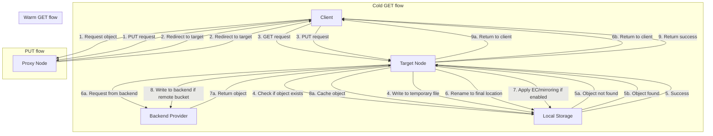
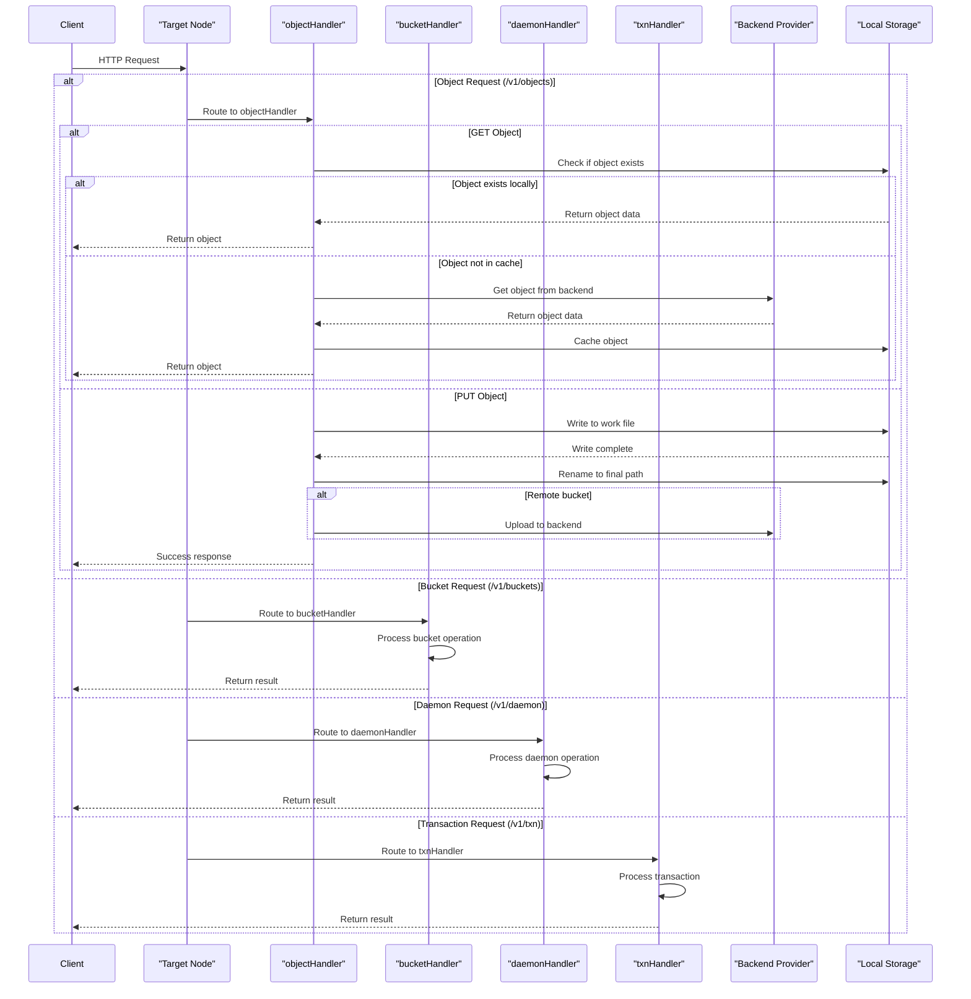
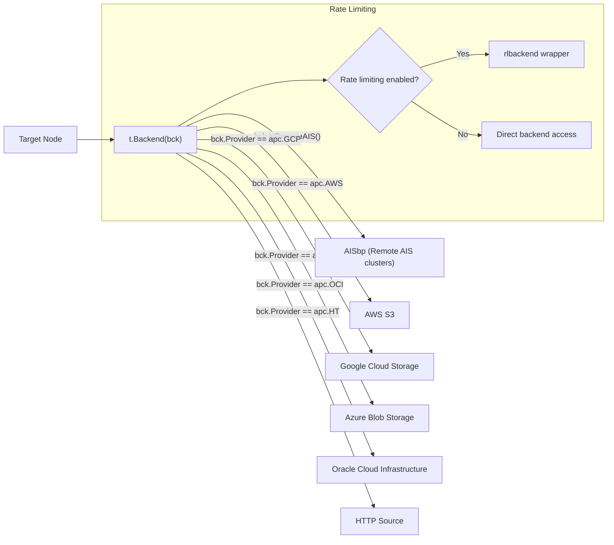
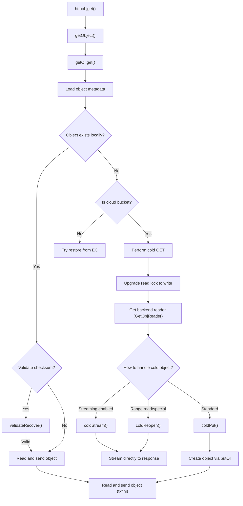
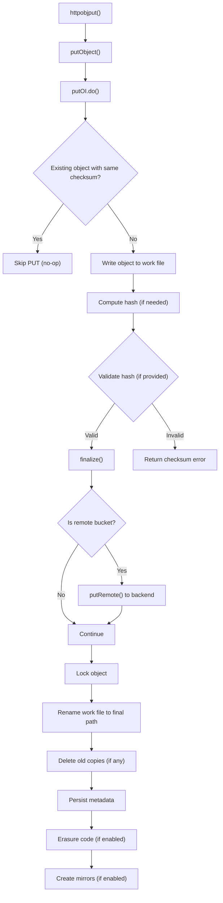
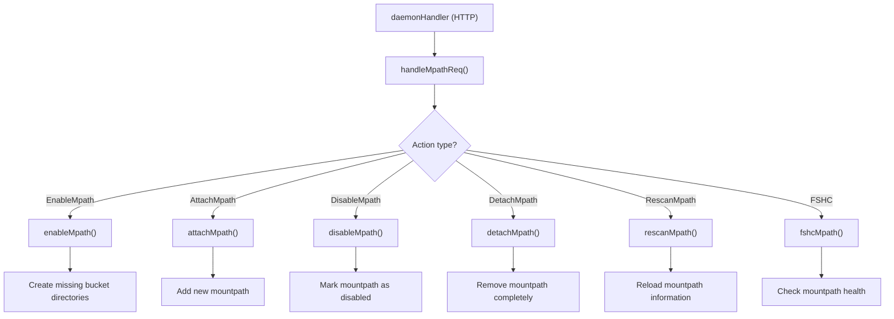
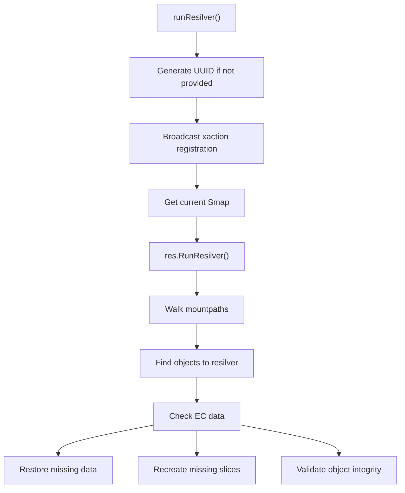
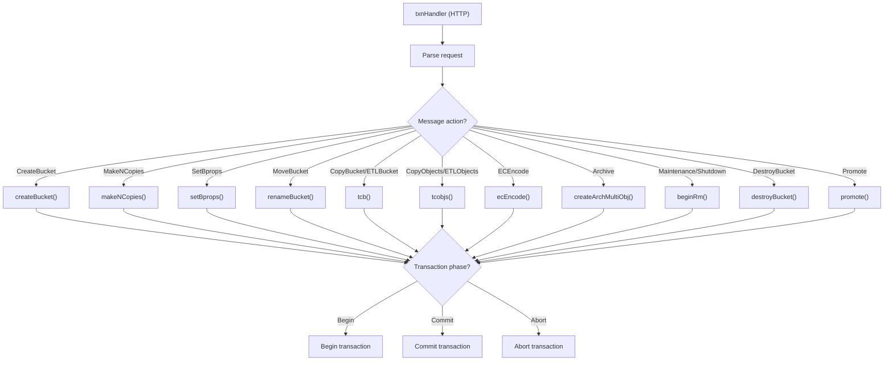

<!-- source: DeepWiki mcp.deepwiki.com · repo NVIDIA/aistore · page 2.2 Target Nodes · fetched 2026-10-26 -->

# Target Nodes

Relevant source files

The following files were used as context for generating this wiki page:

- [ais/bucketmeta.go](ais/bucketmeta.go)
- [ais/clustermap.go](ais/clustermap.go)
- [ais/earlystart.go](ais/earlystart.go)
- [ais/htcommon.go](ais/htcommon.go)
- [ais/htrun.go](ais/htrun.go)
- [ais/kalive.go](ais/kalive.go)
- [ais/metasync.go](ais/metasync.go)
- [ais/proxy.go](ais/proxy.go)
- [ais/prxclu.go](ais/prxclu.go)
- [ais/prxtxn.go](ais/prxtxn.go)
- [ais/rebmeta.go](ais/rebmeta.go)
- [ais/target.go](ais/target.go)
- [ais/tgtcp.go](ais/tgtcp.go)
- [ais/tgtimpl.go](ais/tgtimpl.go)
- [ais/tgtobj.go](ais/tgtobj.go)
- [ais/tgttxn.go](ais/tgttxn.go)
- [ais/txn.go](ais/txn.go)
- [ais/vote.go](ais/vote.go)
- [api/bucket.go](api/bucket.go)
- [api/client.go](api/client.go)
- [api/object.go](api/object.go)
- [cmn/api.go](cmn/api.go)
- [cmn/err.go](cmn/err.go)
- [cmn/owt.go](cmn/owt.go)
- [core/mock/target_mock.go](core/mock/target_mock.go)
- [core/target.go](core/target.go)
- [mirror/utils.go](mirror/utils.go)
- [mirror/utils_test.go](mirror/utils_test.go)

Target nodes are the data storage workhorses of AIStore. While [Proxy Nodes](#2.1) handle client connections and coordinate cluster activities, target nodes are responsible for the actual storage and retrieval of data objects, interaction with backend cloud providers, and handling advanced storage features such as erasure coding and mirroring.

## Architecture and Components

Target nodes have a layered architecture with several key components that work together to provide robust object storage capabilities.

### Target Node Structure Diagram

Sources: [ais/target.go:57-76](). [ais/target.go:106-128]()

The key components include:

1. **HTTP Runtime (htrun)** - Base functionality shared by both proxy and target nodes for HTTP handling.
2. **Backend Providers (bps)** - A map of backend implementations for cloud storage integration.
3. **Rate-Limited Backends (rlbps)** - Wrappers around backends that implement rate limiting.
4. **FileSystem Health Checker (fshc)** - Monitors the health of storage devices.
5. **FileSystem Process RunGroup (fsprg)** - Manages filesystem operations.
6. **Rebalancer (reb)** - Handles data rebalancing across the cluster when nodes join or leave.
7. **Resilver (res)** - Repairs data after failures or during recovery.
8. **Transactions (txns)** - Manages distributed transactions across the cluster.
9. **Registration State (regstate)** - Tracks the node's status within the cluster.

## Target Node Initialization and Startup

```mermaid
graph TD
    Init["init(config)"]
    Run["Run()"]
    
    Init --> InitSnode["Initialize node with target ID"]
    Init --> InitTID["Load or generate target ID"]
    Init --> InitMemory["Initialize memory management"]
    Init --> InitVol["Initialize volume management"]
    Init --> InitNetwork["Configure network endpoints"]
    Init --> InitStats["Initialize statistics tracking"]
    Init --> InitKeepAlive["Setup keepalive mechanism"]
    Init --> InitFSPRG["Initialize filesystem operations"]
    Init --> InitTransport["Initialize transport subsystem"]
    Init --> InitFSHC["Initialize filesystem health checker"]
    
    Run --> ValidateSI["Validate node information"]
    Run --> InitHTRun["Initialize HTTP runtime"]
    Run --> CoreInit["Initialize core target components"]
    Run --> CheckRestart["Check if target is restarting"]
    Run --> RegisterContentType["Register object & workfile types"]
    Run --> InitOwners["Init metadata owners (BMD, ETL)"]
    Run --> LoadClusterMap["Load or create cluster map"]
    Run --> JoinCluster["Join the cluster"]
    Run --> InitBackends["Initialize backend providers"]
    Run --> InitKVStore["Initialize key-value store"]
    Run --> InitTxns["Initialize transaction system"]
    Run --> InitREB["Initialize rebalancer"]
    Run --> InitRES["Initialize resilver"]
    Run --> RegisterHandlers["Register HTTP handlers"]
    Run --> InitEC["Initialize erasure coding"]
    Run --> InitMirror["Initialize mirroring"]
    Run --> InitXactions["Register and init extended actions"]
    Run --> CheckResilver["Check if resilver is required"]
    Run --> InitDSort["Initialize distributed sorting"]
    Run --> InitDownload["Initialize download manager"]
    Run --> StartHTTPServer["Start HTTP server"]
```

Sources: [ais/target.go:248-339](). [ais/target.go:368-477]()

The initialization process involves:

1. **Target Identification** - Each target gets a unique ID, either loaded from storage or generated.
2. **Volume Management** - Initializes and validates mountpaths for data storage.
3. **Network Configuration** - Sets up control, data, and public network endpoints.
4. **Cluster Joining** - The target joins the cluster by communicating with the primary proxy.
5. **Backend Initialization** - Sets up connections to cloud providers and other backends.
6. **Handler Registration** - Registers HTTP handlers for API endpoints.
7. **Feature Initialization** - Sets up erasure coding, mirroring, and other features.

## Data Flow Architecture

The following diagram illustrates how data flows through a target node for the main object operations:

Sources: [ais/tgtobj.go:658-757](). [ais/tgtobj.go:886-963]()

## Request Handling Flow

Target nodes handle several types of HTTP requests through dedicated handlers:

Sources: [ais/target.go:554-576](). [ais/target.go:659-719]()

The main HTTP handlers registered by a target node include:

1. **bucketHandler** - Handles bucket operations (`/v1/buckets`)
2. **objectHandler** - Handles object operations (`/v1/objects`)
3. **daemonHandler** - Handles daemon management and configuration (`/v1/daemon`)
4. **metasyncHandler** - Handles metadata synchronization (`/v1/metasync`)
5. **healthHandler** - Handles health checks (`/v1/health`)
6. **txnHandler** - Handles transactions (`/v1/txn`)

## Backend Integration

Target nodes can interact with multiple storage backends, including cloud providers and HTTP sources:

Sources: [ais/target.go:107-135](). [ais/target.go:137-189]()

The `Backend()` method returns an implementation of the `core.Backend` interface for a given bucket. Each backend provides standard operations like:
- Listing objects
- Getting object data
- Putting objects
- Deleting objects
- Getting bucket information

## Object Operations Implementation

The implementation of object operations involves several specialized structures:

1. **putOI** - For PUT operations
2. **getOI** - For GET operations
3. **apndOI** - For APPEND operations

### Object GET Flow

Sources: [ais/tgtobj.go:582-762](). [ais/tgtobj.go:764-882]()

### Object PUT Flow

Sources: [ais/tgtobj.go:147-342](). [ais/tgtobj.go:430-541]()

## Health Monitoring and Management

Target nodes implement extensive health monitoring and management capabilities:

1. **Filesystem Health Checker (FSHC)** - Monitors mountpath health
2. **Mountpath Management** - Enables adding, removing, and disabling mountpaths
3. **Node Metrics** - Collects performance and health metrics
4. **Keepalive** - Maintains connection with the proxy for health monitoring

### Mountpath Management

Sources: [ais/tgtcp.go:553-629](). [ais/htrun.go:95-125]()

## Rebalancing and Resilver

Target nodes participate in data rebalancing and resilver operations:

1. **Rebalancing** - Redistributes objects when cluster membership changes
2. **Resilver** - Repairs data after failures or during recovery

Sources: [ais/target.go:510-531](). [ais/rebmeta.go:1-50]()

## Transaction Management

Target nodes implement a transaction system for consistent distributed operations:

Sources: [ais/tgttxn.go:36-178](). [ais/txn.go:1-50]()

## Summary

Target nodes form the data storage layer of AIStore, responsible for:

1. Storing and retrieving objects from both local storage and remote backends
2. Managing multiple storage backends (AWS, GCP, Azure, etc.)
3. Providing advanced features like erasure coding and mirroring
4. Monitoring storage health and taking appropriate actions
5. Participating in cluster-wide operations like rebalancing
6. Executing distributed transactions for consistency

Target nodes work in tandem with proxy nodes to provide a complete distributed object storage system that offers high performance, scalability, and durability.

Sources: [ais/target.go:1-51](). [ais/target.go:76-100]()

---

