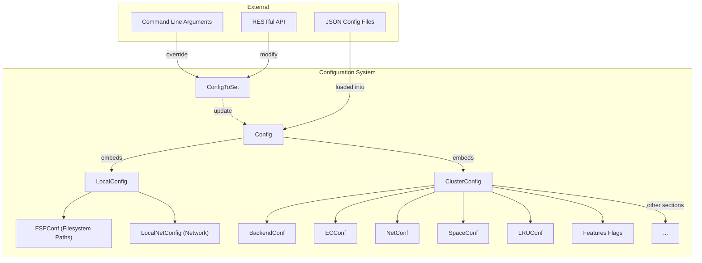
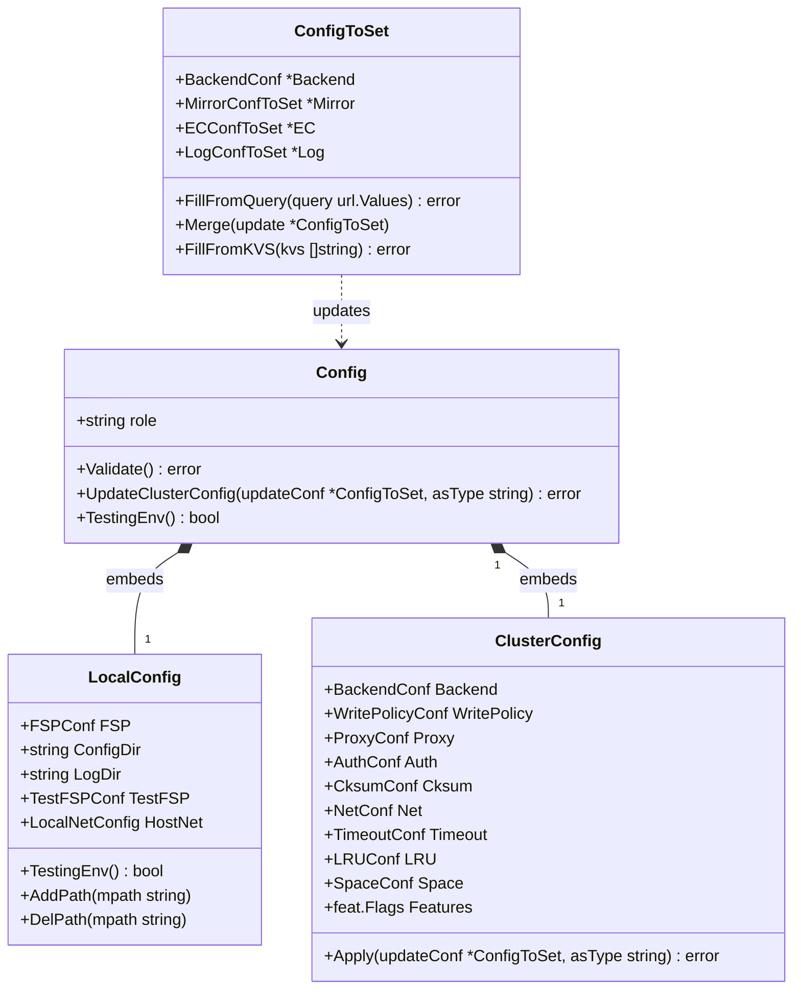
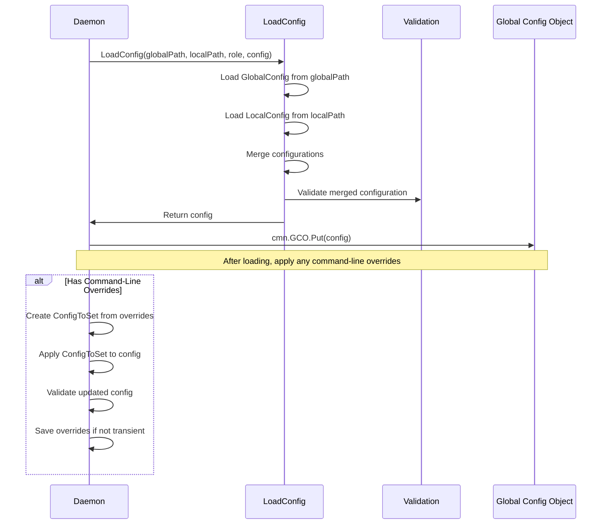
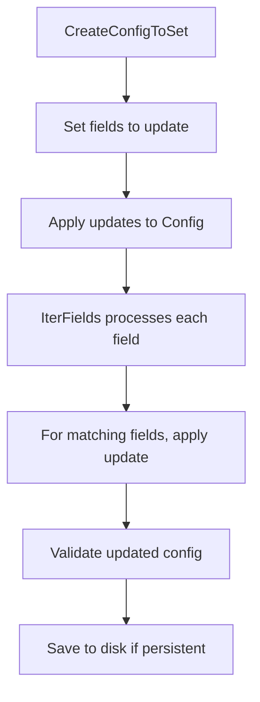
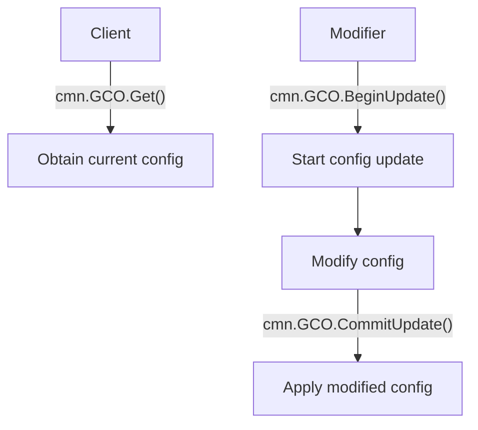
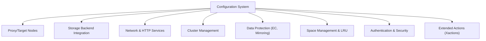

<!-- source: DeepWiki mcp.deepwiki.com · repo NVIDIA/aistore · page 2.3 Configuration System · fetched 2026-10-26 -->

# Configuration System

<details>
<summary>Relevant source files</summary>

The following files were used as context for generating this wiki page:

- [ais/daemon.go](ais/daemon.go)
- [cmd/aisinit/config.go](cmd/aisinit/config.go)
- [cmn/config.go](cmn/config.go)
- [cmn/iter_fields.go](cmn/iter_fields.go)
- [cmn/tests/api_test.go](cmn/tests/api_test.go)
- [cmn/tests/common_test.go](cmn/tests/common_test.go)
- [cmn/tests/config_test.go](cmn/tests/config_test.go)
- [cmn/tests/configs/config.json](cmn/tests/configs/config.json)
- [cmn/tests/iter_fields_test.go](cmn/tests/iter_fields_test.go)
- [deploy/dev/local/aisnode_config.fspaths.sh](deploy/dev/local/aisnode_config.fspaths.sh)
- [deploy/dev/local/aisnode_config.sh](deploy/dev/local/aisnode_config.sh)

</details>


The Configuration System in AIStore manages both cluster-wide (global) and node-specific (local) configuration settings. This page explains the architecture, components, and operation of the configuration system, including how configurations are loaded, validated, accessed, and updated at runtime.

## Architecture Overview

AIStore uses a hierarchical configuration system with a clear separation between node-specific configurations and cluster-wide configurations. The system supports loading configurations from files, programmatic updates, command-line overrides, and API-driven modifications.



Sources: [cmn/config.go:46-55](), [cmn/config.go:60-90](), [cmn/config.go:95-134](), [cmn/config.go:135-168]()

## Configuration Components

### Main Configuration Types

The configuration system is built around several core structures:

1. **Config**: The top-level configuration structure that combines both cluster-wide and node-specific settings.
2. **LocalConfig**: Contains node-specific settings like filesystem paths and network configuration.
3. **ClusterConfig**: Contains cluster-wide settings that apply across all nodes.
4. **ConfigToSet**: A special structure used for updating configuration values.



Sources: [cmn/config.go:51-55](), [cmn/config.go:60-90](), [cmn/config.go:95-134](), [cmn/config.go:135-168]()

### Validator Interface

Configuration components implement validation interfaces to ensure that configuration values are correct:

```go
type Validator interface {
    Validate() error
}

type PropsValidator interface {
    ValidateAsProps(arg ...any) error
}
```

Sources: [cmn/config.go:38-44](), [cmn/config.go:771-805]()

## Configuration Loading Process

Configurations are loaded during daemon initialization from two separate files:

1. **Global Configuration File**: Contains cluster-wide settings (shared by all nodes)
2. **Local Configuration File**: Contains node-specific settings (unique to each node)



Sources: [ais/daemon.go:148-153](), [ais/daemon.go:167-186]()

## Command-Line Configuration Overrides

AIStore supports overriding configuration values at startup via command-line arguments:

```
$ aisnode -config=/etc/ais.json -local_config=/etc/ais_local.json -role=target \
   -config_custom="client.client_timeout=13s,log.level=4"
```

These overrides can be persistent (default) or transient:

```
$ aisnode -config=/etc/ais.json -local_config=/etc/ais_local.json -role=target -transient=true \
   -config_custom="client.client_timeout=13s"
```

The format for configuration keys follows a dotted notation: `section.property`, e.g., `client.client_timeout`.

Sources: [ais/daemon.go:155-166](), [ais/daemon.go:167-186]()

## Configuration Update Mechanism

The configuration update mechanism uses the `ConfigToSet` structure to represent changes. Only the fields that need to be updated are set in this structure (as pointers), and the system applies these changes to the current configuration.

### Field Iteration and Field Update

A key part of the update mechanism is the `IterFields` function, which allows traversing configuration structures and updating fields:



The system uses reflection with tags to control field access:
- `json` tag: Defines the field's name for JSON serialization
- `list` tag: Can be "readonly" (cannot be updated), "omit" (excluded), or "omitempty" (skipped when empty)
- `allow` tag: Restricts updates to specific scopes ("cluster" or "daemon")

Sources: [cmn/iter_fields.go:72-100](), [cmn/iter_fields.go:101-219](), [cmn/iter_fields.go:232-301]()

## Configuration Sections

AIStore configuration is divided into multiple sections, each handling a specific aspect of the system:

| Section | Description | Key Properties |
|---------|-------------|---------------|
| Backend | Cloud backend configuration | `Providers`, `Conf` |
| Mirror | Object mirroring settings | `Copies`, `Enabled`, `Burst` |
| EC | Erasure coding parameters | `DataSlices`, `ParitySlices`, `ObjSizeLimit`, `Enabled` |
| Log | Logging configuration | `Level`, `MaxSize`, `MaxTotal`, `FlushTime` |
| Space | Space management thresholds | `LowWM`, `HighWM`, `CleanupWM`, `OOS` |
| LRU | Eviction policy settings | `DontEvictTime`, `CapacityUpdTime`, `Enabled` |
| Net | Network configuration | `HTTP` (protocol, certificates), `L4` (buffer sizes) |
| Transport | Data transfer settings | `MaxHeaderSize`, `Burst`, `IdleTeardown` |
| Timeout | Operation timeouts | `CplaneOperation`, `MaxKeepalive`, `SendFile` |
| FSP | Filesystem paths | `Paths` (mountpaths/volumes for storage) |

Sources: [cmn/config.go:170-174](), [cmn/config.go:176-185](), [cmn/config.go:187-225](), [cmn/config.go:227-242](), [cmn/config.go:344-366](), [cmn/config.go:368-383](), [cmn/config.go:475-523](), [cmn/config.go:613-634](), [cmn/config.go:297-318](), [cmn/config.go:82-84]()

## Configuration Storage

Configuration files are typically stored in JSON format:

### Global Config Example (Snippet)
```json
{
  "backend": {"aws": {}, "gcp": {}},
  "mirror": {
    "copies": 2,
    "burst_buffer": 512,
    "enabled": false
  },
  "ec": {
    "objsize_limit": 262144,
    "compression": "never",
    "data_slices": 1,
    "parity_slices": 1,
    "enabled": false
  },
  "timeout": {
    "cplane_operation": "2s",
    "max_keepalive": "4s",
    "startup_time": "1m"
  }
}
```

### Local Config Example
```json
{
  "confdir": "/etc/ais/",
  "log_dir": "/tmp/ais/log",
  "host_net": {
    "hostname": "localhost",
    "port": 8080,
    "port_intra_control": 9080,
    "port_intra_data": 10080
  },
  "fspaths": {
    "/tmp/ais/mp1": "disk1",
    "/tmp/ais/mp2": "disk2"
  }
}
```

Sources: [deploy/dev/local/aisnode_config.sh:11-209](), [deploy/dev/local/aisnode_config.fspaths.sh:208-226](), [cmn/tests/configs/config.json:1-165]()

## Configuration Access and Management

The configuration is managed through a Global Configuration Object (GCO) that provides thread-safe access:



For Proxy and Target nodes, this configuration object is initialized at startup and used throughout the system.

Sources: [ais/daemon.go:148-153]()

## Default Configuration

AIStore provides default configuration values for all settings, which serve as a starting point for new deployments. These defaults are defined in the codebase and can be overridden as needed.

Sources: [cmd/aisinit/config.go:16-169](), [cmd/aisinit/config.go:171-197]()

## Configuration Relationship to Other Subsystems

The configuration system is central to AIStore operation and interacts with virtually all other subsystems:



Each subsystem reads its specific section from the configuration to determine its behavior.

Sources: [cmn/config.go:95-134]()

## Validation and Constraints

Each configuration section implements validation rules through the `Validate` method. The top-level `Config.Validate` method calls these section-specific validations to ensure overall configuration consistency.

Common validations include:
- Range checks for numeric values
- Format validation for durations and sizes
- Interdependent setting validation (e.g., ensuring lowWM < highWM < OOS in space management)

Sources: [cmn/config.go:814-846]()

## Conclusion

The AIStore configuration system provides a flexible, hierarchical approach to managing both cluster-wide and node-specific settings. Its validation mechanisms, update capabilities, and integration with command-line arguments allow for easy customization while maintaining configuration consistency across the cluster.

---

