<!-- source: DeepWiki mcp.deepwiki.com · repo NVIDIA/aistore · page 3 Data Operations · fetched 2026-10-26 -->

# Data Operations

Relevant source files

The following files were used as context for generating this wiki page:

- [ais/tgtimpl.go](ais/tgtimpl.go)
- [ais/tgtobj.go](ais/tgtobj.go)
- [cmn/err.go](cmn/err.go)
- [cmn/owt.go](cmn/owt.go)
- [core/mock/target_mock.go](core/mock/target_mock.go)
- [core/target.go](core/target.go)
- [mirror/utils.go](mirror/utils.go)
- [mirror/utils_test.go](mirror/utils_test.go)
- [transport/README.md](transport/README.md)
- [transport/api.go](transport/api.go)
- [transport/base.go](transport/base.go)
- [transport/bundle/dmover.go](transport/bundle/dmover.go)
- [transport/collect.go](transport/collect.go)
- [transport/header.go](transport/header.go)
- [transport/obj_test.go](transport/obj_test.go)
- [transport/pdu.go](transport/pdu.go)
- [transport/recv.go](transport/recv.go)
- [transport/sendobj.go](transport/sendobj.go)
- [transport/stream_bundle_test.go](transport/stream_bundle_test.go)

This document describes the core data operations within AIStore, focusing on how data is stored, retrieved, moved, and transmitted across the system. It covers the primary object operations (PUT, GET, APPEND, COPY), their implementation, and the underlying transport mechanisms that move data between nodes.

For information about storage backends and cloud integration, see [Storage Backends](#4).

## Overview of Data Operations

AIStore's data operations provide methods for moving objects into, out of, and across the storage cluster. These operations include:

- **PUT**: Storing objects in the system
- **GET**: Retrieving objects from the system
- **APPEND**: Appending data to existing objects
- **COPY**: Copying objects between locations

These operations are implemented by target nodes, which handle the actual data storage and retrieval. The operations can involve both local storage and remote storage backends.

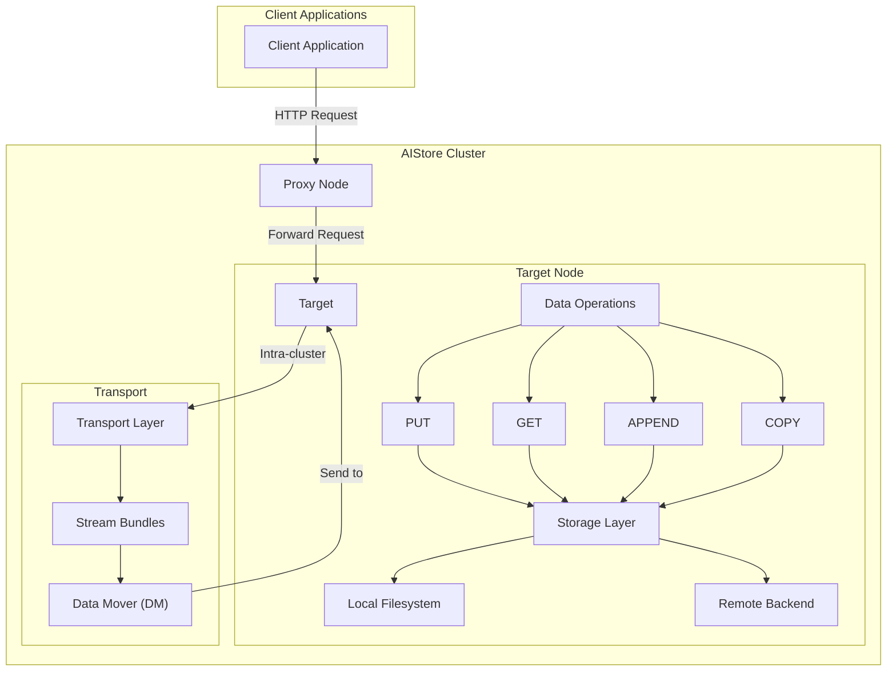

Sources: [ais/tgtobj.go:1-48](), [core/target.go:1-30]()

## Core Data Structures

AIStore implements data operations through several key structures that encapsulate the necessary functionality:

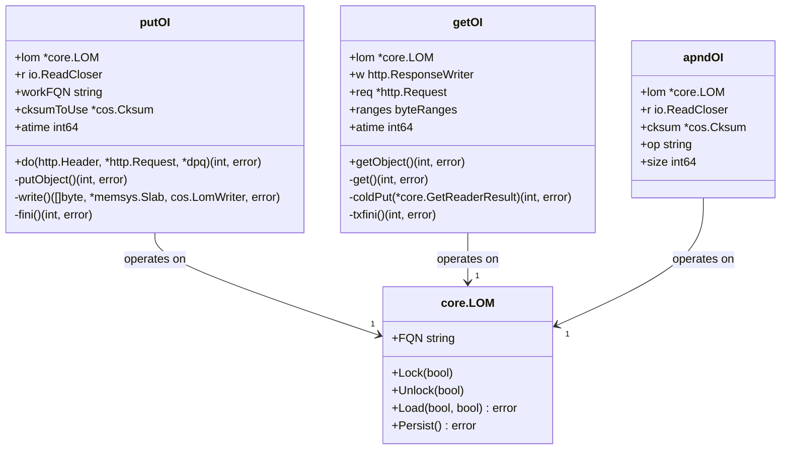

Sources: [ais/tgtobj.go:50-140](), [core/target.go:27-69]()

## PUT Operations

The PUT operation stores objects in AIStore. It handles everything from simple file writes to complex operations involving checksums, compression, and distribution across the cluster.

### PUT Flow

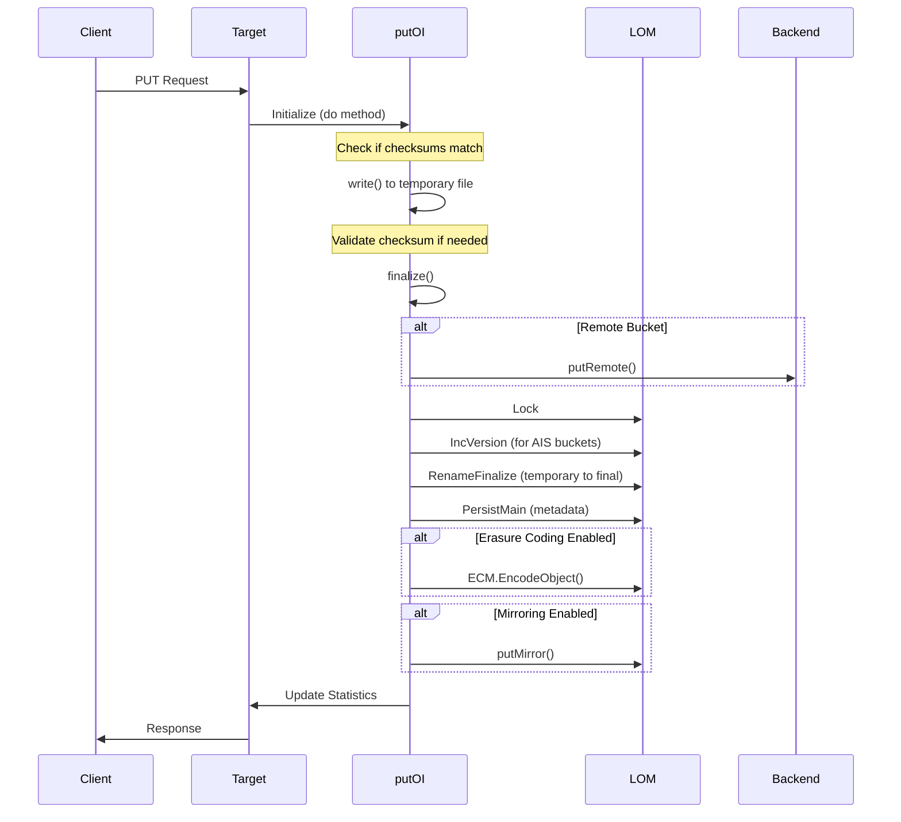

The PUT operation follows these steps:

1. A PUT request is received and the `putOI` structure is initialized
2. The object is written to a temporary file with optional checksum validation
3. For remote buckets, the object is sent to the backend provider
4. The object is finalized by:
   - Locking the LOM (Lock Object Metadata)
   - Handling version control for AIS buckets
   - Renaming from temporary to final location
   - Persisting metadata
5. Optional erasure coding and mirroring are performed
6. Statistics are updated and a response is sent

Sources: [ais/tgtobj.go:142-579]()

### Error Handling in PUT

The PUT operation includes comprehensive error handling for:
- Checksum validation
- Filesystem errors
- Backend errors for remote buckets
- Space constraints
- Concurrent access conflicts

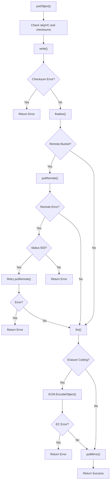

Sources: [ais/tgtobj.go:178-246](), [cmn/err.go:500-520]()

## GET Operations

The GET operation retrieves objects from AIStore. It supports retrieving objects from local storage, other nodes in the cluster, and remote backends.

### GET Flow

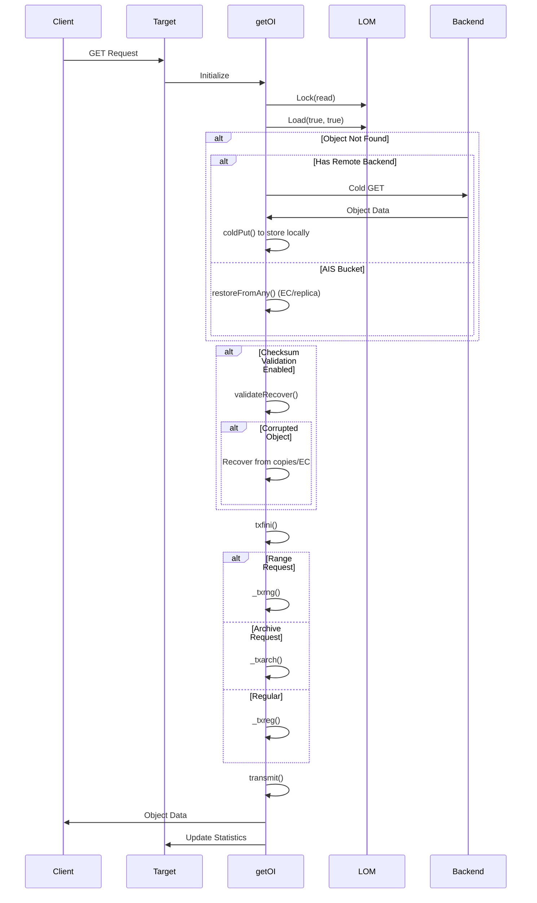

The GET operation follows these steps:

1. A GET request is received and the `getOI` structure is initialized
2. The LOM is read-locked and loaded
3. If the object is not found:
   - For remote buckets, a cold GET is performed from the backend
   - For AIS buckets, restoration from alternate sources is attempted
4. If checksum validation is enabled, the object integrity is checked
5. The object is transmitted based on the request type:
   - Regular retrieval
   - Range requests for partial objects
   - Archive extraction for specific files
6. Statistics are updated and a response is sent

Sources: [ais/tgtobj.go:584-1269]()

### Cold GET Processing

When an object isn't found locally but exists in a remote backend, AIStore performs a "cold GET" to retrieve it:

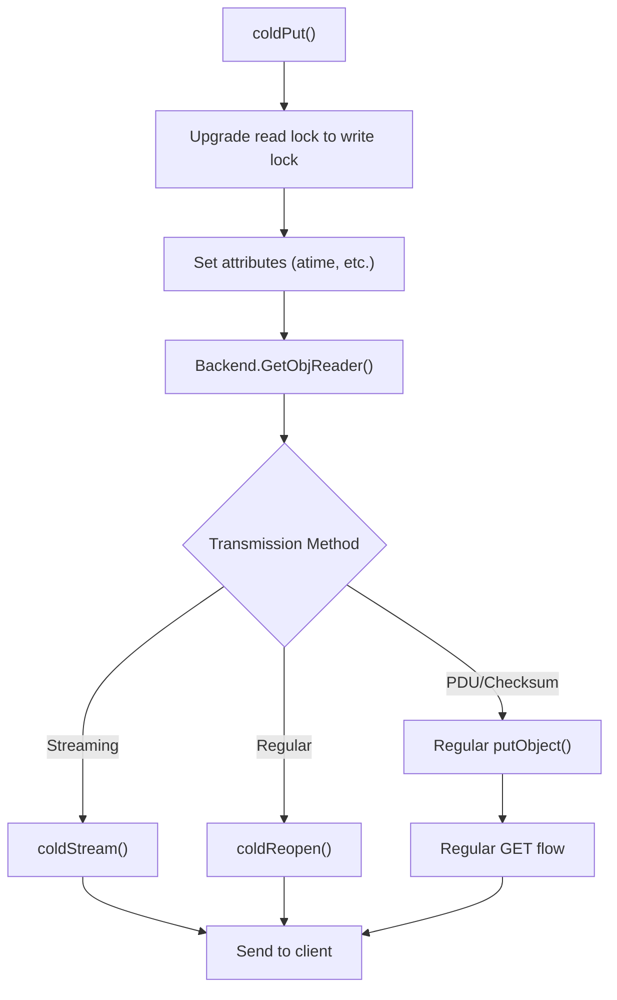

Sources: [ais/tgtobj.go:764-800]()

## APPEND Operations

APPEND operations allow adding data to existing objects or creating new ones. This is particularly useful for log files or any scenario where data accumulates over time.

### APPEND Structure and Flow

The `apndOI` structure represents an APPEND operation:

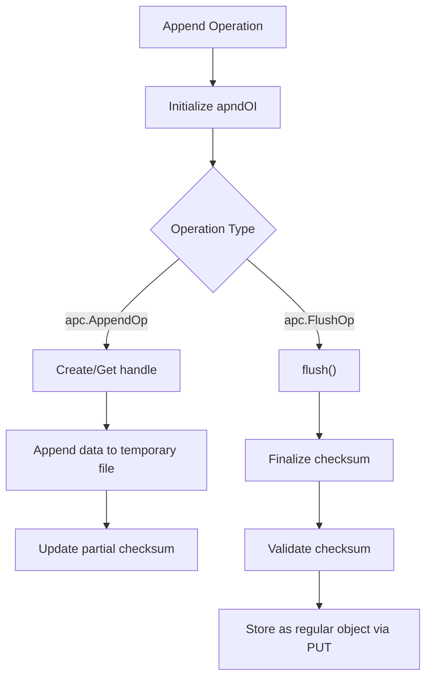

APPEND operations work in two phases:
1. **Append Phase**: Data is appended to a temporary file with a handle
2. **Flush Phase**: The temporary file is finalized and stored as a regular object

Sources: [ais/tgtobj.go:99-116]()

## COPY Operations

COPY operations duplicate objects within or across buckets. This can involve transferring data between targets or transforming objects during the copy process.

### COPY Flow

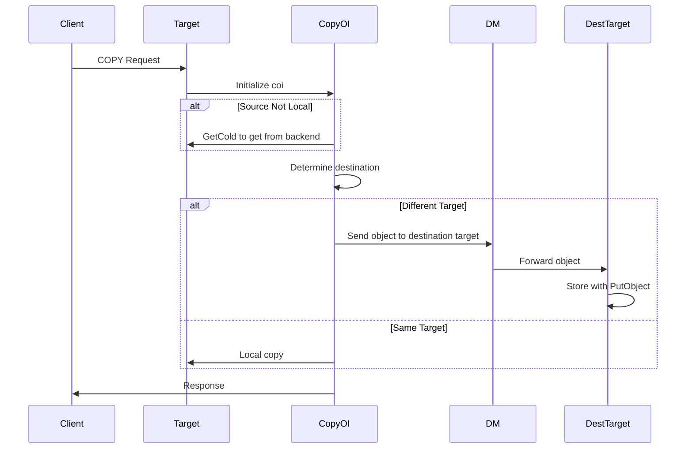

COPY operations handle several scenarios:
- Copying within the same bucket
- Copying between different buckets
- Copying between targets (using the Data Mover)
- Copying from remote backends

Sources: [ais/tgtimpl.go:114-117]()

## Transport Layer

The transport layer is responsible for moving data between nodes in the AIStore cluster. It provides reliable, efficient data transfer with features like streaming, chunking, and compression.

### Transport Architecture

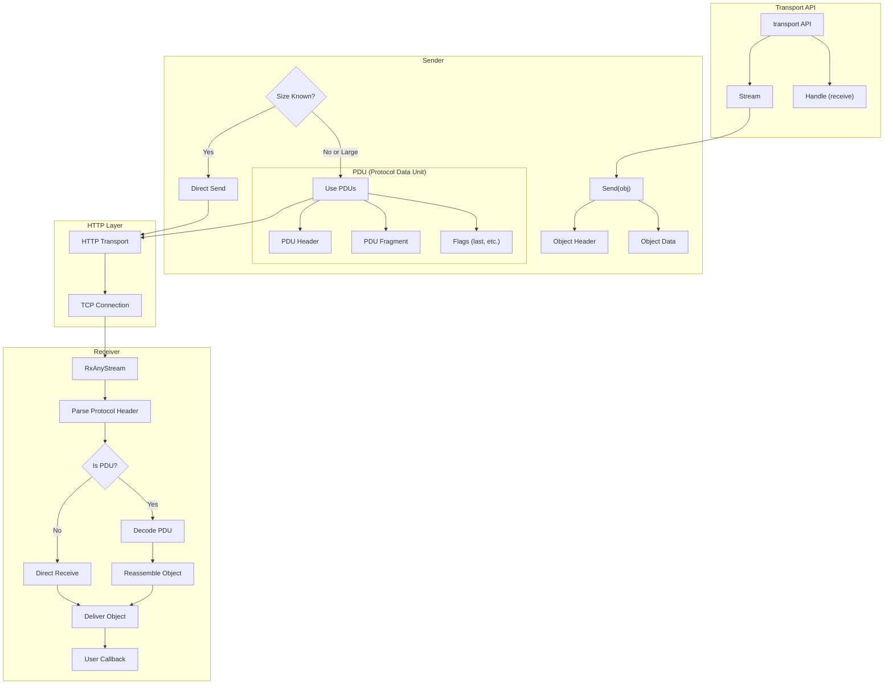

The transport layer has these key components:

1. **Stream**: Handles sending objects to a destination
2. **Object**: Contains a header and data
3. **PDU (Protocol Data Unit)**: Used for breaking large objects into smaller chunks
4. **Receiver**: Processes incoming objects and delivers them to callbacks

Sources: [transport/api.go:1-50](), [transport/recv.go:1-100](), [transport/sendobj.go:1-100]()

### Object Streaming

Objects are sent asynchronously through streams, which provides several benefits:
- Multiple objects can be sent over a single HTTP connection
- Objects are queued and sent in order
- Callbacks can be registered for send completion
- The system can handle errors and retries

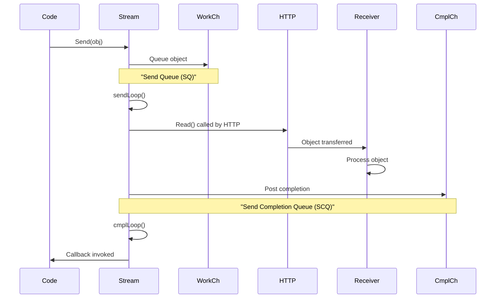

Sources: [transport/sendobj.go:147-179](), [transport/README.md:42-54]()

### PDU-Based Transfer

When objects are large or of unknown size, they're broken into Protocol Data Units (PDUs):

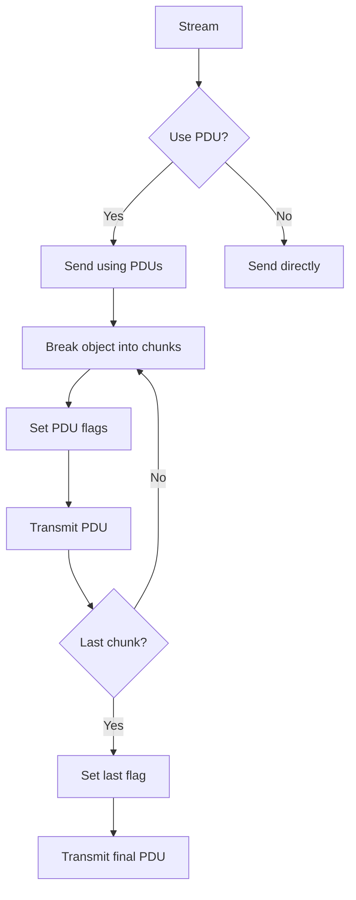

PDUs allow efficient handling of:
- Large objects that exceed memory limits
- Objects of unknown size (streamed content)
- Objects that are generated on-the-fly

Sources: [transport/pdu.go:1-80](), [transport/README.md:109-125]()

## Data Mover

The Data Mover (DM) orchestrates data transfers between target nodes in the cluster, providing a higher-level abstraction above the transport layer.

### Data Mover Architecture

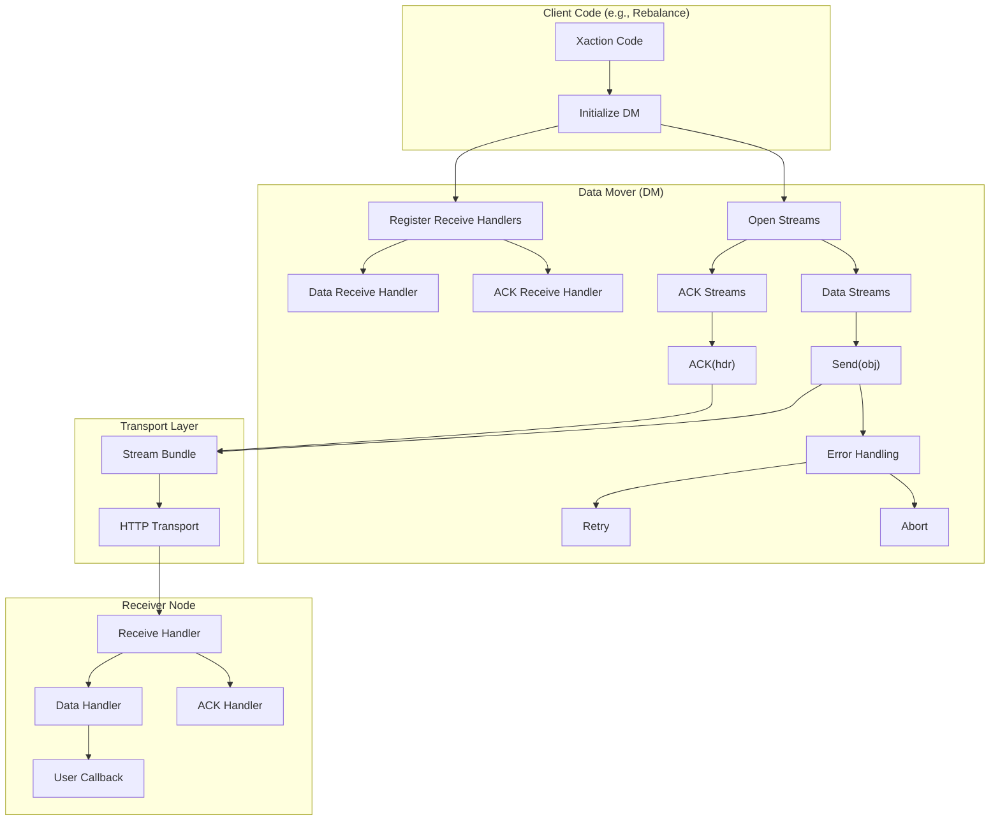

The Data Mover provides:
1. **Stream Bundle Management**: Creates and manages streams to multiple target nodes
2. **Send/Receive Registration**: Registers handlers for receiving data and acknowledgments
3. **Coordinated Data Transfer**: Sends objects to specific targets or broadcasts to all targets
4. **ACK System**: Enables acknowledgments for reliable data transfer
5. **Error Handling**: Manages retries and aborts on failure

Sources: [transport/bundle/dmover.go:1-100](), [transport/bundle/dmover.go:179-225](), [transport/stream_bundle_test.go:1-50]()

### DM Lifecycle

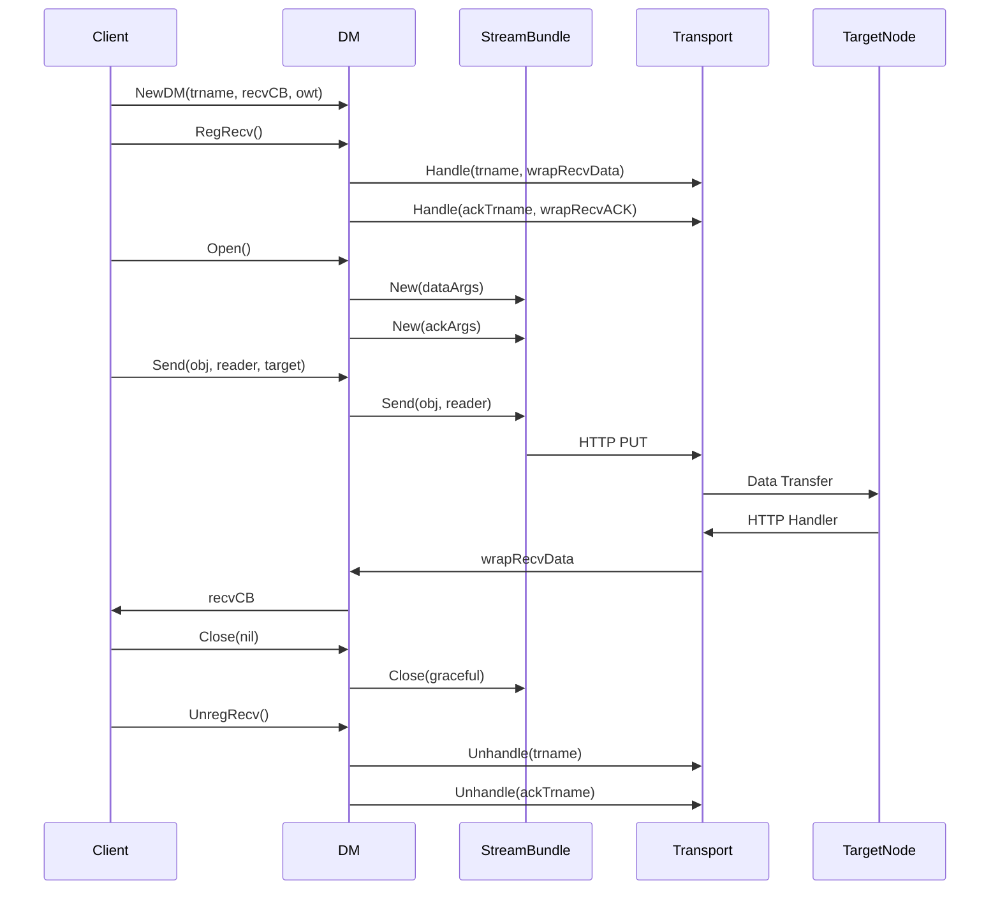

The Data Mover lifecycle involves:
1. Creation with `NewDM`
2. Registration of receive handlers with `RegRecv`
3. Opening streams with `Open`
4. Sending objects with `Send` or `Bcast`
5. Closing streams with `Close`
6. Unregistering handlers with `UnregRecv`

Sources: [transport/bundle/dmover.go:68-176](), [transport/bundle/dmover.go:266-314]()

## Conclusion

Data operations are at the core of AIStore's functionality, providing the mechanisms for storing, retrieving, and moving data across the cluster. The system's architecture balances performance, reliability, and flexibility through:

1. **Core Object Operations**: PUT, GET, APPEND, and COPY operations that handle the fundamental data management tasks
2. **Transport Layer**: Efficient data movement between nodes using streams, PDUs, and compression
3. **Data Mover**: Orchestration of complex data transfers with reliability and error handling

Together, these components create a robust distributed storage system capable of handling diverse workloads and storage requirements.

Sources: [ais/tgtobj.go](), [transport/api.go](), [transport/bundle/dmover.go]()

---

