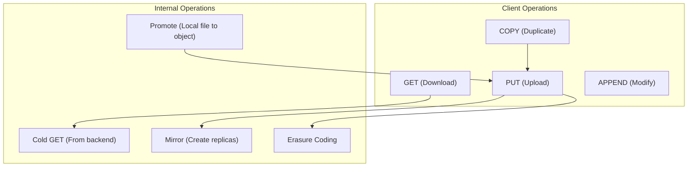
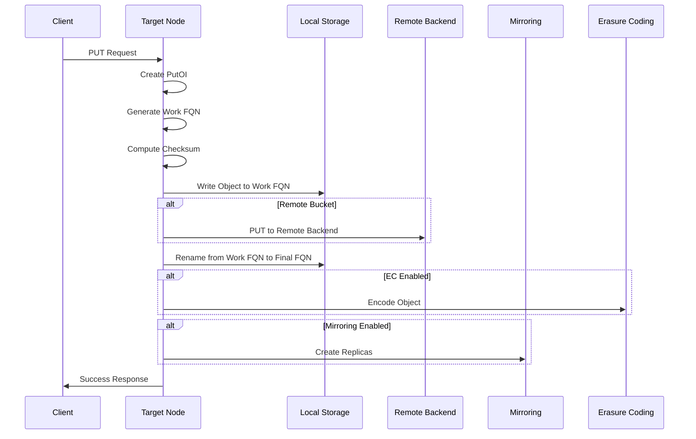
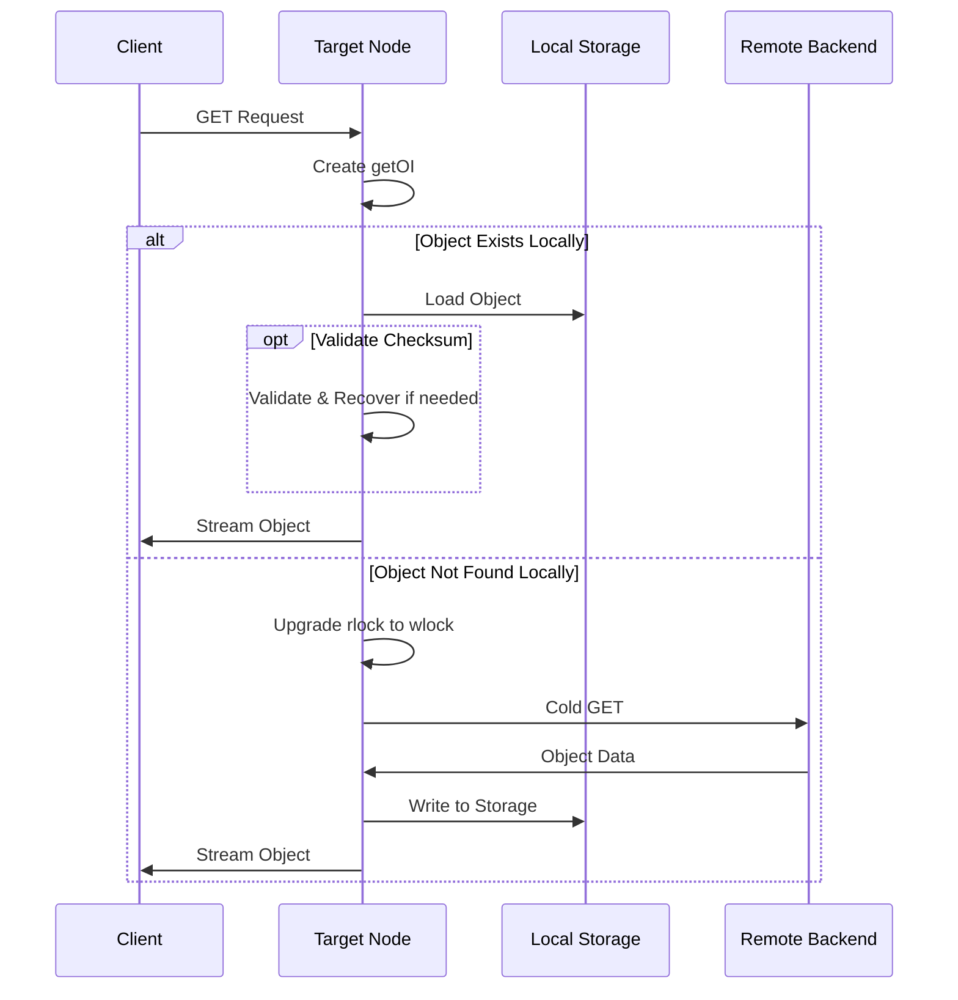
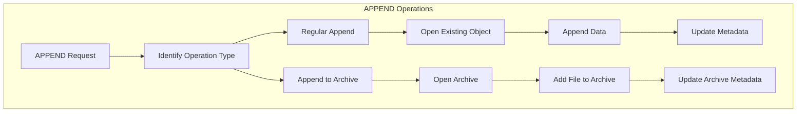
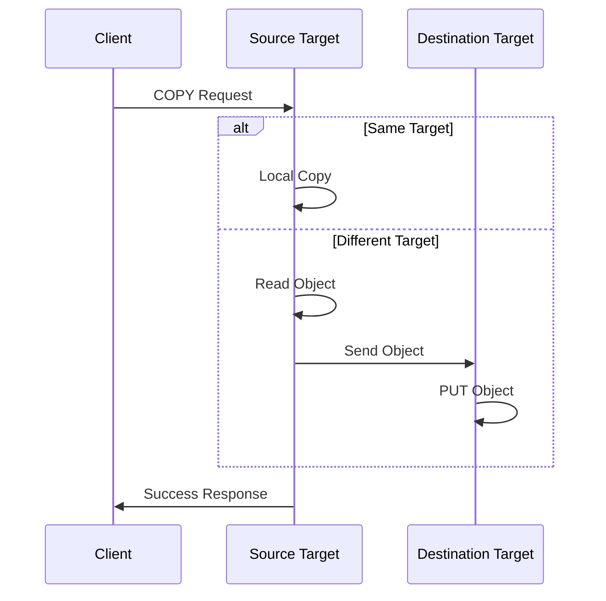
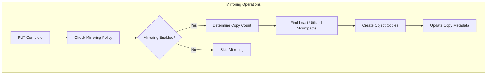

<!-- source: DeepWiki mcp.deepwiki.com · repo NVIDIA/aistore · page 3.1 Object Operations · fetched 2026-10-26 -->

# Object Operations

Relevant source files

The following files were used as context for generating this wiki page:

- [ais/tgtimpl.go](ais/tgtimpl.go)
- [ais/tgtobj.go](ais/tgtobj.go)
- [cmn/err.go](cmn/err.go)
- [cmn/owt.go](cmn/owt.go)
- [core/mock/target_mock.go](core/mock/target_mock.go)
- [core/target.go](core/target.go)
- [mirror/utils.go](mirror/utils.go)
- [mirror/utils_test.go](mirror/utils_test.go)

This page documents the core object operations in AIStore, including PUT, GET, APPEND, and COPY operations. It explains how data flows through the system during these operations and outlines the key components and mechanisms involved. For information about the transport layer used for these operations, see [Transport Layer](#3.2).

## Overview of Object Operations

AIStore supports several fundamental object operations that allow clients to interact with data stored in the cluster:

Sources: [ais/tgtobj.go:46-140](), [core/target.go:26-114]()

## Object Write Transactions (OWT)

AIStore uses Object Write Transactions (OWT) to control different aspects of creating and modifying objects in the cluster. OWT types determine locking strategies, handling of remote objects, and other behavioral aspects of operations.

### OWT Types

| OWT Type | Description | Use Case |
|----------|-------------|----------|
| OwtPut | Standard PUT operation | Client uploading an object |
| OwtPromote | Promote local files to AIS objects | Ingesting existing files |
| OwtArchive | Multi-object archive operations | Working with TAR files |
| OwtTransform | ETL transformed objects | Data processing pipelines |
| OwtCopy | Copy objects within cluster | Duplicating objects |
| OwtRebalance | Move objects during rebalance | Cluster maintenance |
| OwtGetTryLock | Try lock for cold GET | Concurrent object access |
| OwtGetLock | Exclusive lock for cold GET | Ensuring consistency |
| OwtGet | Regular GET with lock upgrading | Standard download |
| OwtGetPrefetchLock | Special lock for prefetching | Bulk prefetch operations |
| OwtCopySameBucket | Copy within same bucket | Object duplication |

Sources: [cmn/owt.go:1-83]()

## PUT Operation

The PUT operation stores objects in the AIS cluster. It handles both client uploads and internal operations like cold GET (which retrieves objects from remote backends).

### PUT Flow

Sources: [ais/tgtobj.go:147-246](), [ais/tgtobj.go:314-429](), [ais/tgtimpl.go:38-69]()

### PUT Implementation Details

The core of the PUT operation is implemented in the `putOI` (PUT Object Info) struct and its methods. The process includes:

1. **Initialization**: Set up the PUT operation with target, LOM (Local Object Metadata), work file path, etc.
2. **Writing**: Copy data from the source to a temporary work file with optional checksum validation
3. **Finalization**: For remote buckets, PUT to the backend, then rename from work path to final path
4. **Post-Processing**: Apply erasure coding and mirroring policies

Key methods:
- `do()`: Entry point for restful PUT requests
- `putObject()`: Main logic for putting an object
- `write()`: Write object data with checksum computation
- `finalize()`: Complete the PUT operation including remote backend operations

Sources: [ais/tgtobj.go:147-246](), [ais/tgtobj.go:314-429](), [ais/tgtobj.go:460-542]()

## GET Operation

The GET operation retrieves objects from the AIS cluster. It handles both warm GETs (retrieving from local storage) and cold GETs (retrieving from remote backends).

### GET Flow

Sources: [ais/tgtobj.go:584-1302]()

### GET Implementation Details

The GET operation is implemented through the `getOI` (GET Object Info) struct and its methods. The process includes:

1. **Initialization**: Set up the GET operation with target, LOM, etc.
2. **Load**: Attempt to load the object locally
3. **Validation**: Optionally validate checksums and recover corrupted objects
4. **Cold GET**: If not found locally, retrieve from remote backend
5. **Streaming**: Return the object data to the client

Key methods:
- `getObject()`: Entry point for GET requests
- `get()`: Main logic for getting an object
- `validateRecover()`: Validate and attempt to recover corrupted objects
- `coldPut()`: Write object from remote backend to local storage
- `txfini()`: Transmit the object data back to the client

Sources: [ais/tgtobj.go:584-799](), [ais/tgtobj.go:800-1020](), [ais/tgtobj.go:1021-1219]()

## APPEND Operation

The APPEND operation allows adding data to existing objects. AIStore supports two types of append operations:

1. **Regular append**: Appending data to a file
2. **Append to archive**: Adding files to an archive (like TAR)

### APPEND Flow

Sources: [ais/tgtobj.go:99-115](), [ais/tgtobj.go:129-139]()

## COPY Operation

The COPY operation creates duplicates of objects within the cluster. It can copy objects between different buckets or within the same bucket, potentially with different names.

### COPY Flow

Sources: [ais/tgtobj.go:117-127](), [ais/tgtimpl.go:114-118]()

## Mirroring and Replication

AIStore supports local mirroring to create and maintain multiple copies of objects within the cluster for increased availability and durability.

### Mirroring Process

Sources: [mirror/utils.go:1-88](), [mirror/utils_test.go:1-147]()

### Mirroring Implementation

The mirroring system:
1. Determines the number of copies needed based on bucket properties
2. Selects mountpaths with the lowest utilization for balanced distribution
3. Creates copies of objects on different mountpaths
4. Maintains metadata linking the original object with its copies

Key functions:
- `addCopies()`: Creates additional copies up to the configured limit
- `delCopies()`: Removes excess copies when configuration changes
- `putMirror()`: Called after a successful PUT to trigger mirroring

Sources: [mirror/utils.go:48-77](), [ais/tgtobj.go:340]()

## Cold Operations

Cold operations involve interaction with remote backend storage (like AWS S3, Google Cloud Storage, etc.). AIStore supports several cold operations:

### Cold GET

Cold GET retrieves objects from remote backends when they're not found locally. The process:

1. Upgrade read lock to write lock on the object
2. Retrieve the object from the remote backend
3. Store locally and serve to the client
4. Maintain cached copy for future requests

Implementation in `getOI.coldPut()` method handles the core of this functionality.

Sources: [ais/tgtobj.go:764-800](), [ais/tgtimpl.go:119-160]()

### Cold PUT

When objects are PUT to a remote bucket, AIStore:

1. First writes the object locally
2. Then sends it to the remote backend
3. Updates metadata with remote source information

Implementation in `putOI.putRemote()` method.

Sources: [ais/tgtobj.go:432-458]()

## Error Handling

AIStore implements comprehensive error handling for object operations, including:

1. Checksum validation failures
2. Remote backend errors
3. Filesystem errors
4. Capacity exceeded errors

Common error types include:

| Error Type | Description |
|------------|-------------|
| ErrCapExceeded | Storage capacity limits exceeded |
| ErrInvalidCksum | Checksum validation failed |
| ErrMpathNotFound | Mountpath not found or disabled |
| ErrBckNotFound | Bucket does not exist |
| ErrRemoteBckNotFound | Remote bucket not found |
| ErrFailedTo | Generic operation failure |

Sources: [cmn/err.go:69-205](), [cmn/err.go:489-520]()

## Conclusion

Object operations form the core functionality of the AIStore system. The implementation balances performance, reliability, and consistency through careful locking strategies, efficient data flow, and integration with various backends. The architecture provides high flexibility while maintaining robustness and scalability.

---

