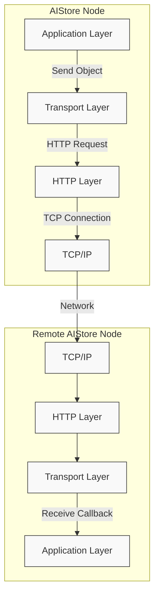
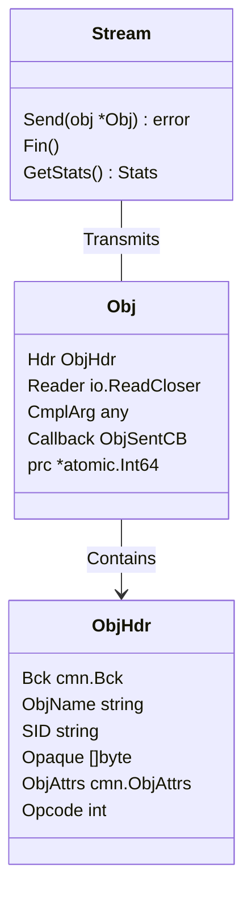
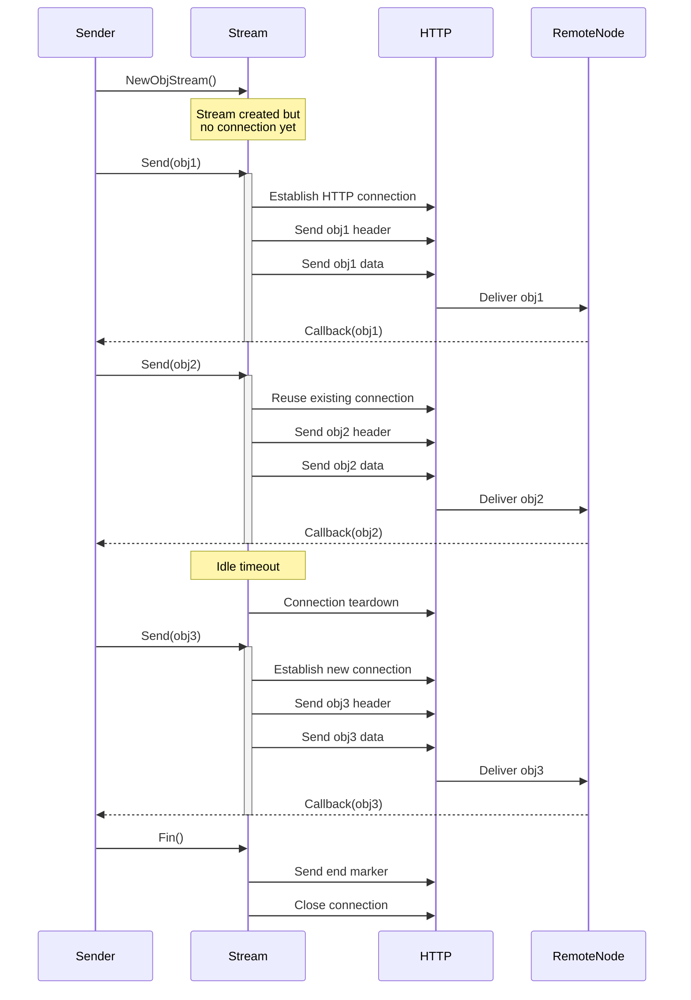
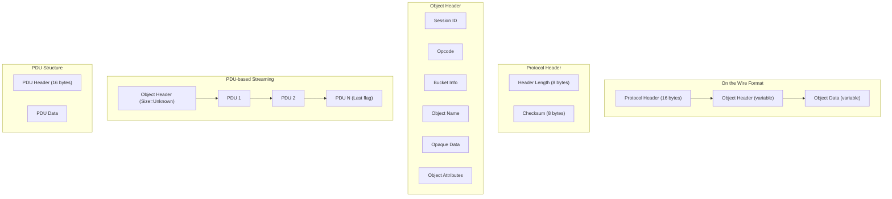
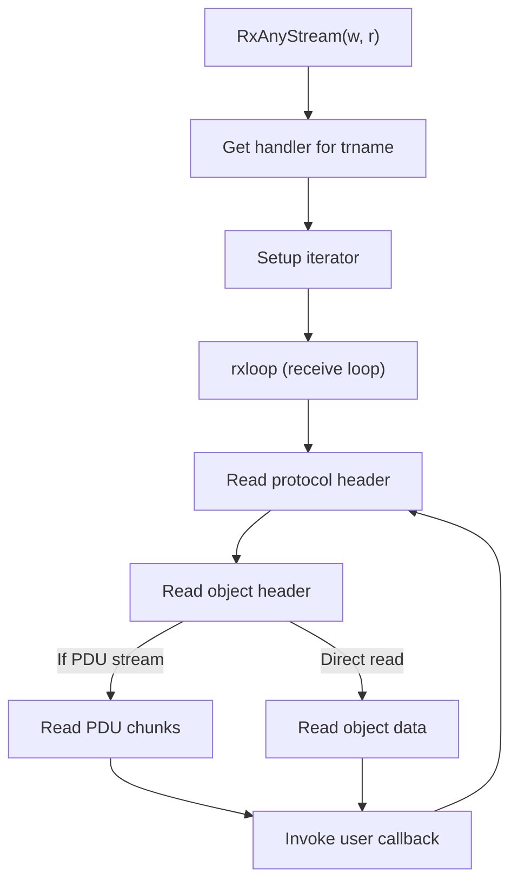
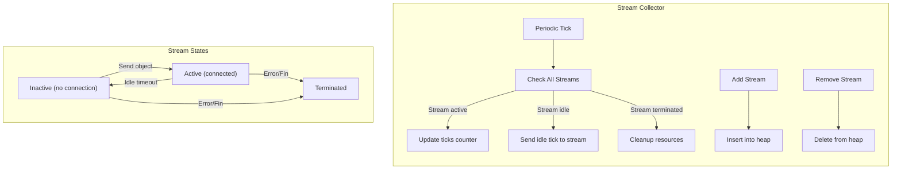
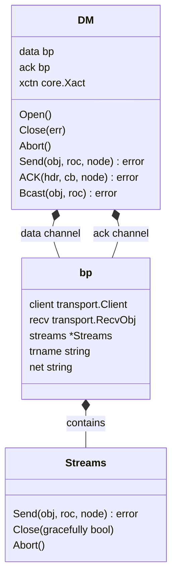
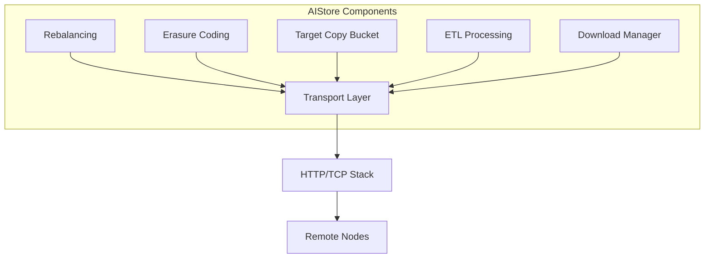

<!-- source: DeepWiki mcp.deepwiki.com · repo NVIDIA/aistore · page 3.2 Transport Layer · fetched 2026-10-26 -->

# Transport Layer

<details>
<summary>Relevant source files</summary>

The following files were used as context for generating this wiki page:

- [transport/README.md](transport/README.md)
- [transport/api.go](transport/api.go)
- [transport/base.go](transport/base.go)
- [transport/bundle/dmover.go](transport/bundle/dmover.go)
- [transport/collect.go](transport/collect.go)
- [transport/header.go](transport/header.go)
- [transport/obj_test.go](transport/obj_test.go)
- [transport/pdu.go](transport/pdu.go)
- [transport/recv.go](transport/recv.go)
- [transport/sendobj.go](transport/sendobj.go)
- [transport/stream_bundle_test.go](transport/stream_bundle_test.go)

</details>


This page describes AIStore's transport layer, which provides long-lived HTTP/TCP connections for efficient intra-cluster communications. The transport layer enables reliable, high-performance streaming of objects between nodes with features such as compression, Protocol Data Units (PDUs), and connection management.

## Overview

The transport layer in AIStore provides a system for establishing and maintaining streams of objects between nodes in the cluster. It's designed for high-throughput, long-lived connections that efficiently transmit multiple objects over a single HTTP connection.

Key capabilities include:
- Streaming multiple objects over a single HTTP/TCP connection
- Efficient protocol with minimal overhead
- Automatic connection reestablishment after idle periods
- Buffered asynchronous sending with backpressure control
- Compression support
- Protocol Data Units (PDUs) for streaming objects of unknown size
- Ordered delivery and completion notifications
- Stream bundling for multicast/broadcast operations



Sources: [transport/README.md:1-5](), [transport/api.go:1-20]()

## Key Concepts

### Objects and Headers

The fundamental unit of transfer in the transport layer is an **object**, consisting of:

1. **Object Header (`ObjHdr`)**: Contains metadata including:
   - Bucket information
   - Object name
   - Object size
   - Custom metadata
   - Optional opaque data for control information
   
2. **Object Data**: The actual content of the object, accessible via an `io.Reader` interface



Sources: [transport/api.go:66-81](), [transport/header.go:233-241]()

### Streams

A **Stream** establishes a long-lived connection between two nodes to transfer objects. Key characteristics include:

- Maintains a single HTTP connection for multiple object transfers
- Preserves send order (FIFO)
- Supports send completion callbacks
- Automatically handles connection teardown after idle periods
- Supports compression
- Provides statistics about transferred objects



Sources: [transport/sendobj.go:23-45](), [transport/api.go:109-133]()

## Stream Creation and Usage

Creating and using a stream involves:

1. **Creating a Stream**: Using `NewObjStream` with a client, URL, and optional settings
2. **Sending Objects**: Using `Stream.Send()` with appropriate headers and readers
3. **Finalizing**: Using `Stream.Fin()` to gracefully close the stream

Example sequence:
```
1. httpClient := transport.NewIntraDataClient()
2. stream := transport.NewObjStream(httpClient, serverURL, nodeID, &extra)
3. stream.Send(&obj)
4. ...
5. stream.Fin()
```

### Stream Configuration

Streams can be configured using the `Extra` structure, which includes options for:

- Compression
- Idle teardown timeout
- Channel burst size (for backpressure control)
- PDU size for chunked transfers
- Custom completion callbacks

Sources: [transport/api.go:48-59](), [transport/base.go:97-154]()

## Transport Protocol

The transport protocol encodes objects as follows:

1. **Protocol Header** (16 bytes)
   - Header length (8 bytes)
   - Checksum (8 bytes)

2. **Object Header** (variable length)
   - Serialized fields from `ObjHdr`
   - Bucket, object name, attributes, etc.

3. **Object Data** (variable length)
   - Raw object content

For PDU-based transfers (used for objects of unknown size), data is sent in chunks:

1. Object header with `Size = SizeUnknown` flag
2. Series of PDUs containing data chunks
3. Final PDU with last chunk flag



Sources: [transport/header.go:30-41](), [transport/header.go:39-121](), [transport/pdu.go:17-34]()

## Receiving Objects

On the receiving side, objects are processed using registered callbacks. The process involves:

1. **Registering a Callback**: Using `transport.Handle(trname, callback)`
2. **Processing Received Objects**: The callback is invoked for each received object
3. **Handling Errors**: The callback must handle errors appropriately

The callback has the signature:
```go
type RecvObj func(hdr *ObjHdr, objReader io.Reader, err error) error
```



Sources: [transport/recv.go:88-145](), [transport/recv.go:178-190]()

## Stream Management

Streams are managed by a **Stream Collector** that handles lifecycle, cleanup, and idle detection:

1. **Activation/Deactivation**: Controls stream state transitions
2. **Idle Detection**: Tracks idle time and terminates connections when needed
3. **Cleanup**: Frees resources after stream termination



Sources: [transport/collect.go:24-39](), [transport/collect.go:162-202]()

## Stream Bundle

The transport layer includes **Stream Bundle** functionality for managing multiple streams as a group:

1. **Broadcast/Multicast**: Send objects to multiple destinations
2. **Connection Management**: Establish and maintain connections to multiple nodes
3. **Automatic Reconnection**: Handle node additions/removals automatically

The Data Mover (`DM`) provides higher-level cluster operations using stream bundles:



Sources: [transport/bundle/dmover.go:26-65](), [transport/bundle/dmover.go:181-207]()

## Advanced Features

### Compression

The transport layer supports LZ4 compression for efficient data transfer:

- Configured via the `Extra.Compression` field
- Compresses data blocks before transmission
- Automatically decompresses on the receiving side
- Provides compression ratio statistics

### Protocol Data Units (PDUs)

PDUs enable handling objects of unknown size:

- Objects marked with `Size = SizeUnknown` use PDU streaming
- Data is sent in chunks with explicit markers
- Efficient for streaming data without knowing total size upfront
- Final PDU marked with a special flag

Sources: [transport/sendobj.go:419-463](), [transport/pdu.go:56-87](), [transport/pdu.go:89-138]()

## Performance Considerations

The transport layer is optimized for high-performance data transfer:

- **Long-lived connections**: Reduce connection establishment overhead
- **Header pooling**: Reuse memory buffers for headers
- **Asynchronous operation**: Non-blocking sends with completion callbacks
- **Backpressure control**: Prevent overwhelming receivers
- **Efficient wire protocol**: Minimal overhead per object
- **Connection management**: Automatic teardown of idle connections
- **Compression**: Reduce network bandwidth usage

Sources: [transport/README.md:42-56](), [transport/obj_test.go:461-472]()

## Integration with AIStore

The transport layer integrates with other AIStore components:

- Used by the rebalancing system for redistributing objects between targets
- Powers distributed operations like bucket copying and erasure coding
- Enables ETL (Extract, Transform, Load) data processing pipelines
- Provides foundation for cluster-wide data transfers



Sources: [transport/README.md:187-195]()

---

