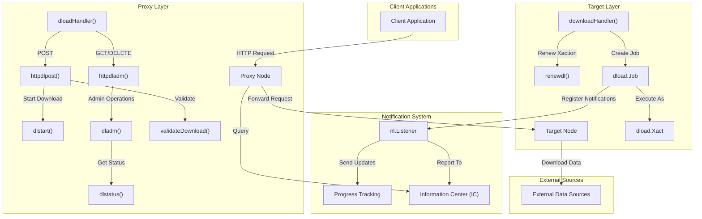
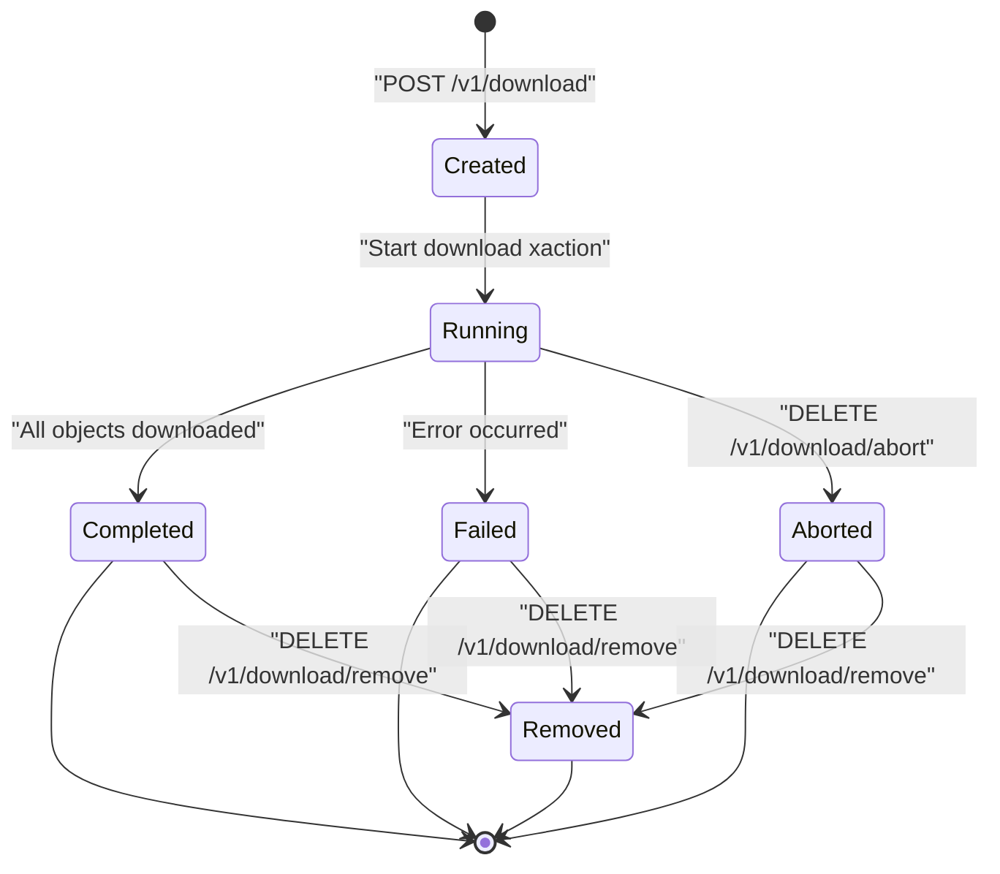
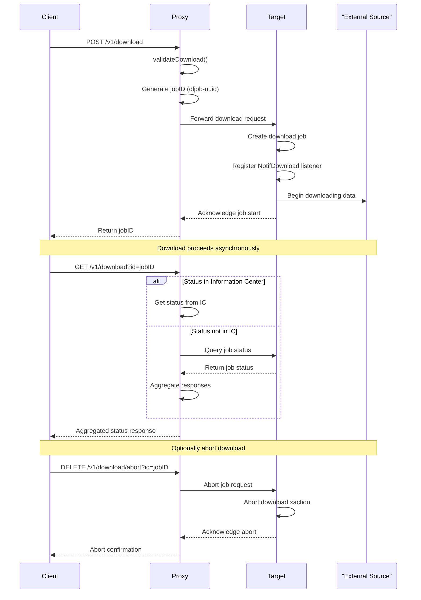

<!-- source: DeepWiki mcp.deepwiki.com · repo NVIDIA/aistore · page 3.3 Download System · fetched 2026-10-26 -->

# Download System

Relevant source files

The following files were used as context for generating this wiki page:

- [ais/prxdl.go](ais/prxdl.go)
- [ais/tgtdl.go](ais/tgtdl.go)

## Purpose and Scope

The Download System is a core component of AIStore that enables downloading objects from external sources (URLs) into AIStore buckets. This document covers the architecture, API, and implementation details of the download system, focusing on how it manages and executes download operations across the AIStore cluster. For information about object operations (GET, PUT, DELETE), see [Object Operations](#3.1).

## Architecture Overview

The Download System is implemented as a distributed operation spanning both proxy and target nodes in the AIStore cluster. It uses AIStore's extended actions (xactions) framework to manage asynchronous, long-running download operations.

Sources: [ais/prxdl.go](), [ais/tgtdl.go]()

## API Endpoints

The Download System exposes the following REST API endpoints:

| Method | Endpoint | Description |
|--------|----------|-------------|
| POST | /v1/download | Start a new download job |
| GET | /v1/download | Get status of download jobs |
| DELETE | /v1/download/{abort,remove} | Abort or remove a download job |

Sources: [ais/prxdl.go:26-39](), [ais/tgtdl.go:30-202]()

## Download Job Lifecycle

Sources: [ais/prxdl.go:82-132](), [ais/tgtdl.go:41-180]()

## Request Flow

The following diagram illustrates the flow of a download request through the system:

Sources: [ais/prxdl.go:41-300](), [ais/tgtdl.go:30-211]()

## Implementation Details

### Proxy-side Implementation

The proxy node acts as the central coordinator for download operations:

1. **Request Handling**: `dloadHandler()` routes download requests based on HTTP method
2. **Download Initiation**: `httpdlpost()` validates requests, generates job IDs, and initiates downloads
3. **Status Management**: `httpdladm()` and `dladm()` handle status queries and job management
4. **Status Aggregation**: `dlstatus()` aggregates status responses from all targets
5. **Request Validation**: `validateDownload()` validates download requests and bucket permissions

Each download job is assigned a unique ID prefixed with "dljob-" to differentiate it from xaction IDs.

Sources: [ais/prxdl.go:26-39](), [ais/prxdl.go:82-132](), [ais/prxdl.go:41-80]()

### Target-side Implementation

Target nodes perform the actual download operations:

1. **Download Execution**: `downloadHandler()` processes download requests and executes downloads
2. **Xaction Management**: `renewdl()` renews download xactions for management operations
3. **Job Creation**: Creates and manages download jobs using the `dload` package
4. **Progress Reporting**: Sends progress updates via notification listeners

Downloads are executed as extended actions (xactions) to provide asynchronous operation and manageable lifecycle.

Sources: [ais/tgtdl.go:30-202](), [ais/tgtdl.go:204-211]()

## Monitoring and Progress Tracking

The Download System provides comprehensive monitoring capabilities:

1. **Progress Notifications**: Download progress is reported at configurable intervals (specified in the download request or defaulting to `dload.DownloadProgressInterval`)
2. **Status Queries**: Clients can query download status using GET requests
3. **Job Filtering**: Jobs can be filtered by ID, regular expression, or active status
4. **Information Center Integration**: Status updates are available through AIStore's Information Center

### Status Information

Status queries return detailed information including:
- Job metadata (ID, description)
- Progress metrics (downloaded objects, total size)
- Current state (running, completed, failed, aborted)
- Error details (if applicable)

Sources: [ais/prxdl.go:232-255](), [ais/tgtdl.go:30-202]()

## Download Types

The Download System supports multiple download types:

1. **Single**: Download a single file from a URL
2. **Range**: Download a range of sequentially numbered files
3. **List**: Download multiple files specified in a list

The download type is specified in the download request body.

Sources: [ais/prxdl.go:282-300](), [ais/tgtdl.go:63-77]()

## Error Handling

Download errors are tracked and reported through the status API. Common error types include:
- Network connectivity issues
- Authentication failures
- Invalid URL formats
- Permission issues
- Storage capacity limitations

Errors are reported in the job status and can be queried using the status API.

Sources: [ais/prxdl.go:134-230](), [ais/tgtdl.go:30-202]()

## Conclusion

AIStore's Download System provides a robust, distributed solution for downloading objects from external sources into AIStore buckets. By leveraging AIStore's xaction framework and notification system, it offers reliable, asynchronous download operations with comprehensive monitoring and management capabilities.

---

