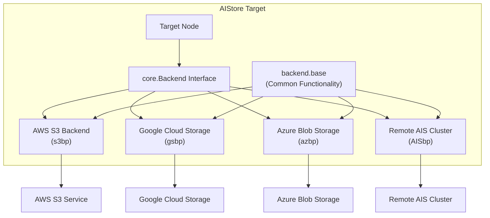
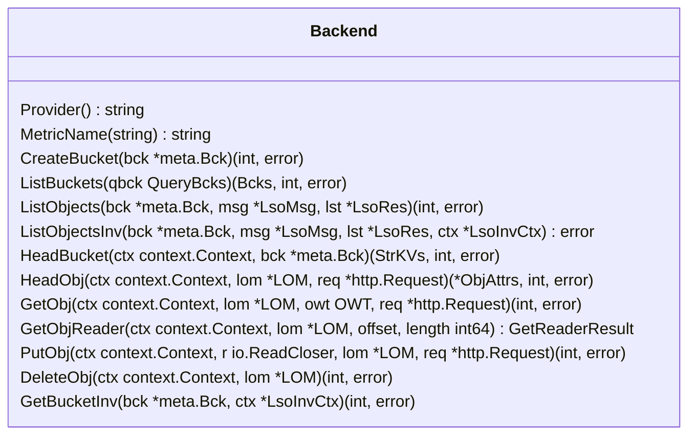
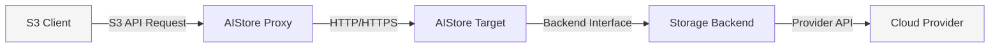
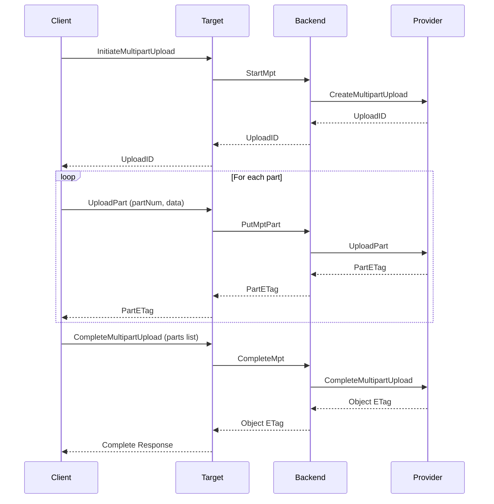
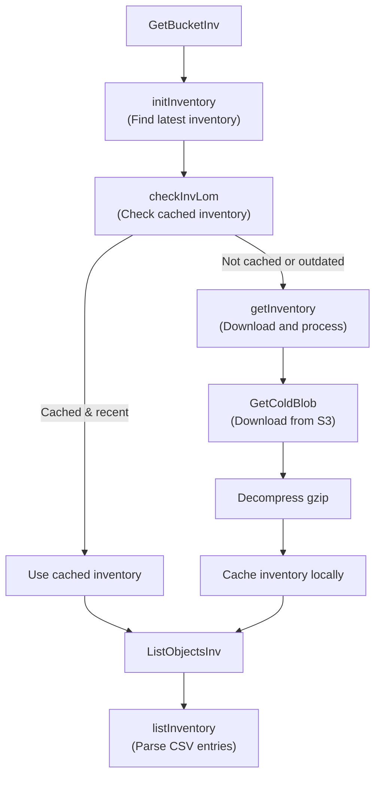

<!-- source: DeepWiki mcp.deepwiki.com · repo NVIDIA/aistore · page 4 Storage Backends · fetched 2026-10-26 -->

# Storage Backends

<details>
<summary>Relevant source files</summary>

The following files were used as context for generating this wiki page:

- [ais/backend/ais.go](ais/backend/ais.go)
- [ais/backend/aws.go](ais/backend/aws.go)
- [ais/backend/awsinv.go](ais/backend/awsinv.go)
- [ais/backend/awsmpt.go](ais/backend/awsmpt.go)
- [ais/backend/azure.go](ais/backend/azure.go)
- [ais/backend/common.go](ais/backend/common.go)
- [ais/backend/gcp.go](ais/backend/gcp.go)
- [ais/backend/mock_aws.go](ais/backend/mock_aws.go)
- [ais/backend/mock_azure.go](ais/backend/mock_azure.go)
- [ais/backend/mock_backend.go](ais/backend/mock_backend.go)
- [ais/backend/mock_gcp.go](ais/backend/mock_gcp.go)
- [ais/prxs3.go](ais/prxs3.go)
- [ais/s3/const.go](ais/s3/const.go)
- [ais/s3/mpt.go](ais/s3/mpt.go)
- [ais/s3/types.go](ais/s3/types.go)
- [ais/s3/xattr.go](ais/s3/xattr.go)
- [ais/tgts3.go](ais/tgts3.go)
- [ais/tgts3mpt.go](ais/tgts3mpt.go)
- [core/backend.go](core/backend.go)

</details>


This page documents the storage backend system in AIStore, which enables transparent access to various cloud storage providers. Storage backends allow AIStore to operate as both a standalone object storage system and as a caching layer in front of cloud storage services like AWS S3, Google Cloud Storage, Azure Blob Storage, and even other AIStore clusters.

For information about configuration settings related to storage backends, see [Configuration System](#2.3).

## Backend Architecture Overview

The backend system follows a plugin architecture where each storage provider implements a common interface (`core.Backend`). This design enables uniform access to various cloud providers while maintaining consistent behavior patterns throughout the codebase.



Sources: [ais/backend/aws.go]()</span>, [ais/backend/gcp.go]()</span>, [ais/backend/azure.go]()</span>, [ais/backend/ais.go]()</span>, [ais/backend/common.go]()</span>, [core/backend.go]()</span>

## Core Backend Interface

All storage backends implement the `core.Backend` interface defined in [core/backend.go:38-63](). This interface specifies common operations for interacting with cloud storage:



The key operations include:

- **Bucket operations**: `CreateBucket`, `ListBuckets`, `HeadBucket`
- **Object operations**: `GetObj`, `PutObj`, `DeleteObj`, `HeadObj`
- **Listing operations**: `ListObjects`, `ListObjectsInv`
- **Helper methods**: `Provider`, `MetricName`

Sources: [core/backend.go:38-63]()

## Supported Storage Backends

### AWS S3 Backend

The AWS S3 backend (`s3bp` struct) provides integration with Amazon S3 storage or S3-compatible services.

#### Authentication and Configuration

AWS S3 authentication uses environment variables and credential profiles:

- `AWS_ENDPOINT`: Custom S3 endpoint URL
- `AWS_PROFILE`: Profile name from AWS credentials file
- `AWS_REGION`: Default AWS region (if not specified by bucket properties)

Per-bucket configuration can be set through bucket properties:

| Property | Description |
|----------|-------------|
| `cloud_region` | AWS region for the bucket |
| `endpoint` | Custom endpoint for this bucket |
| `profile` | AWS profile to use |
| `multi_part_size` | Size of chunks for multipart uploads |

The backend maintains a pool of S3 clients based on profile, region, and endpoint combinations, allowing efficient reuse of connections:

```go
var clients sync.Map // map[string]*s3.Client
```

Each client is keyed by a combination of profile, region, and endpoint, as seen in [ais/backend/aws.go:856-874]().

Sources: [ais/backend/aws.go:44-83](), [ais/backend/aws.go:783-853]()

### Google Cloud Storage Backend

The Google Cloud Storage backend (`gsbp` struct) provides integration with Google Cloud Storage.

#### Authentication and Configuration

Google Cloud Storage authentication uses standard GCP environment variables:

- `GOOGLE_CLOUD_PROJECT`: GCP project ID
- `GOOGLE_APPLICATION_CREDENTIALS`: Path to service account credentials file

The backend creates a single shared client for all operations, following Google's recommendation:

```go
var gcpClient *storage.Client // "Clients should be reused instead of created as needed"
```

Sources: [ais/backend/gcp.go:35-61](), [ais/backend/gcp.go:93-96](), [ais/backend/gcp.go:100-122]()

### Azure Blob Storage Backend

The Azure Blob Storage backend (`azbp` struct) provides integration with Azure Blob Storage.

#### Authentication and Configuration

Azure authentication uses environment variables:

- `AZURE_STORAGE_ACCOUNT`: Azure storage account name
- `AZURE_STORAGE_KEY`: Azure storage account key
- `AIS_AZURE_URL`: Custom Azure Blob Storage endpoint (optional)
- `AIS_AZURE_PROTO`: Protocol (http/https) to use (optional)

Sources: [ais/backend/azure.go:47-56](), [ais/backend/azure.go:102-118]()

### Remote AIS Cluster Backend

The Remote AIS Cluster backend (`AISbp` struct) allows one AIStore cluster to access objects stored in another AIStore cluster.

#### Configuration and Management

Remote AIS clusters are configured through cluster configuration (using `cmn.BackendConfAIS`) and can be managed with alias names:

```go
type AISbp struct {
    t      core.TargetPut
    alias  cos.StrKVs         // alias => UUID
    remote map[string]*remAis // by UUID
    base
    appliedCfgVer int64
    mu            sync.RWMutex
}
```

Multiple remote clusters can be attached to a single AIStore deployment, and they can be referenced by either UUID or an assigned alias. The remote cluster connection is established by connecting to one of the configured URLs and retrieving the cluster's Smap (System Map).

Sources: [ais/backend/ais.go:41-66](), [ais/backend/ais.go:121-174]()

## Common Backend Operations

All backends implement standard operations defined by the `core.Backend` interface. Here are key operations:

### HeadBucket

The `HeadBucket` operation checks if a bucket exists and retrieves its properties:

```go
func (bp *backendProvider) HeadBucket(ctx context.Context, bck *meta.Bck) (bckProps cos.StrKVs, ecode int, err error)
```

This operation returns bucket properties in a standardized format (`cos.StrKVs`) that includes provider-specific metadata, such as:

- `apc.HdrBackendProvider`: The backend provider (AWS, GCP, Azure, AIS)
- `apc.HdrBucketVerEnabled`: Whether versioning is enabled
- Provider-specific attributes (region, endpoint, etc.)

Sources: [ais/backend/aws.go:93-133](), [ais/backend/gcp.go:130-149](), [ais/backend/azure.go:224-250](), [ais/backend/ais.go:413-443]()

### ListObjects

The `ListObjects` operation lists objects in a bucket with support for pagination, prefixes, and other filtering options:

```go
func (bp *backendProvider) ListObjects(bck *meta.Bck, msg *apc.LsoMsg, lst *cmn.LsoRes) (ecode int, err error)
```

Key features:
- Pagination via page size and continuation tokens
- Filtering by prefix
- Virtual directory support via the `apc.LsNoRecursion` flag
- Optional object metadata (size, checksum, version, custom attributes)

Sources: [ais/backend/aws.go:154-417](), [ais/backend/gcp.go:154-229](), [ais/backend/azure.go:259-330](), [ais/backend/ais.go:445-507]()

### GetObj and GetObjReader

The `GetObj` operation retrieves an object from the backend:

```go
func (bp *backendProvider) GetObj(ctx context.Context, lom *core.LOM, owt cmn.OWT, origReq *http.Request) (ecode int, err error)
```

This typically calls `GetObjReader` to obtain a reader for the object data, then passes the data to the target for storage:

```go
func (bp *backendProvider) GetObjReader(ctx context.Context, lom *core.LOM, offset, length int64) GetReaderResult
```

Key features:
- Range requests via offset and length parameters
- Expected checksum for validation
- Custom metadata handling
- Built-in error handling with HTTP status codes

Sources: [ais/backend/aws.go:539-625](), [ais/backend/gcp.go:318-396](), [ais/backend/azure.go:417-481](), [ais/backend/ais.go:560-626]()

### PutObj

The `PutObj` operation stores an object in the backend:

```go
func (bp *backendProvider) PutObj(ctx context.Context, r io.ReadCloser, lom *core.LOM, origReq *http.Request) (ecode int, err error)
```

Key features:
- Checksum handling
- Custom metadata support
- Versioning support where available
- Multipart upload configuration (especially for AWS S3)

Sources: [ais/backend/aws.go:656-743](), [ais/backend/gcp.go:402-435](), [ais/backend/azure.go:487-546](), [ais/backend/ais.go:630-662]()

## Special Features

### S3 Compatibility Layer

AIStore implements an S3-compatible API that allows S3 clients to interact with AIStore. This functionality spans both proxy nodes (handling routing) and target nodes (handling operations).



The implementation includes:
- **API handlers**: [ais/prxs3.go:37-157]() (proxy) and [ais/tgts3.go:31-65]() (target)
- **S3 response types**: [ais/s3/types.go:29-110]()
- **Error handling**: `WriteErr` functions in the s3 package

Sources: [ais/prxs3.go:37-797](), [ais/tgts3.go:31-399](), [ais/s3/types.go:29-243]()

### Multipart Uploads

AIStore supports S3-compatible multipart uploads for handling large objects in chunks. The flow consists of:

1. **Start Multipart Upload**: Initializes the upload and returns an upload ID
2. **Upload Parts**: Each part is uploaded individually with a part number
3. **Complete Multipart Upload**: Combines all parts into the final object



Sources: [ais/backend/awsmpt.go:29-228](), [ais/tgts3mpt.go:52-405](), [ais/s3/mpt.go:46-226]()

### Bucket Inventory

The AWS S3 backend supports bucket inventory, which provides a scheduled alternative to the LIST operation for large buckets. The implementation includes:

1. **Initialization**: Locates and validates inventory files
2. **Retrieval**: Downloads, uncompresses, and stores inventory data
3. **Listing**: Uses inventory data for efficient object listing

This feature is particularly useful for buckets with millions of objects where standard LIST operations would be inefficient.



Sources: [ais/backend/awsinv.go:83-306]()

## Metrics and Monitoring

Each backend registers metrics to track performance and usage. This is implemented in the `base` struct's `init` method, which all backends embed and call during initialization.

Key metrics include:

| Metric Category | Metrics |
|-----------------|---------|
| GET operations | Count, latency, data size |
| PUT operations | Count, latency, end-to-end latency, data size |
| HEAD operations | Count, latency |
| Version changes | Count and size of objects updated externally |

```go
// Sample metric creation
b.metrics[stats.GetCount] = prefix + "." + stats.GetCount
tr.RegExtMetric(snode,
    b.metrics[stats.GetCount],
    stats.KindCounter,
    &stats.Extra{
        Help:    "GET: total number of executed remote requests",
        StrName: "remote_get_count",
        Labels:  labels,
        VarLabs: stats.BckXlabs,
    },
)
```

Sources: [ais/backend/common.go:29-194]()

## Error Handling

Each backend implements provider-specific error handling to convert provider errors into standardized AIStore errors with appropriate HTTP status codes:

- AWS: [ais/backend/aws.go:918-987]()
- GCP: [ais/backend/gcp.go:475-522]()
- Azure: [ais/backend/azure.go:136-216]()
- RemoteAIS: [ais/backend/ais.go:94-119]()

This ensures consistent error reporting across different backends.

## Summary

The storage backend system in AIStore provides a flexible, extensible architecture for integrating with various cloud storage providers. By implementing a common interface, AIStore can present a unified API for operations across different providers, while still taking advantage of provider-specific features.

Key components include:
1. The core `Backend` interface defines common operations
2. Backend implementations for AWS S3, Google Cloud Storage, Azure Blob Storage, and Remote AIS Clusters  
3. S3-compatible API for client applications
4. Support for advanced features like multipart uploads and bucket inventory
5. Comprehensive metrics for monitoring performance and usage

This architecture allows AIStore to function both as a standalone object storage system and as a caching layer in front of existing cloud storage services.

---

